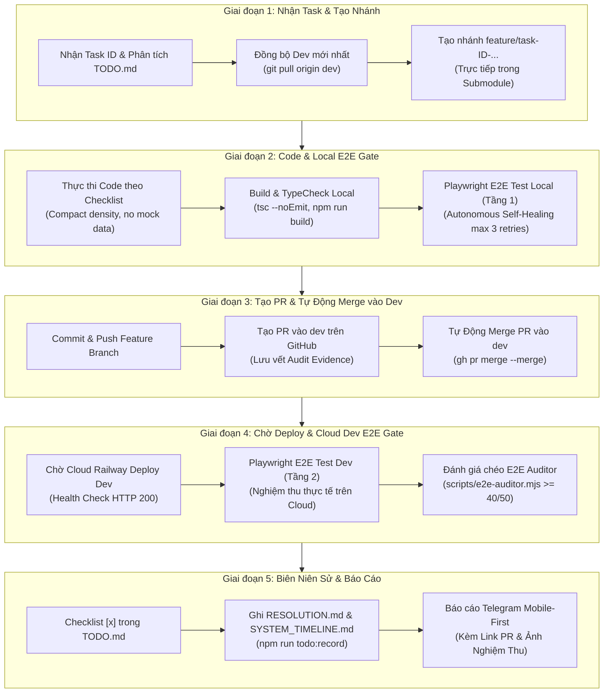

# Quy Chuẩn & Checklist Quy Trình GitHub Cho Tác Vụ (GitHub Task Lifecycle Workflow Rule)

> **Mã quy chuẩn**: `RULE-GIT-TASK-WORKFLOW-01`  
> **Trạng thái**: BẮT BUỘC (MANDATORY INVARIANT) CHO TOÀN BỘ AGENT (`/todo-agent`, `/telegram-task-responder`, `/leader`) VÀ KỸ SƯ  
> **Áp dụng cho**: Monorepo Root (`logistics-website`), Backend Submodule (`logistics-website-backend`), Frontend Submodule (`logistics-website-frontend`)

---

## 1. Mục Đích & Triết Lý Vận Hành

Quy trình này thiết lập **chuẩn mực bất biến** cho toàn bộ vòng đời xử lý một nhiệm vụ (Task / Feedback / Bugfix) trên GitHub:
1. **Tuyệt đối không code trực tiếp trên `dev` hoặc `master`**: Mọi task đều phải được cô lập trên một Feature/Fix Branch riêng biệt, được tách nhánh từ bản mới nhất của `dev`.
2. **Quy trình Kiểm định 2 Tầng (2-Tier Quality Gate)**:
   - **Tầng 1 (Local Gate)**: Kiểm thử E2E Playwright trên Local trước khi tạo PR.
   - **Tầng 2 (Cloud Dev Gate)**: Sau khi merge PR vào `dev` và deploy lên Cloud, kiểm thử E2E Playwright lần thứ 2 trực tiếp trên Domain Dev.
3. **Bằng Chứng Pháp Lý & Minh Bạch (PR Audit Trail)**: Mỗi task hoàn thành bắt buộc phải có một Pull Request / Merge Request (PR/MR) trỏ vào `dev` trên GitHub để lưu vết lịch sử, danh sách thay đổi và biên bản kiểm thử, sau đó tự động merge vào `dev`.
4. **Biên Niên Sử & Báo Cáo**: Tự động ghi chép `RESOLUTION.md`, cập nhật `docs/SYSTEM_TIMELINE.md` và gửi báo cáo chuẩn mobile-first qua Telegram kèm link PR và ảnh bằng chứng.

---

## 2. Kiến Trúc Git Submodules Cần Ghi Nhớ

Hệ thống Logistics TMS gồm **3 Git repository độc lập**:
- **Root Repository** (`d:\Projects\logistics-website`): Chứa scripts, config, tài liệu `docs/`, `feedbacks/`, và `.agents/`.
- **Backend Submodule** (`backend/`): Repo `logistics-website-backend` (NestJS 11, TypeORM, PostgreSQL).
- **Frontend Submodule** (`frontend/`): Repo `logistics-website-frontend` (Next.js 15, React 19, Tailwind CSS).

> ⚠️ **NGUYÊN TẮC CỐT LÕI**:
> - Tạo branch, commit và push **BẮT BUỘC thực hiện TRỰC TIẾP bên trong thư mục submodule tương ứng** (`backend/` và/hoặc `frontend/`).
> - Tạo branch ở root **KHÔNG** làm thay đổi branch trong `backend/` hay `frontend/`.
> - Nếu task tác động cả Fullstack, bắt buộc tạo nhánh cùng tên trên cả hai submodule.

---

## 3. Quy Ước Đặt Tên Nhánh (Branch Naming Convention)

Mọi nhánh tính năng bắt buộc phải gắn liền với `task_id` nghiệp vụ:

```bash
# Định dạng chuẩn:
<loại-nhánh>/task-<task_id>-<mô-tả-ngắn-kebab-case>

# 1. Tính năng mới / triển khai checklist chung:
feature/task-81-warehouse-outbound-pallet

# 2. Sửa lỗi / hotfix cho task cụ thể:
fix/task-80-driver-assignment-crash

# 3. Tái cấu trúc / nâng cấp kỹ thuật:
refactor/task-79-rbac-guard-optimization
```

- **Quy tắc**: Kebab-case, chữ thường, không dấu tiếng Việt, tối đa 4-5 từ mô tả bản chất kỹ thuật/nghiệp vụ.
- **Base Branch**: Bắt buộc là `dev` (sau khi đã `git checkout dev && git pull origin dev`).

---

## 4. Quy Trình 5 Giai Đoạn Chuẩn Chỉ (5-Stage Standard Pipeline)



---

### Giai Đoạn 1: Nhận Task & Khởi Tạo Branch từ `dev`

1. **Kiểm tra trạng thái kho lưu trữ**:
   ```bash
   npm run repo:status
   npm run repo:tracking
   ```
2. **Chuyển về `dev` và kéo mã nguồn mới nhất**:
   ```powershell
   # Đối với Backend (nếu sửa backend):
   git -C backend checkout dev
   git -C backend pull origin dev

   # Đối với Frontend (nếu sửa frontend):
   git -C frontend checkout dev
   git -C frontend pull origin dev

   # Đối với Root (nếu có cập nhật docs/scripts):
   git checkout dev
   git pull origin dev
   ```
3. **Tạo và chuyển sang nhánh làm việc mới**:
   ```powershell
   # Ví dụ với Task ID 81:
   git -C backend checkout -b feature/task-81-warehouse-outbound-pallet
   git -C frontend checkout -b feature/task-81-warehouse-outbound-pallet
   ```
4. **Ghi nhận thông tin nhánh vào `feedbacks/feedback_DD_MM_task_<id>/TODO.md`**:
   - Ghi rõ branch name ở đầu file `TODO.md` để mọi agent đều nhận biết.

---

### Giai Đoạn 2: Triển Khai Code & Nghiệm Thu Tầng 1 (Local E2E Gate)

1. **Lập trình tuân thủ nghiêm ngặt chuẩn hệ thống**:
   - Giao diện siêu gọn (Compact Density): Card padding `p-1`, Modal body `p-2`, cấm tuyệt đối `p-4`, `gap-4`.
   - Kết nối cơ sở dữ liệu thật (Zero Mock Data), không dùng mảng tĩnh giả lập.
   - Thuật ngữ vận hành thực tế tiếng Việt, không chứa jargon kỹ thuật.
2. **Kiểm tra biên dịch & kiểu dữ liệu tĩnh (Local Compile & Lint)**:
   ```powershell
   # Backend typecheck & build:
   npm run build --prefix backend

   # Frontend typecheck & build:
   npx --prefix frontend tsc --noEmit
   ```
3. **Kích hoạt kiểm thử Playwright E2E trên Local (Tầng 1)**:
   - Đảm bảo local dev servers đang chạy (`http://localhost:4000` & `http://localhost:4001`).
   - Chạy test suite tương ứng của task:
     ```powershell
     $env:PLAYWRIGHT_BASE_URL="http://localhost:4000"
     $env:API_URL="http://localhost:4001/api/v1"
     npx --prefix frontend playwright test e2e/<test_spec>.spec.ts
     ```
   - **Cơ chế Autonomous Local Self-Healing (Tối đa 3 lần retry)**:
     - Nếu test fail, phân tích lỗi tại chỗ, chỉnh sửa code và chạy lại test.
     - **CHỐT CHẶN BẮT BUỘC**: 100% test case Local PHẢI PASS thì mới được phép sang Giai đoạn 3. Tuyệt đối không commit code lỗi lên remote.

---

### Giai Đoạn 3: Đẩy Branch, Tạo PR vào `dev` & Tự Động Merge (PR Evidence Gate)

1. **Commit code bên trong submodule tương ứng**:
   ```powershell
   # Quy tắc Conventional Commits có gắn task_id:
   git -C backend commit -am "feat(task-81): implement outbound pallet logic for warehouse"
   git -C frontend commit -am "feat(task-81): add pallet inspection modal and action flow"
   ```
2. **Đẩy nhánh tính năng lên remote GitHub**:
   ```powershell
   git -C backend push -u origin feature/task-81-warehouse-outbound-pallet
   git -C frontend push -u origin feature/task-81-warehouse-outbound-pallet
   ```
3. **Tạo Pull Request (PR) trỏ vào nhánh `dev` để lưu bằng chứng**:
   - Dùng GitHub CLI (`gh pr create`):
     ```powershell
     # Tạo PR cho Backend:
     gh pr create --repo lyquangthai1993/logistics-website-backend `
       --base dev `
       --head feature/task-81-warehouse-outbound-pallet `
       --title "feat(task-81): outbound pallet management" `
       --body "## Task #81`n`n- Checklist TODO: feedbacks/feedback_14_10_task_81/TODO.md`n- Local E2E Gate: PASS 100%`n- Target Branch: dev"

     # Tạo PR cho Frontend:
     gh pr create --repo lyquangthai1993/logistics-website-frontend `
       --base dev `
       --head feature/task-81-warehouse-outbound-pallet `
       --title "feat(task-81): outbound pallet modal and table" `
       --body "## Task #81`n`n- Checklist TODO: feedbacks/feedback_14_10_task_81/TODO.md`n- Local E2E Gate: PASS 100%`n- Target Branch: dev"
     ```
   - Lấy URL của PR được tạo (ví dụ: `https://github.com/lyquangthai1993/logistics-website-frontend/pull/12`) để lưu vào hồ sơ nghiệm thu.
4. **Tự động Merge PR vào `dev`**:
   - Sử dụng GitHub CLI merge ngay lập tức:
     ```powershell
     # Tự động merge PR cho Backend:
     gh pr merge --repo lyquangthai1993/logistics-website-backend feature/task-81-warehouse-outbound-pallet --merge --delete-branch

     # Tự động merge PR cho Frontend:
     gh pr merge --repo lyquangthai1993/logistics-website-frontend feature/task-81-warehouse-outbound-pallet --merge --delete-branch
     ```
   - *Phương án dự phòng (Fallback nếu GitHub CLI chưa login)*:
     Thực hiện merge git an toàn và đẩy lên remote `dev`:
     ```powershell
     git -C backend checkout dev
     git -C backend pull origin dev
     git -C backend merge --no-ff feature/task-81-warehouse-outbound-pallet -m "merge(task-81): merge feature/task-81-warehouse-outbound-pallet into dev"
     git -C backend push origin dev

     git -C frontend checkout dev
     git -C frontend pull origin dev
     git -C frontend merge --no-ff feature/task-81-warehouse-outbound-pallet -m "merge(task-81): merge feature/task-81-warehouse-outbound-pallet into dev"
     git -C frontend push origin dev
     ```

---

### Giai Đoạn 4: Chờ Deploy & Nghiệm Thu Lần 2 Trên Cloud Dev (Cloud Dev Gate)

1. **Theo dõi trạng thái triển khai của Cloud Dev (Railway Cloud)**:
   - Frontend Dev: `https://frontend-tms-core-dev.up.railway.app`
   - Backend Dev: `https://backend-tms-core-dev.up.railway.app`
   - Thực hiện kiểm tra sẵn sàng (Health Check) với cờ timeout (chống treo terminal):
     ```powershell
     curl.exe -m 15 -i https://backend-tms-core-dev.up.railway.app/api/v1/health
     ```
   - Đảm bảo trả về HTTP `200 OK`.
2. **Kích hoạt Playwright E2E nghiệm thu lần thứ 2 trên Cloud Dev**:
   ```powershell
   $env:PLAYWRIGHT_BASE_URL="https://frontend-tms-core-dev.up.railway.app"
   $env:API_URL="https://backend-tms-core-dev.up.railway.app/api/v1"
   npx --prefix frontend playwright test e2e/<test_spec>.spec.ts
   ```
   - Hỗ trợ tối đa 3 lần retry nếu gặp sự cố kết nối mạng tạm thời.
   - Bắt buộc chụp ảnh màn hình bằng chứng thực tế: `feedbacks/feedback_DD_MM_task_<id>/screenshot_*_verified.png`.
3. **Đánh giá chéo chất lượng kiểm thử (Cross-Evaluation Audit)**:
   ```bash
   node scripts/e2e-auditor.mjs frontend/e2e/<test_spec>.spec.ts
   ```
   - Điểm đánh giá bắt buộc đạt $\ge 40/50$, 0 lỗi Auto-FAIL.

---

### Giai Đoạn 5: Biên Niên Sử Kỹ Thuật & Báo Cáo Mobile-First

1. **Đồng bộ toàn bộ Checklist trong `TODO.md` thành `- [x]`**.
2. **Ghi nhận Biên bản Nghiệm thu Kỹ thuật & Đồng bộ Biên niên sử**:
   ```bash
   npm run todo:record feedbacks/feedback_DD_MM_task_<id>
   ```
   - Sinh file `RESOLUTION.md` với đầy đủ 6 cấu phần bắt buộc.
   - Tự động ghi chép mốc son mới vào đỉnh file [`docs/SYSTEM_TIMELINE.md`](file:///d:/Projects/logistics-website/docs/SYSTEM_TIMELINE.md).
3. **Phát Báo Cáo Nghiệm Thu Hoàn Tất qua Telegram Bot**:
   - Tuân thủ quy chuẩn `telegram-task-responder` (Mobile-First, Card layout, không nói thừa, không kết thúc bằng câu hỏi/slogan):
   - Mẫu chuẩn:
     ```markdown
     🟢 HOÀN THÀNH (DEV VERIFIED): [Mô tả ngắn gọn kết quả nghiệm thu]

     ### 1. Thông Tin Nhánh & Bằng Chứng GitHub
     • Nhánh công việc: feature/task-81-warehouse-outbound-pallet
     • Pull Request đã merge: [Backend PR #12](https://github.com/lyquangthai1993/logistics-website-backend/pull/12) | [Frontend PR #15](https://github.com/lyquangthai1993/logistics-website-frontend/pull/15)
     • Nhánh đích: dev (Đã merge tự động)

     ### 2. Nghiệm Thu 2 Tầng (2-Tier Quality Gate)
     ▫️ Tầng 1 (Local E2E Gate): PASS 100% (Local Build & Playwright OK)
     ▫️ Tầng 2 (Cloud Dev Gate): PASS 100% (Railway Cloud Dev Verified)
     ▫️ E2E Cross-Audit: 46/50 điểm (Tuân thủ Real DB, 0 Mock)

     ### 3. Hồ Sơ Kỹ Thuật & Biên Niên Sử
     ▫️ Biên bản kỹ thuật: feedbacks/feedback_14_10_task_81/RESOLUTION.md
     ▫️ Biên niên sử hệ thống: docs/SYSTEM_TIMELINE.md
     ```
   - Tải ảnh `screenshot_*_verified.png` trực tiếp qua Telegram `sendPhoto`.

---

## 5. Bảng Checklist Tự Kiểm Soát (Mandatory Checklist Gate)

Bảng này là danh mục bắt buộc kiểm tra. Agent KHÔNG ĐƯỢC BÁO HOÀN THÀNH nếu còn bất kỳ ô nào chưa đạt:

| STT | Hạng mục kiểm tra | Tiêu chuẩn đạt yêu cầu | Trạng thái |
|:---:|---|---|:---:|
| 1 | **Tách nhánh từ `dev` mới nhất** | Đã `git pull origin dev` và tạo `feature/task-<id>-*` trong submodule. | `[ ]` |
| 2 | **Quy chuẩn mã nguồn** | Compact density (`p-1`, `p-2`), 0 jargon tiếng Anh trong UI, 0 mock data. | `[ ]` |
| 3 | **Local Build & TypeCheck** | `npm run build --prefix backend` & `tsc --noEmit` pass 0 lỗi. | `[ ]` |
| 4 | **Nghiệm thu Tầng 1 (Local E2E)** | Playwright E2E chạy trên Local pass 100%. | `[ ]` |
| 5 | **Tạo PR làm bằng chứng** | Đã push feature branch và tạo PR trỏ vào `dev` trên GitHub. | `[ ]` |
| 6 | **Tự động merge PR vào `dev`** | Đã merge PR thành công vào nhánh `dev` trên remote. | `[ ]` |
| 7 | **Cloud Dev Deploy Ready** | Domain Dev Railway build xong, Health Check HTTP 200. | `[ ]` |
| 8 | **Nghiệm thu Tầng 2 (Cloud Dev E2E)**| Playwright E2E chạy trên Cloud Dev domain pass 100%. | `[ ]` |
| 9 | **Ảnh bằng chứng không rỗng** | Đã chụp `screenshot_*_verified.png` (bảng có dữ liệu, không chụp trắng). | `[ ]` |
| 10| **Biên niên sử kỹ thuật** | Đã chạy `npm run todo:record` cập nhật `RESOLUTION.md` & `SYSTEM_TIMELINE.md`. | `[ ]` |
| 11| **Báo cáo Telegram đúng quy chuẩn**| Dẫn chứng PR link, mobile-first, gửi ảnh qua `sendPhoto`. | `[ ]` |

---

## 6. Lệnh Vận Hành Tóm Tắt (CLI Quick Reference)

```powershell
# 1. Bắt đầu task (Tạo nhánh từ dev):
git -C backend checkout dev; git -C backend pull origin dev; git -C backend checkout -b feature/task-<ID>-<name>
git -C frontend checkout dev; git -C frontend pull origin dev; git -C frontend checkout -b feature/task-<ID>-<name>

# 2. Kiểm thử Tầng 1 (Local):
$env:PLAYWRIGHT_BASE_URL="http://localhost:4000"
$env:API_URL="http://localhost:4001/api/v1"
npx --prefix frontend playwright test e2e/<test_spec>.spec.ts

# 3. Đẩy nhánh, tạo PR và Merge tự động:
git -C backend push -u origin feature/task-<ID>-<name>
gh pr create --repo lyquangthai1993/logistics-website-backend --base dev --head feature/task-<ID>-<name> --title "feat(task-<ID>): ..." --body "..."
gh pr merge --repo lyquangthai1993/logistics-website-backend feature/task-<ID>-<name> --merge --delete-branch

git -C frontend push -u origin feature/task-<ID>-<name>
gh pr create --repo lyquangthai1993/logistics-website-frontend --base dev --head feature/task-<ID>-<name> --title "feat(task-<ID>): ..." --body "..."
gh pr merge --repo lyquangthai1993/logistics-website-frontend feature/task-<ID>-<name> --merge --delete-branch

# 4. Kiểm thử Tầng 2 (Cloud Dev):
curl.exe -m 15 -i https://backend-tms-core-dev.up.railway.app/api/v1/health
$env:PLAYWRIGHT_BASE_URL="https://frontend-tms-core-dev.up.railway.app"
$env:API_URL="https://backend-tms-core-dev.up.railway.app/api/v1"
npx --prefix frontend playwright test e2e/<test_spec>.spec.ts

# 5. Ghi nhận biên niên sử:
npm run todo:record feedbacks/feedback_DD_MM_task_<ID>
```
