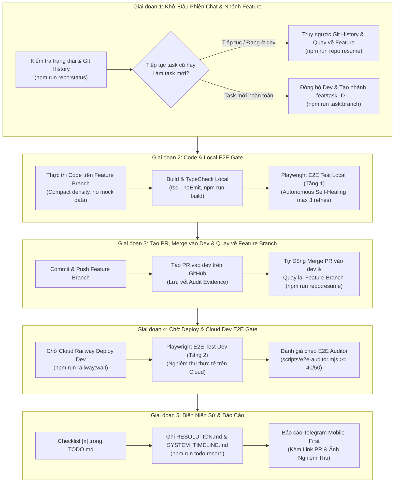

# Quy Chuẩn & Checklist Quy Trình GitHub Cho Tác Vụ (GitHub Task Lifecycle Workflow Rule)

> **Mã quy chuẩn**: `RULE-GIT-TASK-WORKFLOW-01` & `RULE-GIT-HISTORY-RESUME-01`  
> **Trạng thái**: BẮT BUỘC (MANDATORY INVARIANT) CHO TOÀN BỘ AGENT (`/leader`, Default Agent, `/todo-agent`, `/telegram-task-responder`) VÀ KỸ SƯ Ở MỖI PHIÊN SESSION CHAT VỚI ANTIGRAVITY  
> **Áp dụng cho**: Monorepo Root (`logistics-website`), Backend Submodule (`logistics-website-backend`), Frontend Submodule (`logistics-website-frontend`)

---

## 1. Mục Đích & Triết Lý Vận Hành

Quy trình này thiết lập **chuẩn mực bất biến** cho toàn bộ vòng đời xử lý một nhiệm vụ (Task / Feedback / Bugfix) trên GitHub:
1. **Tuyệt đối không code, commit hay push thẳng lên `dev` hoặc `master` (`RULE-GIT-HISTORY-RESUME-01`)**:
   - Mọi task và mọi chỉnh sửa trong các phiên chat đều phải thực hiện trên **Feature/Fix Branch** (`feat/...`, `feature/...`, `fix/...`).
   - **Điều kiện bắt buộc ở MỖI phiên session chat với Antigravity**: Khi bắt đầu phiên chat hoặc trước khi thao tác với Git, `/leader` và Default Agent BẮT BUỘC chạy `npm run repo:status` và `npm run repo:tracking`. Nếu phát hiện bất kỳ repo nào (`root`, `backend/`, `frontend/`) đang đứng ở `dev` hoặc `master`, BẮT BUỘC truy ngược Git History (`git reflog`, `git for-each-ref --sort=-committerdate`) để tìm ra branch feature chính trước đó đã push/làm việc và **quay về branch feature đó ngay lập tức** bằng lệnh `npm run repo:resume` (`node scripts/git-task-workflow.mjs resume`).
   - Chốt chặn kỹ thuật [`scripts/hooks/pre-command-guard.mjs`](file:///d:/Projects/logistics-website/scripts/hooks/pre-command-guard.mjs) tự động **BLOCK (`deny`)** mọi lệnh `git commit` hoặc `git push` trực tiếp trên `dev` và `master`.
2. **Quy trình Kiểm định 2 Tầng (2-Tier Quality Gate)**:
   - **Tầng 1 (Local Gate)**: Kiểm thử E2E Playwright trên Local trước khi tạo PR.
   - **Tầng 2 (Cloud Dev Gate)**: Sau khi merge PR vào `dev` và deploy lên Cloud, kiểm thử E2E Playwright lần thứ 2 trực tiếp trên Domain Dev.
3. **Bằng Chứng Pháp Lý & Minh Bạch (PR Audit Trail)**: Mỗi task hoàn thành bắt buộc phải có một Pull Request / Merge Request (PR/MR) trỏ vào `dev` trên GitHub để lưu vết lịch sử, danh sách thay đổi và biên bản kiểm thử, sau đó tự động merge vào `dev` và **chuyển workspace quay lại branch feature chính** (`npm run repo:resume`).
4. **Biên Niên Sử & Báo Cáo**: Tự động ghi chép `RESOLUTION.md`, cập nhật `docs/SYSTEM_TIMELINE.md` và gửi báo cáo chuẩn mobile-first qua Telegram kèm link PR và ảnh bằng chứng.

---

## 2. Kiến Trúc Git Submodules Cần Ghi Nhớ

Hệ thống Logistics TMS gồm **3 Git repository độc lập**:
- **Root Repository** (`d:\Projects\logistics-website`): Chứa scripts, config, tài liệu `docs/`, `feedbacks/`, và `.agents/`.
- **Backend Submodule** (`backend/`): Repo `logistics-website-backend` (NestJS 11, TypeORM, PostgreSQL).
- **Frontend Submodule** (`frontend/`): Repo `logistics-website-frontend` (Next.js 15, React 19, Tailwind CSS).

> ⚠️ **NGUYÊN TẮC CỐT LÕI**:
> - Tạo branch, commit và push **BẮT BUỘC thực hiện TRỰC TIẾP bên trong thư mục submodule tương ứng** (`backend/` và/hoặc `frontend/`).
> - Tạo branch ở root **KHÔNG** làm thay đổi branch trong `backend/` hay `frontend/`.
> - Nếu task tác động cả Fullstack, bắt buộc tạo nhánh cùng tên trên cả hai submodule và root.

---

## 3. Quy Chuẩn Đặt Tên Nhánh & Suy Luận Thiết Kế (Branch Naming Taxonomy)

### 3.1. Phân Tích & Suy Luận Thiết Kế (Design Rationale)

Khi vận hành hệ thống Logistics TMS với nhiều phân hệ song song (Kho bãi, Điều phối, Đội xe, Đơn hàng) và hàng trăm tác vụ feedback được giao qua Telegram Bot, tên branch cần giải quyết đồng thời **4 bài toán cốt lõi**:

1. **Khả năng truy vết tức thì (Instant Traceability)**: Tên branch phải liên kết 1:1 với `task_id` trong cơ sở dữ liệu `telegram_tasks`, thư mục `feedbacks/feedback_DD_MM_task_<id>`, và biên bản `RESOLUTION.md`.
2. **Khớp nối chuẩn Conventional Commits**: Tiền tố của branch phải đồng bộ với chuẩn commit (`feat(...)`, `fix(...)`, `refactor(...)`), giúp tự động hóa tạo PR title và changelog.
3. **Phân vùng nghiệp vụ rõ ràng (Domain Scoping)**: Nhìn vào danh sách branch trên GitHub hoặc Git CLI là nhận biết ngay phân hệ bị tác động mà không cần mở code.
4. **An toàn Git Ref (Zero Ref Conflict)**: Tránh sử dụng quá nhiều cấp phân tầng thư mục `/` (như `feat/warehouse/task-81/...`) vì Git có cơ chế ref lock dạng file hệ thống, sẽ báo lỗi `cannot lock ref` nếu có nhánh trùng tên thư mục cha.

---

### 3.2. Cấu Trúc Đặt Tên Chuẩn 4 Thành Phần

Mọi branch tạo mới BẮT BUỘC tuân thủ công thức sau:

```
<type>/task-<id>-<module>-<action>
```

```
           ┌── 1. Type: Loại công việc (feat, fix, refactor, perf)
           │
           │      ┌── 2. Task ID: Khóa liên kết nghiệp vụ duy nhất (task-81)
           │      │
           │      │          ┌── 3. Module: Phân hệ nghiệp vụ TMS (warehouse, trip, order...)
           │      │          │
           ▼      ▼          ▼      ▼── 4. Action: Hành động kỹ thuật (2-4 từ kebab-case)
         feat/task-81-warehouse-outbound-pallet
```

#### Giải thích 4 thành phần:

| Thành phần | Ý nghĩa | Giá trị chuẩn | Ví dụ |
|---|---|---|---|
| **`<type>`** | Phân loại mục đích thay đổi | `feat` (hoặc `feature`), `fix`, `refactor`, `perf` | `feat`, `fix` |
| **`task-<id>`** | Mã số định danh của task | Bắt buộc có tiền tố `task-` kèm số ID | `task-81`, `task-80` |
| **`<module>`** | Phân hệ nghiệp vụ bị tác động | Thuộc danh mục phân hệ TMS (bảng bên dưới) | `warehouse`, `trip`, `order` |
| **`<action>`** | Tóm tắt hành động kỹ thuật | 2–4 từ tiếng Anh, viết thường, ngăn cách bằng dấu gạch ngang (`-`) | `outbound-pallet`, `driver-assign` |

---

### 3.3. Bảng Danh Mục Phân Hệ Nghiệp Vụ (`<module>`)

| Mã Module | Phân hệ tương ứng | Nghiệp vụ tiêu biểu |
|---|---|---|
| `warehouse` | Quản lý kho bãi | Nhập kho, xuất kho, tồn kho, pallet, in tem A4, kiểm đếm |
| `trip` | Quản lý chuyến xe | Tạo chuyến, gán chuyến, xếp xe, bốc dỡ, lộ trình trạm |
| `order` | Quản lý đơn hàng | Tạo đơn, gom đơn, cập nhật trọng lượng, thể tích CBM |
| `fleet` | Đội xe & Tài xế | Quản lý phương tiện, hồ sơ tài xế, bảo dưỡng, định vị |
| `hub` | Trạm & Trung chuyển | Điều phối liên Hub, luân chuyển nội bộ, trạm nhận/dỡ |
| `auth` | Xác thực & Phân quyền | Đăng nhập, JWT token, Guard, RBAC matrix |
| `report` | Báo cáo & Thống kê | KPI, đối soát, sổ cái vận hành, xuất file Excel |
| `core` | Hạ tầng & Nền tảng | Scripts, CI/CD, Railway, N8n, cấu hình hệ thống |

---

### 3.4. Các Điều Cấm Kỵ Tuyệt Đối (Anti-Patterns)

- 🚫 **CẤM tiếng Việt có dấu hoặc khoảng trắng**: `feat/task-81-xuat-kho-pallet` (phải dùng tiếng Anh không dấu).
- 🚫 **CẤM bỏ quên `task-<id>`**: `feat/warehouse-outbound` (mất dấu vết nghiệm thu).
- 🚫 **CẤM đặt tên quá dài vượt quá 50 ký tự**: Không viết cả câu văn vào tên branch.
- 🚫 **CẤM dùng ký tự đặc biệt**: `@`, `#`, `$`, `%`, `&`, `*`, `(`, `)`.
- 🚫 **CẤM tự ý commit hoặc push thẳng code lên `dev` hoặc `master`**: Nếu repo đang đứng ở `dev`/`master`, bắt buộc truy ngược Git history (`npm run repo:resume`) để quay về branch feature chính làm việc.

---

## 4. Quy Trình 5 Giai Đoạn Chuẩn Chỉ (5-Stage Standard Pipeline)



---

### Giai Đoạn 1: Bắt Đầu Phiên Session Chat — Truy Ngược Git History Hoặc Khởi Tạo Nhánh Mới

1. **Kiểm tra trạng thái kho lưu trữ & truy vết nhánh feature gần nhất (BẮT BUỘC MỖI PHIÊN CHAT)**:
   ```bash
   npm run repo:status
   npm run repo:tracking
   ```
2. **Trường hợp A — Tiếp tục phiên làm việc hoặc phát hiện repo đang đứng ở `dev` / `master`**:
   - Tuyệt đối KHÔNG làm việc hay push thẳng lên `dev`/`master`.
   - Chạy lệnh tự động truy ngược Git History (`git reflog` + `git for-each-ref`) để quay về đúng branch feature chính trước đó đã push:
     ```bash
     npm run repo:resume
     # (Hoặc: node scripts/git-task-workflow.mjs resume)
     ```
3. **Trường hợp B — Nhận một Task hoàn toàn mới**:
   - Sử dụng script chuẩn để kéo `dev` mới nhất và tạo nhánh `<type>/task-<id>-<module>-<action>` trên cả `backend/`, `frontend/` và `root`:
     ```bash
     node scripts/git-task-workflow.mjs start <task_id> <module> <action> <type> fullstack
     ```
4. **Ghi nhận thông tin nhánh vào `feedbacks/feedback_DD_MM_task_<id>/TODO.md`**:
   - Ghi rõ branch name ở đầu file `TODO.md` để mọi agent đều nhận biết.

---

### Giai Đoạn 2: Triển Khai Code & Nghiệm Thu Tầng 1 (Local E2E Gate)

1. **Lập trình tuân thủ nghiêm ngặt chuẩn hệ thống**:
   - Giao diện siêu gọn (Compact Density): Card padding `p-1`, Modal body `p-2`, cấm tuyệt đối `p-4`, `gap-4`.
   - Kết nối cơ sở dữ liệu thật (Zero Mock Data), không dùng mảng tĩnh giả lập.
   - Thuật ngữ vận hành thực tế tiếng Việt, không chứa jargon kỹ thuật.
2. **Kiểm tra biên dịch & kiểu dữ liệu tĩnh (Local Compile & Lint)**:
   ```powershell
   # Backend typecheck & build:
   npm run build --prefix backend

   # Frontend typecheck & build:
   npx --prefix frontend tsc --noEmit
   ```
3. **Kích hoạt kiểm thử Playwright E2E trên Local (Tầng 1 — BẮT BUỘC BẬT PORT 4000 & 4001)**:
   - **Bắt buộc khởi động Local Dev Servers**: Chạy lệnh `npm run dev:ensure` (tự động kiểm tra và bật ngầm Backend port `4001` + Frontend port `4000` không gây treo phiên). **Nghiêm cấm** bỏ qua bước test Local với lý do server đang tắt.
   - **Chốt chặn Hook (`pre-command-guard.mjs`)**: Nếu port `4000` hoặc `4001` chưa bật (`DOWN`), hệ thống sẽ tự động chặn (`BLOCK`) mọi lệnh `git push` submodule và `gh pr create`.
   - Chạy test suite tương ứng của task:
     ```powershell
     npm run dev:ensure
     $env:PLAYWRIGHT_BASE_URL="http://localhost:4000"
     $env:API_URL="http://localhost:4001/api/v1"
     npx --prefix frontend playwright test e2e/<test_spec>.spec.ts
     ```
   - **Cơ chế Autonomous Local Self-Healing (Tối đa 3 lần retry)**:
     - Nếu test fail, phân tích lỗi tại chỗ, chỉnh sửa code và chạy lại test.
     - **CHỐT CHẶN BẮT BUỘC**: 100% test case Local PHẢI PASS thì mới được phép sang Giai đoạn 3. Tuyệt đối không commit code lỗi lên remote.
4. **Kiểm định mã nguồn test độc lập qua `/e2e-code-auditor` (BẮT BUỘC TRƯỚC KHI TẠO PR)**:
   - Chạy công cụ kiểm toán test AST/Static analysis:
     ```bash
     node scripts/e2e-auditor.mjs frontend/e2e/<test_spec>.spec.ts
     ```
   - **Tiêu chuẩn nghiệm thu E2E Auditor Gate**:
     * Điểm đánh giá $\ge 40/50$, **0 lỗi Auto-FAIL**.
     * **Nghiêm cấm Shallow Tests**: Bị loại bỏ lập tức nếu test chỉ đọc chuỗi file tĩnh (`fs.readFileSync`), chỉ mở URL mà không thao tác click/fill (Look-only test), hoặc rẽ nhánh nuốt lỗi `if (isVisible) ... else { screenshot }`.
     * Nếu không đạt $\ge 40/50$ hoặc dính cảnh báo test hời hợt: **CẤM TẠO PR, CẤM AUTO-MERGE**. AI phải tái cấu trúc test spec tương tác thực tế với UI và API trước khi chuyển giai đoạn.

---

### Giai Đoạn 3: Đẩy Feature Branch, Tạo PR vào `dev`, Merge & Quay Về Feature Branch

1. **Đảm bảo đang đứng trên nhánh Feature (KHÔNG đứng trên `dev` hay `master`)**:
   ```powershell
   npm run repo:resume
   ```
2. **Commit code bên trong submodule tương ứng**:
   ```powershell
   # Quy tắc Conventional Commits có gắn task_id:
   git -C backend commit -am "feat(task-81): implement outbound pallet logic for warehouse"
   git -C frontend commit -am "feat(task-81): add pallet inspection modal and action flow"
   ```
3. **Đẩy nhánh tính năng lên remote GitHub (TUYỆT ĐỐI KHÔNG push thẳng vào `dev`/`master`)**:
   ```powershell
   git -C backend push -u origin feat/task-81-warehouse-outbound-pallet
   git -C frontend push -u origin feat/task-81-warehouse-outbound-pallet
   ```
4. **Tạo Pull Request (PR) trỏ vào nhánh `dev`, Tự động Merge & Quay về Feature Branch**:
   - Sử dụng script chuẩn (tự động push, tạo PR, merge vào `dev`, và checkout quay lại nhánh feature):
     ```powershell
     node scripts/git-task-workflow.mjs pr 81 warehouse outbound-pallet feat fullstack
     ```
   - Hoặc dùng GitHub CLI (`gh pr create` & `gh pr merge` **KHÔNG dùng `--delete-branch`** để giữ nhánh feature làm việc tiếp):
     ```powershell
     gh pr create --repo lyquangthai1993/logistics-website-backend --base dev --head feat/task-81-warehouse-outbound-pallet --title "feat(task-81): outbound pallet management" --body "..."
     gh pr merge --repo lyquangthai1993/logistics-website-backend feat/task-81-warehouse-outbound-pallet --merge
     npm run repo:resume
     ```

---

### Giai Đoạn 4: Chờ Deploy & Nghiệm Thu Lần 2 Trên Cloud Dev (Cloud Dev Gate)

1. **Theo dõi trạng thái triển khai của Cloud Dev (Railway Cloud)**:
   - Frontend Dev: `https://frontend-tms-core-dev.up.railway.app`
   - Backend Dev: `https://backend-tms-core-dev.up.railway.app`
   - Xác nhận bản build mới đạt `SUCCESS` & cutover:
     ```powershell
     npm run railway:wait
     ```
2. **Kích hoạt Playwright E2E nghiệm thu lần thứ 2 trên Cloud Dev**:
   ```powershell
   $env:PLAYWRIGHT_BASE_URL="https://frontend-tms-core-dev.up.railway.app"
   $env:API_URL="https://backend-tms-core-dev.up.railway.app/api/v1"
   npx --prefix frontend playwright test e2e/<test_spec>.spec.ts
   ```
   - Hỗ trợ tối đa 3 lần retry nếu gặp sự cố kết nối mạng tạm thời.
   - Bắt buộc chụp ảnh màn hình bằng chứng thực tế: `feedbacks/feedback_DD_MM_task_<id>/screenshot_*_verified.png`.
3. **Đánh giá chéo chất lượng kiểm thử (Cross-Evaluation Audit)**:
   ```bash
   node scripts/e2e-auditor.mjs frontend/e2e/<test_spec>.spec.ts
   ```
   - Điểm đánh giá bắt buộc đạt $\ge 40/50$, 0 lỗi Auto-FAIL.

---

### Giai Đoạn 5: Biên Niên Sử Kỹ Thuật & Báo Cáo Mobile-First

1. **Đồng bộ toàn bộ Checklist trong `TODO.md` thành `- [x]`**.
2. **Ghi nhận Biên bản Nghiệm thu Kỹ thuật & Đồng bộ Biên niên sử**:
   ```bash
   npm run todo:record feedbacks/feedback_DD_MM_task_<id>
   ```
   - Sinh file `RESOLUTION.md` với đầy đủ 6 cấu phần bắt buộc.
   - Tự động ghi chép mốc son mới vào đỉnh file [`docs/SYSTEM_TIMELINE.md`](file:///d:/Projects/logistics-website/docs/SYSTEM_TIMELINE.md).
3. **Phát Báo Cáo Nghiệm Thu Hoàn Tất qua Telegram Bot**:
   - Tuân thủ quy chuẩn `telegram-task-responder` (Mobile-First, Card layout, không nói thừa, không kết thúc bằng câu hỏi/slogan).

---

## 5. Bảng Checklist Tự Kiểm Soát (Mandatory Checklist Gate)

Bảng này là danh mục bắt buộc kiểm tra. Agent KHÔNG ĐƯỢC BÁO HOÀN THÀNH nếu còn bất kỳ ô nào chưa đạt:

| STT | Hạng mục kiểm tra | Tiêu chuẩn đạt yêu cầu | Trạng thái |
|:---:|---|---|:---:|
| 0 | **Truy ngược Git History mỗi phiên chat** | Đã chạy `npm run repo:status` & `npm run repo:resume` để quay về branch feature chính (không đứng ở `dev`/`master`). | `[ ]` |
| 1 | **Tách nhánh từ `dev` mới nhất** | Đã `git pull origin dev` và làm việc trên `feat/task-<id>-*` trong submodule. | `[ ]` |
| 2 | **Quy chuẩn mã nguồn** | Compact density (`p-1`, `p-2`), 0 jargon tiếng Anh trong UI, 0 mock data. | `[ ]` |
| 3 | **Local Build & TypeCheck** | `npm run build --prefix backend` & `tsc --noEmit` pass 0 lỗi. | `[ ]` |
| 4 | **Nghiệm thu Tầng 1 (Local E2E)** | Playwright E2E chạy trên Local pass 100%. | `[ ]` |
| 5 | **Tạo PR làm bằng chứng** | Đã push feature branch (KHÔNG push thẳng `dev`/`master`) và tạo PR trỏ vào `dev`. | `[ ]` |
| 6 | **Merge PR & Quay về Feature Branch** | Đã merge PR vào `dev` và chạy `npm run repo:resume` để giữ workspace ở nhánh feature. | `[ ]` |
| 7 | **Cloud Dev Deploy Ready** | Domain Dev Railway build xong (`npm run railway:wait`), Health Check HTTP 200. | `[ ]` |
| 8 | **Nghiệm thu Tầng 2 (Cloud Dev E2E)**| Playwright E2E chạy trên Cloud Dev domain pass 100%. | `[ ]` |
| 9 | **Ảnh bằng chứng không rỗng** | Đã chụp `screenshot_*_verified.png` (bảng có dữ liệu, không chụp trắng). | `[ ]` |
| 10| **Biên niên sử kỹ thuật** | Đã chạy `npm run todo:record` cập nhật `RESOLUTION.md` & `SYSTEM_TIMELINE.md`. | `[ ]` |
| 11| **Báo cáo Telegram đúng quy chuẩn**| Dẫn chứng PR link, mobile-first, gửi ảnh qua `sendPhoto`. | `[ ]` |

---

## 6. Lệnh Vận Hành Tóm Tắt (CLI Quick Reference)

```powershell
# 0. Bắt buộc ở đầu mỗi phiên chat (Kiểm tra & quay về branch feature chính từ Git History):
npm run repo:status
npm run repo:tracking
npm run repo:resume

# 1. Bắt đầu task mới hoàn toàn (Tạo nhánh từ dev):
node scripts/git-task-workflow.mjs start <ID> <module> <action> feat fullstack

# 2. Kiểm thử Tầng 1 (Local):
npm run dev:ensure
$env:PLAYWRIGHT_BASE_URL="http://localhost:4000"
$env:API_URL="http://localhost:4001/api/v1"
npx --prefix frontend playwright test e2e/<test_spec>.spec.ts

# 3. Đẩy nhánh feature, tạo PR, Merge vào dev & Quay lại nhánh feature:
node scripts/git-task-workflow.mjs pr <ID> <module> <action> feat fullstack

# 4. Kiểm thử Tầng 2 (Cloud Dev):
npm run railway:wait
$env:PLAYWRIGHT_BASE_URL="https://frontend-tms-core-dev.up.railway.app"
$env:API_URL="https://backend-tms-core-dev.up.railway.app/api/v1"
npx --prefix frontend playwright test e2e/<test_spec>.spec.ts

# 5. Ghi nhận biên niên sử:
npm run todo:record feedbacks/feedback_DD_MM_task_<ID>
```
