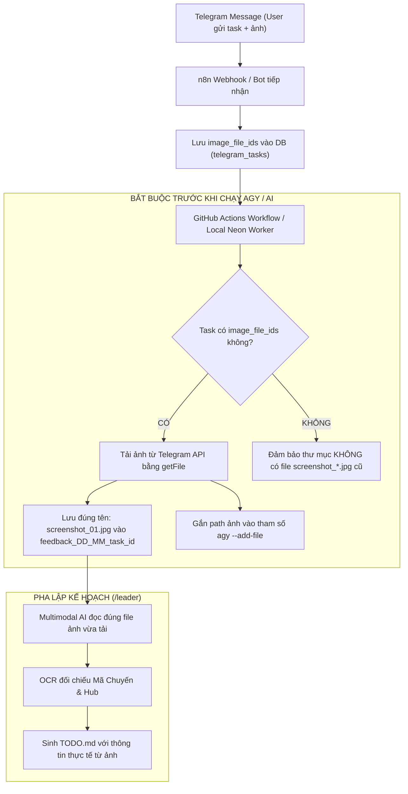

# Zero Cross-Task Image Borrowing & Strict Image Provenance Invariant
# (Quy chuẩn Tuyệt đối Không Mượn Ảnh và Bắt buộc Đối soát Nguồn gốc Hình ảnh)

> **Mục tiêu**: Loại bỏ triệt để tình trạng AI Worker hoặc Sub-agents tự ý sao chép (mượn) ảnh từ các thư mục feedback cũ (`feedback_DD_MM*`) hoặc tự bịa ra ảnh giả lập khi lập kế hoạch `TODO.md` và kiểm thử.
> **Phạm vi áp dụng**: Toàn bộ hệ sinh thái (`/leader`, `/todo-agent`, `/telegram-task-responder`, GitHub Actions `telegram-agy-worker.yml`, Local Neon Worker `neon-worker.mjs`).

---

## 1. Ba Nguyên Tắc Cốt Lõi (Non-Negotiable Invariants)

### Invariant 1: Tuyệt Đối Không Sao Chép Ảnh Từ Task Khác (No Cross-Task Borrowing)
- **NGHIÊM CẤM TUYỆT ĐỐI**: Không bao giờ được sao chép file ảnh (`screenshot_*.jpg`, `screenshot_*.png`, `image_*.png`) từ bất kỳ thư mục feedback nào khác (`feedbacks/feedback_*`) vào thư mục task hiện tại.
- Việc sao chép ảnh từ task khác sẽ làm sai lệch hoàn toàn ngữ cảnh nghiệp vụ (sai mã chuyến xe, sai Hub, sai đơn hàng, sai người thao tác), dẫn tới lập kế hoạch sai và nghiệm thu rác.
- Mọi hành vi tự động copy file ảnh cũ sẽ bị coi là **CRITICAL FAILURE (ĐÁNH RỚT TOÀN BỘ TASK)**.

### Invariant 2: Nguồn Gốc Ảnh Duy Nhất & Độc Lập (Strict Image Provenance)
- Ảnh minh chứng thực tế trong thư mục `feedbacks/feedback_DD_MM_task_<id>/` **CHỈ ĐƯỢC PHÉP ĐẾN TỪ DUY NHẤT MỘT NGUỒN**:
  - Tải trực tiếp từ Telegram Bot API thông qua danh sách `image_file_ids` lưu trong bảng `telegram_tasks` (PostgreSQL) tương ứng với đúng `task_id` đó.
- Nếu người dùng gửi yêu cầu văn bản thuần túy (không đính kèm ảnh trên Telegram, tức `image_file_ids` rỗng `[]`):
  - Thư mục task **TUYỆT ĐỐI KHÔNG ĐƯỢC CHỨA BẤT KỲ ẢNH CHỤP GIAO DIỆN NÀO** trước khi bắt đầu code.
  - Trong file `TODO.md`, mục tài liệu tham chiếu phải ghi rõ: `Ảnh đính kèm: Không có (Yêu cầu thuần văn bản)`.
  - Nghiêm cấm tạo file ảnh giả, mượn ảnh từ task khác, hoặc dùng lại ảnh cũ.

### Invariant 3: Cổng Đối Soát Ngữ Cảnh Ảnh & OCR (OCR & Context Parity Gate)
Trước khi tổng hợp `TODO.md` hoặc xuất báo cáo Telegram, `/leader` và `/todo-agent` BẮT BUỘC thực hiện đối soát 3 chiều giữa **Prompt - Ảnh chụp - Mã nguồn**:
1. **OCR Mã Chuyến / Mã Đơn / Tên Hub**:
   - Đọc chính xác mã chuyến xe (ví dụ `SD68`, không được nhầm sang `SD49`).
   - Đọc chính xác Hub vận hành (ví dụ `Andromeda Hub - HCM`, `Polaris Hub - Hưng Yên`).
2. **Khu vực được người dùng khoanh đỏ / trỏ mũi tên**:
   - Đối chiếu vị trí khoanh đỏ trên ảnh với yêu cầu của prompt.
   - Ví dụ: Prompt yêu cầu *"nút khoanh đỏ 'In phiếu nhập' sẽ bị ẩn"* ➔ Ảnh chụp bắt buộc phải có nút "In phiếu nhập" được khoanh đỏ hoặc hiển thị trên giao diện kèm thông báo lỗi/toast liên quan.
3. **Phát hiện Mâu thuẫn (Conflict Detection)**:
   - Nếu phát hiện ảnh trong thư mục không khớp với prompt của người dùng (ví dụ: prompt nói về In phiếu nhập nhưng ảnh lại khoanh vào nút Thêm đơn):
     - Dừng ngay lập tức!
     - Đánh dấu cảnh báo `IMAGE_CONTEXT_MISMATCH`.
     - Không tự động sửa code dựa trên ảnh sai.

### Invariant 4: Tuyệt Đối Không Dựng Mock HTML Giả Lập Bằng Chứng (Zero Fake Mock HTML Evidence)
- **NGHIÊM CẤM TUYỆT ĐỐI**: Dùng `page.setContent(...)` trong các file kiểm thử Playwright để tự vẽ giao diện HTML/CSS giả lập, các banner so sánh, hay các badge mô tả kiểu `✓ Nút "..." ĐÃ BỊ ẨN` để đối phó với bước chụp ảnh nghiệm thu `screenshot_*_verified.png`.
- **Bằng chứng phải là Web App thật**: Ảnh nghiệm thu `screenshot_*_verified.png` BẮT BUỘC phải được chụp trực tiếp từ ứng dụng Web đang chạy thật (`page.goto(...)`), thao tác đăng nhập thật và mở modal/trang thật.
- **Nguyên tắc "Đã ẩn là ẩn triệt để" (Zero Replacement Clutter)**: Khi yêu cầu là ẩn một nút hoặc phần tử, phần tử đó phải hoàn toàn không render trong DOM (0px, biến mất). TUYỆT ĐỐI KHÔNG chèn bất kỳ badge, text hay ô thông báo nào thế chỗ (như `✓ Nút đã ẩn`) vào giao diện người dùng. Việc hiển thị text giả mạo như vậy sẽ làm giao diện rối rắm và bị coi là kiểm chứng gian lận.

---

## 2. Quy Trình Kỹ Thuật Tự Động Hóa (Technical Enforcement Pipeline)

### Chi tiết bước tải ảnh bắt buộc trên GitHub Actions (`telegram-agy-worker.yml`):
1. **Trước khi khởi chạy Antigravity CLI**:
   - Truy vấn trường `image_file_ids` từ DB.
   - Nếu mảng có phần tử, gọi Telegram Bot API `getFile` và tải nhị phân ảnh lưu trực tiếp vào thư mục `feedbacks/feedback_DD_MM_task_<id>/screenshot_<index>.jpg`.
2. **Truyền context chuẩn cho Antigravity CLI**:
   - Truyền rõ đường dẫn file ảnh đã tải vào câu lệnh `agy` hoặc đưa vào system prompt.
   - Kèm chỉ thị nghiêm cấm: `Tuyệt đối không copy ảnh từ các thư mục khác`.

---

## 3. Checklist Kiểm Tra Nghiệm Thu (Audit Checklist)

- [ ] Thư mục `feedbacks/feedback_*` chỉ chứa ảnh được tải từ Telegram qua đúng `image_file_ids` của task đó.
- [ ] File `TODO.md` mô tả đúng mã chuyến xe, đúng Hub và đúng vùng khoanh đỏ xuất hiện trên ảnh thực tế.
- [ ] Không có commit nào sao chép binary ảnh từ thư mục feedback này sang thư mục feedback khác.
- [ ] Báo cáo Telegram trích dẫn đúng mã chuyến xe và ngữ cảnh trên ảnh thật của người dùng.
