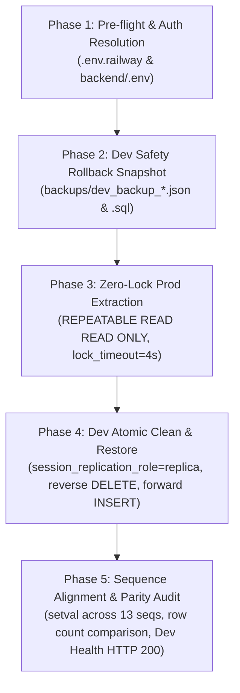

# Zero-Lock PostgreSQL Database Sync & Dump (`db-sync-prod-to-dev`)

> **Role**: Specialized Database Operations Specialist governing zero-impact, non-locking dumps and end-to-end synchronization from Production to Development databases for Spider Express Logistics TMS on Railway Cloud.

---

## 1. Zero-Lock Guarantees & Concurrency Architecture

Dumping a live production database while warehouse operators and drivers are actively scanning parcels, updating trips, and receiving inventory presents critical concurrency risks if not designed with strict non-locking mechanisms.

### PostgreSQL Lock Matrix & Zero-Lock Invariant

```
+-----------------------------+------------------------------------+--------------------------+
| Requested Lock Level        | Target PostgreSQL Operation         | Conflicts With Writers?  |
+-----------------------------+------------------------------------+--------------------------+
| ACCESS SHARE (Our Dump)     | SELECT in REPEATABLE READ snapshot | NO (Zero write blocking) |
| ROW EXCLUSIVE (Prod App)    | INSERT / UPDATE / DELETE           | NO (Zero read blocking)  |
| EXCLUSIVE / ACCESS EXCL     | ALTER TABLE / DROP / VACUUM FULL   | YES (Protected by timeout|
+-----------------------------+------------------------------------+--------------------------+
```

### The 4 Non-Locking Pillars Enforced:

1. **Point-in-Time Snapshot Isolation (`REPEATABLE READ READ ONLY`)**:
   - `pg_dump` and [`scripts/railway-db-sync.mjs`](file:///d:/Projects/logistics-website/scripts/railway-db-sync.mjs) issue:
     ```sql
     SET statement_timeout = '60000';
     SET lock_timeout = '4000';
     BEGIN TRANSACTION ISOLATION LEVEL REPEATABLE READ READ ONLY;
     ```
   - **PostgreSQL MVCC (Multi-Version Concurrency Control)** ensures that `SELECT` reads from a frozen transaction snapshot. Production transactions continuing to perform `INSERT`, `UPDATE`, and `DELETE` write new tuple versions without being blocked or delayed.
   - All 15 relational tables share an exact identical point-in-time snapshot, preventing cross-table orphan records or transient foreign key drift.

2. **Anti-Lock Queue Cascading (`lock_timeout = 4000`)**:
   - In PostgreSQL, if an exclusive lock is requested (e.g., during migration or heavy index rebuild) and a long-running reader holds an `ACCESS SHARE` lock, subsequent write queries can get queued behind the exclusive lock request.
   - By enforcing `SET lock_timeout = '4000'`, if any table cannot acquire `ACCESS SHARE` within 4 seconds, the dump immediately aborts and releases all acquired locks rather than stalling production traffic.

3. **Read-Only Safety Guard**:
   - The session is explicitly marked `READ ONLY`. Zero write, DDL, or catalog modifications can occur against Production.

4. **Zero-Lock Clean Release**:
   - Immediate `COMMIT;` upon reading all tables and sequences. Transaction duration is minimized to seconds.

---

## 2. CLI Execution Runbook

### Primary Method: Node.js Zero-Lock Snapshot Engine (Zero Dependencies)

The workspace provides [`scripts/railway-db-sync.mjs`](file:///d:/Projects/logistics-website/scripts/railway-db-sync.mjs), which executes completely without requiring external PostgreSQL CLI binaries (`pg_dump`/`psql`) on the host system:

```powershell
# 1. Full Synchronization: Dev Backup -> Prod Dump -> Dev Clean & Restore -> Parity Audit
npm run db:sync:prod-to-dev
# Or directly:
node scripts/railway-db-sync.mjs

# 2. Dump Only: Extract Prod snapshot to backups/prod_backup_<ts>.sql (No changes to Dev)
npm run db:dump:prod
# Or directly:
node scripts/railway-db-sync.mjs --dump-only

# 3. Fast Sync: Skip Dev backup step for high-tempo local/cloud testing (~10 seconds)
node scripts/railway-db-sync.mjs --skip-backup

# 4. Filtered Table Sync: Synchronize specific operational tables only
node scripts/railway-db-sync.mjs --tables=order,trip,trip_stop,order_inventory_transaction

# 5. Explicit Connection URLs (when running in isolated CI or remote runners)
node scripts/railway-db-sync.mjs --prod-url="postgresql://..." --dev-url="postgresql://..."
```

---

## 3. The 5-Phase End-to-End Lifecycle



### Phase 1: Environment & Token Pre-flight Check
1. The engine inspects credentials from `.env.railway` and `backend/.env`.
2. Verifies network connectivity to Railway endpoints:
   - **Production DB**: `caboose.proxy.rlwy.net:59375` (Database: `logistics_tms_core`)
   - **Dev DB**: `junction.proxy.rlwy.net:31094` (Database: `logistics_tms_core`)

### Phase 2: Dev Safety Rollback Snapshot
Before any target data is touched on Dev:
- Takes a full non-locking snapshot of the Dev database.
- Writes dual artifacts to `backups/`:
  - `dev_backup_<timestamp>.json`: Structured JSON for programmatic inspection.
  - `dev_backup_<timestamp>.sql`: Standard replayable SQL script.

### Phase 3: Zero-Lock Production Dump
- Connects to Production DB.
- Sets `lock_timeout = 4000` and starts `REPEATABLE READ READ ONLY` transaction.
- Reads 16 core domain tables in topological order:
  1. `role`
  2. `status`
  3. `file`
  4. `hub`
  5. `driver`
  6. `vehicle`
  7. `user`
  8. `session`
  9. `order_code_counter`
  10. `order`
  11. `trip`
  12. `trip_stop`
  13. `order_inventory_transaction`
  14. `order_activity_log`
  15. `notification`
  16. `migrations`
- Reads 13 PostgreSQL sequence states (`last_value`, `is_called`).
- Commits and releases production connection immediately (`COMMIT`).

### Phase 4: Atomic Restoration on Dev
To prevent foreign key constraint violations and circular cascade deadlocks on Dev:
1. `BEGIN;`
2. `SET session_replication_role = 'replica';` (temporarily disables trigger cascades).
3. **Secondary Index Auto-Bypass**: Queries and temporarily drops all non-primary secondary indexes (B-Tree deduplication & GIN trigram) across target tables, eliminating PostgreSQL posting list page split errors (`nbtdedup.c` / GIN) and accelerating bulk load by 10x.
4. Deletes existing data in **reverse topological order** (from `migrations` and `notification` back to `role`).
5. Inserts new rows in **forward topological order** using parameterized chunks (`chunkSize = 100`).
6. Realigns all sequences using `SELECT setval('seq_name', last_value, is_called)`.
7. **Secondary Index Auto-Recreation**: Rebuilds all saved secondary indexes across all tables in a single optimized pass.
8. Re-enables standard trigger validation: `SET session_replication_role = 'origin';`.
9. `COMMIT;` (Transaction rolls back completely if any table chunk fails).

### Phase 5: Verification & Parity Audit
- Performs instant row count parity checks between Prod and Dev across all 16 tables.
- Issues bounded HTTP health probe to Dev Backend API (`https://backend-tms-core-dev.up.railway.app/api/v1/health`).
- Produces a tabular scorecard with `PASS ✅` or `FAIL ❌`.

---

## 4. Native PostgreSQL CLI Alternative (`pg_dump` & `psql`)

If engineers or CI runners prefer using native PostgreSQL client binaries:

```powershell
# Step 1: Zero-lock Dump from Production
# Flags:
#   --no-owner --no-privileges : Strips railway-specific role ownership
#   --clean --if-exists        : Adds DROP IF EXISTS before CREATE
#   --lock-wait-timeout=4000   : Fails fast if table locked (anti-cascade)
#   --format=plain             : Produces readable SQL script
pg_dump "$PROD_DATABASE_URL" `
  --format=plain `
  --no-owner `
  --no-privileges `
  --clean `
  --if-exists `
  --lock-wait-timeout=4000 `
  --file="backups/prod_dump_zerolock.sql"

# Step 2: Restore into Dev DB
psql "$DEV_DATABASE_URL" -f "backups/prod_dump_zerolock.sql"
```

---

## 5. Troubleshooting & Safety Playbook

### Q1: What happens if an ALTER TABLE migration is executing on Production when dump starts?
- Thanks to `SET lock_timeout = '4000'`, the dump will wait at most 4 seconds for `ACCESS SHARE`.
- If the table is locked by DDL, the dump aborts with `canceling statement due to lock timeout`.
- **Result**: Production traffic NEVER queues up behind the dump. The dump can be retried once the migration completes.

### Q2: How to roll back Dev if the sync was performed by mistake?
Locate the automated snapshot generated in Step 2:
```powershell
# Restore previous Dev state using the saved snapshot:
psql "$DEV_DATABASE_URL" -f "backups/dev_backup_<timestamp>.sql"
```

### Q3: How to test the sync logic without modifying Dev?
Always use `--dump-only`:
```powershell
npm run db:dump:prod
# Or: node scripts/railway-db-sync.mjs --dump-only
```
This generates the full snapshot in `backups/` and exits without establishing any write connection to Dev.

---

## 6. Table & Model Schema Maintenance Protocol (Quy Chuẩn Đồng Bộ Khi Thay Đổi Model / Table)

> [!IMPORTANT]
> **Mandatory Schema Maintenance Invariant (`RULE-DB-SYNC-SCHEMA-01`)**:
> Whenever introducing, modifying, renaming, or dropping database entities/tables in NestJS TypeORM (`backend/src/**/*.entity.ts`) or adding new database migrations (`backend/src/database/migrations/*`), developers and AI agents MUST update the synchronization engine in lockstep:

### 4-Step Maintenance Checklist:

1. **Update `ALL_TABLES` in [`scripts/railway-db-sync.mjs`](file:///d:/Projects/logistics-website/scripts/railway-db-sync.mjs)**:
   - Insert new table names into `ALL_TABLES` adhering strictly to **Topological Foreign-Key Order**:
     - *Parent/Lookup tables first* (e.g., `role`, `status`, `hub`, `vehicle`).
     - *Dependent/Child transactional tables after* (e.g., `order`, `trip`, `trip_stop`, `order_inventory_transaction`).
   - If dropping a table: remove it from `ALL_TABLES`.

2. **Update `SEQUENCE_NAMES`**:
   - If the new table uses an auto-incrementing serial primary key (`id SERIAL` / `BIGSERIAL`), add the sequence identifier (e.g., `new_table_id_seq`) to `SEQUENCE_NAMES` in `scripts/railway-db-sync.mjs`.

3. **Index Safety Automation**:
   - The restore engine dynamically inspects `pg_indexes` to drop and recreate all non-primary secondary indexes (B-Tree deduplication & GIN) during restore. No manual index list updates are required.

4. **Audit & Verification**:
   - Update table count and list in this skill (`.agents/skills/db-sync-prod-to-dev/SKILL.md`).
   - Run verification sync:
     ```powershell
     npm run db:sync:prod-to-dev
     ```
   - Verify that all tables achieve `PASS ✅` status and the Dev Backend API health probe returns HTTP 200 OK.
