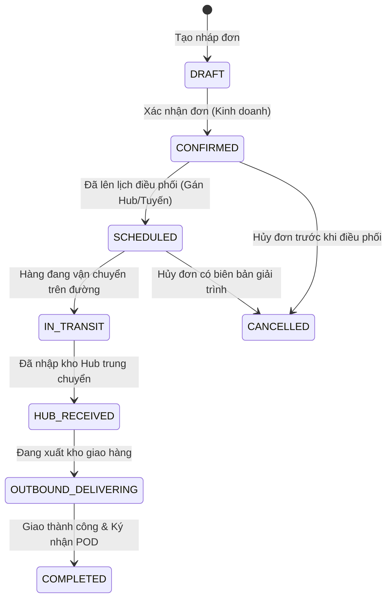
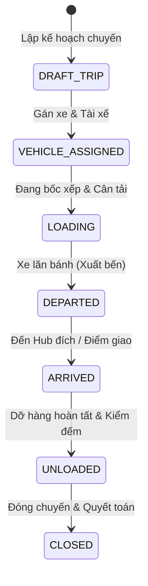

# 📦 TMS Domain-Modeling — Logistics Domain & Operational Terminology Authority

> **Vai trò**: Quản trị viên Từ điển Miền Nghiệp Vụ (Domain Glossary & State Invariants Authority).
> **Mục tiêu**: Đảm bảo toàn bộ kiến trúc (Database Entity, API DTO, State Transition, UI Labels, Vector Canvas) nói chung một ngôn ngữ nghiệp vụ thống nhất (*Ubiquitous Language*), triệt tiêu hoàn toàn biệt ngữ kỹ thuật và bảo vệ các bất biến của sổ cái kho vận.

---

## 🏛️ 1. Quy Chuẩn Ánh Xạ Thuật Ngữ Nghiệp Vụ (Canonical Mapping Matrix)

Tuân thủ nghiêm ngặt **Quy tắc Triệt tiêu Biệt ngữ Kỹ thuật (Zero Technical/Document Jargon in UI Rule)**:

| Đối Tượng Kỹ Thuật (DB / DTO / Code) | Thuật Ngữ Vận Hành Chuẩn (UI / Báo Cáo / In Ấn) | Biệt Ngữ / Ký Hiệu Bị CẤM Tuyệt Đối |
| :--- | :--- | :--- |
| `InboundWaybill` / `FirstMile` | **Xe nhập kho** / **Phiếu yêu cầu nhập kho** | `First-mile Inbound`, `Consignment In`, `TASK-ORD-...` |
| `TransferWaybill` / `MiddleMile` | **Trung chuyển liên Hub** / **Hàng luân chuyển** | `Middle-mile Transfer`, `Inter-hub Consignment` |
| `OutboundWaybill` / `LastMile` | **Xe xuất kho** / **Phiếu xuất kho** | `Last-mile Outbound`, `Consignment Out` |
| `AvailableStock` | **Tồn khả dụng** | `Available Qty`, `Unallocated Balance` |
| `PartialOutbound` | **Đang xuất từng phần** | `Đang xuất nhỏ giọt`, `Partial Drip` |
| `PackageStandard` / `ConsignmentUnit` | **Quy cách đóng gói kiện** | `Quy chuẩn kiện vận tải (No-SKU)` |
| `TallySheet` | **Bảng kê kiểm đếm hàng hóa** | `Tally Audit Grid`, `Item Counter` |
| `DiscrepancyReconciliation` | **Biên bản đối soát thừa/thiếu** | `Discrepancy Handler`, `Diff Log` |
| `FleetDispatch` | **Điều phối xe & Chuyến vận chuyển** | `Trip Engine`, `Dispatch Dispatcher` |

---

## 🔄 2. Bất Biến Chu Kỳ Trạng Thái (State Machine Invariants)

Hệ thống Logistics TMS quản lý 3 chu kỳ trạng thái cốt lõi:

### 🔹 Chu Kỳ Đơn Hàng (`Order`)


**Các bất biến của Đơn hàng**:
1. Đơn hàng một khi đã có giao dịch nhập kho vật lý (`HUB_RECEIVED`) KHÔNG ĐƯỢC PHÉP bị xóa mềm hoặc chuyển về `DRAFT`.
2. Hủy đơn sau khi đã phát sinh chi phí vận chuyển phải tạo chứng từ giải trình và hạch toán hoàn kho.

---

### 🔹 Chu Kỳ Sổ Cái Kho Bãi (`Inventory Ledger`)
```
[Tồn Vật Lý] = [Tồn Khả Dụng] + [Hàng Đã Giữ Chỗ Cho Chuyến Xe] + [Hàng Đang Xuất Từng Phần]
```

**Các bất biến của Sổ cái kho**:
1. **Không tồn kho âm (Zero Negative Inventory)**: `Tồn khả dụng >= 0`. Nghiêm cấm xuất kho vượt quá số kiện hoặc tải trọng khả dụng tại Hub.
2. **Nguyên tắc ghi sổ kép (Double-Entry Audit Trail)**: Mọi biến động hàng hóa (Nhập, Xuất, Luân chuyển, Bù trừ thừa thiếu) đều phải sinh ra dòng giao dịch bất biến (`InventoryTransaction`), không được cập nhật đè số dư trực tiếp mà không có log.
3. **Phân lập Hub tuyệt đối**: Hàng thuộc Hub HCM (`Andromeda`) chỉ được xuất đi từ Hub HCM; không thể xuất hàng của Hub này tại vị trí của Hub khác khi chưa hoàn tất thủ tục nhập kho trung chuyển.

---

### 🔹 Chu Kỳ Chuyến Xe & Điều Phối (`Trip`)


**Các bất biến của Chuyến xe**:
1. Tổng tải trọng (kg) và thể tích (m³) của các đơn hàng gán vào chuyến xe KHÔNG ĐƯỢC VƯỢT QUÁ tải trọng đăng kiểm tối đa của xe nội bộ hoặc xe thuê ngoài (trừ trường hợp cấu hình cho phép dung sai tối đa 5%).
2. Không thể đóng chuyến (`CLOSED`) nếu còn kiện hàng bị ghi nhận "Thất lạc" hoặc "Chưa đối soát".

---

## 🛠️ 3. Quy Trình Vận Hành Domain-Modeling

Khi một thực thể mới hoặc trạng thái mới được đề xuất:

1. **Rà soát Từ Điển Hiện Hữu**: Tra cứu trong [`docs/DOMAIN_GLOSSARY.md`](file:///d:/Projects/logistics-website/docs/DOMAIN_GLOSSARY.md). Nếu chưa có, tiến hành định nghĩa bổ sung.
2. **Kiểm tra Tính Nhất Quán 3 Tầng**:
   - Backend TypeORM/Prisma Entity có dùng đúng Enum không?
   - DTO có đặt tên rõ ràng, tránh viết tắt tối nghĩa không?
   - Frontend UI Component & Badge có dùng thuật ngữ kho thực tế không?
3. **Cập Nhật Tài Liệu Tập Trung**: Đồng bộ các quyết định vào `docs/DOMAIN_GLOSSARY.md` và thông báo cho `/leader` để đưa vào kiểm thử tự động.
