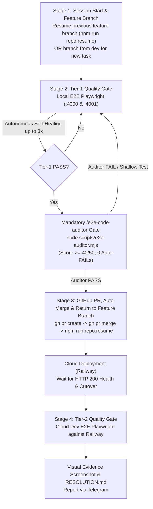

# GitHub Workflow & CI/CD Orchestration — Logistics TMS

> **Role**: Master Architect and Governance Specialist for **GitHub Workflows**, CI/CD pipelines, Git submodules branching lifecycles, Pull Request (PR) audit evidence, and automated cloud deployments across the Spider Express Transportation Management System (TMS).
> Authoritative reference for [`RULE-GIT-TASK-WORKFLOW-01`](file:///d:/Projects/logistics-website/.agents/rules/github-task-workflow.md), GitHub Actions workflows in `.github/workflows/`, and lifecycle automation scripts in `scripts/`.

---

## 🏛️ Repository Architecture & Submodule Golden Rules

The Spider Express TMS system consists of **3 independent Git repositories**:

```text
d:\Projects\logistics-website/                 (Root Monorepo: scripts, docs, .agents, feedbacks)
├── backend/                                   (Submodule: logistics-website-backend — NestJS 11)
└── frontend/                                  (Submodule: logistics-website-frontend — Next.js 15)
```

### Mandatory Invariants (`RULE-GIT-HISTORY-RESUME-01`):
1. **Never Commit or Push Directly to `dev` or `master`**: All development, UI adjustments, and bugfixes MUST happen on dedicated feature/fix branches (`feat/...`, `feature/...`, `fix/...`). Direct `git push origin dev` and `git push origin master` are strictly blocked by `scripts/hooks/pre-command-guard.mjs`.
2. **Mandatory Session-Start Git History Trace & Feature Branch Recovery**:
   - At the start of **every Antigravity chat session** (and before any Git operation), ALWAYS run `npm run repo:status` and `npm run repo:tracking`.
   - If any of the 3 repositories (`root`, `backend/`, `frontend/`) is currently sitting on `dev` or `master`, you MUST trace back Git history (`git reflog`, `git for-each-ref --sort=-committerdate`) to identify which feature/fix branch was most recently worked on and pushed prior to `dev`/`master`, and **immediately switch back to that primary feature branch** using `npm run repo:resume` (`node scripts/git-task-workflow.mjs resume`).
3. **Submodule Isolation**:
   - Creating a branch or committing at the root does NOT branch or commit inside `backend/` or `frontend/`.
   - Branching, committing, and pushing MUST be executed **directly inside the target submodule** (`backend/` and/or `frontend/`).
   - If a task touches both submodules, create identical branch names in both submodules and commit directly within each.
4. **Submodule-First Push Order**:
   - When pushing changes to remote, ALWAYS push `backend/` and `frontend/` submodules first to their feature branch.
   - Only AFTER submodule commits are safely pushed to remote, commit the updated submodule pointers in the root repository and push root to its feature branch.
5. **Mandatory Base Branch (`dev`)**:
   - When starting a brand-new task, feature and fix branches MUST branch off from `dev` (after running `git checkout dev && git pull origin dev`).
   - NEVER branch directly from `master` (except emergency production hotfix branches: `hotfix/<name>`).
   - After merging a PR into `dev`, always switch the local workspace back to the feature branch (`npm run repo:resume`) so subsequent edits never happen directly on `dev`.

---

## 🔄 The 4-Stage GitHub Task Lifecycle Pipeline

Every task received (from Telegram Bot, user prompts, or feature requests) MUST strictly follow the 4-stage pipeline:



---

### Stage 1: Session Start, Git History Recovery & Branch Creation
1. **If continuing work in a chat session (or if any repo is on `dev`/`master`)**:
   ```bash
   npm run repo:status
   npm run repo:resume
   ```
2. **If starting a brand-new task**, use the standardized 4-part branch taxonomy:
```text
<type>/task-<id>-<module>-<action>
```

#### Taxonomy Breakdown:
- **`<type>`**: `feat` (new feature), `fix` (bug fix), `refactor` (cleanup/restructure), `perf` (performance).
- **`task-<id>`**: Linked Telegram task identifier (e.g. `task-81`, `task-88`).
- **`<module>`**: TMS domain module:
  - `warehouse`: Storage, inbound/outbound receiving, pallets, tally sheets, A4 print.
  - `trip`: Fleet trip planning, assignment, en-route roadside pickup, rollback.
  - `order`: Consignment freight payloads (Kg, m³, packages), routes, status.
  - `fleet`: Vehicles, internal vs external 3PL capacity, driver profiles.
  - `hub`: Level 1 regional linehaul hubs vs Level 2 feeder stations (xe bo).
  - `auth`: JWT token rotation, roles guards, RBAC matrices, password reset.
  - `report`: Operational ledgers, KPI aggregations, Excel export/import.
  - `core`: Infrastructure, CI/CD, n8n, Railway configuration.
- **`<action>`**: 2–4 lowercase words in kebab-case describing the technical change.

#### Automated Execution:
```bash
# Resume previous active feature branch from git history:
npm run repo:resume

# Or start a brand-new task branch from dev:
npm run task:branch -- <task_id> <module> <action> [type]
# Example:
node scripts/git-task-workflow.mjs start 89 warehouse outbound-tally feat
```

---

### Stage 2: Tier-1 Quality Gate (Local E2E Verification & Mandatory /e2e-code-auditor)
1. **Local Playwright E2E Suite**:
   - Run tests on workstation (`http://localhost:4000` & `http://localhost:4001/api/v1`).
   - Autonomous self-healing loop: Analyze failure, fix code locally, re-verify (up to 3 retries).
   - **Never push failing code to GitHub**. Code must achieve 100% PASS before leaving the local workstation.
2. **Mandatory E2E Code Auditor Evaluation (`/e2e-code-auditor`)**:
   - Run static & structural audit: `node scripts/e2e-auditor.mjs frontend/e2e/<spec_file>.spec.ts`.
   - The test code MUST clear the 50-point rubric with **Score >= 40/50 and 0 Auto-FAILs**.
   - **Zero Shallow Tests Mandate**: Tests that only check static code (`fs.readFileSync`), "look-only" tests with zero user click/fill actions, or soft fallback `if (isVisible) ... else { screenshot }` branches will be **STRICTLY REJECTED**.
   - If auditor reports `FAIL` or `WARN` (< 40/50), PR creation is blocked until the test is remediated.

---

### Stage 3: GitHub PR Creation, Audit Evidence, Auto-Merge & Return to Feature Branch
Once local tests and `/e2e-code-auditor` pass, publish the feature branch, create an immutable audit trail on GitHub, merge into `dev`, and return local working trees to the feature branch:

```bash
# Using helper CLI (automatically pushes feature branch, creates/merges PR to dev, and checks out back to feature branch):
npm run task:pr -- <task_id> <module> <action>
# Example:
node scripts/git-task-workflow.mjs pr 89 warehouse outbound-tally
```

#### Standard PR Checklist Template:
```markdown
## 📋 Task Details
- **Task ID**: `TASK-89`
- **Module**: `warehouse`
- **Description**: Add outbound tally sheet confirmation

## 🛡️ Pre-Merge Verification (Tier-1 Local Gate & E2E Auditor)
- [x] Compilation: `npm run build` PASS
- [x] Typecheck: `tsc --noEmit` PASS
- [x] Local Playwright E2E: 100% PASS (0 failures)
- [x] E2E Code Auditor Review: Score >= 40/50 (0 Auto-FAILs, zero shallow tests)
- [x] Submodule-first push sequence verified

## 🚀 Target Branch
- Base: `dev`
```

#### Auto-Merge Command (Keep Feature Branch & Return to It):
```bash
gh pr create --base dev --title "feat(warehouse): task #89 outbound tally confirmation" --body-file pr_body.md
gh pr merge --merge --auto --delete-branch=false
```

---

### Stage 4: Tier-2 Quality Gate (Cloud Dev Verification)
1. Monitor Railway Cloud Dev deployment until status is READY (`npm run railway:wait`):
   - Frontend: `https://frontend-tms-core-dev.up.railway.app`
   - Backend: `https://backend-tms-core-dev.up.railway.app`
   - Health check: `curl.exe -m 15 -i https://backend-tms-core-dev.up.railway.app/api/v1/health`
2. Run Playwright E2E suite against Cloud Dev domain:
   ```bash
   PLAYWRIGHT_BASE_URL=https://frontend-tms-core-dev.up.railway.app \
   API_URL=https://backend-tms-core-dev.up.railway.app/api/v1 \
   npm run test:e2e
   ```
3. Run cross-evaluation auditor: `node scripts/e2e-auditor.mjs frontend/e2e/<spec_file>.spec.ts` (Score >= 40/50, 0 Auto-FAILs).
4. Capture visual screenshot evidence (`screenshot_*_verified.png`).
5. Update technical documentation: `npm run todo:record <folder>` to generate `RESOLUTION.md` and append to `docs/SYSTEM_TIMELINE.md`.
6. Dispatch mobile-first completion report to Telegram channel.

---

## 🛠️ CLI Automation Runbook

| Operation | Command | Purpose |
|---|---|---|
| **Check Submodules Status & History** | `npm run repo:status` | Shows status & traces last active feature branch across root, backend, frontend |
| **Check Submodules Tracking** | `npm run repo:tracking` | Shows upstream tracking `[ahead N, behind M]` & last active feature branch |
| **Resume Active Feature Branch** | `npm run repo:resume` | Traces Git history (`reflog`/`refs`) and switches from `dev`/`master` back to active feature branch |
| **Synchronize Submodules** | `npm run repo:sync` | Pulls latest `origin/dev` and returns to active feature branch |
| **Start Feature Branch** | `npm run task:branch -- <id> <module> <action>` | Creates `<type>/task-<id>-<module>-<action>` in target submodules |
| **Create PR & Auto-Merge** | `npm run task:pr -- <id> <module> <action>` | Pushes feature branch, creates PR to `dev`, auto-merges, and returns to feature branch |
| **Trigger Daily RBAC Audit** | `gh workflow run daily-rbac-audit.yml` | Manually triggers the 22:00 PM security audit |
| **Monitor Workflow Run** | `gh run list --limit 5` | Lists recent GitHub Actions workflow runs |
| **Watch Live Run Logs** | `gh run watch <run_id>` | Streams live console logs from GitHub runner |

---

## 🛡️ Critical Governance Rules & Anti-Patterns

1. **Zero Direct Push/Commit to `dev` or `master` (`RULE-GIT-HISTORY-RESUME-01`)**:
   - NEVER commit or push directly onto `dev` or `master`.
   - At the start of every chat session, trace back Git history (`npm run repo:status` -> `npm run repo:resume`) to ensure all 3 repos are on the primary feature branch.
2. **Zero Mid-Execution Cancellation Mandate**:
   - `cancel-in-progress: false` MUST be enforced on all workflow concurrency groups.
   - Never kill or abort running GitHub Actions jobs midway; preserve FIFO queue execution to maintain PostgreSQL state consistency.
3. **Submodule Pointer Drift Prevention**:
   - Never commit root pointers when submodule working trees are dirty or on unpushed commits.
   - Run `npm run repo:status` and `npm run repo:tracking` before every commit operation.
4. **Anti-Hang Network Protocol**:
   - All network calls inside GitHub Actions steps or scripts MUST specify an explicit timeout (`curl.exe -m 15`, `fetch(url, { signal: AbortSignal.timeout(15000) })`).
   - Never use bare unbounded `curl` or infinite retry loops.
5. **Secrets & Security Invariants**:
   - Secrets (`GH_PAT_TOKEN`, `TELEGRAM_BOT_TOKEN`, `RAILWAY_API_TOKEN`) MUST only be injected via GitHub Secrets.
   - NEVER commit `.env` files, credentials, or MCP configurations to GitHub.
