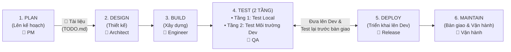

# TMS Domain Lead — Logistics TMS Business & Operational Architecture

> **Role**: Team Lead (`PM` & `Architect` Gatekeeper) for all Transportation Management System (TMS) business logic, warehouse inbound/outbound operations, dispatch governance, and SDLC pipeline alignment.
> All decisions regarding **who does what, lifecycle transitions, warehouse inventory ledger rules, authorization boundaries, and notification triggers** MUST reference this skill first.
> This skill defines **WHAT & WHY** (Business & Architecture Governance), while [`nestjs-best-practices`](../nestjs-best-practices/SKILL.md) and [`nextjs-best-practices`](../nextjs-best-practices/SKILL.md) define **HOW** (Technical Implementation).

---

## 🏗️ 6-Stage SDLC Pipeline & Role Governance (Chuẩn 6 Bước Vận Hành)

`/leader` governs the transition from **Stage 1 (`PLAN`)** through **Stage 6 (`MAINTAIN`)**, ensuring every task in `/todo-agent` completes all 6 engineering stages without skipping gates:



| Stage | Role | Active Skills / Agents | Mandatory Gate & Deliverable |
| :--- | :--- | :--- | :--- |
| **1. PLAN**<br>*(Lên kế hoạch)* | **PM** | [`/todo-agent`](../todo-agent/SKILL.md) + [`/leader`](SKILL.md) | Scan feedback, run Multimodal OCR (extract Hub & Test User), analyze RCA, and output **`📄 Tài liệu` (`TODO.md`)** with Step-by-Step E2E Spec & 10 Edge Cases Matrix. |
| **2. DESIGN**<br>*(Thiết kế)* | **Architect** | [`/leader`](SKILL.md) + [`/ui-ux-flow-designer`](../ui-ux-flow-designer/SKILL.md) + [`/pencil-ui-designer`](../pencil-ui-designer/SKILL.md) + [`/nestjs-best-practices`](../nestjs-best-practices/SKILL.md) + [`/nextjs-best-practices`](../nextjs-best-practices/SKILL.md) | Verify 3-layer [`rbac-matrix.md`](../../rules/rbac-matrix.md), DB schema/migration safety, API contract, 5-Level Modal Width Taxonomy, and Compact Density (`p-1`, `p-2`, `text-[10px]`). |
| **3. BUILD**<br>*(Xây dựng)* | **Engineer** | [`/todo-agent`](../todo-agent/SKILL.md) + [`/feature-branch-advisor`](../feature-branch-advisor/SKILL.md) + [`/ui-spacing-guard`](../ui-spacing-guard/SKILL.md) | Run `npm run repo:status` & `npm run repo:tracking`, branch `<type>/task-<id>-<module>-<action>` from `dev` inside target submodules (`backend/`, `frontend/`), implement code, pass `tsc --noEmit` & `npm run build`. |
| **4. TEST (2 Tầng)**<br>*(Kiểm thử 2 Tầng)* | **QA** | [`/e2e-test-runner`](../e2e-test-runner/SKILL.md) + [`/e2e-code-auditor`](../e2e-code-auditor/SKILL.md) | **Bắt buộc 2 Tầng Test**:<br>• **Tầng 1 (Test Local)**: Chạy Playwright E2E trên Local (`localhost:4000` & `4001`, Self-Healing $\le 3$ lần) + `e2e-auditor.mjs` ($\ge 40/50$). Pass 100% mới đưa lên Dev.<br>• **Tầng 2 (Test trên Môi trường Development)**: Sau khi đưa lên môi trường Dev (`frontend-tms-core-dev.up.railway.app`), **chạy lại E2E + Auditor lần 2 trên Dev**, chụp ảnh thực tế (`screenshot_*_verified.png`) để **bàn giao chuẩn xác**. |
| **5. DEPLOY**<br>*(Triển khai)* | **Release** | [`/git-commit-reviewer`](../git-commit-reviewer/SKILL.md) + [`/github-workflow`](../github-workflow/SKILL.md) | Khi Tầng 1 Local Test PASS ➔ Push submodule branch, tạo GitHub PR vào `dev` (`gh pr create`), auto-merge (`gh pr merge --merge`), đợi Railway Cloud Dev HTTP 200 để bàn giao cho QA chạy **Test Tầng 2 trên môi trường Development**. |
| **6. MAINTAIN**<br>*(Vận hành)* | **Vận hành** | [`/tms-ops-maintainer`](../tms-ops-maintainer/SKILL.md) + [`/codebase-auditor`](../codebase-auditor/SKILL.md) + [`/telegram-task-responder`](../telegram-task-responder/SKILL.md) | Chỉ nhận bàn giao khi **CẢ 2 TẦNG TEST (Local + Development) ĐỀU PASS 100%**: Kiểm tra sức khỏe sau deploy, check `[x]` `TODO.md`, chạy `npm run todo:record <folder>` (`RESOLUTION.md` + `docs/SYSTEM_TIMELINE.md`), đồng bộ `CODEBASE_AUDIT.md` & `rbac-matrix.md`, gửi báo cáo Telegram. |

---

## 🌐 Canonical Environments & Git Submodule Governance

> [!IMPORTANT]
> **1. Mandatory Project Repo Tracking on Start:**
> Before planning, designing, or modifying code, ALWAYS run:
> ```bash
> npm run repo:status
> npm run repo:tracking
> ```
> All 3 repositories (`root`, `backend/`, `frontend/`) are independent Git repos. Always branch and commit **directly inside the target submodule (`backend/` and/or `frontend/`)** off `dev` (`git checkout dev && git pull origin dev`).
>
> **2. Primary Cloud Environments (Railway Cloud Primary):**
> - **Domain Dev (`dev` branch)**:
>   - Frontend Dev: `https://frontend-tms-core-dev.up.railway.app`
>   - Backend Dev: `https://backend-tms-core-dev.up.railway.app` (Swagger: `/docs`, Health: `/api/v1/health`)
> - **Domain Pro (`master` branch)**:
>   - Frontend Pro: `https://frontend-tms-core-production.up.railway.app`
>   - Backend Pro: `https://backend-tms-core-production.up.railway.app` (Swagger: `/docs`, Health: `/api/v1/health`)
>   - Cloud Automation (n8n): `https://n8n-automation-production-d298.up.railway.app` (Daily RBAC Audit Workflow ID: `M1IVf9rAsyFD5TYq` @ 22:00 PM)
> - *Secondary Fallback (Vercel & Render)*: Dev (`logistics-website-frontend-git-dev-thai-lys-projects.vercel.app`, `logistics-website-backend-1jho.onrender.com`) | Pro (`logistics-website-frontend-kappa.vercel.app`, `logistics-website-backend-1.onrender.com`).
>
> **3. Zero Cross-Task Image Borrowing & Strict Image Provenance:**
> Never copy or reuse `screenshot_*.png/.jpg` from another `feedback_*` folder. Always extract Hub context from the task's own Telegram-sourced screenshot and map to the exact test user in [`frontend/e2e/helpers/auth.ts`](file:///d:/Projects/logistics-website/frontend/e2e/helpers/auth.ts):
> - `Andromeda Hub - HCM` ➔ `USER_WAREHOUSE_HCM` (`warehouse_hcm`)
> - `Polaris Hub - Hưng Yên` ➔ `USER_WAREHOUSE_HYN` (`warehouse_hyn`) / `USER_DISPATCHER` (`dispatcher`)
> - `Magellan Hub - Đà Nẵng` ➔ `USER_WAREHOUSE_DAD` (`warehouse_dad`) / `USER_FLEET` (`fleet`)
> - System-wide / Multi-hub ➔ `USER_ADMIN` (`admin`)

---

## 📚 Business Sources of Truth

Before implementing features or modifying workflows, agents MUST reference:

| Document | Key Scope | File Path |
|---|---|---|
| **System Evolutionary Timeline** | Chronological history of all completed tasks, capabilities, and invariants | [`docs/SYSTEM_TIMELINE.md`](../../../docs/SYSTEM_TIMELINE.md) |
| **Codebase Audit Ledger** | Versioned audit of all backend/frontend modules, entities, and flows | [`CODEBASE_AUDIT.md`](../../../CODEBASE_AUDIT.md) |
| **RBAC Permission Matrix** | Single source of truth for Sidebar, Route Guard (`proxy.ts`), and API `@Roles` | [`.agents/rules/rbac-matrix.md`](../../rules/rbac-matrix.md) |
| **GitHub Task Workflow** | 4-part branch naming (`<type>/task-<id>-<module>-<action>`), PR & 2-Tier E2E gates | [`.agents/rules/github-task-workflow.md`](../../rules/github-task-workflow.md) |
| **UI Compact Density** | Narrow layout, Banned Classes (`p-4`, `space-y-3`), 4px card padding, `text-[10px]` tables | [`.agents/rules/ui-compact-density.md`](../../rules/ui-compact-density.md) & [`ui-spacing-guard`](../ui-spacing-guard/SKILL.md) |
| **Notification Matrix** | Event triggers, channels, email templates, external vehicle rules | [`notifications.md`](notifications.md) |
| **Workflow & Split Shipment** | Dispatch planning, product decisions, split shipment architecture | [`docs/order-dispatch-workflow-plan.md`](../../../docs/order-dispatch-workflow-plan.md) |

---

## 👥 Role Responsibilities & Operational Matrix

| Role | Enum | Business Scope & Responsibilities |
|---|---|---|
| **DISPATCHER** | `RoleEnum.DISPATCHER` | Creates draft orders (`DRAFT`), inputs cargo payload (weight, volume, accompanying docs), origin/destination hubs, routes. Submits orders to Fleet queue (`PENDING_FLEET`). Handles external vehicle requests when internal fleet is overloaded. Cancels draft orders. Read-only on Trips. |
| **FLEET_MANAGER** | `RoleEnum.FLEET_MANAGER` | Receives `PENDING_FLEET` orders (Read-Only on Orders, except `PATCH /orders/:id/no-vehicle`). Evaluates vehicle capacity and driver availability. Assigns vehicles (internal or 3PL partner) and drivers to form `Trips`. Confirms finalized trips (`CONFIRMED`). Full CRUD on Vehicles & Drivers. |
| **WAREHOUSE_MANAGER** | `RoleEnum.WAREHOUSE_MANAGER` | Scoped to assigned Hub (`user.hubId`). Operates 3 primary screens: **Nhập kho** (`/dashboard/warehouse/inbound`), **Xuất kho** (`/dashboard/warehouse/outbound`), and **Đơn hàng kho** (`/dashboard/warehouse/orders`). Performs quick/batch inbound, partial single-order receiving, roadside pickup appending, stored order outbound allocation, draft trip management, and A4 Receipt / Pallet Label printing. |
| **SUPER_ADMIN** | `RoleEnum.SUPER_ADMIN` | Full administrative control across all Hubs: user management, branch hubs (Level 1 & Level 2 Xe Bo CRUD), Master Contract Override (`PATCH /orders/:id/admin-override` with mandatory `auditReason` & `DCH` voucher), Completed Trip Rollback (`POST /warehouse/trips/:tripCode/rollback`), and BullMQ queue maintenance. |

---

## 🛡️ Active Project Operational Invariants (Bám Sát Thực Tế Dự Án Hiện Tại)

> [!IMPORTANT]
> The following invariants reflect real production requirements established across recent operational milestones (`docs/SYSTEM_TIMELINE.md` up to Task #91). Every agent MUST preserve these rules without regression:

### 1. Direct Warehouse Navigation & Zero Overview Dashboard Rule (Tasks #87 & #88)
- Upon successful login, users redirect **directly to `/dashboard/warehouse/orders`** (Đơn hàng kho).
- The legacy template screen `/dashboard/overview` is **removed from the Sidebar** (`nav-config.ts`) and strictly intercepted across 3 layers (`next.config.ts`, `proxy.ts`, `overview/page.tsx`) to **redirect immediately to `/dashboard/warehouse/inbound`** (Nhập kho).

### 2. Cargo & Order Data Specification (No-SKU & No-Bin-Location Rule)
- **No SKU Management**: Cargo is managed strictly at the **Consignment / Waybill Level**:
  1. **Mã vận đơn (`orderCode`)**: Canonical auto-generated `{HUB_PREFIX}-{OPERATOR_INITIALS}-{YYMM}-{SEQUENCE}` or custom unique waybill code checked in real time via `GET /api/v1/orders/check-code`.
  2. **Tên hàng hóa (`goodsDescription`)**: General cargo description.
  3. **Số kiện (`totalQuantity`)**, **Số kg (`totalWeight`)**, **Số khối $m^3$ (`totalVolume`)**.
  4. **Chứng từ đi kèm (`accompanyingDocs`)**, **Địa chỉ nhận (`pickupAddress`)**, **Địa chỉ giao / Đích đến (`deliveryAddress` / `destinationHub`)**, **Tỉnh/TP (`province`)**, **Ghi chú (`notes`)**.
- **No Bin/Rack Location**: Inventory is tracked strictly by **Current Hub (`currentHubId`)** and **Inventory Status (`LƯU KHO`, `DRAFT`)** plus physical quantities (`inboundQuantity`, `outboundQuantity`, `remainingQuantity`). Never add `binLocation`, `rackNumber`, or `shelfId`.

### 3. Multi-Inbound Waybill Consolidation & Master Field Lock (Task #91)
- When the same waybill (`orderCode`) is received across multiple inbound deliveries (e.g., morning truck + afternoon truck):
  - **Master Field Lock on First Entry (`id: 'ASC'`)**: `goodsDescription` (Tên hàng), `destinationHub` / `deliveryAddress` (Đích đến / Địa chỉ giao), `province` (Tỉnh/TP), and `accompanyingDocs` (Chứng từ) are **locked to the first inbound record**. In `WarehouseEditableGrid` (inbound mode), typing an existing `orderCode` auto-fills and locks (`disabled`/`readOnly`) those master fields; operators can only edit **Điểm lấy (`pickupAddress`)**, **Số kiện**, **Số kg**, **Số khối ($m^3$)**, and **Ghi chú**.
  - **Single Unified Row Aggregation**: Both `/dashboard/warehouse/orders` (Đơn hàng kho) and Outbound Lookup (`flow=OUTBOUND_LOOKUP`) display **1 consolidated row per `orderCode`** summing total packages, weight, volume, and available stock (never splitting into `Dòng 1..N` or requiring operators to select multiple rows during outbound). Outbound confirmation (`confirmOutbound` / `saveOutboundDraft`) automatically deducts stock FIFO across underlying records sharing that `orderCode`.

### 4. Partial Single-Order Inbound & Scoped Row Dimming (Task #87 — 16/10)
- Inside a **Pending Inbound Trip (`WarehouseTripDetailModal`, `isInboundTripMode = true`)**:
  - The action column replaces the row-duplicate icon with **"Nhập kho đơn hàng này"** (`keepTripPending: true` on `POST /api/v1/warehouse/inbound/confirm`).
  - Receiving a single order immediately transitions that order to `INBOUND` at the current Hub (making it immediately available in `getAvailableOutboundOrders` for cross-docking/outbound), while **keeping the trip and `trip_stop` in `PENDING` ("Chờ xử lý") status** and **not** popping up an individual receipt print modal.
  - **Scoped Row Dimming Invariant**: The already-received row is dimmed (`opacity-50`), its inputs and delete button are locked, and its action icon turns into a green checkmark (`Đã nhập kho`). This dimming/locking **ONLY applies when `isInboundTripMode === true`** (never dim or lock stored orders on the Outbound screen `/warehouse/outbound` or New Inbound screen).
  - When the operator finally clicks **"Xác nhận nhập kho"** in the trip modal footer (`keepTripPending: false`), the trip transitions to `COMPLETED` and automatically opens the **Unified A4 Inbound Receipt Modal** containing **all orders on the trip** (both previously single-received orders and newly confirmed orders).

### 5. Goods Receipt Note Historical Preservation & Print Button Hygiene (Tasks #78, #83, 19/10 Fix)
- **Historical Receipt Integrity**: `getInboundReceiptData` queries orders linked to the trip alongside `InventoryTransactionType.INBOUND` transactions so that printing an Inbound Receipt (`Phiếu Nhập Kho A4`) for a `COMPLETED` trip always preserves **100% of the orders and package quantities originally received on that trip**, even after those orders have been dispatched out on subsequent outbound trips.
- **Print Button Rules**:
  - Hide **"In phiếu nhập"** when a trip is still in `PENDING` (`Chờ xử lý`) status (Task #83).
  - Never render a redundant **"In phiếu xe"** button inside `WarehouseTripDetailModal` footer (19/10 Fix).
  - Temporarily hide the order lookup magnifying glass button in the Outbound editable grid (Task #86).

### 6. Pending Outbound Draft Trip Isolation & Stop Ledger Lock (Tasks #37, #80, #81)
- **Pending Draft Trip Order Isolation (Task #80)**: Orders already assigned to a `PENDING` (draft/unconfirmed) outbound trip are strictly isolated and excluded from `getAvailableOutboundOrders` so they cannot be double-selected into another outbound trip.
- **Stop Ledger Lock (Task #37)**: Once a trip stop at a Hub reaches `COMPLETED` ("Đã xử lý"), all `WAREHOUSE_MANAGER` write operations on that trip (`append-order`, `append-stored-orders`, `destination` change, `confirm`) are blocked (`403 Forbidden` via `validateTripStopEditPermission`) and the UI renders in **Read-Only** mode.
- **Admin Trip Rollback (Task #81)**: Only `SUPER_ADMIN` can reopen a `COMPLETED` trip back to `PENDING` and revert inventory transactions via `POST /api/v1/warehouse/trips/:tripCode/rollback`.

### 7. Two-Tier Hub Network & 3 Outbound Delivery Modes (`deliveryMode`)
- **Hub Level 1 (`level = 1`)**: Regional Linehaul Hubs (*Polaris Hub - Hưng Yên*, *Magellan Hub - Đà Nẵng*, *Andromeda Hub - HCM*).
- **Hub Level 2 (`level = 2`)**: Urban Feeder / Last-Mile Stations (*Trạm Xe Bo*).
- **3 Delivery Modes**:
  1. `DIRECT_CUSTOMER` (Giao thẳng khách lẻ — freeform delivery address; isolated from intermediate transit hub stops).
  2. `HUB_L1` (Luân chuyển Hub cấp 1 — creates/links inter-hub transfer trips).
  3. `XE_BO` (Trung chuyển Trạm Xe Bo cấp 2).

### 8. Dynamic Counter Integrity, Real DB Data & UI Compact Density
- **Zero Mock Data & Nullish Coalescing**: 100% real PostgreSQL data via NestJS REST APIs. Always use `?? 0` (never falsy `|| 52`). Tab badge counts (`Chờ xử lý (N)`, `Đã xử lý (M)`) must have 1:1 parity with table rows.
- **Compact Density & Vietnamese Typography (Task #89)**: Card padding `p-1`, Modal body `p-2`, section/grid gaps `gap-1.5` to `gap-2`, table cells `text-[10px]`, order/trip codes `text-[11px] font-mono font-bold`, row padding `py-1 px-1.5`, sticky action footers `sticky bottom-0`, and 100% Vietnamese diacritic font support across all 10 themes and print/email templates.

---

## 🔄 Order Lifecycle & Dispatch State Machine

```text
[Initialization]
    │
    ▼
  DRAFT ─────────────(Dispatcher / WM cancels draft)────────► CANCELLED / Soft-deleted
    │
    │ (Dispatcher submits OR Warehouse confirms Inbound)
    ▼
PENDING_FLEET / INBOUND (LƯU KHO) ◄──(Resubmits with 3PL flag)─┐
    │                                                           │
    ├────────────────► NO_VEHICLE ──────────────────────────────┘
    │                   (Fleet reports no capacity)
    │ (Fleet assigns vehicles OR Warehouse creates Outbound Trip)
    ▼
  ASSIGNED / OUTBOUND DRAFT (PENDING TRIP)
    │
    │ (Trip confirmed / Vehicle departs)
    ▼
 IN_TRANSIT
    │
    │ (Arrives at Destination Hub -> Inbound confirm OR Delivered to Customer)
    ▼
DELIVERED / COMPLETED
```

---

## ✅ Pre-Implementation Business & Architecture Checklist (Stage 1 `PLAN` & Stage 2 `DESIGN`)

Before writing or modifying any backend endpoint, frontend page, or data model, verify:

0. **Project Repo Tracking Check**: Executed `npm run repo:status` and `npm run repo:tracking` across all 3 repos (`root`, `backend/`, `frontend/`)?
1. **System Timeline & Invariant Check**: Reviewed [`docs/SYSTEM_TIMELINE.md`](../../../docs/SYSTEM_TIMELINE.md) to ensure zero regression against Tasks #37–#91 invariants?
2. **Multimodal OCR & Hub Account Parity**: Extracted exact Hub from screenshot and mapped to `USER_WAREHOUSE_HCM`, `USER_WAREHOUSE_HYN`, `USER_WAREHOUSE_DAD`, `USER_DISPATCHER`, `USER_FLEET`, or `USER_ADMIN`?
3. **3-Layer RBAC Enforcement**: Checked [`rbac-matrix.md`](../../rules/rbac-matrix.md) across Sidebar (`nav-config.ts`), Route Guard (`proxy.ts`), and Controller (`@Roles()`)?
4. **Master Contract & Stop Ledger Guards**: Preserved post-DRAFT contract immutability, first-entry waybill field lock (`id: 'ASC'`), and `COMPLETED` trip stop read-only lock?
5. **Dynamic Counter & Real DB Integrity**: Zero mock data, `?? 0` nullish coalescing, and 1:1 tab counter parity?
6. **UI Compact Density & 5-Level Modal Width**: Enforced `p-1` cards, `p-2` modals, `gap-1.5`/`gap-2`, `text-[10px]` tables, wide modal containers (`sm:max-w-5xl xl:max-w-6xl` for tables), and zero banned classes (`p-4`, `space-y-3`, `gap-4`)?

---

## 🗂️ Skill & Agent Ecosystem Breakdown (Mapped to 6-Stage Pipeline)

```text
  leader (PM & Architect Gatekeeper — WHAT & WHY)
  ├── [1. PLAN - PM]
  │   ├── todo-agent ──► Feedback scanner, Multimodal OCR, RCA, TODO.md + E2E & Edge Case Spec
  │   └── antigravity-goal-generator ──► Atomic /goal prompt synthesis
  ├── [2. DESIGN - Architect]
  │   ├── rbac-matrix.md & jwt-rbac-auth ──► 3-Layer authorization & token governance
  │   ├── notifications.md & bullmq-redis-patterns ──► Event triggers, WebSocket, Email & Redis queues
  │   ├── ui-ux-flow-designer & pencil-ui-designer ──► Wireframes, user flows & .pen vector canvas
  │   └── nestjs-best-practices & nextjs-best-practices ──► Backend/Frontend architectural blueprints
  ├── [3. BUILD - Engineer]
  │   ├── feature-branch-advisor ──► Submodule branching (<type>/task-<id>-<module>-<action>)
  │   ├── shadcn-ui-patterns & ui-spacing-guard ──► Compact density UI (p-1, p-2, text-[10px])
  │   └── tanstack-query-nextjs & tanstack-optimistic-updates & zustand-state-management
  ├── [4. TEST - QA]
  │   ├── e2e-test-runner ──► Tier-1 Local & Tier-2 Cloud Dev Playwright execution + Self-Healing
  │   ├── e2e-code-auditor ──► 50-point AST & behavioral audit (scripts/e2e-auditor.mjs >= 40/50)
  │   └── ui-spec-auditor & visual-pen-matcher ──► Visual & spec compliance verification
  ├── [5. DEPLOY - Release]
  │   ├── git-commit-reviewer ──► Pre-commit security & rule audit across submodules
  │   └── github-workflow ──► GitHub PR creation, audit trail, auto-merge & Railway Cloud Dev gate
  └── [6. MAINTAIN - Vận hành]
      ├── tms-ops-maintainer ──► Live health checks, RESOLUTION.md, SYSTEM_TIMELINE.md, rollback playbooks
      ├── codebase-auditor ──► Living CODEBASE_AUDIT.md synchronization
      ├── n8n-expert ──► Scheduled RBAC audit workflows & webhook automation
      └── telegram-task-responder ──► Mobile-first acceptance reporting with visual proof
```
