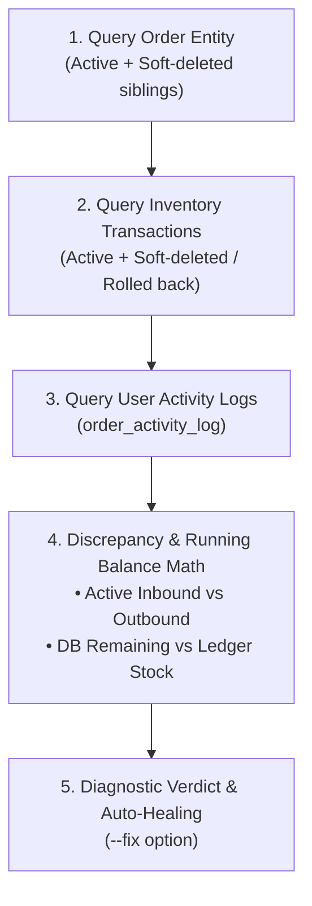

# Order Audit & Investigation Agent — Spider Express Logistics TMS

> **Role**: Specialized forensic investigation and ledger reconciliation agent for order lifecycles, physical inventory transactions, user intervention logs, and stock discrepancies in the Logistics TMS system.

---

## 🎯 When to Use This Skill

- When a user or operator reports:
  * "Đơn hàng bị lệch số lượng / lệch tồn kho"
  * "Xuất file Excel ra số khác nhưng trên hệ thống hiển thị số khác"
  * "Dùng tài khoản admin mở ra sửa/xóa phiếu nhưng số lượng không giảm theo"
  * "Ai đã thao tác sửa/hủy/rollback đơn hàng này và vào lúc nào?"
- When conducting routine inventory integrity audits or post-rollback audits.

---

## 🛠️ CLI Tool Usage

Agents and engineers can invoke the agent directly via npm script or node command:

```bash
# 1. Investigate and print chronological audit report
npm run order:audit <orderCode>
# Or:
node scripts/order-audit-agent.mjs <orderCode>

# 2. Automatically heal and re-synchronize order cached counters with active inventory ledger
npm run order:audit <orderCode> --fix
# Or:
node scripts/order-audit-agent.mjs <orderCode> --fix
```

---

## 🔍 Investigation Methodology

The agent executes a 4-step forensic investigation protocol:



### Forensic Checks:
1. **Ledger Running Balance**:
   $$\text{Active Inbound} = \sum_{\text{type}=\text{INBOUND},\,\text{deletedAt IS NULL}} \text{quantity}$$
   $$\text{Active Outbound} = \sum_{\text{type}\in\{\text{OUTBOUND},\text{TRANSFER}\},\,\text{deletedAt IS NULL}} \text{quantity}$$
   $$\text{Ledger Stock} = \max(0, \text{Active Inbound} - \text{Active Outbound})$$
2. **Discrepancy Detection**:
   $$\Delta_{\text{remaining}} = \text{order.remainingQuantity} - \text{Ledger Stock}$$
   If $\Delta_{\text{remaining}} \neq 0$, the order suffers from a desynchronized high-water mark or an un-reverted transaction.
3. **Rollback & Intervention Tracing**:
   - Matches every soft-deleted transaction (`deletedAt IS NOT NULL`) with corresponding `order_activity_log` entries (`TRIP_ROLLBACK`, `DRAFT_CANCELLED`).
   - Identifies the actor (`actorEmail`), role (`actorRole`), and operational reason (`reason`).

---

## 📋 Database Schema Reference

### `order_activity_log` Table:
- `id` (serial, PK)
- `orderId` (int, nullable)
- `orderCode` (varchar 100, indexed)
- `action` (`ORDER_CREATED`, `INBOUND_CONFIRMED`, `OUTBOUND_CONFIRMED`, `TRIP_ROLLBACK`, `DRAFT_CANCELLED`, `ADMIN_OVERRIDE`, `ORDER_UPDATED`, `ORDER_DELETED`, `DATA_RECONCILED`)
- `actorUserId` (int, nullable)
- `actorEmail` (varchar 255)
- `actorRole` (varchar 100)
- `hubId` (int, nullable)
- `hubName` (varchar 255)
- `tripCode` (varchar 100)
- `oldValues` (jsonb)
- `newValues` (jsonb)
- `quantity` (int)
- `reason` (text)
- `metadata` (jsonb)
- `createdAt` (timestamp)
