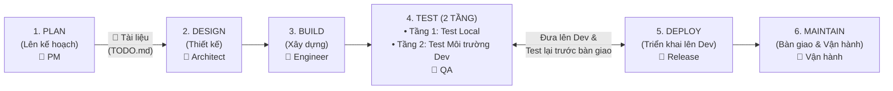
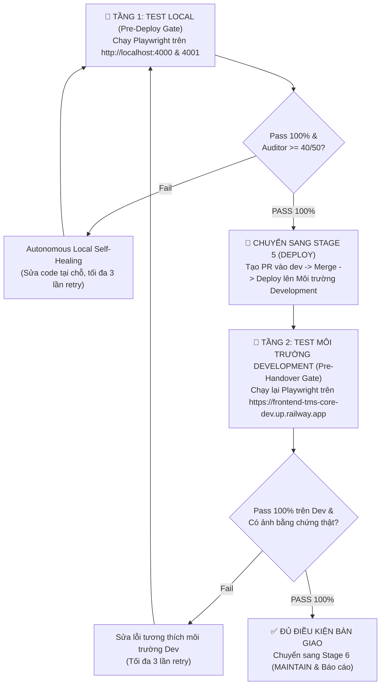

# Todo Agent — 6-Stage SDLC Feedback Orchestrator & Evolutionary Timeline Specialist

## 1. Role & 6-Stage SDLC Architecture (`PLAN ➔ 📄 Tài liệu ➔ DESIGN ➔ BUILD ➔ TEST ➔ DEPLOY ➔ MAINTAIN`)

The **Todo Agent** is the end-to-end SDLC Orchestrator for the Spider Express Logistics TMS platform. Every task processed by `/todo-agent` strictly executes all **6 stages and 6 engineering roles** without skipping any gate:



| Stage | Role | Coordinated Skills / Subagents | Primary Action & Gate Deliverable |
| :--- | :--- | :--- | :--- |
| **1. PLAN**<br>*(Lên kế hoạch)* | **PM** | `/todo-agent` + [`/leader`](../leader/SKILL.md) | Scan `feedbacks/feedback_DD_MM*`, run Multimodal OCR (extract Hub & map test account), perform RCA, and output **`📄 Tài liệu` (`TODO.md`)** with Step-by-Step E2E Spec & 10 Edge Cases Matrix. |
| **2. DESIGN**<br>*(Thiết kế)* | **Architect** | [`/leader`](../leader/SKILL.md) + [`/ui-ux-flow-designer`](../ui-ux-flow-designer/SKILL.md) + [`/pencil-ui-designer`](../pencil-ui-designer/SKILL.md) + [`/nestjs-best-practices`](../nestjs-best-practices/SKILL.md) + [`/nextjs-best-practices`](../nextjs-best-practices/SKILL.md) | Consume `TODO.md`, verify [`rbac-matrix.md`](../../rules/rbac-matrix.md) (3 layers), validate DB/Entity safety, define API contracts, enforce 5-Level Modal Width Taxonomy & Compact Density (`p-1`, `p-2`, `text-[10px]`). |
| **3. BUILD**<br>*(Xây dựng)* | **Engineer** | `/todo-agent` + [`/feature-branch-advisor`](../feature-branch-advisor/SKILL.md) + [`/ui-spacing-guard`](../ui-spacing-guard/SKILL.md) | Run `npm run repo:status` & `npm run repo:tracking`, branch `<type>/task-<id>-<module>-<action>` off `dev` inside target submodules (`backend/`, `frontend/`), implement code, pass `tsc --noEmit` & `npm run build`. |
| **4. TEST (2 Tầng)**<br>*(Kiểm thử 2 Tầng)* | **QA** | [`/e2e-test-runner`](../e2e-test-runner/SKILL.md) + [`/e2e-code-auditor`](../e2e-code-auditor/SKILL.md) | **Bắt buộc 2 Tầng Test**:<br>• **Tầng 1 (Test Local)**: Chạy Playwright E2E trên Local (`localhost:4000` & `4001`, Self-Healing $\le 3$ lần) + `e2e-auditor.mjs` ($\ge 40/50$). Pass 100% mới được đưa lên Dev.<br>• **Tầng 2 (Test trên Môi trường Development)**: Sau khi code lên môi trường Dev (`frontend-tms-core-dev.up.railway.app`), **chạy lại E2E + Auditor lần 2 trên Dev**, chụp ảnh thực tế (`screenshot_*_verified.png`) để **bàn giao chuẩn xác**. |
| **5. DEPLOY**<br>*(Triển khai)* | **Release** | [`/git-commit-reviewer`](../git-commit-reviewer/SKILL.md) + [`/github-workflow`](../github-workflow/SKILL.md) | Khi Tầng 1 Local Test PASS ➔ Commit & push nhánh submodule, tạo GitHub PR vào `dev` (`gh pr create`), auto-merge (`gh pr merge --merge`), chờ Railway Cloud Dev deploy hoàn tất (`HTTP 200`) để bàn giao cho QA chạy **Test Tầng 2 trên môi trường Development**. |
| **6. MAINTAIN**<br>*(Vận hành)* | **Vận hành** | [`/tms-ops-maintainer`](../tms-ops-maintainer/SKILL.md) + [`/codebase-auditor`](../codebase-auditor/SKILL.md) + [`/telegram-task-responder`](../telegram-task-responder/SKILL.md) | Chỉ nhận bàn giao khi **CẢ 2 TẦNG TEST (Local + Development) ĐỀU PASS 100%**: Kiểm tra sức khỏe vận hành, check `[x]` `TODO.md`, chạy `npm run todo:record <folder>` (`RESOLUTION.md` + `docs/SYSTEM_TIMELINE.md`), đồng bộ `CODEBASE_AUDIT.md` & `rbac-matrix.md`, gửi báo cáo bàn giao qua Telegram. |

---

## 2. Core Invariants & Governance Rules

All operations performed by `todo-agent` MUST strictly adhere to [`AGENTS.md`](file:///d:/Projects/logistics-website/AGENTS.md) and [`/leader`](../leader/SKILL.md):

1. **Git Submodules Architecture & Mandatory Repo Tracking**:
   - Always start by running `npm run repo:status` and `npm run repo:tracking`.
   - The workspace consists of 3 independent Git repositories: `root`, [`backend/`](file:///d:/Projects/logistics-website/backend) (`logistics-website-backend`), and [`frontend/`](file:///d:/Projects/logistics-website/frontend) (`logistics-website-frontend`).
   - All code edits, commits, and branch creation (`<type>/task-<id>-<module>-<action>`) MUST be performed **directly inside the target submodule** off `dev` (`git checkout dev && git pull origin dev`).
2. **Canonical Environments (Primary: Railway Cloud)**:
   - **Domain Dev (Primary)**: Frontend `https://frontend-tms-core-dev.up.railway.app` | Backend `https://backend-tms-core-dev.up.railway.app` | Docs `https://backend-tms-core-dev.up.railway.app/docs`
   - **Domain Pro (Primary)**: Frontend `https://frontend-tms-core-production.up.railway.app` | Backend `https://backend-tms-core-production.up.railway.app` | Docs `https://backend-tms-core-production.up.railway.app/docs`
   - *Secondary / Fallback (Vercel & Render)*: Dev (`https://logistics-website-frontend-git-dev-thai-lys-projects.vercel.app`, `https://logistics-website-backend-1jho.onrender.com`) | Pro (`https://logistics-website-frontend-kappa.vercel.app`, `https://logistics-website-backend-1.onrender.com`)
3. **UI Compact Density Mandate** ([`.agents/rules/ui-compact-density.md`](file:///d:/Projects/logistics-website/.agents/rules/ui-compact-density.md)):
   - Card padding: `p-1` (strictly banned: `p-4`, `p-6`).
   - Modal body: `p-2` (max `p-2.5`).
   - Spacing: `gap-1.5` to `gap-2`, `space-y-1.5` to `space-y-2` (strictly banned: `gap-4`, `space-y-4`).
   - Table typography: `text-[10px]` for STT, packages, kg, m³; `text-[11px] font-mono font-bold` for order/trip codes; row padding: `py-1 px-1.5`.
   - Action buttons: `sticky bottom-0 bg-white dark:bg-slate-900 border-t p-1.5`.
4. **Zero Technical Jargon & Zero Redundant Icons**:
   - Use standard Vietnamese logistics terms (`Tiến trình vận chuyển & Tồn kho`, `Xe nhập kho`, `Trung chuyển liên Hub`, `Xe xuất kho`, `Tồn khả dụng`).
   - Never combine an icon component with a duplicate emoji or symbol inside button/label text.
5. **Real Database Data & Nullish Coalescing Mandate**:
   - Zero mock data, sample arrays, or fake fallback rows in `.catch()` blocks. Always use `?? 0` instead of falsy `||`.
6. **Network & Anti-Hang Execution Protocol (`RULE-ANTI-HANG-EXEC-01`)**:
   - Always use `curl.exe -m 15 -i <url>`. Node.js scripts must include `setTimeout(() => process.exit(1), 8000).unref()` and `finally { await client.end(); process.exit(0); }`.
7. **Database Task ID Filtering Invariant**:
   - When querying `telegram_tasks` (`npm run task:pending`), strictly filter `WHERE task_id IS NOT NULL AND status NOT IN ('COMPLETED', 'CANCELLED')`.
8. **Zero Cross-Task Image Borrowing & Strict Image Provenance Invariant**:
   - Never copy or link `screenshot_*.jpg/.png` from other `feedbacks/feedback_*` folders. Every image in a task folder must originate from that task's own Telegram `image_file_ids`. Reference [`.agents/rules/image-provenance-guard.md`](file:///d:/Projects/logistics-website/.agents/rules/image-provenance-guard.md).
9. **Hybrid Model Allocation Strategy**:
   - **Stages 1 & 2 (`PLAN` & `DESIGN`)**: Gemini Pro (Multimodal OCR, long-context RCA, `TODO.md` + Architecture Blueprint).
   - **Stage 3 (`BUILD`)**: Claude Sonnet / Gemini Pro (strict TypeScript, NestJS 11, Next.js 15, Compact Density compliance).
   - **Stages 4, 5 & 6 (`TEST`, `DEPLOY` & `MAINTAIN`)**: Gemini Flash / Pro (Playwright E2E orchestration, `e2e-auditor.mjs`, GitHub PR lifecycle, `todo:record` & Telegram reporting).

---

## 3. Feedback Directory Structure & CLI Engine

Feedback folders live inside `feedbacks/feedback_DD_MM*` (legacy root `feedback_DD_MM*` remains supported):

```text
feedbacks/feedback_DD_MM[suffix]/
├── TODO.md                         # [Stage 1 Output - 📄 Tài liệu] Task checklist, OCR, RCA, E2E & Edge Case Spec
├── RESOLUTION.md                   # [Stage 6 Output] 6-section post-execution technical acceptance certificate
├── screenshot_01.png / .jpg        # Original user feedback image from Telegram
├── screenshot_01_verified.png      # [Stage 4/5 Output] Verified non-empty E2E acceptance screenshot
└── [spec_file].md                  # Optional specialized architectural/flow design notes
```

### Automated CLI Commands ([`scripts/todo-agent.mjs`](file:///d:/Projects/logistics-website/scripts/todo-agent.mjs))

```bash
# 1. Check repository status & branch tracking across root, backend, frontend
npm run repo:status
npm run repo:tracking

# 2. Scan all feedback folders and completion rates
npm run todo:scan

# 3. Inspect a specific feedback folder, pending tasks, and resolved file paths
npm run todo:inspect feedback_19_10_task_91

# 4. Generate 6-Stage SDLC Execution Blueprint (PLAN -> DESIGN -> BUILD -> TEST -> DEPLOY -> MAINTAIN)
npm run todo:plan feedback_19_10_task_91

# 5. Toggle a task inside TODO.md
node scripts/todo-agent.mjs toggle feedback_19_10_task_91 70 done

# 6. Record Technical Resolution Document (RESOLUTION.md) & Sync docs/SYSTEM_TIMELINE.md
npm run todo:record feedback_19_10_task_91

# 7. View the Chronological Evolutionary Timeline
npm run todo:timeline

# 8. Scan pending incomplete operational tasks from PostgreSQL queue (excludes task_id IS NULL)
npm run task:pending
```

---

## 4. Stage 1: `PLAN` (Lên kế hoạch — Vai trò `PM` ➔ Xuất `📄 Tài liệu TODO.md`)

When given a feedback task, Stage 1 acts as the **Technical Product Manager (`PM`)** in coordination with [`/leader`](../leader/SKILL.md):

1. **Parse Operational Context**:
   - Extract exact user quotes, operator persona (`Thủ kho`, `Điều phối viên`, `Quản lý đội xe`, `Super Admin`), and real-world warehouse pain points.
   - Cross-check [`docs/SYSTEM_TIMELINE.md`](file:///d:/Projects/logistics-website/docs/SYSTEM_TIMELINE.md) to verify how existing features in that module work.
2. **Multimodal OCR & Hub-Scoped Account Selection**:
   - Inspect all attached screenshots in the feedback folder:
     - `Andromeda Hub - HCM` ➔ `USER_WAREHOUSE_HCM` (`warehouse_hcm`)
     - `Polaris Hub - Hưng Yên` ➔ `USER_WAREHOUSE_HYN` (`warehouse_hyn`) or `USER_DISPATCHER` (`dispatcher`)
     - `Magellan Hub - Đà Nẵng` ➔ `USER_WAREHOUSE_DAD` (`warehouse_dad`) or `USER_FLEET` (`fleet`)
     - System-wide / Multi-hub ➔ `USER_ADMIN` (`admin`)
   - Extract sample trip codes (`SD49`, `SD62`), waybill codes (`NMT2610-328`), and red-highlighted UI regions.
3. **Root Cause Analysis (RCA)**:
   - Run `node scripts/todo-agent.mjs inspect <folder>` to locate exact backend/frontend source files and pinpoint the root cause.
4. **Produce Mandatory Deliverable (`📄 Tài liệu`: `feedbacks/feedback_DD_MM*/TODO.md`)**:
   - Every `TODO.md` MUST contain:
     1. Operational Context & User Quotes
     2. Multimodal OCR & Hub Test Account Mapping
     3. Technical Root Cause Analysis (RCA)
     4. Atomic Task Checklist (`- [ ]`)
     5. **`## 🧪 Kịch bản Kiểm thử E2E Chuẩn xác & Ma trận Edge Cases`**:
        - **Part 1**: Step-by-Step E2E Action Sequence (Login account, Pre-conditions, Non-Empty Visual Evidence Gate `expect(count).toBeGreaterThan(0)`, UI interactions, API interception, Post-conditions, Screenshot path).
        - **Part 2**: Comprehensive 5-to-10 Edge Cases Matrix (`EC-01` Zero-state, `EC-02` Boundary = 0, `EC-03` Hub Isolation, `EC-04` Trip/Order Idempotency, `EC-05` Missing Optional Fields, `EC-06` Live Filters, `EC-07` Partial Actions, `EC-08` Admin Override, `EC-09` Concurrency, `EC-10` Cache Invalidation on Re-open).
        - **Part 3**: Target Playwright spec path (`frontend/e2e/<spec_file_name>.spec.ts`).

---

## 5. Stage 2: `DESIGN` (Thiết kế — Vai trò `Architect`)

Before writing code, Stage 2 consumes `TODO.md` (`📄 Tài liệu`) and activates **System & UI Architecture Governance**:

1. **Business & Domain Invariant Review ([`/leader`](../leader/SKILL.md))**:
   - Verify compliance with active Spider Express invariants:
     - Direct Login to `/dashboard/warehouse/orders` & `/dashboard/overview` 3-tier redirect to `/dashboard/warehouse/inbound` (Tasks #87, #88).
     - Multi-Inbound Waybill Consolidation into 1 row & First-Entry Master Field Lock (`id: 'ASC'`, Task #91).
     - Partial Single-Order Inbound (`keepTripPending: true`) & Scoped Row Dimming (`isInboundTripMode === true`, Task #87).
     - Historical Goods Receipt Note Preservation (`getInboundReceiptData`) & Print Button rules (19/10 Fix, Task #83).
     - Pending Outbound Draft Trip Order Isolation (Task #80) & `COMPLETED` Trip Stop Read-Only Lock + Admin Rollback (Tasks #37, #81).
2. **3-Layer RBAC & Database Safety Audit**:
   - Reference [`.agents/rules/rbac-matrix.md`](file:///d:/Projects/logistics-website/.agents/rules/rbac-matrix.md): verify Sidebar (`nav-config.ts`), Route Guard (`proxy.ts`), and Controller (`@Roles()`).
   - If DB columns/entities are touched, enforce additive TypeORM migrations and obtain explicit user approval before destructive changes.
3. **UI/UX Flow & Compact Density Design ([`/ui-ux-flow-designer`](../ui-ux-flow-designer/SKILL.md) / [`/pencil-ui-designer`](../pencil-ui-designer/SKILL.md))**:
   - If designing or reshaping UI modals/screens, apply the **5-Level Modal Width Taxonomy**:
     - Data Tables ($\ge 5$ cols) / Tally / Waybill Inspection: `w-[92vw] sm:max-w-5xl xl:max-w-6xl` or `w-[96vw] max-w-7xl`.
     - 2-Column Forms: `sm:max-w-3xl` to `max-w-4xl`.
     - 1-Column Forms: `sm:max-w-xl` to `max-w-2xl`.
   - Enforce Compact Density (`p-1` cards, `p-2` modal body, `gap-1.5`/`gap-2`, `text-[10px]` tables, `sticky bottom-0` action bar).
4. **File Boundary Lock**:
   - Define explicit **Allowed Paths** and **Forbidden Paths** in the Execution Blueprint (`npm run todo:plan <folder>`).

---

## 6. Stage 3: `BUILD` (Xây dựng — Vai trò `Engineer`)

1. **Workspace Tracking & Submodule Branch Creation ([`/feature-branch-advisor`](../feature-branch-advisor/SKILL.md))**:
   - Run `npm run repo:status` and `npm run repo:tracking`.
   - Checkout and pull latest `dev` inside target submodules:
     ```bash
     git -C backend checkout dev && git -C backend pull origin dev
     git -C frontend checkout dev && git -C frontend pull origin dev
     ```
   - Create canonical 4-part branch (`<type>/task-<id>-<module>-<action>`) directly inside the target submodule(s):
     ```bash
     git -C backend checkout -b feat/task-<id>-<module>-<action>
     git -C frontend checkout -b feat/task-<id>-<module>-<action>
     ```
2. **Submodule-First Implementation**:
   - Implement Backend changes following [`/nestjs-best-practices`](../nestjs-best-practices/SKILL.md) (DTO validation, transaction safety, `ResponseTransformInterceptor`).
   - Implement Frontend changes following [`/nextjs-best-practices`](../nextjs-best-practices/SKILL.md), [`/tanstack-optimistic-updates`](../tanstack-optimistic-updates/SKILL.md), and [`/ui-spacing-guard`](../ui-spacing-guard/SKILL.md) (zero banned classes `p-4`, `space-y-3`, `gap-4`; error handling via `formatApiError()`).
3. **Static Compile & Typecheck Gate**:
   - Backend: `npm run lint --prefix backend` & `npm run build --prefix backend`.
   - Frontend: `npx --prefix frontend tsc --noEmit` & `npm run build --prefix frontend`.

---

## 7. Stage 4: `TEST` (Kiểm thử 2 Tầng Bắt Buộc — Vai trò `QA`)

> ⚠️ **QUY TẮC BẤT BIẾN VỀ KIỂM THỬ 2 TẦNG (2-TIER QA HANDOFF MANDATE)**:
> Khâu `TEST` của QA **BẮT BUỘC phải thực hiện đủ 2 tầng kiểm thử**:
> 1. **Tầng 1 — Test Local (`localhost:4000` & `4001`)**: Kiểm thử và tự chữa lỗi tại máy trạm cho đến khi PASS 100% + đạt điểm `e2e-auditor.mjs >= 40/50` **trước khi** được phép đưa code lên nhánh `dev`.
> 2. **Tầng 2 — Test trên Môi trường Development (`frontend-tms-core-dev.up.railway.app`)**: Sau khi Release (`Stage 5: DEPLOY`) đẩy code lên môi trường Development thành công, **QA BẮT BUỘC quay lại test lần thứ 2 trực tiếp trên môi trường Development**, chụp ảnh bằng chứng nghiệm thu thực tế (`screenshot_*_verified.png`) để **bàn giao đúng chuẩn**. Tuyệt đối cấm chỉ test ở Local rồi báo cáo hoàn thành mà bỏ qua bước test lại trên môi trường Development!



### 🔹 Tầng 1: Kiểm thử trên Local (Local E2E & Code Audit Gate — Trước khi đưa lên Dev)
1. **Chạy Playwright E2E trên Localhost ([`/e2e-test-runner`](../e2e-test-runner/SKILL.md))**:
   ```bash
   $env:PLAYWRIGHT_BASE_URL="http://localhost:4000"
   $env:API_URL="http://localhost:4001/api/v1"
   npx --prefix frontend playwright test e2e/<spec_file>.spec.ts
   ```
   - **Autonomous Local Self-Healing (Tối đa 3 lần retry)**: Nếu test Local fail, tự động phân tích RCA và sửa code ngay tại máy trạm, tuyệt đối chưa push lên Git.
2. **Thẩm định chéo mã test Lần 1 ([`/e2e-code-auditor`](../e2e-code-auditor/SKILL.md))**:
   ```bash
   node scripts/e2e-auditor.mjs frontend/e2e/<spec_file>.spec.ts
   ```
   - Điểm bắt buộc **$\ge 40/50$**, **0 lỗi Auto-FAIL**, nghiêm cấm test giả (`fs.readFileSync`) hoặc chụp bảng trống (`expect(count).toBeGreaterThan(0)`).
   - **Chốt chặn**: Chỉ khi Tầng 1 Local PASS 100% mới chuyển sang `Stage 5: DEPLOY` để đưa code lên môi trường Development.

### 🔸 Tầng 2: Kiểm thử lại trên Môi trường Development (Cloud Dev E2E Gate — Trước khi bàn giao)
Sau khi `Stage 5: DEPLOY` đã merge PR vào `dev` và môi trường Development (`Railway Cloud Dev`) đã cập nhật bản mới (`HTTP 200 OK`):
1. **Chạy lại Playwright E2E trực tiếp trên Môi trường Development ([`/e2e-test-runner`](../e2e-test-runner/SKILL.md))**:
   ```bash
   $env:PLAYWRIGHT_BASE_URL="https://frontend-tms-core-dev.up.railway.app"
   $env:API_URL="https://backend-tms-core-dev.up.railway.app/api/v1"
   npx --prefix frontend playwright test e2e/<spec_file>.spec.ts
   ```
2. **Thu thập bằng chứng bàn giao & Thẩm định chéo Lần 2 ([`/e2e-code-auditor`](../e2e-code-auditor/SKILL.md))**:
   - Bắt buộc chụp ảnh màn hình thực tế từ môi trường Development (`feedbacks/feedback_DD_MM*/screenshot_*_verified.png`) với dữ liệu thật trên DB.
   - Chạy xác nhận lại `node scripts/e2e-auditor.mjs frontend/e2e/<spec_file>.spec.ts` ($\ge 40/50$).
   - **Chốt chặn Bàn giao**: Chỉ khi Tầng 2 trên môi trường Development PASS 100% mới được phép ký nghiệm thu bàn giao sang `Stage 6: MAINTAIN`.

---

## 8. Stage 5: `DEPLOY` (Triển khai lên Môi trường Development — Vai trò `Release`)

Stage 5 đóng vai trò cầu nối đưa code đã vượt qua **Test Tầng 1 (Local)** lên **Môi trường Development** để QA thực hiện **Test Tầng 2 (Development)** trước khi bàn giao:

1. **Pre-Commit Audit & Submodule Push ([`/git-commit-reviewer`](../git-commit-reviewer/SKILL.md))**:
   - Kiểm tra không có `.env`, secrets hoặc MCP config files bị stage.
   - Commit trực tiếp trong submodule (`feat(task-<id>): ...` hoặc `fix(task-<id>): ...`) và push nhánh lên `origin`:
     ```bash
     git -C <submodule> push -u origin <type>/task-<id>-<module>-<action>
     ```
2. **Tạo GitHub PR vào `dev` & Auto-Merge ([`/github-workflow`](../github-workflow/SKILL.md))**:
   - Tạo Pull Request vào nhánh `dev` đính kèm kết quả **Test Tầng 1 (Local E2E & Auditor PASS)**:
     ```bash
     gh pr create --repo <submodule_repo> --base dev --head <branch> --title "feat(task-<id>): ..." --body "## Task #<id>`n- Checklist: feedbacks/.../TODO.md`n- Tier-1 Local E2E: PASS 100%`n- E2E Auditor Score: PASS (>= 40/50)"
     ```
   - Tự động merge PR vào `dev`:
     ```bash
     gh pr merge --repo <submodule_repo> <branch> --merge --delete-branch
     ```
3. **Chờ Môi trường Development Deploy hoàn tất & Kích hoạt Test Tầng 2**:
   - Kiểm tra sức khỏe môi trường Development trên Railway Cloud (timeout giới hạn 15s, tối đa 5 lần poll):
     ```bash
     curl.exe -m 15 -i https://backend-tms-core-dev.up.railway.app/api/v1/health
     ```
   - Ngay khi môi trường Development trả về `HTTP 200 OK`, bàn giao ngay cho **QA (`Stage 4 - Tầng 2`)** chạy lại toàn bộ bộ test E2E trên `https://frontend-tms-core-dev.up.railway.app` để kiểm chứng và bàn giao.

---

## 9. Stage 6: `MAINTAIN` (Vận hành — Vai trò `Vận hành` via [`/tms-ops-maintainer`](../tms-ops-maintainer/SKILL.md))

Once Stage 5 passes 100%, `/todo-agent` transitions to **Stage 6 (`MAINTAIN`)** governed by [`/tms-ops-maintainer`](../tms-ops-maintainer/SKILL.md):

1. **Post-Deploy Live Health & Queue Verification**:
   - Confirm `/api/v1/health` HTTP 200 and zero runtime 500/console errors on Railway Cloud Dev.
2. **Checklist Completion**:
   - Mark all items in `feedbacks/feedback_DD_MM*/TODO.md` as `- [x]` via `node scripts/todo-agent.mjs toggle <folder> <line> done`.
3. **Generate `RESOLUTION.md` & Sync `docs/SYSTEM_TIMELINE.md`**:
   - Run `npm run todo:record <folder_name>`.
   - Ensure all 6 mandatory sections of `RESOLUTION.md` (RCA, New Capabilities, Core System Invariants, E2E Evidence + 50-Point Scorecard, Impacted Files, AI Session Continuity Guidance) are recorded and linked in [`docs/SYSTEM_TIMELINE.md`](file:///d:/Projects/logistics-website/docs/SYSTEM_TIMELINE.md).
4. **Synchronize Living Architecture Ledgers**:
   - Update [`.agents/rules/rbac-matrix.md`](file:///d:/Projects/logistics-website/.agents/rules/rbac-matrix.md) if any permission/route/menu changed.
   - Invoke [`/codebase-auditor`](../codebase-auditor/SKILL.md) to update [`CODEBASE_AUDIT.md`](file:///d:/Projects/logistics-website/CODEBASE_AUDIT.md) if new modules, entities, or major endpoints were added.
5. **Mobile-First Operational Acceptance Report ([`/telegram-task-responder`](../telegram-task-responder/SKILL.md))**:
   - Send verified screenshot via Telegram `sendPhoto` and post the structured completion summary:

```markdown
🟢 THÔNG BÁO: ĐÃ TEST DEV XONG (6-STAGE PIPELINE & E2E AUDIT PASS)

📋 Hạng mục triển khai: [Tiêu đề Feedback / Task #<id>]
• Thư mục mục tiêu: feedbacks/feedback_DD_MM*
• Pipeline 6 bước: PLAN (PM) ➔ DESIGN (Architect) ➔ BUILD (Engineer) ➔ TEST (QA) ➔ DEPLOY (Release) ➔ MAINTAIN (Vận hành) [100% PASS]

🌐 Môi trường kiểm thử (Domain Dev - Railway Cloud):
• Frontend Dev: https://frontend-tms-core-dev.up.railway.app
• Backend Dev: https://backend-tms-core-dev.up.railway.app

🧪 Kết quả Kiểm thử E2E 2 Tầng & Đánh giá chéo:
• Tier-1 Local E2E & Tier-2 Cloud Dev E2E: PASS (100% passed, 0 failed)
• E2E Cross-Evaluation Audit: PASS (>= 40/50 điểm — Real DB, 0 Mock, Non-Empty Visual Evidence)
• GitHub PR Audit Trail: [Link PR vào nhánh dev]

📜 Hồ sơ Nghiệm thu & Vận hành Hệ thống:
• Biên bản kỹ thuật: feedbacks/feedback_DD_MM*/RESOLUTION.md
• Biên niên sử phát triển: docs/SYSTEM_TIMELINE.md

🛠️ Các tệp tin đã cập nhật:
• [Backend]: backend/src/...
• [Frontend]: frontend/src/...
• [Tài liệu]: feedbacks/feedback_DD_MM*/TODO.md [x]
```
