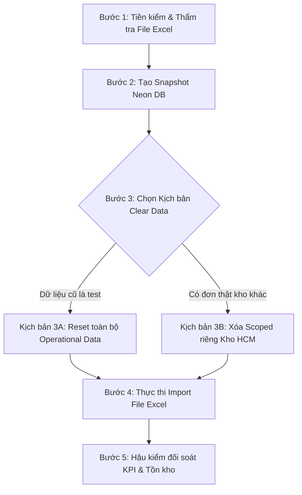

# KỊCH BẢN VẬN HÀNH: LÀM SẠCH DỮ LIỆU & IMPORT TỒN KHO HCM (SPIDER EXPRESS TMS)

> **Mã quy trình**: `RUNBOOK-OPS-HCM-INVENTORY-IMPORT-01`  
> **Áp dụng**: Andromeda Hub - HCM (Hub Cấp 1, `hubId = 1`, Code: `HUB-HCM-01`)  
> **Mục tiêu**: Làm sạch dữ liệu hàng hóa cũ (hoặc reset dữ liệu test) và nạp bảng kê tồn kho thực tế từ file Excel vào hệ thống.  
> **Tài khoản kiểm thử/thực thi**: 
> - **Cách 1 (SUPER ADMIN)**: Tài khoản `admin` (Super Admin có toàn quyền hệ thống, khi nạp phải chọn đích danh **Andromeda Hub - HCM**).
> - **Cách 2 (Thủ kho HCM)**: Tài khoản `warehouse_hcm` (Đã được hệ thống gán cố định `hubId = 1` - Kho HCM).

---

## ⚠️ NGUYÊN TẮC AN TOÀN SỐNG CÒN (SAFETY INVARIANTS)

1. **TUYỆT ĐỐI KHÔNG DROP DATABASE / DROP TABLE**:
   - Chỉ thao tác làm sạch dữ liệu nghiệp vụ (Operational Data) trên các bảng giao dịch: `order`, `order_inventory_transaction`, `trip`, `trip_stop`, `order_code_counter`.
   - **NGHIÊM CẤM** xóa hoặc truncate các bảng Danh mục nền (Master Data): `user`, `role`, `hub`, `vehicle`, `driver`, `file`.
2. **LUÔN CÓ BẢN SAO LƯU (BACKUP / SNAPSHOT) TRƯỚC KHI XÓA**:
   - Phải tạo Neon Database Snapshot hoặc dump dữ liệu trước khi chạy script xóa.
3. **MỌI CÂU LỆNH SQL PHẢI BỌC TRONG TRANSACTION**:
   - Sử dụng `BEGIN; ... COMMIT;` để nếu xảy ra lỗi khóa ngoại hoặc gián đoạn mạng, cơ sở dữ liệu sẽ tự động rollback an toàn.

---

## 📋 QUY TRÌNH 5 BƯỚC THỰC HIỆN CHI TIẾT



---

### BƯỚC 1: TIỀN KIỂM & THẨM TRA FILE EXCEL (PRE-FLIGHT)

Trước khi import, AI hoặc người vận hành cần kiểm tra định dạng file Excel đảm bảo các tiêu chí sau:

1. **Cấu trúc cột chuẩn**:
   | Tên cột Excel | Bắt buộc? | Mô tả & Quy chuẩn dữ liệu |
   | :--- | :---: | :--- |
   | **Mã vận đơn** | Tùy chọn | Nếu để trống hoặc điền `(TỰ SINH KHI LƯU)`, hệ thống tự cấp theo định dạng `HCM-2610-xxx`. Nếu có mã riêng từ khách hàng, hệ thống lưu giữ nguyên. |
   | **Địa chỉ nhận / Nơi gửi** | Bắt buộc | Mặc định là Kho HCM: `Andromeda Hub - Khu Công Nghệ Cao, TP. Thủ Đức, TP. Hồ Chí Minh`. |
   | **Tên hàng / Loại hàng** | Bắt buộc | Mô tả hàng hóa thực tế (ví dụ: *Linh kiện máy móc, Thùng carton, Sơn nước...*). |
   | **Số kiện** | Bắt buộc | Số nguyên $\ge 1$ (không để trống, không âm, không ghi chữ). |
   | **Số kg (Khối lượng)** | Bắt buộc | Kiểu số (ví dụ: `25.5` hoặc `120`). Tránh kèm ký tự như `kg`, `kí`. |
   | **Số m³ (Thể tích)** | Bắt buộc | Kiểu số (ví dụ: `0.15` hoặc `1.2`). |
   | **Địa chỉ giao** | Bắt buộc | Địa chỉ trả hàng thực tế của khách hàng hoặc đại lý nhận. |
   | **Tỉnh / TP** | Khuyến nghị | Tỉnh/thành nơi giao đến (dùng để lọc và gợi ý xe bo sau này). |
   | **Ghi chú / Chứng từ** | Tùy chọn | Chứng từ đi kèm (BCT, Hóa đơn VAT, Giấy tờ kiểm dịch...). |

2. **Rà soát dữ liệu rác trong Excel**:
   - Xóa các dòng tiêu đề thừa, các dòng merge ô làm chú thích tổng.
   - Xóa các dòng trống ở cuối sheet.
   - Đảm bảo không bị trùng lặp cùng một `Mã vận đơn` trong nhiều dòng khác nhau của file.

---

### BƯỚC 2: SAO LƯU CƠ SỞ DỮ LIỆU DỰ PHÒNG (BACKUP SNAPSHOT)

Trước khi thực hiện lệnh xóa dữ liệu, chụp một Snapshot cơ sở dữ liệu để có thể phục hồi ngay lập tức nếu cần:
- **Cách 1 (TỰ ĐỘNG 100% qua Script `import-hcm-inventory.mjs` - KHUYẾN NGHỊ)**:
  - Script đã được tích hợp cơ chế **Auto-Backup tự động**: Ngay trước khi thực thi lệnh xóa (`--mode=truncate` hoặc `--mode=scoped`), script sẽ tự động query và lưu toàn bộ bảng `order`, `order_inventory_transaction`, `trip`, `trip_stop`, `order_code_counter` ra file `backups/backup_tms_operational_<timestamp>.json`.
  - Nếu muốn **chủ động backup riêng trước** mà chưa xóa hay nạp gì:
    ```bash
    node scripts/import-hcm-inventory.mjs --backup-only
    ```
  - Nếu muốn **hoàn tác / phục hồi lại dữ liệu cũ** bất kỳ lúc nào:
    ```bash
    node scripts/import-hcm-inventory.mjs --restore="backups/backup_tms_operational_xxx.json"
    ```

- **Cách 2 (Neon Console Cloud Snapshot)**:
  - Vào Dashboard Neon -> Chọn Project -> Chọn Branch `dev` (hoặc `main`) -> Bấm **"Create Branch / Snapshot"** với tên: `backup_before_hcm_inventory_import`.

- **Cách 3 (CLI / pg_dump)**:
  ```bash
  # Lệnh dự phòng xuất dữ liệu ra file sql
  pg_dump -d "$DATABASE_URL" -t '"order"' -t '"order_inventory_transaction"' -t 'trip' -t 'trip_stop' -t 'order_code_counter' > backups/backup_orders_before_import.sql
  ```

---

### BƯỚC 3: LỰA CHỌN & THỰC THI CLEAR DATA

#### 🔴 KỊCH BẢN 3A: Reset sạch toàn bộ Operational Data (KHUYẾN NGHỊ TỐI ƯU)
> **Áp dụng khi**: Hệ thống đang ở giai đoạn chuẩn bị go-live / nghiệm thu dữ liệu thật, toàn bộ đơn hàng và chuyến xe hiện tại trong DB là dữ liệu thử nghiệm (test data).  
> **Lợi ích**: Đảm bảo sạch sẽ 100%, không bị tồn kho ma, không bị lệch bộ đếm sinh mã `order_code_counter` và sequence chuyến `trip_code_sd_seq`.

Chạy đoạn lệnh SQL sau (trong Neon SQL Editor hoặc psql):

```sql
BEGIN;

-- 1. Xóa các bảng giao dịch kho và chặng dừng chuyến
TRUNCATE TABLE "order_inventory_transaction" CASCADE;
TRUNCATE TABLE "trip_stop" CASCADE;

-- 2. Xóa các chuyến xe điều phối
TRUNCATE TABLE "trip" CASCADE;

-- 3. Xóa toàn bộ hợp đồng đơn hàng
TRUNCATE TABLE "order" CASCADE;

-- 4. Đặt lại bộ đếm sinh mã vận đơn và chuỗi số chuyến xe
DELETE FROM "order_code_counter";
ALTER SEQUENCE IF EXISTS trip_code_sd_seq RESTART WITH 1;

COMMIT;
```

---

#### 🟡 KỊCH BẢN 3B: Chỉ xóa dữ liệu phụ thuộc riêng Kho HCM (Scoped Clear)
> **Áp dụng khi**: Hệ thống đã chạy thực tế ở các kho khác (Polaris Hưng Yên, Magellan Đà Nẵng) và cần bảo toàn nguyên vẹn dữ liệu của các kho đó.

Chạy đoạn lệnh SQL sau:

```sql
BEGIN;

-- 1. Xác định danh sách ID các đơn hàng cần xóa thuộc Hub HCM (ID = 1)
-- Bao gồm: Đơn đang lưu tại HCM hoặc đơn có nguồn gốc từ HCM chưa giao
CREATE TEMP TABLE temp_hcm_order_ids AS
SELECT id FROM "order"
WHERE "currentHubId" = 1 
   OR ("originHubId" = 1 AND ("destinationHubId" IS NULL OR "destinationHubId" = 1));

-- 2. Xóa giao dịch kho liên quan đến các đơn hàng này hoặc giao dịch lập tại Hub HCM
DELETE FROM "order_inventory_transaction"
WHERE "orderId" IN (SELECT id FROM temp_hcm_order_ids)
   OR "hubId" = 1;

-- 3. Xóa các chuyến xe gắn liền với đơn hàng của HCM
DELETE FROM "trip"
WHERE "orderId" IN (SELECT id FROM temp_hcm_order_ids)
   OR "originHubId" = 1;

-- 4. Xóa chính các đơn hàng của kho HCM
DELETE FROM "order"
WHERE id IN (SELECT id FROM temp_hcm_order_ids);

-- 5. Xóa bảng tạm
DROP TABLE temp_hcm_order_ids;

COMMIT;
```

---

### BƯỚC 4: THỰC THI IMPORT FILE EXCEL

#### Cách 1: Nạp trực tiếp qua Giao diện Web (Khuyên dùng cho file $\le$ 300 dòng)
Hệ thống hỗ trợ 3 vị trí trên giao diện để nạp file Excel:

- **Vị trí 1 (Nhanh nhất - Ngay trên màn hình bạn đang xem)**:
  1. Tại trang **Tổng Hợp Đơn Hàng Tại Kho** (`/dashboard/warehouse/orders`), ở góc trên bên phải cạnh nút *"Xuất Excel tất cả"*, bấm nút **"Nhập Excel"** (nút xanh dương).
  2. Hệ thống sẽ mở ngay trang Chuyển đổi Excel để bạn tải file lên và đẩy vào kho.

- **Vị trí 2 (Trang chuyên dụng - Chuyển đổi Excel điều hành)**:
  1. Vào menu bên trái: chọn **Chuyển đổi Excel điều hành** (URL: `/dashboard/warehouse/excel-converter`).
  2. Kéo thả file Excel vào vùng tiếp nhận.
  3. Kiểm tra xem trước dữ liệu, sau đó bấm **"Chuyển sang bảng kê nhập kho"** để hoàn tất nạp tồn.

- **Vị trí 3 (Trên Bảng kê Nhập kho trực tiếp)**:
  1. Vào menu bên trái: chọn **Nhập kho** (URL: `/dashboard/warehouse/inbound`).
  2. Bấm nút xanh **"Tạo đơn nhập mới"**.
  3. Trên thanh công cụ của bảng kê, bấm nút **"Import Excel"** (hoặc nút **"Dán từ Excel"** nếu copy từ bảng tính).
  4. Chọn chế độ **"Thay thế bảng kê (REPLACE)"** và bấm **"Xác nhận nhập kho"**.
7. Hệ thống tự động:
   - Cấp một mã chuyến tiếp nhận nội bộ `SD...`
   - Cấp một Phiếu nhập kho chính thức `PNK-HCM-2610-xxx`
   - Đưa toàn bộ các dòng hàng vào trạng thái **Đang lưu kho** (`STORED / RECEIVED`) với vị trí hiện tại `currentHubId = 1`.

#### Cách 2: Nạp tự động qua Script Node.js (Khuyên dùng cho file lớn > 300 - 5.000 dòng)
Nếu file Excel có số lượng dòng rất lớn, nên chạy script Node.js trực tiếp để import theo lô (batch insert 100 dòng/lần) nhằm tránh timeout trình duyệt:
```bash
# Cú pháp chạy script import tồn kho
node scripts/import-hcm-inventory.mjs "duong/dan/den/file_ton_kho_hcm.xlsx"
```

---

### BƯỚC 5: HẬU KIỂM & NGHIỆM THU (POST-IMPORT AUDIT)

Sau khi import hoàn tất, bắt buộc chạy kiểm tra đối soát 3 yếu tố:

#### 1. Đối soát số liệu qua SQL (Reconciliation Query)
```sql
SELECT 
  COUNT(*) AS total_orders,
  SUM("totalQuantity") AS total_packages,
  ROUND(SUM("totalWeight")::numeric, 2) AS total_kg,
  ROUND(SUM("totalVolume")::numeric, 3) AS total_cbm
FROM "order"
WHERE "currentHubId" = 1;
```
👉 **Tiêu chí đạt**:
- `total_orders` phải bằng đúng số dòng hàng hợp lệ trong file Excel.
- `total_packages`, `total_kg`, `total_volume` phải khớp 100% với hàm `=SUM(...)` trên file Excel.

#### 2. Kiểm tra trên Giao diện Web
- Mở màn hình **Quản lý kho** (`/dashboard/warehouse/orders`), chuyển sang Hub **Andromeda Hub - HCM**.
- Tab **"Đang lưu kho"**: Phải hiển thị đầy đủ danh sách các kiện hàng vừa import.
- Thử nghiệm chức năng: Thử tạo 1 phiếu xuất xe bo hoặc xuất luân chuyển cho 1 đơn hàng bất kỳ để đảm bảo hàng tồn kho khả dụng bình thường, không gặp lỗi ràng buộc dữ liệu.

---

## 💬 PROMPT MẪU DÀNH CHO BẠN GIAO CHO AI TỐI NAY

Khi bạn bắt đầu phiên làm việc tối nay, bạn chỉ cần gửi đoạn prompt sau cho AI:

```markdown
Chào bạn, tối nay tôi cần thực hiện import file Excel hàng tồn kho HCM vào hệ thống theo đúng tài liệu runbook đã chuẩn bị sẵn tại:
file:///d:/Projects/logistics-website/docs/RUNBOOK_HCM_INVENTORY_IMPORT.md

Yêu cầu thực hiện:
1. Đọc kỹ file RUNBOOK_HCM_INVENTORY_IMPORT.md để nắm vững các nguyên tắc an toàn.
2. Kiểm tra dữ liệu hiện tại trong DB và thực hiện Clear data theo Kịch bản 3A (nếu là reset dữ liệu test) hoặc Kịch bản 3B (nếu chỉ xóa riêng Hub HCM).
3. Đọc và kiểm tra file Excel tồn kho tại: [ĐIỀN_ĐƯỜNG_DẪN_FILE_EXCEL_Ở_ĐÂY]
4. Tiến hành nạp dữ liệu vào hệ thống cho Andromeda Hub - HCM (hubId = 1).
5. Thực hiện Bước 5 Hậu kiểm số liệu và báo cáo kết quả đối soát tổng số kiện, kg, m³ cho tôi.
```
