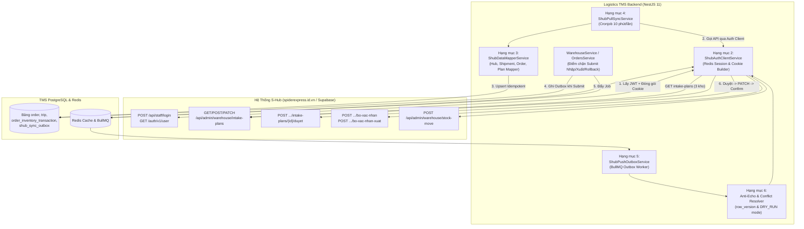

# Kế Hoạch Triển Khai & Giải Pháp Kỹ Thuật Chi Tiết: Đấu Nối Đồng Bộ 2 Chiều S-Hub (`spiderexpress.id.vn`) ↔ Logistics TMS

> **Tài liệu nghiên cứu nền tảng**: [SHUB_INTEGRATION_RESEARCH.md](file:///d:/Projects/logistics-website/docs/SHUB_INTEGRATION_RESEARCH.md)  
> **Mục tiêu**: Xây dựng phân hệ đồng bộ dữ liệu tự động 2 chiều giữa **S-Hub (Sflow)** và **Logistics TMS**:
> - **Chiều PULL (Mỗi 10 phút qua Cronjob)**: Tự động kéo Chuyến xe (`shipments`), Đơn hàng (`sso`/`loads`) và Kế hoạch Nhập/Xuất kho (`KN-...`/`KX-...`) từ S-Hub về TMS.
> - **Chiều PUSH (Real-time qua Hàng đợi Outbox khi Submit)**: Khi Thủ kho/Admin thao tác xác nhận Nhập kho, Xuất kho, Tạo phiếu thủ công hoặc Hoàn tác (Rollback) trên TMS, tự động đẩy kết quả ngược về S-Hub.

---

## Kiến Trúc Tổng Thể Giải Pháp (Architecture Blueprint)



---

## Chi Tiết 7 Hạng Mục Triển Khai & Giải Pháp Kỹ Thuật (Solution Breakdown)

---

### HẠNG MỤC 1: Thiết Kế Database Schema & Migration Liên Kết S-Hub (`Database & Entity Layer`)

#### 1.1. Vấn đề cần giải quyết
Hiện tại [`OrderEntity`](file:///d:/Projects/logistics-website/backend/src/orders/infrastructure/persistence/relational/entities/order.entity.ts) và [`TripEntity`](file:///d:/Projects/logistics-website/backend/src/trips/infrastructure/persistence/relational/entities/trip.entity.ts) chỉ lưu định danh nội bộ (`id`, `orderCode`, `tripCode`). Khi kéo dữ liệu từ S-Hub về hoặc đẩy ngược sang S-Hub, chúng ta cần lưu các khóa ngoại UUID của S-Hub (`sso.id`, `load.id`, `plan.id`, `shipment_id`), phiên bản dòng (`row_version`), mã băm duyệt (`dau_duyet`), cờ sẵn sàng (`_ready`) và một bảng nhật ký hàng đợi (`shub_sync_outbox`) để đảm bảo không bao giờ mất bản tin khi mạng lỗi.

#### 1.2. Phạm vi File tác động
- Sửa [`order.entity.ts`](file:///d:/Projects/logistics-website/backend/src/orders/infrastructure/persistence/relational/entities/order.entity.ts)
- Sửa [`trip.entity.ts`](file:///d:/Projects/logistics-website/backend/src/trips/infrastructure/persistence/relational/entities/trip.entity.ts)
- Tạo mới `backend/src/orders/infrastructure/persistence/relational/entities/shub-sync-outbox.entity.ts`
- Tạo mới TypeORM Migration tại `backend/src/database/migrations/`
- Cập nhật [`railway-db-sync.mjs`](file:///d:/Projects/logistics-website/scripts/railway-db-sync.mjs) (thêm bảng `shub_sync_outbox` vào danh sách đồng bộ DB).

#### 1.3. Giải pháp kỹ thuật (Solution)
1. **Bổ sung cột vào bảng `"order"` ([`OrderEntity`](file:///d:/Projects/logistics-website/backend/src/orders/infrastructure/persistence/relational/entities/order.entity.ts))** *(Tất cả đều `nullable: true` để không ảnh hưởng dữ liệu cũ)*:
   - `externalSsoId` (`varchar(64)`, indexed): Lưu `sso.id` từ S-Hub.
   - `externalLoadId` (`varchar(64)`, indexed): Lưu `load.id` (chặng vận chuyển).
   - `externalWarehouseItemId` (`varchar(64)`, nullable): Lưu `warehouse_items.id` khi hàng đã vào tồn kho S-Hub.
   - `packageUnit` (`varchar(50)`, nullable): Đơn vị tính (`thùng`, `kiện`, `pallet`, `cây`).
2. **Bổ sung cột vào bảng `"trip"` ([`TripEntity`](file:///d:/Projects/logistics-website/backend/src/trips/infrastructure/persistence/relational/entities/trip.entity.ts))**:
   - `externalPlanId` (`varchar(64)`, unique nullable index): Lưu `warehouse_intake_plans.id` (UUID của phiếu `KN-...` / `KX-...`).
   - `externalPlanCode` (`varchar(50)`, indexed): Lưu mã `KN-2611-643` hoặc `KX-2611-268`.
   - `externalShipmentId` (`varchar(64)`, indexed): Lưu `load.shipment_id`.
   - `externalShipmentCode` (`varchar(100)`, indexed): Lưu mã chuyến xe S-Hub (VD: `CXBN_061126_43H21203`).
   - `externalSource` (`varchar(30)`, nullable): Nguồn phiếu (`fleet`, `dispatch`, `customer_drop`, `manual`).
   - `externalRowVersion` (`int`, nullable): Lưu `row_version` của phiếu trên S-Hub để kiểm soát Optimistic Locking.
   - `externalDauDuyet` (`varchar(64)`, nullable): Lưu chuỗi MD5 `dau_duyet` từ S-Hub (bắt buộc phải gửi kèm khi gọi API `/duyet`).
   - `externalApprovedAt` (`timestamptz`, nullable): Thời điểm kho duyệt trên S-Hub.
   - `externalConfirmedAt` (`timestamptz`, nullable): Thời điểm xác nhận nhập/xuất trên S-Hub.
   - `externalReady` (`boolean`, default `true`): Cờ `_ready` từ S-Hub (xác định chặng xe công ty đã bấm hoàn thành chưa).
   - `externalReadyReason` (`text`, nullable): Lý do chưa sẵn sàng (`_ready_reason`).
   - `externalIsPendingCount` (`boolean`, default `false`): Đánh dấu bằng `true` khi trên S-Hub dòng hàng có `quantity: null` (`"chờ đếm"`).
   - `externalSyncStatus` (`varchar(30)`, default `'LOCAL_ONLY'`): Trạng thái đồng bộ (`LOCAL_ONLY`, `SYNCED`, `PENDING_PUSH`, `WAITING_DRIVER_READY`, `SYNC_ERROR`).
3. **Tạo bảng `"shub_sync_outbox"` (`ShubSyncOutboxEntity`)**:
   - Các cột: `id`, `direction` (`PULL` | `PUSH`), `action` (`APPROVE_PLAN` | `CONFIRM_INBOUND` | `CONFIRM_OUTBOUND` | `CREATE_MANUAL_PLAN` | `ROLLBACK_INBOUND` | `ROLLBACK_OUTBOUND` | `CANCEL_PLAN`), `tripId`, `orderId`, `externalPlanId`, `externalPlanCode`, `payload` (`jsonb`), `status` (`PENDING` | `PROCESSING` | `COMPLETED` | `WAITING_DRIVER_READY` | `FAILED`), `retryCount` (`int`), `nextRetryAt` (`timestamptz`), `lastError` (`text`), `responseSnapshot` (`jsonb`), `createdAt`, `updatedAt`.

---

### HẠNG MỤC 2: S-Hub HTTP Client & Quản Lý Phiên Xác Thực Tự Động (`ShubAuthClientService`)

#### 2.1. Vấn đề cần giải quyết
Các API nghiệp vụ kho của S-Hub (`/api/admin/warehouse/intake-plans/...`) từ chối truy cập (`{"error": "Không có quyền"}`) nếu chỉ truyền `Authorization: Bearer <token>`, vì Next.js BFF của S-Hub đọc phiên đăng nhập từ Cookie chuẩn `@supabase/ssr` (`sb-yaswbffpktmrgukttnic-auth-token=base64-...`). Hơn nữa, token có thời hạn `3600s` (1 giờ), nên hệ thống cần cơ chế tự động giữ phiên sống liên tục 24/7 mà không cần đăng nhập lại ở mỗi request.

#### 2.2. Phạm vi File tác động
- Tạo mới `backend/src/orders/shub-sync/shub-auth-client.service.ts`
- Tạo mới `backend/src/config/shub.config.ts` (đọc biến môi trường `SHUB_BASE_URL`, `SHUB_SUPABASE_URL`, `SHUB_SUPABASE_ANON_KEY`, `SHUB_EMAIL`, `SHUB_PASSWORD`).

#### 2.3. Giải pháp kỹ thuật (Solution)
1. **Quy trình Khởi tạo & Đóng gói Session (`authenticateAndBuildSession`)**:
   - Bước 1: Gọi `POST https://spiderexpress.id.vn/api/staff/login` với `{ email, password }` → nhận `{ access_token, refresh_token }`.
   - Bước 2: Gọi `GET https://yaswbffpktmrgukttnic.supabase.co/auth/v1/user` với header `Authorization: Bearer <access_token>` và `apikey: <SHUB_SUPABASE_ANON_KEY>` → nhận object `supaUser` chuẩn xác của GoTrue.
   - Bước 3: Đóng gói chuỗi Cookie:
     ```ts
     const sessionObj = {
       access_token: loginData.access_token,
       refresh_token: loginData.refresh_token,
       user: supaUser,
       token_type: 'bearer',
       expires_in: 3600,
       expires_at: Math.floor(Date.now() / 1000) + 3600,
     };
     const base64Session = 'base64-' + Buffer.from(JSON.stringify(sessionObj)).toString('base64url');
     const cookieHeader = `sb-yaswbffpktmrgukttnic-auth-token=${base64Session}`;
     ```
2. **Cơ chế Cache & Tự động Refresh (Zero Downtime)**:
   - Lưu `{ accessToken, refreshToken, cookieHeader, expiresAt }` vào [`RedisCacheService`](file:///d:/Projects/logistics-website/backend/src/redis/redis-cache.service.ts) dưới key `shub:auth:session` với TTL `3000s` (50 phút).
   - Dùng **Single-Flight Mutex Lock** (`private loginPromise: Promise<ShubSession> | null = null`) để khi có 10 request chạy song song lúc token vừa hết hạn, chỉ có **1 request duy nhất** gọi API login, 9 request còn lại chờ lấy chung kết quả.
   - Tự động Retry 1 lần: Nếu bất kỳ lệnh gọi `requestShubApi()` nào nhận HTTP `401` hoặc `403` (`"Không có quyền"`), tự động xóa cache Redis, gọi `authenticateAndBuildSession()` lấy phiên mới và thực thi lại request ngay lập tức.
   - Mọi lệnh `fetch` đều gắn `signal: AbortSignal.timeout(15000)` tuân thủ nghiêm ngặt quy chuẩn chống treo (`RULE-ANTI-HANG-EXEC-01`).

---

### HẠNG MỤC 3: Bộ Ánh Xạ Dữ Liệu & Quy Tắc Nghiệp Vụ (`ShubDataMapperService`)

#### 3.1. Vấn đề cần giải quyết
Cấu trúc dữ liệu của S-Hub và TMS có 4 điểm khác biệt cần bộ chuyển đổi chuẩn xác:
1. S-Hub dùng UUID cho 3 kho (`KHO-HCM`, `KHO-DN`, `KHO-HY`), còn TMS dùng `hub.id` (`int`) và `hub.code` (`HUB-HCM-01`, `HUB-DAD-01`, `HUB-HYN-01`).
2. S-Hub tách rời **Chuyến xe (`shipments.code`: `CXBN_061126_43H21203`)** và **Kế hoạch từng đơn trên xe (`warehouse_intake_plans.code`: `KN-2611-656`)**, trong khi TMS dùng [`TripEntity`](file:///d:/Projects/logistics-website/backend/src/trips/infrastructure/persistence/relational/entities/trip.entity.ts) cho cả hai.
3. Nhiều kế hoạch trên S-Hub có `quantity: null` (hiển thị `"chờ đếm"`) hoặc không có `sso` (như khách tự mang hàng đến kho lưu tạm `KN-2611-642`).
4. Một đơn `sso` trên S-Hub có thể có nhiều `warehouse_intake_plan_items` (nhiều dòng hàng khác nhau trong cùng 1 phiếu).

#### 3.2. Phạm vi File tác động
- Tạo mới `backend/src/orders/shub-sync/shub-data-mapper.service.ts`

#### 3.3. Giải pháp kỹ thuật (Solution)
1. **Ánh xạ Kho ↔ Hub (`resolveHubFromShubWarehouse`)**:
   - Xây dựng bảng ánh xạ 2 chiều được cache trong bộ nhớ:
     - `4581811f-45e2-4d1a-b3ae-26a6f4768150` (`KHO-HCM`) ↔ `HUB-HCM-01`
     - `698fee88-2e2d-4f61-af3d-ba7edabfa72e` (`KHO-DN`) ↔ `HUB-DAD-01`
     - `ba6f66f3-77ee-4078-a67e-5a274fcddc9f` (`KHO-HY`) ↔ `HUB-HYN-01`
2. **Quy tắc sinh `orderCode` và gộp dòng hàng (`warehouse_intake_plan_items`)**:
   - **Mã đơn hàng (`orderCode`)**:
     - Ưu tiên 1: `plan.sso?.code` (VD: `NKT2611-0587`, `LTV2611-0166`).
     - Ưu tiên 2: Nếu `sso` là `null` nhưng có `plan.load?.code`, lấy phần gốc trước dấu chấm của `load.code` (VD: `DTT2611-0004.1` → `DTT2611-0004`).
     - Ưu tiên 3: Nếu cả `sso` và `load` đều `null` (khách tự mang tới kho chưa lên đơn), lấy `plan.code` (VD: `KN-2611-642`).
   - **Tổng hợp chỉ số hàng hóa từ mảng `warehouse_intake_plan_items`**:
     - `totalQuantity`: Tổng `item.quantity` của các dòng. Nếu tất cả các dòng đều có `quantity === null` (`"chờ đếm"`), gán `quantityAllocated = null`, `externalIsPendingCount = true` (và trên `OrderEntity` nếu là đơn mới thì để `totalQuantity = null` hoặc `0` kèm ghi chú `[Chờ kiểm đếm thực tế]`).
     - `totalWeight`: Tổng `Number(item.weight_kg ?? 0)`.
     - `totalVolume`: Tổng `Number(item.volume_cbm ?? 0)`.
     - `goodsDescription`: Nối `item.description` kèm số lượng & đơn vị (VD: `"Hạt nhựa SamYang (6 pallet); Phụ kiện (2 thùng)"`).
3. **Quy tắc ánh xạ `tripCode` (Gom nhóm Chuyến xe chuẩn xác)**:
   - Nếu kế hoạch thuộc một chuyến xe (`plan.load?.shipments?.code` tồn tại, VD: `CXBN_061126_43H21203`):
     - Gán `TripEntity.tripCode = plan.load.shipments.code` (`"CXBN_061126_43H21203"`).
     - Nhờ đó, nếu chuyến xe `CXBN_061126_43H21203` chở 4 đơn (`KN-2611-656`, `KN-2611-654`, `KN-2611-653`, `KN-2611-652`), cả 4 dòng `TripEntity` trên TMS sẽ có cùng `tripCode = "CXBN_061126_43H21203"`, giúp giao diện **Kiểm đếm chuyến xe** của TMS tự động gom 4 đơn này vào đúng 1 thẻ chuyến xe!
   - Nếu kế hoạch lẻ không gắn chuyến (`plan.load?.shipments?.code == null`):
     - Nếu có biển số xe (`plan.vehicle_plate`), gom theo mã `KH-${plan.planned_date}-${plan.vehicle_plate}` hoặc giữ `tripCode = plan.code` (`KN-2611-643`) để Thủ kho xử lý theo từng phiếu.

---

### HẠNG MỤC 4: Engine Kéo Dữ Liệu Định Kỳ 10 Phút — Chiều PULL (`ShubPullSyncService`)

#### 4.1. Vấn đề cần giải quyết
Cứ mỗi 10 phút, hệ thống phải tự động kéo toàn bộ các kế hoạch Nhập kho (`KN-...`) và Xuất kho (`KX-...`) mới hoặc vừa thay đổi trạng thái từ S-Hub về TMS mà:
- Không tạo bản ghi trùng lặp.
- Không ghi đè làm hỏng dữ liệu những đơn Thủ kho đang thao tác trên TMS.
- Xử lý được cả trường hợp đơn hàng đã được Thủ kho xác nhận trực tiếp trên web S-Hub hoặc bị Điều hành huỷ/đổi điểm kho.

#### 4.2. Phạm vi File tác động
- Tạo mới `backend/src/orders/shub-sync/shub-pull-sync.service.ts`
- Sửa [`admin-reports.service.ts`](file:///d:/Projects/logistics-website/backend/src/orders/admin-reports.service.ts) (đăng ký thêm cấu hình Cronjob `SHUB_DATA_SYNC` chạy mỗi 10 phút vào bảng `cron_job_config`).

#### 4.3. Giải pháp kỹ thuật (Solution)
1. **Tích hợp vào bộ lập lịch Cronjob sẵn có ([`AdminReportsService`](file:///d:/Projects/logistics-website/backend/src/orders/admin-reports.service.ts))**:
   - Seed thêm cấu hình `jobKey = 'SHUB_DATA_SYNC'`, `jobName = 'Đồng bộ dữ liệu 2 chiều S-Hub (10 phút/lần)'`, `cronExpression = '*/10 * * * *'` vào bảng `cron_job_config`.
   - Trong vòng lặp kiểm tra mỗi phút (`checkAndRunScheduledCron`), nếu `now - lastShubSyncAt >= 10 phút` và `isEnabled === true`, kích hoạt `ShubPullSyncService.executePullCycle('CRON_SCHEDULE')` và ghi kết quả (số phiếu tạo mới, số phiếu cập nhật, số lỗi) vào bảng `cron_job_execution_log`.
2. **Thuật toán Quét & Upsert Idempotent (`executePullCycle`)**:
   - Với mỗi kho trong 3 kho (`KHO-HCM`, `KHO-DN`, `KHO-HY`), gọi song song các feed từ `/api/admin/warehouse/intake-plans`:
     1. `type=intake&status=pending&duyet=cho` (Kế hoạch nhập mới chờ duyệt)
     2. `type=intake&status=pending&duyet=da` (Kế hoạch nhập đã duyệt chờ hàng về)
     3. `type=intake&status=confirmed&limit=50` (Kế hoạch nhập vừa xác nhận trên S-Hub)
     4. `type=intake&status=cancelled&limit=30` (Kế hoạch nhập vừa bị huỷ trên S-Hub)
     5. Tương tự cho `type=outbound` (`duyet=cho`, `duyet=da`, `status=confirmed`, `status=cancelled`).
   - **Xử lý từng phiếu `plan` trong Transaction ngắn (Per-Plan Atomic Upsert)**:
     - Tìm `existingTrip = await tripRepo.findOne({ where: { externalPlanId: plan.id } })`.
     - **Fast-Skip (`O(1)`)**: Nếu `existingTrip` đã tồn tại VÀ `existingTrip.externalRowVersion === plan.row_version` VÀ trạng thái không đổi → **Bỏ qua ngay lập tức** (tiết kiệm 95% truy vấn DB).
     - **Trường hợp 1: Phiếu mới tinh (`!existingTrip`)**:
       - Tìm `OrderEntity` theo `externalSsoId = plan.sso?.id` hoặc `orderCode = mappedOrderCode`.
       - Nếu chưa có `OrderEntity`: Tạo mới `OrderEntity` (gán `originHubId`, `destinationHubId`, `totalQuantity`, `totalWeight`, `totalVolume`, `goodsDescription`, `province`, `accompanyingDocs`, `status = 'IN_TRANSIT'`).
       - Nếu đã có `OrderEntity` (ví dụ đơn luân chuyển liên kho hoặc nhập nhiều đợt): Giữ nguyên `OrderEntity`, tận dụng logic `consolidateSiblingOrdersByCode` của [`WarehouseService`](file:///d:/Projects/logistics-website/backend/src/orders/warehouse.service.ts).
       - Tạo dòng `TripEntity` mới với `externalPlanId = plan.id`, `externalPlanCode = plan.code`, `tripCode = mappedTripCode`, `type = plan.plan_type === 'outbound' ? 'OUTBOUND' : 'INBOUND'`, `status = 'PENDING'`, `quantityAllocated`, `weightAllocated`, `volumeAllocated`, `externalRowVersion = plan.row_version`, `externalDauDuyet = plan.dau_duyet`, `externalReady = plan._ready`, `externalReadyReason = plan._ready_reason`.
       - Khởi tạo chặng dừng `TripStopEntity` qua [`OperationalLedgerService.upsertTripStop()`](file:///d:/Projects/logistics-website/backend/src/orders/operational-ledger.service.ts#L119-L140).
     - **Trường hợp 2: Phiếu đã có trên TMS và S-Hub chuyển sang `status === 'confirmed'` (Thủ kho bấm xác nhận bên S-Hub trước)**:
       - Nếu `existingTrip.status !== 'COMPLETED'`, tự động gọi hàm ghi sổ cái nội bộ để chuyển `existingTrip.status = 'COMPLETED'`, sinh phiếu `PNK-...` (hoặc `PXK-...`) trong `order_inventory_transaction` và cộng/trừ `inboundQuantity` / `remainingQuantity` trên `OrderEntity` để tồn kho TMS khớp tuyệt đối với S-Hub!
     - **Trường hợp 3: Phiếu trên S-Hub chuyển sang `status === 'cancelled'`**:
       - Nếu `existingTrip.status === 'PENDING'`, thực hiện soft-delete (`deletedAt = NOW()`) dòng `TripEntity` dự kiến trên TMS và ghi `OrderActivityLogEntity`.

---

### HẠNG MỤC 5: Engine Đẩy Dữ Liệu Ngược Về S-Hub Khi Submit — Chiều PUSH (`ShubPushOutboxService` + BullMQ)

#### 5.1. Vấn đề cần giải quyết
Khi Thủ kho hoặc Admin thao tác trên giao diện TMS (Xác nhận nhập kho, Xác nhận xuất kho, Tạo đơn nhập mới tại kho, hoặc Hoàn tác chuyến xe), kết quả phải được đẩy ngược về S-Hub. Tuy nhiên:
- Không được làm chậm thao tác bấm nút của Thủ kho trên TMS.
- Phải tuân thủ đúng quy trình 2 bước của S-Hub (`Duyệt` → `Cập nhật số đếm` → `Xác nhận`).
- Phải xử lý được chốt chặn `_ready: false` của S-Hub khi tài xế xe công ty chưa bấm hoàn thành chặng trên App.

#### 5.2. Phạm vi File tác động
- Tạo mới `backend/src/orders/shub-sync/shub-push-outbox.service.ts`
- Tạo mới `backend/src/orders/shub-sync/shub-push.processor.ts` (BullMQ Worker chạy nền)
- Sửa [`warehouse.service.ts`](file:///d:/Projects/logistics-website/backend/src/orders/warehouse.service.ts) (chèn Hook ghi Outbox tại các hàm xác nhận Nhập kho, Xuất kho, Tạo nhanh đơn nhập và Rollback chuyến).

#### 5.3. Giải pháp kỹ thuật (Solution cho từng nghiệp vụ Submit)

##### A. Khi Thủ kho Xác nhận Nhập kho trên TMS (`confirmInbound` / `createBatchInbound`)
1. **Đối với đơn hàng kéo từ Kế hoạch S-Hub về (`trip.externalPlanId != null`)**:
   - Ngay khi Transaction xác nhận nhập kho trên TMS commit thành công, `ShubPushOutboxService.enqueueConfirmInbound(trip, actualCountedQty, actualWeight, actualVolume)` tạo bản ghi `shub_sync_outbox` và đẩy job vào BullMQ.
   - **BullMQ Worker thực thi tuần tự 3 bước sang S-Hub**:
     - **Bước 1 (Auto-Approve)**: Kiểm tra nếu `trip.externalApprovedAt == null`, gọi:
       ```http
       POST https://spiderexpress.id.vn/api/admin/warehouse/intake-plans/{externalPlanId}/duyet
       Body: { "dau": "<trip.externalDauDuyet>" }
       ```
     - **Bước 2 (Cập nhật số lượng thực đếm & thông tin đầu phiếu)**: Gọi:
       ```http
       PATCH https://spiderexpress.id.vn/api/admin/warehouse/intake-plans/{externalPlanId}
       Body: {
         "row_version": <latest_row_version>,
         "vehicle_plate": "<trip.licensePlate>",
         "planned_date": "<YYYY-MM-DD>",
         "warehouse_id": "<shub_warehouse_uuid>",
         "notes": "<trip.notes>",
         "xac_nhan_kem": true,
         "items": [{ ...item, "quantity": <actualCountedQty>, "weight_kg": <actualWeight>, "volume_cbm": <actualVolume> }]
       }
       ```
     - **Bước 3 (Chốt nhập kho S-Hub)**:
       - Kiểm tra cờ `_ready`: Nếu `_ready === true`, gọi ngay:
         ```http
         POST https://spiderexpress.id.vn/api/admin/warehouse/intake-plans/{externalPlanId}
         ```
       - **Xử lý thông minh khi `_ready === false`** *(do tài xế xe công ty chưa bấm hoàn thành trên App)*:
         - Bước 1 (`Duyệt`) và Bước 2 (`PATCH` số thực đếm) **vẫn được đẩy lên S-Hub thành công**!
         - Bước 3 được chuyển sang trạng thái `WAITING_DRIVER_READY` trong bảng `shub_sync_outbox` (và `trip.externalSyncStatus = 'WAITING_DRIVER_READY'`).
         - Ở các chu kỳ Cronjob 10 phút tiếp theo, ngay khi thấy tài xế đã bấm hoàn thành trên App (`plan._ready === true`), Worker tự động bắn nốt lệnh `POST /api/admin/warehouse/intake-plans/{externalPlanId}` để hoàn tất 100%!
2. **Đối với đơn hàng do Kho TMS tự tạo mới (`trip.externalPlanId == null`)**:
   - Worker gọi `POST /api/admin/warehouse/intake-plans` với `plan_type: "intake"`, `source: "manual"` để tạo phiếu `KN-...` mới trên S-Hub.
   - Lưu `id`, `code`, `dau_duyet`, `row_version` trả về vào `TripEntity`, sau đó gọi tiếp `/duyet` và `POST /intake-plans/{id}` để ghi nhận tồn kho trên S-Hub.

##### B. Khi Thủ kho Xác nhận Xuất kho / Trung chuyển trên TMS (`confirmOutbound`)
1. **Nếu khớp với phiếu Kế hoạch xuất `KX-...` từ S-Hub (`trip.externalPlanId != null`)**:
   - Thực hiện tương tự 3 bước: `POST /duyet` → `PATCH /intake-plans/{id}` (cập nhật số lượng thực xuất) → `POST /intake-plans/{id}`.
2. **Nếu Kho chủ động ghép chuyến xuất trên TMS (chưa có phiếu `KX-...` trên S-Hub)**:
   - Tạo phiếu kế hoạch xuất thủ công qua `POST /api/admin/warehouse/intake-plans` (`plan_type: "outbound"`, `source: "manual"`) hoặc gọi `POST /api/admin/warehouse/stock-move` (`op: "out"`) nếu xuất trực tiếp từ lô hàng tồn (`externalWarehouseItemId`).

##### C. Khi Admin Hoàn tác (Rollback) chuyến xe trên TMS (`rollbackTrip`)
- Nếu chuyến xe đã đồng bộ xác nhận với S-Hub (`trip.externalPlanId != null` và `externalSyncStatus === 'SYNCED'`):
  - Với chuyến Nhập (`INBOUND`): Gọi `POST /api/admin/warehouse/intake-plans/{externalPlanId}/bo-xac-nhan` với `{ "lyDo": reason }`.
  - Với chuyến Xuất (`OUTBOUND` / `TRANSFER`): Gọi `POST /api/admin/warehouse/intake-plans/{externalPlanId}/bo-xac-nhan-xuat` với `{ "lyDo": reason }`.

---

### HẠNG MỤC 6: Cơ Chế Chống Lặp Vòng Tròn, Xử Lý Xung Đột & Chế Độ An Toàn (`Anti-Echo & Safety Guards`)

#### 6.1. Giải pháp Chống Lặp Vòng Tròn (Anti-Echo Loop Prevention)
- **Kịch bản rủi ro**: TMS đẩy lệnh xác nhận sang S-Hub → S-Hub tăng `row_version` từ `1` lên `2` và đổi `status = 'confirmed'` → 10 phút sau Cronjob Pull của TMS quét thấy phiếu này có `row_version = 2` và chạy lại logic nhập kho lần 2.
- **Giải pháp**:
  1. Ngay khi `ShubPushOutboxService` nhận response thành công từ S-Hub, nó trích xuất `row_version` mới nhất và cập nhật ngay vào `TripEntity.externalRowVersion`, `TripEntity.externalConfirmedAt`, và `TripEntity.externalSyncStatus = 'SYNCED'`.
  2. Trong `ShubPullSyncService`, trước khi thực hiện bất kỳ thao tác ghi sổ cái nào, luôn kiểm tra:
     - Đã có giao dịch `OrderInventoryTransactionEntity` (`PNK-...` / `PXK-...`) gắn với `tripCode` và `orderId` này chưa (`deletedAt IS NULL`). Nếu đã có → tuyệt đối không sinh giao dịch trùng!

#### 6.2. Giải pháp Xử lý Xung đột Phiên bản (`row_version` Optimistic Lock Conflict)
- Khi TMS gửi `PATCH /api/admin/warehouse/intake-plans/{id}` kèm `row_version: 1`, nếu Điều hành bên S-Hub vừa sửa ghi chú làm `row_version` trên S-Hub tăng lên `2`, S-Hub sẽ trả lỗi conflict.
- **Giải pháp Self-Healing**: Khi gặp lỗi `row_version`, Worker tự động gọi `GET /api/admin/warehouse/intake-plans?tim=<externalPlanCode>` để lấy `row_version` mới nhất và danh sách `items` mới nhất, áp số lượng thực đếm của Kho TMS lên trên object mới đó rồi gọi lại `PATCH` (tối đa 3 lần retry với Exponential Backoff `5s -> 15s -> 45s`).

#### 6.3. Cơ chế Chốt chặn An toàn bằng Feature Flags (`.env`)
Cung cấp 3 biến cấu hình trong `.env` và bảng `cron_job_config` để kiểm soát rủi ro tuyệt đối khi Go-Live:
- `SHUB_SYNC_ENABLED=true|false`: Công tắc tổng bật/tắt đồng bộ.
- `SHUB_PUSH_MODE=DRY_RUN|LIVE`:
  - Khi để `DRY_RUN` (Mặc định ở giai đoạn kiểm thử): Chiều **PULL 10 phút** hoạt động thật 100% để kéo dữ liệu S-Hub về TMS; chiều **PUSH** vẫn tạo bản ghi đầy đủ vào bảng `shub_sync_outbox` (ghi rõ URL, Method, JSON Payload dự kiến gửi sang S-Hub) nhưng **không bắn HTTP mutation thật** sang S-Hub.
  - Khi kiểm tra bảng `shub_sync_outbox` thấy payload chuẩn 100%, chỉ cần chuyển `SHUB_PUSH_MODE=LIVE` là hệ thống đẩy thật sang S-Hub mà không cần sửa code!
- `SHUB_TARGET_WAREHOUSES=HCM,DN,HY`: Cho phép bật từng kho hoặc cả 3 kho.

---

### HẠNG MỤC 7: Giao Diện Giám Sát Đồng Bộ & Trạng Thái S-Hub Trên Frontend (`Frontend UI`)

#### 7.1. Phạm vi File tác động
- Sửa màn hình Kiểm đếm chuyến xe & Bảng kê Nhập/Xuất tại [`frontend/src/app/dashboard/warehouse/`](file:///d:/Projects/logistics-website/frontend/src/app/dashboard/warehouse)
- Bổ sung Tab / Panel **"Đồng bộ S-Hub"** trong trang Quản lý Cronjob / Báo cáo vận hành.

#### 7.2. Giải pháp kỹ thuật (Solution)
1. **Hiển thị Badge nhận diện trên bảng Kiểm đếm chuyến xe & Đơn hàng kho**:
   - Hiển thị mã phiếu S-Hub (`KN-2611-643`, `KX-2611-268`) cạnh mã đơn/chuyến xe.
   - Hiển thị Badge cảnh báo **`Chờ đếm`** màu cam đối với các đơn từ S-Hub có `externalIsPendingCount === true` (`quantity: null`), và khóa nút Xác nhận cho đến khi Thủ kho nhập số kiện thực tế `> 0`.
   - Hiển thị Badge trạng thái đồng bộ:
     - 🟢 `Đã đồng bộ S-Hub` (`SYNCED`)
     - 🟡 `Chờ tài xế hoàn tất chặng` (`WAITING_DRIVER_READY` — kèm tooltip hiển thị `_ready_reason` từ S-Hub)
     - 🔵 `Đang đẩy S-Hub...` (`PENDING_PUSH`)
     - 🔴 `Lỗi đồng bộ` (`SYNC_ERROR` — kèm nút bấm `Thử lại`).
2. **Nút "Kéo dữ liệu S-Hub ngay" (Manual Pull Trigger)**:
   - Cho phép Thủ kho hoặc Admin bấm nút **`Đồng bộ S-Hub ngay`** trên giao diện mà không cần đợi hết 10 phút khi có xe gấp vừa cập bến (gọi `POST /api/v1/warehouse/shub-sync/pull-now`).

---

## Lộ Trình Triển Khai Đề Xuất (Phased Rollout Roadmap)

| Giai đoạn | Hạng mục thực hiện | Chế độ vận hành | Tiêu chí nghiệm thu (DoD) |
| :--- | :--- | :--- | :--- |
| **Phase 1: Nền tảng & Chiều PULL (10 phút/lần)** | Hạng mục 1 + Hạng mục 2 + Hạng mục 3 + Hạng mục 4 | `SHUB_PUSH_MODE=DRY_RUN` | Cronjob chạy mỗi 10 phút kéo thành công các phiếu `KN-...` và `KX-...` của 3 kho về TMS; hiển thị đúng trên màn hình Kiểm đếm chuyến xe & Kho; không trùng lặp khi chạy nhiều lần. |
| **Phase 2: Chiều PUSH (Outbox) ở chế độ Kiểm thử (`DRY_RUN`)** | Hạng mục 5 + Hạng mục 6 | `SHUB_PUSH_MODE=DRY_RUN` | Khi Thủ kho xác nhận Nhập/Xuất/Rollback trên TMS, bản tin Push được sinh chuẩn xác vào bảng `shub_sync_outbox` với đầy đủ payload `/duyet`, `PATCH`, `POST` để đối chiếu. |
| **Phase 3: Giao diện Giám sát & Bật PUSH Thực tế (`LIVE`)** | Hạng mục 7 + Chuyển `SHUB_PUSH_MODE=LIVE` | `SHUB_PUSH_MODE=LIVE` | Đồng bộ 2 chiều khép kín; xử lý mượt trường hợp `_ready: false` và `"chờ đếm"`; vượt qua đầy đủ Local E2E (Gate 1) và Cloud Dev E2E (Gate 2). |
