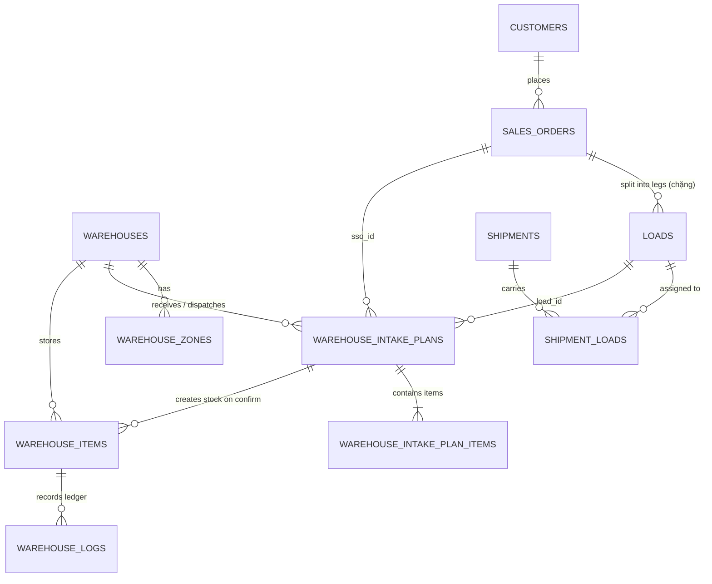
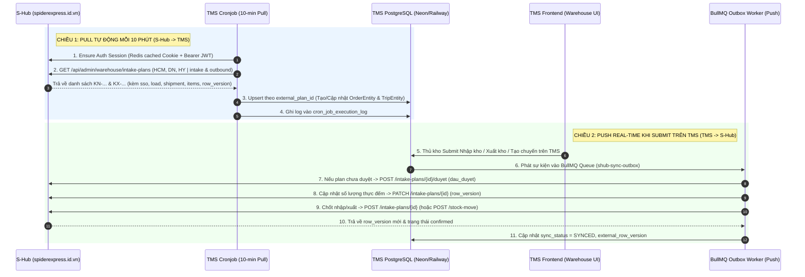

# Tài Liệu Nghiên Cứu & Kiến Trúc Đấu Nối Đồng Bộ Dữ Liệu 2 Chiều: S-Hub (`spiderexpress.id.vn`) ↔ Logistics TMS

> **Ngày khảo sát**: `09/11/2026`  
> **Hệ thống đích khảo sát**: `https://spiderexpress.id.vn` (**Sflow — Quản lý vận tải & kho bãi**, gọi tắt là **S-Hub**)  
> **Tài khoản khảo sát**: `congduc.dante@spiderexpress.net` (`Mai Công Đức` — Role: `warehouse_keeper` / Thủ kho — Kho mặc định: `Spider Warehousing HCM`)  
> **Chế độ khảo sát**: **100% Read-Only (Chỉ đọc)** — Không click nút thao tác nghiệp vụ, không tạo/sửa/xóa bất kỳ dữ liệu nào trên S-Hub.  
> **Phiên bản S-Hub tại thời điểm khảo sát**: Git commit `61617c59be0e477d0992277df7fc3fd3293a15b6`, DB Migration cuối: `673` (`673_bo_xac_nhan_xuat`).

---

## 1. Tổng Quan Kiến Trúc Kỹ Thuật Hệ Thống S-Hub (`spiderexpress.id.vn`)

Qua quá trình giải mã lưu lượng mạng (Network Traffic), HTML/RSC payloads và các tệp JavaScript bundle của S-Hub, kiến trúc bên dưới của `spiderexpress.id.vn` được xác định chính xác như sau:

| Thành phần | Công nghệ / Hạ tầng trên S-Hub | Chi tiết kỹ thuật & Bằng chứng |
| :--- | :--- | :--- |
| **Tên nội bộ** | **Sflow** (`LogiHub`) | Công cụ nội bộ vận hành vận tải & kho bãi của CTCP Giao hàng Nhanh Spider (`Spider Express`). |
| **Frontend & BFF** | **Next.js 16+ (App Router + Turbopack)** trên **Vercel** | Header `x-deployment-id: dpl_9c3W6HZSUZT76QbpcjHaUo3AdSqY`, sử dụng React Server Components (`_rsc`) kết hợp Route Handlers tại `/api/...`. |
| **Core Backend & DB** | **Supabase (PostgreSQL + PostgREST + GoTrue Auth + Realtime)** | Project URL: `https://yaswbffpktmrgukttnic.supabase.co`<br>Publishable Key (`apikey`): `sb_publishable_aJsGDcl4iis2cUY90CFfOw_75lAoA7-`<br>Quy mô DB (từ `/api/admin/health`): **673 migrations**, **241 critical functions**, **72 triggers**, **584 RPC functions**. |
| **Object Storage** | **FPT Cloud S3** & **Supabase Storage** | `https://s3-hcm04.fptcloud.com` và `https://yaswbffpktmrgukttnic.supabase.co` (lưu ảnh hàng hóa, biên bản hư hỏng, chứng từ POD). |
| **Cơ chế truy xuất dữ liệu** | **Hybrid (Lai 2 kênh)** | 1. **Next.js API Routes (`/api/admin/warehouse/...`)**: Dùng cho các nghiệp vụ có logic phức tạp (Kế hoạch nhập/xuất kho, Duyệt phiếu, Xác nhận thực đếm, Gộp phiếu, Bỏ xác nhận).<br>2. **Direct Supabase PostgREST (`/rest/v1/...`)**: Trình duyệt gọi thẳng tới `yaswbffpktmrgukttnic.supabase.co/rest/v1/` kèm JWT `Bearer` để lấy danh mục kho, tồn kho (`warehouse_items`), đơn hàng (`orders`, `sales_orders`, `loads`), lịch sử kho (`warehouse_logs`). |

---

## 2. Cơ Chế Xác Thực (Authentication) & Khả Năng Kết Nối Machine-to-Machine (Zero-Browser)

Một phát hiện kỹ thuật **cực kỳ quan trọng** cho việc làm Cronjob 10 phút và Push dữ liệu: **Hệ thống của chúng ta KHÔNG CẦN chạy trình duyệt ngầm (Playwright/Puppeteer) để đồng bộ**, mà có thể giao tiếp **100% qua HTTP thuần (`fetch` / `axios`)** từ NestJS Backend.

### Quy trình 2 bước khởi tạo phiên S-Hub bằng HTTP thuần:
1. **Bước 1 — Đăng nhập lấy Token (`POST /api/staff/login`)**:
   - **URL**: `POST https://spiderexpress.id.vn/api/staff/login`
   - **Payload**:
     ```json
     {
       "email": "congduc.dante@spiderexpress.net",
       "password": "<SHUB_PASSWORD>"
     }
     ```
   - **Response (`200 OK`)**:
     ```json
     {
       "id": "6268b522-0049-460e-967b-6af61aa8ad83",
       "email": "congduc.dante@spiderexpress.net",
       "full_name": "Mai Công Đức",
       "role": "warehouse_keeper",
       "team": null,
       "warehouse_id": "4581811f-45e2-4d1a-b3ae-26a6f4768150",
       "warehouse_name": "Spider Warehousing HCM",
       "access_token": "eyJhbGciOiJFUzI1NiIs...",
       "refresh_token": "l3atg2p7epv7",
       "mobile_token": "eyJzdWIiOiI2MjY4YjUyMi...",
       "login_at": "2026-11-09T03:04:18.213Z"
     }
     ```
2. **Bước 2 — Đóng gói Cookie `@supabase/ssr` cho các API `/api/admin/...`**:
   - Các API `/rest/v1/...` của Supabase chỉ cần header:
     - `Authorization: Bearer <access_token>`
     - `apikey: sb_publishable_aJsGDcl4iis2cUY90CFfOw_75lAoA7-`
   - Tuy nhiên, các API Next.js BFF (`/api/admin/warehouse/intake-plans`, v.v.) kiểm tra quyền qua cookie của `@supabase/ssr` có tên `sb-yaswbffpktmrgukttnic-auth-token`.
   - Công thức tạo cookie này trong Node.js (đã kiểm chứng thực tế trả về `200 OK` với đầy đủ dữ liệu):
     1. Gọi `GET https://yaswbffpktmrgukttnic.supabase.co/auth/v1/user` (với `Authorization: Bearer <access_token>` và `apikey`) để lấy object `supaUser`.
     2. Tạo chuỗi:
        ```ts
        const sessionPayload = {
          access_token: loginData.access_token,
          refresh_token: loginData.refresh_token,
          user: supaUser,
          token_type: 'bearer',
          expires_in: 3600,
          expires_at: Math.floor(Date.now() / 1000) + 3600,
        };
        const cookieValue = 'base64-' + Buffer.from(JSON.stringify(sessionPayload)).toString('base64url');
        const cookieHeader = `sb-yaswbffpktmrgukttnic-auth-token=${cookieValue}`;
        ```
   - **Thời hạn & Làm mới (Refresh)**: `access_token` có hạn `3600s` (1 giờ). Trong NestJS, chúng ta có thể cache session trong Redis/Memory với TTL `50 phút` (3000s), hoặc dùng `refresh_token` gọi `POST https://yaswbffpktmrgukttnic.supabase.co/auth/v1/token?grant_type=refresh_token` trước khi hết hạn.

---

## 3. Khảo Sát Toàn Diện Các Tính Năng Hiện Có Trên S-Hub (Role `Thủ kho`)

Khi đăng nhập bằng tài khoản `congduc.dante@spiderexpress.net` (`Mai Công Đức` — `📦 Thủ kho`), hệ thống cấp `23` quyền trong bảng `role_permissions` và hiển thị các phân hệ sau:

### 3.1. Tổng quan (`/admin/dashboard`)
- Hiển thị số liệu vận hành theo kỳ báo cáo (ví dụ kỳ tháng 11/2026):
  - **Chuyến đang chạy**: `5` (trên tổng `250` chuyến đã điều xe).
  - **Đơn trễ hạn giao**: `0`.
  - **Phím tắt nghiệp vụ**: `📥 Import kế hoạch` (`/admin/po`), `🗺️ Ghép kế hoạch` (`/admin/planning`), `🧾 Tạo bảng kê` (`/admin/customers/billing`).
  - **4 Tab chỉ số**: `📊 Tổng quan`, `🚚 Vận hành`, `🚛 Đội xe`, `🏭 Kho`.

### 3.2. Kho bãi — Quản lý Tồn kho & Xuất/Nhập trực tiếp (`/admin/warehouse`)
- Quản lý **3 kho chính** trên toàn quốc (trùng khớp 100% với 3 Hub Cấp 1 trong hệ thống TMS của chúng ta):
  1. **`Spider Warehousing HCM`** (`KHO-HCM`) — Số 16, Đường 15, P. Linh Trung, Thủ Đức, TP.HCM.
  2. **`Kho Magellan Spider Đà Nẵng`** (`KHO-DN`) — Tổng Kho Minh Hương, Đường Số 2, Hoà Thọ Tây, Cẩm Lệ, Đà Nẵng.
  3. **`Spider Polaris Hưng Yên`** (`KHO-HY`) — Tân Tiến, Văn Giang, Hưng Yên.
- **Các khu vực / tính năng chính trên màn hình `/admin/warehouse`**:
  - **Banner điều hướng**:
    - `📥 Kế hoạch nhập kho` (`/admin/warehouse/ke-hoach-nhap`)
    - `📤 Kế hoạch xuất kho` (`/admin/warehouse/ke-hoach-xuat`)
  - **Nút tác vụ**: `+ Nhập hàng khách gửi` (mở modal gọi `POST /api/admin/warehouse/stock-move` với `op: "in"`).
  - **KPI Cards theo từng kho**:
    - `Đang lưu kho` (số mặt hàng `status = "in_stock"`, tổng số lượng, tổng kg, tổng m³).
    - `Chờ xuất` (`status = "reserved"`).
    - `Đã xuất` (`status = "dispatched"`).
  - **Bảng Hàng tồn trong kho (`warehouse_items`)**:
    - Các cột: `MÔ TẢ HÀNG`, `ĐƠN HÀNG` (`sso.code`), `KHU VỰC` (`warehouse_zones`), `SỐ LƯỢNG` (`remaining_quantity / quantity`), `KHỐI LƯỢNG`, `THỂ TÍCH`, `TRẠNG THÁI` (`Trong kho` / `Chờ xuất` / `Đã xuất`), `NGÀY NHẬP`, `THỜI GIAN LƯU`, `THAO TÁC` (`Xuất kho`).

### 3.3. Kế hoạch nhập kho (`/admin/warehouse/ke-hoach-nhap`) — **Trọng tâm đồng bộ số 1**
Đây là nơi điều hành (`dispatch`) hoặc đội xe (`fleet`) đẩy các chuyến xe/đơn hàng dự kiến về kho để Thủ kho kiểm đếm và xác nhận nhập.
- **Mã kế hoạch**: Định dạng `KN-YYMM-XXX` (ví dụ: `KN-2611-643`, `KN-2611-657`).
- **4 Nguồn tạo kế hoạch (`source`)**:
  1. `"fleet"`: Đội xe tách chặng qua kho (tạo tự động khi xe tuyến Bắc-Nam / xe công ty chạy chặng về kho).
  2. `"dispatch"`: Điều hành tạo từ chặng (`Tạo tự động từ chặng ...`).
  3. `"customer_drop"`: Khách tự mang hàng tới kho gửi (`Khách tự mang tới — đơn ...` hoặc `Khách gửi LƯU KHO — chưa có điểm giao`).
  4. `"manual"`: Thủ kho bấm `+ Tạo kế hoạch thủ công` trực tiếp trên màn hình kho.
- **4 Tab Trạng thái (`filterStatus`)**:
  1. **`Chờ kho duyệt`** (`status=pending&duyet=cho`): Kế hoạch mới đẩy xuống kho, chờ thủ kho bấm `✓ Duyệt` (hoặc `✓ Duyệt cả chuyến`).
  2. **`Đã duyệt — chờ hàng về`** (`status=pending&duyet=da`): Thủ kho đã duyệt nhận kế hoạch (`approved_at != null`), đang chờ xe vật lý cập bến để đếm số lượng thực tế và bấm `Xác nhận nhập kho`.
  3. **`Đã nhập kho`** (`status=confirmed`): Đã xác nhận nhập (`confirmed_at != null`), hàng đã cộng vào `warehouse_items` và ghi `warehouse_logs`.
  4. **`Đã huỷ`** (`status=cancelled`): Phiếu bị huỷ hoặc đã được gộp vào phiếu khác.
- **Cơ chế Gom nhóm theo Chuyến xe (`Shipment Grouping`)**:
  - Trên giao diện S-Hub, các kế hoạch `KN-...` có cùng `load.shipment_id` được gom dưới một thanh tiêu đề chuyến xe:
    - Ví dụ: `🚛 43H21203 · CXBN_061126_43H21203 — 4 đơn (Chờ kho duyệt: 4)` kèm nút `✓ Duyệt cả chuyến`.
  - Các đơn lẻ không gắn chuyến xe được gom vào nhóm `📦 Không gắn chuyến`.
- **Cơ chế Khóa `_ready` trên S-Hub (Ràng buộc nghiệp vụ cực kỳ quan trọng)**:
  - Mỗi kế hoạch có cờ boolean `_ready` và chuỗi `_ready_reason`.
  - Ví dụ thực tế trên S-Hub:
    - Khi chặng do **xe công ty** chạy nhưng tài xế chưa bấm hoàn thành trên App: `_ready: false`, `_ready_reason: "Hàng chưa về kho — chặng do xe công ty chạy: chờ tài xế bấm hoàn thành trên app"`.
    - Khi dòng hàng chưa có số lượng (`quantity: null`, hiển thị nhãn đỏ `"chờ đếm"`): Thủ kho bắt buộc phải nhập số thực đếm trước khi xác nhận.
- **Banner Cảnh báo Thay đổi từ Điều hành**:
  - S-Hub có 2 API cảnh báo biến động trên kế hoạch:
    - `/api/admin/warehouse/notifications/doi-diem-kho`: Cảnh báo các đơn điều hành vừa đổi điểm giao sang kho khác.
    - `/api/admin/warehouse/notifications/lui-kho`: Cảnh báo các đơn bị lùi lịch nhập kho.

### 3.4. Kế hoạch xuất kho (`/admin/warehouse/ke-hoach-xuat`) — **Trọng tâm đồng bộ số 2**
- **Mã kế hoạch**: Định dạng `KX-YYMM-XXX` (ví dụ: `KX-2611-268`, `KX-2611-267`).
- Dùng chung bảng vật lý và chung endpoint `/api/admin/warehouse/intake-plans` nhưng truyền `type=outbound` (`plan_type: "outbound"`).
- **4 Tab Trạng thái**:
  1. `Chờ kho duyệt` (`type=outbound&status=pending&duyet=cho`)
  2. `Đã duyệt — chờ hàng về` (`type=outbound&status=pending&duyet=da`)
  3. `Đã xuất kho` (`type=outbound&status=confirmed`)
  4. `Đã huỷ` (`type=outbound&status=cancelled`)
- **Ràng buộc `_ready` khi xuất kho**:
  - Nếu lô hàng tương ứng chưa được xác nhận nhập vào kho hoặc đã hết tồn: `_ready: false`, `_ready_reason: "Kho này không còn tồn của lô"`.

### 3.5. Lịch sử kho (`/admin/warehouse/logs`), Hàng hư hỏng (`/admin/warehouse/hu-hong`), POD (`/admin/pod`), Trung tâm ngoại lệ (`/admin/exceptions`)
- **Lịch sử kho (`/admin/warehouse/logs`)**:
  - Truy vấn bảng `warehouse_logs` (các loại biến động: `Nhập kho`, `Xuất kho`, `Di chuyển`, `Điều chỉnh`) kèm ảnh chụp chứng từ/hàng hóa và nút **`↩ Bỏ xác nhận nhập KN-...`** (rollback phiếu nhập về lại trạng thái `Đã duyệt — chờ hàng về`).
- **Hàng hư hỏng (`/admin/warehouse/hu-hong`)**:
  - Endpoint `/api/admin/warehouse/damage`: Quản lý hồ sơ hàng hư hỏng/mất mát phát sinh tại kho hoặc trên đường vận chuyển.
- **Chứng từ POD (`/admin/pod`)**:
  - Endpoint `/api/admin/pod`: Theo dõi bàn giao chứng từ giấy (Bill/POD) từ tài xế/kho về bộ phận chứng từ để làm bảng kê công nợ.
- **Trung tâm ngoại lệ (`/admin/exceptions`)**:
  - Giám sát các nút thắt vận hành: `intake_overdue` (Kế hoạch kho quá hạn chưa xác nhận), `pod_overdue`, `pod_resign`, `damage_open`.

---

## 4. Mô Hình Dữ Liệu S-Hub & Đặc Tả API Contracts (Primary Source Citations)

### 4.1. Sơ đồ quan hệ thực thể (ERD) trên S-Hub


### 4.2. Phân cấp 4 tầng Mã Vận Hành trên S-Hub (Rất quan trọng khi ánh xạ sang TMS)
Trên S-Hub, một lô hàng đi qua kho có 4 định danh liên kết chặt chẽ với nhau:
1. **`sso` (`sales_orders`) — Đơn hàng gốc của khách (SSO)**:
   - Mã `sso.code`: Ví dụ `NKT2611-0587`, `LTV2611-0166`, `NDA2611-0159`, `DTT2611-0004`.
   - **Chính là `OrderEntity.orderCode` (`Mã đơn hàng`) trong hệ thống Logistics TMS của chúng ta!**
2. **`load` (`loads`) — Chặng vận chuyển (`Transport Leg`)**:
   - Một đơn `sso` có thể đi thẳng (1 chặng, `load.code === sso.code` như `NDA2611-0159`) hoặc **tách nhiều chặng qua kho** (`load.code` có hậu tố `.1`, `.2`, `.A`, `.B` như `DTT2611-0004.1`, `NTC2611-0161.A`).
   - Chứa thông tin xe & tài xế thực chạy chặng đó: `load.vehicles.plate_number`, `load.drivers.full_name`, `load.pickup_city`, `load.delivery_city`, `load.current_status` (`assigned`, `in_transit`, `delivered`).
3. **`shipment` (`shipments`) — Chuyến xe (`Vehicle Trip`)**:
   - Mã `shipments.code`: Định dạng `<LOẠI_CHUYẾN>_<DDMMYY>_<BIỂN_SỐ>`, ví dụ:
     - `CXBN_061126_43H21203` (Chuyến xe Bắc Nam ngày 06/11/26, xe `43H21203`)
     - `CXCONT_061126_75H07560` (Chuyến Cont ngày 06/11/26, xe `75H07560`)
     - `CX2THCM_231026_29H81252` (Chuyến xe 2 tấn HCM ngày 23/10/26, xe `29H81252`)
   - Một `shipment` chở nhiều `loads` (qua bảng trung gian `shipment_loads` có `sort_order`).
4. **`warehouse_intake_plans` — Kế hoạch Nhập kho (`KN-...`) / Kế hoạch Xuất kho (`KX-...`)**:
   - Là phiếu kế hoạch giao việc cho Kho đối với từng `load` / `sso`.
   - Chứa danh sách dòng hàng `warehouse_intake_plan_items` (`description`, `quantity`, `unit`, `weight_kg`, `volume_cbm`, `customer_name`, `pickup_address`, `delivery_address`, `province`, `chung_tu`, `ghi_chu`).

### 4.3. Danh mục API S-Hub phục vụ Đồng Bộ (Pull & Push)

#### A. Nhóm API Kéo Dữ Liệu (PULL: S-Hub → Logistics TMS)

| STT | Mục đích | Method & Endpoint | Query Params / Headers chính |
| :---: | :--- | :--- | :--- |
| 1 | Lấy danh sách Kho & Khu vực kho | `GET /api/admin/warehouse/list`<br>hoặc `GET <SUPABASE>/rest/v1/warehouses?select=*,warehouse_zones(*)&is_active=eq.true` | Cookie `sb-...-auth-token` hoặc `Authorization: Bearer` |
| 2 | Đếm tổng số lượng kế hoạch theo trạng thái | `GET /api/admin/warehouse/intake-plans/dem` | `type=intake\|outbound`<br>`warehouse_id=<uuid>` |
| 3 | Lấy danh sách ngày có kế hoạch & số lượng tồn đọng (`qua_ngay`) | `GET /api/admin/warehouse/intake-plans/theo-ngay` | `type=intake\|outbound`<br>`duyet=cho\|da`<br>`warehouse_id=<uuid>` |
| 4 | **API Cốt lõi**: Lấy danh sách Kế hoạch Nhập kho (`KN-...`) hoặc Xuất kho (`KX-...`) kèm `sso`, `load`, `shipment`, `items` | `GET /api/admin/warehouse/intake-plans` | `limit=100&offset=0`<br>`type=intake\|outbound`<br>`status=pending\|confirmed\|cancelled`<br>`duyet=cho\|da` *(khi `status=pending`)*<br>`warehouse_id=<uuid>`<br>`ngay=<YYYY-MM-DD\|qua_ngay>` *(bỏ `ngay` để lấy toàn bộ)*<br>`tim=<mã_đơn_hoặc_biển_số>` |
| 5 | Lấy thông tin điền sẵn (Prefill) của đơn/chặng | `GET /api/admin/warehouse/intake-plans/prefill-items` | `load_id=<uuid>` hoặc `sso_id=<uuid>` (`loai=xuat`, `plan_id=<uuid>`) |
| 6 | Lấy cảnh báo đơn đổi điểm kho / lùi lịch kho | `GET /api/admin/warehouse/notifications/doi-diem-kho`<br>`GET /api/admin/warehouse/notifications/lui-kho` | `warehouse_id=<uuid>` |
| 7 | Lấy trực tiếp Tồn kho vật lý tại S-Hub | `GET <SUPABASE>/rest/v1/warehouse_items` | `select=*,orders(code,customer_name,sender_name,sender_phone,receiver_name,receiver_phone,receiver_address,status),warehouse_zones(code,name),sales_orders(code,origin_city,destination_city,customers(company_name,official_name)),loads(code,delivery_city,delivery_address,delivery_contact)`<br>`warehouse_id=eq.<uuid>` |
| 8 | Lấy trực tiếp Lịch sử giao dịch kho (`warehouse_logs`) | `GET <SUPABASE>/rest/v1/warehouse_logs` | `warehouse_id=eq.<uuid>&order=created_at.desc&limit=200` |

#### B. Nhóm API Đẩy Dữ Liệu (PUSH: Logistics TMS → S-Hub)
*(Được trích xuất trực tiếp từ mã nguồn client bundle `/_next/static/immutable/chunks/0b54h_z8syunf.js` và `42v5d394d1jsw.js` của S-Hub)*

| STT | Nghiệp vụ bên TMS thực hiện | Method & Endpoint bên S-Hub | Request Body JSON chuẩn xác |
| :---: | :--- | :--- | :--- |
| 1 | **Duyệt kế hoạch nhập/xuất** (`Chờ kho duyệt` → `Đã duyệt — chờ hàng về`) | `POST /api/admin/warehouse/intake-plans/${planId}/duyet` | `{"dau": "<plan.dau_duyet>"}`<br>*(Lưu ý: `dau_duyet` là chuỗi MD5 hash chống xung đột lấy từ object plan)* |
| 2 | **Cập nhật thông tin đầu phiếu & Số lượng thực đếm** (Sửa biển số, người giao nhận, ghi chú, số kiện/kg/m³ thực tế) | `PATCH /api/admin/warehouse/intake-plans/${planId}` | ```json\n{\n  "row_version": 1,\n  "vehicle_plate": "43H21203",\n  "planned_date": "2026-11-09",\n  "notes": "...",\n  "nguoi_giao_nhan": "...",\n  "warehouse_id": "4581811f-45e2-4d1a-b3ae-26a6f4768150",\n  "xac_nhan_kem": true,\n  "items": [\n    {\n      "id": "<item_uuid>",\n      "description": "Phụ kiện",\n      "quantity": 18,\n      "unit": "kiện",\n      "weight_kg": 352,\n      "volume_cbm": 1.36,\n      "customer_name": "...",\n      "pickup_address": "...",\n      "delivery_address": "...",\n      "province": "Đà Nẵng",\n      "chung_tu": "",\n      "ghi_chu": ""\n    }\n  ]\n}\n``` |
| 3 | **Xác nhận Đã Nhập Kho / Đã Xuất Kho** (Chốt tồn kho S-Hub) | `POST /api/admin/warehouse/intake-plans/${planId}` | Không cần body (hoặc `{}`), gọi sau khi đã `duyet` và (nếu có sửa số đếm) đã `PATCH` với `xac_nhan_kem: true`. |
| 4 | **Tạo mới Kế hoạch Nhập/Xuất thủ công** (Khi kho TMS tạo phiếu nhập/xuất phát sinh ngoài kế hoạch) | `POST /api/admin/warehouse/intake-plans` | ```json\n{\n  "plan_type": "intake",\n  "vehicle_plate": "51C12345",\n  "planned_date": "2026-11-09",\n  "warehouse_id": "4581811f-45e2-4d1a-b3ae-26a6f4768150",\n  "notes": "Tạo từ TMS",\n  "nguoi_giao_nhan": "Nguyễn Văn A",\n  "source": "manual",\n  "items": [\n    {\n      "description": "Hàng lẻ",\n      "quantity": 10,\n      "unit": "kiện",\n      "weight_kg": 120,\n      "volume_cbm": 0.8,\n      "customer_name": "...",\n      "pickup_address": "...",\n      "delivery_address": "...",\n      "province": "..."\n    }\n  ]\n}\n``` |
| 5 | **Nhập hàng khách gửi / Xuất tồn trực tiếp** (`Stock Move`) | `POST /api/admin/warehouse/stock-move` | - **Nhập (`op: "in"`)**: `{ "op": "in", "warehouseId": "<uuid>", "items": [{ "order_id": null, "zone_id": null, "description": "...", "quantity": 10, "unit": "kiện", "weight_kg": 100, "volume_cbm": 1.5, "notes": null }], "note": "Nhập kho", "orderNote": "Nhập kho ...", "reference": null }`<br>- **Xuất (`op: "out"`)**: `{ "op": "out", "warehouseId": "<uuid>", "items": [{ "item_id": "<warehouse_item_uuid>" }], "note": "Xuất kho", "orderNote": "Xuất kho ..." }` |
| 6 | **Bỏ xác nhận nhập kho (Rollback Nhập)** | `POST /api/admin/warehouse/intake-plans/${planId}/bo-xac-nhan` | `{"lyDo": "Lý do hoàn tác từ TMS (tối đa 500 ký tự)"}` |
| 7 | **Bỏ xác nhận xuất kho (Rollback Xuất)** | `POST /api/admin/warehouse/intake-plans/${planId}/bo-xac-nhan-xuat` | `{"lyDo": "Lý do hoàn tác xuất từ TMS (tối đa 500 ký tự)"}` |
| 8 | **Huỷ kế hoạch nhập/xuất** | `PATCH /api/admin/warehouse/intake-plans/${planId}` | `{"status": "cancelled", "row_version": 1, "ly_do": "..."}` |
| 9 | **Gộp nhiều kế hoạch cùng đơn/kho** | `POST /api/admin/warehouse/intake-plans/gop` | `{"ids": ["<plan_uuid_1>", "<plan_uuid_2>"]}` |

---

## 5. Bảng Ánh Xạ Thực Thể & Trường Dữ Liệu (S-Hub ↔ Logistics TMS)

### 5.1. Ánh xạ Danh mục Kho / Hub Cấp 1 (`warehouses` ↔ `HubEntity`)

| S-Hub `warehouse_id` (UUID) | S-Hub `code` | S-Hub `name` | TMS `HubEntity.code` | TMS `HubEntity.prefix` | Tên Hub trên TMS |
| :--- | :--- | :--- | :--- | :--- | :--- |
| `4581811f-45e2-4d1a-b3ae-26a6f4768150` | `KHO-HCM` | `Spider Warehousing HCM` | `HUB-HCM-01` | `HCM` | Andromeda Hub - HCM |
| `698fee88-2e2d-4f61-af3d-ba7edabfa72e` | `KHO-DN` | `Kho Magellan Spider Đà Nẵng` | `HUB-DAD-01` | `DAD` | Magellan Hub - Đà Nẵng |
| `ba6f66f3-77ee-4078-a67e-5a274fcddc9f` | `KHO-HY` | `Spider Polaris Hưng Yên` | `HUB-HYN-01` | `HYN` | Polaris Hub - Hưng Yên |

> **Lưu ý kiến trúc**: Tài khoản `congduc.dante@spiderexpress.net` có `warehouse_id` mặc định là HCM, nhưng API `/api/admin/warehouse/intake-plans?warehouse_id=<uuid>` cho phép truyền `warehouse_id` của cả 3 kho (`HCM`, `Đà Nẵng`, `Hưng Yên`) để kéo dữ liệu toàn quốc!

### 5.2. Ánh xạ Đơn Hàng (`sso` + `warehouse_intake_plan_items` ↔ `OrderEntity`)

| Trường bên S-Hub (`intake-plans` payload) | Kiểu dữ liệu | Trường bên Logistics TMS ([`OrderEntity`](file:///d:/Projects/logistics-website/backend/src/orders/infrastructure/persistence/relational/entities/order.entity.ts)) | Quy tắc chuyển đổi (Mapping Rule) |
| :--- | :--- | :--- | :--- |
| `sso.code` (fallback `load.code` hoặc `plan.code`) | `string` | `orderCode` (`varchar(100)`) | Giữ nguyên mã gốc (VD: `NKT2611-0587`, `LTV2611-0166`). Nếu kế hoạch `customer_drop` chưa có `sso` (như `KN-2611-642`), dùng `plan.code` (`KN-2611-642`) làm mã đơn tạm. |
| `sso.id` | `uuid` | `externalSsoId` *(Cột mới cần thêm)* | Lưu UUID của `sales_orders` bên S-Hub để đối chiếu 2 chiều. |
| `load.id` / `load.code` | `uuid` / `string` | `externalLoadId` / `externalLoadCode` *(Cột mới)* | Lưu UUID và mã chặng (VD: `DTT2611-0004.1`) vì 1 SSO có thể tách nhiều chặng qua nhiều kho. |
| `item.customer_name` | `string` | `senderName` / `customerName` | Tên khách hàng / chủ hàng (VD: `"CJ"`, `"MASAN"`, `"KH0486 VICO VIỆT NAM"`). |
| `item.pickup_address` (fallback `sso.origin_address`) | `string` | `pickupAddress` / `route` | Địa chỉ lấy hàng. |
| `item.delivery_address` (fallback `sso.destination_address`) | `string` | `deliveryAddress` / `specificAddress` | Địa chỉ giao hàng. |
| `item.province` (fallback `load.delivery_city` / `sso.destination_city`) | `string` | `province` | Tỉnh/Thành phố giao hàng (VD: `"Bắc Ninh"`, `"Đà Nẵng"`). |
| `item.description` | `string` | `goodsDescription` | Tên mặt hàng (VD: `"Hạt nhựa SamYang"`, `"Vải cuộn vico"`). |
| `item.unit` | `string` | `packageUnit` / `notes` | Đơn vị tính (`"thùng"`, `"kiện"`, `"pallet"`, `"cây"`). |
| `item.quantity` | `number \| null` | `totalQuantity` (`int`) | Nếu `item.quantity === null` (`"chờ đếm"` trên S-Hub), gán `totalQuantity = 0` kèm cờ `isPendingCount = true` để nhắc Thủ kho nhập số thực đếm. |
| `item.weight_kg` | `number \| null` | `totalWeight` (`decimal(10,2)`) | `Number(item.weight_kg ?? 0)`. |
| `item.volume_cbm` | `number \| null` | `totalVolume` (`decimal(10,2)`) | `Number(item.volume_cbm ?? 0)`. |
| `item.chung_tu` | `string \| null` | `accompanyingDocs` | Chứng từ đi kèm. |
| `plan.notes` + `item.ghi_chu` | `string \| null` | `notes` | Gộp ghi chú đầu phiếu và ghi chú dòng hàng. |

### 5.3. Ánh xạ Chuyến Xe & Kế Hoạch Kho (`shipments` + `warehouse_intake_plans` ↔ `TripEntity` & `OrderInventoryTransactionEntity`)

Đây là điểm khác biệt mô hình quan trọng nhất giữa 2 hệ thống mà kiến trúc sư cần nắm rõ:

1. **Cách gom nhóm Chuyến xe (`TripEntity`)**:
   - Bên **S-Hub**: Mỗi đơn hàng trên xe là 1 phiếu `warehouse_intake_plans` (`KN-2611-656`, `KN-2611-654`, ...), và các phiếu đi chung 1 xe được liên kết qua `load.shipment_id` + `load.shipments.code` (VD: `CXBN_061126_43H21203`).
   - Bên **Logistics TMS**: Mỗi dòng phân bổ đơn hàng lên chuyến xe cũng là 1 bản ghi trong bảng [`TripEntity`](file:///d:/Projects/logistics-website/backend/src/trips/infrastructure/persistence/relational/entities/trip.entity.ts) có chung `tripCode`!
   - **Quy tắc ánh xạ hoàn hảo 1-1**:
     - `TripEntity` trong TMS thực chất là một dòng phân bổ (`Trip Manifest Allocation Row`: `tripCode` + `orderId`).
     - Do đó, **mỗi phiếu `warehouse_intake_plans` (`KN-...` hoặc `KX-...`) bên S-Hub ánh xạ 1-1 với 1 dòng `TripEntity` bên TMS!**
     - Các phiếu `KN-...` có cùng `load.shipments.code` (VD: `CXBN_061126_43H21203`) sẽ chia sẻ cùng `TripEntity.tripCode = "CXBN_061126_43H21203"` (hoặc mã `SD...` nội bộ kèm `externalShipmentCode = "CXBN_061126_43H21203"`), giúp màn hình **Kiểm đếm chuyến xe** của TMS gom đúng toàn bộ các đơn trên cùng 1 xe giống hệt S-Hub!
     - Với các phiếu lẻ không có `shipment` (`source = "customer_drop"` hoặc `load.shipment_id = null`), `tripCode` sẽ lấy theo `plan.code` (VD: `KN-2611-643`).

2. **Ánh xạ Vòng đời Trạng thái (State Machine Mapping)**:

| Trạng thái bên S-Hub (`warehouse_intake_plans`) | Điều kiện nhận diện trên S-Hub | Trạng thái tương ứng bên Logistics TMS | Hành động đồng bộ |
| :--- | :--- | :--- | :--- |
| **1. Chờ kho duyệt**<br>(`status = "pending"`, `duyet = "cho"`, `approved_at = null`) | Điều hành/Đội xe vừa tạo kế hoạch đẩy về kho | `TripEntity.status = PENDING`<br>`OrderEntity.status = IN_TRANSIT` (đơn nhập) hoặc `IN_STOCK` (đơn xuất) | **Pull (10p/lần)**: Tạo/cập nhật `OrderEntity` và `TripEntity` (`status: PENDING`, `type: INBOUND` hoặc `OUTBOUND`). |
| **2. Đã duyệt — chờ hàng về**<br>(`status = "pending"`, `duyet = "da"`, `approved_at != null`) | Thủ kho đã bấm `✓ Duyệt` trên S-Hub (hoặc duyệt trên TMS) | `TripEntity.status = PENDING` (kèm `externalApprovedAt != null`) | - Nếu duyệt trên TMS: Gọi `POST /intake-plans/${id}/duyet` sang S-Hub.<br>- Nếu duyệt trên S-Hub: Cập nhật `externalApprovedAt` và `dau_duyet` về TMS. |
| **3. Đã nhập kho**<br>(`plan_type = "intake"`, `status = "confirmed"`, `confirmed_at != null`) | Thủ kho bấm `Xác nhận nhập kho` | `TripEntity.status = COMPLETED`<br>Sinh `OrderInventoryTransactionEntity` (`PNK-...`, `type: INBOUND`)<br>`OrderEntity.status = IN_STOCK` | - **Push (TMS → S-Hub)**: Khi Thủ kho bấm **Xác nhận nhập kho** trên TMS, hệ thống tự động: (1) Nếu chưa duyệt bên S-Hub thì gọi `/duyet`, (2) Gọi `PATCH /intake-plans/${id}` cập nhật số thực đếm (`xac_nhan_kem: true`), (3) Gọi `POST /intake-plans/${id}` chốt nhập kho.<br>- **Pull (S-Hub → TMS)**: Nếu Thủ kho đã bấm xác nhận bên S-Hub trước, Cronjob tự động hoàn tất `TripEntity` và ghi sổ cái `PNK-...` bên TMS. |
| **4. Đã xuất kho**<br>(`plan_type = "outbound"`, `status = "confirmed"`, `confirmed_at != null`) | Thủ kho bấm `Xác nhận xuất kho` | `TripEntity.status = COMPLETED`<br>Sinh `OrderInventoryTransactionEntity` (`PXK-...` / `PGH-...`)<br>`OrderEntity.status = OUT_FOR_DELIVERY` / `DELIVERED` | - **Push (TMS → S-Hub)**: Khi TMS xác nhận xuất kho cho đơn có `externalOutboundPlanId`, tự động duyệt + cập nhật số thực xuất + xác nhận `KX-...` bên S-Hub (hoặc tạo kế hoạch `outbound` / `stock-move` nếu xuất chủ động từ TMS). |
| **5. Bỏ xác nhận nhập / xuất**<br>(`bo-xac-nhan` / `bo-xac-nhan-xuat`) | Phiếu từ `confirmed` quay về `pending` (`duyet = "da"`) | Admin thực hiện `rollbackTrip()` (Xóa mềm `OrderInventoryTransactionEntity`, trả `TripEntity` về `PENDING`) | Đồng bộ 2 chiều hành động hoàn tác kèm `lyDo`. |
| **6. Đã huỷ**<br>(`status = "cancelled"`) | Kế hoạch bị huỷ | Xóa mềm (`deletedAt`) `TripEntity` đang `PENDING` | Khi S-Hub huỷ kế hoạch chưa nhập, TMS tự động thu hồi dòng `TripEntity` dự kiến. |

---

## 6. Thiết Kế Kiến Trúc Đồng Bộ 2 Chiều (Bi-Directional Sync Blueprint)



### 6.1. Thiết kế Chiều Kéo (PULL — Cronjob 10 phút/lần từ S-Hub về TMS)
1. **Tận dụng hạ tầng Cronjob sẵn có của TMS**:
   - Hệ thống TMS hiện đã có bảng `cron_job_config` và `cron_job_execution_log` trong [`AdminReportsService`](file:///d:/Projects/logistics-website/backend/src/admin-reports/admin-reports.service.ts).
   - Đăng ký thêm job `SHUB_DATA_SYNC` với biểu thức `*/10 * * * *` (mỗi 10 phút).
2. **Chiến lược Quét (Polling Strategy)**:
   - Mỗi chu kỳ 10 phút, `ShubSyncService` lặp qua 3 kho (`KHO-HCM`, `KHO-DN`, `KHO-HY`) và gọi song song:
     - `type=intake&status=pending&duyet=cho` (Kế hoạch nhập mới chờ duyệt)
     - `type=intake&status=pending&duyet=da` (Kế hoạch nhập đã duyệt chờ xe về)
     - `type=intake&status=confirmed` (Kế hoạch vừa xác nhận nhập trên S-Hub — `limit=50`)
     - `type=outbound&status=pending&duyet=cho` & `duyet=da` (Kế hoạch xuất kho)
     - `type=outbound&status=confirmed` (Kế hoạch vừa xác nhận xuất trên S-Hub — `limit=50`)
3. **Cơ chế Idempotency (Chống trùng lặp tuyệt đối)**:
   - Sử dụng `plan.id` (`externalPlanId` — UUID) và `plan.code` (`KN-2611-643` / `KX-2611-268`) làm khóa chống trùng (`Unique Index`).
   - So sánh `plan.row_version` và `plan.dau_duyet`: Nếu `row_version` và `status` trên S-Hub không đổi so với lần đồng bộ trước (`externalRowVersion`), bỏ qua ngay lập tức (`O(1)` skip) để không gây tải DB.
   - **Liên kết Đơn nhiều chặng (`consolidateSiblingOrdersByCode`)**:
     - Hệ thống TMS của chúng ta đã có sẵn hàm `consolidateSiblingOrdersByCode` trong [`OrdersService`](file:///d:/Projects/logistics-website/backend/src/orders/orders.service.ts) để gộp các bản ghi có cùng `orderCode`!
     - Khi một đơn `sso.code` (VD: `NMT2611-0038`) đi từ Hưng Yên vào HCM, nó sẽ khớp vào đúng `OrderEntity` có `orderCode = "NMT2611-0038"`.

### 6.2. Thiết kế Chiều Đẩy (PUSH — Từ TMS sang S-Hub khi Submit)
Để đảm bảo thao tác của Thủ kho trên giao diện TMS luôn mượt mà (phản hồi `< 200ms`, không bị treo nếu mạng S-Hub chậm) và **không bao giờ mất dữ liệu**, chiều Push được thiết kế theo mẫu **Transactional Outbox + BullMQ Queue**:

1. **Tình huống 1: Thủ kho xác nhận Nhập kho (`confirmInboundTrip` / `createBatchInbound` trên TMS)**
   - **Nếu đơn hàng đến từ Kế hoạch S-Hub (`externalPlanId != null`)**:
     - Bước 1: Kiểm tra nếu `approved_at == null` thì tự động gọi `POST /api/admin/warehouse/intake-plans/${externalPlanId}/duyet` với `{ dau: externalDauDuyet }`.
     - Bước 2: Gọi `PATCH /api/admin/warehouse/intake-plans/${externalPlanId}` truyền `row_version`, `vehicle_plate`, `nguoi_giao_nhan` và mảng `items` với số lượng thực nhận (`inboundQuantity`, `weightAllocated`, `volumeAllocated`) và `xac_nhan_kem: true`.
     - Bước 3: Gọi `POST /api/admin/warehouse/intake-plans/${externalPlanId}` để chốt nhập kho trên S-Hub.
   - **Xử lý trường hợp đặc biệt `_ready === false` bên S-Hub**:
     - Như đã phát hiện ở Mục 3.3, nếu chặng xe do **xe công ty (`source = "fleet"`)** chạy mà tài xế chưa bấm hoàn thành chặng trên App Sflow, API `POST /api/admin/warehouse/intake-plans/${id}` của S-Hub sẽ từ chối xác nhận với lý do `"Hàng chưa về kho — chặng do xe công ty chạy: chờ tài xế bấm hoàn thành trên app"`.
     - **Giải pháp thông minh**:
       1. TMS vẫn cho phép Thủ kho lưu/xác nhận nhập kho bên TMS (hoặc hiển thị badge cảnh báo rõ ràng `"Chờ tài xế bấm hoàn thành trên S-Hub"`).
       2. Trên S-Hub, TMS vẫn đẩy bước **Duyệt (`duyet`)** và **Cập nhật số thực đếm (`PATCH items`)** lên trước!
       3. Bản ghi trong Outbox của TMS được đặt trạng thái `WAITING_DRIVER_READY`. Mỗi 10 phút khi Cronjob thấy cờ `_ready` của phiếu đó trên S-Hub chuyển sang `true`, Worker sẽ tự động gọi nốt lệnh `POST /intake-plans/${id}` để chốt tồn trên S-Hub!
   - **Nếu Thủ kho tạo Phiếu Nhập Mới hoàn toàn trên TMS (`externalPlanId == null`)**:
     - Worker gọi `POST /api/admin/warehouse/intake-plans` (`plan_type: "intake"`, `source: "manual"`) để tạo kế hoạch tương ứng trên S-Hub, sau đó tự động duyệt và xác nhận để tồn kho 2 bên khớp 100%.

2. **Tình huống 2: Thủ kho xác nhận Xuất kho / Trung chuyển (`createBatchOutbound` trên TMS)**
   - **Nếu khớp với Kế hoạch xuất `KX-...` có sẵn trên S-Hub (`externalPlanId != null`)**:
     - Tự động gọi `duyet` → `PATCH` số lượng thực xuất → `POST /api/admin/warehouse/intake-plans/${externalPlanId}`.
   - **Nếu Kho chủ động ghép chuyến xuất trên TMS chưa có phiếu `KX-...` trên S-Hub**:
     - Gọi `POST /api/admin/warehouse/intake-plans` với `plan_type: "outbound"`, `source: "manual"` (hoặc `POST /api/admin/warehouse/stock-move` với `op: "out"` và `item_id` của `warehouse_items`).

3. **Tình huống 3: Admin hoàn tác chuyến xe (`rollbackTrip` trên TMS)**
   - Gọi tương ứng `POST /api/admin/warehouse/intake-plans/${externalPlanId}/bo-xac-nhan` (nếu là chuyến nhập) hoặc `/bo-xac-nhan-xuat` (nếu là chuyến xuất) kèm `lyDo` từ TMS.

### 6.3. Cơ chế Chống Vòng Lặp Vô Tận (Anti-Echo / Loop Prevention)
Khi TMS đẩy 1 thay đổi sang S-Hub (làm tăng `row_version` hoặc đổi `status` thành `confirmed`), 10 phút sau Cronjob kéo dữ liệu từ S-Hub về sẽ nhìn thấy bản ghi đó. Để tránh xử lý lặp (Double-processing):
- Ngay khi Push Worker đẩy thành công sang S-Hub, Worker lấy `row_version` mới và `status: "confirmed"` từ response của S-Hub cập nhật luôn vào cột `externalRowVersion` và `externalSyncStatus = 'SYNCED'` trong DB của TMS.
- Khi Cronjob 10 phút chạy, thấy `plan.row_version === trip.externalRowVersion` và `plan.status === trip.externalStatus`, Cronjob biết ngay đây là dữ liệu đã đồng bộ và bỏ qua (`No-op`).

---

## 7. Đề Xuất Thay Đổi Schema Database Bên Logistics TMS Để Sẵn Sàng Đấu Nối

Để triển khai kiến trúc trên một cách sạch sẽ, an toàn và không phá vỡ logic hiện tại, chúng ta chỉ cần bổ sung các cột liên kết ngoại vi (nullable) và 1 bảng nhật ký đồng bộ:

1. **Bảng `order` ([`OrderEntity`](file:///d:/Projects/logistics-website/backend/src/orders/infrastructure/persistence/relational/entities/order.entity.ts))**:
   - `externalSsoId` (`uuid`, nullable, indexed): Lưu `sso.id` từ S-Hub.
   - `externalLoadId` (`uuid`, nullable, indexed): Lưu `load.id` từ S-Hub.
   - `externalWarehouseItemId` (`uuid`, nullable): Lưu `warehouse_items.id` khi hàng đã vào tồn kho S-Hub.
   - `packageUnit` (`varchar(50)`, nullable): Lưu đơn vị tính từ S-Hub (`thùng`, `kiện`, `pallet`, `cây`, `cuộn`).

2. **Bảng `trip` ([`TripEntity`](file:///d:/Projects/logistics-website/backend/src/trips/infrastructure/persistence/relational/entities/trip.entity.ts))**:
   - `externalPlanId` (`uuid`, nullable, unique): Lưu `warehouse_intake_plans.id` (`KN-...` / `KX-...`).
   - `externalPlanCode` (`varchar(50)`, nullable, indexed): Lưu mã `KN-2611-643` hoặc `KX-2611-268`.
   - `externalShipmentId` (`uuid`, nullable, indexed): Lưu `load.shipment_id`.
   - `externalShipmentCode` (`varchar(100)`, nullable, indexed): Lưu `CXBN_061126_43H21203`.
   - `externalSource` (`varchar(30)`, nullable): `'fleet' | 'dispatch' | 'customer_drop' | 'manual'`.
   - `externalRowVersion` (`int`, nullable): Lưu `row_version` để kiểm soát Optimistic Locking với S-Hub.
   - `externalDauDuyet` (`varchar(64)`, nullable): Lưu hash `dau_duyet` phục vụ gọi API `/duyet`.
   - `externalReady` (`boolean`, default `true`): Lưu cờ `_ready` từ S-Hub.
   - `externalReadyReason` (`text`, nullable): Lưu lý do `_ready_reason` (VD: chờ tài xế bấm hoàn thành trên app).
   - `externalSyncStatus` (`varchar(30)`, default `'LOCAL_ONLY'`): `'LOCAL_ONLY' | 'SYNCED' | 'PENDING_PUSH' | 'WAITING_DRIVER_READY' | 'SYNC_ERROR'`.

3. **Bảng mới `shub_sync_outbox` (Hàng đợi & Nhật ký đồng bộ 2 chiều)**:
   - Lưu lịch sử từng bản tin Pull/Push (`direction: 'PULL' | 'PUSH'`, `action`, `externalPlanId`, `payload`, `responseStatus`, `errorMessage`, `retryCount`, `nextRetryAt`) để Admin/Thủ kho có thể tra cứu trạng thái đồng bộ trực tiếp trên giao diện.
