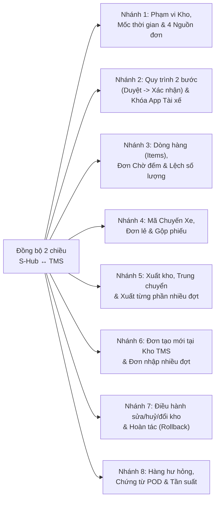

# Tài Liệu Phỏng Vấn Chuyên Sâu (`/grill-me`) & Chốt Nghiệp Vụ Vận Hành: Đấu Nối Đồng Bộ 2 Chiều S-Hub (`spiderexpress.id.vn`) ↔ Hệ Thống Kho TMS

> **Mục đích tài liệu**: Tài liệu này liệt kê **toàn bộ cây quyết định nghiệp vụ (8 Nhánh lớn — 18 Câu hỏi gốc & Câu hỏi nhánh con)** phát sinh khi đồng bộ dữ liệu 2 chiều giữa **S-Hub (Sflow — `spiderexpress.id.vn`)** và **Hệ thống Quản lý Kho TMS**.  
> **Cơ chế đồng bộ mục tiêu**:
> - **Chiều Kéo về (PULL — Cronjob 10 phút/lần)**: Tự động kéo Chuyến xe, Đơn hàng, Kế hoạch Nhập/Xuất kho từ S-Hub về TMS.
> - **Chiều Đẩy ngược (PUSH — Tự động khi Submit trên TMS)**: Khi Thủ kho/Admin thao tác trên TMS, tự động đẩy kết quả ngược về S-Hub.
>
> **Hướng dẫn dành cho Người Vận Hành / Điều Hành**:  
> Anh/Chị vui lòng tích chọn **`[x]`** vào phương án phù hợp nhất ở từng câu hỏi (mỗi câu đều có sẵn **Phương án Đề xuất** của đội Kỹ thuật) và điền ghi chú (nếu có) vào dòng **Chốt của Vận hành**.

---

## Sơ Đồ Cây Quyết Định Nghiệp Vụ (`/grill-me` Decision Tree)

---

## NHÁNH 1: Phạm Vi Kho, Mốc Thời Gian Cắt Dữ Liệu & 4 Nguồn Đơn Trên S-Hub

### Câu 1.1 — Phạm vi Kho áp dụng & Xử lý các phiếu tồn đọng "Quá ngày" (`qua_ngay`)
- **Bối cảnh thực tế giữa 2 hệ thống**:
  - S-Hub có 3 kho: **Kho HCM (`KHO-HCM`)**, **Kho Đà Nẵng (`KHO-DN`)**, **Kho Hưng Yên (`KHO-HY`)** — khớp 1-1 với 3 Hub Cấp 1 trên TMS.
  - Tuy nhiên, trên S-Hub hiện có tab **`Quá ngày` (`qua_ngay`)** đang tồn đọng **68 phiếu chờ nhập** và **162 phiếu chờ xuất** từ những ngày trước chưa được bấm xác nhận trên S-Hub (trong đó nhiều đơn thực tế Kho đã nhập/xuất xong trên TMS rồi).
- **Phương án lựa chọn**:
  - `[ ]` **Phương án A (Đề xuất)**: Đồng bộ cả **3 kho (HCM, Đà Nẵng, Hưng Yên)**, nhưng **chỉ kéo các kế hoạch có ngày dự kiến từ ngày bắt đầu Go-Live trở đi**. Với các đơn cũ trước đó, nếu trùng mã vận đơn (`orderCode`) đã có trên TMS thì chỉ liên kết ngầm ID chứ không tạo phiếu chờ nhập mới làm ngập màn hình Kho.
  - `[ ]` **Phương án B**: Kéo thêm các phiếu tồn đọng trong mục `Quá ngày` của $N$ ngày gần nhất (ví dụ 3 hoặc 7 ngày gần nhất) về TMS để Kho rà soát xử lý nốt.
  - `[ ]` **Phương án C**: Giai đoạn đầu chỉ bật trước cho **1 kho (`KHO-HCM`)**, sau khi chạy ổn định mới bật tiếp Đà Nẵng và Hưng Yên.
- 👉 **Chốt của Vận hành (Ghi rõ ngày bắt đầu cắt mốc kéo dữ liệu)**: `................................................................................`

---

### Câu 1.2 — Xử lý 4 Nguồn tạo kế hoạch (`source`) & Đơn "Khách gửi lưu kho chưa có điểm giao"
- **Bối cảnh thực tế giữa 2 hệ thống**:
  - Trên S-Hub, phiếu kế hoạch nhập (`KN-...`) có 4 nguồn (`source`):
    1. `fleet`: Đội xe tách chặng qua kho (xe tuyến Bắc-Nam).
    2. `dispatch`: Điều hành tạo từ chặng vận chuyển.
    3. `customer_drop`: Khách tự mang hàng tới kho gửi (Ví dụ thực tế trên S-Hub: phiếu `KN-2611-642` có ghi chú *"Khách gửi LƯU KHO — chưa có điểm giao, chờ khách báo"*, chưa có mã đơn `sso` và địa chỉ giao ghi là *"Chờ khách báo điểm giao"*).
    4. `manual`: Phiếu tạo thủ công trên S-Hub.
  - Trong khi trên TMS, mỗi đơn hàng khi nhập kho thường cần xác định **Kho đích (`destinationHub`)** hoặc **Tỉnh/Thành giao (`province`)**.
- **Phương án lựa chọn**:
  - `[ ]` **Phương án A (Đề xuất)**:
    - Kéo **cả 4 nguồn** (`fleet`, `dispatch`, `customer_drop`, `manual`) về TMS.
    - Riêng với đơn `customer_drop` chưa có mã đơn `sso` và chưa có điểm giao: Lấy luôn mã phiếu S-Hub (VD: `KN-2611-642`) làm `Mã đơn hàng` tạm trên TMS, để trống `Kho đích` (hoặc gán nhãn `"Lưu kho chờ báo điểm giao"`). Khi nào Điều hành S-Hub cập nhật điểm giao và mã đơn chính thức, Cronjob 10 phút sẽ tự động cập nhật sang TMS.
  - `[ ]` **Phương án B**: Chỉ kéo các đơn đã có đầy đủ mã vận đơn `sso` và điểm giao (`fleet`, `dispatch`); bỏ qua các phiếu lưu kho tạm chưa có điểm giao.
- 👉 **Chốt của Vận hành**: `........................................................................................................................`

---

## NHÁNH 2: Quy Trình 2 Bước ("Duyệt" → "Xác Nhận") Của S-Hub & Chốt Chặn App Tài Xế

### Câu 2.1 — Quy trình 2 bước (`Chờ kho duyệt` → `Đã duyệt` → `Đã nhập/xuất`) trên S-Hub vs. 1 bước trên TMS
- **Bối cảnh thực tế giữa 2 hệ thống**:
  - **Bên S-Hub**: Bắt buộc qua 2 bước:
    - Bước 1: Phiếu mới nằm ở tab **`Chờ kho duyệt`**. Thủ kho phải bấm **`✓ Duyệt`** (hoặc `✓ Duyệt cả chuyến`) để chuyển sang tab **`Đã duyệt — chờ hàng về`** (bước này chưa cộng tồn kho).
    - Bước 2: Khi xe về tới kho, Thủ kho đếm hàng và bấm **`Xác nhận nhập/xuất kho`** (lúc này mới cộng/trừ tồn kho).
  - **Bên TMS**: Màn hình **Kiểm đếm chuyến xe** hiện chỉ có **1 bước**: Chuyến xe nằm ở `Chờ xử lý` → Xe tới kho, Thủ kho kiểm đếm và bấm **`Xác nhận nhập kho`**.
- **Phương án lựa chọn**:
  - `[ ]` **Phương án A (Đề xuất — Giữ thao tác 1 chạm trên TMS)**:
    - Cronjob 10 phút kéo **cả phiếu `Chờ kho duyệt` lẫn `Đã duyệt`** từ S-Hub về hiển thị trên màn hình Kiểm đếm của TMS.
    - Thủ kho chỉ cần thao tác **1 lần duy nhất** trên TMS (bấm `Xác nhận nhập/xuất kho`), Backend TMS sẽ tự động bắn liên hoàn cả 2 lệnh sang S-Hub: **(1) Duyệt phiếu + (2) Xác nhận nhập/xuất theo số thực đếm**.
  - `[ ]` **Phương án B (Tự động Duyệt ngay khi TMS kéo về)**:
    - Ngay khi Cronjob 10 phút của TMS kéo một phiếu `Chờ kho duyệt` từ S-Hub về TMS thành công, TMS **tự động gọi API `Duyệt` sang S-Hub luôn** (chuyển phiếu trên S-Hub sang `Đã duyệt — chờ hàng về` để Điều hành biết hệ thống Kho đã nhận thông tin). Sau đó khi xe về, Thủ kho bấm `Xác nhận nhập kho` trên TMS thì đẩy nốt bước chốt tồn sang S-Hub.
  - `[ ]` **Phương án C (Làm 2 nút giống S-Hub)**:
    - Thêm nút **`Duyệt kế hoạch`** riêng trên màn hình TMS để Thủ kho bấm duyệt tay trước, khi xe về mới bấm **`Xác nhận nhập kho`**.
  - `[ ]` **Phương án D**:
    - Chỉ kéo về TMS những phiếu nào Thủ kho đã bấm **`✓ Duyệt`** bên S-Hub trước.
- 👉 **Chốt của Vận hành**: `........................................................................................................................`

---

### Câu 2.2 — Xử lý chốt chặn `_ready = false` khi Tài xế xe công ty chưa bấm "Hoàn thành" trên App Sflow
- **Bối cảnh thực tế giữa 2 hệ thống**:
  - **Bên S-Hub**: Với các chuyến xe do **xe công ty chạy** (`source = "fleet"`), nếu tài xế chưa bấm nút "Hoàn thành chặng" trên App điện thoại, S-Hub sẽ khóa cứng không cho Thủ kho bấm Xác nhận nhập kho (báo lỗi: *"Hàng chưa về kho — chặng do xe công ty chạy: chờ tài xế bấm hoàn thành trên app"*).
  - **Thực tế tại Kho**: Xe đã đổ hàng xuống bãi, Thủ kho cần nhập kho ngay trên TMS để có tồn kho ghép lên chuyến xe xuất tiếp theo.
- **Phương án lựa chọn**:
  - `[ ]` **Phương án A (Đề xuất — Không khóa cứng theo S-Hub)**:
    - Trên TMS, Thủ kho **luôn được bấm Xác nhận nhập kho ngay khi hàng thực tế đã hạ xuống kho** để có tồn kho TMS xuất đi tiếp ngay lập tức.
    - Ở phía ngầm, TMS đẩy trước bước **Duyệt + Số lượng thực đếm** lên S-Hub, và giữ lệnh chốt S-Hub ở hàng đợi tự động (`Chờ tài xế hoàn tất App`). Ngay ở chu kỳ 10 phút nào S-Hub báo tài xế đã bấm App (`_ready = true`), TMS tự động chốt nốt trên S-Hub mà Thủ kho không cần làm lại.
  - `[ ]` **Phương án B**: Khóa nút Xác nhận nhập kho trên TMS giống S-Hub cho đến khi tài xế bấm hoàn thành trên App.
- 👉 **Chốt của Vận hành**: `........................................................................................................................`

---

## NHÁNH 3: Cấu Trúc Hàng Hóa (`Items`), Đơn `"Chờ Đếm"` & Xử Lý Lệch Số Lượng

### Câu 3.1 — Quy đổi khi 1 phiếu trên S-Hub có nhiều dòng mặt hàng (`warehouse_intake_plan_items`)
- **Bối cảnh thực tế giữa 2 hệ thống**:
  - Trên S-Hub, 1 phiếu kế hoạch của 1 đơn hàng (`sso.code`, VD `NKT2611-0587`) có thể chứa mảng `warehouse_intake_plan_items` gồm 2–3 dòng hàng khác nhau (VD: Dòng 1: *10 thùng Sữa*, Dòng 2: *5 kiện Bánh*).
  - Trên TMS, mỗi vận đơn (`OrderEntity`) quản lý theo **1 tổng số lượng**, **1 tổng khối lượng (kg)**, **1 tổng thể tích (m³)** và **1 chuỗi Mô tả hàng hóa**.
- **Phương án lựa chọn**:
  - `[ ]` **Phương án A (Đề xuất)**:
    - Gộp tổng Số lượng, Tổng Kg, Tổng m³ của các dòng vào chung **1 mã vận đơn duy nhất** (`NKT2611-0587`) trên TMS; đồng thời nối tên từng mặt hàng vào ô `Mô tả hàng hóa` (VD: *"Sữa (10 thùng); Bánh (5 kiện)"*).
  - `[ ]` **Phương án B**:
    - Tách mỗi dòng mặt hàng trong phiếu S-Hub thành 1 mã vận đơn con riêng biệt trên TMS (VD: `NKT2611-0587-1`, `NKT2611-0587-2`).
- 👉 **Chốt của Vận hành**: `........................................................................................................................`

---

### Câu 3.2 — Xử lý các đơn hàng `"Chờ đếm"` (trên S-Hub bỏ trống số lượng `quantity = null`)
- **Bối cảnh thực tế giữa 2 hệ thống**:
  - Rất nhiều phiếu trên S-Hub khi Điều hành tạo chưa có số kiện cụ thể nên để trống (`quantity = null`, trên giao diện S-Hub hiện chữ đỏ **`"chờ đếm"`**).
- **Phương án lựa chọn**:
  - `[ ]` **Phương án A (Đề xuất)**:
    - Khi kéo về TMS, hiển thị số kiện dự kiến = `0` kèm nhãn cảnh báo màu cam **`[Chờ đếm]`**.
    - Khi xe về kho, hệ thống TMS **bắt buộc Thủ kho phải nhập số lượng thực đếm (`> 0`)** thì mới cho bấm Xác nhận nhập kho; sau đó tự động đẩy con số thực đếm đó ngược về điền vào phiếu S-Hub!
  - `[ ]` **Phương án B**: Không kéo các đơn `"chờ đếm"` về TMS cho đến khi Điều hành điền số lượng dự kiến trên S-Hub.
- 👉 **Chốt của Vận hành**: `........................................................................................................................`

---

### Câu 3.3 — Xử lý khi Số lượng Thực đếm tại Kho TMS bị LỆCH (Thiếu / Dư) so với Kế hoạch trên S-Hub
- **Bối cảnh thực tế giữa 2 hệ thống**:
  - Giả sử phiếu `KN-2611-037` trên S-Hub dự kiến giao về kho **`53 thùng`**.
  - Khi xe về tới kho, Thủ kho kiểm đếm thực tế trên TMS chỉ nhận được **`50 thùng` (Thiếu 3 thùng)** hoặc **`55 thùng` (Dư 2 thùng)**.
  - Trên TMS, sổ cái (`PNK-...`) đã có sẵn cột `expectedQuantity` (`53`), `quantity` (`50`), `discrepancyQuantity` (`-3`) và `discrepancyReason`. Nhưng khi đẩy ngược sang S-Hub thì cần xử lý thế nào?
- **Phương án lựa chọn**:
  - `[ ]` **Phương án A (Đề xuất)**:
    - Khi đẩy ngược sang S-Hub, TMS tự động gọi API `PATCH` của S-Hub **cập nhật số lượng dòng hàng thành số thực đếm (`50 thùng`)** để tồn kho vật lý trên S-Hub khớp đúng `50 thùng` với TMS, đồng thời **ghi tự động vào ô Ghi chú (`notes` / `ghi_chu`) của phiếu S-Hub**: *"[TMS Đối soát]: Kế hoạch 53, Thực nhận 50 (Lệch -3) - Lý do: ..."*.
  - `[ ]` **Phương án B**:
    - Nếu số thực nhận bằng số dự kiến thì tự động chốt sang S-Hub; nếu **có lệch (Thiếu/Dư)** thì chỉ đẩy ghi chú cảnh báo và tạm dừng bước chốt trên S-Hub để Thủ kho/Điều hành kiểm tra tay trên S-Hub.
- 👉 **Chốt của Vận hành**: `........................................................................................................................`

---

### Câu 3.4 — Quản lý Đơn vị tính (`pallet`, `thùng`, `kiện`, `cây`, `cuộn`, `bao`) giữa 2 hệ thống
- **Bối cảnh thực tế giữa 2 hệ thống**:
  - S-Hub lưu đơn vị tính cụ thể theo từng đơn (`pallet`, `thùng`, `kiện`, `cây`, `cuộn`), còn TMS hiện đang hiển thị mặc định là `kiện`.
- **Phương án lựa chọn**:
  - `[ ]` **Phương án A (Đề xuất)**: Bổ sung cột `Đơn vị tính` trên TMS để hiển thị và in phiếu đúng theo đơn vị gốc của S-Hub (`6 pallet`, `66 cây`, `53 thùng`); nếu không có thì mặc định là `kiện`.
  - `[ ]` **Phương án B**: Giữ nguyên đơn vị chung là `kiện` trên toàn bộ bảng biểu TMS, chỉ ghi chú đơn vị gốc (`pallet`, `cây`) vào trong ô `Mô tả hàng hóa`.
- 👉 **Chốt của Vận hành**: `........................................................................................................................`

---

## NHÁNH 4: Quy Chuẩn Mã Chuyến Xe (`CXBN_...` vs `SD...`), Đơn Lẻ & Gộp Phiếu

### Câu 4.1 — Quy chuẩn hiển thị Mã Chuyến Xe (`CXBN_...` của S-Hub vs `SD...` của TMS)
- **Bối cảnh thực tế giữa 2 hệ thống**:
  - Trên S-Hub, chuyến xe có mã định danh rất tường minh: `<LOẠI_CHUYẾN>_<NGÀY>_<BIỂN_SỐ>`, ví dụ: **`CXBN_061126_43H21203`** hoặc **`CXCONT_061126_75H07560`**.
  - Trên TMS, hệ thống đang đánh mã chuyến tự tăng ngắn gọn là **`SD1`**, **`SD2`**, **`SD3`**...
- **Phương án lựa chọn**:
  - `[ ]` **Phương án A (Đề xuất)**:
    - Với các chuyến kéo từ S-Hub về, **sử dụng luôn mã `CXBN_061126_43H21203` của S-Hub làm Mã chuyến xe (`tripCode`) hiển thị chính trên TMS** để Thủ kho và Điều hành tra cứu đối chiếu 2 màn hình khớp nhau 100%. (Các chuyến do Kho tự tạo nội bộ trên TMS vẫn dùng mã `SD...` như cũ).
  - `[ ]` **Phương án B**:
    - Mọi chuyến trên TMS đều bắt buộc sinh mã `SD...` (`SD105`, `SD106`), còn mã `CXBN_061126_43H21203` chỉ hiển thị phụ bên dưới hoặc trong ngoặc đơn `SD105 (CXBN_061126_43H21203)`.
- 👉 **Chốt của Vận hành**: `........................................................................................................................`

---

### Câu 4.2 — Cách gom nhóm các phiếu lẻ `📦 Không gắn chuyến` trên S-Hub khi kéo về TMS
- **Bối cảnh thực tế giữa 2 hệ thống**:
  - Trên S-Hub, ngoài các đơn đi theo chuyến `CXBN_...`, có nhóm **`📦 Không gắn chuyến`** gồm:
    1. Các đơn xe ngoài/xe tăng bo chỉ có Biển số xe (`vehicle_plate: "452256"`) nhưng chưa ghép vào `shipment`.
    2. Các đơn khách tự mang hàng ra kho (`source = "customer_drop"`, `vehicle_plate = null`).
- **Phương án lựa chọn**:
  - `[ ]` **Phương án A (Đề xuất)**:
    - Nếu các phiếu lẻ có **cùng Biển số xe + cùng Kho + cùng Ngày dự kiến**: Gom chung vào 1 thẻ chuyến xe trên TMS theo Biển số đó.
    - Nếu phiếu không có biển số xe (khách tự mang tới): Mỗi phiếu `KN-2611-643` hiển thị thành 1 dòng phiếu nhập độc lập (lấy mã `KN-2611-643` làm mã chuyến/phiếu).
  - `[ ]` **Phương án B**:
    - Mọi phiếu nằm trong mục `📦 Không gắn chuyến` trên S-Hub đều tách riêng từng phiếu `KN-...` thành từng phiếu nhập độc lập trên TMS, không tự gom theo biển số.
- 👉 **Chốt của Vận hành**: `........................................................................................................................`

---

### Câu 4.3 — Xử lý khi S-Hub sử dụng tính năng `🔗 Gộp phiếu` (`POST /intake-plans/gop`)
- **Bối cảnh thực tế giữa 2 hệ thống**:
  - Trên S-Hub, khi có 2–3 phiếu `KN-...` của cùng 1 đơn/cùng NCC/cùng kho, Thủ kho trên S-Hub có thể bấm **`🔗 Gộp`** để cộng dồn số lượng vào phiếu sớm nhất, còn các phiếu kia tự động chuyển sang trạng thái `Đã huỷ` với ghi chú *"Gộp vào KN-..."*.
- **Phương án lựa chọn**:
  - `[ ]` **Phương án A (Đề xuất)**: Khi Cronjob 10 phút phát hiện 1 phiếu bị huỷ do gộp và phiếu chính tăng `row_version`, TMS tự động cập nhật lại tổng số lượng trên phiếu chính và xóa mềm phiếu phụ để không bị nhân đôi số lượng.
  - `[ ]` **Phương án B**: Quy định thống nhất không dùng nút `🔗 Gộp` bên S-Hub nữa mà xử lý gộp vận đơn trực tiếp trên TMS.
- 👉 **Chốt của Vận hành**: `........................................................................................................................`

---

## NHÁNH 5: Nghiệp Vụ Xuất Kho, Trung Chuyển Liên Kho & Xuất Từng Phần (Chiều PUSH)

### Câu 5.1 — Khi Kho xác nhận Xuất kho / Trung chuyển trên TMS (Đã có vs. Chưa có phiếu `KX-...` trên S-Hub)
- **Bối cảnh thực tế giữa 2 hệ thống**:
  - **Tình huống 1**: Điều hành bên S-Hub đã tạo sẵn phiếu Kế hoạch xuất kho (`KX-2611-268`) cho đơn hàng đó.
  - **Tình huống 2**: Hàng đang nằm trong kho, Thủ kho trên TMS chủ động **ghép xe xuất kho / trung chuyển liên Hub** trước khi bên S-Hub có phiếu `KX-...`.
- **Phương án lựa chọn**:
  - `[ ]` **Phương án A (Đề xuất — Đồng bộ khép kín cả 2 tình huống)**:
    - Nếu đơn hàng **đã có phiếu `KX-...`** đang chờ trên S-Hub: TMS tự động cập nhật biển số xe thực xuất, số lượng thực xuất và bấm **Xác nhận xuất kho** vào đúng phiếu `KX-...` đó.
    - Nếu đơn hàng **chưa có phiếu `KX-...`** trên S-Hub: TMS tự động gọi API S-Hub **Tạo phiếu Kế hoạch xuất thủ công (`KX-...`) + Xác nhận xuất** (hoặc lệnh `Stock Move Out`) để tồn kho trên S-Hub cũng được trừ khớp 100% với TMS!
  - `[ ]` **Phương án B**:
    - TMS chỉ tự động chốt những đơn đã có sẵn phiếu `KX-...` do Điều hành tạo trên S-Hub; nếu đơn chưa có phiếu `KX-...` thì để Điều hành tự tạo trên S-Hub sau.
- 👉 **Chốt của Vận hành**: `........................................................................................................................`

---

### Câu 5.2 — Xử lý nghiệp vụ "Xuất từng phần / Chia nhiều chuyến xuất" (Partial Outbound)
- **Bối cảnh thực tế giữa 2 hệ thống**:
  - Giả sử đơn `NDA2611-0159` đang tồn kho `10 pallet` và trên S-Hub có **1 phiếu Kế hoạch xuất `KX-2611-268` duy nhất cho cả `10 pallet`**.
  - Thực tế tại kho TMS, vì xe đầy nên Thủ kho chỉ bốc lên Xe 1 được **`6 pallet`** (còn lại `4 pallet` lưu lại kho chờ đi Xe 2 vào ngày mai).
- **Phương án lựa chọn**:
  - `[ ]` **Phương án A (Đề xuất)**:
    - Ngay khi Xe 1 xuất `6 pallet` trên TMS: Hệ thống đẩy sang phiếu `KX-2611-268` trên S-Hub cập nhật số thực xuất `6 pallet` và chốt xuất `6 pallet` (lúc này trên S-Hub lô hàng vẫn còn tồn `4 pallet` trong `warehouse_items`).
    - Khi Xe 2 xuất nốt `4 pallet` còn lại trên TMS: Hệ thống tự động tạo 1 phiếu xuất bổ sung (hoặc trừ tồn `Stock Move Out` cho `4 pallet` còn lại) trên S-Hub.
  - `[ ]` **Phương án B**:
    - Giữ phiếu `KX-2611-268` trên S-Hub ở trạng thái `Đã duyệt` (ghi chú: *"Đã xuất đợt 1: 6/10 pallet trên xe ..."*), chờ đến khi TMS xuất hết đủ `10/10 pallet` mới bấm chốt hoàn tất phiếu `KX-2611-268` trên S-Hub.
- 👉 **Chốt của Vận hành**: `........................................................................................................................`

---

## NHÁNH 6: Nghiệp Vụ Tạo Đơn Mới Tại Kho TMS & Đơn Nhập Nhiều Đợt

### Câu 6.1 — Khi Thủ kho tạo "Đơn mới hoàn toàn" trực tiếp trên TMS (Không có trước trên S-Hub)
- **Bối cảnh thực tế giữa 2 hệ thống**:
  - Khách hàng tự mang hàng ra kho hoặc xe giao hàng phát sinh đột xuất mà Điều hành chưa tạo đơn trên S-Hub. Thủ kho vào TMS tạo đơn mới (`Tạo đơn mới hoàn toàn`) và xác nhận nhập kho.
- **Phương án lựa chọn**:
  - `[ ]` **Phương án A (Đề xuất)**:
    - Ngay khi Thủ kho xác nhận nhập kho đơn mới trên TMS, hệ thống tự động đẩy sang S-Hub bằng API **`Tạo kế hoạch nhập thủ công` (`POST /api/admin/warehouse/intake-plans`, `source: "manual"`) + Xác nhận nhập kho** để lô hàng đó xuất hiện ngay trong Tồn kho (`warehouse_items`) của S-Hub cho Điều hành biết và điều xe.
  - `[ ]` **Phương án B**:
    - Đẩy sang S-Hub qua tính năng **`+ Nhập hàng khách gửi` (`POST /api/admin/warehouse/stock-move`, `op: "in"`)**.
  - `[ ]` **Phương án C**:
    - Các đơn phát sinh nội bộ tại TMS không đẩy ngược sang S-Hub.
- 👉 **Chốt của Vận hành**: `........................................................................................................................`

---

### Câu 6.2 — Xử lý khi 1 Mã đơn hàng (`sso.code`) về kho làm Nhiều đợt trên Nhiều xe khác nhau
- **Bối cảnh thực tế giữa 2 hệ thống**:
  - Trên S-Hub, 1 đơn hàng lớn (VD `DTT2611-0004`, tổng `100 kiện`) có thể được tách thành 2 chặng xe (`DTT2611-0004.1` chở `60 kiện` và `DTT2611-0004.2` chở `40 kiện`), sinh ra **2 phiếu kế hoạch nhập `KN-...` riêng biệt** trên S-Hub.
- **Phương án lựa chọn**:
  - `[ ]` **Phương án A (Đề xuất)**:
    - Trên TMS, cả 2 phiếu `KN-...` đều liên kết vào **cùng 1 Mã vận đơn gốc `DTT2611-0004`** (tránh tạo 2 đơn hàng trùng mã), nhưng tạo ra **2 dòng chuyến xe (`TripEntity`) riêng biệt** tương ứng với 2 xe. Xe nào về trước xác nhận nhập trước thì cộng dồn vào `Đã nhập` và `Tồn khả dụng` của đơn `DTT2611-0004` và chốt đúng phiếu `KN-...` của xe đó trên S-Hub.
  - `[ ]` **Phương án B**:
    - Tạo thành 2 mã vận đơn riêng biệt trên TMS theo mã chặng (`DTT2611-0004.1` và `DTT2611-0004.2`).
- 👉 **Chốt của Vận hành**: `........................................................................................................................`

---

## NHÁNH 7: Biến Động Từ Điều Hành S-Hub (Sửa / Đổi Kho / Lùi Lịch / Huỷ) & Hoàn Tác (Rollback)

### Câu 7.1 — Khi Điều hành trên S-Hub sửa số lượng, Đổi điểm kho (`doi-diem-kho`), Lùi lịch (`lui-kho`) hoặc Huỷ phiếu
- **Bối cảnh thực tế giữa 2 hệ thống**:
  - Đơn đã kéo về TMS nhưng sau đó Điều hành trên S-Hub thay đổi thông tin hoặc huỷ kế hoạch.
- **Phương án lựa chọn**:
  - `[ ]` **Phương án A (Đề xuất)**:
    - **Nếu trên TMS đơn/chuyến đó VẪN ĐANG CHỜ (`Chờ xử lý` — chưa nhập kho)**: Cronjob 10 phút tự động cập nhật theo thông tin mới nhất của S-Hub; nếu S-Hub huỷ phiếu hoặc đổi sang kho khác thì tự động thu hồi (xóa mềm) khỏi danh sách chờ của kho cũ trên TMS.
    - **Nếu trên TMS Thủ kho ĐÃ XÁC NHẬN NHẬP KHO RỒI**: Tuyệt đối **không tự động sửa/xóa** tồn kho thực tế của TMS (vì hàng vật lý đã nằm trong kho), chỉ phát thông báo cảnh báo cho Thủ kho và Admin.
  - `[ ]` **Phương án B**:
    - Mọi thay đổi từ S-Hub sau khi đã kéo về TMS đều chỉ hiện cảnh báo để Thủ kho bấm chấp nhận thủ công.
- 👉 **Chốt của Vận hành**: `........................................................................................................................`

---

### Câu 7.2 — Khi thao tác song song trên cả 2 web & Nghiệp vụ Hoàn tác (`Rollback` ↔ `Bỏ xác nhận`)
- **Bối cảnh thực tế giữa 2 hệ thống**:
  - Thủ kho có thể bấm xác nhận trực tiếp trên web S-Hub, hoặc Admin/Thủ kho thực hiện **Hoàn tác chuyến xe (`Rollback`)** trên TMS (tương ứng nút **`↩ Bỏ xác nhận nhập / xuất`** trên S-Hub).
- **Phương án lựa chọn**:
  - `[ ]` **Phương án A (Đề xuất — Đồng bộ gương 2 chiều)**:
    - Nếu Thủ kho bấm xác nhận trên S-Hub trước → Chu kỳ 10 phút tiếp theo TMS tự động chuyển chuyến đó sang `Đã hoàn tất` và cộng/trừ tồn kho trên TMS.
    - Nếu Admin bấm **Hoàn tác chuyến xe (Rollback)** trên TMS → Hệ thống tự động gọi API **`Bỏ xác nhận nhập / xuất`** sang S-Hub kèm lý do hoàn tác để cả 2 bên cùng quay về trạng thái chờ.
  - `[ ]` **Phương án B**:
    - Chỉ đồng bộ 1 chiều thao tác xác nhận từ TMS sang S-Hub; việc Hoàn tác (Rollback) chỉ xử lý riêng trên từng hệ thống.
- 👉 **Chốt của Vận hành**: `........................................................................................................................`

---

## NHÁNH 8: Hàng Hư Hỏng, Chứng Từ POD & Chế Độ Vận Hành Giai Đoạn Đầu

### Câu 8.1 — Phạm vi đồng bộ Hàng hư hỏng (`/admin/warehouse/hu-hong`) & Chứng từ POD (`/admin/pod`)
- **Bối cảnh thực tế giữa 2 hệ thống**:
  - Ngoài Nhập/Xuất/Tồn kho, S-Hub còn có mục **Hàng hư hỏng** và **Chứng từ POD**.
- **Phương án lựa chọn**:
  - `[ ]` **Phương án A (Đề xuất)**:
    - **Giai đoạn 1**: Tập trung 100% vào đồng bộ **Chuyến xe, Đơn hàng, Kế hoạch Nhập kho (`KN-...`), Kế hoạch Xuất kho (`KX-...`) và Tồn kho** giữa 2 hệ thống.
    - **Giai đoạn 2**: Mở rộng đồng bộ thêm ảnh chụp chứng từ và biên bản Hàng hư hỏng (nếu phát sinh).
  - `[ ]` **Phương án B**: Cần đồng bộ ngay cả mục Hàng hư hỏng ngay trong Giai đoạn 1.
- 👉 **Chốt của Vận hành**: `........................................................................................................................`

---

## Xác Nhận Phê Duyệt Của Bộ Phận Vận Hành / Điều Hành

- **Họ và tên người chốt**: `................................................................`
- **Chức vụ / Bộ phận**: `................................................................`
- **Ngày xác nhận**: `....../....../2026`
- **Ý kiến chỉ đạo bổ sung**:
  `................................................................................................................................................................`
  `................................................................................................................................................................`
