# BÁO CÁO NGHIỆP VỤ: ĐIỀU HÀNH CHUYẾN XE TRUNG CHUYỂN LIÊN HUB (TRANSFER TRIPS)
**Góc nhìn Vận hành Thực tế — Tổng quản lý Kho bãi (10 năm kinh nghiệm khai thác & điều phối)**

---

## 1. TỔNG QUAN XƯƠNG SỐNG VẬN HÀNH
Chuyến xe luân chuyển (Trung chuyển liên Hub) là các tuyến vận tải đường dài bằng xe tải trọng lớn/container kết nối trực tiếp giữa các **Tổng kho vùng** (*Polaris Hưng Yên, Magellan Đà Nẵng, Andromeda TP.HCM*) và các **Trạm xe bo vệ tinh cấp 2**.

Khác biệt cốt lõi:
- **Không quản lý SKU chi tiết**: Quản lý thuần túy theo kiện hàng vận tải, số kg, số khối ($m^3$).
- **Không chia ô kệ (Bin/Rack)**: Hàng luân chuyển là hàng thông chuyển nhanh (Cross-dock / Short-stay), hạ sàn là phân tuyến lên xe chạy ngay.

---

## 2. NĂNG LỰC ĐÁP ỨNG THỰC TẾ & BỘ HÌNH ẢNH MINH CHỨNG KIỂM ĐỊNH

### Giai đoạn 1: Chuẩn bị & Đóng hàng tại Cửa Dock Kho Gửi (Hub Xuất)

#### 1. Bảng điều độ xuất kho & Lựa chọn hình thức Luân chuyển liên Hub
Thủ kho tại Hub gửi mở Bảng điều độ xuất kho, chọn hình thức **Luân chuyển nội bộ (Mode 2)** và chỉ định Hub đích đến (Hub Cấp 1 hoặc Tuyến xe bo Cấp 2).

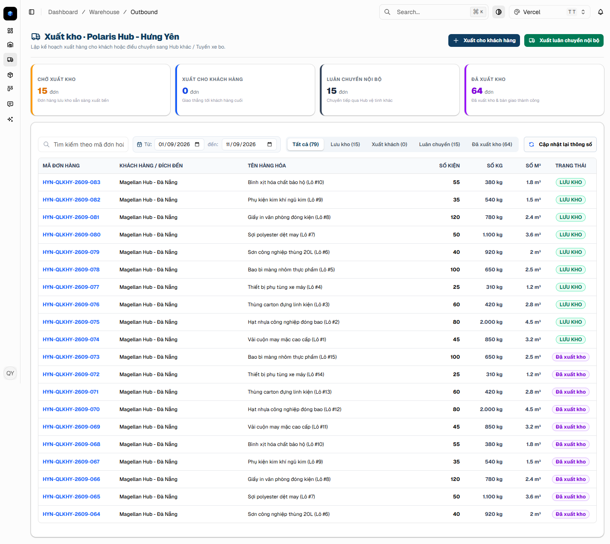
*Hình 1: Bảng điều độ xuất kho tại Kho A (Hub gửi) — Lọc danh sách hàng lưu kho và các chuyến xe xuất.*

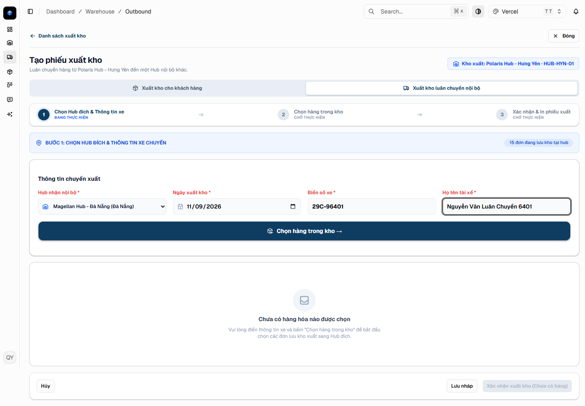
*Hình 2: Chọn hình thức Luân chuyển nội bộ (Mode 2) và chỉ định Hub đích đến trong mạng lưới.*

#### 2. Lựa chọn đơn hàng bốc lên xe luân chuyển (Hàng lưu kho & Đơn nháp)
Thủ kho tích chọn các đơn hàng đang lưu tại kho hoặc các lô hàng nháp đang làm thủ tục nhập bãi. Hệ thống hiển thị rõ ràng số kiện kế hoạch, khối lượng, thể tích và số kiện tồn khả dụng.

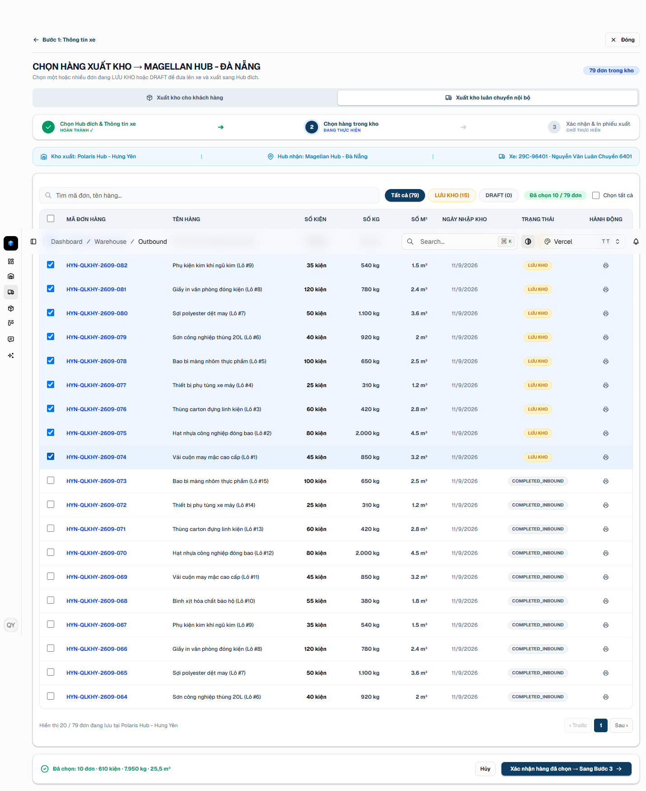
*Hình 3: Lưới chọn các đơn hàng đang lưu kho để bốc lên xe luân chuyển.*

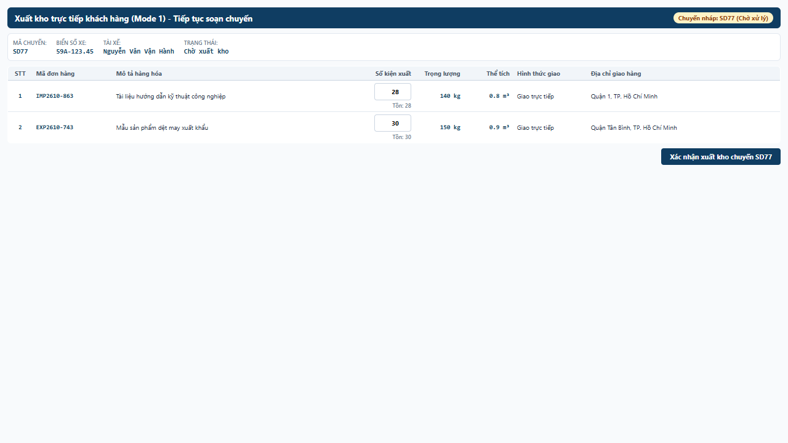
*Hình 4: Cơ chế gán đơn hàng nháp vào chuyến xuất (Task #80) — Hiển thị "Biển số xe nhập dự kiến" trước khi xuất bãi.*

#### 3. Nhập thông tin xe, tài xế và Xác nhận xuất bến
Thủ kho nhập biển kiểm soát xe trung chuyển, họ tên tài xế, thời gian khởi hành dự kiến và bấm **Xác nhận xuất kho**. Hệ thống tự động sinh mã chuyến xe luân chuyển (ví dụ: `TX-HCM-...`), trừ tồn khả dụng tại kho gửi và xuất Phiếu Xuất Kho (PXK).

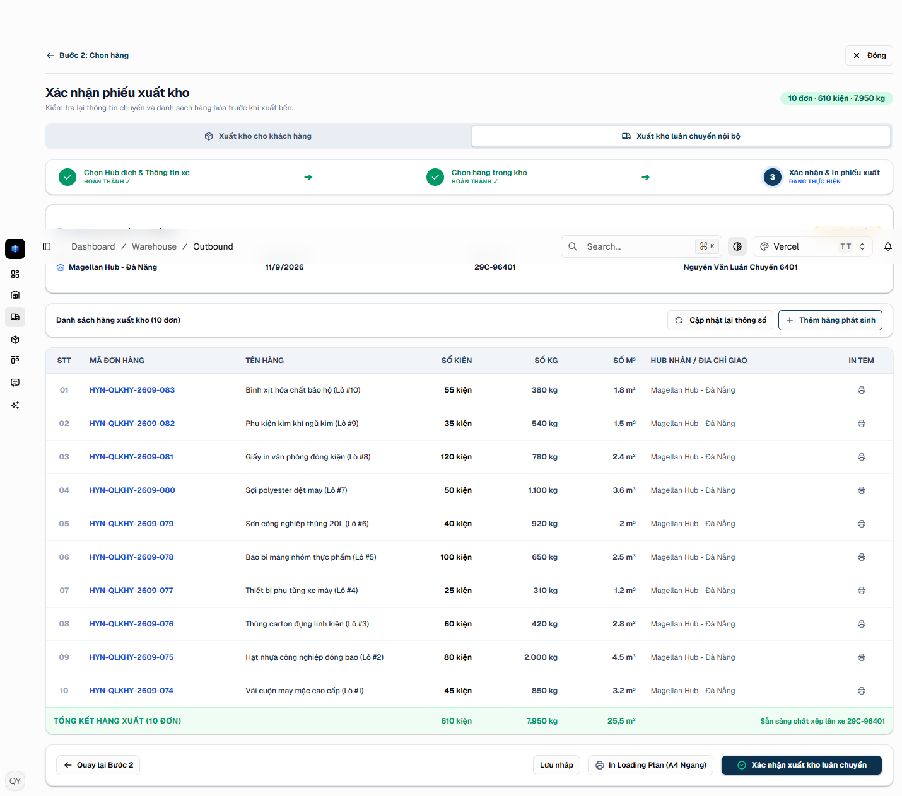
*Hình 5: Khóa thông tin phương tiện, tài xế và xác nhận xuất bến.*

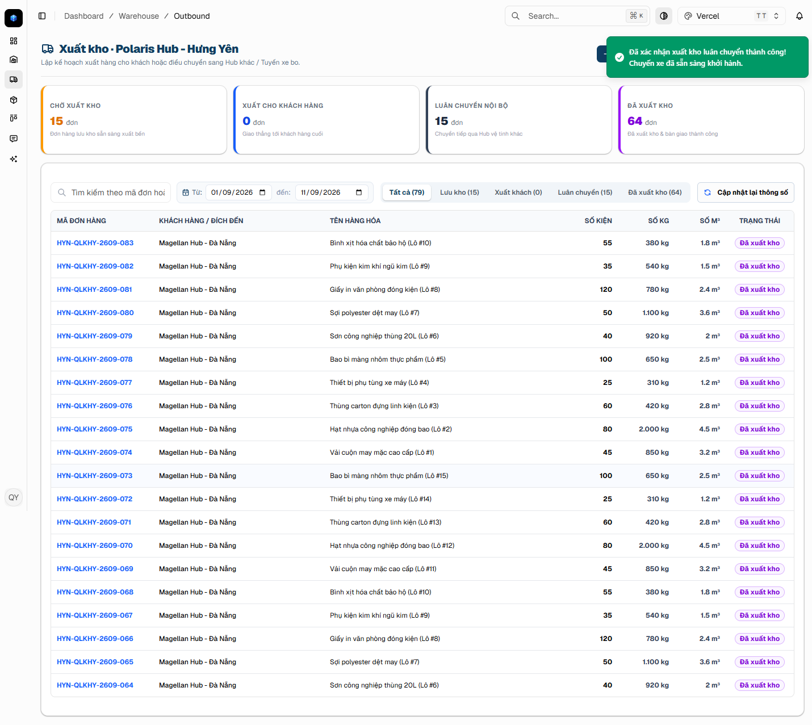
*Hình 6: Xác nhận xuất kho thành công — Mã chuyến xe được tạo, hàng hóa chuyển sang trạng thái "Đang luân chuyển".*

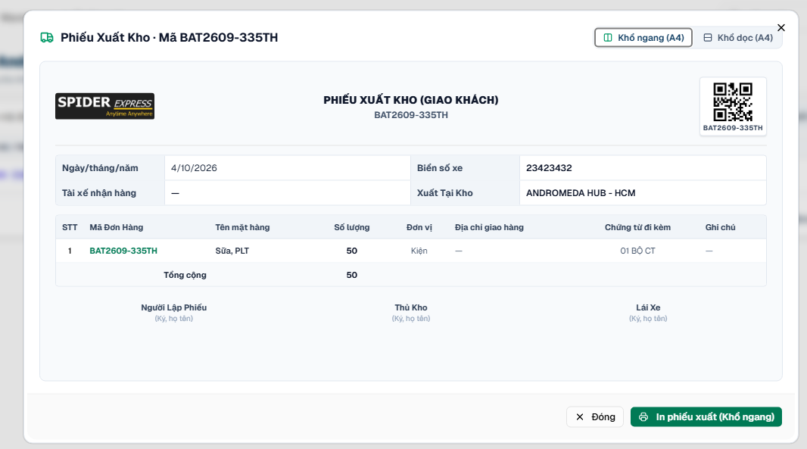
*Hình 7: Phiếu Xuất Kho (PXK) khổ A4 chuẩn hóa (Task #78) — Đầy đủ mã vạch, thông tin phương tiện, tài xế và danh sách kiện hàng.*

---

### Giai đoạn 2: Tác nghiệp Trên Đường Chạy & Trạm Trung Gian

1. **Bốc hàng dọc đường (En-route Cargo Pickup)**: Khi xe đang lưu thông trên trục quốc lộ mà ghé trạm trung gian, thủ kho tại trạm dọc đường có thể mở mã chuyến xe đang chạy để bốc thêm các đơn hàng gom phát sinh gửi ké vào cùng chuyến xe.
2. **Dỡ hàng & Bốc tiếp tại trạm trung chuyển (Multi-stop Transit)**: Xe dừng tại trạm giữa (ví dụ trạm Đà Nẵng): dỡ các kiện trả cho miền Trung, đồng thời bốc thêm hàng tồn kho Đà Nẵng chất tiếp lên xe để chạy tiếp vào TP.HCM.

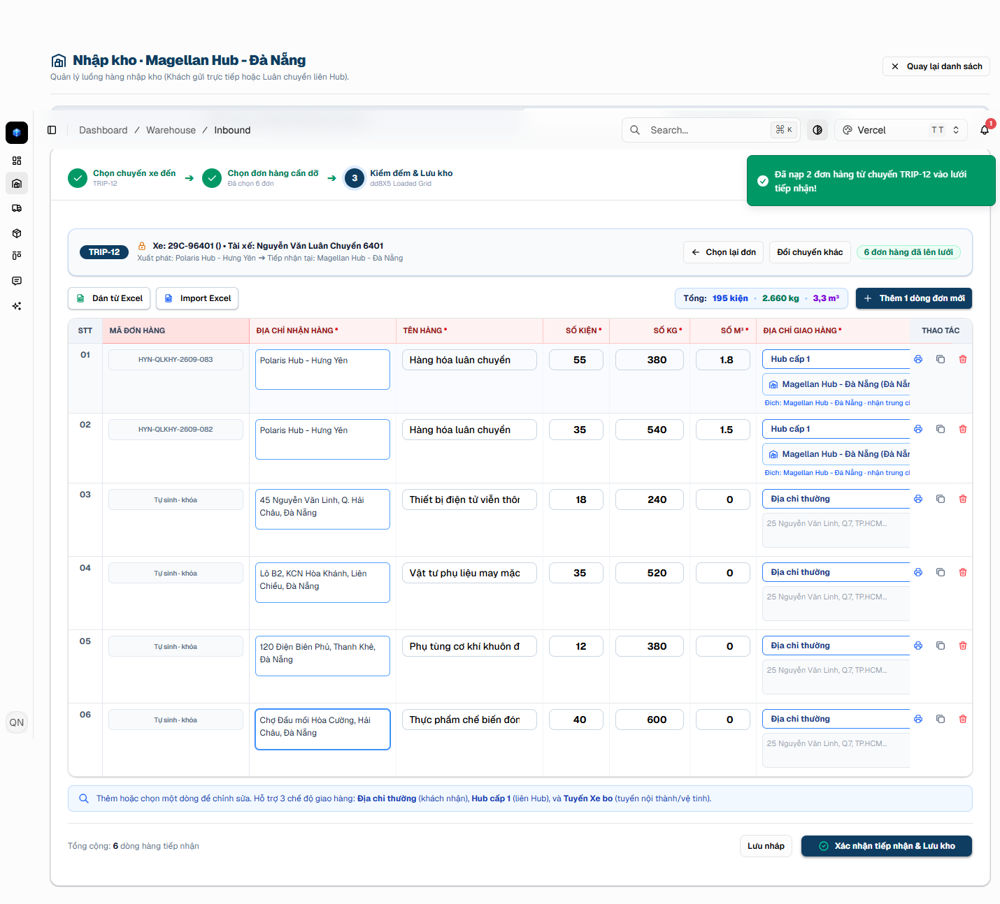
*Hình 8: Tác nghiệp bốc bổ sung các đơn hàng phát sinh dọc đường vào chuyến xe đang lưu thông.*

---

### Giai đoạn 3: Tiếp nhận & Kiểm đếm Dỡ hàng tại Cửa Dock Kho Đích (Hub Nhận)

#### 1. Theo dõi xe luân chuyển đến bãi theo thời gian thực
Thủ kho tại Hub đích theo dõi Bảng điều phối nhập kho, hệ thống phân loại riêng Tab **Luân chuyển** để nhận diện các chuyến xe tải lớn sắp cập bến, dự kiến đến lúc mấy giờ, chở bao nhiêu kiện để bố trí công nhân bốc xếp và xe nâng chờ sẵn ở cửa dock.

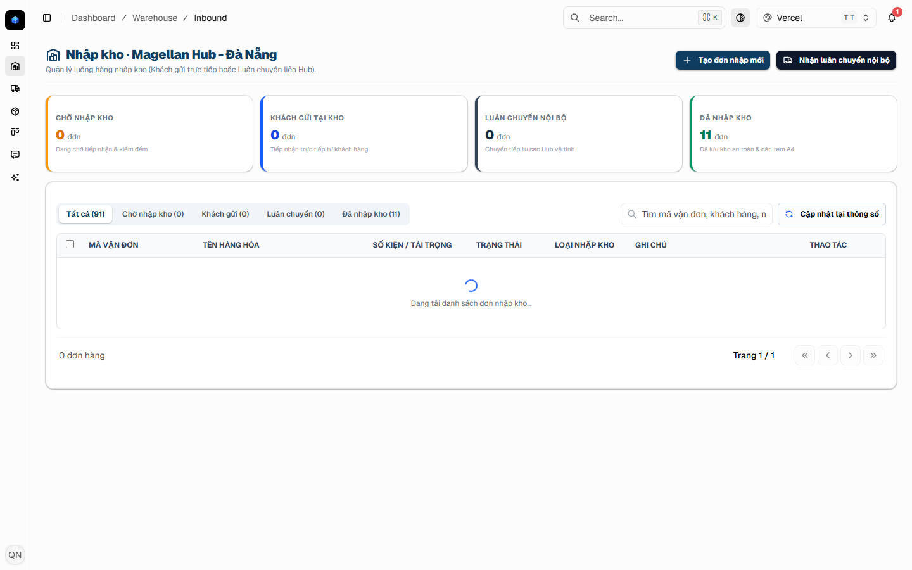
*Hình 9: Bảng theo dõi các chuyến xe luân chuyển đang trên đường đến Hub đích.*

#### 2. Tiếp nhận chuyến xe cập bến & Chọn đơn dỡ hàng
Khi xe lùi vào cửa dock mở niêm chì, thủ kho mở chi tiết chuyến xe để đối soát toàn bộ danh sách kiện hàng có trên xe. Hỗ trợ dỡ toàn bộ hoặc dỡ một phần số kiện chỉ định cho trạm hiện tại.

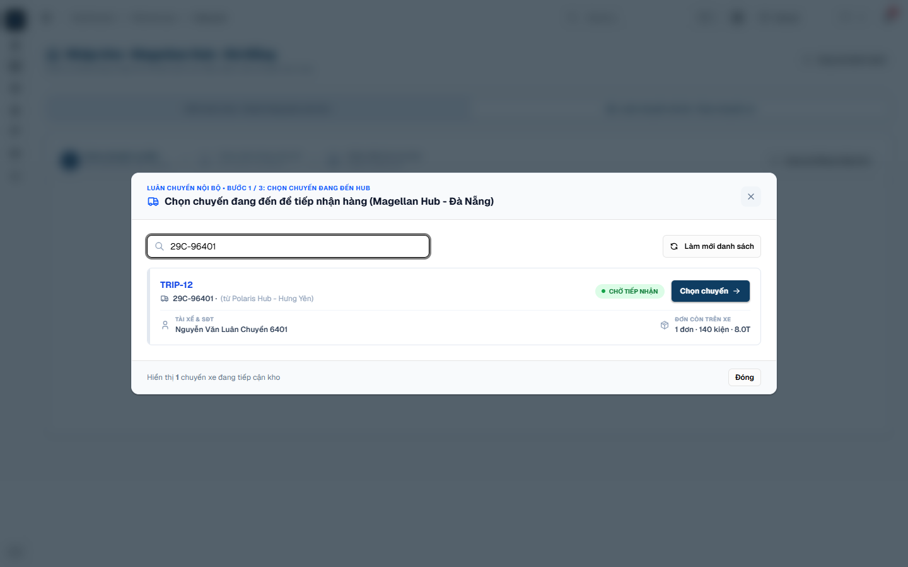
*Hình 10: Tiếp nhận chuyến xe luân chuyển cập bến cửa dock Kho B.*

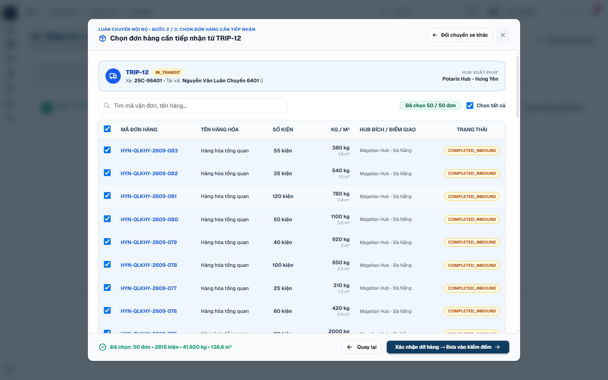
*Hình 11: Danh sách đầy đủ các đơn hàng trên xe vận chuyển.*

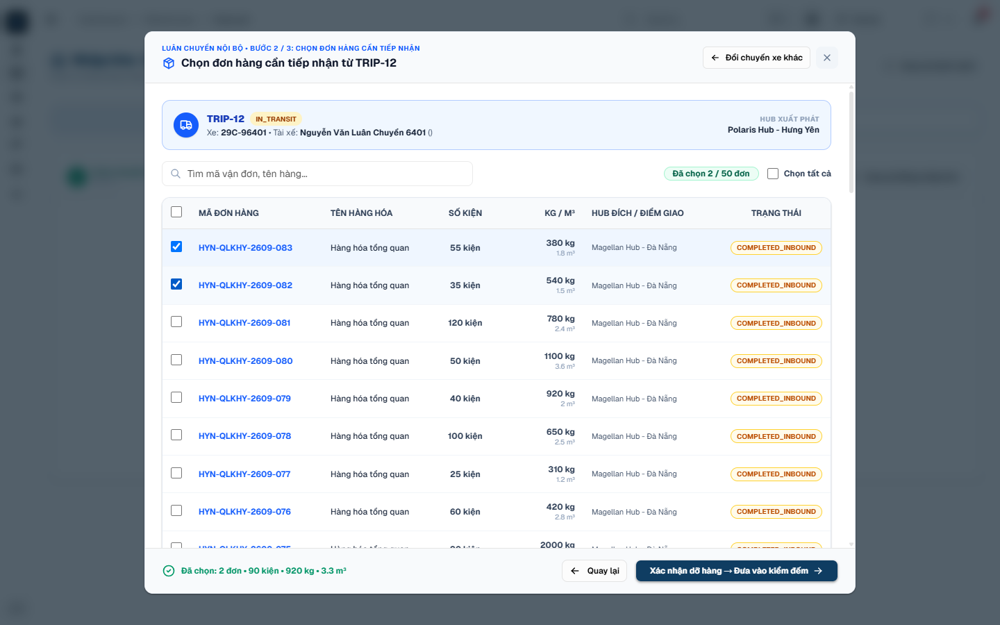
*Hình 12: Cho phép chọn dỡ toàn bộ hoặc dỡ một phần số kiện chỉ định cho trạm hiện tại.*

#### 3. Kiểm đếm dỡ hàng thực tế (Bảng kê Tally Sheet)
Thủ kho cầm bảng kiểm đếm đối chiếu trực tiếp: Hàng trên phiếu gửi đi bao nhiêu kiện - Hàng dỡ xuống sàn thực tế bao nhiêu kiện. Ghi nhận tình trạng rách bao bì, móp méo, ướt kiện hoặc thiếu kiện ngay trên từng dòng hàng.

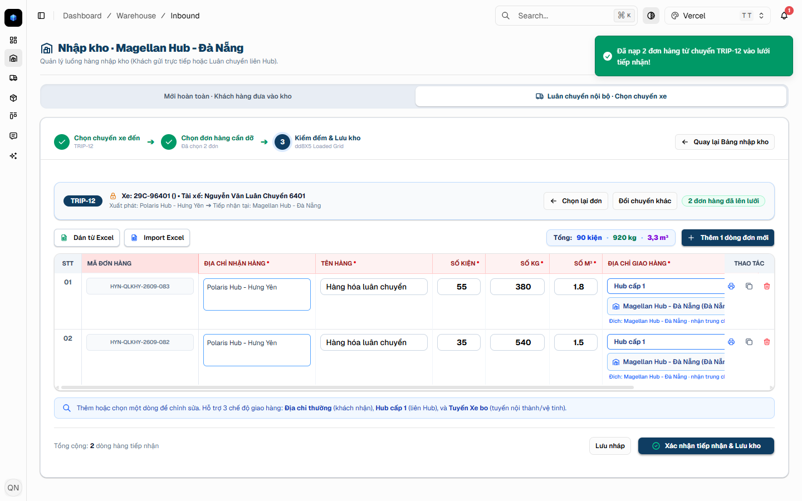
*Hình 13: Bảng kiểm đếm dỡ hàng (Tally Sheet) thực tế tại cửa dock — So sánh số kiện gửi và thực nhận.*

#### 4. Chốt chặn an toàn: Ẩn nút "In phiếu nhập" khi Chờ xử lý & Hoàn tất nhập bãi
- Khi chuyến xe còn ở trạng thái `Chờ xử lý` (hàng chưa dỡ xong), hệ thống ẩn hoàn toàn nút "In phiếu nhập" để tránh in phiếu khống khi hàng chưa vào kho (Cập nhật mới nhất Task #83).
- Sau khi kiểm đếm xong và bấm xác nhận, hệ thống sinh Phiếu Nhập Kho (PNK), tăng tồn khả dụng tại Hub đích và kết thúc chuyến xe luân chuyển.

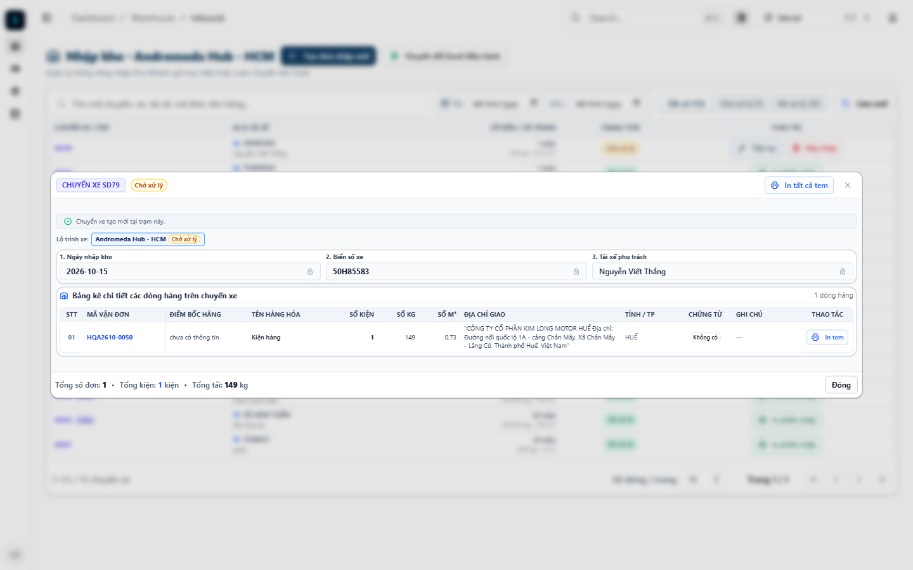
*Hình 14: Chốt chặn an toàn mới nhất (Task #83) — Ẩn nút "In phiếu nhập" khi chuyến xe ở trạng thái Chờ xử lý (hàng chưa dỡ).*

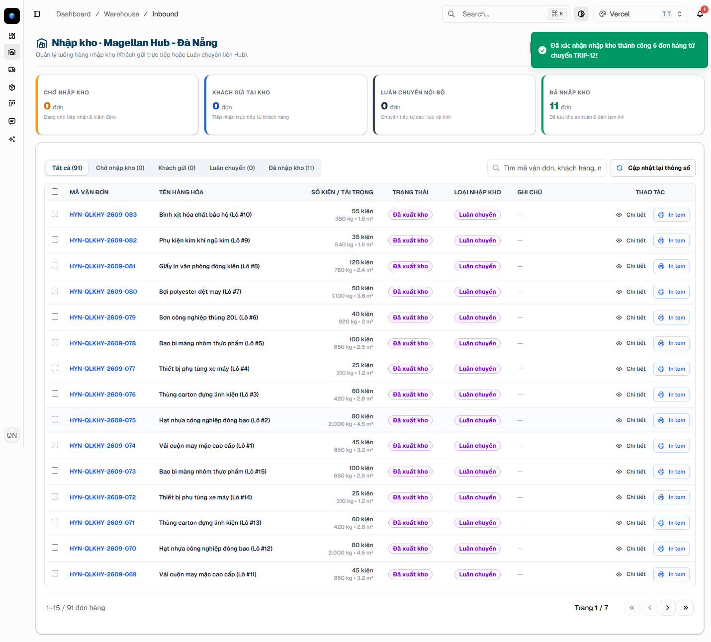
*Hình 15: Hoàn tất dỡ hàng nhập kho thành công — Số kiện tự động ghi nhận vào tồn kho Hub đích.*

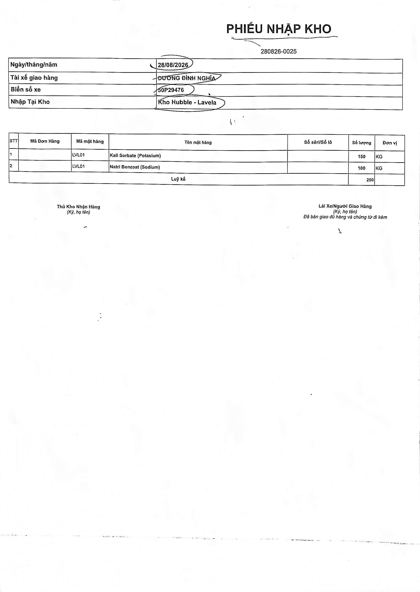
*Hình 16: Mẫu Phiếu Nhập Kho (PNK) khổ A4 thực tế (Task #78) — Bằng chứng đối soát pháp lý nhận hàng.*

---

### Giai đoạn 4: Quản trị Ngoại lệ & Bảo vệ Thao tác Sàn Bãi

#### 1. Cơ chế Quản trị viên Mở lại / Rollback chuyến xe (Task #81)
Làm việc lúc cao điểm nửa đêm, nhân viên kho rất dễ bấm nhầm hoàn tất khi hàng chưa dỡ xong. Cấp Quản lý (`SUPER_ADMIN`) được trang bị tính năng **Rollback / Mở lại chuyến xe**: tự động hoàn tác trạng thái chuyến xe về `Chờ xử lý` và đảo ngược số lượng tồn kho tương ứng một cách an toàn mà không làm rối sổ sách.

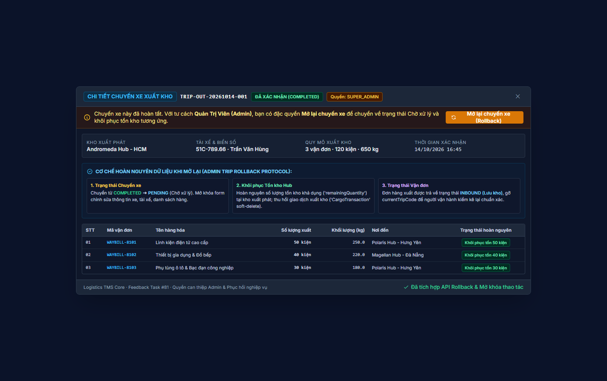
*Hình 17: Nút "Mở lại chuyến xe (Rollback)" dành riêng cho Quản trị viên (Task #81) — Hoàn tác trạng thái và tồn kho.*

#### 2. Khóa an toàn & Thanh tác vụ ghim dưới đáy trên thiết bị di động (Task #71)
Khi nhân viên cầm điện thoại ra ngoài cửa dock kiểm tra thông tin, hệ thống tự động khóa các nút xóa đơn, sửa đơn và ghim cố định thanh tác vụ dưới đáy màn hình để tránh việc quẹt nhầm tay làm mất dữ liệu chuyến xe.

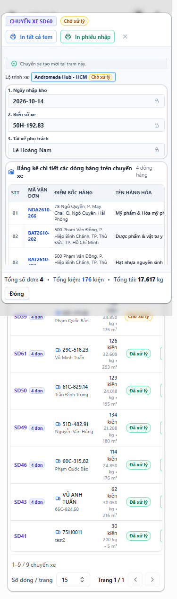
*Hình 18: Giao diện bảo vệ thao tác trên thiết bị di động (Task #71) — Khóa sửa xóa nhạy cảm tại bãi.*

---

## 3. TỔNG KẾT NGUYÊN TẮC QUẢN TRỊ BÃI XE
1. **Tuyệt đối chống âm kho**: $\text{Tồn thực} = \text{Nhập} - (\text{Xuất lẻ} + \text{Xuất luân chuyển})$.
2. **Cách ly dữ liệu kho (Hub Isolation)**: Kho nào chỉ thấy và thao tác hàng của kho đó.
3. **Quy chuẩn kiện vận tải**: Quản lý gọn gàng theo kiện, kg, khối; tối đa hóa tốc độ giải phóng cửa dock.
