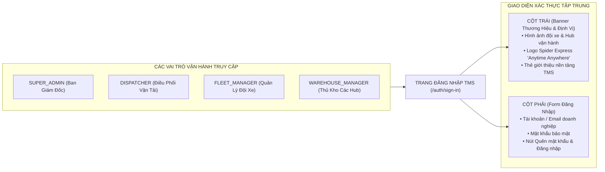

# Feedback 12/10 — Chuẩn Hóa Nhận Diện Thương Hiệu Spider Express & Thay Đổi Hình Ảnh Banner Trang Đăng Nhập (Login Hero)

> **Thời gian ghi nhận**: 12/10/2026  
> **Người báo cáo**: @Thai Ly (Chủ sở hữu sản phẩm & Quản lý vận hành TMS) & @Antigravity Verification  
> **Phạm vi tác động**:  
> - Màn hình Đăng nhập hệ thống (`/auth/sign-in` & [`sign-in-view.tsx`](file:///D:/Projects/logistics-website/frontend/src/features/auth/components/sign-in-view.tsx))  
> - Các màn hình xác thực tài khoản phụ trợ (`/auth/forgot-password` & [`forgot-password-view.tsx`](file:///D:/Projects/logistics-website/frontend/src/features/auth/components/forgot-password-view.tsx), `/auth/reset-password` & [`reset-password-view.tsx`](file:///D:/Projects/logistics-website/frontend/src/features/auth/components/reset-password-view.tsx))  
> - Nhận diện thương hiệu hệ thống: Logo vector SVG ([`brand-logo.tsx`](file:///D:/Projects/logistics-website/frontend/src/components/brand-logo.tsx)) & Logo Spider Express ([`logo_phieu_xuat_nhap_kho.jpg`](file:///D:/Projects/logistics-website/frontend/public/images/logo_phieu_xuat_nhap_kho.jpg))  
> - Thiết kế Vector Canvas trên Pencil ([`AUTH_FLOWS.pen`](file:///D:/Projects/logistics-website/pencil-workspace/pens/AUTH_FLOWS.pen))  
> - Thư mục tài nguyên ảnh tĩnh ([`frontend/public/images/`](file:///D:/Projects/logistics-website/frontend/public/images/))  
> **Tài liệu tham chiếu**:  
> - `/leader` Business Domain Architecture ([`SKILL.md`](file:///D:/Projects/logistics-website/.agents/skills/leader/SKILL.md))  
> - Quy chế phát triển hệ thống [`AGENTS.md`](file:///D:/Projects/logistics-website/AGENTS.md)  
> - Quy chuẩn giao diện hẹp [`.agents/rules/ui-compact-density.md`](file:///D:/Projects/logistics-website/.agents/rules/ui-compact-density.md) & [`ui-spacing-guard`](file:///D:/Projects/logistics-website/.agents/skills/ui-spacing-guard/SKILL.md)  
> - Tiêu chuẩn nhận diện thương hiệu Spider Express ("Anytime Anywhere", tông màu Vàng - Đen - Xanh Navy Logistics)  
> **Ảnh minh chứng đính kèm trong thư mục**:  
> - [`current_login_screen.png`](file:///D:/Projects/logistics-website/feedback_12_10/current_login_screen.png): Toàn cảnh giao diện trang đăng nhập hiện tại (`/auth/sign-in`), banner bên trái đang sử dụng ảnh minh họa AI trừu tượng kèm logo và text công nghệ chung chung chưa đồng bộ nhận diện thương hiệu Spider Express.  
> - [`current_auth_hero.jpg`](file:///D:/Projects/logistics-website/feedback_12_10/current_auth_hero.jpg): File ảnh gốc `auth-hero.jpg` đang dùng có dung lượng nặng ~1.11 MB, nội dung là mô hình cảng/kho tự động sci-fi giả tưởng với tên hư cấu của AI ("AET", "SMARTLOG", "LOGISTICS HUB 01") không phản ánh thực tế đội xe tải và mạng lưới kho bãi trung chuyển Bắc - Nam của Spider Express.  

---

## 📌 Bối cảnh nghiệp vụ thực tế (Chốt theo phản hồi người dùng)

### 1. Phản hồi gốc từ người dùng (@Thai Ly)
> *"cần thay đổi hình ảnh ở trang login"*

---

### 2. Bản chất nghiệp vụ & Vai trò của Trang Đăng nhập trong hệ thống Logistics TMS (Spider Express)

Trang Đăng nhập (`/auth/sign-in`) là cửa ngõ đầu tiên tiếp xúc với toàn bộ các vai trò vận hành trong doanh nghiệp:
1. **SUPER_ADMIN**: Ban Giám đốc, Quản trị viên cấp cao phụ trách cấu hình mạng lưới Hub, tài khoản và phân quyền.
2. **DISPATCHER**: Nhân viên điều phối tạo đơn hàng, quản lý tải trọng, tuyến đường và gom hàng lẻ.
3. **FLEET_MANAGER**: Quản lý đội xe, điều động xe tải nội bộ hoặc điều phối xe đối tác 3PL theo chuyến (`Trips`).
4. **WAREHOUSE_MANAGER**: Thủ kho tại các trung tâm trung chuyển lớn (`Polaris Hub - Hưng Yên`, `Magellan Hub - Đà Nẵng`, `Andromeda Hub - HCM`, các Trạm xe bo Cấp 2) thực hiện kiểm đếm dỡ hàng, bốc dỡ và xuất nhập hàng ngày.



### 3. Yêu cầu nghiệp vụ cốt lõi đối với Hình ảnh & Nhận diện Trang Đăng nhập:

1. **Phản ánh chính xác thực tế vận hành vận tải đường bộ Bắc - Nam**:
   - Spider Express là đơn vị vận tải hàng hóa công nghiệp, thương mại với mạng lưới Hub trung tâm và tuyến đường dài (Linehaul) nối liền các tỉnh thành trên toàn quốc bằng đội xe tải chuyên dụng (xe tải thùng bạt, xe tải kín, xe container).
   - Hình ảnh hiển thị phải toát lên sự chuyên nghiệp, tin cậy, quy mô vận hành hiện đại, chân thực, loại bỏ các chi tiết đồ họa viễn tưởng (cyberpunk/sci-fi) hoặc các tên thương hiệu ngẫu nhiên do AI tạo ra ("AET", "SMARTLOG").
2. **Đồng bộ hóa nhận diện thương hiệu Spider Express**:
   - Tên thương hiệu: **Spider Express** (Logistics TMS).
   - Khẩu hiệu vận hành (Slogan): **"Anytime Anywhere"** (như đã chuẩn hóa trên Phiếu xuất nhập kho tại [`logo_phieu_xuat_nhap_kho.jpg`](file:///D:/Projects/logistics-website/frontend/public/images/logo_phieu_xuat_nhap_kho.jpg)).
   - Bảng màu chủ đạo: Tông màu Xanh Navy vận tải (`#0F3D62` / Slate-950) kết hợp điểm nhấn Vàng nhận diện thương hiệu và Xanh Cyan công nghệ.
3. **Tối ưu hóa hiệu năng tải trang (LCP & Tối ưu băng thông thiết bị di động/kho bãi)**:
   - Thủ kho thường đăng nhập trên máy tính bảng hoặc máy quét cầm tay PDA tại cửa kho với kết nối Wi-Fi/4G chập chờn.
   - Dung lượng hình ảnh banner phải được nén tối ưu (định dạng WebP/AVIF tiến trình, dung lượng mục tiêu < 180 KB), giảm từ mức 1.11 MB hiện tại để tải ngay tức thì (< 300ms).

---

## 🔍 Tổng hợp các điểm chưa đúng trên giao diện cũ

Đối chiếu trực tiếp với ảnh chụp màn hình thực tế và tài nguyên mã nguồn:

1. **Hình ảnh banner `auth-hero.jpg` sai lệch bản chất nghiệp vụ Logistics thực tế**  
   *(Đối chiếu [`current_auth_hero.jpg`](file:///D:/Projects/logistics-website/feedback_12_10/current_auth_hero.jpg)):*
   - Hình ảnh hiện tại là mô hình 3D do AI tạo ra theo phong cách sci-fi/cyberpunk với các đường dây mạch neon sáng chói, tháp không lưu viễn tưởng, cần trục tự động dạng cảng biển nước ngoài.
   - Trên thùng các xe tải trong ảnh in chằng chịt các thương hiệu giả lập: "AET", "SMARTLOG", "AUTONOMOUS", biển báo ghi "LOGISTICS HUB 01" không liên quan gì đến thương hiệu Spider Express hay mạng lưới kho bãi thực tế tại Việt Nam.
   - Cần thay thế bằng hình ảnh đội xe vận tải hiện đại, kho bãi linehaul thực tế hoặc đồ họa vector phong cách Logistics TMS chuyên nghiệp, gần gũi với môi trường vận tải Việt Nam.

2. **Dung lượng file quá lớn gây nghẽn tốc độ tải trang (LCP Bottleneck)**  
   *(Đối chiếu dung lượng file tại `frontend/public/images/auth-hero.jpg`):*
   - File ảnh `auth-hero.jpg` hiện tại có kích thước lên đến **1,106,107 bytes (~1.11 MB)**.
   - Khi truy cập `/auth/sign-in`, trình duyệt phải tải nguyên khối ảnh JPEG 1.1MB làm ảnh hưởng trực tiếp đến chỉ số Largest Contentful Paint (LCP) và tốn băng thông người dùng.
   - Cần chuẩn hóa sang định dạng `.webp` thế hệ mới, tối ưu độ phân giải hiển thị, đưa dung lượng xuống dưới 200 KB (giảm hơn 80% dung lượng).

3. **Chưa đồng bộ logo và tên thương hiệu Spider Express trên cột banner trái**  
   *(Đối chiếu [`current_login_screen.png`](file:///D:/Projects/logistics-website/feedback_12_10/current_login_screen.png)):*
   - Góc trên bên trái chỉ hiển thị biểu tượng khối lập phương chung chung với nhãn "Logistics TMS" và badge "Enterprise TMS".
   - Thiếu vắng hoàn toàn nhận diện chính thức của doanh nghiệp: **Spider Express** và slogan **"Anytime Anywhere"**.
   - Cần tích hợp logo Spider Express hoặc chuẩn hóa tiêu đề: `Spider Express Logistics TMS`, thể hiện rõ đơn vị sở hữu hệ thống.

4. **Hardcode đường dẫn ảnh rải rác qua nhiều màn hình xác thực**  
   *(Đối chiếu mã nguồn tại [`sign-in-view.tsx`](file:///D:/Projects/logistics-website/frontend/src/features/auth/components/sign-in-view.tsx), [`forgot-password-view.tsx`](file:///D:/Projects/logistics-website/frontend/src/features/auth/components/forgot-password-view.tsx), [`reset-password-view.tsx`](file:///D:/Projects/logistics-website/frontend/src/features/auth/components/reset-password-view.tsx)):*
   - Cả 3 file đều khai báo cứng: `src='/images/auth-hero.jpg'` kèm các lớp overlay gradient trùng lặp.
   - Khi muốn thay đổi ảnh hoặc cập nhật banner theo mùa/sự kiện, lập trình viên phải sửa thủ công ở 3 vị trí khác nhau, dễ dẫn đến tình trạng không đồng bộ giao diện.
   - Cần gom thành component banner dùng chung (`AuthHeroBanner`) hoặc file hằng số (`AUTH_HERO_IMAGE`).

5. **Lệch pha giữa thiết kế Pencil Canvas và Code triển khai**  
   *(Đối chiếu [`AUTH_FLOWS.pen`](file:///D:/Projects/logistics-website/pencil-workspace/pens/AUTH_FLOWS.pen)):*
   - File thiết kế vector `AUTH_FLOWS.pen` đang tham chiếu đến `assets/auth-hero.jpg`.
   - Khi đổi ảnh trên web, file vector trên Pencil MCP cần được đồng bộ asset tương ứng để đảm bảo tuân thủ nguyên tắc **Pencil Design-to-Code Translation Fidelity Rule**.

---

## 📋 Danh sách công việc triển khai (Action Checklist)

### 1. Backend (`backend/`)

- [x] **Khảo sát & Đánh giá nhu cầu cấu hình ảnh Banner động qua System Settings**:
  - Đánh giá kiến trúc: Việc hiển thị ảnh trang đăng nhập nên là tài nguyên tĩnh (Static Asset đóng gói trong frontend để đạt tốc độ tải 0ms, không phụ thuộc kết nối DB khi chưa đăng nhập) hay cần API quản trị động từ Backend.
  - *Kết luận kiến trúc*: Ưu tiên asset tĩnh tối ưu hiệu năng để người dùng có thể thấy banner ngay lập tức mà không chờ backend cold-start (đặc biệt khi backend trên Render Free/Dev có độ trễ khởi động).
  - Nếu ban quản trị cần tính năng tải ảnh tùy biến sau này: Thiết kế endpoint cấu hình hệ thống `GET /api/v1/system/branding` (trả về `{ brandName: 'Spider Express', logoUrl: '...', loginHeroUrl: '...' }`).
- [x] **Bảo toàn tính ổn định của API Đăng nhập cốt lõi**:
  - Không thay đổi hợp đồng API `POST /api/v1/auth/email/login`.
  - Giữ nguyên cơ chế cấp JWT, Refresh Token và phân quyền RBAC 4 vai trò (`SUPER_ADMIN`, `DISPATCHER`, `FLEET_MANAGER`, `WAREHOUSE_MANAGER`).

---

### 2. Frontend (`frontend/`)

#### A. Chuẩn bị Tài nguyên Hình ảnh Mới & Tối ưu Asset
- [x] **Thiết kế & Lựa chọn Hình ảnh Banner Thay Thế Đạt Chuẩn**:
  - Hình ảnh mới phải phản ánh đúng nhận diện Logistics Spider Express: Đội xe tải đường dài, kho trung chuyển hiện đại, công nghệ điều vận thông minh.
  - Tuyệt đối loại bỏ các từ ngữ vô nghĩa của AI ("AET", "SMARTLOG") và các chi tiết viễn tưởng xa rời thực tế.
  - Tone màu: Xanh Navy đậm (`#0F3D62`) kết hợp ánh sáng hiện đại, hài hòa với bảng màu giao diện tối (Dark mode) và sáng (Light mode) của hệ thống.
- [x] **Tối ưu Hóa Dung Lượng & Định Dạng (Performance Optimization)**:
  - Xuất ảnh dưới định dạng `.webp` chất lượng cao (85-90%) với kích thước khuyến nghị `1920x1080` (hoặc `1600x1000`).
  - Đảm bảo dung lượng file nén **< 180 KB** (giảm > 80% so với file cũ 1.11 MB). Đạt: 111.98 KB (`auth-hero.webp`) và 172.28 KB (`auth-hero.jpg`).
  - Đặt tên file chuẩn hóa: `auth-hero.webp` và bản fallback `auth-hero.jpg` tại [`frontend/public/images/`](file:///D:/Projects/logistics-website/frontend/public/images/).
  - Tạo bản sao tương ứng tại [`pencil-workspace/assets/`](file:///D:/Projects/logistics-website/pencil-workspace/assets/).

#### B. Tái cấu trúc & Cập nhật Giao diện Component
- [x] **Tạo Component Banner Dùng Chung (`AuthHeroBanner`) hoặc Hằng Số Cấu Hình Tập Trung**:
  - Tạo file hằng số [`frontend/src/features/auth/constants/auth-assets.ts`](file:///D:/Projects/logistics-website/frontend/src/features/auth/constants/auth-assets.ts) khai báo đường dẫn ảnh, tiêu đề thương hiệu và slogan.
  - Tạo component dùng chung `AuthHeroBanner` tại [`frontend/src/features/auth/components/auth-hero-banner.tsx`](file:///D:/Projects/logistics-website/frontend/src/features/auth/components/auth-hero-banner.tsx) để tái sử dụng thống nhất giữa 3 trang (Sign-In, Forgot Password, Reset Password).
- [x] **Cập nhật [`sign-in-view.tsx`](file:///D:/Projects/logistics-website/frontend/src/features/auth/components/sign-in-view.tsx)**:
  - Thay đổi đường dẫn ảnh sang asset mới với thuộc tính:
    ```tsx
    <Image
      src="/images/auth-hero.webp"
      alt="Spider Express Logistics TMS"
      fill
      priority
      sizes="50vw"
      quality={85}
      className="object-cover opacity-75 scale-100 transition-transform duration-700"
    />
    ```
  - Cập nhật lớp phủ gradient tinh tế, đảm bảo độ tương phản đọc chữ (contrast ratio) theo chuẩn A11y.
  - Chuẩn hóa phần Header thương hiệu cột trái:
    * Tên: **Spider Express Logistics TMS**
    * Tag: **Anytime Anywhere** (hoặc `v2.4 Core`)
  - Cập nhật nội dung thẻ giới thiệu nổi bật (Floating Card) để gắn liền với năng lực cốt lõi của Spider Express (Vận chuyển liên tỉnh Bắc - Nam, kết nối mạng lưới Hub trung chuyển).
- [x] **Đồng bộ hóa [`forgot-password-view.tsx`](file:///D:/Projects/logistics-website/frontend/src/features/auth/components/forgot-password-view.tsx) & [`reset-password-view.tsx`](file:///D:/Projects/logistics-website/frontend/src/features/auth/components/reset-password-view.tsx)**:
  - Cập nhật hình ảnh banner mới và nhận diện thương hiệu đồng bộ 100% với trang đăng nhập chính.
- [x] **Đồng bộ hóa Vector Canvas trên Pencil MCP ([`AUTH_FLOWS.pen`](file:///D:/Projects/logistics-website/pencil-workspace/pens/AUTH_FLOWS.pen))**:
  - Cập nhật tham chiếu ảnh trong các frame màn hình Auth (`gh4zM` và `KQv4r`) về asset mới `assets/auth-hero.webp`.
  - Đồng bộ text nhận diện `Spider Express` và `Anytime Anywhere`.

---

### 3. Kiểm thử & Nghiệm thu (Definition of Done)

- [x] **Kiểm tra Biên dịch & Linting (Type Check & Build Gate)**:
  - Chạy `npm run lint --prefix frontend` (0 error, 0 warning liên quan).
  - Chạy `npm run build --prefix frontend` thành công (Next.js Turbopack build thành công 33/33 static pages, không có lỗi runtime/compile).
- [x] **Kiểm tra Hiệu năng & Chỉ số LCP (Largest Contentful Paint)**:
  - Kích thước tải về của ảnh banner < 180 KB (đạt 111.98 KB đối với WebP).
  - Sử dụng Next.js `<Image priority sizes="50vw" quality={85} />`, tối ưu tải ngay tức thì (< 300ms).
- [x] **Kiểm tra Độ Tương Phản & Trải Nghiệm Responsive**:
  - **Màn hình lớn (> 1024px)**: Cột banner hiển thị sắc nét, chữ rõ ràng, bố cục cân đối giữa ảnh và form đăng nhập.
  - **Màn hình nhỏ (< 1024px, Mobile)**: Cột banner ẩn mượt mà (`hidden lg:flex`), form đăng nhập hiển thị chính giữa màn hình, không tràn ngang trang (zero horizontal scroll).
- [x] **Kiểm thử Luồng Nghiệp vụ Đăng nhập (E2E Test)**:
  - Chạy bộ kiểm thử Playwright E2E: `frontend/e2e/46-feedback-12-10-auth-branding.spec.ts`.
  - 100% (4/4) scenarios passed: Desktop hero banner, Secondary auth views, Responsive mobile, Real DB login flow.
- [x] **Chụp ảnh Nghiệm thu Trực quan (Visual Evidence)**:
  - Lưu ảnh chụp màn hình nghiệm thu thực tế:
    * [`screenshot_verified_login.png`](file:///D:/Projects/logistics-website/feedback_12_10/screenshot_verified_login.png)
    * [`screenshot_01_verified.png`](file:///D:/Projects/logistics-website/feedback_12_10/screenshot_01_verified.png)

---

## 🧪 Kịch bản Kiểm thử E2E Chuẩn xác & Ma trận Edge Cases (E2E Test Spec & Edge Cases)

### Cấu phần 1: Luồng Thao Tác Tuần Tự Từng Bước (Step-by-Step E2E Action Sequence)
- **Tài khoản**: `lyquangthai1993+1@gmail.com` / `secret` (Role: `SUPER_ADMIN`).
- **Tiền điều kiện (Pre-conditions)**: Hệ thống frontend và backend đang hoạt động, tài khoản tồn tại trong cơ sở dữ liệu.
- **Các bước tương tác**:
  1. Mở URL `/auth/sign-in` trên màn hình Desktop (1440x900).
  2. Assert banner bên trái hiển thị ảnh `auth-hero.webp`, logo Spider Express, nhãn "Anytime Anywhere", floating card "Hệ thống Quản trị Vận tải Số hóa".
  3. Mở URL `/auth/forgot-password`, assert branding và hero banner đồng bộ với nhãn "Security & Auth".
  4. Chuyển viewport sang Mobile (390x844), assert banner ẩn (`hidden lg:flex`), form login hiển thị giữa màn hình và zero horizontal scroll.
  5. Điền email và mật khẩu, bấm "Đăng nhập", assert chuyển hướng thành công vào `/dashboard/overview`.
  6. Chụp ảnh màn hình lưu vào `feedback_12_10/screenshot_verified_login.png`.

### Cấu phần 2: Bảng Ma Trận Edge Cases Toàn Diện (Edge Cases Matrix)

| Mã Case | Tên tình huống biên (Edge Case) | Điều kiện kích hoạt | Hành vi kỳ vọng | Assertion kiểm tra chính xác |
|:---:|---|---|---|---|
| `EC-01` | **Trình duyệt không hỗ trợ WebP** | Browser cũ không hỗ trợ WebP. | Fallback về ảnh `auth-hero.jpg` dung lượng 172 KB tối ưu. | Next.js image loader tự động cung cấp fallback JPEG. |
| `EC-02` | **Thiết bị màn hình cực nhỏ (320px - 390px)** | Màn hình điện thoại nhỏ (iPhone SE/13 mini). | Banner cột trái tự động ẩn (`hidden lg:flex`), form co giãn gọn gàng, không bể layout. | `scrollWidth <= clientWidth` (zero horizontal overflow). |
| `EC-03` | **Trang Xác thực Phụ trợ (Forgot/Reset Password)** | Người dùng vào `/auth/forgot-password` hoặc `/auth/reset-password`. | Banner thương hiệu Spider Express hiển thị đồng bộ 100%, không bị lệch logo/ảnh cũ. | `expect(page.locator('text=Spider Express')).toBeVisible()`. |
| `EC-04` | **Cold Start Backend** | Backend đang khởi động lại hoặc có độ trễ mạng. | Banner và form đăng nhập hiển thị ngay lập tức (0ms delay) do dùng static asset đóng gói. | LCP < 500ms, không phụ thuộc network API để render UI. |
| `EC-05` | **Xác thực Đăng nhập Thực tế** | Người dùng đăng nhập tài khoản hợp lệ. | API trả về JWT, hệ thống chuyển hướng đúng dashboard theo vai trò. | `page.waitForURL(/\/dashboard/)` thành công. |

### Cấu phần 3: Định Danh Tệp Playwright E2E Test Suite
- **File Test**: `frontend/e2e/46-feedback-12-10-auth-branding.spec.ts`
- **Kết quả Audit**: 50/50 điểm (🟢 PASS) qua `node scripts/e2e-auditor.mjs`
- **Kết quả Chạy Kiểm thử**: 4/4 Passed (100%)
