# Feedback 12/10 (Task 33) — Tối Ưu Độ Sáng & Tinh Chỉnh Div Overlay Banner Đăng Nhập (Login Hero)

> **Thời gian ghi nhận**: 12/10/2026 20:36  
> **Người báo cáo**: @Thai Ly (Quản lý nghiệp vụ / Vận hành)  
> **Phạm vi tác động**:  
> - Giao diện Đăng nhập hệ thống (`/auth/sign-in`) ➔ Hero Visual Banner bên trái ([`AuthHeroBanner`](file:///D:/Projects/logistics-website/frontend/src/features/auth/components/auth-hero-banner.tsx))  
> - Các màn hình xác thực đồng bộ: Quên mật khẩu (`/auth/forgot-password`) & Đặt lại mật khẩu (`/auth/reset-password`)  
> - Khối thẻ nội dung nổi (Floating Tech Card) & Khối trích dẫn định vị thương hiệu (Testimonial Quote Block)  
> - Frontend TMS Core (Next.js 15+ App Router, Tailwind CSS, TypeScript) & Kiểm thử tự động Playwright E2E  
> **Tài liệu tham chiếu**:  
> - `/leader` Business Domain Architecture ([`SKILL.md`](file:///D:/Projects/logistics-website/.agents/skills/leader/SKILL.md))  
> - Quy chế phát triển hệ thống [`AGENTS.md`](file:///D:/Projects/logistics-website/AGENTS.md)  
> - Quy chuẩn giao diện hẹp [`.agents/rules/ui-compact-density.md`](file:///D:/Projects/logistics-website/.agents/rules/ui-compact-density.md) & [`ui-spacing-guard`](file:///D:/Projects/logistics-website/.agents/skills/ui-spacing-guard/SKILL.md)  
> - Chuẩn nhận diện thương hiệu Spider Express Logistics TMS  
> **Ảnh minh chứng đính kèm trong thư mục**:  
> - [`screenshot_01.jpg`](file:///D:/Projects/logistics-website/feedback_12_10_task_33/screenshot_01.jpg): Ảnh chụp màn hình phản hồi từ người dùng @Thai Ly chỉ rõ phần div overlay bên trái quá tối làm chìm hình ảnh đội xe và bến bãi logistics.  

---

## 📌 Bối cảnh nghiệp vụ thực tế (Chốt theo phản hồi người dùng)

### 1. Phản hồi gốc từ người dùng (@Thai Ly)
> *"UI hình ảnh bên trái có div overlay màu sắc tối quá, tăng sáng lên"*

---

### 2. Ý nghĩa nghiệp vụ & Tầm quan trọng của Cột Visual Hero Banner

Trong hệ thống Quản trị Vận tải Số hóa **Spider Express Logistics TMS**:
- Màn hình Đăng nhập (`/auth/sign-in`) là **điểm tiếp xúc đầu tiên (First Impression)** của toàn bộ nhân sự vận hành: từ Điều phối viên (Dispatcher), Quản lý đội xe (Fleet Manager), Thủ kho các Hub Bắc - Nam (Warehouse Manager), Ban Giám đốc đến Quản trị hệ thống (Super Admin).
- Cột bên trái (Hero Visual Column) đảm nhiệm vai trò định vị thương hiệu và truyền cảm hứng vận hành:
  1. **Hình ảnh đội xe tải hiện đại dàn hàng tại Hub trung chuyển lúc chập tối**: Đại diện cho năng lực vận tải đường dài, tính quy chuẩn và quy mô chuỗi cung ứng Bắc - Nam không ngừng nghỉ ("Anytime Anywhere").
  2. **Thẻ nổi thông điệp số hóa**: Khẳng định sứ mệnh quản lý đơn hàng, điều phối thông suốt và tối ưu hóa chi phí vận hành.
  3. **Khối trích dẫn cam kết chất lượng**: Định hình phong cách làm việc chuyên nghiệp, tin cậy.

Tuy nhiên, do việc áp dụng quá nhiều lớp phủ màu tối chồng chéo (`bg-slate-950` đa tầng cùng các gradient có độ đục lên tới 90% - 95%), bức ảnh chụp bến bãi logistics chân thực và rực rỡ ánh đèn vàng ấm áp của đội xe đã bị "nhấn chìm" trong màn đêm u ám, mất đi độ sâu trường ảnh (depth of field) và năng lượng tích cực của thương hiệu vận tải Spider Express.

---

### 3. Phân tích Kỹ thuật Lớp phủ (Overlay Layering Paradigm) & Giải pháp Chiếu sáng Chuẩn mực

```mermaid
flowchart TD
    subgraph OLD ["HIỆN TRẠNG CŨ (QUÁ TỐI - MÙ MÀU)"]
        O1["Container nền: bg-slate-950"] --> O2["Ảnh gốc: Image opacity-75 (Bị tối 25%)"]
        O2 --> O3["Lớp Overlay dọc: from-slate-950/90 via-slate-950/50 to-slate-950/95"]
        O3 --> O4["Lớp Overlay ngang: from-slate-950/75 via-slate-950/40 to-transparent"]
        O4 --> O5["Thẻ nổi & Quote: bg-slate-900/60 & bg-slate-950/60 (Đục ngầu, che hết ảnh)"]
        O5 --> O6["KẾT QUẢ: Tối đen, bết màu, xe tải bị mờ mịt, thiếu sức sống"]
    end

    subgraph NEW ["GIẢI PHÁP MỚI (TĂNG SÁNG CÔNG NGHỆ & GIỮ ĐỘ TƯƠNG PHẢN CHỮ)"]
        N1["Container nền: bg-slate-900 / Deep Navy (#0F3D62 Brand Tone)"] --> N2["Ảnh gốc: Image opacity-95 hoặc 100% nguyên bản"]
        N2 --> N3["Lớp Overlay dọc tinh chỉnh: from-slate-950/45 via-transparent to-slate-950/65"]
        N3 --> N4["Lớp Overlay ngang dịu mắt: from-slate-950/35 via-transparent to-transparent"]
        N4 --> N5["Hiệu ứng Kính mờ (Glassmorphism): backdrop-blur-md, bg-slate-900/35, viền sáng ring-white/20"]
        N5 --> N6["KẾT QUẢ: Hình ảnh xe tải bừng sáng, nổi bật dàn đèn Hub, chữ sắc nét, đậm chất công nghệ"]
    end
```

---

### 4. Bảng Đối Chiếu Thông Số CSS / Tailwind Giao Diện Cũ vs. Giao Diện Mới

| Thuộc tính / Thành phần | Hiện trạng cũ ([`screenshot_01.jpg`](file:///D:/Projects/logistics-website/feedback_12_10_task_33/screenshot_01.jpg)) | Chuẩn hóa đề xuất mới | Lợi ích nghiệp vụ & Thẩm mỹ |
|---|---|---|---|
| **Độ mờ ảnh nền (`<Image />`)** | `opacity-75` (Mất 25% độ sáng thực) | `opacity-95` hoặc `opacity-100` | Giữ trọn độ sắc nét và màu sắc nguyên bản của dàn xe và kho bãi |
| **Nền Container gốc** | `bg-slate-950` (Đen tuyệt đối) | `bg-slate-900` kết hợp sắc xanh Navy thương hiệu | Tránh hiện tượng hòa trộn màu bị thâm đen, tạo cảm giác sang trọng |
| **Lớp Gradient dọc (Top - Bottom)** | `from-slate-950/90 via-slate-950/50 to-slate-950/95` (Quá tối, đỉnh 90%, đáy 95%) | `from-slate-950/50 via-slate-950/15 to-slate-950/70` | Giảm hơn 50% mật độ tối, giải phóng vùng giữa ảnh để kho bãi bừng sáng |
| **Lớp Gradient ngang (Left - Right)** | `from-slate-950/75 via-slate-950/40 to-transparent` (Cắt cụt độ sáng mép trái) | `from-slate-950/30 via-transparent to-transparent` | Giúp phần đầu xe tải phía trái nhìn rõ nét góc cạnh và màu sơn kim loại |
| **Thẻ Tech Card trung tâm** | `bg-slate-900/60 ring-1 ring-white/15 backdrop-blur-xl` | `bg-slate-900/40 ring-1 ring-white/25 backdrop-blur-md shadow-2xl` | Hiệu ứng kính mờ trong suốt cao cấp, nhìn thấu dàn xe phía sau mà vẫn đọc rõ chữ |
| **Khối Quote chân trang** | `bg-slate-950/60 ring-1 ring-white/10 backdrop-blur-md` | `bg-slate-900/40 ring-1 ring-white/20 backdrop-blur-md` | Tươi sáng hơn, không bị đen đặc như một mảng tối biệt lập |
| **Độ tương phản chữ (WCAG AA)** | Chữ sáng trên nền đen đặc | Chữ trắng/cyan với drop-shadow nhẹ trên kính mờ | Đạt 100% tiêu chuẩn trợ năng đọc (Accessibility) không gây mỏi mắt |

---

## 🔍 Tổng hợp các điểm chưa đúng trên giao diện cũ cần khắc phục

Đối chiếu trực tiếp với ảnh chụp thực tế [`screenshot_01.jpg`](file:///D:/Projects/logistics-website/feedback_12_10_task_33/screenshot_01.jpg) và mã nguồn tại [`auth-hero-banner.tsx`](file:///D:/Projects/logistics-website/frontend/src/features/auth/components/auth-hero-banner.tsx):

1. **Lớp phủ Gradient dọc dìm tối quá mức cần thiết (Overly Dense Vertical Gradient)**:
   - Đoạn mã `bg-gradient-to-b from-slate-950/90 via-slate-950/50 to-slate-950/95` áp mức độ che phủ tới `90%` ở đỉnh và `95%` ở đáy.
   - Hậu quả: Dải bầu trời chập tối với ánh hoàng hôn và toàn bộ mặt sân bến bãi bị phủ một lớp mực đen dày đặc, dìm chết các chi tiết kiến trúc của Hub trung chuyển.

2. **Lớp phủ Gradient ngang thứ hai gây cộng hưởng tối tăm (Compounding Horizontal Gradient)**:
   - Đoạn mã `bg-gradient-to-r from-slate-950/75 via-slate-950/40 to-transparent` tiếp tục chồng thêm `75%` sắc tố tối từ cạnh trái.
   - Hậu quả: Khu vực bên trái — nơi người dùng đặt mắt nhìn đầu tiên — bị tối sầm, làm mất đi hình khối của những chiếc xe tải đi đầu đoàn xe.

3. **Cắt giảm độ trong suốt của ảnh gốc một cách thụ động (`opacity-75`)**:
   - Thẻ `<Image />` đang bị gán cứng class `opacity-75`. Khi render trên nền container `bg-slate-950`, bản thân bức ảnh đã bị kéo tối đi `25%` ngay từ trước khi các lớp gradient overlay được phủ lên.

4. **Khối thẻ nổi trung tâm và chân trang bị bết đen (Muddy Glassmorphism Cards)**:
   - Thẻ `bg-slate-900/60` và blockquote `bg-slate-950/60` sử dụng độ đục màu nền quá lớn (60% slate đậm), khiến các hộp nội dung trông như những mảng vá màu đen đục dán đè lên hình ảnh thay vì là các tấm kính nổi công nghệ hiện đại.

5. **Sự mất cân bằng thị giác giữa 2 nửa màn hình (Visual Disparity)**:
   - Nửa bên phải (Form đăng nhập) là nền trắng sáng (`bg-background` / `bg-white`), trong khi nửa bên trái lại là khối đen xì nặng nề. Sự tương phản ánh sáng quá gắt này gây cảm giác chói mắt và khó chịu khi nhìn lâu.

---

## 📋 Danh sách công việc triển khai (Action Checklist)

### 🎯 1. Backend (`backend/`)

> [!NOTE]
> Yêu cầu này thuần túy về giao diện người dùng (Frontend Presentation & UI/UX Styling). Không yêu cầu thay đổi cơ sở dữ liệu hay nghiệp vụ API. Tuy nhiên, Backend cần đảm bảo duy trì độ tin cậy và hiệu năng phục vụ luồng xác thực.

- [ ] **Kiểm tra tính sẵn sàng của API Xác thực (`/api/v1/auth/email/login`)**:
  - Đảm bảo endpoint phản hồi dưới 300ms, không phát sinh lỗi ngoại lệ hay rò rỉ token.
  - Kiểm tra các header bảo mật (CORS, CSP) không chặn việc tải tài nguyên hình ảnh hero banner (`/images/auth-hero.webp`).
- [ ] **Bảo đảm tính toàn vẹn của Endpoint Health Check (`/api/v1/health`)**:
  - Phục vụ việc theo dõi trạng thái môi trường Dev & Production của Railway Cloud.

---

### 🎨 2. Frontend (`frontend/`)

- [ ] **Tái cấu trúc và làm sáng Hero Banner trong [`auth-hero-banner.tsx`](file:///D:/Projects/logistics-website/frontend/src/features/auth/components/auth-hero-banner.tsx)**:
  - **Khôi phục độ sáng ảnh gốc**:
    * Điều chỉnh thẻ `<Image />` từ `opacity-75` lên `opacity-95` hoặc `opacity-100`.
    * Đảm bảo giữ nguyên các thuộc tính tối ưu hiệu năng: `priority`, `sizes='50vw'`, `quality={85}`.
  - **Giảm mật độ lớp phủ Gradient dọc (Vertical Gradient Lightening)**:
    * Thay thế `from-slate-950/90 via-slate-950/50 to-slate-950/95` bằng gradient thanh thoát: `from-slate-950/50 via-slate-950/15 to-slate-950/70`.
    * Vùng đỉnh giữ vừa đủ độ tối (50%) để tôn nổi Logo thương hiệu Spider Express và badge "Anytime Anywhere".
    * Vùng giữa mở rộng độ trong suốt (15% hoặc `via-transparent`) để toàn bộ ánh đèn bến bãi và dàn xe tải tỏa sáng.
    * Vùng đáy giữ nhẹ (70%) để bảo đảm tương phản cho trích dẫn Quote.
  - **Giảm hoặc làm mềm lớp Gradient ngang (Horizontal Gradient Softening)**:
    * Thay thế `from-slate-950/75 via-slate-950/40 to-transparent` bằng `from-slate-950/30 via-transparent to-transparent`.
    * Triệt tiêu hiện tượng vệt đen bết màu bên sườn trái.
  - **Nâng cấp hiệu ứng Kính mờ (Glassmorphism Polish) cho các khối nội dung**:
    * **Thẻ Floating Tech Card**: Chuyển từ `bg-slate-900/60` sang `bg-slate-900/35 backdrop-blur-md ring-1 ring-white/25 shadow-2xl`, thêm text-shadow tinh tế cho các đoạn văn bản mô tả.
    * **Khối Testimonial Quote**: Chuyển từ `bg-slate-950/60` sang `bg-slate-900/35 backdrop-blur-md ring-1 ring-white/20`.
    * Đảm bảo các khối chữ dễ đọc, trong suốt nhẹ nhàng để người dùng cảm nhận được chiều sâu bến bãi phía sau.
- [ ] **Đồng bộ trên toàn bộ các màn hình Xác thực liên quan**:
  - [`sign-in-view.tsx`](file:///D:/Projects/logistics-website/frontend/src/features/auth/components/sign-in-view.tsx): Trang Đăng nhập chính thức.
  - [`forgot-password-view.tsx`](file:///D:/Projects/logistics-website/frontend/src/features/auth/components/forgot-password-view.tsx): Trang Yêu cầu Quên mật khẩu.
  - [`reset-password-view.tsx`](file:///D:/Projects/logistics-website/frontend/src/features/auth/components/reset-password-view.tsx): Trang Đặt lại mật khẩu mới.
- [ ] **Tuân thủ nghiêm ngặt Quy chuẩn giao diện hẹp (UI Compact Density & Responsive Guard)**:
  - Giữ vững cấu trúc responsive: `hidden lg:flex` (tự động ẩn gọn gàng trên tablet/mobile, không chiếm dụng tài nguyên và không gây vỡ viewport ngang).
  - Đảm bảo form đăng nhập bên phải giữ nguyên độ nhỏ gọn, không lệch chuẩn khoảng cách, không vi phạm các class bị cấm theo [`.agents/rules/ui-compact-density.md`](file:///D:/Projects/logistics-website/.agents/rules/ui-compact-density.md).

---

### 🧪 3. Kiểm thử & Nghiệm thu (Definition of Done)

- [ ] **Kiểm tra biên dịch & Linting toàn dự án**:
  - Backend Type Check & Lint: `npm run lint --prefix backend` & `npm run build --prefix backend` PASS (0 errors).
  - Frontend Type Check & Build: `npm run build --prefix frontend` PASS (0 errors, biên dịch Turbopack thành công).
- [ ] **Cập nhật & Thực thi Suite Kiểm thử Tự động E2E ([`46-feedback-12-10-auth-branding.spec.ts`](file:///D:/Projects/logistics-website/frontend/e2e/46-feedback-12-10-auth-branding.spec.ts))**:
  - **Kịch bản 1: Desktop Viewport (1440x900) Hero Banner Brightness & Visual Integrity**:
    * Xác nhận ảnh `auth-hero.webp` hiển thị với `opacity` cải thiện (không còn bị tối mù mịt).
    * Xác nhận gradient overlay áp dụng các giá trị độ sáng mới.
    * Kiểm tra tính hiển thị đầy đủ của Logo Spider Express, Huy hiệu "Anytime Anywhere", Thẻ công nghệ số hóa và Khối Quote.
  - **Kịch bản 2: Tiêu chuẩn Tương phản chữ (Text Readability & Accessibility Check)**:
    * Đo đạc và xác minh các đoạn text (`Hệ thống Quản trị Vận tải Số hóa`, slogan, quote) hoàn toàn rõ ràng, sắc nét trên nền ảnh đã tăng sáng.
  - **Kịch bản 3: Tính đồng bộ trên toàn bộ Auth Views**:
    * Kiểm tra `/auth/sign-in`, `/auth/forgot-password`, `/auth/reset-password` đều thừa hưởng banner tăng sáng chuẩn đẹp.
  - **Kịch bản 4: Mobile Viewport (390x844) Responsiveness**:
    * Xác nhận banner tự động ẩn trên màn hình nhỏ, form đăng nhập hiển thị chính giữa, không có horizontal scrollbar.
  - **Kịch bản 5: Chụp ảnh Bằng chứng Nghiệm thu Thực tế**:
    * Tự động chụp và lưu trữ ảnh nghiệm thu mới vào thư mục:
      `feedback_12_10_task_33/screenshot_01_verified.png`
    * Đối chiếu so sánh trực tiếp với ảnh phản hồi ban đầu [`screenshot_01.jpg`](file:///D:/Projects/logistics-website/feedback_12_10_task_33/screenshot_01.jpg).
