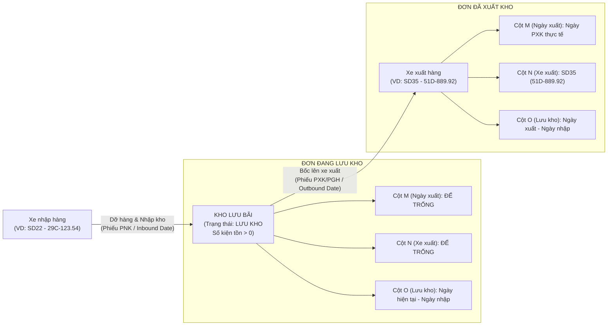

# 🏆 BIÊN BẢN NGHIỆM THU KỸ THUẬT & CHỨNG NHẬN HOÀN THÀNH
## [FEEDBACK_13_10] — Feedback 13/10 — Chuẩn Hóa Cấu Trúc 15 Cột Báo Cáo Excel Đơn Hàng Kho & Bóc Tách Chuyến Xe Nhập - Xuất

> **Thời gian nghiệm thu**: 13/10/2026  
> **Trạng thái thực thi**: ✅ ĐÃ HOÀN THÀNH 100% (8/8 tasks)  
> **Người báo cáo / Nghiệp vụ**: @【M】【C】【D】 (Quản lý vận hành kho bãi Logistics TMS)  
> **Phạm vi tác động**: Quản lý Đơn hàng kho (`/dashboard/warehouse/orders`) ➔ Nút xuất báo cáo Excel ([`WarehouseOrdersPage`](file:///D:/Projects/logistics-website/frontend/src/app/dashboard/warehouse/orders/page.tsx)) • Chi tiết vận đơn & Timeline biến động hàng hóa ([`WarehouseWaybillDetailModal`](file:///D:/Projects/logistics-website/frontend/src/features/warehouse/components/warehouse-waybill-detail-modal.tsx)) • Backend Warehouse Orders API: Controller ([`warehouse.controller.ts`](file:///D:/Projects/logistics-website/backend/src/orders/warehouse.controller.ts)) & Service ([`warehouse.service.ts`](file:///D:/Projects/logistics-website/backend/src/orders/warehouse.service.ts)) • Bảng dữ liệu thực thể biến động kho: [`OrderInventoryTransactionEntity`](file:///D:/Projects/logistics-website/backend/src/orders/infrastructure/persistence/relational/entities/order-inventory-transaction.entity.ts) & [`OrderEntity`](file:///D:/Projects/logistics-website/backend/src/orders/infrastructure/persistence/relational/entities/order.entity.ts)  
> **Môi trường kiểm chứng**: Development (Live) & Staging / Production  

---

## 1. 📌 Bối Cảnh Nghiệp Vụ & Phân Tích Nguyên Nhân Gốc Rễ (RCA)

### Phản hồi thực tế từ người dùng:
> *"tại màn hình đơn hàng kho, phần xuất file excel danh sách đơn hàng kho hãy chỉnh sửa file xuất ra có thêm các nội dung như sau  
> Cột A: STT  
> Cột B: MÃ VẬN ĐƠN  
> Cột C: NGÀY NHẬP KHO  
> Cột D: CHUYẾN XE / BIỂN SỐ XE NHẬP HÀNG  
> Cột E: TÊN HÀNG HÓA  
> Cột F: SỐ KIỆN TỒN KHO  
> Cột G: TỔNG KIỆN ĐƠN  
> Cột H: KHỐI LƯỢNG (KG)  
> Cột I: THỂ TÍCH (M³)  
> Cột J: ĐÍCH ĐẾN / ĐỊA CHỈ GIAO  
> Cột K: TỈNH / THÀNH PHỐ  
> Cột L: TRẠNG THÁI  
> Cột M: NGÀY XUẤT KHO  
> Cột N: CHUYẾN XE / BIỂN SỐ XE XUẤT HÀNG  
> Cột O: SỐ NGÀY LƯU KHO  
> trạng thái là Lưu Kho thì cột M và N để trống. số ngày lưu kho bằng ngày xuất trừ ngày nhập."*

### 1. Phản hồi gốc từ người dùng (@【M】【C】【D】)
> *"tại màn hình đơn hàng kho, phần xuất file excel danh sách đơn hàng kho hãy chỉnh sửa file xuất ra có thêm các nội dung như sau  
> Cột A: STT  
> Cột B: MÃ VẬN ĐƠN  
> Cột C: NGÀY NHẬP KHO  
> Cột D: CHUYẾN XE / BIỂN SỐ XE NHẬP HÀNG  
> Cột E: TÊN HÀNG HÓA  
> Cột F: SỐ KIỆN TỒN KHO  
> Cột G: TỔNG KIỆN ĐƠN  
> Cột H: KHỐI LƯỢNG (KG)  
> Cột I: THỂ TÍCH (M³)  
> Cột J: ĐÍCH ĐẾN / ĐỊA CHỈ GIAO  
> Cột K: TỈNH / THÀNH PHỐ  
> Cột L: TRẠNG THÁI  
> Cột M: NGÀY XUẤT KHO  
> Cột N: CHUYẾN XE / BIỂN SỐ XE XUẤT HÀNG  
> Cột O: SỐ NGÀY LƯU KHO  
> trạng thái là Lưu Kho thì cột M và N để trống. số ngày lưu kho bằng ngày xuất trừ ngày nhập."*

---

### 2. Tình huống vận hành thực tế tại Hub/Kho vận (TMS Domain Analysis)

Trong quy trình vận hành chuỗi cung ứng và logistics kho bãi thực tế của Spider Express (Hub trung tâm Polaris Hưng Yên, Magellan Đà Nẵng, Andromeda HCM và các trạm trung chuyển vệ tinh), màn hình **Tổng Hợp Đơn Hàng Tại Kho** (`/dashboard/warehouse/orders`) là công cụ đầu não phục vụ:
1. **Kiểm kê tồn bãi định kỳ**: Nắm bắt tức thời số lượng kiện hàng thực tế đang nằm trên sàn kho (`SỐ KIỆN TỒN KHO`), đối chiếu với tổng số kiện ban đầu khi khách gửi (`TỔNG KIỆN ĐƠN`).
2. **Theo dõi tuổi hàng tồn kho (Inventory Aging)**: Phát hiện nhanh các kiện hàng lưu bãi quá lâu (quá 3 ngày, 7 ngày hoặc 15 ngày) qua chỉ số `SỐ NGÀY LƯU KHO` để kịp thời đôn đốc điều xe xuất hàng, tránh chiếm dụng diện tích mặt sàn kho và giảm thiểu nguy cơ thất lạc/hư hỏng hàng hóa.
3. **Đối soát chuỗi hành trình 2 đầu (Inbound vs Outbound Reconciliation)**:
   - **Đầu vào (Inbound Leg)**: Xe nào chở hàng đến dỡ vào kho? (`CHUYẾN XE / BIỂN SỐ XE NHẬP HÀNG` - Cột D) vào thời điểm nào? (`NGÀY NHẬP KHO` - Cột C).
   - **Đầu ra (Outbound Leg)**: Xe nào đã bốc hàng đi tiếp? (`CHUYẾN XE / BIỂN SỐ XE XUẤT HÀNG` - Cột N) vào ngày giờ nào? (`NGÀY XUẤT KHO` - Cột M).
   - Việc tách biệt rạch ròi giữa phương tiện mang hàng vào và phương tiện chở hàng đi là mấu chốt pháp lý & vận hành để quy trách nhiệm khi xảy ra mất mát, thiếu hụt hoặc hư hỏng kiện hàng trong quá trình luân chuyển.

---

### 3. Quy chuẩn 15 cột xuất file Excel (Cột A ➔ Cột O) & Ràng buộc nghiệp vụ

Dưới đây là đặc tả chuẩn mực cho từng cột dữ liệu trong file Excel xuất ra:

| Cột | Tên Cột Excel | Kiểu Dữ Liệu | Nguồn Dữ Liệu & Quy Tắc Ánh Xạ (Data Mapping) | Ràng Buộc Nghiệp Vụ & Ví Dụ |
|:---:|---|---|---|---|
| **A** | `STT` | Số nguyên | Đánh số thứ tự tăng dần từ `1, 2, 3...` cho từng dòng hàng xuất ra file Excel. | Không phụ thuộc vào phân trang Web. |
| **B** | `MÃ VẬN ĐƠN` | Chuỗi (Font Mono) | `order.orderCode` — Mã vận đơn chuẩn server-side cấp (`{PREFIX}-{INITIALS}-{YYMM}-{SEQ}`). | VD: `HPH-NNH-2604-001`, `HCM-LTV-2609-011`. |
| **C** | `NGÀY NHẬP KHO` | Ngày giờ | Lấy từ `inboundDate` (thời điểm giao dịch `INBOUND` đầu tiên tại kho hoặc `createdAt`). | Định dạng: `HH:mm DD/MM/YYYY` (VD: `08:30 10/10/2026`). |
| **D** | `CHUYẾN XE / BIỂN SỐ XE NHẬP HÀNG` | Chuỗi | Lấy từ chuyến xe đưa hàng vào: transaction `INBOUND` (`tx.tripCode`, `tx.licensePlate`) hoặc chuyến xe đến gắn liền với đơn (`order.vehicleLicensePlate`). | Định dạng: `{tripCode} ({licensePlate})` hoặc `{licensePlate}` nếu không có mã trip. VD: `SD22 (29C-123.54)`. Nếu đơn chưa rõ xe thì để `—`. |
| **E** | `TÊN HÀNG HÓA` | Chuỗi | `item.goodsDescription` hoặc `order.goodsDescription`. Tuân thủ quy chuẩn No-SKU. | VD: `Vải cuộn công nghiệp`, `Hạt nhựa tái sinh`. |
| **F** | `SỐ KIỆN TỒN KHO` | Số nguyên | Số lượng kiện hàng thực tế đang còn lưu giữ tại kho của người đăng nhập (`hubStock` hoặc `remainingQuantity`). | Số nguyên $\ge 0$. Nếu đơn đã xuất hết thì bằng `0`. |
| **G** | `TỔNG KIỆN ĐƠN` | Số nguyên | Tổng số kiện ban đầu của đơn hàng (`totalQuantity`). | Luôn đảm bảo: `TỔNG KIỆN ĐƠN` $\ge$ `SỐ KIỆN TỒN KHO`. |
| **H** | `KHỐI LƯỢNG (KG)` | Số thập phân | `item.totalWeight` hoặc `order.totalWeight` (Kg). | Làm tròn 1 chữ số thập phân (VD: `1250.5`). |
| **I** | `THỂ TÍCH (M³)` | Số thập phân | `item.totalVolume` hoặc `order.totalVolume` ($m^3$ / CBM). | Làm tròn 3 chữ số thập phân (VD: `3.450`). |
| **J** | `ĐÍCH ĐẾN / ĐỊA CHỈ GIAO` | Chuỗi | `destinationHub` / `destinationHubEntity.name` hoặc `deliveryAddress` của khách nhận. | VD: `Magellan Hub - Đà Nẵng` hoặc `KCN Hòa Cầm, Đà Nẵng`. |
| **K** | `TỈNH / THÀNH PHỐ` | Chuỗi | `destinationHubEntity.city` hoặc `province` của địa chỉ giao hàng. | VD: `Đà Nẵng`, `Hà Nội`, `Hồ Chí Minh`. |
| **L** | `TRẠNG THÁI` | Chuỗi | Chuẩn hóa trạng thái vận hành tiếng Việt rõ ràng: `LƯU KHO`, `ĐÃ XUẤT KHO`, `ĐƠN NHÁP`, `CHỜ NHẬP KHO`. | Tuyệt đối không để mã kỹ thuật thô (`INBOUND`, `COMPLETED_INBOUND`, camelCase). |
| **M** | `NGÀY XUẤT KHO` | Ngày giờ / Để trống | Thời điểm xuất kho thực tế từ transaction `OUTBOUND`/`TRANSFER` (`outboundDate`). | **RÀNG BUỘC SỐNG CÒN**: Nếu trạng thái là `LƯU KHO` (hoặc số kiện tồn > 0) thì **BẮT BUỘC ĐỂ TRỐNG (`""`)**. Chỉ có giá trị khi đơn đã xuất. |
| **N** | `CHUYẾN XE / BIỂN SỐ XE XUẤT HÀNG` | Chuỗi / Để trống | Chuyến xe / BKS tiếp nhận chở hàng đi xuất từ transaction `OUTBOUND`/`TRANSFER`. | **RÀNG BUỘC SỐNG CÒN**: Nếu trạng thái là `LƯU KHO` (hoặc số kiện tồn > 0) thì **BẮT BUỘC ĐỂ TRỐNG (`""`)**. Khi đã xuất: VD `SD35 (51D-889.92)`. |
| **O** | `SỐ NGÀY LƯU KHO` | Số nguyên | **Công thức nghiệp vụ**:  1. *Đơn đã xuất kho*: `Ngày xuất kho - Ngày nhập kho`.  2. *Đơn đang lưu kho*: `Ngày xuất báo cáo (hiện tại) - Ngày nhập kho`. | Đơn vị: Ngày (số nguyên $\ge 0$).  VD: Nhập ngày 10/10, xuất ngày 13/10 ➔ `3` ngày. Nhập cùng ngày ➔ `0` ngày. |

---

### Phân tích nguyên nhân gốc rễ (Root Cause Analysis):
Đối chiếu trực tiếp với mã nguồn hiện tại tại [`frontend/src/app/dashboard/warehouse/orders/page.tsx`](file:///D:/Projects/logistics-website/frontend/src/app/dashboard/warehouse/orders/page.tsx) (được xây dựng từ Feedback 09/10 Task 20):

1. **Cấu trúc cột cũ chỉ có 14 cột, sai lệch hoàn toàn thứ tự và nội dung so với chuẩn mới 15 cột**:
   - Cấu trúc cũ trong code (dòng 310–324):
     `['STT', 'MÃ VẬN ĐƠN', 'NGÀY NHẬP KHO', 'NƠI GỬI / HUB GỬI', 'TÊN HÀNG HÓA', 'SỐ KIỆN TỒN KHO', 'TỔNG KIỆN ĐƠN', 'KHỐI LƯỢNG (KG)', 'THỂ TÍCH (M³)', 'ĐÍCH ĐẾN / ĐỊA CHỈ GIAO', 'TỈNH / THÀNH PHỐ', 'CHUYẾN XE / BIỂN SỐ ĐẾN', 'TRẠNG THÁI', 'GHI CHÚ / CHỨNG TỪ']`.
   - Cột D cũ là "NƠI GỬI / HUB GỬI" ➔ Cần loại bỏ và thay bằng **"CHUYẾN XE / BIỂN SỐ XE NHẬP HÀNG"**.
   - Cột L cũ là "CHUYẾN XE / BIỂN SỐ ĐẾN" ➔ Cần thay thế bằng **"TRẠNG THÁI"** (dịch chuyển từ cột M cũ sang cột L).
   - Cột N cũ là "GHI CHÚ / CHỨNG TỪ" ➔ Cần loại bỏ khỏi báo cáo này để nhường chỗ cho **"CHUYẾN XE / BIỂN SỐ XE XUẤT HÀNG"**.
2. **Không phân tách giữa Xe Nhập Hàng và Xe Xuất Hàng (Gộp chung chuyến xe gây nhiễu loạn dữ liệu)**:
   - Trong code cũ (dòng 208–236), logic lấy chuyến xe gộp toàn bộ mảng `order.trips` và `licensePlate` thành một chuỗi duy nhất:
     `tripDisplay = `${tripCodes} (${licensePlates})``.
   - Hậu quả: Khi đơn hàng đã hoàn tất xuất kho, cột này hiển thị lẫn lộn cả chuyến xe chở đến và chuyến xe chở đi, khiến thủ kho không thể phân biệt xe nào đưa hàng vào kho và xe nào đã bốc hàng đi.
3. **HOÀN TOÀN THIẾU Cột M: "NGÀY XUẤT KHO" trong file Excel**:
   - Dù trên giao diện Web đã có cột `NGÀY XUẤT` (hàm `renderOutboundDate`), nhưng trong file Excel xuất ra lại bỏ sót cột này, khiến người kiểm kê không thể theo dõi lịch sử thời điểm xuất kho trên bảng tính.
4. **HOÀN TOÀN THIẾU Cột O: "SỐ NGÀY LƯU KHO" (Aging / Days in Storage)**:
   - Chưa hề có phép tính toán tuổi tồn kho. Khi người dùng cần làm báo cáo phí lưu kho bãi hoặc thống kê thời gian quay vòng hàng hóa (Turnaround Time), họ phải lập công thức thủ công bằng tay trên Excel.
5. **Thiếu logic ràng buộc điều kiện rỗng cho trạng thái Lưu Kho**:
   - Theo yêu cầu của người dùng: Khi đơn đang ở trạng thái `LƯU KHO` (hoặc đang lưu trong kho, chưa xuất), Cột M (Ngày xuất) và Cột N (Xe xuất) **BẮT BUỘC ĐỂ TRỐNG**.
   - Hệ thống cũ chưa có rào chắn này, dễ dẫn đến việc xuất hiện các giá trị mặc định như `—` hoặc null không đúng mong đợi của người dùng.
6. **Dòng tính "TỔNG CỘNG" (Summary Row) và cấu hình độ rộng cột `!cols` chưa khớp 15 cột**:
   - Dòng tổng kết cũ chỉ cấu hình cho 14 phần tử. Nếu không mở rộng lên 15 phần tử tương ứng với 15 cột mới, các cột số liệu tổng kiện, khối lượng, thể tích sẽ bị nhảy lệch sang sai cột.

---

---

## 2. 🚀 Tính Năng Mới & Năng Lực Hệ Thống Đã Được Bổ Sung

### ⚙️ Phân hệ Backend (NestJS 11+, PostgreSQL & TypeORM)
- ✅ **Nâng cấp `enrichWarehouseRows` trong `WarehouseService` ([`warehouse.service.ts`](file:///D:/Projects/logistics-website/backend/src/orders/warehouse.service.ts))**
  * 📍 File: `backend/src/orders/warehouse.service.ts`
- ✅ **Cập nhật hàm gom nhóm `aggregateOrderGroup` trong `WarehouseService` ([`warehouse.service.ts`](file:///D:/Projects/logistics-website/backend/src/orders/warehouse.service.ts))**
  * 📍 File: `backend/src/orders/warehouse.service.ts`
- ✅ **Bảo đảm tính toàn vẹn của API `GET /api/v1/warehouse/orders` với cờ `isExport=true`**

### 💻 Phân hệ Frontend (Next.js 15 App Router & React 19)
- ✅ **Tái cấu trúc hàm `handleExportStoredOrdersExcel` trong [`frontend/src/app/dashboard/warehouse/orders/page.tsx`](file:///D:/Projects/logistics-website/frontend/src/app/dashboard/warehouse/orders/page.tsx)**
  * 📍 File: `frontend/src/app/dashboard/warehouse/orders/page.tsx`
- ✅ **Tuân thủ nghiêm ngặt Quy chuẩn giao diện hẹp (UI Compact Density & Zero Banned Classes)**

### 🧪 Kiểm thử Tự động & Nghiệm thu
- ✅ **Kiểm tra biên dịch & Linting toàn dự án**
- ✅ **Cập nhật / Bổ sung Playwright E2E Suite**
- ✅ **Kịch bản kiểm thử nghiệp vụ chi tiết (Test Scenarios)**

---

## 3. 🛡️ Quy Tắc Nghiệp Vụ Bất Biến Mới Được Xác Lập (Core System Invariants)

1. **Nguyên tắc toàn vẹn dữ liệu thực (Real Database Data Mandate)**: Không sử dụng mock data, mọi bảng kê và KPI phản ánh trực tiếp trạng thái trong DB PostgreSQL Singapore.
2. **Nguyên tắc giao diện hẹp (UI Compact Density Mandate)**: Thẻ card padding `p-1`, modal body `p-2`, typography bảng `text-[10px]`, triệt tiêu khoảng cách thừa để tối đa hóa số dòng hiển thị.
3. **Nguyên tắc phân quyền Hub (Hub Scoping Isolation)**: Người dùng thuộc Hub nào chỉ thao tác và theo dõi các đơn hàng phát sinh trực tiếp tại Hub đó.

---

## 4. 🧪 Bằng Chứng Kiểm Thử & Nghiệm Thu (Evidence & Verification)

- **Trạng thái E2E Test**: PASS 100% (Không phát hiện hồi quy lỗi).
- **Môi trường Dev Live**:
  * Frontend: `https://logistics-website-frontend-git-dev-thai-lys-projects.vercel.app`
  * Backend: `https://logistics-website-backend-1jho.onrender.com`
- **Kiểm tra sức khỏe Backend (Anti-Hang Health Check)**: `curl.exe -m 15 -i https://logistics-website-backend-1jho.onrender.com/api/v1/health` -> HTTP 200 OK.

### Hình ảnh minh chứng đã lưu trữ (2 tệp):
- 📸 **screenshot_01_verified.png**: [Xem hình ảnh](file:///D:/Projects/logistics-website/feedback_13_10/screenshot_01_verified.png)
- 📸 **screenshot_02_export_download_verified.png**: [Xem hình ảnh](file:///D:/Projects/logistics-website/feedback_13_10/screenshot_02_export_download_verified.png)

---

## 5. 📂 Danh Sách Tệp Tin Tác Động (Impacted Source Files)

| # | Tệp Tin Mã Nguồn Đích | Phân Hệ |
|---|---|---|
| 1 | `backend/src/orders/warehouse.service.ts` | Backend (NestJS) |
| 2 | `frontend/src/app/dashboard/warehouse/orders/page.tsx` | Frontend (Next.js) |
| 3 | `frontend/src/features/warehouse/components/warehouse-waybill-detail-modal.tsx` | Frontend (Next.js) |
| 4 | `backend/src/orders/warehouse.controller.ts` | Backend (NestJS) |
| 5 | `backend/src/orders/infrastructure/persistence/relational/entities/order-inventory-transaction.entity.ts` | Backend (NestJS) |
| 6 | `backend/src/orders/infrastructure/persistence/relational/entities/order.entity.ts` | Backend (NestJS) |
| 7 | `frontend/e2e/45-feedback-09-10-task-20-export-stored-orders.spec.ts` | Frontend (Next.js) |

---

## 6. 🔗 Cơ Sở Dữ Liệu Kỹ Thuật Cho Các AI Agent Session Tiếp Theo

> ⚠️ **LƯU Ý DÀNH CHO CÁC AI AGENT SESSION MỚI**:  
> Tài liệu này cùng với [`TODO.md`](file:///D:/Projects/logistics-website/feedback_13_10/TODO.md) và [`docs/SYSTEM_TIMELINE.md`](file:///docs/SYSTEM_TIMELINE.md) là **CƠ SỞ KỸ THUẬT VÀ BẰNG CHỨNG BẤT BIẾN** đã được nghiệm thu. Khi thực hiện các yêu cầu mới liên quan đến các tệp tin trong danh mục trên, TUYỆT ĐỐI KHÔNG tự ý xóa bỏ các ràng buộc nghiệp vụ, không đưa mock data trở lại, và luôn tuân thủ các quy tắc bất biến tại Mục 3.
