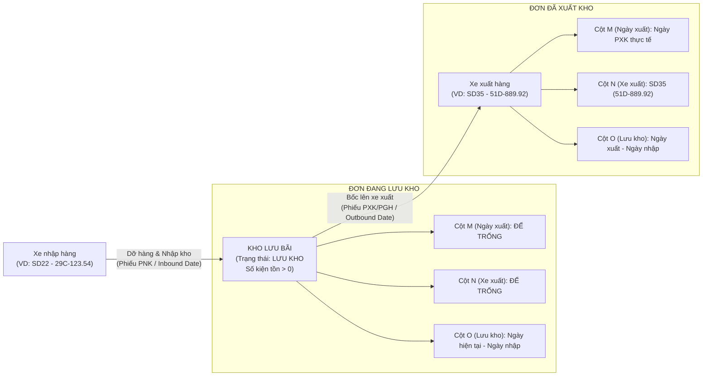

# Feedback 13/10 — Chuẩn Hóa Cấu Trúc 15 Cột Báo Cáo Excel Đơn Hàng Kho & Bóc Tách Chuyến Xe Nhập - Xuất

> **Thời gian ghi nhận**: 13/10/2026  
> **Người báo cáo**: @【M】【C】【D】 (Quản lý vận hành kho bãi Logistics TMS)  
> **Màn hình liên quan**:  
> - Quản lý Đơn hàng kho (`/dashboard/warehouse/orders`) ➔ Nút xuất báo cáo Excel ([`WarehouseOrdersPage`](file:///D:/Projects/logistics-website/frontend/src/app/dashboard/warehouse/orders/page.tsx))  
> - Chi tiết vận đơn & Timeline biến động hàng hóa ([`WarehouseWaybillDetailModal`](file:///D:/Projects/logistics-website/frontend/src/features/warehouse/components/warehouse-waybill-detail-modal.tsx))  
> - Backend Warehouse Orders API: Controller ([`warehouse.controller.ts`](file:///D:/Projects/logistics-website/backend/src/orders/warehouse.controller.ts)) & Service ([`warehouse.service.ts`](file:///D:/Projects/logistics-website/backend/src/orders/warehouse.service.ts))  
> - Bảng dữ liệu thực thể biến động kho: [`OrderInventoryTransactionEntity`](file:///D:/Projects/logistics-website/backend/src/orders/infrastructure/persistence/relational/entities/order-inventory-transaction.entity.ts) & [`OrderEntity`](file:///D:/Projects/logistics-website/backend/src/orders/infrastructure/persistence/relational/entities/order.entity.ts)  
> **Tài liệu tham chiếu**:  
> - `/leader` TMS Domain Lead Architecture ([`SKILL.md`](file:///D:/Projects/logistics-website/.agents/skills/leader/SKILL.md))  
> - Quy chế phát triển hệ thống [`AGENTS.md`](file:///D:/Projects/logistics-website/AGENTS.md)  
> - Quy chuẩn giao diện hẹp [`.agents/rules/ui-compact-density.md`](file:///D:/Projects/logistics-website/.agents/rules/ui-compact-density.md) & [`ui-spacing-guard`](file:///D:/Projects/logistics-website/.agents/skills/ui-spacing-guard/SKILL.md)  
> - Quy chuẩn kiểm soát kiện vận tải (No-SKU, Consignment Level)  
> - File kiểm thử E2E tham chiếu đợt trước: [`45-feedback-09-10-task-20-export-stored-orders.spec.ts`](file:///D:/Projects/logistics-website/frontend/e2e/45-feedback-09-10-task-20-export-stored-orders.spec.ts)  

---

## 📌 Bối cảnh nghiệp vụ thực tế (Chốt theo phản hồi người dùng)

### 1. Phản hồi gốc từ người dùng (@【M】【C】【D】)
> *"tại màn hình đơn hàng kho, phần xuất file excel danh sách đơn hàng kho hãy chỉnh sửa file xuất ra có thêm các nội dung như sau  
> Cột A: STT  
> Cột B: MÃ VẬN ĐƠN  
> Cột C: NGÀY NHẬP KHO  
> Cột D: CHUYẾN XE / BIỂN SỐ XE NHẬP HÀNG  
> Cột E: TÊN HÀNG HÓA  
> Cột F: SỐ KIỆN TỒN KHO  
> Cột G: TỔNG KIỆN ĐƠN  
> Cột H: KHỐI LƯỢNG (KG)  
> Cột I: THỂ TÍCH (M³)  
> Cột J: ĐÍCH ĐẾN / ĐỊA CHỈ GIAO  
> Cột K: TỈNH / THÀNH PHỐ  
> Cột L: TRẠNG THÁI  
> Cột M: NGÀY XUẤT KHO  
> Cột N: CHUYẾN XE / BIỂN SỐ XE XUẤT HÀNG  
> Cột O: SỐ NGÀY LƯU KHO  
> trạng thái là Lưu Kho thì cột M và N để trống. số ngày lưu kho bằng ngày xuất trừ ngày nhập."*

---

### 2. Tình huống vận hành thực tế tại Hub/Kho vận (TMS Domain Analysis)

Trong quy trình vận hành chuỗi cung ứng và logistics kho bãi thực tế của Spider Express (Hub trung tâm Polaris Hưng Yên, Magellan Đà Nẵng, Andromeda HCM và các trạm trung chuyển vệ tinh), màn hình **Tổng Hợp Đơn Hàng Tại Kho** (`/dashboard/warehouse/orders`) là công cụ đầu não phục vụ:
1. **Kiểm kê tồn bãi định kỳ**: Nắm bắt tức thời số lượng kiện hàng thực tế đang nằm trên sàn kho (`SỐ KIỆN TỒN KHO`), đối chiếu với tổng số kiện ban đầu khi khách gửi (`TỔNG KIỆN ĐƠN`).
2. **Theo dõi tuổi hàng tồn kho (Inventory Aging)**: Phát hiện nhanh các kiện hàng lưu bãi quá lâu (quá 3 ngày, 7 ngày hoặc 15 ngày) qua chỉ số `SỐ NGÀY LƯU KHO` để kịp thời đôn đốc điều xe xuất hàng, tránh chiếm dụng diện tích mặt sàn kho và giảm thiểu nguy cơ thất lạc/hư hỏng hàng hóa.
3. **Đối soát chuỗi hành trình 2 đầu (Inbound vs Outbound Reconciliation)**:
   - **Đầu vào (Inbound Leg)**: Xe nào chở hàng đến dỡ vào kho? (`CHUYẾN XE / BIỂN SỐ XE NHẬP HÀNG` - Cột D) vào thời điểm nào? (`NGÀY NHẬP KHO` - Cột C).
   - **Đầu ra (Outbound Leg)**: Xe nào đã bốc hàng đi tiếp? (`CHUYẾN XE / BIỂN SỐ XE XUẤT HÀNG` - Cột N) vào ngày giờ nào? (`NGÀY XUẤT KHO` - Cột M).
   - Việc tách biệt rạch ròi giữa phương tiện mang hàng vào và phương tiện chở hàng đi là mấu chốt pháp lý & vận hành để quy trách nhiệm khi xảy ra mất mát, thiếu hụt hoặc hư hỏng kiện hàng trong quá trình luân chuyển.



---

### 3. Quy chuẩn 15 cột xuất file Excel (Cột A ➔ Cột O) & Ràng buộc nghiệp vụ

Dưới đây là đặc tả chuẩn mực cho từng cột dữ liệu trong file Excel xuất ra:

| Cột | Tên Cột Excel | Kiểu Dữ Liệu | Nguồn Dữ Liệu & Quy Tắc Ánh Xạ (Data Mapping) | Ràng Buộc Nghiệp Vụ & Ví Dụ |
|:---:|---|---|---|---|
| **A** | `STT` | Số nguyên | Đánh số thứ tự tăng dần từ `1, 2, 3...` cho từng dòng hàng xuất ra file Excel. | Không phụ thuộc vào phân trang Web. |
| **B** | `MÃ VẬN ĐƠN` | Chuỗi (Font Mono) | `order.orderCode` — Mã vận đơn chuẩn server-side cấp (`{PREFIX}-{INITIALS}-{YYMM}-{SEQ}`). | VD: `HPH-NNH-2604-001`, `HCM-LTV-2609-011`. |
| **C** | `NGÀY NHẬP KHO` | Ngày giờ | Lấy từ `inboundDate` (thời điểm giao dịch `INBOUND` đầu tiên tại kho hoặc `createdAt`). | Định dạng: `HH:mm DD/MM/YYYY` (VD: `08:30 10/10/2026`). |
| **D** | `CHUYẾN XE / BIỂN SỐ XE NHẬP HÀNG` | Chuỗi | Lấy từ chuyến xe đưa hàng vào: transaction `INBOUND` (`tx.tripCode`, `tx.licensePlate`) hoặc chuyến xe đến gắn liền với đơn (`order.vehicleLicensePlate`). | Định dạng: `{tripCode} ({licensePlate})` hoặc `{licensePlate}` nếu không có mã trip. VD: `SD22 (29C-123.54)`. Nếu đơn chưa rõ xe thì để `—`. |
| **E** | `TÊN HÀNG HÓA` | Chuỗi | `item.goodsDescription` hoặc `order.goodsDescription`. Tuân thủ quy chuẩn No-SKU. | VD: `Vải cuộn công nghiệp`, `Hạt nhựa tái sinh`. |
| **F** | `SỐ KIỆN TỒN KHO` | Số nguyên | Số lượng kiện hàng thực tế đang còn lưu giữ tại kho của người đăng nhập (`hubStock` hoặc `remainingQuantity`). | Số nguyên $\ge 0$. Nếu đơn đã xuất hết thì bằng `0`. |
| **G** | `TỔNG KIỆN ĐƠN` | Số nguyên | Tổng số kiện ban đầu của đơn hàng (`totalQuantity`). | Luôn đảm bảo: `TỔNG KIỆN ĐƠN` $\ge$ `SỐ KIỆN TỒN KHO`. |
| **H** | `KHỐI LƯỢNG (KG)` | Số thập phân | `item.totalWeight` hoặc `order.totalWeight` (Kg). | Làm tròn 1 chữ số thập phân (VD: `1250.5`). |
| **I** | `THỂ TÍCH (M³)` | Số thập phân | `item.totalVolume` hoặc `order.totalVolume` ($m^3$ / CBM). | Làm tròn 3 chữ số thập phân (VD: `3.450`). |
| **J** | `ĐÍCH ĐẾN / ĐỊA CHỈ GIAO` | Chuỗi | `destinationHub` / `destinationHubEntity.name` hoặc `deliveryAddress` của khách nhận. | VD: `Magellan Hub - Đà Nẵng` hoặc `KCN Hòa Cầm, Đà Nẵng`. |
| **K** | `TỈNH / THÀNH PHỐ` | Chuỗi | `destinationHubEntity.city` hoặc `province` của địa chỉ giao hàng. | VD: `Đà Nẵng`, `Hà Nội`, `Hồ Chí Minh`. |
| **L** | `TRẠNG THÁI` | Chuỗi | Chuẩn hóa trạng thái vận hành tiếng Việt rõ ràng: `LƯU KHO`, `ĐÃ XUẤT KHO`, `ĐƠN NHÁP`, `CHỜ NHẬP KHO`. | Tuyệt đối không để mã kỹ thuật thô (`INBOUND`, `COMPLETED_INBOUND`, camelCase). |
| **M** | `NGÀY XUẤT KHO` | Ngày giờ / Để trống | Thời điểm xuất kho thực tế từ transaction `OUTBOUND`/`TRANSFER` (`outboundDate`). | **RÀNG BUỘC SỐNG CÒN**: Nếu trạng thái là `LƯU KHO` (hoặc số kiện tồn > 0) thì **BẮT BUỘC ĐỂ TRỐNG (`""`)**. Chỉ có giá trị khi đơn đã xuất. |
| **N** | `CHUYẾN XE / BIỂN SỐ XE XUẤT HÀNG` | Chuỗi / Để trống | Chuyến xe / BKS tiếp nhận chở hàng đi xuất từ transaction `OUTBOUND`/`TRANSFER`. | **RÀNG BUỘC SỐNG CÒN**: Nếu trạng thái là `LƯU KHO` (hoặc số kiện tồn > 0) thì **BẮT BUỘC ĐỂ TRỐNG (`""`)**. Khi đã xuất: VD `SD35 (51D-889.92)`. |
| **O** | `SỐ NGÀY LƯU KHO` | Số nguyên | **Công thức nghiệp vụ**: <br>1. *Đơn đã xuất kho*: `Ngày xuất kho - Ngày nhập kho`. <br>2. *Đơn đang lưu kho*: `Ngày xuất báo cáo (hiện tại) - Ngày nhập kho`. | Đơn vị: Ngày (số nguyên $\ge 0$). <br>VD: Nhập ngày 10/10, xuất ngày 13/10 ➔ `3` ngày. Nhập cùng ngày ➔ `0` ngày. |

---

## 🔍 Tổng hợp các điểm chưa đúng trên hệ thống cũ cần khắc phục

Đối chiếu trực tiếp với mã nguồn hiện tại tại [`frontend/src/app/dashboard/warehouse/orders/page.tsx`](file:///D:/Projects/logistics-website/frontend/src/app/dashboard/warehouse/orders/page.tsx) (được xây dựng từ Feedback 09/10 Task 20):

1. **Cấu trúc cột cũ chỉ có 14 cột, sai lệch hoàn toàn thứ tự và nội dung so với chuẩn mới 15 cột**:
   - Cấu trúc cũ trong code (dòng 310–324):
     `['STT', 'MÃ VẬN ĐƠN', 'NGÀY NHẬP KHO', 'NƠI GỬI / HUB GỬI', 'TÊN HÀNG HÓA', 'SỐ KIỆN TỒN KHO', 'TỔNG KIỆN ĐƠN', 'KHỐI LƯỢNG (KG)', 'THỂ TÍCH (M³)', 'ĐÍCH ĐẾN / ĐỊA CHỈ GIAO', 'TỈNH / THÀNH PHỐ', 'CHUYẾN XE / BIỂN SỐ ĐẾN', 'TRẠNG THÁI', 'GHI CHÚ / CHỨNG TỪ']`.
   - Cột D cũ là "NƠI GỬI / HUB GỬI" ➔ Cần loại bỏ và thay bằng **"CHUYẾN XE / BIỂN SỐ XE NHẬP HÀNG"**.
   - Cột L cũ là "CHUYẾN XE / BIỂN SỐ ĐẾN" ➔ Cần thay thế bằng **"TRẠNG THÁI"** (dịch chuyển từ cột M cũ sang cột L).
   - Cột N cũ là "GHI CHÚ / CHỨNG TỪ" ➔ Cần loại bỏ khỏi báo cáo này để nhường chỗ cho **"CHUYẾN XE / BIỂN SỐ XE XUẤT HÀNG"**.
2. **Không phân tách giữa Xe Nhập Hàng và Xe Xuất Hàng (Gộp chung chuyến xe gây nhiễu loạn dữ liệu)**:
   - Trong code cũ (dòng 208–236), logic lấy chuyến xe gộp toàn bộ mảng `order.trips` và `licensePlate` thành một chuỗi duy nhất:
     `tripDisplay = `${tripCodes} (${licensePlates})``.
   - Hậu quả: Khi đơn hàng đã hoàn tất xuất kho, cột này hiển thị lẫn lộn cả chuyến xe chở đến và chuyến xe chở đi, khiến thủ kho không thể phân biệt xe nào đưa hàng vào kho và xe nào đã bốc hàng đi.
3. **HOÀN TOÀN THIẾU Cột M: "NGÀY XUẤT KHO" trong file Excel**:
   - Dù trên giao diện Web đã có cột `NGÀY XUẤT` (hàm `renderOutboundDate`), nhưng trong file Excel xuất ra lại bỏ sót cột này, khiến người kiểm kê không thể theo dõi lịch sử thời điểm xuất kho trên bảng tính.
4. **HOÀN TOÀN THIẾU Cột O: "SỐ NGÀY LƯU KHO" (Aging / Days in Storage)**:
   - Chưa hề có phép tính toán tuổi tồn kho. Khi người dùng cần làm báo cáo phí lưu kho bãi hoặc thống kê thời gian quay vòng hàng hóa (Turnaround Time), họ phải lập công thức thủ công bằng tay trên Excel.
5. **Thiếu logic ràng buộc điều kiện rỗng cho trạng thái Lưu Kho**:
   - Theo yêu cầu của người dùng: Khi đơn đang ở trạng thái `LƯU KHO` (hoặc đang lưu trong kho, chưa xuất), Cột M (Ngày xuất) và Cột N (Xe xuất) **BẮT BUỘC ĐỂ TRỐNG**.
   - Hệ thống cũ chưa có rào chắn này, dễ dẫn đến việc xuất hiện các giá trị mặc định như `—` hoặc null không đúng mong đợi của người dùng.
6. **Dòng tính "TỔNG CỘNG" (Summary Row) và cấu hình độ rộng cột `!cols` chưa khớp 15 cột**:
   - Dòng tổng kết cũ chỉ cấu hình cho 14 phần tử. Nếu không mở rộng lên 15 phần tử tương ứng với 15 cột mới, các cột số liệu tổng kiện, khối lượng, thể tích sẽ bị nhảy lệch sang sai cột.

---

## 📋 Danh sách công việc triển khai (Action Checklist)

### 1. Backend (`backend/`)

- [x] **Nâng cấp `enrichWarehouseRows` trong `WarehouseService` ([`warehouse.service.ts`](file:///D:/Projects/logistics-website/backend/src/orders/warehouse.service.ts))**:
  - Tách bạch rõ ràng lịch sử phương tiện nhập và xuất từ `inventoryTransactions`:
    * **Inbound Vehicle**: Lọc transaction `type === InventoryTransactionType.INBOUND` đầu tiên tại Hub hiện tại. Trích xuất `inboundTripCode`, `inboundLicensePlate`, `inboundDriverName`. Format chuỗi hiển thị `inboundTripDisplay` (ví dụ: `SD22 (29C-123.54)` hoặc fallback `order.vehicleLicensePlate`).
    * **Outbound Vehicle**: Lọc transaction `type === InventoryTransactionType.OUTBOUND || type === InventoryTransactionType.TRANSFER` mới nhất tại Hub hiện tại. Trích xuất `outboundTripCode`, `outboundLicensePlate`, `outboundDriverName`. Format chuỗi hiển thị `outboundTripDisplay` (ví dụ: `SD35 (51D-889.92)`).
  - Áp dụng triệt để ràng buộc: Khi đơn ở trạng thái Lưu kho (`isStoredOrDraft = true` hoặc tồn kho khả dụng `effectiveStock > 0`), gán `outboundDate = null`, `outboundTripCode = null`, `outboundLicensePlate = null`, `outboundTripDisplay = null`.
  - Tính toán trường `storageDays` (Số ngày lưu kho):
    * Nếu đơn đã xuất: `storageDays = Math.max(0, Math.floor((outboundDate.getTime() - inboundDate.getTime()) / (1000 * 60 * 60 * 24)))`.
    * Nếu đơn đang lưu kho: `storageDays = Math.max(0, Math.floor((Date.now() - inboundDate.getTime()) / (1000 * 60 * 60 * 24)))`.
- [x] **Cập nhật hàm gom nhóm `aggregateOrderGroup` trong `WarehouseService` ([`warehouse.service.ts`](file:///D:/Projects/logistics-website/backend/src/orders/warehouse.service.ts))**:
  - Tổng hợp `inboundTripDisplay` và `outboundTripDisplay` từ danh sách member rows thuộc cùng mã vận đơn (`orderCode`).
  - Đảm bảo khi mã vận đơn có hàng đang lưu kho, `outboundDate` và `outboundTripDisplay` của dòng tổng hợp luôn trả về `null`.
  - Đồng bộ `storageDays` đại diện cho cả nhóm vận đơn (lấy theo thời điểm nhập kho sớm nhất của lô hàng).
- [x] **Bảo đảm tính toàn vẹn của API `GET /api/v1/warehouse/orders` với cờ `isExport=true`**:
  - Kiểm tra các quan hệ `inventoryTransactions`, `trips`, `originHubEntity`, `destinationHubEntity` được nạp đầy đủ (eager load qua `leftJoinAndSelect`) để không bị thiếu dữ liệu khi xuất nhiều dòng hàng.

---

### 2. Frontend (`frontend/`)

- [x] **Tái cấu trúc hàm `handleExportStoredOrdersExcel` trong [`frontend/src/app/dashboard/warehouse/orders/page.tsx`](file:///D:/Projects/logistics-website/frontend/src/app/dashboard/warehouse/orders/page.tsx)**:
  - **Khởi tạo Header bảng kê đúng chuẩn 15 cột (A ➔ O)**:
    ```typescript
    const TABLE_HEADERS_15_COLS = [
      'STT',                             // Cột A
      'MÃ VẬN ĐƠN',                      // Cột B
      'NGÀY NHẬP KHO',                   // Cột C
      'CHUYẾN XE / BIỂN SỐ XE NHẬP HÀNG', // Cột D
      'TÊN HÀNG HÓA',                    // Cột E
      'SỐ KIỆN TỒN KHO',                 // Cột F
      'TỔNG KIỆN ĐƠN',                   // Cột G
      'KHỐI LƯỢNG (KG)',                 // Cột H
      'THỂ TÍCH (M³)',                   // Cột I
      'ĐÍCH ĐẾN / ĐỊA CHỈ GIAO',         // Cột J
      'TỈNH / THÀNH PHỐ',                // Cột K
      'TRẠNG THÁI',                      // Cột L
      'NGÀY XUẤT KHO',                   // Cột M
      'CHUYẾN XE / BIỂN SỐ XE XUẤT HÀNG', // Cột N
      'SỐ NGÀY LƯU KHO'                  // Cột O
    ];
    ```
  - **Logic trích xuất dữ liệu từng dòng hàng (Row Mapping)**:
    * *Cột A (STT)*: Số thứ tự `stt++` (bắt đầu từ 1).
    * *Cột B (Mã vận đơn)*: `order.orderCode`.
    * *Cột C (Ngày nhập kho)*: `formatDateTime(inboundDateStr)` (định dạng `HH:mm DD/MM/YYYY`).
    * *Cột D (Chuyến xe / BKS nhập hàng)*:
      Trích xuất từ `inboundTripDisplay` do backend trả về, hoặc phân tích từ `inventoryTransactions` (`t.type === 'INBOUND'`), fallback từ `order.vehicleLicensePlate`. Nếu không có để `—`.
    * *Cột E (Tên hàng hóa)*: `item.goodsDescription || order.goodsDescription || 'Hàng hóa tổng hợp'`.
    * *Cột F (Số kiện tồn kho)*: `stock` (Số kiện thực tế còn tại Hub, $\ge 0$).
    * *Cột G (Tổng kiện đơn)*: `total` (Tổng số kiện toàn đơn, $\ge stock$).
    * *Cột H (Khối lượng kg)*: `Number(item.totalWeight ?? 0)`.
    * *Cột I (Thể tích m³)*: `Number(item.totalVolume ?? 0)`.
    * *Cột J (Đích đến / Địa chỉ giao)*: `destHubStr` (Tên Hub nhận hoặc địa chỉ khách lẻ).
    * *Cột K (Tỉnh / Thành phố)*: `provinceStr`.
    * *Cột L (Trạng thái)*:
      `statusText` được ánh xạ tiếng Việt chuẩn vận hành kho (`LƯU KHO`, `ĐÃ XUẤT KHO`, `ĐƠN NHÁP`, `CHỜ NHẬP KHO`).
    * *Cột M (Ngày xuất kho)*:
      Nếu `isStored` (trạng thái là `LƯU KHO` hoặc `stock > 0`) ➔ **BẮT BUỘC ĐỂ TRỐNG (`""`)**.
      Nếu đã xuất kho: `formatDateTime(outboundDateStr)`.
    * *Cột N (Chuyến xe / BKS xuất hàng)*:
      Nếu `isStored` (trạng thái là `LƯU KHO` hoặc `stock > 0`) ➔ **BẮT BUỘC ĐỂ TRỐNG (`""`)**.
      Nếu đã xuất kho: Trích xuất từ `outboundTripDisplay` hoặc transaction `OUTBOUND`/`TRANSFER`.
    * *Cột O (Số ngày lưu kho)*:
      Tính toán chuẩn:
      - Đơn đã xuất kho: `Math.max(0, Math.floor((new Date(outboundDateStr).getTime() - new Date(inboundDateStr).getTime()) / (1000 * 60 * 60 * 24)))`.
      - Đơn đang lưu kho: `Math.max(0, Math.floor((new Date().getTime() - new Date(inboundDateStr).getTime()) / (1000 * 60 * 60 * 24)))`.
  - **Cập nhật dòng TỔNG CỘNG ở cuối bảng**:
    * Cột E hiển thị `'TỔNG CỘNG'`.
    * Cột F: `totalStock`.
    * Cột G: `totalOriginalQty`.
    * Cột H: Tổng khối lượng (làm tròn 1 chữ số thập phân).
    * Cột I: Tổng thể tích (làm tròn 3 chữ số thập phân).
    * Các cột A, B, C, D, J, K, L, M, N, O để trống `""`.
  - **Cập nhật độ rộng cột tối ưu (`ws['!cols']`) cho 15 cột**:
    ```typescript
    ws['!cols'] = [
      { wch: 6 },  // A: STT
      { wch: 18 }, // B: MÃ VẬN ĐƠN
      { wch: 18 }, // C: NGÀY NHẬP KHO
      { wch: 24 }, // D: CHUYẾN XE / BKS NHẬP HÀNG
      { wch: 28 }, // E: TÊN HÀNG HÓA
      { wch: 14 }, // F: SỐ KIỆN TỒN KHO
      { wch: 14 }, // G: TỔNG KIỆN ĐƠN
      { wch: 15 }, // H: KHỐI LƯỢNG (KG)
      { wch: 15 }, // I: THỂ TÍCH (M³)
      { wch: 32 }, // J: ĐÍCH ĐẾN / ĐỊA CHỈ GIAO
      { wch: 18 }, // K: TỈNH / THÀNH PHỐ
      { wch: 16 }, // L: TRẠNG THÁI
      { wch: 18 }, // M: NGÀY XUẤT KHO
      { wch: 24 }, // N: CHUYẾN XE / BKS XUẤT HÀNG
      { wch: 16 }  // O: SỐ NGÀY LƯU KHO
    ];
    ```
- [x] **Tuân thủ nghiêm ngặt Quy chuẩn giao diện hẹp (UI Compact Density & Zero Banned Classes)**:
  - Giữ vững style nút xuất Excel: Chiều cao `h-8`, font `text-xs font-bold`, màu emerald dịu mắt, icon `IconFileSpreadsheet`.
  - Không sinh các class cấm (`p-4`, `space-y-3`, `gap-4`).

---

### 3. Kiểm thử & Nghiệm thu (Definition of Done)

- [x] **Kiểm tra biên dịch & Linting toàn dự án**:
  - Backend: `npm run lint --prefix backend` & `npm run build --prefix backend` PASS (0 errors).
  - Frontend: `npm run build --prefix frontend` PASS (Turbopack compile thành công, TypeScript 0 errors).
- [x] **Cập nhật / Bổ sung Playwright E2E Suite**:
  - Cập nhật file [`frontend/e2e/45-feedback-09-10-task-20-export-stored-orders.spec.ts`](file:///D:/Projects/logistics-website/frontend/e2e/45-feedback-09-10-task-20-export-stored-orders.spec.ts) (hoặc tạo test mới `frontend/e2e/46-feedback-13-10-export-15-columns.spec.ts`):
    * Kiểm tra file Excel tải về có đúng 15 cột (từ Cột A đến Cột O).
    * Khớp chính xác 100% tên từng header: `STT`, `MÃ VẬN ĐƠN`, `NGÀY NHẬP KHO`, `CHUYẾN XE / BIỂN SỐ XE NHẬP HÀNG`, `TÊN HÀNG HÓA`, `SỐ KIỆN TỒN KHO`, `TỔNG KIỆN ĐƠN`, `KHỐI LƯỢNG (KG)`, `THỂ TÍCH (M³)`, `ĐÍCH ĐẾN / ĐỊA CHỈ GIAO`, `TỈNH / THÀNH PHỐ`, `TRẠNG THÁI`, `NGÀY XUẤT KHO`, `CHUYẾN XE / BIỂN SỐ XE XUẤT HÀNG`, `SỐ NGÀY LƯU KHO`.
    * Assert rằng các đơn hàng có trạng thái `LƯU KHO` thì giá trị tại Cột M (index 12) và Cột N (index 13) **hoàn toàn để trống hoặc undefined**.
    * Assert rằng Cột O (index 14) là một số nguyên không âm (`>= 0`).
    * Chụp ảnh màn hình bằng chứng tải file thành công và lưu vào thư mục `feedback_13_10/`.
- [x] **Kịch bản kiểm thử nghiệp vụ chi tiết (Test Scenarios)**:
  - **Kịch bản 1: Xuất Excel tại Tab "LƯU KHO"**:
    * Đăng nhập vai trò Thủ kho Hưng Yên (`Polaris Hub`).
    * Chọn Tab "LƯU KHO", bấm "Xuất Excel lưu kho".
    * Mở file kiểm tra: Cột M (Ngày xuất kho) = Rỗng, Cột N (Xe xuất) = Rỗng. Cột D có biển số xe nhập hàng. Cột O hiển thị số ngày lưu kho tính từ ngày nhập đến ngày xuất báo cáo.
  - **Kịch bản 2: Xuất Excel tại Tab "ĐÃ XUẤT KHO"**:
    * Chọn Tab "ĐÃ XUẤT KHO", bấm "Xuất Excel đã xuất".
    * Mở file kiểm tra: Cột M có ngày xuất kho thực tế (ví dụ: `14:20 12/10/2026`). Cột N có mã chuyến xe hoặc BKS xe xuất. Cột O = `Ngày xuất kho - Ngày nhập kho`.
  - **Kịch bản 3: Xuất Excel tại Tab "TẤT CẢ"**:
    * Bấm "Xuất Excel tất cả": Tải toàn bộ danh sách đơn hàng.
    * Kiểm tra tính nhất quán: Đơn nào còn lưu kho thì cột M, N rỗng; đơn nào đã xuất kho thì có đầy đủ ngày xuất và xe xuất.
