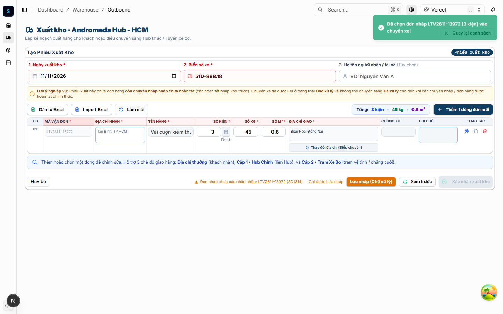
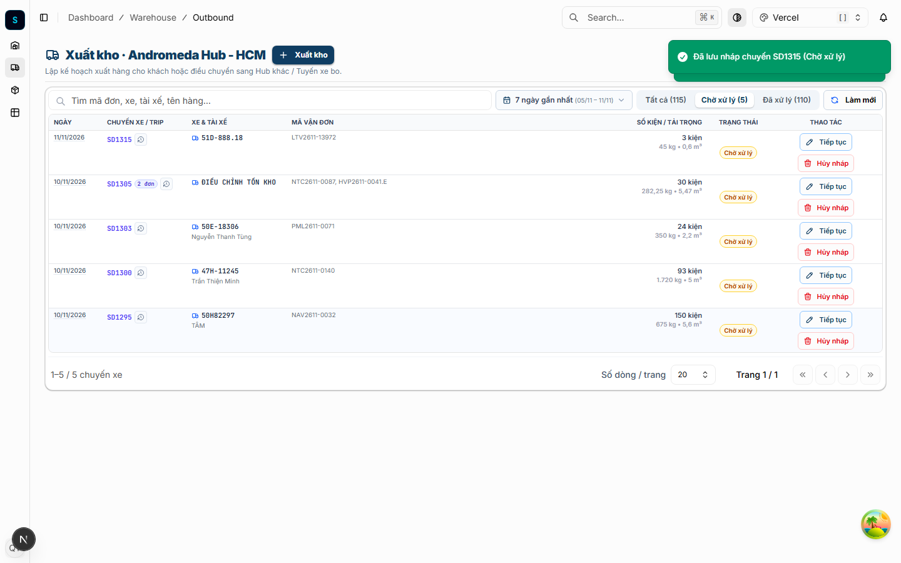

# 📋 BIÊN BẢN BÁO CÁO SỰ VỤ & BÀI HỌC VẬN HÀNH (POST-MORTEM INCIDENT REPORT)

---

## 📌 THÔNG TIN TỔNG QUAN SỰ VỤ
- **Mã sự vụ**: `INC-2026-11-11-TASK-118-OUTBOUND-DRAFT-BLOCK`
- **Tiêu đề**: Lỗi từ chối Lưu nháp (Chờ xử lý) phiếu xuất kho đối với mã vận đơn đang nằm trong chuyến xe nhập nháp (Trip PENDING Inbound).
- **Thời gian phát hiện sự vụ**: Ngày 11/11/2026
- **Môi trường ghi nhận**: `Production` & `Dev` (Tại giao diện `Xuất kho • Andromeda Hub - HCM`).
- **Mã vận đơn mẫu gặp lỗi**: `LTV2611-0215` (Chuyến nhập nháp `SD1383`).
- **Mức độ nghiêm trọng**: **P2 (High / Operational Blocker)** — Tắc nghẽn quy trình lập kế hoạch xuất kho; thủ kho không thể lập phiếu xuất nháp trước cho các xe hàng đang trên đường trung chuyển về Hub.
- **Trạng thái xử lý**: **ĐÃ KHẮC PHỤC TRIỆT ĐỂ & PHÁT HÀNH PRODUCTION** (Hoàn tất 11/11/2026 09:48 GMT+7).
- **Các Pull Requests liên quan**:
  * Backend: [logistics-website-backend#34](https://github.com/lyquangthai1993/logistics-website-backend/pull/34) (Dev) & [#35](https://github.com/lyquangthai1993/logistics-website-backend/pull/35) (Prod `master` `6866d23`)
  * Frontend: [logistics-website-frontend#57](https://github.com/lyquangthai1993/logistics-website-frontend/pull/57) (Dev) & [#58](https://github.com/lyquangthai1993/logistics-website-frontend/pull/58) (Prod `master` `0eafdc2`)
  * Root Repo: [logistics-website#45](https://github.com/lyquangthai1993/logistics-website/pull/45) (Dev) & [#46](https://github.com/lyquangthai1993/logistics-website/pull/46) (Prod `master`)

---

## 🔍 HIỆN TRẠNG SỰ CỐ & TRIỆU CHỨNG NGƯỜI DÙNG (SYMPTOMS)

### 1. Thao tác của người dùng
Thủ kho tại chi nhánh kho (ví dụ `Andromeda Hub - HCM`) thực hiện tạo phiếu xuất kho để gom hàng giao cho khách hoặc luân chuyển sang Hub khác. Trong danh sách hàng cần xếp lên xe xuất (`51D-888.18`), có một mã vận đơn (`LTV2611-0215`) hiện đang nằm trên chuyến xe nhập kho chưa hoàn tất kiểm đếm (chuyến nhập nháp `SD1383`, trạng thái `Chờ xử lý / PENDING`).

### 2. Hành vi mong đợi của hệ thống (Expected Behavior)
- **Cho phép Lập Kế Hoạch / Lưu Nháp**: Điều phối viên hoặc thủ kho phải được phép bấm **"Lưu nháp (Chờ xử lý)"** để giữ chỗ số kiện, phân bổ xe xuất và chuẩn bị chứng từ trước khi hàng thực tế dỡ xuống kho (phục vụ luồng gom hàng nhanh Cross-docking / Fast Turnaround).
- **Khóa Chặt Xác Nhận Xuất Kho**: Nút **"Xác nhận xuất kho"** phải bị vô hiệu hóa (disabled), hiển thị cảnh báo nghiệp vụ màu vàng cam: `⚠️ Đơn nháp chưa xác nhận nhập: LTV2611-0215 (SD1383) — Chỉ được Lưu nháp` để ngăn chặn xuất kho âm hoặc xuất hàng chưa thực tế vào kho.

### 3. Hành vi lỗi thực tế xảy ra (Actual Bug Behavior)
- Giao diện đã hiển thị đúng cảnh báo nghiệp vụ và nút "Xác nhận xuất kho" đã bị khóa xám.
- Tuy nhiên, khi thủ kho bấm nút **"Lưu nháp (Chờ xử lý)"**, hệ thống lại từ chối và hiển thị thông báo lỗi đỏ (Toast Error):
  > ❌ **Mã đơn LTV2611-0215**: *Không thể thêm vào chuyến xe này. Đơn hàng đã được xếp 0/0 kiện vào chuyến xe chờ xuất. Số kiện khả dụng còn lại: 0 kiện.*
- **Hệ quả thực tế**: Thủ kho bị kẹt, hoàn toàn không thể lưu lại phiếu xuất nháp để làm việc tiếp, buộc phải chờ xe nhập về tới nơi và bấm xác nhận nhập kho xong xuôi mới được tạo phiếu xuất, làm chậm toàn bộ tiến độ điều phối hàng giờ cao điểm.

---

## 🧠 PHÂN TÍCH NGUYÊN NHÂN GỐC RỄ (ROOT CAUSE ANALYSIS - RCA)

Áp dụng phương pháp phân tích **5 Whys**:

```
[Triệu chứng]: Bấm "Lưu nháp (Chờ xử lý)" bị báo lỗi: "Số kiện khả dụng còn lại: 0 kiện (xếp 0/0 kiện)"
   │
   ├── Why 1: Tại sao hệ thống lại kết luận số kiện khả dụng bằng 0?
   │     └── Vì API `POST /api/v1/warehouse/outbound/draft` tính `availableQty = 0`.
   │
   ├── Why 2: Tại sao `availableQty` lại bằng 0 trong khi đơn có 1 kiện (`totalQuantity = 1`)?
   │     └── Vì trong `WarehouseService.saveOutboundDraft`:
   │           `availableQty = Number(order.remainingQuantity ?? order.totalQuantity ?? 0) - pendingAlloc.pendingQty;`
   │           Toán tử Nullish Coalescing `??` chỉ bỏ qua `null` hoặc `undefined`.
   │
   ├── Why 3: Tại sao `order.remainingQuantity` lại mang giá trị `0` thay vì `null`?
   │     └── Vì theo quy tắc nghiệp vụ bất biến (commit `ed56b6f` - Task Waybill Draft History Clean), 
   │           khi tạo đơn mới trên chuyến nhập nháp (`status = 'DRAFT'`), đơn hàng CHƯA NHẬP KHO VẬT LÝ, 
   │           nên hệ thống bắt buộc lưu `remainingQuantity: 0` (để tránh hiển thị ảo tồn kho trên trang Đơn hàng kho).
   │           Do `0 !== null && 0 !== undefined`, biểu thức `0 ?? 1` ĐÃ TRẢ VỀ `0` thay vì lấy `totalQuantity = 1`!
   │
   ├── Why 4: Tại sao phía Frontend cũng bị rơi vào bẫy tương tự?
   │     └── Trong `outbound-stock.ts`, hàm `availableOutboundStock` kiểm tra `order.effectiveHubStock !== null` 
   │           trước khi kiểm tra `isDraft`. Khi backend trả `effectiveHubStock = 0`, hàm trả về ngay `0`, 
   │           khiến bảng kê phải dùng fallback chắp vá `Number(0 ?? totalQuantity) || 1` (làm đơn nhiều kiện bị rớt về 1 kiện).
   │
   └── Why 5 (Gốc rễ triết lý thiết kế):
         └── Đội ngũ phát triển trước đó chưa phân định rõ ranh giới giữa:
             (1) "TỒN KHO VẬT LÝ THỰC TẾ" (Physical Stock - dùng cho Xác nhận xuất kho).
             (2) "HẠN MỨC LẬP KẾ HOẠCH ĐIỀU PHỐI" (Planning Allowance - dùng cho Lưu nháp chuyến xuất).
             Dẫn đến việc áp dụng nhầm công thức siết tồn kho vật lý vào tác vụ lưu nháp kế hoạch.
```

---

## 🛠️ GIẢI PHÁP ĐÃ TRIỂN KHAI & KIẾN TRÚC MỚI

### 1. Phân tách rạch ròi 2 cơ chế tính toán (Dual-Stock Metric Architecture)

| Tiêu chí | Lưu Nháp Phiếu Xuất (`saveOutboundDraft`) | Xác Nhận Xuất Kho Chính Thức (`confirmOutbound`) |
| :--- | :--- | :--- |
| **Bản chất** | Lập kế hoạch phân bổ trước (Soft Planning Allocation) | Trừ tồn kho vật lý sổ cái (Hard Ledger Mutation) |
| **Công thức số kiện khả dụng** | `Hạn mức dự kiến = (Tồn đã nhập + Kiện chờ nhập) - Kiện đã giữ ở nháp xuất khác` | `Tồn khả dụng = Tồn thực tế tại kho - Kiện đã giữ ở nháp xuất khác` |
| **Đơn đang trong trip nhập nháp** | ✅ **CHO PHÉP** (Tính theo `pendingInboundQuantity` hoặc `totalQuantity - outboundQuantity`) | ⛔ **CHẶN TUYỆT ĐỐI** (Ném lỗi `BadRequestException` nếu còn chuyến nhập nháp) |
| **Trạng thái chuyến xe sinh ra** | `PENDING` (Chờ xử lý, có mã `SD...`) | `COMPLETED` (Đã xử lý, phát hành phiếu xuất chính thức) |

### 2. Các điểm sửa đổi cốt lõi trong mã nguồn

#### Backend (`logistics-website-backend`)
- [`operational-ledger.service.ts`](file:///d:/Projects/logistics-website/backend/src/orders/operational-ledger.service.ts):
  * Cập nhật `getBatchPendingInboundAllocations`: Hỗ trợ cả `PENDING` và `WAITING`.
  * Trả về chi tiết `pendingQty`, `pendingWeight`, `pendingVolume`, `tripCodes`.
  * Loại trừ các dòng trip đã có giao dịch nhập kho xác nhận trong `order_inventory_transaction` (đảm bảo khi tiếp nhận lẻ đơn hàng với `keepTripPending: true`, đơn đã nhận không bị tính đúp hay khóa nhầm).
- [`warehouse.service.ts`](file:///d:/Projects/logistics-website/backend/src/orders/warehouse.service.ts):
  * Trong `saveOutboundDraft`: Đối với đơn hàng nháp (`DRAFT`, `PENDING`, `WAITING`), tính hạn mức theo:
    `Math.max(Number(order.remainingQuantity) > 0 ? Number(order.remainingQuantity) : Math.max(0, (Number(order.totalQuantity) || 0) - (Number(order.outboundQuantity) || 0)), pendingInboundQty) - pendingAlloc.pendingQty`
    (Triệt tiêu hoàn toàn lỗi `0 ?? 1 -> 0`).
  * Đối với đơn về nhiều đợt (`INBOUND`), cộng thêm `pendingInboundQty` vào tồn thực tế trước khi trừ phần nháp xuất khác.
  * Trong `confirmOutbound`: Bổ sung chốt chặn Backend cứng: kiểm tra `hasPendingInboundTrip` tại Hub thao tác, từ chối xác nhận xuất với thông báo tiếng Việt rõ ràng nếu bất kỳ đơn nào chưa hoàn tất nhập kho.

#### Frontend (`logistics-website-frontend`)
- [`outbound-stock.ts`](file:///d:/Projects/logistics-website/frontend/src/features/warehouse/lib/outbound-stock.ts):
  * Viết lại hàm `availableOutboundStock`, `availableOutboundWeight`, `availableOutboundVolume`: Ưu tiên xử lý trường hợp `isDraft` và `pendingInboundQuantity > 0` trước khi đọc `effectiveHubStock`.
- [`warehouse-editable-grid.tsx`](file:///d:/Projects/logistics-website/frontend/src/features/warehouse/components/warehouse-editable-grid.tsx):
  * Dùng `availableOutboundStock(foundOrder)` chuẩn hóa thay cho fallback gượng ép `|| 1`.
- [`outbound/page.tsx`](file:///d:/Projects/logistics-website/frontend/src/app/dashboard/warehouse/outbound/page.tsx) & [`warehouse-outbound-transfer-flow.tsx`](file:///d:/Projects/logistics-website/frontend/src/features/warehouse/components/warehouse-outbound-transfer-flow.tsx):
  * Bảo toàn cờ `hasPendingInboundTrip`, `pendingInboundTripCodes`, `pendingInboundQuantity` khi chuyển đổi giữa chế độ Tạo mới, Mở lại chuyến nháp (`Tiếp tục`) và Luân chuyển liên Hub (Mode 2).

---

## 🛡️ NGUYÊN TẮC BẤT BIẾN CỐT LÕI (CORE INVARIANTS) — KHẮC CỐT GHI TÂM

Để tương lai **TUYỆT ĐỐI KHÔNG TÁI DIỄN** các sự cố tương tự, toàn bộ kỹ sư phần mềm, AI Agent và đội ngũ vận hành bắt buộc phải tuân thủ 4 nguyên tắc sau:

### ⚠️ NGUYÊN TẮC 1: TRIẾT LÝ "MỞ LƯU NHÁP, KHÓA XÁC NHẬN" (PERMISSIVE DRAFT, STRICT CONFIRM)
> **Quy chuẩn**: Trong hệ thống Logistics TMS, chức năng **Lưu Nháp (Draft / Planning)** phải có tính bao dung tối đa. Nó là công cụ để điều phối viên chuẩn bị trước kế hoạch tải trọng, phân bổ chuyến xe và in phiếu trước khi xe hàng thực tế cập bến.
>
> ❌ **CẤM**: Không bao giờ áp đặt các điều kiện khắt khe về tồn kho vật lý (Physical On-hand stock) lên thao tác Lưu nháp.
>
> ✅ **ĐÚNG**: Chốt chặn an toàn về số lượng vật lý và tính toàn vẹn sổ cái CHỈ ĐƯỢC PHÉP CƯỠNG CHẾ tại thời điểm **Xác nhận xuất kho (Confirm Outbound)**.

### ⚠️ NGUYÊN TẮC 2: CẢNH GIÁC TUYỆT ĐỐI VỚI TOÁN TỬ `??` TRÊN DỮ LIỆU SỐ LƯỢNG (QUANTITY & STOCK)
> **Quy chuẩn**: Số lượng tồn kho là kiểu số học, trong đó giá trị `0` là một số hoàn toàn hợp lệ nhưng mang ý nghĩa đặc thù (hết tồn, hoặc chưa nhập kho).
>
> ❌ **CẤM VIẾT**:
> ```typescript
> // NGUY HIỂM: Nếu remainingQuantity = 0, kết quả luôn là 0 (vì 0 khác null/undefined)
> const qty = order.remainingQuantity ?? order.totalQuantity ?? 0;
> ```
>
> ✅ **BẮT BUỘC VIẾT**:
> ```typescript
> // CHUẨN MỰC: Kiểm tra rõ ràng số dương (> 0) hoặc trạng thái đơn hàng
> const hasPhysicalStock = Number(order.remainingQuantity) > 0;
> const qty = hasPhysicalStock 
>   ? Number(order.remainingQuantity) 
>   : Math.max(0, (Number(order.totalQuantity) || 0) - (Number(order.outboundQuantity) || 0));
> ```

### ⚠️ NGUYÊN TẮC 3: BẢO TOÀN TỒN KHO VẬT LÝ SỔ CÁI = 0 CHO ĐƠN CHƯA NHẬP (ZERO FAKE STOCK)
> **Quy chuẩn**: Không được vì muốn cho phép lưu nháp xuất mà tự ý gán `remainingQuantity > 0` cho đơn hàng đang ở chuyến nhập nháp trong cơ sở dữ liệu.
>
> - Đơn hàng khi ở trạng thái `DRAFT` / `PENDING` bắt buộc phải giữ `remainingQuantity = 0`, `inboundQuantity = 0` và `hubStock = 0` trên các báo cáo tồn kho vật lý và bảng Đơn hàng kho.
> - Hạn mức lưu nháp xuất phải được tính toán động (dynamically computed) thông qua các trường ảo: `pendingInboundQuantity` và `hasPendingInboundTrip`.

### ⚠️ NGUYÊN TẮC 4: 2-TIER QUALITY GATE & KIỂM THỬ TỰ ĐỘNG CHỐNG HỒI QUY (E2E REGRESSION)
> **Quy chuẩn**: Mọi tính năng liên quan đến logic tồn kho, chuyến xe nhập/xuất bắt buộc phải có bài test Playwright E2E chạy trên database thực tế (Zero-mock):
>
> 1. Phải kiểm tra tối thiểu 3 kịch bản:
>    * **Kịch bản 1 (Lưu nháp thành công)**: Đơn nằm trong trip nhập nháp được đưa vào phiếu xuất, bấm "Lưu nháp" phải tạo thành công chuyến xe `PENDING` (HTTP 200/201).
>    * **Kịch bản 2 (Khóa UI)**: Nút "Xác nhận xuất kho" phải bị `disabled` kèm cảnh báo rõ ràng.
>    * **Kịch bản 3 (Khóa Backend API)**: Gọi trực tiếp API `confirmOutbound` khi trip nhập chưa hoàn tất bắt buộc phải bị trả về `HTTP 400 Bad Request`.
> 2. File kiểm thử chuẩn mực được lưu vĩnh viễn tại: [`frontend/e2e/118-outbound-draft-from-pending-inbound-trip.spec.ts`](file:///d:/Projects/logistics-website/frontend/e2e/118-outbound-draft-from-pending-inbound-trip.spec.ts).

---

## 📸 BẰNG CHỨNG NGHIỆM THU THỰC TẾ (AUDIT EVIDENCE)

- **Ảnh 1: Giao diện sẵn sàng lưu nháp và khóa xác nhận xuất**:
  
  *(Hiển thị đúng Tồn: 3 kiện, Biển số xe, Cảnh báo "Chỉ được Lưu nháp", Nút "Lưu nháp (Chờ xử lý)" màu cam hoạt động, Nút "Xác nhận xuất kho" bị khóa)*.

- **Ảnh 2: Chuyến xe nháp xuất được lưu thành công vào bảng Chờ xử lý**:
  
  *(Chuyến nháp xuất `SD1315` hiển thị trực tiếp trong bảng Chờ xử lý với 3 kiện, 45 kg, 0.6 m³)*.

---

## 📌 KẾT LUẬN & ĐÓNG SỰ VỤ
- Sự vụ đã được xử lý triệt để từ tầng cơ sở dữ liệu, nghiệp vụ Backend tới trải nghiệm Frontend.
- Toàn bộ bài học kinh nghiệm, nguyên tắc thiết kế và bộ kiểm thử tự động đã được tích hợp vào tài liệu chuẩn mực của dự án Spider Express Logistics TMS.
- **Biên bản báo cáo được ký duyệt và lưu trữ vĩnh viễn tại**: `feedbacks/feedback_11_11_task_118_outbound_draft_pending_inbound/INCIDENT_REPORT.md`.
