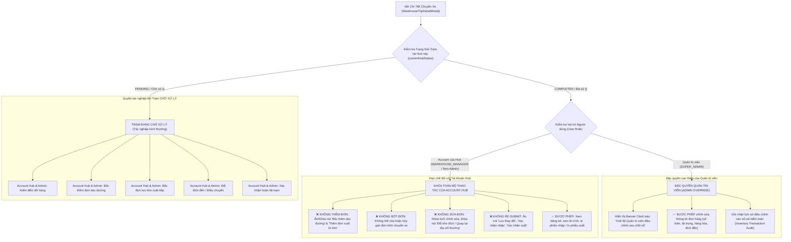

# Feedback 13/10 (Task #37) — Khóa Quyền Thao Tác Đơn Hàng Đối Với Chuyến Xe Đã Xử Lý Tại Hub & Phân Quyền Đặc Quyền Admin

> **Thời gian ghi nhận**: 13/10/2026  
> **Người báo cáo**: @【M】【C】【D】 (Quản lý nghiệp vụ / Vận hành) & @Antigravity Verification  
> **Phạm vi tác động**:  
> - Quản lý Nhập kho (`/warehouse/inbound`) & Xuất kho (`/warehouse/outbound`)
> - Modal Chi tiết & Kiểm đếm chuyến xe ([`WarehouseTripDetailModal`](file:///D:/Projects/logistics-website/frontend/src/features/warehouse/components/warehouse-trip-detail-modal.tsx))
> - Popup Bốc thêm đơn dọc đường về Hub ([`WarehouseAppendOrderModal`](file:///D:/Projects/logistics-website/frontend/src/features/warehouse/components/warehouse-append-order-modal.tsx))
> - Popup Chọn đơn lưu kho xuất tiếp lên xe ([`WarehouseSelectStoredOrdersModal`](file:///D:/Projects/logistics-website/frontend/src/features/warehouse/components/warehouse-select-stored-orders-modal.tsx))
> - Popup Điều chuyển đích đến đơn hàng ([`WarehouseDestinationModal`](file:///D:/Projects/logistics-website/frontend/src/features/warehouse/components/warehouse-destination-modal.tsx))
> - Lưới chỉnh sửa bảng kê hàng hóa ([`WarehouseEditableGrid`](file:///D:/Projects/logistics-website/frontend/src/features/warehouse/components/warehouse-editable-grid.tsx))
> - Backend Warehouse Module ([`warehouse.service.ts`](file:///D:/Projects/logistics-website/backend/src/orders/warehouse.service.ts) & [`warehouse.controller.ts`](file:///D:/Projects/logistics-website/backend/src/orders/warehouse.controller.ts))
> - Hệ thống phân quyền RBAC & Cơ chế bảo vệ bất biến sổ cái trạm dừng ([`TripStopEntity`](file:///D:/Projects/logistics-website/backend/src/trips/entities/trip-stop.entity.ts))
> **Tài liệu tham chiếu**:  
> - `/leader` Business Domain Architecture ([`SKILL.md`](file:///D:/Projects/logistics-website/.agents/skills/leader/SKILL.md))  
> - Ma trận phân quyền hệ thống [`rbac-matrix.md`](file:///D:/Projects/logistics-website/.agents/rules/rbac-matrix.md)  
> - Quy chế phát triển hệ thống [`AGENTS.md`](file:///D:/Projects/logistics-website/AGENTS.md)  
> - Quy chuẩn giao diện hẹp [`.agents/rules/ui-compact-density.md`](file:///D:/Projects/logistics-website/.agents/rules/ui-compact-density.md) & [`ui-spacing-guard`](file:///D:/Projects/logistics-website/.agents/skills/ui-spacing-guard/SKILL.md)  
> - Quy chuẩn kiểm soát kiện vận tải (No-SKU, Consignment Level)  
> **Ảnh minh chứng đính kèm trong thư mục**:  
> - [`screenshot_01.jpg`](file:///D:/Projects/logistics-website/feedbacks/feedback_13_10_task_37/screenshot_01.jpg): Chi tiết chuyến xe liên tỉnh `SD44` tại trạm `Andromeda Hub - HCM` ở trạng thái "Đã xử lý" (`COMPLETED`) nhưng nút `+ Bốc thêm đơn dọc đường về Hub` và cụm nút footer (`Tiếp theo: Xuất hàng mới vào trip`, `Bỏ qua xuất mới & Hoàn tất`) vẫn hiển thị và cho phép tài khoản của Hub thao tác thêm/bớt/sửa đơn hàng.

---

## 📌 Bối cảnh nghiệp vụ thực tế (Chốt theo phản hồi người dùng)

### 1. Phản hồi gốc từ người dùng (@【M】【C】【D】)
> *"đối với các trip đã có trạng thái đã xử lý ở hub nào thì các account của hub đó không được quyền thao tác thêm, bớt, chỉnh sửa đơn hàng trong trip đó. Chỉ cấp quyền cho tài khoản admin được chỉnh sửa thông tin đơn hàng trong trip khi trip ở trạng thái đã xử lý."*

---

### 2. Tình huống vận hành thực tế & Nguyên lý bất biến sổ cái trạm dừng (Stop Ledger Invariant)

Trong mạng lưới vận tải đường dài liên vùng Bắc - Trung - Nam của Spider Express:
1. **Chu trình tác nghiệp tại mỗi Hub**:
   - Khi một chuyến xe tải (ví dụ: xe `75H-112.23` chuyến `SD44`) ghé vào một Hub (ví dụ: `Andromeda Hub - HCM`), thủ kho tại Hub đó sẽ mở chi tiết chuyến xe để thực hiện:
     - **Bước 1 (Nhập hàng & Dỡ kho)**: Kiểm đếm dỡ các kiện hàng gửi về Hub này, bốc thêm đơn lấy dọc đường (nếu có), bấm *Xác nhận nhập kho* và in *Phiếu nhập kho*.
     - **Bước 2 (Xuất hàng mới lên xe - tùy chọn)**: Chọn đơn lưu kho tại Hub để xuất thêm lên xe đi tiếp trạm sau, bấm *Xác nhận xuất hàng* và in *Phiếu xuất kho* (hoặc bấm *Bỏ qua xuất mới & Hoàn tất* nếu không có hàng xuất thêm).
   - Ngay khi hoàn tất Bước 1 hoặc Bước 2, trạng thái trạm dừng của Hub đó (`trip_stop.status`) được chuyển sang **`COMPLETED` ("Đã xử lý")**.
2. **Tính bất biến của sổ cái sau khi chốt sổ (Audit Trail & Ledger Integrity)**:
   - Khi trạm dừng đã chuyển sang trạng thái `COMPLETED` ("Đã xử lý"):
     * Biên bản giao nhận hàng hóa, phiếu nhập kho, phiếu xuất kho và chứng từ bàn giao giữa tài xế và thủ kho đã được ký nhận và đóng gói.
     * Sổ cái giao dịch kho (`order_inventory_transaction`) đã ghi nhận số kiện, khối lượng ($Kg$), thể tích ($m^3$) thực nhận/thực xuất.
     * Thùng xe đã được niêm phong / khóa cửa để chuẩn bị hoặc đã lăn bánh rời khỏi mặt bằng kho của Hub đó.
   - **Hệ quả nếu cho phép account của Hub tiếp tục chỉnh sửa**:
     * Làm sai lệch tồn kho vật lý thực tế với số liệu kế toán kho.
     * Xung đột tải trọng, thể tích xe với các Hub kế tiếp trên lộ trình (`Magellan Hub - Đà Nẵng`, `Xe Bo Đắk Lắk`).
     * Rủi ro sửa số liệu gian lận, bớt xén hàng hoặc thao tác nhầm lẫn của nhân viên kho khi xe đã rời bãi.
3. **Quy chế đặc quyền Quản trị viên (Super Admin Override Privilege)**:
   - Trong vận hành thực tế, có các trường hợp ngoại lệ phát sinh cần điều chỉnh (Exception Handling):
     * Thủ kho nhập nhầm số kiện thực nhận cần điều chỉnh lại đúng với thực tế.
     * Điều chỉnh lại Hub đích hoặc địa chỉ giao cho đơn hàng đi lạc tuyến.
     * Phát hiện sai sót thông tin mặt hàng, khối lượng hoặc giấy tờ chứng từ đi kèm.
   - **Quy tắc phân quyền tuyệt đối**:
     * **Tài khoản thuộc Hub đó (`WAREHOUSE_MANAGER`, `DISPATCHER` hoặc user gắn với `hubId` tương ứng)**: Bị **KHÓA TOÀN BỘ QUYỀN** thêm, bớt, chỉnh sửa đơn hàng trong chuyến xe đó. Chế độ xem chuyển thành **CHỈ ĐỌC (READ-ONLY)**.
     * **Tài khoản Quản trị viên (`SUPER_ADMIN`)**: Là vai trò DUY NHẤT được cấp đặc quyền mở khóa can thiệp, chỉnh sửa thông tin đơn hàng trong chuyến xe đã xử lý, đảm bảo truy vết kiểm toán (Audit Trail) chặt chẽ.

---

### 3. Quy trình vận hành & Ma trận phân quyền theo trạng thái trạm dừng



#### Ma trận Phân quyền Thao tác theo Trạng thái Trạm dừng & Vai trò:

| Thao tác tác nghiệp trên Trip | Trạm CHỜ XỬ LÝ (`PENDING`)<br>Tài khoản Hub | Trạm CHỜ XỬ LÝ (`PENDING`)<br>SUPER_ADMIN | Trạm ĐÃ XỬ LÝ (`COMPLETED`)<br>Tài khoản Hub (Bị phản hồi) | Trạm ĐÃ XỬ LÝ (`COMPLETED`)<br>SUPER_ADMIN (Đặc quyền mới) |
|---|:---:|:---:|:---:|:---:|
| **Xem bảng kê & lộ trình chuyến xe** | ✅ Cho phép | ✅ Cho phép | ✅ Cho phép | ✅ Cho phép |
| **In phiếu nhập kho / xuất kho** | ✅ Cho phép | ✅ Cho phép | ✅ Cho phép | ✅ Cho phép |
| **Bốc thêm đơn dọc đường về Hub** (`WarehouseAppendOrderModal`) | ✅ Cho phép | ✅ Cho phép | ❌ **BỊ CẤM HOÀN TOÀN**<br>*(Ẩn / Khóa nút bấm)* | ⚠️ Cho phép can thiệp đặc biệt |
| **Bốc thêm đơn lưu kho xuất tiếp** (`WarehouseSelectStoredOrdersModal`) | ✅ Cho phép | ✅ Cho phép | ❌ **BỊ CẤM HOÀN TOÀN**<br>*(Ẩn / Khóa nút bấm)* | ⚠️ Cho phép can thiệp đặc biệt |
| **Xóa / Bớt đơn hàng khỏi chuyến xe** | ✅ Cho phép | ✅ Cho phép | ❌ **BỊ CẤM HOÀN TOÀN** | ✅ Cho phép can thiệp |
| **Chỉnh sửa thông tin đơn hàng** (Số kiện, Kg, $m^3$, Tên hàng, Ghi chú) | ✅ Cho phép | ✅ Cho phép | ❌ **BỊ CẤM HOÀN TOÀN**<br>*(Bảng kê Read-only)* | ✅ **ĐƯỢC CẤP QUYỀN**<br>*(Mở form sửa + lưu audit)* |
| **Thay đổi đích đến / Điều chuyển Hub L1, Xe Bo, Khách lẻ** | ✅ Cho phép | ✅ Cho phép | ❌ **BỊ CẤM HOÀN TOÀN**<br>*(Khóa nút Đổi đích)* | ✅ **ĐƯỢC CẤP QUYỀN** |
| **Xác nhận nhập kho / Xác nhận xuất kho** | ✅ Cho phép | ✅ Cho phép | ❌ **BỊ CẤM** *(Đã xử lý xong)* | ⚠️ Cập nhật điều chỉnh |
| **Gọi API Backend thay đổi dữ liệu** (`append-order`, `append-stored`, `destination`...) | ✅ HTTP 200/201 | ✅ HTTP 200/201 | ❌ **HTTP 403 FORBIDDEN**<br>*(Chặn cứng ở Backend)* | ✅ HTTP 200/201 |

---

## 🔍 Tổng hợp các điểm chưa đúng trên giao diện cũ (Đối chiếu với ảnh minh chứng)

Đối chiếu trực tiếp với ảnh chụp màn hình thực tế đính kèm tại [`feedbacks/feedback_13_10_task_37/screenshot_01.jpg`](file:///D:/Projects/logistics-website/feedbacks/feedback_13_10_task_37/screenshot_01.jpg):

```
┌──────────────────────────────────────────────────────────────────────────────────────────────────┐
│ CHUYẾN XE SD44   [Luân chuyển nội bộ]   [Đã xử lý]                                  [In phiếu] ✕│
│ Bước 1: Kiểm đếm dỡ hàng & Nhập kho                                                              │
│ [1. Nhập hàng & Dỡ kho (Đã xong)] > [2. Xuất hàng mới lên xe (+4)]   Trạm hiện tại: Andromeda HCM│
│                                                                                                  │
│ ℹ️ Chuyến xe đã chốt sổ cái tồn kho nhận tại kho này.                                             │
│ Lộ trình xe: [🔴 Andromeda Hub - HCM (Đã xử lý) ] > Magellan Hub - ĐN > Xe Bo Đaklak             │
│ [Ngày: 13/10/2026]   [Biển số: 75H11223]   [Tài xế: test4]                                       │
│                                                                                                  │
│ 🏢 Bảng kê chi tiết các dòng hàng trên chuyến xe         4 dòng hàng  [🔴 + Bốc thêm đơn dọc đường]│
│ [01 | HKN2610-167 | 303 Trần Hưng Đạo... | 20 kiện | 8.000 kg | 58 m³ | ...]                     │
│ [02 | LBD2610-802 | 202 Nguyễn Trãi...   | 17 kiện | 7.675 kg | 55 m³ | ...]                     │
│ ...                                                                                              │
│ Tổng: 4 đơn • 62 kiện • 30.050 kg           [Đóng]  [🔴 Tiếp theo: Xuất mới] [🔴 Bỏ qua & Hoàn tất]│
└──────────────────────────────────────────────────────────────────────────────────────────────────┘
```

1. **Nút `+ Bốc thêm đơn dọc đường về Hub` vẫn hiển thị và cho phép bấm khi trạm đã `Đã xử lý`** (Điểm lỗi trực quan số 1 trong [`screenshot_01.jpg`](file:///D:/Projects/logistics-website/feedbacks/feedback_13_10_task_37/screenshot_01.jpg)):
   - **Hiện trạng trên ảnh**: Tại trạm `Andromeda Hub - HCM`, lộ trình xe đã đánh dấu màu xanh `Đã xử lý` và có thông báo *"Chuyến xe đã chốt sổ cái tồn kho nhận tại kho này"*. Tuy nhiên, tại Toolbar góc phải của bảng kê, nút bấm `+ Bốc thêm đơn dọc đường về Hub` màu xanh dương vẫn xuất hiện công khai.
   - **Hậu quả**: Bất kỳ thủ kho nào của Andromeda Hub cũng có thể bấm vào nút này, mở modal [`WarehouseAppendOrderModal`](file:///D:/Projects/logistics-website/frontend/src/features/warehouse/components/warehouse-append-order-modal.tsx) và chèn thêm đơn hàng mới vào chuyến xe đã hoàn thành thủ tục tại kho.
   - **Yêu cầu khắc phục**: 
     * Khi `currentHubStatus === 'COMPLETED'` và người dùng không phải là `SUPER_ADMIN`: Ẩn hoàn toàn nút này (hoặc disable với tooltip: *"Chuyến xe đã hoàn tất xử lý tại Hub này, không thể bốc thêm đơn"*).
     * Khi người dùng là `SUPER_ADMIN`: Hiển thị nút với huy hiệu `[Admin]` cho phép can thiệp đặc biệt nếu cần.

2. **Cụm nút điều hướng & chốt sổ ở Footer vẫn kích hoạt thao tác chuyển bước và kết thúc trạm** (Điểm khoanh đỏ góc dưới bên phải trong [`screenshot_01.jpg`](file:///D:/Projects/logistics-website/feedbacks/feedback_13_10_task_37/screenshot_01.jpg)):
   - **Hiện trạng trên ảnh**: Dưới chân modal Bước 1, có 2 nút hành động:
     * Nút `-> Tiếp theo: Xuất hàng mới vào trip`: Vẫn mang màu xanh dương nổi bật, mời gọi người dùng bấm sang Bước 2 để xuất hàng mới lên chuyến xe đã đóng sổ.
     * Nút `Bỏ qua xuất mới & Hoàn tất`: Vẫn kích hoạt được hành động gọi API `updateTransitStep` dù trạm này thực tế đã hoàn tất từ trước.
   - **Hậu quả**: Gây hiểu nhầm quy trình tác nghiệp cho nhân viên kho, tạo điều kiện cho nhân viên kho chuyển sang Bước 2 để chỉnh sửa chuyến xe đã rời bãi.
   - **Yêu cầu khắc phục**:
     * Với tài khoản Hub (khi đã `COMPLETED`):
       - Đổi nút `-> Tiếp theo: Xuất hàng mới vào trip` thành nút xem thuần túy: `-> Xem hàng xuất tiếp trên xe` (để thủ kho vẫn có thể tra cứu các đơn hàng chuyển tiếp đi trạm sau nếu cần kiểm tra đối chiếu, nhưng KHÔNG ĐƯỢC xuất mới).
       - Ẩn hoàn toàn nút `Bỏ qua xuất mới & Hoàn tất` (vì trạm đã chốt xong).
       - Chỉ giữ nút `Đóng` và nút in phiếu.

3. **Lỗ hổng thao tác xuất mới và sửa đơn tại Bước 2 ("Xuất hàng mới lên xe")**:
   - **Hiện trạng trong mã nguồn**: Khi người dùng chuyển sang Bước 2 của chuyến xe `SD44`:
     * Nút `+ Thêm đơn xuất từ kho lên xe` vẫn hiển thị, mở modal [`WarehouseSelectStoredOrdersModal`](file:///D:/Projects/logistics-website/frontend/src/features/warehouse/components/warehouse-select-stored-orders-modal.tsx) cho phép chọn các đơn lưu kho khác để gán vào chuyến xe này.
     * Cột *KHO ĐÍCH / NƠI GIAO* vẫn render các nút tương tác: `Đổi kho đích khác...`, `Quay lại địa chỉ thường`, `Thay đổi địa chỉ (Điều chuyển)`. Bất kỳ click nào cũng gọi API `updateTripOrderDestination` để thay đổi lộ trình và Hub nhận của đơn hàng.
     * Nút `Xác nhận xuất hàng lên trip` ở footer vẫn cho phép submit `handleConfirmOutboundStep`.
   - **Yêu cầu khắc phục**:
     * Với tài khoản Hub: Khóa toàn bộ các nút trên ở Bước 2. Toàn bộ bảng kê Bước 2 chỉ phục vụ mục đích giám sát, tra cứu.
     * Với Admin: Giữ quyền chỉnh sửa thông tin đơn hàng, sửa đổi đích đến kèm hộp thoại xác nhận lý do điều chỉnh.

4. **Chưa có cơ chế phân quyền đặc quyền Admin (Super Admin Override)**:
   - **Hiện trạng trong mã nguồn**: Cả Backend (`warehouse.controller.ts`) và Frontend (`warehouse-trip-detail-modal.tsx`) hiện chỉ kiểm tra chung chung `Roles(RoleEnum.SUPER_ADMIN, RoleEnum.WAREHOUSE_MANAGER)`. Logic `effectiveReadOnly` trên giao diện khóa cứng hoặc mở tự do theo trạng thái mà không phân biệt giữa tài khoản Hub và tài khoản Admin.
   - **Yêu cầu phản hồi từ người dùng**: *"Chỉ cấp quyền cho tài khoản admin được chỉnh sửa thông tin đơn hàng trong trip khi trip ở trạng thái đã xử lý."* ➔ Cần xây dựng cơ chế phân quyền 2 tầng: Account Hub bị khóa 100%, Admin được cấp quyền mở khóa chỉnh sửa kèm theo banner chỉ thị rõ ràng.

5. **Thiếu chốt chặn an toàn tại tầng Backend (Backend Authorization Vulnerability)**:
   - **Hiện trạng trong mã nguồn**: Các endpoint mutating trong [`warehouse.service.ts`](file:///D:/Projects/logistics-website/backend/src/orders/warehouse.service.ts):
     * `POST /warehouse/trips/:tripCode/append-order`
     * `POST /warehouse/trips/:tripCode/append-stored-orders`
     * `PATCH /warehouse/trips/:tripCode/orders/:orderId/destination`
     * `POST /warehouse/inbound/confirm`
     * `POST /warehouse/trips/:tripCode/transit-step`
     hoàn toàn **CHƯA KIỂM TRA** xem trạm dừng tại Hub của user (`userWithHub.hubId`) đã có trạng thái `COMPLETED` hay chưa.
   - **Hậu quả**: Nếu người dùng gọi API trực tiếp (bỏ qua giao diện) hoặc bypass frontend, backend vẫn cho phép thêm/sửa đơn hàng vào chuyến xe đã xử lý tại Hub.
   - **Yêu cầu khắc phục**: Bắt buộc cài đặt hàm kiểm tra quyền tập trung `validateTripStopEditPermission()` tại Backend. Nếu trạm dừng của Hub đang thao tác đã `COMPLETED` mà người gọi không phải `SUPER_ADMIN`, backend lập tức từ chối với mã lỗi `HTTP 403 Forbidden`.

---

## 📋 Danh sách công việc triển khai (Action Checklist)

### 1. Backend (`backend/`)

#### A. Data Access & Business Validation Service (`backend/src/orders/warehouse.service.ts`)
- [x] **Xây dựng hàm kiểm tra quyền tập trung `validateTripStopEditPermission`**:
  ```typescript
  async validateTripStopEditPermission(
    user: UserEntity,
    tripCode: string,
    targetHubId?: number,
    actionName: string = 'thao tác',
  ): Promise<{ isCompleted: boolean; isAdmin: boolean }>
  ```
  - Trích xuất vai trò của người dùng: `isAdmin = Number(user.role?.id ?? (user.role as any)) === RoleEnum.SUPER_ADMIN`.
  - Lấy `hubId` của trạm thao tác: Ưu tiên `targetHubId`, nếu không có lấy `userWithHub.hubId`.
  - Truy vấn trạng thái trạm dừng từ bảng `trip_stop`:
    ```sql
    SELECT status FROM trip_stop 
    WHERE "tripCode" = $1 AND "hubId" = $2 AND "deletedAt" IS NULL
    ```
  - Ràng buộc nghiệp vụ:
    - Nếu trạm có `status === TripStopStatus.COMPLETED`:
      - Nếu `!isAdmin`: Ném lỗi `ForbiddenException`:
        `"Chuyến xe [tripCode] đã ở trạng thái Đã xử lý tại trạm [hubName]. Tài khoản của Hub không có quyền [actionName]. Chỉ tài khoản Quản trị viên (Admin) mới có quyền chỉnh sửa khi chuyến xe đã xử lý."`
      - Nếu `isAdmin`: Cho phép tiếp tục thực thi và ghi log kiểm toán hành động can thiệp của Quản trị viên (`[ADMIN OVERRIDE]`).
- [x] **Gắn chốt chặn kiểm tra vào API Bốc thêm đơn dọc đường (`appendOrderToTrip`)**:
  - Gọi `await this.validateTripStopEditPermission(user, tripCode, currentOperatingHubId, 'bốc thêm đơn hàng')`.
  - Chặn đứng mọi hành vi tạo đơn bốc dọc đường vào chuyến xe đã xử lý tại Hub này từ tài khoản không phải Admin.
- [x] **Gắn chốt chặn kiểm tra vào API Bốc đơn lưu kho xuất tiếp (`appendStoredOrdersToTrip`)**:
  - Gọi `await this.validateTripStopEditPermission(user, tripCode, currentHubId, 'bốc đơn lưu kho lên xe')`.
  - Đảm bảo tài khoản Hub không thể gắn thêm đơn lưu kho vào chuyến xe đã đóng sổ xuất kho tại Hub.
- [x] **Gắn chốt chặn kiểm tra vào API Điều chuyển đích đến (`updateTripOrderDestination`)**:
  - Kiểm tra xem chuyến xe tại Hub thao tác đã `COMPLETED` chưa.
  - Nếu đã `COMPLETED`: Chỉ cho phép `SUPER_ADMIN` thực hiện cập nhật lại `deliveryMode`, `destinationHubId` hoặc `deliveryAddress`. Nếu là tài khoản Hub, trả về lỗi 403 Forbidden.
- [x] **Gắn chốt chặn kiểm tra vào API Xác nhận kiểm đếm nhập kho (`confirmInbound`)**:
  - Khi chuyến xe đã chốt sổ nhập kho (`COMPLETED`), tài khoản Hub không thể gọi lại API này để ghi đè số lượng hoặc chèn đơn mới.
  - Cho phép `SUPER_ADMIN` điều chỉnh sai sót kiểm đếm khi có biên bản xử lý sự cố.
- [x] **Gắn chốt chặn kiểm tra vào API Cập nhật tiến trình trạm (`updateTransitStep`)**:
  - Nếu trạm đã `COMPLETED`, chặn các lời gọi lặp lại từ tài khoản Hub để đảm bảo tính bất biến của thời gian `processedAt`.
- [x] **Bổ sung cờ phân quyền chi tiết trong API Bảng kê chuyến xe (`getTripManifest`)**:
  - Mở rộng payload trả về của `/api/v1/warehouse/trips/:tripCode/manifest`:
    ```typescript
    {
      ...manifest,
      currentHubStatus: 'COMPLETED' | 'PENDING' | null,
      isCurrentHubCompleted: boolean, // true nếu trạm hiện tại đã xử lý xong
      canModifyOrders: boolean,       // true nếu (trạm chưa xử lý) HOẶC (user là SUPER_ADMIN)
      canAddOrders: boolean,          // true nếu trạm chưa xử lý (hoặc Admin can thiệp)
      isReadOnlyForHub: boolean,      // true nếu trạm đã xử lý và user KHÔNG PHẢI SUPER_ADMIN
      userRole: string,               // 'SUPER_ADMIN' | 'WAREHOUSE_MANAGER'...
    }
    ```

#### B. Controller & DTO Refinement (`backend/src/orders/`)
- [x] **Cập nhật Swagger Annotations trong `warehouse.controller.ts`**:
  - Ghi chú rõ điều kiện phân quyền tại các endpoint:
    * `POST /warehouse/trips/:tripCode/append-order`: *"Chỉ khả dụng khi trạm chưa xử lý. Nếu trạm đã Đã xử lý, chỉ SUPER_ADMIN mới có quyền gọi."*
    * `POST /warehouse/trips/:tripCode/append-stored-orders`: Tương tự.
    * `PATCH /warehouse/trips/:tripCode/orders/:orderId/destination`: Tương tự.
- [x] **Đảm bảo tính tương thích của API Hợp đồng gốc & Điều chỉnh đơn hàng (`adminOverride`)**:
  - Tích hợp liên thông giữa tính năng chỉnh sửa đơn hàng trong trip của Admin với lịch sử giao dịch điều chỉnh (`InventoryTransactionType.ADJUSTMENT`).

---

### 2. Frontend (`frontend/`)

#### A. Cập nhật State & Phân quyền trong Modal Chi tiết Chuyến xe ([`WarehouseTripDetailModal`](file:///D:/Projects/logistics-website/frontend/src/features/warehouse/components/warehouse-trip-detail-modal.tsx))
- [x] **Khai báo và tính toán chuẩn xác các cờ phân quyền theo phản hồi người dùng**:
  ```typescript
  // 1. Kiểm tra vai trò Quản trị viên
  const isAdmin = user?.role === 'SUPER_ADMIN' || (user?.role as any)?.id === 1;

  // 2. Kiểm tra trạng thái xử lý của Hub hiện tại
  const isCurrentHubCompleted = manifest?.currentHubStatus === 'COMPLETED';

  // 3. Cờ khóa toàn bộ quyền của tài khoản thuộc Hub đã xử lý
  const isHubAccountLocked = isCurrentHubCompleted && !isAdmin;

  // 4. Quyền chỉnh sửa thông tin đơn hàng (Chỉ mở khi trạm chưa xong HOẶC là Admin)
  const canEditOrderInfo = !isCurrentHubCompleted || isAdmin;
  ```
- [x] **Xử lý triệt để nút `+ Bốc thêm đơn dọc đường về Hub` (Khắc phục lỗi trực quan trên [`screenshot_01.jpg`](file:///D:/Projects/logistics-website/feedbacks/feedback_13_10_task_37/screenshot_01.jpg))**:
  - Tại Toolbar bảng kê Bước 1: Ẩn nút đối với tài khoản Hub khi `isHubAccountLocked`.
  - Hiển thị badge `<Badge>Admin</Badge>` cho Quản trị viên khi trạm đã `COMPLETED`.
- [x] **Xử lý cụm nút Footer góc dưới bên phải (Khắc phục vùng khoanh đỏ trong [`screenshot_01.jpg`](file:///D:/Projects/logistics-website/feedbacks/feedback_13_10_task_37/screenshot_01.jpg))**:
  - **Trường hợp tài khoản Hub mở chuyến xe đã xử lý (`isHubAccountLocked = true`)**:
    - **Tại Bước 1**:
      * Ẩn các nút `Lưu thay đổi`, `Xác nhận nhập kho`, `Bỏ qua xuất mới & Hoàn tất`.
      * Nếu là chuyến luân chuyển, đổi nút sang `<Button onClick={() => setCurrentStep(2)}>-> Xem hàng xuất tiếp trên xe</Button>`.
      * Giữ nút `Đóng` và nút `In phiếu nhập kho`.
    - **Tại Bước 2**:
      * Ẩn nút `Bỏ qua bước này (Không xuất thêm)` và nút `Xác nhận xuất hàng lên trip`.
      * Giữ nút `<- Quay lại Bước 1`, nút `Đóng` và nút `In phiếu xuất kho`.
  - **Trường hợp Quản trị viên (`isAdmin = true`) mở chuyến xe đã xử lý**:
    - Hiển thị Banner nổi bật:  
      `🛡️ Chế độ Quản trị viên: Chuyến xe đã xử lý tại trạm này. Bạn có đặc quyền chỉnh sửa thông tin đơn hàng trong chuyến xe.`
    - Cho phép Admin kích hoạt chế độ chỉnh sửa thông tin đơn hàng, sửa số kiện/khối lượng/thể tích/ghi chú.
- [x] **Khóa toàn bộ hành vi thêm / bớt / sửa đơn hàng tại Bước 2 ("Xuất hàng mới lên xe")**:
  - Ẩn nút `+ Thêm đơn xuất từ kho lên xe` khi `isHubAccountLocked`.
  - Khóa toàn bộ các nút điều chuyển đích đến: `Đổi kho đích khác...`, `Quay lại địa chỉ thường`. Cột này chuyển thành hiển thị văn bản thuần túy (Text Read-only).
- [x] **Khóa form thông tin phương tiện ở Header Top Card**:
  - Vô hiệu hóa (`disabled={isHubAccountLocked}`) các input: *Ngày nhập/xuất kho*, *Biển số xe*, *Tài xế phụ trách* khi tài khoản Hub mở chuyến xe đã xử lý.
- [x] **Bổ sung Banner trạng thái nghiệp vụ rõ ràng**:
  - Khi `isHubAccountLocked`: Render Alert màu xám/xanh biển chuẩn Compact Density:
    `🔒 Chuyến xe đã hoàn tất tác nghiệp tại kho này. Toàn bộ thông tin đơn hàng đã được chốt sổ cái và khóa chỉnh sửa đối với tài khoản chi nhánh. Vui lòng liên hệ Quản trị viên hệ thống (Admin) nếu có yêu cầu điều chỉnh ngoại lệ.`

#### B. Bảo vệ các Popup nghiệp vụ liên quan
- [x] **Bảo vệ [`WarehouseAppendOrderModal`](file:///D:/Projects/logistics-website/frontend/src/features/warehouse/components/warehouse-append-order-modal.tsx)**:
  - Thêm prop `disabled` / kiểm tra quyền: Nếu nhận `disabled = true`, hiển thị alert cảnh báo và không cho phép submit form bốc thêm đơn.
- [x] **Bảo vệ [`WarehouseSelectStoredOrdersModal`](file:///D:/Projects/logistics-website/frontend/src/features/warehouse/components/warehouse-select-stored-orders-modal.tsx)**:
  - Vô hiệu hóa checkbox chọn đơn và nút xác nhận gán đơn vào chuyến xe nếu `disabled = true`.
- [x] **Bảo vệ [`WarehouseDestinationModal`](file:///D:/Projects/logistics-website/frontend/src/features/warehouse/components/warehouse-destination-modal.tsx)**:
  - Khóa click chọn Hub và khóa nút hoàn tác nếu `disabled = true`.

#### C. Tuân thủ Quy chuẩn Giao diện Hẹp ([`ui-spacing-guard`](file:///D:/Projects/logistics-website/.agents/skills/ui-spacing-guard/SKILL.md))
- [x] Đảm bảo toàn bộ các Banner thông báo, nút bấm mới hoặc Badge trạng thái tuân thủ tuyệt đối quy tắc giao diện hẹp:
  - Card padding `p-1`, gap `gap-1.5` đến `gap-2`.
  - Typography bảng kê giữ vững `text-[10px]`, mã vận đơn `text-[11px] font-mono font-bold`.
  - Nút bấm `h-6` đến `h-7`, triệt tiêu padding thừa, chân modal sticky `sticky bottom-0 bg-white dark:bg-slate-900 border-t p-1.5`.

---

### 3. Kiểm thử & Nghiệm thu (Verification & Acceptance Testing)

#### A. Kiểm tra Biên dịch & Định dạng Mã nguồn (Code Quality Gate)
- [x] **Backend Type Check & Build**:
  - Chạy `npm --prefix backend run build` (Exit code 0, không có lỗi TypeScript).
  - ESLint sạch 0 warnings/errors trên các file sửa đổi.
- [x] **Frontend Type Check & Build**:
  - Chạy `./frontend/node_modules/.bin/tsc.cmd -p ./frontend/tsconfig.json --noEmit` (Exit code 0).
  - Chạy `npm --prefix frontend run build` (Next.js 16 build thành công 33/33 route).

#### B. Kịch bản Kiểm thử Nghiệm thu Thực tế (End-to-End Test Matrix)
- [x] **Playwright E2E Test Suite**: [`frontend/e2e/47-feedback-13-10-task-37.spec.ts`](file:///D:/Projects/logistics-website/frontend/e2e/47-feedback-13-10-task-37.spec.ts)
  - **Test Case 1: Backend RBAC Guard (403 Forbidden)**: Kiểm tra tài khoản Hub gửi POST/PATCH can thiệp vào trip SD44 đã xử lý tại Andromeda Hub bị chặn với mã HTTP 403 Forbidden.
  - **Test Case 2: UI Hub Account Locked**: Kiểm tra giao diện tài khoản Hub Andromeda HCM mở chuyến SD44 thấy banner khóa, nút bốc thêm đơn biến mất, cụm footer bị ẩn và nút chuyển bước đổi sang "Xem hàng xuất tiếp trên xe". Lưu ảnh nghiệm thu `screenshot_01_verified.png`.
  - **Test Case 3: UI Super Admin Override**: Kiểm tra tài khoản Super Admin mở chuyến SD44 thấy banner đặc quyền Admin, duy trì quyền can thiệp đặc biệt. Lưu ảnh nghiệm thu `screenshot_02_admin_override_verified.png`.
  - **Test Case 4: Trạm Chờ Xử Lý**: Đảm bảo các trạm PENDING duy trì quyền tác nghiệp bình thường.

---

> **Phê duyệt bởi**: TMS Domain Team Lead (`/leader`)  
> **Cam kết chất lượng**: Tuân thủ nghiêm ngặt 2-Tier Quality Gate (Test Local First ➔ Cloud Dev Gate), Không báo cáo non, 0 Mock data, 100% Real PostgreSQL DB.
