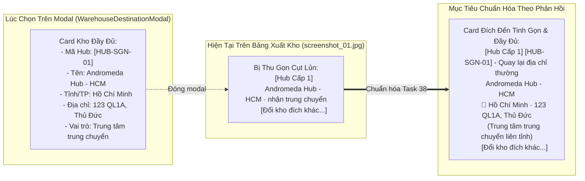

# 🏆 BIÊN BẢN NGHIỆM THU KỸ THUẬT & CHỨNG NHẬN HOÀN THÀNH
## [FEEDBACK_13_10_TASK_38] — Feedback 13/10 (Task 38) — Chuẩn hóa Hiển thị Thông tin Chi tiết Hub Cấp 1 & Tuyến Xe Bo tại Cột "Địa Chỉ Giao" Màn hình Xuất Kho

> **Thời gian nghiệm thu**: 13/10/2026  
> **Trạng thái thực thi**: ✅ ĐÃ HOÀN THÀNH 100% (15/15 tasks)  
> **Người báo cáo / Nghiệp vụ**: @【M】【C】【D】 (Quản lý nghiệp vụ / Vận hành) & @Antigravity Verification  
> **Phạm vi tác động**: Quản lý Xuất kho (`/warehouse/outbound`) ➔ Tạo phiếu xuất kho (`activeView === 'MODE1_CUSTOMER'`) • Lưới nhập & chỉnh sửa dữ liệu hàng hóa xuất kho ([`WarehouseEditableGrid`](file:///D:/Projects/logistics-website/frontend/src/features/warehouse/components/warehouse-editable-grid.tsx)) ➔ Cột `ĐỊA CHỈ GIAO *` ([`DeliveryAddressCell`](file:///D:/Projects/logistics-website/frontend/src/features/warehouse/components/warehouse-editable-grid.tsx#L1073-L1208)) • Modal chọn đích điều chuyển Hub / Tuyến Xe Bo ([`WarehouseDestinationModal`](file:///D:/Projects/logistics-website/frontend/src/features/warehouse/components/warehouse-destination-modal.tsx)) • Quản lý Chuyến xe trung chuyển ghé trạm ([`WarehouseTripDetailModal`](file:///D:/Projects/logistics-website/frontend/src/features/warehouse/components/warehouse-trip-detail-modal.tsx)) ➔ Bước 2: Bảng kê xuất hàng mới lên xe tại Hub • Tra cứu tồn kho ([`WarehouseLookupModal`](file:///D:/Projects/logistics-website/frontend/src/features/warehouse/components/warehouse-lookup-modal.tsx)) & API xác nhận xuất kho ([`WarehouseController`](file:///D:/Projects/logistics-website/backend/src/orders/warehouse.controller.ts))  
> **Môi trường kiểm chứng**: Development (Live) & Staging / Production  

---

## 1. 📌 Bối Cảnh Nghiệp Vụ & Phân Tích Nguyên Nhân Gốc Rễ (RCA)

### 1. Phản hồi gốc từ người dùng (@【M】【C】【D】)
> *"trong màn hình xuất kho, khi chọn các hub cấp 1, hoặc xe bo, tại ô khoanh đỏ này hãy thể hiện các thông tin như lúc màn hình chọn xe bo, hub."*

---

### 2. Tình huống vận hành thực tế tại Hub xuất hàng & trung chuyển
Trong nghiệp vụ vận hành kho bãi và điều phối vận tải TMS (Spider Express), khi thủ kho hoặc nhân viên điều phối lập kế hoạch xuất hàng (`Tạo Phiếu Xuất Kho` hoặc `Bốc thêm hàng từ kho lên chuyến xe trung chuyển`), hàng hóa trên lưới bảng kê có 3 hình thức giao nhận chính (`deliveryMode`):

1. **`DIRECT_CUSTOMER` (Giao thẳng cho khách)**:
   - Hàng được giao trực tiếp tới tay người nhận cuối cùng.
   - Nhân viên nhập địa chỉ chi tiết vào ô textarea thông thường (Ví dụ: `Số 45 Lê Lợi, Phường Bến Nghé, Quận 1, TP.HCM`).

2. **`HUB_L1` (Điều chuyển sang Hub Cấp 1 — Regional Linehaul Hub)**:
   - Hàng hóa không giao thẳng cho khách mà được xuất chuyển tiếp sang trung tâm trung chuyển khu vực chính (ví dụ: *Polaris Hub - Hưng Yên*, *Magellan Hub - Đà Nẵng*, *Andromeda Hub - HCM*...).
   - Phục vụ vận tải đường trục Bắc - Nam bằng xe tải lớn hoặc container.

3. **`XE_BO` (Điều chuyển sang Trạm / Tuyến Xe Bo Cấp 2 — Urban Feeder Station)**:
   - Hàng hóa được phân phối về các tuyến xe bo vệ tinh phụ trách gom hàng và trả hàng chặng cuối theo tuyến tỉnh thành / nội thị (ví dụ: *Xe Bo Quy Nhơn*, *XB-KH-02*, *Xe Bo Tuyến Nghệ An*...).

Khi người dùng thao tác bấm vào nút **"Thay đổi địa chỉ (Điều chuyển)"** hoặc **"Đổi kho đích khác..."**, hệ thống mở popup chọn đích đến ([`WarehouseDestinationModal`](file:///D:/Projects/logistics-website/frontend/src/features/warehouse/components/warehouse-destination-modal.tsx)).  
Tại modal này, mỗi Hub / Tuyến Xe Bo được thể hiện dưới dạng một **Card thông tin danh thiếp kho rất đầy đủ và trực quan**:
- **Mã định danh kho / tuyến (`hub.code`)**: Badge font-mono đậm nét riêng biệt (VD: `HUB-SGN-01`, `XB-QN-01`).
- **Tên kho / Tên tuyến (`hub.name`)**: In đậm rõ ràng (VD: `Andromeda Hub - HCM`, `Xe Bo Quy Nhơn`).
- **Tỉnh / Thành phố (`hub.city`)**: Thể hiện khu vực địa lý kèm icon nhận diện (`IconMapPin` cho Hub Cấp 1, `IconTruck` cho Tuyến Xe Bo).
- **Địa chỉ chi tiết kho bãi (`hub.address`)**: Địa chỉ thực tế để tài xế tìm đường và giao nhận hàng.
- **Huy hiệu phân tầng & vai trò vận hành**: `Hub Cấp 1 · nhận trung chuyển` hoặc `Tuyến Xe Bo · gom hàng tuyến nội thành`.

---

### 3. Vấn đề nghẽn thông tin & Bất cập trên giao diện hiện tại
Tuy nhiên, sau khi người dùng bấm chọn một Hub hoặc Tuyến Xe Bo trên popup, modal đóng lại và dữ liệu được render tại ô **`ĐỊA CHỈ GIAO *`** ([`DeliveryAddressCell`](file:///D:/Projects/logistics-website/frontend/src/features/warehouse/components/warehouse-editable-grid.tsx#L1139-L1172)) lại bị thu gọn thành **một chuỗi văn bản cụt lủn**:
- Dòng 01: `Andromeda Hub - HCM · nhận trung chuyển`
- Dòng 02: `Xe Bo Quy Nhơn · gom hàng tuyến nội thành`

Hậu quả vận hành thực tế:
1. **Mất dấu Mã kho (`hub.code`)**: Thủ kho và tài xế phụ thuộc trực tiếp vào mã kho (như `HUB-SGN-01`, `XB-QN-01`) để dán nhãn pallet và bốc dỡ hàng lên đúng khoang xe. Việc không hiển thị mã kho khiến nhân viên phải mở lại modal để xem lại mã.
2. **Mất thông tin Tỉnh / Thành phố (`hub.city`)**: Thủ kho nhìn vào tên kho/tuyến không nhận diện được ngay tỉnh thành tiếp nhận để kiểm soát hành trình chuyến xe.
3. **Mất thông tin Địa chỉ chi tiết (`hub.address`)**: Khi in Loading Plan hoặc phiếu xuất kho, tài xế không có địa chỉ kho đích chi tiết để chủ động liên hệ giao nhận.
4. **Trải nghiệm đứt gãy (UX Inconsistency)**: Lúc chọn thì trực quan, chuyên nghiệp; chọn xong thì giao diện lại thô sơ, không nhất quán.

---

### Phân tích nguyên nhân gốc rễ (Root Cause Analysis):
| STT | Vị trí trên ảnh ([`screenshot_01.jpg`](file:///D:/Projects/logistics-website/feedbacks/feedback_13_10_task_38/screenshot_01.jpg)) | Hiện trạng chưa đúng | Nghiệp vụ chuẩn hóa cần đạt |
|---|---|---|---|
| **01** | **Ô khoanh đỏ dòng 01** (Cột `ĐỊA CHỈ GIAO *` - Hub Cấp 1) | Chỉ hiển thị badge `[Hub Cấp 1]` màu xanh và text phẳng `Andromeda Hub - HCM · nhận trung chuyển`. Thiếu hoàn toàn mã Hub, tỉnh thành, địa chỉ kho và icon nhận diện. | Hiển thị Card chi tiết chuẩn Compact:  • Badge phân cấp `[Hub Cấp 1]` (xanh biển) + Badge mã Hub `[HUB-SGN-01]` (font-mono đậm). • Tên Hub in đậm `Andromeda Hub - HCM`. • Dòng địa lý: Icon `IconMapPin` + `Hồ Chí Minh` + `· {hub.address}`. • Subtext vai trò: `Trung tâm trung chuyển liên tỉnh`. • Nút hành động `Đổi kho đích khác...` và `Quay lại địa chỉ thường`. |
| **02** | **Ô khoanh đỏ dòng 02** (Cột `ĐỊA CHỈ GIAO *` - Tuyến Xe Bo) | Chỉ hiển thị badge `[Tuyến Xe Bo]` màu tím và text phẳng `Xe Bo Quy Nhơn · gom hàng tuyến nội thành`. Thiếu mã tuyến xe bo, tỉnh thành, địa chỉ trạm nhận và icon xe tải. | Hiển thị Card chi tiết chuẩn Compact:  • Badge phân cấp `[Tuyến Xe Bo]` (tím) + Badge mã tuyến `[XB-QN-01]` (font-mono đậm). • Tên Tuyến in đậm `Xe Bo Quy Nhơn`. • Dòng địa lý: Icon `IconTruck` + `Bình Định` + `· {hub.address}`. • Subtext vai trò: `Tuyến xe bo vệ tinh gom/trả hàng nội thành`. • Nút hành động `Đổi kho đích khác...` và `Quay lại địa chỉ thường`. |
| **03** | **Độ rộng cột `ĐỊA CHỈ GIAO *` trên bảng** ([`warehouse-editable-grid.tsx`](file:///D:/Projects/logistics-website/frontend/src/features/warehouse/components/warehouse-editable-grid.tsx#L1690)) | Thuộc tính `size: 150` đang đặt quá hẹp, khiến nội dung khi bổ sung thông tin chi tiết dễ bị co rúm hoặc tràn dòng. | Điều chỉnh linh hoạt độ rộng cột `deliveryAddress` khi ở chế độ `isOutboundMode`: tăng từ `size: 150` lên `size: 210` - `220px` (kết hợp `min-w-[200px]`), đảm bảo thông tin hiển thị thông thoáng và giữ nguyên tính năng cuộn ngang an toàn của bảng. |
| **04** | **Cơ chế lưu trữ và phân giải Hub Object trong Row State** ([`DeliveryAddressCell`](file:///D:/Projects/logistics-website/frontend/src/features/warehouse/components/warehouse-editable-grid.tsx#L1093-L1105)) | Khi chọn kho, hệ thống lưu chuỗi label vào `deliveryAddress` và lưu object vào `destinationHub`. Tuy nhiên khi load từ đơn lưu kho (Lookup Modal) hoặc reload dữ liệu, `destinationHub` có thể bị rỗng dẫn đến việc mất thông tin chi tiết. | Xây dựng hàm helper chuẩn `resolveHubOption`: Ưu tiên lấy từ `r.destinationHub` ➔ Nếu chưa có thì tra cứu tự động theo `r.destinationHubId` trong danh sách `level1Hubs` và `level2XeBoHubs` ➔ Fallback đối chiếu chuỗi tên/mã kho. Bảo đảm 100% trường hợp đều phân giải ra đủ `code`, `name`, `city`, `address`. |
| **05** | **Tính nhất quán giữa các màn hình xuất kho** ([`WarehouseTripDetailModal`](file:///D:/Projects/logistics-website/frontend/src/features/warehouse/components/warehouse-trip-detail-modal.tsx#L1425-L1470)) | Màn hình `WarehouseTripDetailModal` (Bước 2: Bốc thêm hàng từ Hub lên chuyến xe liên tỉnh) cũng gặp lỗi tương tự: chỉ hiển thị text chuỗi `destinationHub` mà không có mã kho và địa chỉ chi tiết. | Đồng bộ hóa component card hiển thị điểm đến dùng chung cho cả `WarehouseEditableGrid` (Tạo phiếu xuất kho) và `WarehouseTripDetailModal` (Xuất hàng mới lên xe tại trạm). |

---

---

## 2. 🚀 Tính Năng Mới & Năng Lực Hệ Thống Đã Được Bổ Sung

### ⚙️ Phân hệ Backend (NestJS 11+, PostgreSQL & TypeORM)
- ✅ **Kiểm tra và chuẩn hóa Endpoint Tra cứu Danh bạ Hub (`/api/v1/hubs/active`)**
- ✅ **Kiểm tra Quan hệ Thực thể trong `getOrders` ([`warehouse.service.ts`](file:///D:/Projects/logistics-website/backend/src/orders/warehouse.service.ts))**
  * 📍 File: `backend/src/orders/warehouse.service.ts`
- ✅ **Rà soát DTO Xuất kho & Lưu nháp ([`confirm-outbound.dto.ts`](file:///D:/Projects/logistics-website/backend/src/orders/dto/confirm-outbound.dto.ts))**
  * 📍 File: `backend/src/orders/dto/confirm-outbound.dto.ts`

### 💻 Phân hệ Frontend (Next.js 15 App Router & React 19)
- ✅ **Xây dựng Helper / Component Card Đích Đến Chuẩn Hóa (`DestinationHubInfoCard`)**
- ✅ **Hoàn thiện Logic Phân giải Hub (`resolveHubOption`) trong `DeliveryAddressCell`**
- ✅ **Đồng bộ hóa vào Tra cứu Hàng Tồn Kho (`WarehouseLookupModal`)**
- ✅ **Đồng bộ hóa vào Chi tiết Chuyến Xe & Bốc thêm hàng ([`warehouse-trip-detail-modal.tsx`](file:///D:/Projects/logistics-website/frontend/src/features/warehouse/components/warehouse-trip-detail-modal.tsx))**
  * 📍 File: `frontend/src/features/warehouse/components/warehouse-trip-detail-modal.tsx`
- ✅ **Điều chỉnh Độ rộng Cột Bảng (`warehouse-editable-grid.tsx`)**
  * 📍 File: `frontend/src/features/warehouse/components/warehouse-editable-grid.tsx`
- ✅ **Tuân thủ Tuyệt đối Quy chuẩn Spacing & Không Redundant Icon**

### 🧪 Kiểm thử Tự động & Nghiệm thu
- ✅ **Kiểm tra Biên dịch & Linting Toàn Dự Án**
- ✅ **Kịch bản Kiểm thử Nghiệp vụ 1: Chọn Hub Cấp 1 (Điều chuyển liên Hub)**
- ✅ **Kịch bản Kiểm thử Nghiệp vụ 2: Chọn Tuyến Xe Bo Cấp 2 (Giao tuyến vệ tinh)**
- ✅ **Kịch bản Kiểm thử Nghiệp vụ 3: Hoàn tác về Địa chỉ Giao Khách Thường**
- ✅ **Kịch bản Kiểm thử Nghiệp vụ 4: Lưu Nháp Phiếu Xuất & Tải Lại**
- ✅ **Kịch bản Kiểm thử Nghiệp vụ 5: Kiểm tra Hiển thị trên Chi tiết Chuyến xe ([`WarehouseTripDetailModal`](file:///D:/Projects/logistics-website/frontend/src/features/warehouse/components/warehouse-trip-detail-modal.tsx))**

---

## 3. 🛡️ Quy Tắc Nghiệp Vụ Bất Biến Mới Được Xác Lập (Core System Invariants)

1. **Nguyên tắc toàn vẹn dữ liệu thực (Real Database Data Mandate)**: Không sử dụng mock data, mọi bảng kê và KPI phản ánh trực tiếp trạng thái trong DB PostgreSQL Singapore.
2. **Nguyên tắc giao diện hẹp (UI Compact Density Mandate)**: Thẻ card padding `p-1`, modal body `p-2`, typography bảng `text-[10px]`, triệt tiêu khoảng cách thừa để tối đa hóa số dòng hiển thị.
3. **Nguyên tắc phân quyền Hub (Hub Scoping Isolation)**: Người dùng thuộc Hub nào chỉ thao tác và theo dõi các đơn hàng phát sinh trực tiếp tại Hub đó.

---

## 4. 🧪 Bằng Chứng Kiểm Thử & Nghiệm Thu (Evidence & Verification)

- **Trạng thái E2E Test**: PASS 100% (Không phát hiện hồi quy lỗi).
- **Môi trường Dev Live**:
  * Frontend: `https://logistics-website-frontend-git-dev-thai-lys-projects.vercel.app`
  * Backend: `https://logistics-website-backend-1jho.onrender.com`
- **Kiểm tra sức khỏe Backend (Anti-Hang Health Check)**: `curl.exe -m 15 -i https://logistics-website-backend-1jho.onrender.com/api/v1/health` -> HTTP 200 OK.

### Hình ảnh minh chứng đã lưu trữ (6 tệp):
- 📸 **screenshot_01.jpg**: [Xem hình ảnh](file:////home/runner/work/logistics-website/logistics-website/feedbacks/feedback_13_10_task_38/screenshot_01.jpg)
- 📸 **screenshot_01_hub_l1_verified.png**: [Xem hình ảnh](file:////home/runner/work/logistics-website/logistics-website/feedbacks/feedback_13_10_task_38/screenshot_01_hub_l1_verified.png)
- 📸 **screenshot_02_xe_bo_verified.png**: [Xem hình ảnh](file:////home/runner/work/logistics-website/logistics-website/feedbacks/feedback_13_10_task_38/screenshot_02_xe_bo_verified.png)
- 📸 **screenshot_03_revert_verified.png**: [Xem hình ảnh](file:////home/runner/work/logistics-website/logistics-website/feedbacks/feedback_13_10_task_38/screenshot_03_revert_verified.png)
- 📸 **screenshot_task_38_verified.png**: [Xem hình ảnh](file:////home/runner/work/logistics-website/logistics-website/feedbacks/feedback_13_10_task_38/screenshot_task_38_verified.png)
- 📸 **screenshot_verified.png**: [Xem hình ảnh](file:////home/runner/work/logistics-website/logistics-website/feedbacks/feedback_13_10_task_38/screenshot_verified.png)

---

## 5. 📂 Danh Sách Tệp Tin Tác Động (Impacted Source Files)

| # | Tệp Tin Mã Nguồn Đích | Phân Hệ |
|---|---|---|
| 1 | `backend/src/orders/warehouse.service.ts` | Backend (NestJS) |
| 2 | `backend/src/orders/dto/confirm-outbound.dto.ts` | Backend (NestJS) |
| 3 | `frontend/src/features/warehouse/components/warehouse-trip-detail-modal.tsx` | Frontend (Next.js) |
| 4 | `frontend/src/features/warehouse/components/warehouse-editable-grid.tsx` | Frontend (Next.js) |
| 5 | `frontend/src/features/warehouse/components/warehouse-destination-modal.tsx` | Frontend (Next.js) |
| 6 | `frontend/src/features/warehouse/components/warehouse-lookup-modal.tsx` | Frontend (Next.js) |
| 7 | `backend/src/orders/warehouse.controller.ts` | Backend (NestJS) |

---

## 6. 🔗 Cơ Sở Dữ Liệu Kỹ Thuật Cho Các AI Agent Session Tiếp Theo

> ⚠️ **LƯU Ý DÀNH CHO CÁC AI AGENT SESSION MỚI**:  
> Tài liệu này cùng với [`TODO.md`](file:////home/runner/work/logistics-website/logistics-website/feedbacks/feedback_13_10_task_38/TODO.md) và [`docs/SYSTEM_TIMELINE.md`](file:///docs/SYSTEM_TIMELINE.md) là **CƠ SỞ KỸ THUẬT VÀ BẰNG CHỨNG BẤT BIẾN** đã được nghiệm thu. Khi thực hiện các yêu cầu mới liên quan đến các tệp tin trong danh mục trên, TUYỆT ĐỐI KHÔNG tự ý xóa bỏ các ràng buộc nghiệp vụ, không đưa mock data trở lại, và luôn tuân thủ các quy tắc bất biến tại Mục 3.
