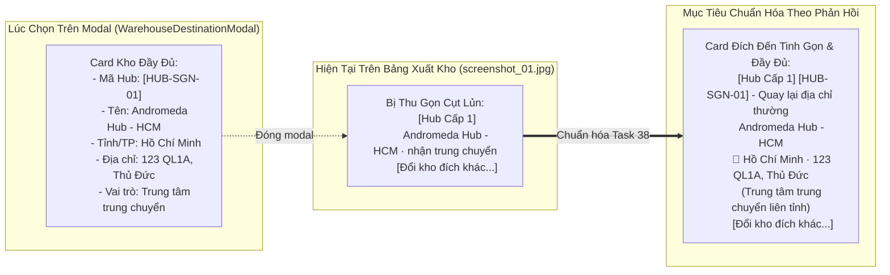

# Feedback 13/10 (Task 38) — Chuẩn hóa Hiển thị Thông tin Chi tiết Hub Cấp 1 & Tuyến Xe Bo tại Cột "Địa Chỉ Giao" Màn hình Xuất Kho

> **Thời gian ghi nhận**: 13/10/2026  
> **Người báo cáo**: @【M】【C】【D】 (Quản lý nghiệp vụ / Vận hành) & @Antigravity Verification  
> **Phạm vi tác động**:  
> - Quản lý Xuất kho (`/warehouse/outbound`) ➔ Tạo phiếu xuất kho (`activeView === 'MODE1_CUSTOMER'`)  
> - Lưới nhập & chỉnh sửa dữ liệu hàng hóa xuất kho ([`WarehouseEditableGrid`](file:///D:/Projects/logistics-website/frontend/src/features/warehouse/components/warehouse-editable-grid.tsx)) ➔ Cột `ĐỊA CHỈ GIAO *` ([`DeliveryAddressCell`](file:///D:/Projects/logistics-website/frontend/src/features/warehouse/components/warehouse-editable-grid.tsx#L1073-L1208))  
> - Modal chọn đích điều chuyển Hub / Tuyến Xe Bo ([`WarehouseDestinationModal`](file:///D:/Projects/logistics-website/frontend/src/features/warehouse/components/warehouse-destination-modal.tsx))  
> - Quản lý Chuyến xe trung chuyển ghé trạm ([`WarehouseTripDetailModal`](file:///D:/Projects/logistics-website/frontend/src/features/warehouse/components/warehouse-trip-detail-modal.tsx)) ➔ Bước 2: Bảng kê xuất hàng mới lên xe tại Hub  
> - Tra cứu tồn kho ([`WarehouseLookupModal`](file:///D:/Projects/logistics-website/frontend/src/features/warehouse/components/warehouse-lookup-modal.tsx)) & API xác nhận xuất kho ([`WarehouseController`](file:///D:/Projects/logistics-website/backend/src/orders/warehouse.controller.ts))  
> **Tài liệu tham chiếu**:  
> - `/leader` Business Domain Architecture ([`SKILL.md`](file:///D:/Projects/logistics-website/.agents/skills/leader/SKILL.md))  
> - Quy chế phát triển hệ thống [`AGENTS.md`](file:///D:/Projects/logistics-website/AGENTS.md)  
> - Quy chuẩn giao diện hẹp [`.agents/rules/ui-compact-density.md`](file:///D:/Projects/logistics-website/.agents/rules/ui-compact-density.md) & [`ui-spacing-guard`](file:///D:/Projects/logistics-website/.agents/skills/ui-spacing-guard/SKILL.md)  
> - Quy định quản lý Hub 2 tầng (Hub Cấp 1 & Tuyến Xe Bo Cấp 2) và 3 chế độ giao nhận (`DIRECT_CUSTOMER`, `HUB_L1`, `XE_BO`)  
> **Ảnh minh chứng đính kèm trong thư mục**:  
> - [`screenshot_01.jpg`](file:///D:/Projects/logistics-website/feedbacks/feedback_13_10_task_38/screenshot_01.jpg): Giao diện Tạo Phiếu Xuất Kho tại `Andromeda Hub - HCM`, hai ô khoanh đỏ tại cột "ĐỊA CHỈ GIAO *" thể hiện dòng 01 (Hub Cấp 1) và dòng 02 (Tuyến Xe Bo) đang chỉ hiển thị text chuỗi cụt lủn `Andromeda Hub - HCM · nhận trung chuyển` và `Xe Bo Quy Nhơn · gom hàng tuyến nội thành`, thiếu toàn bộ mã kho, tỉnh thành, địa chỉ chi tiết và icon nhận diện.  

---

## 📌 Bối cảnh nghiệp vụ thực tế (Chốt theo phản hồi người dùng)

### 1. Phản hồi gốc từ người dùng (@【M】【C】【D】)
> *"trong màn hình xuất kho, khi chọn các hub cấp 1, hoặc xe bo, tại ô khoanh đỏ này hãy thể hiện các thông tin như lúc màn hình chọn xe bo, hub."*

---

### 2. Tình huống vận hành thực tế tại Hub xuất hàng & trung chuyển
Trong nghiệp vụ vận hành kho bãi và điều phối vận tải TMS (Spider Express), khi thủ kho hoặc nhân viên điều phối lập kế hoạch xuất hàng (`Tạo Phiếu Xuất Kho` hoặc `Bốc thêm hàng từ kho lên chuyến xe trung chuyển`), hàng hóa trên lưới bảng kê có 3 hình thức giao nhận chính (`deliveryMode`):

1. **`DIRECT_CUSTOMER` (Giao thẳng cho khách)**:
   - Hàng được giao trực tiếp tới tay người nhận cuối cùng.
   - Nhân viên nhập địa chỉ chi tiết vào ô textarea thông thường (Ví dụ: `Số 45 Lê Lợi, Phường Bến Nghé, Quận 1, TP.HCM`).

2. **`HUB_L1` (Điều chuyển sang Hub Cấp 1 — Regional Linehaul Hub)**:
   - Hàng hóa không giao thẳng cho khách mà được xuất chuyển tiếp sang trung tâm trung chuyển khu vực chính (ví dụ: *Polaris Hub - Hưng Yên*, *Magellan Hub - Đà Nẵng*, *Andromeda Hub - HCM*...).
   - Phục vụ vận tải đường trục Bắc - Nam bằng xe tải lớn hoặc container.

3. **`XE_BO` (Điều chuyển sang Trạm / Tuyến Xe Bo Cấp 2 — Urban Feeder Station)**:
   - Hàng hóa được phân phối về các tuyến xe bo vệ tinh phụ trách gom hàng và trả hàng chặng cuối theo tuyến tỉnh thành / nội thị (ví dụ: *Xe Bo Quy Nhơn*, *XB-KH-02*, *Xe Bo Tuyến Nghệ An*...).

Khi người dùng thao tác bấm vào nút **"Thay đổi địa chỉ (Điều chuyển)"** hoặc **"Đổi kho đích khác..."**, hệ thống mở popup chọn đích đến ([`WarehouseDestinationModal`](file:///D:/Projects/logistics-website/frontend/src/features/warehouse/components/warehouse-destination-modal.tsx)).  
Tại modal này, mỗi Hub / Tuyến Xe Bo được thể hiện dưới dạng một **Card thông tin danh thiếp kho rất đầy đủ và trực quan**:
- **Mã định danh kho / tuyến (`hub.code`)**: Badge font-mono đậm nét riêng biệt (VD: `HUB-SGN-01`, `XB-QN-01`).
- **Tên kho / Tên tuyến (`hub.name`)**: In đậm rõ ràng (VD: `Andromeda Hub - HCM`, `Xe Bo Quy Nhơn`).
- **Tỉnh / Thành phố (`hub.city`)**: Thể hiện khu vực địa lý kèm icon nhận diện (`IconMapPin` cho Hub Cấp 1, `IconTruck` cho Tuyến Xe Bo).
- **Địa chỉ chi tiết kho bãi (`hub.address`)**: Địa chỉ thực tế để tài xế tìm đường và giao nhận hàng.
- **Huy hiệu phân tầng & vai trò vận hành**: `Hub Cấp 1 · nhận trung chuyển` hoặc `Tuyến Xe Bo · gom hàng tuyến nội thành`.

---

### 3. Vấn đề nghẽn thông tin & Bất cập trên giao diện hiện tại
Tuy nhiên, sau khi người dùng bấm chọn một Hub hoặc Tuyến Xe Bo trên popup, modal đóng lại và dữ liệu được render tại ô **`ĐỊA CHỈ GIAO *`** ([`DeliveryAddressCell`](file:///D:/Projects/logistics-website/frontend/src/features/warehouse/components/warehouse-editable-grid.tsx#L1139-L1172)) lại bị thu gọn thành **một chuỗi văn bản cụt lủn**:
- Dòng 01: `Andromeda Hub - HCM · nhận trung chuyển`
- Dòng 02: `Xe Bo Quy Nhơn · gom hàng tuyến nội thành`



Hậu quả vận hành thực tế:
1. **Mất dấu Mã kho (`hub.code`)**: Thủ kho và tài xế phụ thuộc trực tiếp vào mã kho (như `HUB-SGN-01`, `XB-QN-01`) để dán nhãn pallet và bốc dỡ hàng lên đúng khoang xe. Việc không hiển thị mã kho khiến nhân viên phải mở lại modal để xem lại mã.
2. **Mất thông tin Tỉnh / Thành phố (`hub.city`)**: Thủ kho nhìn vào tên kho/tuyến không nhận diện được ngay tỉnh thành tiếp nhận để kiểm soát hành trình chuyến xe.
3. **Mất thông tin Địa chỉ chi tiết (`hub.address`)**: Khi in Loading Plan hoặc phiếu xuất kho, tài xế không có địa chỉ kho đích chi tiết để chủ động liên hệ giao nhận.
4. **Trải nghiệm đứt gãy (UX Inconsistency)**: Lúc chọn thì trực quan, chuyên nghiệp; chọn xong thì giao diện lại thô sơ, không nhất quán.

---

## 🔍 Tổng hợp các điểm chưa đúng trên giao diện cũ (Đối chiếu screenshot_01.jpg)

| STT | Vị trí trên ảnh ([`screenshot_01.jpg`](file:///D:/Projects/logistics-website/feedbacks/feedback_13_10_task_38/screenshot_01.jpg)) | Hiện trạng chưa đúng | Nghiệp vụ chuẩn hóa cần đạt |
|---|---|---|---|
| **01** | **Ô khoanh đỏ dòng 01** (Cột `ĐỊA CHỈ GIAO *` - Hub Cấp 1) | Chỉ hiển thị badge `[Hub Cấp 1]` màu xanh và text phẳng `Andromeda Hub - HCM · nhận trung chuyển`. Thiếu hoàn toàn mã Hub, tỉnh thành, địa chỉ kho và icon nhận diện. | Hiển thị Card chi tiết chuẩn Compact: <br>• Badge phân cấp `[Hub Cấp 1]` (xanh biển) + Badge mã Hub `[HUB-SGN-01]` (font-mono đậm).<br>• Tên Hub in đậm `Andromeda Hub - HCM`.<br>• Dòng địa lý: Icon `IconMapPin` + `Hồ Chí Minh` + `· {hub.address}`.<br>• Subtext vai trò: `Trung tâm trung chuyển liên tỉnh`.<br>• Nút hành động `Đổi kho đích khác...` và `Quay lại địa chỉ thường`. |
| **02** | **Ô khoanh đỏ dòng 02** (Cột `ĐỊA CHỈ GIAO *` - Tuyến Xe Bo) | Chỉ hiển thị badge `[Tuyến Xe Bo]` màu tím và text phẳng `Xe Bo Quy Nhơn · gom hàng tuyến nội thành`. Thiếu mã tuyến xe bo, tỉnh thành, địa chỉ trạm nhận và icon xe tải. | Hiển thị Card chi tiết chuẩn Compact: <br>• Badge phân cấp `[Tuyến Xe Bo]` (tím) + Badge mã tuyến `[XB-QN-01]` (font-mono đậm).<br>• Tên Tuyến in đậm `Xe Bo Quy Nhơn`.<br>• Dòng địa lý: Icon `IconTruck` + `Bình Định` + `· {hub.address}`.<br>• Subtext vai trò: `Tuyến xe bo vệ tinh gom/trả hàng nội thành`.<br>• Nút hành động `Đổi kho đích khác...` và `Quay lại địa chỉ thường`. |
| **03** | **Độ rộng cột `ĐỊA CHỈ GIAO *` trên bảng** ([`warehouse-editable-grid.tsx`](file:///D:/Projects/logistics-website/frontend/src/features/warehouse/components/warehouse-editable-grid.tsx#L1690)) | Thuộc tính `size: 150` đang đặt quá hẹp, khiến nội dung khi bổ sung thông tin chi tiết dễ bị co rúm hoặc tràn dòng. | Điều chỉnh linh hoạt độ rộng cột `deliveryAddress` khi ở chế độ `isOutboundMode`: tăng từ `size: 150` lên `size: 210` - `220px` (kết hợp `min-w-[200px]`), đảm bảo thông tin hiển thị thông thoáng và giữ nguyên tính năng cuộn ngang an toàn của bảng. |
| **04** | **Cơ chế lưu trữ và phân giải Hub Object trong Row State** ([`DeliveryAddressCell`](file:///D:/Projects/logistics-website/frontend/src/features/warehouse/components/warehouse-editable-grid.tsx#L1093-L1105)) | Khi chọn kho, hệ thống lưu chuỗi label vào `deliveryAddress` và lưu object vào `destinationHub`. Tuy nhiên khi load từ đơn lưu kho (Lookup Modal) hoặc reload dữ liệu, `destinationHub` có thể bị rỗng dẫn đến việc mất thông tin chi tiết. | Xây dựng hàm helper chuẩn `resolveHubOption`: Ưu tiên lấy từ `r.destinationHub` ➔ Nếu chưa có thì tra cứu tự động theo `r.destinationHubId` trong danh sách `level1Hubs` và `level2XeBoHubs` ➔ Fallback đối chiếu chuỗi tên/mã kho. Bảo đảm 100% trường hợp đều phân giải ra đủ `code`, `name`, `city`, `address`. |
| **05** | **Tính nhất quán giữa các màn hình xuất kho** ([`WarehouseTripDetailModal`](file:///D:/Projects/logistics-website/frontend/src/features/warehouse/components/warehouse-trip-detail-modal.tsx#L1425-L1470)) | Màn hình `WarehouseTripDetailModal` (Bước 2: Bốc thêm hàng từ Hub lên chuyến xe liên tỉnh) cũng gặp lỗi tương tự: chỉ hiển thị text chuỗi `destinationHub` mà không có mã kho và địa chỉ chi tiết. | Đồng bộ hóa component card hiển thị điểm đến dùng chung cho cả `WarehouseEditableGrid` (Tạo phiếu xuất kho) và `WarehouseTripDetailModal` (Xuất hàng mới lên xe tại trạm). |

---

## 📋 Danh sách công việc triển khai (Action Checklist)

### 1. Backend (`backend/`)
- [ ] **Kiểm tra và chuẩn hóa Endpoint Tra cứu Danh bạ Hub (`/api/v1/hubs/active`)**:
  - Xác nhận endpoint trả về đầy đủ các trường dữ liệu thực thể của Hub: `id`, `code`, `name`, `city`, `address`, `level`, `orderCodePrefix`, `status`.
  - Bảo đảm không bị sót trường `address` hoặc `city` của các tuyến xe bo cấp 2.
- [ ] **Kiểm tra Quan hệ Thực thể trong `getOrders` ([`warehouse.service.ts`](file:///D:/Projects/logistics-website/backend/src/orders/warehouse.service.ts))**:
  - Đảm bảo câu lệnh TypeORM QueryBuilder luôn `leftJoinAndSelect('order.destinationHubEntity', 'destinationHubEntity')` khi trả về danh sách đơn hàng kho.
  - Phục vụ cho modal Tra cứu hàng tồn kho (`WarehouseLookupModal`) có sẵn thông tin đầy đủ của `destinationHubEntity` (kèm `code`, `city`, `address`).
- [ ] **Rà soát DTO Xuất kho & Lưu nháp ([`confirm-outbound.dto.ts`](file:///D:/Projects/logistics-website/backend/src/orders/dto/confirm-outbound.dto.ts))**:
  - Đảm bảo `OutboundItemDto` tiếp nhận đầy đủ `destinationHubId`, `deliveryMode`, `deliveryAddress`.
  - Xác nhận phương thức `saveOutboundDraft` (lưu nháp chuyến SD) và `confirmOutbound` (xuất kho chính thức) lưu vết chính xác `destinationHubId` vào bảng `orders` và `trips`.

---

### 2. Frontend (`frontend/`)
- [ ] **Xây dựng Helper / Component Card Đích Đến Chuẩn Hóa (`DestinationHubInfoCard`)**:
  - Tạo component hiển thị thẻ đích đến dùng chung hoặc tích hợp trực tiếp vào [`DeliveryAddressCell`](file:///D:/Projects/logistics-website/frontend/src/features/warehouse/components/warehouse-editable-grid.tsx#L1073-L1208).
  - **Cấu trúc giao diện chi tiết (Tuân thủ nghiêm ngặt Compact Density)**:
    ```tsx
    <div className={cn(
      'p-1.5 rounded-md border text-[10px] space-y-1 transition-all',
      isXeBo
        ? 'bg-purple-50/70 dark:bg-purple-950/30 border-purple-200 dark:border-purple-800'
        : 'bg-blue-50/70 dark:bg-blue-950/30 border-blue-200 dark:border-blue-800'
    )}>
      {/* Hàng 1: Huy hiệu phân cấp + Mã kho font-mono + Nút hoàn tác */}
      <div className="flex items-center justify-between gap-1">
        <div className="flex items-center gap-1">
          <Badge className={cn(
            'text-[9px] font-bold px-1.5 py-0 h-4 rounded',
            isXeBo ? 'bg-purple-600 text-white' : 'bg-blue-600 text-white'
          )}>
            {isXeBo ? 'Tuyến Xe Bo' : 'Hub Cấp 1'}
          </Badge>
          <span className={cn(
            'font-mono font-bold text-[9px] px-1 py-0.5 rounded',
            isXeBo
              ? 'bg-purple-100 text-purple-800 dark:bg-purple-900/60 dark:text-purple-300'
              : 'bg-blue-100 text-blue-800 dark:bg-blue-900/60 dark:text-blue-300'
          )}>
            {hub.code}
          </span>
        </div>
        <button
          type="button"
          onClick={handleResetToOriginal}
          className="text-[9px] text-slate-500 hover:text-red-600 underline cursor-pointer shrink-0"
          title="Khôi phục lại địa chỉ giao ban đầu"
        >
          Quay lại địa chỉ thường
        </button>
      </div>

      {/* Hàng 2: Tên kho / Tuyến xe bo in đậm */}
      <div className="font-bold text-[11px] text-slate-900 dark:text-slate-100 truncate" title={hub.name}>
        {hub.name}
      </div>

      {/* Hàng 3: Vị trí địa lý (Tỉnh/TP + Địa chỉ chi tiết) */}
      <div className="flex items-center gap-1 text-[10px] text-slate-600 dark:text-slate-400">
        {isXeBo ? (
          <IconTruck className="h-3 w-3 text-purple-600 shrink-0" />
        ) : (
          <IconMapPin className="h-3 w-3 text-blue-600 shrink-0" />
        )}
        <span className="font-semibold text-slate-800 dark:text-slate-200">{hub.city}</span>
        {hub.address && (
          <span className="truncate text-slate-500 dark:text-slate-400" title={hub.address}>
            · {hub.address}
          </span>
        )}
      </div>

      {/* Hàng 4: Vai trò vận hành */}
      <div className="text-[9px] text-slate-500 dark:text-slate-400 italic">
        {isXeBo ? 'Tuyến xe bo gom/trả hàng nội thành' : 'Trung tâm trung chuyển liên tỉnh'}
      </div>

      {/* Hàng 5: Nút bấm đổi kho đích khác */}
      <button
        type="button"
        onClick={() => setModalOpen(true)}
        className="w-full text-center text-[9px] font-semibold text-blue-600 hover:text-blue-800 dark:text-blue-400 py-0.5 border border-dashed border-blue-300 dark:border-blue-700 rounded hover:bg-blue-100/50 transition-colors"
      >
        Đổi kho đích khác...
      </button>
    </div>
    ```
- [ ] **Hoàn thiện Logic Phân giải Hub (`resolveHubOption`) trong `DeliveryAddressCell`**:
  - Hỗ trợ phân giải đa tầng:
    1. Lấy từ `r.destinationHub` (nếu là object có đủ thuộc tính).
    2. Tra cứu `r.destinationHubId` trong danh sách `level1Hubs` và `level2XeBoHubs`.
    3. Tra cứu chuỗi theo `code` hoặc `name` trong `r.deliveryAddress`.
  - Trường hợp ngoại lệ (chưa tìm thấy Hub): Vẫn render khung card chuẩn với badge loại và hiển thị an toàn chuỗi text hiện có, không làm crash giao diện.
- [ ] **Đồng bộ hóa vào Tra cứu Hàng Tồn Kho (`WarehouseLookupModal`)**:
  - Cập nhật hàm `handleSelectFromLookup` trong [`warehouse-editable-grid.tsx`](file:///D:/Projects/logistics-website/frontend/src/features/warehouse/components/warehouse-editable-grid.tsx#L1561-L1587): Kế thừa đầy đủ `destinationHubId`, `destinationHubEntity`, `deliveryMode` khi nạp đơn lưu kho vào lưới bảng.
- [ ] **Đồng bộ hóa vào Chi tiết Chuyến Xe & Bốc thêm hàng ([`warehouse-trip-detail-modal.tsx`](file:///D:/Projects/logistics-website/frontend/src/features/warehouse/components/warehouse-trip-detail-modal.tsx#L1425-L1480))**:
  - Cập nhật Bước 2 (Xuất hàng mới lên xe tại trạm): Thay thế đoạn hiển thị đơn điệu bằng card thông tin điểm đến chi tiết tương tự, bảo đảm trải nghiệm đồng nhất 100% trên toàn bộ hệ thống.
- [ ] **Điều chỉnh Độ rộng Cột Bảng (`warehouse-editable-grid.tsx`)**:
  - Cập nhật định nghĩa cột `deliveryAddress`: Đặt `size: isOutboundMode ? 210 : 150` để card thông tin hiển thị đẹp mắt, không bị ép dòng.
- [ ] **Tuân thủ Tuyệt đối Quy chuẩn Spacing & Không Redundant Icon**:
  - Không sinh các class cấm: `p-4`, `space-y-3`, `gap-4`.
  - Giữ khoảng cách gọn gàng `p-1.5`, `space-y-1`, `gap-1`, font chữ `text-[10px]`.

---

### 3. Kiểm thử & Nghiệm thu (Definition of Done)
- [ ] **Kiểm tra Biên dịch & Linting Toàn Dự Án**:
  - Backend: `npm run lint --prefix backend` & `npm run build --prefix backend` ➔ PASS (0 errors).
  - Frontend: `npm run build --prefix frontend` ➔ Next.js Turbopack build PASS (33/33 static pages, 0 TypeScript errors).
- [ ] **Kịch bản Kiểm thử Nghiệp vụ 1: Chọn Hub Cấp 1 (Điều chuyển liên Hub)**:
  1. Vào màn hình Tạo Phiếu Xuất Kho (`/warehouse/outbound` ➔ `Tạo Phiếu Xuất`).
  2. Tại dòng 01, bấm `Thay đổi địa chỉ (Điều chuyển)`.
  3. Chọn `Polaris Hub - Hưng Yên` (Mã: `HUB-HAN-01`, Tỉnh: `Hưng Yên`, Đ/C: `Phố Nối A...`).
  4. **Kết quả kỳ vọng**: Ô `ĐỊA CHỈ GIAO *` lập tức hiển thị card màu xanh có badge `Hub Cấp 1`, mã `HUB-HAN-01`, tên `Polaris Hub - Hưng Yên`, tỉnh `Hưng Yên`, địa chỉ chi tiết và nút `Đổi kho đích khác...`.
- [ ] **Kịch bản Kiểm thử Nghiệp vụ 2: Chọn Tuyến Xe Bo Cấp 2 (Giao tuyến vệ tinh)**:
  1. Thêm dòng 02 trên bảng xuất kho.
  2. Bấm `Thay đổi địa chỉ (Điều chuyển)`, chuyển sang tab Tuyến Xe Bo.
  3. Chọn `Xe Bo Quy Nhơn` (Mã: `XB-QN-01`, Tỉnh: `Bình Định`).
  4. **Kết quả kỳ vọng**: Ô `ĐỊA CHỈ GIAO *` hiển thị card màu tím có badge `Tuyến Xe Bo`, mã `XB-QN-01`, tên `Xe Bo Quy Nhơn`, tỉnh `Bình Định`, địa chỉ trạm nhận và nút đổi kho.
- [ ] **Kịch bản Kiểm thử Nghiệp vụ 3: Hoàn tác về Địa chỉ Giao Khách Thường**:
  1. Tại ô đã chọn Hub hoặc Tuyến Xe Bo, bấm `Quay lại địa chỉ thường`.
  2. **Kết quả kỳ vọng**: Card Hub biến mất, ô chuyển lại thành khung textarea nhập địa chỉ khách giao thẳng (`DIRECT_CUSTOMER`), địa chỉ khách ban đầu (nếu có) được khôi phục nguyên vẹn.
- [ ] **Kịch bản Kiểm thử Nghiệp vụ 4: Lưu Nháp Phiếu Xuất & Tải Lại**:
  1. Nhập thông tin ngày xuất, biển số xe, chọn Hub đích và bấm `Lưu nháp`.
  2. Mở lại phiếu nháp từ danh sách chờ xử lý.
  3. **Kết quả kỳ vọng**: Toàn bộ card thông tin Hub Cấp 1 / Tuyến Xe Bo vẫn hiển thị đầy đủ chi tiết mã kho, tên kho, địa chỉ như lúc mới chọn.
- [ ] **Kịch bản Kiểm thử Nghiệp vụ 5: Kiểm tra Hiển thị trên Chi tiết Chuyến xe ([`WarehouseTripDetailModal`](file:///D:/Projects/logistics-website/frontend/src/features/warehouse/components/warehouse-trip-detail-modal.tsx))**:
  1. Mở chuyến xe trung chuyển tại trạm Đà Nẵng, chuyển sang Bước 2 (Xuất hàng mới lên xe).
  2. Bấm `Đổi kho đích khác...` cho một đơn bốc mới từ kho lên xe.
  3. Chọn Hub đích tiếp theo trên lộ trình.
  4. **Kết quả kỳ vọng**: Ô điểm đến trên bảng hiển thị card chi tiết đồng bộ 100% với màn hình Tạo phiếu xuất kho.
