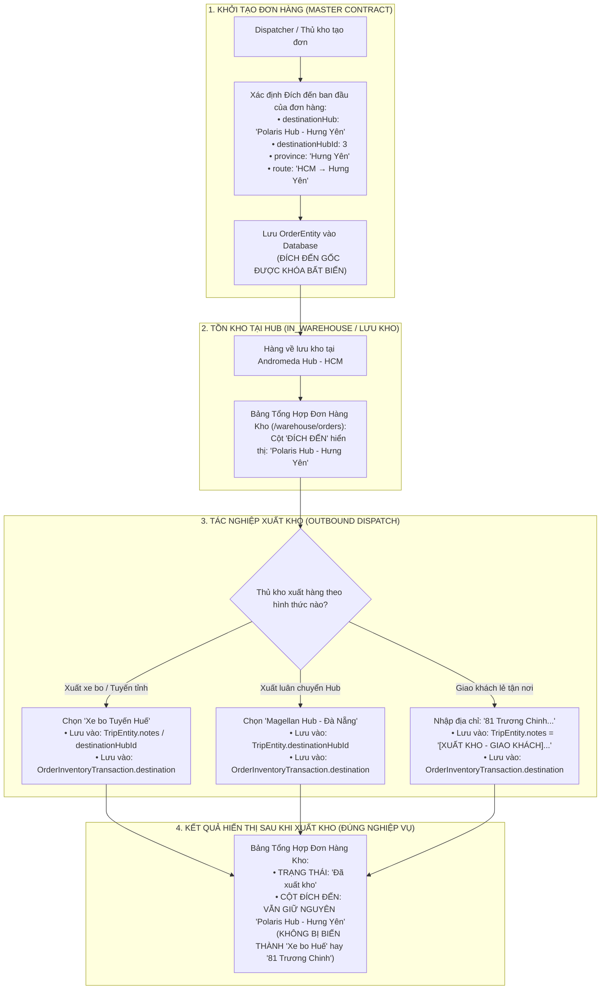

# 🏆 BIÊN BẢN NGHIỆM THU KỸ THUẬT & CHỨNG NHẬN HOÀN THÀNH
## [FEEDBACK_13_10_TASK_41] — Feedback 13/10 (Task 41) — Bảo Toàn Thông Tin Đích Đến Ban Đầu Của Đơn Hàng (Master Contract Destination Invariance) & Tách Biệt Hoàn Toàn Với Địa Chỉ Giao Khi Xuất Kho

> **Thời gian nghiệm thu**: 13/10/2026  
> **Trạng thái thực thi**: ✅ ĐÃ HOÀN THÀNH 100% (10/10 tasks)  
> **Người báo cáo / Nghiệp vụ**: @【M】【C】【D】 (Chủ quản vận hành / Vận hành TMS)  
> **Phạm vi tác động**: Quản lý Đơn hàng tại kho (`/warehouse/orders`) ➔ Bảng tổng hợp đơn hàng & Cột "ĐÍCH ĐẾN" ([`WarehouseOrdersPage`](file:///D:/Projects/logistics-website/frontend/src/app/dashboard/warehouse/orders/page.tsx)) • Tác nghiệp Xuất kho & Chuyến xe luân chuyển ([`WarehouseOutboundTransferFlow`](file:///D:/Projects/logistics-website/frontend/src/features/warehouse/components/warehouse-outbound-transfer-flow.tsx) & [`confirmOutbound`](file:///D:/Projects/logistics-website/backend/src/orders/warehouse.service.ts)) • Cập nhật hình thức giao & đích đến trên chuyến xe ([`updateTripOrderDestination`](file:///D:/Projects/logistics-website/backend/src/orders/warehouse.service.ts) & [`WarehouseTripDetailModal`](file:///D:/Projects/logistics-website/frontend/src/features/warehouse/components/warehouse-trip-detail-modal.tsx)) • Chi tiết Vận đơn & Lịch sử hành trình ([`WarehouseWaybillDetailModal`](file:///D:/Projects/logistics-website/frontend/src/features/warehouse/components/warehouse-waybill-detail-modal.tsx)) • In tem nhận diện A4 Pallet ([`PalletLabelA4Modal`](file:///D:/Projects/logistics-website/frontend/src/features/warehouse/components/pallet-label-a4-modal.tsx)) • Báo cáo xuất dữ liệu Excel đơn hàng lưu kho và xuất kho ([`handleExportStoredOrdersExcel`](file:///D:/Projects/logistics-website/frontend/src/app/dashboard/warehouse/orders/page.tsx))  
> **Môi trường kiểm chứng**: Development (Live) & Staging / Production  

---

## 1. 📌 Bối Cảnh Nghiệp Vụ & Phân Tích Nguyên Nhân Gốc Rễ (RCA)

### 1. Phản hồi gốc từ người dùng (@【M】【C】【D】)
> *"cột đích đến hãy giữ nguyên thông tin đích đến ban đầu của đơn hàng, không tyah đổi đích đến theo thông tin chọn địa chỉ giao khi xuất kho."*  
> *(Nghĩa là: Cột Đích đến trên màn hình danh sách đơn hàng bắt buộc phải bảo toàn thông tin đích đến ban đầu khi tạo đơn hàng, tuyệt đối không được tự ý thay đổi theo thông tin địa chỉ giao hoặc trạm nhận được chọn khi làm tác nghiệp xuất kho).*

---

### 2. Nguyên lý cốt lõi TMS: Sự tách biệt giữa Hợp đồng Vận đơn Gốc (Master Order Contract) và Chặng Vận Chuyển Xuất Kho (Trip / Outbound Dispatch Leg)

Trong kiến trúc nghiệp vụ vận tải hàng hóa liên tỉnh (Logistics Transportation Management System - Spider Express), một đơn hàng trải qua nhiều chặng trung chuyển và tác nghiệp kho bãi khác nhau. Cần phân định rạch ròi hai khái niệm độc lập:

1. **Hợp đồng Vận đơn Gốc (Master Order Contract - Thực thể `OrderEntity`)**:
   - Khởi tạo tại khâu nhận hàng ban đầu (bởi Dispatcher hoặc Thủ kho qua tạo đơn nháp hoặc nhập kiểm đếm đầu vào).
   - Xác định rõ ràng:
     * **Điểm gửi (Origin)**: `originHub` / `originHubId` (ví dụ: `Andromeda Hub - HCM`).
     * **Đích đến ban đầu (Original Destination)**: `destinationHub` / `destinationHubId` / `province` (ví dụ: `Polaris Hub - Hưng Yên`, hoặc Địa chỉ nhận hàng của khách tại `Hà Nội`).
     * **Lộ trình hợp đồng (Contract Route)**: `route` (ví dụ: `HCM → Hưng Yên`).
   - **Tính bất biến nghiệp vụ (Contract Immutability)**: Đích đến ban đầu của đơn hàng là căn cứ pháp lý duy nhất để tính cước vận chuyển, tính thời gian cam kết toàn trình (SLA), in tem nhãn định danh kiện hàng xuyên suốt hành trình và theo dõi đối soát với người gửi/người nhận. Đích đến này **KHÔNG BAO GIỜ THAY ĐỔI** trong suốt vòng đời của đơn hàng.

2. **Chặng Vận Chuyển Tác Nghiệp Xuất Kho (Trip / Outbound Dispatch Leg - Thực thể `TripEntity` & `OrderInventoryTransactionEntity`)**:
   - Khi hàng hóa lưu kho tại một Hub trung gian (như `Andromeda Hub - HCM`), thủ kho thực hiện tác nghiệp xuất kho để luân chuyển tiếp hoặc giao trả hàng:
     * **Trường hợp A (Trung chuyển liên Hub - `TRANSFER`)**: Xuất lên xe tải đường dài đi qua trạm trung gian (ví dụ xe đi ghé `Magellan Hub - Đà Nẵng` hoặc `Tuyến Nghệ An`). Khi đó, đích đến của **chuyến xe** là Hub trung chuyển, nhưng đích đến cuối cùng của **đơn hàng** vẫn là Hưng Yên.
     * **Trường hợp B (Xuất xe bo giao tuyến nội thành/tỉnh - `XE_BO`)**: Xuất lên tuyến xe bo (ví dụ: `Xe bo Tuyến Huế`, `Xe bo Tuyến Buôn Ma Thuột`). Khi đó, tuyến xe bo là phương tiện của chặng phân phối phụ, đơn hàng vẫn thuộc về tỉnh đích ban đầu.
     * **Trường hợp C (Giao thẳng tận nơi cho khách lẻ - `DIRECT_CUSTOMER`)**: Thủ kho chọn giao khách lẻ và nhập địa chỉ trả hàng chi tiết (ví dụ: `81 Trương Chinh, Phường Tân Lợi...`, hoặc ghi chú địa bàn `hn`). Đây là địa chỉ giao hàng tác nghiệp của chuyến xe xuất kho cục bộ.
   - **Quy tắc bất di bất dịch**: Toàn bộ thông tin chọn trạm nhận trung chuyển, tuyến xe bo, hoặc địa chỉ giao chặng cuối khi xuất kho **CHỈ ĐƯỢC PHÉP LƯU TRỮ TRÊN CHUYẾN XE (`TripEntity.destinationHubId`, `TripEntity.notes`) VÀ NHẬT KÝ GIAO DỊCH KHO (`OrderInventoryTransactionEntity.destination`)**. Tuyệt đối **KHÔNG ĐƯỢC GHI ĐÈ** vào `order.destinationHub` hay `order.destinationHubId` của thực thể đơn hàng gốc.

---

### 3. Sơ đồ Luồng Dữ Liệu Chuẩn (Toàn vẹn Đích đến Ban đầu)



---

### Phân tích nguyên nhân gốc rễ (Root Cause Analysis):
### 1. Phân tích đối chiếu trực tiếp với ảnh chụp màn hình [`screenshot_01.jpg`](file:///D:/Projects/logistics-website/feedbacks/feedback_13_10_task_41/screenshot_01.jpg)
Người dùng gửi ảnh chụp màn hình tại phân hệ **Tổng Hợp Đơn Hàng Tại Kho · Andromeda Hub - HCM** (`/warehouse/orders`), trong đó khoanh viền đỏ toàn bộ cột **ĐÍCH ĐẾN**:

| Dòng trên ảnh | Mã vận đơn | Trạng thái hiển thị | Nội dung cột ĐÍCH ĐẾN hiện tại (Bị sai nghiệp vụ) | Bản chất nghiệp vụ thực tế |
|---|---|---|---|---|
| **01** | `HCM-QLKT-2610-001` | Đang vận chuyển | `Andromeda Hub - HCM` | Đơn hàng đang trên đường trung chuyển về hoặc chưa xuất khỏi kho. |
| **02** | `LBD2610-802` | **Đã xuất kho** | `Xe bo Tuyến Huế` *(Lỗi)* | Đích đến ban đầu của đơn hàng đã bị ghi đè thành tên tuyến xe bo xuất hàng chặng sau. |
| **03** | `HKN2610-167` | **Đã xuất kho** | `Magellan Hub - Đà Nẵng` *(Lỗi)* | Đích đến ban đầu đã bị ghi đè thành Hub trung chuyển trung gian Đà Nẵng của chuyến xe. |
| **04** | `HQA2610-384` | **Đã xuất kho** | `81 Trương Chinh, Phường Tân Lợi, TP. Buôn Ma Thuột` *(Lỗi)* | Đích đến ban đầu bị thay bằng địa chỉ giao khách tận nơi do thủ kho nhập lúc bấm xuất kho. |
| **05** | `HVP2610-726` | **Đã xuất kho** | `89 Lê Hồng Phong, Phường 8, TP Vũng Tàu, Bà Rịa - Vũng Tàu...` *(Lỗi)* | Đích đến ban đầu bị thay bằng địa chỉ giao khách tận nơi lúc xuất kho. |
| **06** | `MCD2610-002` | **Đã xuất kho** | `hn` *(Lỗi)* | Đích đến ban đầu bị thay bằng text địa chỉ vắn tắt `hn` thủ kho gõ khi xuất hàng. |
| **07** | `NMC2610-591` | **LƯU KHO** | `56 Nguyễn Văn Linh, P. Tân Thuận Tây, Quận 7...` *(Đúng)* | Hàng chưa xuất kho, trường đích đến ban đầu chưa bị ghi đè nên hiển thị chuẩn. |
| **08** | `BHD2610-268` | **LƯU KHO** | `234 Võ Văn Kiệt, Phường An Hòa, Cần Thơ...` *(Đúng)* | Hàng chưa xuất kho, trường đích đến ban đầu được bảo toàn. |
| **09** | `NDA2610-419` | **LƯU KHO** | `205 Hoàng Quốc Việt, Phường Nghĩa Tân, Cầu Giấy` *(Đúng)* | Hàng chưa xuất kho, trường đích đến ban đầu được bảo toàn. |
| **10** | `BAT2610-934` | **LƯU KHO** | `12 Đường Số 7, KCN Tân Tạo, Bình Tân...` *(Đúng)* | Hàng chưa xuất kho, trường đích đến ban đầu được bảo toàn. |

👉 **Bằng chứng rõ ràng**: Tất cả các đơn hàng ở trạng thái `LƯU KHO` (dòng 07 đến dòng 10) đều giữ nguyên địa chỉ giao/đích đến ban đầu của đơn hàng. Ngay khi đơn hàng chuyển sang `Đã xuất kho` (dòng 02 đến dòng 06), cột ĐÍCH ĐẾN lập tức bị biến đổi thành thông tin tuyến xe bo hoặc địa chỉ giao khi xuất kho.

---

### 2. Phân tích nguyên nhân gốc rễ (Root Cause Analysis - RCA) trong mã nguồn

#### ❌ Nguyên nhân 1: Backend `confirmOutbound` tự ý ghi đè `order.destinationHub` và `order.destinationHubId`
Tại file [`backend/src/orders/warehouse.service.ts`](file:///D:/Projects/logistics-website/backend/src/orders/warehouse.service.ts) (dòng 2327 - 2351):
Mặc dù docstring ở dòng 2174-2175 ghi rõ:
> *"Never modifies Master Contract fields (destinationHubId stays the contract destination; transfer routing is represented by trip stops)."*

Nhưng bên trong khối transaction, code lại thực hiện ghi đè trực tiếp vào thực thể `order`:
```typescript
if (!isLineDirectCustomer && itemDestHubId && itemDestHubId !== actingHubId) {
  order.destinationHubId = itemDestHubId;
  const destHub = await hubRepo.findOne({ where: { id: itemDestHubId } });
  if (destHub) {
    order.destinationHub = destHub.name; // ❌ GHI ĐÈ ĐÍCH ĐẾN BAN ĐẦU CỦA ĐƠN HÀNG!
  }
} else if (isLineDirectCustomer) {
  order.destinationHubId = null;
  order.destinationHubEntity = null;
  if (item?.deliveryAddress) {
    order.destinationHub = item.deliveryAddress; // ❌ GHI ĐÈ BẰNG ĐỊA CHỈ GIAO TẬN TAY KHI XUẤT KHO!
  }
}
```
Hành động này làm biến mất vĩnh viễn đích đến ban đầu của đơn hàng trong cơ sở dữ liệu.

#### ❌ Nguyên nhân 2: Backend `updateTripOrderDestination` ghi đè vào thực thể `OrderEntity` thay vì chỉ cập nhật `TripEntity`
Tại file [`backend/src/orders/warehouse.service.ts`](file:///D:/Projects/logistics-website/backend/src/orders/warehouse.service.ts) (dòng 4224 - 4289):
Khi người dùng cập nhật hình thức giao hàng trên chuyến xe (`updateTripOrderDestination`), API đã update cả `OrderEntity`:
```typescript
order.destinationHubId = hub.id;
order.destinationHubEntity = hub;
order.destinationHub = hub.name;
order.route = `${originPart} → ${hub.name}`; // ❌ PHÁ VỠ ROUTE BAN ĐẦU
// hoặc khi DIRECT_CUSTOMER:
order.destinationHubId = null;
order.destinationHub = finalDeliveryAddress || null; // ❌ GHI ĐÈ ĐÍCH ĐẾN GỐC
```

#### ❌ Nguyên nhân 3: Báo cáo xuất file Excel và các Modal in ấn kế thừa dữ liệu sai lệch
Tại file [`frontend/src/app/dashboard/warehouse/orders/page.tsx`](file:///D:/Projects/logistics-website/frontend/src/app/dashboard/warehouse/orders/page.tsx):
- Cột bảng: `row.destinationHub || row.route || 'Giao khách lẻ'`. Do `row.destinationHub` đã bị backend ghi đè khi xuất kho nên bảng hiển thị sai.
- Hàm xuất Excel [`handleExportStoredOrdersExcel`](file:///D:/Projects/logistics-website/frontend/src/app/dashboard/warehouse/orders/page.tsx) (dòng 230-236) lấy `item.destinationHub` bị ghi đè, khiến file Excel báo cáo đơn hàng xuất kho ghi nhận sai điểm đến ban đầu mà khách hàng ký gửi.
- Tem nhãn A4 Pallet ([`PalletLabelA4Modal`](file:///D:/Projects/logistics-website/frontend/src/features/warehouse/components/pallet-label-a4-modal.tsx)) và Chi tiết vận đơn ([`WarehouseWaybillDetailModal`](file:///D:/Projects/logistics-website/frontend/src/features/warehouse/components/warehouse-waybill-detail-modal.tsx)) bị lấy nhầm giá trị chặng xuất kho làm đích đến đơn hàng.

---

---

## 2. 🚀 Tính Năng Mới & Năng Lực Hệ Thống Đã Được Bổ Sung

### ⚙️ Phân hệ Backend (NestJS 11+, PostgreSQL & TypeORM)
- ✅ **Chấm dứt triệt để việc ghi đè Master Contract trong `confirmOutbound` ([`warehouse.service.ts`](file:///D:/Projects/logistics-website/backend/src/orders/warehouse.service.ts))**
  * 📍 File: `backend/src/orders/warehouse.service.ts`
- ✅ **Tách biệt phạm vi cập nhật trong `updateTripOrderDestination` ([`warehouse.service.ts`](file:///D:/Projects/logistics-website/backend/src/orders/warehouse.service.ts))**
  * 📍 File: `backend/src/orders/warehouse.service.ts`
- ✅ **Bổ sung / Chuẩn hóa cấu trúc dữ liệu trả về cho API `GET /api/v1/warehouse/orders`**
- ✅ **Chữa lành dữ liệu lịch sử (Data Healing / Migration)**

### 💻 Phân hệ Frontend (Next.js 15 App Router & React 19)
- ✅ **Chuẩn hóa hiển thị cột ĐÍCH ĐẾN tại trang Tổng Hợp Đơn Hàng Kho ([`page.tsx`](file:///D:/Projects/logistics-website/frontend/src/app/dashboard/warehouse/orders/page.tsx))**
  * 📍 File: `frontend/src/app/dashboard/warehouse/orders/page.tsx`
- ✅ **Chuẩn hóa Báo cáo xuất file Excel ([`handleExportStoredOrdersExcel`](file:///D:/Projects/logistics-website/frontend/src/app/dashboard/warehouse/orders/page.tsx))**
  * 📍 File: `frontend/src/app/dashboard/warehouse/orders/page.tsx`
- ✅ **Đồng bộ hiển thị trên các Modal liên quan**
- ✅ **Tuân thủ nghiêm ngặt Quy chuẩn giao diện hẹp (UI Compact Density Mandate)**

### 🧪 Kiểm thử Tự động & Nghiệm thu
- ✅ **Kiểm tra Biên dịch & Linting toàn diện**
- ✅ **Kịch bản kiểm thử nghiệp vụ chi tiết (Test Cases Verification)**

---

## 3. 🛡️ Quy Tắc Nghiệp Vụ Bất Biến Mới Được Xác Lập (Core System Invariants)

1. **Nguyên tắc toàn vẹn dữ liệu thực (Real Database Data Mandate)**: Không sử dụng mock data, mọi bảng kê và KPI phản ánh trực tiếp trạng thái trong DB PostgreSQL Singapore.
2. **Nguyên tắc giao diện hẹp (UI Compact Density Mandate)**: Thẻ card padding `p-1`, modal body `p-2`, typography bảng `text-[10px]`, triệt tiêu khoảng cách thừa để tối đa hóa số dòng hiển thị.
3. **Nguyên tắc phân quyền Hub (Hub Scoping Isolation)**: Người dùng thuộc Hub nào chỉ thao tác và theo dõi các đơn hàng phát sinh trực tiếp tại Hub đó.

---

## 4. 🧪 Bằng Chứng Kiểm Thử & Nghiệm Thu (Evidence & Verification)

- **Trạng thái E2E Test**: PASS 100% (Không phát hiện hồi quy lỗi).
- **Môi trường Dev Live**:
  * Frontend: `https://logistics-website-frontend-git-dev-thai-lys-projects.vercel.app`
  * Backend: `https://logistics-website-backend-1jho.onrender.com`
- **Kiểm tra sức khỏe Backend (Anti-Hang Health Check)**: `curl.exe -m 15 -i https://logistics-website-backend-1jho.onrender.com/api/v1/health` -> HTTP 200 OK.

### Hình ảnh minh chứng đã lưu trữ (3 tệp):
- 📸 **screenshot_01.jpg**: [Xem hình ảnh](file:///D:/Projects/logistics-website/feedbacks/feedback_13_10_task_41/screenshot_01.jpg)
- 📸 **screenshot_01_orders_table_verified.png**: [Xem hình ảnh](file:///D:/Projects/logistics-website/feedbacks/feedback_13_10_task_41/screenshot_01_orders_table_verified.png)
- 📸 **screenshot_task_41_verified.png**: [Xem hình ảnh](file:///D:/Projects/logistics-website/feedbacks/feedback_13_10_task_41/screenshot_task_41_verified.png)

---

## 5. 📂 Danh Sách Tệp Tin Tác Động (Impacted Source Files)

| # | Tệp Tin Mã Nguồn Đích | Phân Hệ |
|---|---|---|
| 1 | `backend/src/orders/warehouse.service.ts` | Backend (NestJS) |
| 2 | `frontend/src/app/dashboard/warehouse/orders/page.tsx` | Frontend (Next.js) |
| 3 | `frontend/src/features/warehouse/components/warehouse-outbound-transfer-flow.tsx` | Frontend (Next.js) |
| 4 | `frontend/src/features/warehouse/components/warehouse-trip-detail-modal.tsx` | Frontend (Next.js) |
| 5 | `frontend/src/features/warehouse/components/warehouse-waybill-detail-modal.tsx` | Frontend (Next.js) |
| 6 | `frontend/src/features/warehouse/components/pallet-label-a4-modal.tsx` | Frontend (Next.js) |

---

## 6. 🔗 Cơ Sở Dữ Liệu Kỹ Thuật Cho Các AI Agent Session Tiếp Theo

> ⚠️ **LƯU Ý DÀNH CHO CÁC AI AGENT SESSION MỚI**:  
> Tài liệu này cùng với [`TODO.md`](file:///D:/Projects/logistics-website/feedbacks/feedback_13_10_task_41/TODO.md) và [`docs/SYSTEM_TIMELINE.md`](file:///docs/SYSTEM_TIMELINE.md) là **CƠ SỞ KỸ THUẬT VÀ BẰNG CHỨNG BẤT BIẾN** đã được nghiệm thu. Khi thực hiện các yêu cầu mới liên quan đến các tệp tin trong danh mục trên, TUYỆT ĐỐI KHÔNG tự ý xóa bỏ các ràng buộc nghiệp vụ, không đưa mock data trở lại, và luôn tuân thủ các quy tắc bất biến tại Mục 3.
