# Feedback 13/10 (Task 45) — Loại Bỏ Chức Năng Chọn Nhiều Trip & Nút Xác Nhận Nhập/Xuất Kho Hàng Loạt Ngoài Màn Hình Danh Sách (Chuyển Giao Trọn Vẹn Sang Tác Nghiệp Theo Chuyến Xe & Kiểm Đếm Thực Tế)

> **Thời gian ghi nhận**: 13/10/2026  
> **Người báo cáo**: @【M】【C】【D】 (Chủ quản vận hành / Vận hành TMS)  
> **Phạm vi tác động**:  
> - Quản lý Nhập kho (`/warehouse/inbound`) ➔ Bảng điều độ chuyến xe đến & Thanh tác vụ chọn hàng loạt ([`WarehouseInboundPage`](file:///D:/Projects/logistics-website/frontend/src/app/dashboard/warehouse/inbound/page.tsx))  
> - Quản lý Xuất kho (`/warehouse/outbound`) ➔ Bảng điều độ chuyến xe đi & Thanh tác vụ chọn hàng loạt ([`WarehouseOutboundPage`](file:///D:/Projects/logistics-website/frontend/src/app/dashboard/warehouse/outbound/page.tsx))  
> - Tác nghiệp Kiểm đếm & Dỡ hàng theo Chuyến xe ([`WarehouseTripDetailModal`](file:///D:/Projects/logistics-website/frontend/src/features/warehouse/components/warehouse-trip-detail-modal.tsx))  
> - Tác nghiệp Lập phiếu xuất & Điều độ chuyến xe xuất kho ([`WarehouseOutboundTransferFlow`](file:///D:/Projects/logistics-website/frontend/src/features/warehouse/components/warehouse-outbound-transfer-flow.tsx) & Form Xuất kho Mode 1 / Mode 2)  
> **Tài liệu tham chiếu**:  
> - `/leader` Business Domain Architecture ([`SKILL.md`](file:///D:/Projects/logistics-website/.agents/skills/leader/SKILL.md))  
> - Quy chế phát triển hệ thống [`AGENTS.md`](file:///D:/Projects/logistics-website/AGENTS.md)  
> - Quy chuẩn kiểm soát kiện vận tải (No-SKU, Consignment Level)  
> - Quy chuẩn giao diện hẹp [`.agents/rules/ui-compact-density.md`](file:///D:/Projects/logistics-website/.agents/rules/ui-compact-density.md) & [`ui-spacing-guard`](file:///D:/Projects/logistics-website/.agents/skills/ui-spacing-guard/SKILL.md)  
> **Ảnh minh chứng đính kèm trong thư mục**:  
> - [`screenshot_01.jpg`](file:///D:/Projects/logistics-website/feedbacks/feedback_13_10_task_45/screenshot_01.jpg): Ảnh chụp màn hình "Nhập kho · Andromeda Hub - HCM", người dùng khoanh 2 khung đỏ chỉ rõ các phần tử cần loại bỏ:  
>   1. **Khung đỏ bên trái**: Toàn bộ cột Checkbox chọn nhiều trip ở đầu mỗi hàng (`[v] SD45`, `[v] SD39`, `[v] SD46`, `[v] SD43`, `[v] SD41`).  
>   2. **Khung đỏ bên phải**: Thanh tác vụ chọn nhiều nổi lên trên đầu bảng chứa dòng text *"Đã chọn 17 đơn hàng"*, nút `[Bỏ chọn]` và nút `[Xác nhận nhập kho 17 đơn]`.

---

## 📌 Bối cảnh nghiệp vụ thực tế (Chốt theo phản hồi người dùng)

### 1. Phản hồi gốc từ người dùng (@【M】【C】【D】)
> *"loại bỏ các nút chọn nhiều trip, nút xác nhận nhập kho, xác nhận xuất kho ở màn hình nhập kho, xuất kho."*  
> *(Nghĩa là: Triệt tiêu hoàn toàn cơ chế checkbox chọn nhiều chuyến xe và thanh công cụ thao tác hàng loạt "Xác nhận nhập kho" / "Xác nhận xuất kho" ngoài bảng danh sách ở cả 2 màn hình Nhập kho và Xuất kho. Mọi thao tác xác nhận tiếp nhận hoặc xuất hàng bắt buộc phải thực hiện trong giao diện chi tiết chuyến xe sau khi đã kiểm đếm thực tế).*

---

### 2. Tình huống vận hành thực tế tại Hub/Kho bãi & Nguyên nhân loại bỏ cơ chế chọn nhiều Trip

Trong kiến trúc vận hành mạng lưới vận tải hàng hóa đường dài Bắc - Nam (Logistics TMS - Spider Express), một chuyến xe tải (Trip) là một thực thể vận chuyển vật lý độc lập (xe 5 tấn, 10 tấn, 15 tấn hoặc container) chở theo nhiều lô hàng (Consignment) của nhiều khách hàng với hàng chục, thậm chí hàng trăm kiện hàng.

Cơ chế "chọn nhiều trip" và "xác nhận nhập/xuất kho hàng loạt" ngoài bảng danh sách tiềm ẩn các nguy cơ vận hành cực kỳ nghiêm trọng:

1. **Nguy cơ Xác nhận "Mù" (Blind Bulk Confirmation) — Vi phạm nguyên tắc kiểm soát vật lý kho bãi**:
   - Khi xe tải đến Hub, xe còn đang đỗ ở sân bãi, tài xế chưa xuống xe, cửa thùng xe chưa mở niêm phong chì (seal), hàng hóa chưa được dỡ xuống mặt sàn kho.
   - Nếu để nút "chọn nhiều trip" và "Xác nhận nhập kho X đơn" ngay ngoài bảng danh sách, thủ kho có thể ngồi trong phòng điều độ tích chọn một lúc 4–5 chuyến xe (như trong ảnh `screenshot_01.jpg` là 17 đơn hàng) rồi bấm xác nhận chỉ bằng 1 cú click chuột.
   - Thao tác này hoàn toàn là **nhập kho khống trên giấy tờ**, đi ngược lại bản chất của nghiệp vụ kho vận chuyên nghiệp.

2. **Gây sai lệch tồn kho tức thì (Live Inventory Distortion) & Mất dấu vết thất thoát**:
   - Khi bấm xác nhận hàng loạt, toàn bộ đơn hàng lập tức chuyển trạng thái sang `IN_WAREHOUSE` (Lưu kho) với số lượng mặc định bằng 100% số kiện trên vận đơn.
   - Trong thực tế, hàng hóa trên xe đường dài thường xuyên xảy ra tình trạng: rách bao bì, móp méo thùng carton, ướt hàng, hoặc thiếu hụt kiện do bốc nhầm ở trạm trước.
   - Nếu không mở từng chuyến xe để kiểm đếm thực nhận (Tally: Expected Qty vs. Actual Received Qty) và ghi nhận biên bản chênh lệch, thì Hub nhận sẽ phải gánh toàn bộ trách nhiệm bồi thường và thất thoát mà tài xế hoặc Hub gửi trước đó gây ra.

3. **Vi phạm nguyên tắc phân lập hàng trung chuyển (Inter-hub Cargo Isolation)**:
   - Các chuyến xe đường dài ghé trạm trung chuyển (như xe từ HCM đi Hưng Yên ghé Đà Nẵng) luôn chở 2 nhóm hàng: (1) Hàng dỡ xuống kho Đà Nẵng, và (2) Hàng trung chuyển đi tiếp ra Hưng Yên/Nghệ An.
   - Nút "Xác nhận nhập kho hàng loạt" ngoài bảng danh sách quét gom toàn bộ đơn hàng trên xe mà không phân tách được hàng dỡ tại trạm và hàng đi tiếp, dẫn đến nguy cơ dỡ nhầm cả hàng của trạm kế tiếp vào tồn kho cục bộ!

4. **Tương tự đối với Quản lý Xuất kho (`/warehouse/outbound`)**:
   - Một chuyến xe xuất kho (SD Draft) cần được kiểm tra kỹ lưỡng về danh sách đơn hàng xếp lên thùng, tính toán tổng khối lượng ($Kg$) và thể tích ($m^3$) không vượt quá tải trọng xe, kiểm tra thông tin tài xế và biển số xe trước khi xuất phát.
   - Việc tích chọn nhiều chuyến nháp rồi bấm "Xác nhận xuất X chuyến" ngoài màn hình bảng là thao tác xuất xe hàng loạt không qua kiểm tra tải trọng, vi phạm quy trình giám sát đội xe.

---

### 3. Quy trình vận hành chuẩn hóa: Chuyển toàn bộ quyền xác nhận vào Chi tiết Chuyến xe (Trip-Centric Operations)

Hệ thống Logistics TMS chuẩn hóa quy trình phân tách rõ ràng giữa hai tầng:

- **Tầng 1: Màn hình Bảng danh sách ngoài (`/warehouse/inbound` & `/warehouse/outbound`)**:
  - Đóng vai trò thuần túy là **Bảng Điều Độ Giám Sát (Operational Monitoring Board)**.
  - Cho phép thủ kho tra cứu nhanh theo biển số xe, tài xế, mã chuyến, lọc trạng thái (`Tất cả`, `Chờ xử lý`, `Đã xử lý`), lọc theo khoảng ngày.
  - Cung cấp các thao tác điều hướng: Bấm vào mã chuyến xe `tripCode` để mở chi tiết, bấm `In phiếu nhập` / `In phiếu xuất`, bấm `Xem đơn` để mở rộng danh sách kiện hàng bên dưới.
  - **TUYỆT ĐỐI KHÔNG** có checkbox chọn nhiều hàng và không có nút xác nhận hàng loạt.

- **Tầng 2: Giao diện Chi tiết Chuyến xe ([`WarehouseTripDetailModal`](file:///D:/Projects/logistics-website/frontend/src/features/warehouse/components/warehouse-trip-detail-modal.tsx)) & Form Xuất kho**:
  - Đây là **nơi duy nhất** diễn ra tác nghiệp xác nhận chuyển trạng thái:
    * **Nhập kho**: Mở chi tiết xe -> Thủ kho kiểm đếm thực nhận từng đơn hàng dỡ tại kho -> Nhập số kiện thực tế -> Bấm `Xác nhận nhập kho ({count} dòng)` -> In phiếu nhập kho chính thức.
    * **Xuất kho**: Thực hiện tạo phiếu xuất qua form (`activeView = MODE1_CUSTOMER` / `MODE2_TRANSFER`), hoặc bấm `Tiếp tục` trên chuyến nháp để rà soát danh sách đơn trước khi bấm `Xác nhận xuất kho`.

```mermaid
flowchart TD
    subgraph S1 ["GIAO DIỆN CŨ (CÓ NGUY CƠ NHẬP/XUẤT MÙ - CẦN LOẠI BỎ)"]
        A1["Bảng danh sách Nhập/Xuất kho"] --> B1["Tích chọn nhiều checkbox ở các hàng [v] SD45, [v] SD39..."]
        B1 --> C1["Thanh nổi: 'Đã chọn 17 đơn hàng'"]
        C1 --> D1["Bấm 'Xác nhận nhập kho 17 đơn' / 'Xác nhận xuất X chuyến'"]
        D1 --> E1["❌ NGUY HIỂM: Nhập/xuất khống, chưa dỡ hàng, chưa tally, sai lệch tồn kho"]
    end

    subgraph S2 ["GIAO DIỆN MỚI CHUẨN HÓA (TRIP-CENTRIC - AN TOÀN 100%)"]
        A2["Bảng danh sách Nhập/Xuất kho (Monitoring Board)"] --> B2["Xem thông tin xe, tài xế, tải trọng, trạng thái"]
        B2 --> C2["Thủ kho bấm trực tiếp vào mã chuyến xe: SD45"]
        C2 --> D2["Mở WarehouseTripDetailModal (Chi tiết chuyến xe)"]
        D2 --> E2["Kiểm đếm dỡ hàng thực tế từng mã vận đơn (Tally)"]
        E2 --> F2["Xác nhận nhập kho cho riêng chuyến xe SD45"]
        F2 --> G2["In phiếu nhập kho chuyến xe chuẩn A4/A5"]
    end
```



---

## 🔍 Tổng hợp các điểm chưa đúng trên giao diện cũ cần khắc phục

Đối chiếu trực tiếp với ảnh chụp màn hình thực tế [`screenshot_01.jpg`](file:///D:/Projects/logistics-website/feedbacks/feedback_13_10_task_45/screenshot_01.jpg) và mã nguồn hiện tại:

1. **Cột Checkbox chọn nhiều chuyến xe trên Bảng Nhập kho ([`inbound/page.tsx`](file:///D:/Projects/logistics-website/frontend/src/app/dashboard/warehouse/inbound/page.tsx))**:
   - Header bảng có ô checkbox chọn tất cả (`<th className='py-1.5 px-2 w-[36px] text-center'><input type='checkbox' .../></th>`).
   - Mỗi dòng chuyến xe có ô checkbox (`<td className='py-1 px-2 text-center'><input type='checkbox' .../></td>`).
   - *Hạn chế*: Tạo ra hành vi sai lệch cho người dùng rằng có thể gom các chuyến xe khác nhau lại để xác nhận một lần, gây lãng phí 36px chiều rộng của bảng dữ liệu.

2. **Thanh tác vụ chọn nhiều nổi trên Bảng Nhập kho ([`inbound/page.tsx`](file:///D:/Projects/logistics-website/frontend/src/app/dashboard/warehouse/inbound/page.tsx) lines 897–932)**:
   - Khi có bất kỳ checkbox nào được tích, thanh nổi màu xanh xuất hiện: `Đã chọn X đơn hàng` cùng nút `[Bỏ chọn]` và nút `[Xác nhận nhập kho X đơn]`.
   - Trong ảnh `screenshot_01.jpg`, người dùng tích chọn 5 chuyến xe dẫn đến số đơn chọn vọt lên 17 đơn (bao gồm cả các đơn thuộc xe `SD46` vốn đã ở trạng thái "Đã xử lý"!).
   - *Hạn chế*: Logic đếm gộp thiếu chính xác, cho phép xác nhận đè lên cả các chuyến xe đã hoàn tất tác nghiệp.

3. **Cột Checkbox và Thanh xác nhận xuất hàng loạt trên Bảng Xuất kho ([`outbound/page.tsx`](file:///D:/Projects/logistics-website/frontend/src/app/dashboard/warehouse/outbound/page.tsx) lines 1203–1267)**:
   - Tương tự như Nhập kho, bảng Xuất kho có cột checkbox và thanh nổi `Đã chọn X chuyến nháp` + nút `[Xác nhận xuất X chuyến]`.
   - *Hạn chế*: Thao tác xuất hàng loạt nhiều chuyến nháp cùng lúc mà không kiểm tra lại tình trạng bốc xếp hàng thực tế trên từng xe là quy trình rủi ro, cần triệt tiêu hoàn toàn.

4. **Tối ưu hóa không gian hiển thị (UI Compact Density Mandate)**:
   - Việc loại bỏ cột checkbox 36px giúp giải phóng diện tích cho các cột nghiệp vụ cốt lõi: `CHUYẾN XE / TRIP`, `XE & TÀI XẾ`, `SỐ KIỆN / TẢI TRỌNG`, `TRẠNG THÁI`, `THAO TÁC`.
   - Bảng hiển thị rộng rãi, cân đối hơn, không bị co ép text và không bị tràn ngang trên màn hình laptop tiêu chuẩn.

---

## 📋 Danh sách công việc triển khai (Action Checklist)

### 1. Backend (`backend/`)

> [!NOTE]
> Các endpoint `POST /api/v1/warehouse/inbound/confirm` và `POST /api/v1/warehouse/outbound/confirm` hiện vẫn đang được sử dụng hợp lệ bởi các modal tác nghiệp nghiệp vụ chuyên sâu (`WarehouseTripDetailModal`, `WarehouseTallyModal`, `WarehouseInboundTransferFlow`, `WarehouseOutboundTransferFlow`). Do đó, Backend không xóa bỏ endpoint này mà chỉ rà soát tính toàn vẹn và bảo mật dữ liệu.

- [x] **Rà soát & Bảo toàn Endpoints xác nhận kho trong `WarehouseController` & `WarehouseService`**:
  - File: [`backend/src/orders/warehouse.controller.ts`](file:///D:/Projects/logistics-website/backend/src/orders/warehouse.controller.ts) & [`backend/src/orders/warehouse.service.ts`](file:///D:/Projects/logistics-website/backend/src/orders/warehouse.service.ts).
  - Đảm bảo endpoint `POST /api/v1/warehouse/inbound/confirm` kiểm tra chặt chẽ quyền thao tác của Hub hiện tại (`user.hubId`), ngăn chặn việc xác nhận đơn hàng không thuộc phạm vi kho của người dùng.
  - Đảm bảo endpoint `POST /api/v1/warehouse/outbound/confirm` yêu cầu đầy đủ thông tin chuyến xe, biển số, tài xế trước khi ghi nhận xuất kho.
  - Cập nhật tài liệu Swagger `@ApiOperation`: Ghi rõ đây là endpoint phục vụ xác nhận theo từng chuyến xe / biên bản kiểm đếm, không khuyến khích gọi bulk tự do ngoài danh sách.

---

### 2. Frontend (`frontend/`)

#### A. Màn hình Quản lý Nhập kho ([`frontend/src/app/dashboard/warehouse/inbound/page.tsx`](file:///D:/Projects/logistics-website/frontend/src/app/dashboard/warehouse/inbound/page.tsx))
- [x] **Xóa bỏ State & Logic chọn nhiều đơn hàng**:
  - Xóa bỏ state `selectedOrderIds` (`const [selectedOrderIds, setSelectedOrderIds] = useState<number[]>([]);`).
  - Xóa bỏ state `isBatchSubmitting` (`const [isBatchSubmitting, setIsBatchSubmitting] = useState(false);`).
  - Xóa bỏ hàm `handleBatchConfirmInbound` (lines 481–517).
  - Dọn dẹp biến tính toán `allVisibleOrders` nếu không còn mục đích sử dụng khác ngoài checkbox chọn tất cả.
  - Dọn dẹp các lệnh reset `setSelectedOrderIds([])` trong các hiệu ứng chuyển tab, tìm kiếm, ngày tháng.
- [x] **Xóa bỏ Thanh tác vụ hàng loạt nổi (Batch Action Bar)**:
  - Xóa bỏ toàn bộ khối JSX lines 897–932:
    ```tsx
    {selectedOrderIds.length > 0 && (
      <div className='flex items-center justify-between bg-blue-50 ...'>
        ...
      </div>
    )}
    ```
- [x] **Xóa bỏ Cột Checkbox trong Bảng Chuyến xe Nhập kho**:
  - Xóa thẻ `<th>` checkbox ở `<thead>`:
    ```tsx
    <th className='py-1.5 px-2 w-[36px] text-center'>
      <input type='checkbox' ... />
    </th>
    ```
  - Xóa thẻ `<td>` checkbox ở mỗi dòng chuyến xe trong `<tbody>`:
    ```tsx
    <td className='py-1 px-2 text-center'>
      <input type='checkbox' ... />
    </td>
    ```
- [x] **Điều chỉnh `colSpan` của Bảng**:
  - Dòng Loading (`isLoadingOrders`): Điều chỉnh từ `colSpan={6}` thành `colSpan={5}`.
  - Dòng Empty state (`vehicleGroups.length === 0`): Điều chỉnh từ `colSpan={6}` thành `colSpan={5}`.
  - Dòng Nested sub-row (`isExpanded`): Điều chỉnh từ `colSpan={6}` thành `colSpan={5}`.

---

#### B. Màn hình Quản lý Xuất kho ([`frontend/src/app/dashboard/warehouse/outbound/page.tsx`](file:///D:/Projects/logistics-website/frontend/src/app/dashboard/warehouse/outbound/page.tsx))
- [x] **Xóa bỏ State & Logic chọn nhiều chuyến nháp**:
  - Xóa bỏ state `selectedTripCodes` (`const [selectedTripCodes, setSelectedTripCodes] = useState<string[]>([]);`).
  - Xóa bỏ state `isBatchSubmitting` (`const [isBatchSubmitting, setIsBatchSubmitting] = useState(false);`).
  - Xóa bỏ hàm `handleBatchConfirmOutbound` (lines 762–824).
  - Xóa bỏ hàm không dùng `handleExportVehicleTrip` (lines 826–862) để tránh code thừa (dead code).
  - Dọn dẹp biến `draftGroups` nếu không còn sử dụng cho checkbox.
- [x] **Xóa bỏ Thanh tác vụ xuất hàng loạt nổi (Batch Action Bar)**:
  - Xóa bỏ toàn bộ khối JSX lines 1204–1238:
    ```tsx
    {selectedTripCodes.length > 0 && (
      <div className='bg-blue-50 ...'>
        ...
      </div>
    )}
    ```
- [x] **Xóa bỏ Cột Checkbox trong Bảng Chuyến xe Xuất kho**:
  - Xóa thẻ `<th>` checkbox ở `<thead>`:
    ```tsx
    <th className='py-1.5 px-2 w-[36px] text-center'>
      <input type='checkbox' ... />
    </th>
    ```
  - Xóa thẻ `<td>` checkbox ở mỗi dòng chuyến xe trong `<tbody>`:
    ```tsx
    <td className='py-1 px-2 text-center'>
      <input type='checkbox' ... />
    </td>
    ```
- [x] **Điều chỉnh `colSpan` của Bảng**:
  - Dòng Loading (`isLoading`): Điều chỉnh từ `colSpan={6}` thành `colSpan={5}`.
  - Dòng Empty state (`vehicleGroups.length === 0`): Điều chỉnh từ `colSpan={6}` thành `colSpan={5}`.
  - Dòng Nested sub-row (`isExpanded`): Điều chỉnh từ `colSpan={6}` thành `colSpan={5}`.

---

#### C. Quy chuẩn Giao diện hẹp & Trải nghiệm Người dùng (UI Compact Density)
- [x] **Bảo toàn tỷ lệ và cấu trúc bảng sau khi bỏ cột Checkbox**:
  - 5 cột chuẩn gồm: `CHUYẾN XE / TRIP` (150px) | `XE & TÀI XẾ` (150px) | `SỐ KIỆN / TẢI TRỌNG` (130px) | `TRẠNG THÁI` (100px) | `THAO TÁC` (180px).
  - Giữ nguyên typography chuẩn: Header `text-[10px]`, ô dữ liệu `text-[11px]`, mã chuyến `font-mono font-bold`.
  - Giữ nguyên khả năng mở rộng xem danh sách đơn (`isExpanded` / `Xem đơn` / `Thu gọn`).
  - Giữ nguyên thao tác bấm vào `tripCode` để mở [`WarehouseTripDetailModal`](file:///D:/Projects/logistics-website/frontend/src/features/warehouse/components/warehouse-trip-detail-modal.tsx).

---

### 3. Kiểm thử & Nghiệm thu (Definition of Done)

- [x] **Kiểm tra Biên dịch & Linting (Zero Compilation Errors)**:
  - Chạy `npm run lint --prefix backend` và `npm run build --prefix backend` đạt PASS (0 lỗi).
  - Chạy `npm run build --prefix frontend` đạt PASS (Next.js compiled successfully, TypeScript passed, 0 lỗi type).
- [x] **Kịch bản kiểm thử Nghiệp vụ Thực tế (Manual & E2E Verification)**:
  - **Kịch bản 1: Màn hình Nhập kho (`/warehouse/inbound`)**:
    1. Đăng nhập tài khoản Quản lý kho (ví dụ: `wh_hcm@spider.com` hoặc `wh_danang@spider.com`).
    2. Truy cập màn hình Quản lý Nhập kho.
    3. Xác nhận: Cột checkbox ở header và từng dòng đã biến mất 100%. Không có bất kỳ ô checkbox nào trên bảng chuyến xe.
    4. Xác nhận: Thanh tác vụ "Đã chọn X đơn hàng" / "Xác nhận nhập kho X đơn" không bao giờ xuất hiện.
    5. Nhấp vào mã chuyến xe `SD45`: Modal `WarehouseTripDetailModal` mở lên bình thường.
    6. Thực hiện kiểm đếm và bấm `Xác nhận nhập kho` bên trong modal: Hoạt động chuẩn xác, cập nhật trạng thái đơn thành công.
  - **Kịch bản 2: Màn hình Xuất kho (`/warehouse/outbound`)**:
    1. Truy cập màn hình Quản lý Xuất kho.
    2. Xác nhận: Cột checkbox ở header và từng dòng đã biến mất 100%.
    3. Xác nhận: Thanh tác vụ "Đã chọn X chuyến nháp" / "Xác nhận xuất X chuyến" không bao giờ xuất hiện.
    4. Đối với chuyến nháp (`PENDING`): Nút `Tiếp tục` mở lại phiếu xuất kho bình thường; nút `Hủy nháp` hoạt động chuẩn xác.
    5. Đối với chuyến đã xuất (`COMPLETED`): Nút `In phiếu xuất` mở modal in phiếu bình thường.
  - **Kịch bản 3: Hồi quy E2E Playwright Suite**:
    1. Chạy suite Playwright E2E liên quan đến module kho vận: `npx playwright test frontend/e2e/13-warehouse-ui-visual-validation.spec.ts frontend/e2e/34-feedback-06-10-two-step-transit-workflow.spec.ts`.
    2. Đảm bảo toàn bộ test case PASS 100%, không bị ảnh hưởng bởi việc bỏ cột checkbox.
