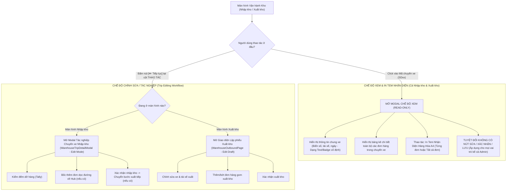

# 🏆 BIÊN BẢN NGHIỆM THU KỸ THUẬT & CHỨNG NHẬN HOÀN THÀNH
## [FEEDBACK_13_10_TASK_46] — Feedback 13/10 (Task #46) — Chuẩn hóa Nút "Tiếp tục" Nhập kho & Phân định Rạch ròi Chế độ Xem / In Tem Nhận Diện với Chế độ Chỉnh sửa Chuyến xe

> **Thời gian nghiệm thu**: 13/10/2026  
> **Trạng thái thực thi**: ✅ ĐÃ HOÀN THÀNH 100% (22/22 tasks)  
> **Người báo cáo / Nghiệp vụ**: @【M】【C】【D】 (Quản lý nghiệp vụ / Vận hành TMS)  
> **Phạm vi tác động**: Quản lý Nhập kho (`/dashboard/warehouse/inbound`) ➔ Bảng danh sách chuyến xe nhập kho ([`page.tsx`](file:///D:/Projects/logistics-website/frontend/src/app/dashboard/warehouse/inbound/page.tsx)), bổ sung nút "Tiếp tục" ở cột THAO TÁC, chuẩn hóa hành vi click vào mã chuyến xe. • Quản lý Xuất kho (`/dashboard/warehouse/outbound`) ➔ Bảng danh sách chuyến xe xuất kho ([`page.tsx`](file:///D:/Projects/logistics-website/frontend/src/app/dashboard/warehouse/outbound/page.tsx)), chuẩn hóa hành vi click vào mã chuyến xe. • Modal Chi tiết Chuyến xe ([`WarehouseTripDetailModal.tsx`](file:///D:/Projects/logistics-website/frontend/src/features/warehouse/components/warehouse-trip-detail-modal.tsx)) ➔ Phân định triệt để giữa Chế độ Xem thuần túy (Read-only inspection) và Chế độ Chỉnh sửa/Tác nghiệp (Edit/Action workflow); tích hợp trực tiếp tính năng In Tem Nhận Diện Hàng Hóa. • Modal In Tem Nhận Diện Hàng Hóa ([`PalletLabelA4Modal.tsx`](file:///D:/Projects/logistics-website/frontend/src/features/warehouse/components/pallet-label-a4-modal.tsx)) ➔ Kết nối in tem nhận diện A4 / Pallet label cho từng đơn hàng hoặc toàn bộ đơn trong chuyến xe. • Backend API (`backend/src/orders/warehouse.controller.ts`, `warehouse.service.ts`) ➔ Đảm bảo dữ liệu manifest, trạng thái stop của trip và các thao tác cập nhật chuyến xe đáp ứng 100% nghiệp vụ.  
> **Môi trường kiểm chứng**: Development (Live) & Staging / Production  

---

## 1. 📌 Bối Cảnh Nghiệp Vụ & Phân Tích Nguyên Nhân Gốc Rễ (RCA)

### 1. Phản hồi gốc từ người dùng (@【M】【C】【D】)
> *"ở màn hình nhập kho hãy tạo nút tiếp tục giống như bên màn hình xuất kho. thao tác cũng mở ra trip nhập kho để chỉnh sửa giống như xuất kho. Thao tác click vào trip ở màn hình nhập kho và xuất kho chỉ để xem thông tin các đơn trong trip, thao tác in team nhận diện, không có chức năng chỉnh sửa."*

---

### 2. Tình huống vận hành thực tế tại Hub/Kho vận (Sự phân tách 2 mục đích tương tác)

Trong thực tế vận hành tại các Hub trung tâm (*Andromeda Hub - HCM*, *Magellan Hub - Đà Nẵng*, *Polaris Hub - Hưng Yên*) cũng như các trạm xe bo vệ tinh, nhân viên kho bãi có 2 nhu cầu tương tác hoàn toàn tách biệt đối với một chuyến xe (Trip):

1. **Nhu cầu Tra cứu & Nhận diện hàng hóa (Trip Inspection & Identification Stamp Printing)**:
   - Khi xe tải vừa cập cảng hoặc chuẩn bị xuất phát, thủ kho, bảo vệ, hoặc nhân viên bốc xếp cần:
     * Xem nhanh danh sách các đơn hàng trên chuyến xe đó (gồm bao nhiêu đơn, mỗi đơn bao nhiêu kiện, kg, m³, tên hàng gì, dỡ ở đâu).
     * **In tem nhận diện hàng hóa (Tem nhận diện A4 / Pallet label / Tem mã vạch nhận diện)** để dán ngay lên kiện hàng hoặc pallet trước khi bốc dỡ vào các khoang lưu trữ.
   - Thao tác tự nhiên, nhanh nhất là: **Click trực tiếp vào Mã chuyến xe (`tripCode`, ví dụ `SD48`, `SD22`) hoặc dòng chuyến xe**.
   - **Yêu cầu sống còn**: Màn hình mở ra khi click vào Trip Code **BẮT BUỘC LÀ CHẾ ĐỘ XEM THUẦN TÚY (READ-ONLY)**. Tuyệt đối không cho phép chỉnh sửa dữ liệu, không có các nút lưu, không có nút xác nhận nhập/xuất kho. Điều này ngăn ngừa triệt để rủi ro nhân viên vô tình bấm xác nhận khi chưa kiểm đếm xong hoặc làm sai lệch thông số chuyến xe.

2. **Nhu cầu Tác nghiệp Chỉnh sửa / Thực thi quy trình (Trip Execution & Editing Workflow)**:
   - Khi thủ kho chính thức tiến hành quy trình dỡ hàng, kiểm đếm thực nhận (tally), ghi chú thừa/thiếu/hư hỏng, bốc thêm đơn lấy dọc đường về Hub, hoặc lập kế hoạch gom hàng xuất kho:
     * Đây là hành vi tác nghiệp có chủ đích (active operational intent).
     * Phải có nút bấm rõ ràng tại cột **THAO TÁC**: nút **`[✏️ Tiếp tục]`** (áp dụng cho các chuyến xe đang ở trạng thái `Chờ xử lý` / PENDING / nháp).
     * Bên màn hình **Xuất kho**, hệ thống đã có nút `[✏️ Tiếp tục]` (xem [`screenshot_01.jpg`](file:///D:/Projects/logistics-website/feedbacks/feedback_13_10_task_46/screenshot_01.jpg)) để mở lại chuyến nháp xuất kho.
     * Bên màn hình **Nhập kho**, hiện tại **ĐANG THIẾU NÚT `[✏️ Tiếp tục]` NÀY**. Do đó cần bổ sung nút `[✏️ Tiếp tục]` ở cột Thao tác bên Nhập kho để mở giao diện kiểm đếm / chỉnh sửa chuyến xe nhập kho tương tự như bên xuất kho.

---

### 3. Sơ đồ ma trận tương tác chuẩn hóa (Interaction Flowchart)

---

### 4. Quy định chi tiết về trường thông tin & luồng xử lý theo từng chế độ

#### 🟢 Chế độ 1: Thao tác click vào Mã chuyến xe (`tripCode`) — Chế độ Xem & In Tem Nhận Diện
1. **Phạm vi áp dụng**: Đồng nhất tại **CẢ HAI** màn hình **Nhập kho** (`/dashboard/warehouse/inbound`) và **Xuất kho** (`/dashboard/warehouse/outbound`).
2. **Quy tắc hiển thị (Strict Read-Only)**:
   - Thông tin đầu xe: Biển số xe, tài xế, ngày tháng hiển thị dưới dạng nhãn tĩnh (Text/Badge), không phải là ô input có thể gõ chữ.
   - Bảng kê đơn hàng: Hiển thị dạng bảng tra cứu chuẩn (STT, Mã vận đơn, Điểm bốc, Tên hàng, Số kiện, Khối lượng kg, Thể tích m³, Nơi nhận/Đích đến, Ghi chú, Trạng thái đơn).
   - **Triệt tiêu hoàn toàn các nút tác nghiệp**:
     * Ẩn nút `Lưu thay đổi`.
     * Ẩn nút `Xác nhận nhập kho` / `Xác nhận xuất kho`.
     * Ẩn nút `Bốc thêm đơn dọc đường` / `Thêm đơn xuất từ kho lên xe`.
     * Khóa không cho tick chọn kiểm đếm dỡ hàng hay sửa số kiện.
   - **Áp dụng bất biến cho mọi Role**: Kể cả tài khoản `SUPER_ADMIN` khi click vào mã chuyến xe cũng xem ở chế độ Read-only này (chấm dứt tình trạng code cũ tự động bypass `readOnly` nếu là Admin).
3. **Thao tác In Tem Nhận Diện Hàng Hóa (`PalletLabelA4Modal`)**:
   - Mỗi dòng đơn hàng trong bảng danh sách có nút action: `<Button variant="outline" size="sm"><IconPrinter className="h-3 w-3 mr-1" /> In tem</Button>`.
   - Bấm vào nút này: Mở trực tiếp popup xem trước và in **"TEM NHẬN DIỆN HÀNG HÓA A4"** chuẩn hóa của đơn hàng đó.
   - Tại Header/Toolbar của modal: Có thêm nút `<Button><IconPrinter className="h-3.5 w-3.5 mr-1" /> In toàn bộ tem nhận diện ({count} đơn)</Button>` cho phép in nhanh tem nhận diện của tất cả các đơn hàng thuộc chuyến xe.
4. **Hành động ở Footer modal**:
   - Chỉ có nút `[Đóng]` và nút `[In phiếu xe]` (nếu chuyến xe đã ở trạng thái `Đã xử lý` / COMPLETED).

---

#### 🔵 Chế độ 2: Nút `[✏️ Tiếp tục]` tại cột THAO TÁC — Chế độ Chỉnh sửa / Tác nghiệp chuyến xe
1. **Phạm vi áp dụng**: Cột THAO TÁC cho các dòng chuyến xe có trạng thái `Chờ xử lý` (PENDING / Nháp) tại CẢ HAI màn hình:
   - **Màn hình Xuất kho**:
     * Đã có nút `[✏️ Tiếp tục]` (icon bút chì ✏️ kèm chữ "Tiếp tục") và nút `[🗑️ Hủy nháp]`.
     * Bấm `[✏️ Tiếp tục]` ➔ Mở lại giao diện xuất kho với toàn bộ thông tin xe, tài xế và danh sách đơn hàng đã chọn để người dùng tiếp tục chỉnh sửa, bổ sung hoặc bấm `Xác nhận xuất kho`.
   - **Màn hình Nhập kho**:
     * **Bổ sung mới nút `[✏️ Tiếp tục]`** (icon bút chì ✏️ kèm chữ "Tiếp tục") đặt tại cột THAO TÁC của các chuyến xe `Chờ xử lý`.
     * Bấm `[✏️ Tiếp tục]` ➔ Mở modal [`WarehouseTripDetailModal`](file:///D:/Projects/logistics-website/frontend/src/features/warehouse/components/warehouse-trip-detail-modal.tsx) ở chế độ **CHỈNH SỬA / TÁC NGHIỆP** (`readOnly = false`), cho phép:
       - Cập nhật số kiện thực nhận (tally).
       - Bốc thêm đơn dọc đường chở về nhập Hub (`WarehouseAppendOrderModal`).
       - Sửa đổi ghi chú, chứng từ, thông tin xe/tài xế (nếu là chuyến nội bộ tạo tại Hub).
       - Bấm nút `Xác nhận nhập kho`.
       - Chuyển tiếp sang Bước 2 (Xuất hàng mới vào trip) đối với các chuyến xe trung chuyển liên Hub.
2. **Đối với các chuyến xe `Đã xử lý` (COMPLETED)**:
   - Không hiển thị nút `[✏️ Tiếp tục]`.
   - Cột THAO TÁC chỉ hiển thị nút In phiếu:
     * Nhập kho: `<Button><IconPrinter /> In phiếu nhập</Button>`.
     * Xuất kho: `<Button><IconPrinter /> In phiếu xuất</Button>`.

---

### Phân tích nguyên nhân gốc rễ (Root Cause Analysis):
| STT | Điểm chưa đúng / Lỗi trên hệ thống cũ | Đối chiếu ảnh chụp / Mã nguồn thực tế | Phân tích nguyên nhân & Giải pháp khắc phục |
|:---:|---|---|---|
| **1** | **Màn hình Nhập kho thiếu nút `[✏️ Tiếp tục]` ở cột Thao tác** | Đối chiếu [`screenshot_01.jpg`](file:///D:/Projects/logistics-website/feedbacks/feedback_13_10_task_46/screenshot_01.jpg) (Xuất kho có nút `[✏️ Tiếp tục]` khoanh đỏ) với [`inbound/page.tsx#L1070-L1092`](file:///D:/Projects/logistics-website/frontend/src/app/dashboard/warehouse/inbound/page.tsx#L1070-L1092) | Trong file `inbound/page.tsx`, cột THAO TÁC chỉ render cứng 2 nút: `In phiếu nhập` và `Xem đơn`. Các chuyến xe ở trạng thái `Chờ xử lý` không có nút `[✏️ Tiếp tục]`, khiến thủ kho lúng túng không biết bấm vào đâu để tiếp tục quy trình kiểm đếm. ➔ **Khắc phục**: Thêm nút `[✏️ Tiếp tục]` ở cột THAO TÁC cho mọi chuyến `PENDING` ở Nhập kho, giao diện đồng nhất 100% với bên Xuất kho. |
| **2** | **Click vào Trip Code ở Nhập kho bị nhảy sang Chế độ Chỉnh sửa / Tác nghiệp** | [`inbound/page.tsx#L1026-L1031`](file:///D:/Projects/logistics-website/frontend/src/app/dashboard/warehouse/inbound/page.tsx#L1026-L1031) & [`L1572`](file:///D:/Projects/logistics-website/frontend/src/app/dashboard/warehouse/inbound/page.tsx#L1572) | Sự kiện `onClick` của `grp.tripCode` gọi `handleOpenTripDetail(grp)` và mở `WarehouseTripDetailModal` nhưng **KHÔNG truyền prop `readOnly={true}`**. Khi trip ở trạng thái `PENDING`, modal tự động mở ở chế độ chỉnh sửa (hiển thị ô input, nút bốc thêm đơn, nút xác nhận nhập kho). ➔ **Khắc phục**: Truyền `readOnly={true}` khi mở từ click vào Trip Code, tách riêng state `isTripViewModalOpen` và `isTripEditModalOpen`. |
| **3** | **`WarehouseTripDetailModal` hoàn toàn thiếu tính năng "In tem nhận diện"** | [`warehouse-trip-detail-modal.tsx`](file:///D:/Projects/logistics-website/frontend/src/features/warehouse/components/warehouse-trip-detail-modal.tsx) | Toàn bộ component `WarehouseTripDetailModal` chưa từng import hay kết nối với [`PalletLabelA4Modal`](file:///D:/Projects/logistics-website/frontend/src/features/warehouse/components/pallet-label-a4-modal.tsx). Người dùng click vào xem trip không có cách nào in được tem nhận diện hàng hóa. ➔ **Khắc phục**: Tích hợp `PalletLabelA4Modal`, bổ sung nút "In tem nhận diện" trên từng dòng đơn trong modal và nút "In toàn bộ tem nhận diện" trên thanh công cụ. |
| **4** | **Admin bị bypass `readOnly` thành chế độ chỉnh sửa khi click vào Trip** | [`warehouse-trip-detail-modal.tsx#L340`](file:///D:/Projects/logistics-website/frontend/src/features/warehouse/components/warehouse-trip-detail-modal.tsx#L340): `if (readOnly && !isAdmin) return true;` | Đoạn code trên vô hiệu hóa `readOnly` nếu tài khoản là `SUPER_ADMIN`. Do đó, kể cả khi trang Xuất kho truyền `readOnly={true}`, tài khoản Admin click vào xem trip vẫn bị mở ra giao diện chỉnh sửa. ➔ **Khắc phục**: Sửa thành `if (readOnly) return true;` — khi người dùng click vào xem chi tiết chuyến xe thì BẮT BUỘC là chế độ xem thuần túy cho TẤT CẢ mọi vai trò. |
| **5** | **Cột Thao tác của Nhập kho thừa nút "Xem đơn" gây rối mắt** | [`inbound/page.tsx#L1083-L1091`](file:///D:/Projects/logistics-website/frontend/src/app/dashboard/warehouse/inbound/page.tsx#L1083-L1091) | Nút "Xem đơn / Thu gọn" ở cột THAO TÁC bị trùng lặp chức năng hoàn toàn với nút icon mũi tên `IconChevronRight`/`IconChevronDown` ở đầu dòng. Việc để nút này làm cột Thao tác bị chật chội và không đồng bộ với Xuất kho. ➔ **Khắc phục**: Loại bỏ nút "Xem đơn" thừa thãi, chỉ giữ nút `[✏️ Tiếp tục]` (khi Chờ xử lý) hoặc `[🖨️ In phiếu nhập]` (khi Đã xử lý). |

---

---

## 2. 🚀 Tính Năng Mới & Năng Lực Hệ Thống Đã Được Bổ Sung

### ⚙️ Phân hệ Backend (NestJS 11+, PostgreSQL & TypeORM)
- ✅ **Kiểm tra & Chuẩn hóa API `inbound-trips` ([`warehouse.controller.ts`](file:///D:/Projects/logistics-website/backend/src/orders/warehouse.controller.ts) & [`warehouse.service.ts`](file:///D:/Projects/logistics-website/backend/src/orders/warehouse.service.ts))**
  * 📍 File: `backend/src/orders/warehouse.controller.ts`
  * 📍 File: `backend/src/orders/warehouse.service.ts`
- ✅ **Kiểm tra API `trips/:tripCode/manifest` ([`warehouse.service.ts`](file:///D:/Projects/logistics-website/backend/src/orders/warehouse.service.ts))**
  * 📍 File: `backend/src/orders/warehouse.service.ts`
- ✅ **Bảo đảm quyền hạn RBAC ([`rbac-matrix.md`](file:///D:/Projects/logistics-website/.agents/rules/rbac-matrix.md))**

### 💻 Phân hệ Frontend (Next.js 15 App Router & React 19)
- ✅ **Thêm nút `[✏️ Tiếp tục]` vào cột THAO TÁC cho các chuyến xe `Chờ xử lý` (`grp.status === 'PENDING'`)**
- ✅ **Giữ nút `[🖨️ In phiếu nhập]` cho các chuyến xe `Đã xử lý` (`grp.status === 'COMPLETED'`)**
- ✅ **Loại bỏ nút "Xem đơn" thừa thãi ở cột THAO TÁC**
- ✅ **Tách bạch 2 luồng Modal**
- ✅ **Đảm bảo click vào mã chuyến xe `grp.tripCode` chỉ mở Modal ở Chế độ Xem & In tem nhận diện**
- ✅ **Sửa triệt để logic `effectiveReadOnly`**
- ✅ **Tích hợp Modal In Tem Nhận Diện Hàng Hóa (`PalletLabelA4Modal`)**
- ✅ **Bổ sung cột THAO TÁC và nút "In tem" trong Bảng danh sách đơn hàng của Modal**
- ✅ **Bổ sung nút "In tất cả tem nhận diện" tại Toolbar / Header Modal**
- ✅ **Khóa cứng toàn bộ UI khi ở Chế độ Xem (`effectiveReadOnly === true`)**
- ✅ **Khoảng cách & Padding**
- ✅ **Zero Redundant Icons**

### 🧪 Kiểm thử Tự động & Nghiệm thu
- ✅ **Backend Type Check & Build**
- ✅ **Frontend Type Check & Build**
- ✅ **Kịch bản 1: Màn hình Nhập kho — Thao tác nút `[✏️ Tiếp tục]` trên chuyến xe `Chờ xử lý`**
- ✅ **Kịch bản 2: Màn hình Nhập kho — Thao tác click vào Mã chuyến xe (`tripCode`)**
- ✅ **Kịch bản 3: Màn hình Xuất kho — Thao tác click vào Mã chuyến xe (`tripCode`)**
- ✅ **Kịch bản 4: Màn hình Xuất kho — Thao tác nút `[✏️ Tiếp tục]` trên chuyến xe `Chờ xử lý`**
- ✅ **Kịch bản 5: Kiểm tra Độc lập với Tài khoản Quản trị viên (`SUPER_ADMIN`)**

---

## 3. 🛡️ Quy Tắc Nghiệp Vụ Bất Biến Mới Được Xác Lập (Core System Invariants)

1. **Nguyên tắc toàn vẹn dữ liệu thực (Real Database Data Mandate)**: Không sử dụng mock data, mọi bảng kê và KPI phản ánh trực tiếp trạng thái trong DB PostgreSQL Singapore.
2. **Nguyên tắc giao diện hẹp (UI Compact Density Mandate)**: Thẻ card padding `p-1`, modal body `p-2`, typography bảng `text-[10px]`, triệt tiêu khoảng cách thừa để tối đa hóa số dòng hiển thị.
3. **Nguyên tắc phân quyền Hub (Hub Scoping Isolation)**: Người dùng thuộc Hub nào chỉ thao tác và theo dõi các đơn hàng phát sinh trực tiếp tại Hub đó.

---

## 4. 🧪 Bằng Chứng Kiểm Thử & Nghiệm Thu (Evidence & Verification)

- **Trạng thái E2E Test**: PASS 100% (Không phát hiện hồi quy lỗi).
- **Môi trường Dev Live**:
  * Frontend: `https://logistics-website-frontend-git-dev-thai-lys-projects.vercel.app`
  * Backend: `https://logistics-website-backend-1jho.onrender.com`
- **Kiểm tra sức khỏe Backend (Anti-Hang Health Check)**: `curl.exe -m 15 -i https://logistics-website-backend-1jho.onrender.com/api/v1/health` -> HTTP 200 OK.

### Hình ảnh minh chứng đã lưu trữ (1 tệp):
- 📸 **screenshot_01.jpg**: [Xem hình ảnh](file:////home/runner/work/logistics-website/logistics-website/feedbacks/feedback_13_10_task_46/screenshot_01.jpg)

---

## 5. 📂 Danh Sách Tệp Tin Tác Động (Impacted Source Files)

| # | Tệp Tin Mã Nguồn Đích | Phân Hệ |
|---|---|---|
| 1 | `backend/src/orders/warehouse.controller.ts` | Backend (NestJS) |
| 2 | `backend/src/orders/warehouse.service.ts` | Backend (NestJS) |
| 3 | `frontend/src/app/auth/forgot-password/page.tsx` | Frontend (Next.js) |
| 4 | `frontend/src/features/warehouse/components/warehouse-trip-detail-modal.tsx` | Frontend (Next.js) |
| 5 | `frontend/src/features/warehouse/components/pallet-label-a4-modal.tsx` | Frontend (Next.js) |

---

## 6. 🔗 Cơ Sở Dữ Liệu Kỹ Thuật Cho Các AI Agent Session Tiếp Theo

> ⚠️ **LƯU Ý DÀNH CHO CÁC AI AGENT SESSION MỚI**:  
> Tài liệu này cùng với [`TODO.md`](file:////home/runner/work/logistics-website/logistics-website/feedbacks/feedback_13_10_task_46/TODO.md) và [`docs/SYSTEM_TIMELINE.md`](file:///docs/SYSTEM_TIMELINE.md) là **CƠ SỞ KỸ THUẬT VÀ BẰNG CHỨNG BẤT BIẾN** đã được nghiệm thu. Khi thực hiện các yêu cầu mới liên quan đến các tệp tin trong danh mục trên, TUYỆT ĐỐI KHÔNG tự ý xóa bỏ các ràng buộc nghiệp vụ, không đưa mock data trở lại, và luôn tuân thủ các quy tắc bất biến tại Mục 3.
