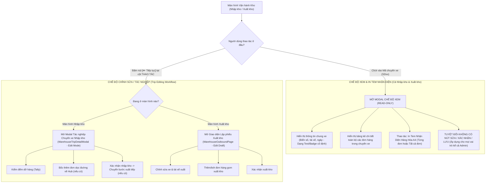

# Feedback 13/10 (Task #46) — Chuẩn hóa Nút "Tiếp tục" Nhập kho & Phân định Rạch ròi Chế độ Xem / In Tem Nhận Diện với Chế độ Chỉnh sửa Chuyến xe

> **Thời gian ghi nhận**: 13/10/2026  
> **Người báo cáo**: @【M】【C】【D】 (Quản lý nghiệp vụ / Vận hành TMS)  
> **Phạm vi tác động**:  
> - Quản lý Nhập kho (`/dashboard/warehouse/inbound`) ➔ Bảng danh sách chuyến xe nhập kho ([`page.tsx`](file:///D:/Projects/logistics-website/frontend/src/app/dashboard/warehouse/inbound/page.tsx)), bổ sung nút "Tiếp tục" ở cột THAO TÁC, chuẩn hóa hành vi click vào mã chuyến xe.  
> - Quản lý Xuất kho (`/dashboard/warehouse/outbound`) ➔ Bảng danh sách chuyến xe xuất kho ([`page.tsx`](file:///D:/Projects/logistics-website/frontend/src/app/dashboard/warehouse/outbound/page.tsx)), chuẩn hóa hành vi click vào mã chuyến xe.  
> - Modal Chi tiết Chuyến xe ([`WarehouseTripDetailModal.tsx`](file:///D:/Projects/logistics-website/frontend/src/features/warehouse/components/warehouse-trip-detail-modal.tsx)) ➔ Phân định triệt để giữa Chế độ Xem thuần túy (Read-only inspection) và Chế độ Chỉnh sửa/Tác nghiệp (Edit/Action workflow); tích hợp trực tiếp tính năng In Tem Nhận Diện Hàng Hóa.  
> - Modal In Tem Nhận Diện Hàng Hóa ([`PalletLabelA4Modal.tsx`](file:///D:/Projects/logistics-website/frontend/src/features/warehouse/components/pallet-label-a4-modal.tsx)) ➔ Kết nối in tem nhận diện A4 / Pallet label cho từng đơn hàng hoặc toàn bộ đơn trong chuyến xe.  
> - Backend API (`backend/src/orders/warehouse.controller.ts`, `warehouse.service.ts`) ➔ Đảm bảo dữ liệu manifest, trạng thái stop của trip và các thao tác cập nhật chuyến xe đáp ứng 100% nghiệp vụ.  
> **Tài liệu tham chiếu**:  
> - `/leader` Business Domain Architecture ([`SKILL.md`](file:///D:/Projects/logistics-website/.agents/skills/leader/SKILL.md))  
> - Quy chế phát triển hệ thống [`AGENTS.md`](file:///D:/Projects/logistics-website/AGENTS.md)  
> - Quy chuẩn giao diện hẹp [`.agents/rules/ui-compact-density.md`](file:///D:/Projects/logistics-website/.agents/rules/ui-compact-density.md) & [`ui-spacing-guard`](file:///D:/Projects/logistics-website/.agents/skills/ui-spacing-guard/SKILL.md)  
> - Quy chuẩn kiểm soát kiện vận tải (No-SKU, Consignment Level)  
> **Ảnh minh chứng đính kèm trong thư mục**:  
> - [`screenshot_01.jpg`](file:///D:/Projects/logistics-website/feedbacks/feedback_13_10_task_46/screenshot_01.jpg): Giao diện Màn hình Xuất kho tại Andromeda Hub - HCM với nút `[✏️ Tiếp tục]` khoanh khung đỏ nổi bật ở cột THAO TÁC cho chuyến xe chờ xử lý `SD48`.  

---

## 📌 Bối cảnh nghiệp vụ thực tế (Chốt theo phản hồi người dùng)

### 1. Phản hồi gốc từ người dùng (@【M】【C】【D】)
> *"ở màn hình nhập kho hãy tạo nút tiếp tục giống như bên màn hình xuất kho. thao tác cũng mở ra trip nhập kho để chỉnh sửa giống như xuất kho. Thao tác click vào trip ở màn hình nhập kho và xuất kho chỉ để xem thông tin các đơn trong trip, thao tác in team nhận diện, không có chức năng chỉnh sửa."*

---

### 2. Tình huống vận hành thực tế tại Hub/Kho vận (Sự phân tách 2 mục đích tương tác)

Trong thực tế vận hành tại các Hub trung tâm (*Andromeda Hub - HCM*, *Magellan Hub - Đà Nẵng*, *Polaris Hub - Hưng Yên*) cũng như các trạm xe bo vệ tinh, nhân viên kho bãi có 2 nhu cầu tương tác hoàn toàn tách biệt đối với một chuyến xe (Trip):

1. **Nhu cầu Tra cứu & Nhận diện hàng hóa (Trip Inspection & Identification Stamp Printing)**:
   - Khi xe tải vừa cập cảng hoặc chuẩn bị xuất phát, thủ kho, bảo vệ, hoặc nhân viên bốc xếp cần:
     * Xem nhanh danh sách các đơn hàng trên chuyến xe đó (gồm bao nhiêu đơn, mỗi đơn bao nhiêu kiện, kg, m³, tên hàng gì, dỡ ở đâu).
     * **In tem nhận diện hàng hóa (Tem nhận diện A4 / Pallet label / Tem mã vạch nhận diện)** để dán ngay lên kiện hàng hoặc pallet trước khi bốc dỡ vào các khoang lưu trữ.
   - Thao tác tự nhiên, nhanh nhất là: **Click trực tiếp vào Mã chuyến xe (`tripCode`, ví dụ `SD48`, `SD22`) hoặc dòng chuyến xe**.
   - **Yêu cầu sống còn**: Màn hình mở ra khi click vào Trip Code **BẮT BUỘC LÀ CHẾ ĐỘ XEM THUẦN TÚY (READ-ONLY)**. Tuyệt đối không cho phép chỉnh sửa dữ liệu, không có các nút lưu, không có nút xác nhận nhập/xuất kho. Điều này ngăn ngừa triệt để rủi ro nhân viên vô tình bấm xác nhận khi chưa kiểm đếm xong hoặc làm sai lệch thông số chuyến xe.

2. **Nhu cầu Tác nghiệp Chỉnh sửa / Thực thi quy trình (Trip Execution & Editing Workflow)**:
   - Khi thủ kho chính thức tiến hành quy trình dỡ hàng, kiểm đếm thực nhận (tally), ghi chú thừa/thiếu/hư hỏng, bốc thêm đơn lấy dọc đường về Hub, hoặc lập kế hoạch gom hàng xuất kho:
     * Đây là hành vi tác nghiệp có chủ đích (active operational intent).
     * Phải có nút bấm rõ ràng tại cột **THAO TÁC**: nút **`[✏️ Tiếp tục]`** (áp dụng cho các chuyến xe đang ở trạng thái `Chờ xử lý` / PENDING / nháp).
     * Bên màn hình **Xuất kho**, hệ thống đã có nút `[✏️ Tiếp tục]` (xem [`screenshot_01.jpg`](file:///D:/Projects/logistics-website/feedbacks/feedback_13_10_task_46/screenshot_01.jpg)) để mở lại chuyến nháp xuất kho.
     * Bên màn hình **Nhập kho**, hiện tại **ĐANG THIẾU NÚT `[✏️ Tiếp tục]` NÀY**. Do đó cần bổ sung nút `[✏️ Tiếp tục]` ở cột Thao tác bên Nhập kho để mở giao diện kiểm đếm / chỉnh sửa chuyến xe nhập kho tương tự như bên xuất kho.

---

### 3. Sơ đồ ma trận tương tác chuẩn hóa (Interaction Flowchart)



---

### 4. Quy định chi tiết về trường thông tin & luồng xử lý theo từng chế độ

#### 🟢 Chế độ 1: Thao tác click vào Mã chuyến xe (`tripCode`) — Chế độ Xem & In Tem Nhận Diện
1. **Phạm vi áp dụng**: Đồng nhất tại **CẢ HAI** màn hình **Nhập kho** (`/dashboard/warehouse/inbound`) và **Xuất kho** (`/dashboard/warehouse/outbound`).
2. **Quy tắc hiển thị (Strict Read-Only)**:
   - Thông tin đầu xe: Biển số xe, tài xế, ngày tháng hiển thị dưới dạng nhãn tĩnh (Text/Badge), không phải là ô input có thể gõ chữ.
   - Bảng kê đơn hàng: Hiển thị dạng bảng tra cứu chuẩn (STT, Mã vận đơn, Điểm bốc, Tên hàng, Số kiện, Khối lượng kg, Thể tích m³, Nơi nhận/Đích đến, Ghi chú, Trạng thái đơn).
   - **Triệt tiêu hoàn toàn các nút tác nghiệp**:
     * Ẩn nút `Lưu thay đổi`.
     * Ẩn nút `Xác nhận nhập kho` / `Xác nhận xuất kho`.
     * Ẩn nút `Bốc thêm đơn dọc đường` / `Thêm đơn xuất từ kho lên xe`.
     * Khóa không cho tick chọn kiểm đếm dỡ hàng hay sửa số kiện.
   - **Áp dụng bất biến cho mọi Role**: Kể cả tài khoản `SUPER_ADMIN` khi click vào mã chuyến xe cũng xem ở chế độ Read-only này (chấm dứt tình trạng code cũ tự động bypass `readOnly` nếu là Admin).
3. **Thao tác In Tem Nhận Diện Hàng Hóa (`PalletLabelA4Modal`)**:
   - Mỗi dòng đơn hàng trong bảng danh sách có nút action: `<Button variant="outline" size="sm"><IconPrinter className="h-3 w-3 mr-1" /> In tem</Button>`.
   - Bấm vào nút này: Mở trực tiếp popup xem trước và in **"TEM NHẬN DIỆN HÀNG HÓA A4"** chuẩn hóa của đơn hàng đó.
   - Tại Header/Toolbar của modal: Có thêm nút `<Button><IconPrinter className="h-3.5 w-3.5 mr-1" /> In toàn bộ tem nhận diện ({count} đơn)</Button>` cho phép in nhanh tem nhận diện của tất cả các đơn hàng thuộc chuyến xe.
4. **Hành động ở Footer modal**:
   - Chỉ có nút `[Đóng]` và nút `[In phiếu xe]` (nếu chuyến xe đã ở trạng thái `Đã xử lý` / COMPLETED).

---

#### 🔵 Chế độ 2: Nút `[✏️ Tiếp tục]` tại cột THAO TÁC — Chế độ Chỉnh sửa / Tác nghiệp chuyến xe
1. **Phạm vi áp dụng**: Cột THAO TÁC cho các dòng chuyến xe có trạng thái `Chờ xử lý` (PENDING / Nháp) tại CẢ HAI màn hình:
   - **Màn hình Xuất kho**:
     * Đã có nút `[✏️ Tiếp tục]` (icon bút chì ✏️ kèm chữ "Tiếp tục") và nút `[🗑️ Hủy nháp]`.
     * Bấm `[✏️ Tiếp tục]` ➔ Mở lại giao diện xuất kho với toàn bộ thông tin xe, tài xế và danh sách đơn hàng đã chọn để người dùng tiếp tục chỉnh sửa, bổ sung hoặc bấm `Xác nhận xuất kho`.
   - **Màn hình Nhập kho**:
     * **Bổ sung mới nút `[✏️ Tiếp tục]`** (icon bút chì ✏️ kèm chữ "Tiếp tục") đặt tại cột THAO TÁC của các chuyến xe `Chờ xử lý`.
     * Bấm `[✏️ Tiếp tục]` ➔ Mở modal [`WarehouseTripDetailModal`](file:///D:/Projects/logistics-website/frontend/src/features/warehouse/components/warehouse-trip-detail-modal.tsx) ở chế độ **CHỈNH SỬA / TÁC NGHIỆP** (`readOnly = false`), cho phép:
       - Cập nhật số kiện thực nhận (tally).
       - Bốc thêm đơn dọc đường chở về nhập Hub (`WarehouseAppendOrderModal`).
       - Sửa đổi ghi chú, chứng từ, thông tin xe/tài xế (nếu là chuyến nội bộ tạo tại Hub).
       - Bấm nút `Xác nhận nhập kho`.
       - Chuyển tiếp sang Bước 2 (Xuất hàng mới vào trip) đối với các chuyến xe trung chuyển liên Hub.
2. **Đối với các chuyến xe `Đã xử lý` (COMPLETED)**:
   - Không hiển thị nút `[✏️ Tiếp tục]`.
   - Cột THAO TÁC chỉ hiển thị nút In phiếu:
     * Nhập kho: `<Button><IconPrinter /> In phiếu nhập</Button>`.
     * Xuất kho: `<Button><IconPrinter /> In phiếu xuất</Button>`.

---

## 🔍 Tổng hợp các điểm chưa đúng trên giao diện cũ (Phân tích đối chiếu trực tiếp)

| STT | Điểm chưa đúng / Lỗi trên hệ thống cũ | Đối chiếu ảnh chụp / Mã nguồn thực tế | Phân tích nguyên nhân & Giải pháp khắc phục |
|:---:|---|---|---|
| **1** | **Màn hình Nhập kho thiếu nút `[✏️ Tiếp tục]` ở cột Thao tác** | Đối chiếu [`screenshot_01.jpg`](file:///D:/Projects/logistics-website/feedbacks/feedback_13_10_task_46/screenshot_01.jpg) (Xuất kho có nút `[✏️ Tiếp tục]` khoanh đỏ) với [`inbound/page.tsx#L1070-L1092`](file:///D:/Projects/logistics-website/frontend/src/app/dashboard/warehouse/inbound/page.tsx#L1070-L1092) | Trong file `inbound/page.tsx`, cột THAO TÁC chỉ render cứng 2 nút: `In phiếu nhập` và `Xem đơn`. Các chuyến xe ở trạng thái `Chờ xử lý` không có nút `[✏️ Tiếp tục]`, khiến thủ kho lúng túng không biết bấm vào đâu để tiếp tục quy trình kiểm đếm.<br>➔ **Khắc phục**: Thêm nút `[✏️ Tiếp tục]` ở cột THAO TÁC cho mọi chuyến `PENDING` ở Nhập kho, giao diện đồng nhất 100% với bên Xuất kho. |
| **2** | **Click vào Trip Code ở Nhập kho bị nhảy sang Chế độ Chỉnh sửa / Tác nghiệp** | [`inbound/page.tsx#L1026-L1031`](file:///D:/Projects/logistics-website/frontend/src/app/dashboard/warehouse/inbound/page.tsx#L1026-L1031) & [`L1572`](file:///D:/Projects/logistics-website/frontend/src/app/dashboard/warehouse/inbound/page.tsx#L1572) | Sự kiện `onClick` của `grp.tripCode` gọi `handleOpenTripDetail(grp)` và mở `WarehouseTripDetailModal` nhưng **KHÔNG truyền prop `readOnly={true}`**. Khi trip ở trạng thái `PENDING`, modal tự động mở ở chế độ chỉnh sửa (hiển thị ô input, nút bốc thêm đơn, nút xác nhận nhập kho).<br>➔ **Khắc phục**: Truyền `readOnly={true}` khi mở từ click vào Trip Code, tách riêng state `isTripViewModalOpen` và `isTripEditModalOpen`. |
| **3** | **`WarehouseTripDetailModal` hoàn toàn thiếu tính năng "In tem nhận diện"** | [`warehouse-trip-detail-modal.tsx`](file:///D:/Projects/logistics-website/frontend/src/features/warehouse/components/warehouse-trip-detail-modal.tsx) | Toàn bộ component `WarehouseTripDetailModal` chưa từng import hay kết nối với [`PalletLabelA4Modal`](file:///D:/Projects/logistics-website/frontend/src/features/warehouse/components/pallet-label-a4-modal.tsx). Người dùng click vào xem trip không có cách nào in được tem nhận diện hàng hóa.<br>➔ **Khắc phục**: Tích hợp `PalletLabelA4Modal`, bổ sung nút "In tem nhận diện" trên từng dòng đơn trong modal và nút "In toàn bộ tem nhận diện" trên thanh công cụ. |
| **4** | **Admin bị bypass `readOnly` thành chế độ chỉnh sửa khi click vào Trip** | [`warehouse-trip-detail-modal.tsx#L340`](file:///D:/Projects/logistics-website/frontend/src/features/warehouse/components/warehouse-trip-detail-modal.tsx#L340): `if (readOnly && !isAdmin) return true;` | Đoạn code trên vô hiệu hóa `readOnly` nếu tài khoản là `SUPER_ADMIN`. Do đó, kể cả khi trang Xuất kho truyền `readOnly={true}`, tài khoản Admin click vào xem trip vẫn bị mở ra giao diện chỉnh sửa.<br>➔ **Khắc phục**: Sửa thành `if (readOnly) return true;` — khi người dùng click vào xem chi tiết chuyến xe thì BẮT BUỘC là chế độ xem thuần túy cho TẤT CẢ mọi vai trò. |
| **5** | **Cột Thao tác của Nhập kho thừa nút "Xem đơn" gây rối mắt** | [`inbound/page.tsx#L1083-L1091`](file:///D:/Projects/logistics-website/frontend/src/app/dashboard/warehouse/inbound/page.tsx#L1083-L1091) | Nút "Xem đơn / Thu gọn" ở cột THAO TÁC bị trùng lặp chức năng hoàn toàn với nút icon mũi tên `IconChevronRight`/`IconChevronDown` ở đầu dòng. Việc để nút này làm cột Thao tác bị chật chội và không đồng bộ với Xuất kho.<br>➔ **Khắc phục**: Loại bỏ nút "Xem đơn" thừa thãi, chỉ giữ nút `[✏️ Tiếp tục]` (khi Chờ xử lý) hoặc `[🖨️ In phiếu nhập]` (khi Đã xử lý). |

---

## 📋 Danh sách công việc triển khai (Action Checklist)

### 1. Backend (`backend/`)
- [x] **Kiểm tra & Chuẩn hóa API `inbound-trips` ([`warehouse.controller.ts`](file:///D:/Projects/logistics-website/backend/src/orders/warehouse.controller.ts) & [`warehouse.service.ts`](file:///D:/Projects/logistics-website/backend/src/orders/warehouse.service.ts))**:
  - Đảm bảo trường `status` của chuyến xe tại trạm dừng hiện tại (`TripStopEntity`) trả về chính xác: `'PENDING'` (Chờ xử lý) hoặc `'COMPLETED'` (Đã xử lý).
  - Đảm bảo danh sách đơn hàng con (`orders`) trong chuyến xe trả về đầy đủ các thông tin cần thiết phục vụ in tem nhận diện:
    * `orderCode`: Mã vận đơn.
    * `goodsDescription`: Tên mô tả hàng hóa.
    * `totalQuantity`: Số lượng kiện hàng.
    * `totalWeight`, `totalVolume`: Khối lượng và thể tích.
    * `originHub`, `originHubEntity`: Kho xuất phát / Điểm gửi hàng.
    * `destinationHub`, `destinationHubEntity`: Kho đích / Điểm nhận hàng.
    * `deliveryAddress`: Địa chỉ giao hàng khách cuối.
    * `province`: Tỉnh / Thành phố đích.
    * `accompanyingDocs`: Chứng từ đi kèm.
    * `notes`: Ghi chú vận hành.
- [x] **Kiểm tra API `trips/:tripCode/manifest` ([`warehouse.service.ts`](file:///D:/Projects/logistics-website/backend/src/orders/warehouse.service.ts))**:
  - Đảm bảo bảng kê toàn bộ hàng trên chuyến xe trả về đầy đủ metadata cho từng dòng (`TripManifestLine`), bao gồm thông tin kho gửi, kho nhận và thông tin tem nhận diện.
- [x] **Bảo đảm quyền hạn RBAC ([`rbac-matrix.md`](file:///D:/Projects/logistics-website/.agents/rules/rbac-matrix.md))**:
  - Xác nhận các vai trò `WAREHOUSE_MANAGER` và `SUPER_ADMIN` được cấp quyền gọi API lấy dữ liệu manifest, xác nhận nhập kho và bốc thêm đơn trên chuyến xe.

---

### 2. Frontend (`frontend/`)

#### A. Cải tiến Màn hình Nhập kho ([`inbound/page.tsx`](file:///D:/Projects/logistics-website/frontend/src/app/dashboard/warehouse/inbound/page.tsx))
- [x] **Thêm nút `[✏️ Tiếp tục]` vào cột THAO TÁC cho các chuyến xe `Chờ xử lý` (`grp.status === 'PENDING'`)**:
  - Giao diện nút bấm:
    ```tsx
    <Button
      variant='outline'
      size='sm'
      onClick={() => handleResumeInboundTrip(grp)}
      className='h-7 text-[11px] text-[#0F3D62] border-blue-300 hover:bg-blue-50 dark:text-blue-300 dark:border-blue-800 px-2 font-semibold'
      title='Mở trip nhập kho để kiểm đếm, chỉnh sửa hoặc xác nhận nhập kho'
    >
      <IconPencil className='h-3.5 w-3.5 mr-1' /> Tiếp tục
    </Button>
    ```
  - Nếu là chuyến xe nháp tạo nội bộ tại kho này (`initialStatus === 'DRAFT'`): Có thể bổ sung thêm nút `[🗑️ Hủy nháp]` tương tự bên Xuất kho.
- [x] **Giữ nút `[🖨️ In phiếu nhập]` cho các chuyến xe `Đã xử lý` (`grp.status === 'COMPLETED'`)**:
  - Hiển thị nút in phiếu nhập cho xe đã dỡ hàng xong.
- [x] **Loại bỏ nút "Xem đơn" thừa thãi ở cột THAO TÁC**:
  - Việc mở rộng sub-row đã được đảm nhiệm bởi nút chevron ở cột Chuyến xe, loại bỏ nút này để giao diện gọn gàng và đồng bộ với màn hình Xuất kho.
- [x] **Tách bạch 2 luồng Modal**:
  - State `isTripViewModalOpen`: Dành riêng cho chế độ **Xem & In tem nhận diện** khi người dùng click vào mã chuyến xe `grp.tripCode`.
  - State `isTripEditModalOpen`: Dành riêng cho chế độ **Chỉnh sửa / Tác nghiệp** khi người dùng bấm nút `[✏️ Tiếp tục]` ở cột Thao tác.
  - Hàm `handleOpenTripDetail(grp)`: Mở `isTripViewModalOpen = true`.
  - Hàm `handleResumeInboundTrip(grp)`: Mở `isTripEditModalOpen = true`.

#### B. Chuẩn hóa Màn hình Xuất kho ([`outbound/page.tsx`](file:///D:/Projects/logistics-website/frontend/src/app/dashboard/warehouse/outbound/page.tsx))
- [x] **Đảm bảo click vào mã chuyến xe `grp.tripCode` chỉ mở Modal ở Chế độ Xem & In tem nhận diện**:
  - Giữ nguyên nút `[✏️ Tiếp tục]` và `[🗑️ Hủy nháp]` ở cột THAO TÁC cho chuyến nháp.
  - Khi click vào `grp.tripCode`: Mở `WarehouseTripDetailModal` với `readOnly={true}` và `mode='OUTBOUND'`.

#### C. Nâng cấp Modal Chi tiết Chuyến xe ([`warehouse-trip-detail-modal.tsx`](file:///D:/Projects/logistics-website/frontend/src/features/warehouse/components/warehouse-trip-detail-modal.tsx))
- [x] **Sửa triệt để logic `effectiveReadOnly`**:
  - Loại bỏ hoàn toàn việc bypass của Admin khi prop `readOnly = true`:
    ```tsx
    const effectiveReadOnly = useMemo(() => {
      // Khi đã chỉ định readOnly = true, BẮT BUỘC là chế độ xem cho TẤT CẢ vai trò kể cả Admin
      if (readOnly) return true;
      if (!tripGroup) return true;
      if (isHubAccountLocked) return true;
      ...
    }, [readOnly, tripGroup, isHubAccountLocked, ...]);
    ```
- [x] **Tích hợp Modal In Tem Nhận Diện Hàng Hóa (`PalletLabelA4Modal`)**:
  - Import `PalletLabelA4Modal` và `PalletLabelData`.
  - Khai báo state `selectedLabelData: PalletLabelData | null`.
  - Render `<PalletLabelA4Modal isOpen={Boolean(selectedLabelData)} onClose={() => setSelectedLabelData(null)} data={selectedLabelData} />`.
- [x] **Bổ sung cột THAO TÁC và nút "In tem" trong Bảng danh sách đơn hàng của Modal**:
  - Tại bảng danh sách đơn hàng khi xem chi tiết chuyến xe:
    - Bổ sung cột `THAO TÁC` (w-[80px] text-center).
    - Render nút:
      ```tsx
      <Button
        type='button'
        variant='outline'
        size='sm'
        onClick={() => handlePrintLabelForOrder(r)}
        className='h-6 text-[10px] text-blue-600 border-blue-200 hover:bg-blue-50 dark:border-blue-800 px-1.5 font-semibold'
        title='In tem nhận diện hàng hóa A4'
      >
        <IconPrinter className='h-3 w-3 mr-1' /> In tem
      </Button>
      ```
- [x] **Bổ sung nút "In tất cả tem nhận diện" tại Toolbar / Header Modal**:
  - Thêm nút hành động:
    ```tsx
    <Button
      type='button'
      variant='outline'
      size='sm'
      onClick={handlePrintAllLabels}
      className='h-7 text-xs font-semibold text-blue-600 border-blue-200 hover:bg-blue-50'
    >
      <IconPrinter className='mr-1.5 h-3.5 w-3.5' /> In toàn bộ tem nhận diện ({rows.length} đơn)
    </Button>
    ```
- [x] **Khóa cứng toàn bộ UI khi ở Chế độ Xem (`effectiveReadOnly === true`)**:
  - Biển số xe, tên tài xế, ngày nhận/xuất: Render dưới dạng Badge hoặc Text cố định (có icon khóa `IconLock` nhỏ).
  - Ẩn toàn bộ:
    * Nút `Lưu thay đổi`.
    * Nút `Xác nhận nhập kho` / `Xác nhận xuất kho`.
    * Nút `Bốc thêm đơn dọc đường` / `Thêm đơn xuất từ kho lên xe`.
    * Nút chuyển bước stepper `Tiếp theo: Xuất hàng mới vào trip`.
  - Footer khi xem chỉ hiển thị:
    * Nút `<Button variant="outline" onClick={onClose}>Đóng</Button>`.
    * Nút In phiếu xe (nếu chuyến xe đã hoàn tất xử lý).

#### D. Tuân thủ Quy chuẩn Giao diện Hẹp & Không dư thừa Icon (UI Compact Density Mandate)
- [x] **Khoảng cách & Padding**:
  - Modal body: `p-2` (tối đa `p-2.5`), `overflow-y-auto max-h-[85vh]`.
  - Cột thao tác trong bảng: nút cao `h-6` đến `h-7`, typography `text-[10px]`, padding `px-2`.
  - Không sinh các class cấm: `p-4`, `p-6`, `space-y-4`, `gap-4`.
- [x] **Zero Redundant Icons**:
  - Không kết hợp emoji/ký tự thừa với icon (`<Button><IconPencil /> Tiếp tục</Button>`, tuyệt đối không dùng `<Button><IconPencil /> ✏️ Tiếp tục</Button>`).

---

### 3. Kiểm thử & Nghiệm thu (Definition of Done)

#### A. Kiểm tra Biên dịch & Linting Toàn diện
- [x] **Backend Type Check & Build**:
  - Chạy `npm run lint --prefix backend` ➔ Đạt 0 lỗi linting.
  - Chạy `npm run build --prefix backend` ➔ NestJS compile PASS (0 errors).
- [x] **Frontend Type Check & Build**:
  - Chạy `npm run lint --prefix frontend` ➔ Đạt 0 lỗi linting.
  - Chạy `npm run build --prefix frontend` ➔ Next.js Turbopack compile PASS (33/33 static pages generated, 0 TypeScript errors).

#### B. Kịch bản Kiểm thử Nghiệm thu Chi tiết (Test Scenarios)

- [x] **Kịch bản 1: Màn hình Nhập kho — Thao tác nút `[✏️ Tiếp tục]` trên chuyến xe `Chờ xử lý`**:
  1. Đăng nhập tài khoản Thủ kho (`WAREHOUSE_MANAGER` tại *Magellan Hub - Đà Nẵng* hoặc *Andromeda Hub - HCM*).
  2. Truy cập `/dashboard/warehouse/inbound`.
  3. Tại bảng danh sách chuyến xe, chuyển sang tab `Chờ xử lý`.
  4. Quan sát chuyến xe chưa hoàn tất: Cột THAO TÁC hiển thị nút `[✏️ Tiếp tục]` (icon bút chì, viền xanh).
  5. Bấm vào nút `[✏️ Tiếp tục]`.
  6. **Kỳ vọng**: Hệ thống mở modal tác nghiệp chuyến xe nhập kho ở chế độ **CHỈNH SỬA** (`readOnly = false`). Có đầy đủ bảng kiểm đếm dỡ hàng (checkbox, ô nhập số kiện thực nhận), nút `Bốc thêm đơn dọc đường`, nút `Xác nhận nhập kho` và nút `Lưu thay đổi`.

- [x] **Kịch bản 2: Màn hình Nhập kho — Thao tác click vào Mã chuyến xe (`tripCode`)**:
  1. Đang ở `/dashboard/warehouse/inbound`.
  2. Click chuột trực tiếp vào mã chuyến xe (ví dụ `SD48` hoặc `SD22`).
  3. **Kỳ vọng**:
     - Hệ thống mở modal Chi tiết chuyến xe ở chế độ **CHỈ XEM THUẦN TÚY (READ-ONLY)**.
     - Toàn bộ thông tin đầu xe (Biển số, tài xế, ngày tháng) hiển thị dạng nhãn tĩnh, không sửa được.
     - Bảng kê đơn hàng hiển thị đầy đủ thông tin chi tiết từng đơn nhưng KHÔNG cho phép sửa số kiện, KHÔNG có checkbox kiểm đếm dỡ hàng.
     - Tuyệt đối KHÔNG có nút `Xác nhận nhập kho`, `Lưu thay đổi`, hay `Bốc thêm đơn`.
     - Trên từng dòng đơn hàng xuất hiện nút `[🖨️ In tem]`. Bấm vào mở popup `PalletLabelA4Modal` hiển thị đúng tem nhận diện hàng hóa của đơn đó.
     - Footer modal chỉ có nút `[Đóng]`.

- [x] **Kịch bản 3: Màn hình Xuất kho — Thao tác click vào Mã chuyến xe (`tripCode`)**:
  1. Truy cập `/dashboard/warehouse/outbound`.
  2. Click chuột vào mã chuyến xe bất kỳ (kể cả chuyến `Chờ xử lý` như `SD48` hoặc chuyến `Đã xử lý` như `SD40`).
  3. **Kỳ vọng**:
     - Modal mở ra ở chế độ **CHỈ XEM THUẦN TÚY**.
     - Người dùng xem được toàn bộ danh sách các đơn hàng trên xe.
     - Có nút `[🖨️ In tem]` cho từng đơn để in tem nhận diện hàng hóa A4.
     - Không có chức năng chỉnh sửa hay xuất kho bên trong modal xem này.

- [x] **Kịch bản 4: Màn hình Xuất kho — Thao tác nút `[✏️ Tiếp tục]` trên chuyến xe `Chờ xử lý`**:
  1. Đang ở `/dashboard/warehouse/outbound`.
  2. Tại dòng chuyến xe `SD48` (trạng thái `Chờ xử lý`), bấm nút `[✏️ Tiếp tục]` ở cột THAO TÁC.
  3. **Kỳ vọng**: Mở ra giao diện lập phiếu xuất kho với đầy đủ thông tin xe, tài xế và các dòng đơn hàng của chuyến `SD48` để tiếp tục thao tác chỉnh sửa hoặc bấm `Xác nhận xuất kho`.

- [x] **Kịch bản 5: Kiểm tra Độc lập với Tài khoản Quản trị viên (`SUPER_ADMIN`)**:
  1. Đăng nhập tài khoản có quyền `SUPER_ADMIN`.
  2. Vào cả màn hình Nhập kho và Xuất kho.
  3. Click vào mã chuyến xe `tripCode`.
  4. **Kỳ vọng**: Modal vẫn mở ở chế độ **CHỈ XEM & IN TEM NHẬN DIỆN**, không bị tự động kích hoạt chế độ chỉnh sửa.
  5. Khi Admin bấm nút `[✏️ Tiếp tục]` ở cột THAO TÁC: Modal mới mở ở chế độ Chỉnh sửa / Tác nghiệp.
