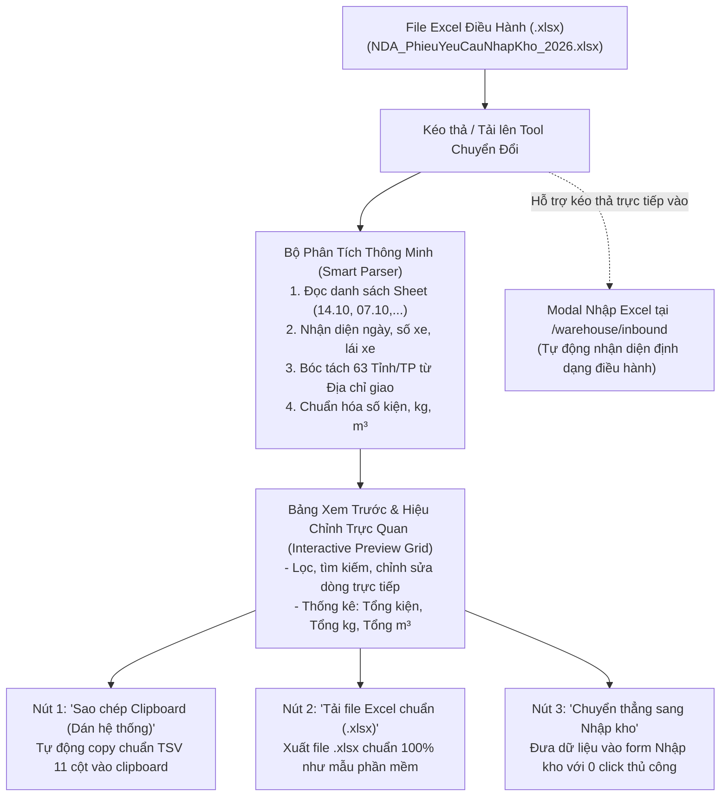

# Feedback 14/10 (Extra) — Xây Dựng Công Cụ Chuyển Đổi & Chuẩn Hóa File Excel Nhập Kho Từ Điều Hành Sang Mẫu Chuẩn Hệ Thống (Excel Inbound Converter Tool)

> **Thời gian ghi nhận**: 14/10/2026 18:30:00  
> **Người báo cáo**: @User / Thủ kho Spider Express (@Thai & Đội ngũ vận hành)  
> **Phạm vi tác động**:  
> - **Công cụ Tiện ích Kho Vận (Warehouse Operational Utilities & Tools)**:  
>   * Trang công cụ chuyên dụng: [`/dashboard/warehouse/excel-converter`](file:///d:/Projects/logistics-website/frontend/src/app/dashboard/warehouse/excel-converter/page.tsx)  
>   * Tích hợp trực tiếp tại Màn hình Nhập kho: Nút mở bộ chuyển đổi nhanh trên thanh công cụ [`page.tsx`](file:///d:/Projects/logistics-website/frontend/src/app/dashboard/warehouse/inbound/page.tsx)  
>   * Cải tiến bộ phân tích tự động trong Modal Nhập Excel: [`warehouse-excel-import-modal.tsx`](file:///d:/Projects/logistics-website/frontend/src/features/warehouse/components/warehouse-excel-import-modal.tsx)  
>   * Khả năng tương thích cơ chế Dán thông minh (Smart TSV Clipboard Paste): [`warehouse-editable-grid.tsx`](file:///d:/Projects/logistics-website/frontend/src/features/warehouse/components/warehouse-editable-grid.tsx)  
> - **Phân quyền truy cập RBAC (Role-Based Access Control)**:  
>   * Cập nhật điều kiện lọc thanh điều hướng [`use-nav.ts`](file:///d:/Projects/logistics-website/frontend/src/hooks/use-nav.ts) cho vai trò `WAREHOUSE_MANAGER` và `DISPATCHER`  
> **Tài liệu tham chiếu**:  
> - Quy chế phát triển hệ thống [`AGENTS.md`](file:///d:/Projects/logistics-website/AGENTS.md)  
> - Quy chuẩn giao diện hẹp [`.agents/rules/ui-compact-density.md`](file:///d:/Projects/logistics-website/.agents/rules/ui-compact-density.md)  
> - File ảnh trao đổi nghiệp vụ: [`image.png`](file:///d:/Projects/logistics-website/feedbacks/feedback_14_10_extra/image.png)  
> - File mẫu chuẩn hệ thống: [`mẫu chuẩn của phần mềm.xlsx`](file:///d:/Projects/logistics-website/feedbacks/feedback_14_10_extra/mẫu%20chuẩn%20của%20phần%20mềm.xlsx)  
> - File nguồn điều hành gửi: [`NDA_PhieuYeuCauNhapKho_2026 (1).xlsx`](file:///d:/Projects/logistics-website/feedbacks/feedback_14_10_extra/NDA_PhieuYeuCauNhapKho_2026%20(1).xlsx)  

---

## 📌 Bối cảnh nghiệp vụ thực tế (Trích xuất từ trao đổi vận hành thực tế)

### 1. Phản hồi gốc từ người dùng (Ảnh trao đổi qua Zalo - `image.png`)

> **Thủ kho / Người vận hành:**
> *"t hỏi thăm cái này"*  
> *[Ảnh 1: Xem trước file Excel chuẩn 11 cột có header Phiếu Yêu Cầu Nhập Kho, Ngày, Lái xe, Số xe]*  
> *"đây là cái excel chuẩn của mình để copy vào hệ thống cho lẹ"*  
> *[Ảnh 2: Xem trước file Excel 14 cột do bộ phận điều hành gửi sang]*  
> *"còn đây là cái mà điều hành họ gửi cho kho, nó đang dư khá nhiều thông tin"*  
> *"mình có cách nào để cô đặc lại các thông tin mình cần không nhỉ? 13:33"*  
>
> **Kỹ sư hệ thống (Phản hồi giải pháp):**  
> *"vậy thì để làm 1 trang riêng dạng tool, cho ông nhập đầu vào là file excel từ điều hành"*  
> *"sau đó bấm process 1 cái, thì đầu ra là file excel chuẩn"*  
> *"ông gửi lại cho tui 2 file excel đó, để tui làm cái tool này cho 13:34"*  

---

### 2. Nỗi đau vận hành (Operator Pain Point & Inefficiency)

Hiện nay, khi bộ phận **Điều hành vận tải (Dispatchers)** lên kế hoạch gom hàng và luân chuyển hàng về kho bãi (như `Andromeda Hub - HCM`), điều hành thường gửi file Excel tổng hợp có tên dạng `NDA_PhieuYeuCauNhapKho_2026.xlsx`.
File này có đặc thù:
1. **Nhiều sheet theo ngày**: Mỗi ngày là một sheet (ví dụ `14.10`, `07.10`, `06.10`, ..., sheet tổng `Nhập` với hơn 1,100 dòng).
2. **Thừa thông tin điều hành & format không khớp**: Bảng kê của điều hành có tới 14 cột, bao gồm tên điều hành viên, giờ dự kiến về kho, tiêu đề công ty dài 7 dòng...
3. **Thủ kho mất 15-30 phút thao tác thủ công mỗi ca làm việc**:
   - Phải mở Excel bằng tay, xóa các cột thừa.
   - Sắp xếp lại thứ tự cột cho đúng với cấu trúc 11 cột chuẩn của hệ thống TMS.
   - Trích xuất tên Tỉnh/Thành phố từ địa chỉ giao hàng chi tiết (vì bảng điều hành chỉ có cột gộp địa chỉ người nhận).
   - Nếu điều hành không điền số kiện (để trống vì hàng bao bì/lốp xe), thủ kho phải dò từng dòng để điền `1` kiện hoặc đếm kiện, nếu không khi dán vào TMS sẽ bị báo lỗi thiếu số kiện.
   - Rất dễ xảy ra sai sót lệch cột khi copy-paste thủ công, dẫn tới nhập nhầm Số kg vào Số m³ hoặc nhầm Địa chỉ nhận với Địa chỉ giao.

---

### 3. Đối chiếu cấu trúc 2 định dạng Excel

#### A. File Nguồn từ Điều Hành (`NDA_PhieuYeuCauNhapKho_2026.xlsx`)
- **Dòng 1-7**: Thông tin công ty & 4 chi nhánh kho.
- **Dòng 9**: Tiêu đề `"PHIẾU YÊU CẦU NhẬP KHO "`.
- **Dòng 10**: Mã ngày tháng dạng Excel serial (ví dụ `46309` = `14/10/2026`).
- **Dòng 12 (Header bảng 14 cột)**:
  1. `Ngày tháng(*)`: Ngày giao nhận (dạng số hoặc ngày).
  2. `Mã Đơn Hàng (*)`: Mã đơn hàng (ví dụ `NDA2610-0210`).
  3. `Điều Hành`: Tên nhân sự điều hành (ví dụ `ĐỨC ANH`).
  4. `Số Xe (*)`: Biển số xe gom (ví dụ `50E-84654` hoặc trống).
  5. `Tên tài xế`: Họ tên lái xe hoặc trống.
  6. `Tên Hàng (*)`: Tên mặt hàng (ví dụ `Lốp Michelin`, `Bột giặt NET...`).
  7. `Kho Nhập (*)`: Tên kho tiếp nhận (ví dụ `Kho Andromeda`).
  8. ` Giờ Dự Kiến Về Kho`: Khung giờ xe về (ví dụ `17H`).
  9. `Địa Chỉ Lấy Hàng (*)`: Nơi lấy hàng/kho nguồn gửi.
  10. `Địa Chỉ Giao Hàng (*)`: Tên công ty nhận, địa chỉ chi tiết, tỉnh thành.
  11. `Số Lượng`: Số kiện (có thể rỗng hoặc số).
  12. `Khối lượng (Kg)`: Trọng lượng hàng hóa.
  13. `Thể Tích (m³)`: Thể tích khối hàng.
  14. `GHI CHÚ`: Ghi chú lưu ý xếp dỡ.

#### B. File Đích Chuẩn Của Phần Mềm (`mẫu chuẩn của phần mềm.xlsx`)
- **Dòng 1**: C1:G1 Merge `"PHIẾU YÊU CẦU NHẬP KHO"`, H1: `"Ngày"`, I1: `<DD/MM/YYYY>`.
- **Dòng 2**: C2: `"LÁI XE :"`, D2: `<Tên tài xế>`.
- **Dòng 3**: C3: `"SỐ XE:"`, D3: `<Biển số xe>`.
- **Dòng 4 (Header 11 cột chuẩn của hệ thống TMS)**:
  1. `STT`: Số thứ tự tăng dần từ 1.
  2. `Mã vận đơn`: Khớp từ `Mã Đơn Hàng (*)`.
  3. `Địa chỉ nhận`: Khớp từ `Địa Chỉ Lấy Hàng (*)`.
  4. `Tên hàng`: Khớp từ `Tên Hàng (*)`.
  5. `Số kiện`: Khớp từ `Số Lượng` (nếu rỗng hoặc `= 0` thì tự động chuẩn hóa thành `1`).
  6. `Số KG`: Khớp từ `Khối lượng (Kg)` (parse số float chuẩn xác).
  7. `Số m³`: Khớp từ `Thể Tích (m³)` (parse số float chuẩn xác).
  8. `Địa chỉ giao`: Khớp từ `Địa Chỉ Giao Hàng (*)`.
  9. `Tỉnh / TP`: **Tự động bóc tách từ Địa chỉ giao hàng** bằng từ điển 63 tỉnh thành Việt Nam.
  10. `Chứng từ`: Mặc định rỗng hoặc trích xuất từ ghi chú (ví dụ `1 bộ ct`, `Kèm hóa đơn`).
  11. `Ghi chú`: Khớp từ `GHI CHÚ` (có thể kèm thông tin phụ: Giờ về kho, Tên điều hành).

---

## 🚀 Giải pháp Kỹ thuật & Thiết kế Kiến trúc Toàn diện

### 1. Các thành phần cần phát triển:

1. **Trang công cụ chuyên dụng** ([`frontend/src/app/dashboard/warehouse/excel-converter/page.tsx`](file:///d:/Projects/logistics-website/frontend/src/app/dashboard/warehouse/excel-converter/page.tsx)):
   - Giao diện thiết kế theo chuẩn **Compact Density** (`p-2`, `gap-2`, màu sắc nhận diện Navy `#0F3D62` & Slate).
   - Khung kéo thả file Excel hiện đại (hỗ trợ kéo thả file `.xlsx`, `.xls`).
   - Tự động phát hiện các Sheet trong file và hiển thị dropdown cho phép chọn Sheet cần xử lý (mặc định chọn Sheet mới nhất hoặc Sheet khớp ngày hiện tại).
   - Khu vực thông tin chuyến xe: Cho phép xem và chỉnh sửa Ngày nhận hàng, Biển số xe, Tên lái xe được trích xuất từ file.
   - Bảng xem trước dữ liệu 11 cột chuẩn: Hiển thị STT, Mã vận đơn, Địa chỉ nhận, Tên hàng, Số kiện, Số kg, Số m³, Địa chỉ giao, Tỉnh/TP bóc tách tự động, Chứng từ, Ghi chú.
   - Thanh tác vụ cố định (Sticky Action Bar):
     * **Nút "Sao chép Clipboard"**: Copy trực tiếp dạng TSV để thủ kho có thể dán bằng phím `Ctrl + V` vào bảng Nhập kho.
     * **Nút "Tải file Excel chuẩn (.xlsx)"**: Xuất file Excel chuẩn hóa đúng 100% mẫu quy chuẩn.
     * **Nút "Chuyển sang Nhập kho"**: Lưu cache dữ liệu và điều hướng thẳng tới `/dashboard/warehouse/inbound` với dữ liệu đã được điền sẵn vào bảng kê!
     * **Nút "Tải lại / Chọn file khác"**: Reset công cụ nhanh chóng.

2. **Tiện ích trích xuất Tỉnh / Thành phố Việt Nam (`extractVietnamProvince`)**:
   - Xây dựng module trích xuất chuyên sâu với từ điển 63 tỉnh/thành phố và các biến thể phổ biến trong logistics (ví dụ: `TP. Hồ Chí Minh`, `TP.HCM`, `Sài Gòn`, `Hà Nội`, `Đà Nẵng`, `Bình Dương`, `Đồng Nai`, `Khánh Hòa`, `Gia Lai`, `Cần Thơ`, `Cà Mau`, `Nghệ An`, `Bắc Ninh`, `Hưng Yên`, v.v.).

3. **Cải tiến `WarehouseExcelImportModal` ([`warehouse-excel-import-modal.tsx`](file:///d:/Projects/logistics-website/frontend/src/features/warehouse/components/warehouse-excel-import-modal.tsx))**:
   - Bổ sung logic tự động phát hiện định dạng file điều hành (khi phát hiện các cột đặc trưng như `Địa Chỉ Lấy Hàng (*)`, `Mã Đơn Hàng (*)`, `Khối lượng (Kg)`).
   - Nếu người dùng thả file điều hành vào Modal Nhập Excel ở trang Inbound, hệ thống tự động kích hoạt bộ chuyển đổi mà không yêu cầu người dùng phải định dạng lại file!

4. **Nút liên kết trên Bảng điều khiển Nhập kho ([`page.tsx`](file:///d:/Projects/logistics-website/frontend/src/app/dashboard/warehouse/inbound/page.tsx))**:
   - Bổ sung nút bấm `"Chuyển đổi Excel điều hành"` hoặc tích hợp mở nhanh Converter Modal giúp thủ kho thao tác mượt mà trong 1 màn hình.

5. **Cập nhật Phân quyền Navigation ([`use-nav.ts`](file:///d:/Projects/logistics-website/frontend/src/hooks/use-nav.ts))**:
   - Thêm URL `/dashboard/warehouse/excel-converter` vào danh sách các trang được phép truy cập của role `WAREHOUSE_MANAGER` và `DISPATCHER`.

---

## 🧪 Kịch bản Kiểm thử E2E Chuẩn xác & Ma trận Edge Cases (E2E Test Spec & Edge Cases)

### Cấu phần 1: Luồng Thao Tác Tuần Tự Từng Bước (Step-by-Step E2E Action Sequence)

- **Tài khoản kiểm thử**: `USER_WAREHOUSE_HCM` (username: `warehouse_hcm` từ [`frontend/e2e/helpers/auth.ts`](file:///d:/Projects/logistics-website/frontend/e2e/helpers/auth.ts)).
- **Dữ liệu kiểm thử**: Sử dụng chính file thực tế `feedbacks/feedback_14_10_extra/NDA_PhieuYeuCauNhapKho_2026 (1).xlsx`.
- **Quy tắc nghiệm thu không chụp bảng trống**: Mọi assertion kiểm tra bảng kết quả phải chứng minh có ít nhất 1 dòng dữ liệu hợp lệ (`expect(rowsCount).toBeGreaterThan(0)`).
- **Chuỗi hành động kiểm tra**:
  1. Đăng nhập với tài khoản Thủ kho HCM: `loginAs(page, USER_WAREHOUSE_HCM)`.
  2. Điều hướng tới `/dashboard/warehouse/excel-converter`.
  3. Upload file `NDA_PhieuYeuCauNhapKho_2026 (1).xlsx`.
  4. Xác nhận hệ thống đọc được danh sách sheets (`14.10`, `07.10`, `06.10`, `Nhập`,...).
  5. Chọn sheet `14.10`, assert bảng xem trước hiển thị đúng 11 dòng hàng của sheet `14.10` (các mã `NDA2610-0210`, `NDA2610-0210A`, ..., `NDA2610-0202`).
  6. Assert các cột được bóc tách chuẩn xác:
     - Tên hàng: `Lốp Michelin`, `BỘT GIẶT NET...`
     - Tỉnh / TP được trích xuất chính xác: `Khánh Hòa`, `Đà Nẵng`, `An Giang`, `Cần Thơ`, `Cà Mau`, `Ninh Bình`.
     - Số kiện mặc định là `1` cho các dòng lốp xe không có số lượng, và `180` cho dòng bột giặt.
  7. Bấm nút **"Sao chép Clipboard"**, kiểm tra nội dung copy vào clipboard có định dạng TSV 11 cột hợp lệ.
  8. Bấm nút **"Tải file Excel chuẩn (.xlsx)"**, kiểm tra sự kiện tải file kích hoạt và tên file xuất ra có định dạng `.xlsx`.
  9. Chuyển sang `/dashboard/warehouse/inbound`, thực hiện dán từ clipboard hoặc bấm nút chuyển tiếp, assert các dòng hàng xuất hiện đầy đủ trên lưới nhập kho `WarehouseEditableGrid`.
  10. Chụp ảnh màn hình minh chứng nghiệm thu lưu vào `feedbacks/feedback_14_10_extra/screenshot_converter_verified.png`.

---

### Cấu phần 2: Bảng Ma Trận Edge Cases Toàn Diện (Edge Cases Matrix)

| Mã Case | Tên tình huống biên (Edge Case) | Điều kiện kích hoạt (Trigger Condition) | Hành vi kỳ vọng (Expected Behavior) | Assertion kiểm tra chính xác |
|:---:|---|---|---|---|
| `EC-01` | **Sheet có ngày rỗng / Dòng trống xen kẽ** | File điều hành có các dòng trống cách quãng giữa bảng. | Bỏ qua dòng trống, chỉ giữ lại các dòng có Mã đơn hàng hợp lệ. | `rows.length === 11` (không bị lọt dòng trống). |
| `EC-02` | **Số lượng kiện rỗng (Lốp xe)** | Cột `Số Lượng` trong file điều hành bị rỗng (null/undefined). | Tự động gán mặc định `1` kiện (đáp ứng ràng buộc TMS `totalQuantity >= 1`). | Mọi dòng đều có `totalQuantity >= 1`. |
| `EC-03` | **Địa chỉ không có từ khóa Tỉnh/TP rõ ràng** | Địa chỉ giao hàng chỉ có tên công ty hoặc số nhà không ghi tỉnh. | Giữ nguyên địa chỉ giao, cột Tỉnh/TP hiển thị rỗng hoặc ghi nhận theo Hub tiếp nhận, không crash giao diện. | Không crash ứng dụng, hiển thị badge hoặc chuỗi rỗng. |
| `EC-04` | **File nhiều sheet với ngày khác nhau** | Chọn lần lượt sheet `14.10`, sau đó chuyển sang `07.10`, `Nhập`. | Bảng xem trước cập nhật tức thời theo sheet được chọn, thông số tổng (Tổng kiện, kg, m³) được tính toán lại. | Tổng kg và m³ khớp với sheet được chọn. |
| `EC-05` | **File Excel định dạng sai / Không phải file điều hành** | Người dùng tải lên file Excel ngẫu nhiên không có các cột điều hành. | Báo lỗi toast thân thiện tiếng Việt: `"Không tìm thấy cấu trúc bảng kê điều hành hợp lệ"`. | Hiển thị toast lỗi, không phát sinh unhandled error. |
| `EC-06` | **Mã đơn hàng có ký tự xuống dòng / khoảng trắng thừa** | Mã đơn chứa `\r\n` hoặc khoảng trắng ở 2 đầu. | Tự động làm sạch `.trim()` và loại bỏ ký tự xuống dòng khỏi mã vận đơn. | Mã vận đơn sạch dạng chuỗi đơn dòng. |
| `EC-07` | **Dữ liệu khối lượng / thể tích dùng dấu phẩy thập phân** | File ghi `574,65` hoặc chuỗi có khoảng trắng. | Parser chuẩn hóa dấu phẩy thành dấu chấm và parse float chính xác. | `totalWeight === 574.65`. |
| `EC-08` | **Trích xuất Tỉnh có tên phức tạp** | Địa chỉ ghi `Tp. Quy Nhơn, Bình Định (nay Gia Lai)`. | Nhận diện đúng `Bình Định` hoặc `Gia Lai` trong danh mục 63 tỉnh thành. | `province` thuộc danh mục tỉnh thành hợp lệ. |
| `EC-09` | **Kéo thả trực tiếp file điều hành vào Modal Inbound** | Thả file `NDA_PhieuYeuCauNhapKho_2026.xlsx` vào `WarehouseExcelImportModal`. | Modal tự động nhận diện và convert mượt mà không bắt người dùng mở trang riêng. | Modal hiển thị các dòng hàng hợp lệ của sheet đầu tiên. |
| `EC-10` | **Quyền truy cập WAREHOUSE_MANAGER** | Đăng nhập bằng `warehouse_hcm` truy cập trang công cụ. | Không bị Next.js middleware chặn, thanh sidebar hiển thị đúng mục công cụ. | Page render thành công với HTTP 200 / status sẵn sàng. |

---

### Cấu phần 3: Định Danh Tệp Playwright E2E Test Suite

- **File test**: `frontend/e2e/79-feedback-14-10-extra-excel-inbound-converter.spec.ts`
- **Lệnh chạy**: `npx playwright test e2e/79-feedback-14-10-extra-excel-inbound-converter.spec.ts`
- **Tiêu chuẩn chất lượng**: 100% test cases pass, Auditor score $\ge$ 40/50 qua `node scripts/e2e-auditor.mjs`.

---

## 📋 Danh mục Công việc Thực thi (Task Checklist)

### Pha 1: Xây dựng Module Logic Phân Tích & Chuyển Đổi Excel
- [x] Xây dựng tiện ích [`frontend/src/features/warehouse/lib/vietnam-provinces.ts`](file:///d:/Projects/logistics-website/frontend/src/features/warehouse/lib/vietnam-provinces.ts) với danh mục 63 tỉnh/thành phố và thuật toán trích xuất Tỉnh từ địa chỉ tiếng Việt.
- [x] Xây dựng module core phân tích và chuyển đổi file Excel điều hành: [`frontend/src/features/warehouse/lib/dispatch-excel-converter.ts`](file:///d:/Projects/logistics-website/frontend/src/features/warehouse/lib/dispatch-excel-converter.ts).
- [x] Hỗ trợ sinh file Excel chuẩn `.xlsx` với đúng định dạng header và các ô hợp nhất như file [`mẫu chuẩn của phần mềm.xlsx`](file:///d:/Projects/logistics-website/feedbacks/feedback_14_10_extra/mẫu%20chuẩn%20của%20phần%20mềm.xlsx).

### Pha 2: Xây dựng Trang Giao Diện Công Cụ Chuyên Dụng
- [x] Tạo trang giao diện: [`frontend/src/app/dashboard/warehouse/excel-converter/page.tsx`](file:///d:/Projects/logistics-website/frontend/src/app/dashboard/warehouse/excel-converter/page.tsx).
- [x] Thiết kế chuẩn **Compact Density** (`p-2`, `gap-2`, thẻ KPI tổng quan, bảng dữ liệu font `text-[10px]`, thanh sticky button bar).
- [x] Tích hợp tính năng Sao chép Clipboard (TSV format chuẩn 11 cột).
- [x] Tích hợp tính năng Tải file Excel chuẩn `.xlsx`.
- [x] Tích hợp tính năng Điều hướng chuyển thẳng dữ liệu sang trang Nhập kho (`/dashboard/warehouse/inbound`).

### Pha 3: Tích Hợp Trải Nghiệm Mượt Mà Tại Màn Hình Nhập Kho
- [x] Cập nhật [`frontend/src/features/warehouse/components/warehouse-excel-import-modal.tsx`](file:///d:/Projects/logistics-website/frontend/src/features/warehouse/components/warehouse-excel-import-modal.tsx) tự động nhận diện file điều hành khi kéo thả.
- [x] Thêm nút mở công cụ chuyển đổi trên thanh tác vụ của [`frontend/src/app/dashboard/warehouse/inbound/page.tsx`](file:///d:/Projects/logistics-website/frontend/src/app/dashboard/warehouse/inbound/page.tsx).
- [x] Cập nhật cấu hình phân quyền điều hướng trong [`frontend/src/hooks/use-nav.ts`](file:///d:/Projects/logistics-website/frontend/src/hooks/use-nav.ts) và danh mục menu.

### Pha 4: Kiểm Thử, Đánh Giá Chéo & Biên Niên Sử
- [x] Viết suite Playwright E2E: [`frontend/e2e/79-feedback-14-10-extra-excel-inbound-converter.spec.ts`](file:///d:/Projects/logistics-website/frontend/e2e/79-feedback-14-10-extra-excel-inbound-converter.spec.ts).
- [x] Chạy kiểm thử tự động, bắt screenshot minh chứng thực tế: `feedbacks/feedback_14_10_extra/screenshot_converter_verified.png`.
- [x] Chạy đánh giá chéo qua `node scripts/e2e-auditor.mjs` (đảm bảo $\ge$ 40/50 điểm).
- [x] Kiểm tra biên dịch TypeScript frontend (`npx tsc --noEmit`) và build Next.js.
- [x] Chạy ghi nhận biên niên sử: `npm run todo:record feedback_14_10_extra` để sinh `RESOLUTION.md` và đồng bộ `docs/SYSTEM_TIMELINE.md`.
