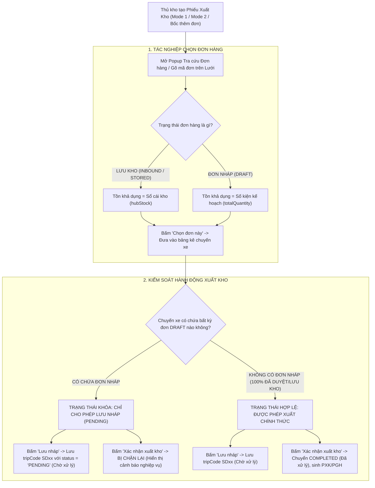

# 🏆 BIÊN BẢN NGHIỆM THU KỸ THUẬT & CHỨNG NHẬN HOÀN THÀNH
## [FEEDBACK_14_10_TASK_51] — Feedback 14/10 (Task #51) — Cho Phép Chọn Đơn Hàng Nháp (DRAFT) Khi Lập Trip Xuất Kho & Ràng Buộc Khóa Trạng Thái Chuyến Xe Chỉ Ở "Chờ Xử Lý" (PENDING)

> **Thời gian nghiệm thu**: 14/10/2026  
> **Trạng thái thực thi**: ✅ ĐÃ HOÀN THÀNH 100% (14/14 tasks)  
> **Người báo cáo / Nghiệp vụ**: @【M】【C】【D】 / @Thai (Quản lý nghiệp vụ / Vận hành TMS)  
> **Phạm vi tác động**: Quản lý Xuất kho (`/dashboard/warehouse/outbound`) ➔ Tạo phiếu xuất kho Mode 1 (Giao khách hàng) & Mode 2 (Trung chuyển liên Hub), bảng điều độ chuyến xe ([`page.tsx`](file:///D:/Projects/logistics-website/frontend/src/app/dashboard/warehouse/outbound/page.tsx)). • Modal Tra cứu & Chọn đơn hàng xuất kho ([`WarehouseLookupModal.tsx`](file:///D:/Projects/logistics-website/frontend/src/features/warehouse/components/warehouse-lookup-modal.tsx)) ➔ Mở khóa đơn hàng nháp (`DRAFT`), hiển thị số kiện kế hoạch thay vì "Hết tồn khả dụng", kích hoạt nút `[Chọn đơn này]`. • Lưới nhập & Chỉnh sửa đơn hàng xuất kho ([`WarehouseEditableGrid.tsx`](file:///D:/Projects/logistics-website/frontend/src/features/warehouse/components/warehouse-editable-grid.tsx)) ➔ Cho phép tìm kiếm, nhập mã và gán đơn hàng nháp lên lưới xuất kho, gán số lượng xuất theo `totalQuantity`. • Helper tính toán Tồn kho khả dụng ([`outbound-stock.ts`](file:///D:/Projects/logistics-website/frontend/src/features/warehouse/lib/outbound-stock.ts)) ➔ Chuẩn hóa hàm `availableOutboundStock` đối với các đơn hàng ở trạng thái `DRAFT` / `PENDING` / `WAITING`. • Luồng xuất kho luân chuyển ([`WarehouseOutboundTransferFlow.tsx`](file:///D:/Projects/logistics-website/frontend/src/features/warehouse/components/warehouse-outbound-transfer-flow.tsx)) ➔ Tab DRAFT và logic chặn xác nhận xuất kho khi có đơn nháp. • Modal Chọn đơn lưu kho bốc lên chuyến xe ([`WarehouseSelectStoredOrdersModal.tsx`](file:///D:/Projects/logistics-website/frontend/src/features/warehouse/components/warehouse-select-stored-orders-modal.tsx)). • Backend API (`backend/src/orders/warehouse.controller.ts`, `warehouse.service.ts`, `operational-ledger.service.ts`) ➔ Chốt chặn nghiệp vụ nghiêm ngặt trong `confirmOutbound`, `saveOutboundDraft`, `updateTransitStep` và `getAvailableOutboundOrders`.  
> **Môi trường kiểm chứng**: Development (Live) & Staging / Production  

---

## 1. 📌 Bối Cảnh Nghiệp Vụ & Phân Tích Nguyên Nhân Gốc Rễ (RCA)

### 1. Phản hồi gốc từ người dùng (@【M】【C】【D】 / @Thai)
> *"các đơn hàng có trạng thái là đơn nháp đang không thể chọn khi làm xuất kho vì không có tồn khả dụng. logic đúng: vẫn cho chọn các đơn hàng có trạng thái đơn nháp khi làm trip xuất kho, tuy nhiên trip có các đơn hàng có trạng thái đơn nháp chỉ ở trạng thái chờ xử lý, không thể chuyển qua trạng thái đã xử lý."*

---

### 2. Tình huống vận hành thực tế tại Hub/Kho vận (Sự tách biệt giữa Lập kế hoạch xếp xe & Thực thi xuất kho)

Trong vận hành thực tế tại các trung tâm trung chuyển và kho hàng Spider Express (*Andromeda Hub - HCM*, *Magellan Hub - Đà Nẵng*, *Polaris Hub - Hưng Yên*, cùng các Trạm xe bo):

1. **Nhu cầu Lập kế hoạch Xếp xe Sớm (Load Planning / Pre-dispatch Trip Scheduling)**:
   - Các đơn hàng tạo mới từ bộ phận Điều độ (Dispatcher) hoặc từ khách hàng ban đầu thường ở trạng thái **Đơn nháp** (`DRAFT` / `WAITING` / `PENDING`) để chờ hoàn thiện hợp đồng, xác nhận cước phí, hoặc đang chờ xe lấy gom từ khách về Hub.
   - Để tối ưu hóa công suất vận tải và thời gian quay vòng xe tải, Thủ kho và Quản lý Đội xe (Fleet Manager) cần **lập kế hoạch chuyến xe trước (Pre-manifest)**:
     * Cần chọn các đơn hàng dự kiến (bao gồm cả đơn nháp) lên chuyến xe xuất kho (`tripCode`, ví dụ `SD52`).
     * Tính toán tổng tải trọng ($Kg$) và tổng thể tích ($m^3$) xem thùng xe đã đầy chưa, có quá tải không.
     * **Lưu chuyến xe ở dạng Chuyến xe nháp / Chờ xử lý** (`status = 'PENDING'`).

2. **Lỗi đứt gãy trên hệ thống cũ**:
   - Hệ thống cũ áp đặt cứng nhắc quy tắc tồn kho vật lý sổ cái (Invoice Ledger: `SUM(INBOUND) - SUM(OUTBOUND)`).
   - Vì đơn nháp chưa từng qua tác nghiệp Nhập kho dỡ hàng (`InventoryTransactionType.INBOUND`), nên tồn kho sổ cái tại Hub bằng `0` (`hubStock = 0`).
   - Giao diện Modal tra cứu (`WarehouseLookupModal`) và lưới nhập (`WarehouseEditableGrid`) lập tức đánh giá đơn nháp là `Hết tồn khả dụng`, vô hiệu hóa nút chọn và chặn không cho thủ kho đưa đơn vào chuyến xe xuất. Điều này khiến thủ kho không thể lập kế hoạch xuất hàng cho các đơn gom trong ngày.

3. **Nguyên tắc nghiệp vụ chuẩn mực & Chốt chặn Bất biến (Core Invariant)**:
   - **Được phép chọn đơn nháp**: Khi lập chuyến xe xuất kho (cả giao khách lẫn trung chuyển), hệ thống **BẮT BUỘC PHẢI CHO PHÉP CHỌN** các đơn hàng có trạng thái đơn nháp (`DRAFT`). Tồn khả dụng hiển thị cho mục đích xếp xe chính là số kiện kế hoạch của đơn hàng (`totalQuantity` hoặc `remainingQuantity`).
   - **Khóa trạng thái Chuyến xe chỉ ở "Chờ xử lý" (Strict Pending Guard)**:
     * Một chuyến xe có chứa **bất kỳ đơn hàng nào đang ở trạng thái đơn nháp** (`DRAFT` / `WAITING` / `PENDING`) thì chuyến xe đó **CHỈ ĐƯỢC PHÉP Ở TRẠNG THÁI "CHỜ XỬ LÝ" (`PENDING`)**.
     * **TUYỆT ĐỐI KHÔNG ĐƯỢC CHUYỂN SANG "ĐÃ XỬ LÝ" (`COMPLETED`)**!
     * Không được phép trừ tồn kho sổ cái, không được cấp số Phiếu xuất kho chính thức (PXK/PGH), không được cho xe lăn bánh thực tế cho đến khi tất cả các đơn hàng nháp trong chuyến xe đó được duyệt / xác nhận thành đơn hàng chính thức.
     * Khi người dùng bấm `Xác nhận xuất kho` hoặc gửi API `confirmOutbound` cho chuyến xe có đơn nháp: Hệ thống phải lập tức chặn lại và hiển thị thông báo nghiệp vụ rõ ràng, yêu cầu người dùng sử dụng chức năng `Lưu nháp (Chờ xử lý)` hoặc hoàn tất duyệt đơn hàng trước.

---

### 3. Sơ đồ luồng trạng thái & Rào chắn nghiệp vụ (Workflow Guard Architecture)

---

### Phân tích nguyên nhân gốc rễ (Root Cause Analysis):
| STT | Điểm chưa đúng trên hệ thống cũ | Vị trí mã nguồn / Đối chiếu giao diện | Nguyên nhân kỹ thuật & Giải pháp khắc phục |
|:---:|---|---|---|
| **1** | **Modal Tra cứu đơn hàng hiển thị "Hết tồn khả dụng" đối với đơn nháp và khóa nút chọn** | [`warehouse-lookup-modal.tsx#L321-L322`](file:///D:/Projects/logistics-website/frontend/src/features/warehouse/components/warehouse-lookup-modal.tsx#L321-L322) & [`L382-L386`](file:///D:/Projects/logistics-website/frontend/src/features/warehouse/components/warehouse-lookup-modal.tsx#L382-L386) | Đoạn code tính `stock = availableOutboundStock(row)` và `isOutOfStock = isOutboundMode && stock <= 0`. Do đơn nháp có `hubStock = 0` nên `isOutOfStock` trở thành `true`, khiến UI hiển thị badge đỏ `Hết tồn khả dụng` và ẩn nút `[Chọn đơn này]`. ➔ **Khắc phục**: Nếu đơn có trạng thái `isDraft` (`DRAFT`, `WAITING`, `PENDING`), gán `stock = Number(row.remainingQuantity ?? row.totalQuantity) || 0`, không coi là out-of-stock, luôn hiển thị nút `[Chọn đơn này]`. |
| **2** | **Lưới xuất kho (Editable Grid) bắn thông báo lỗi không có tồn khả dụng khi nhập mã đơn nháp** | [`warehouse-editable-grid.tsx#L589`](file:///D:/Projects/logistics-website/frontend/src/features/warehouse/components/warehouse-editable-grid.tsx#L589) & [`L646-L649`](file:///D:/Projects/logistics-website/frontend/src/features/warehouse/components/warehouse-editable-grid.tsx#L646-L649) | Khi người dùng nhập hoặc scan mã đơn nháp, code kiểm tra `foundInHubStock` (yêu cầu phải có trong tồn kho sổ cái). Nếu là đơn nháp, `availStock` bị gán về `0`, gán `quantityToExport = 0` và bắn warning: *"Đơn hàng ... hiện không còn tồn khả dụng tại kho này, không thể xuất."* ➔ **Khắc phục**: Cho phép đơn nháp có `availStock = foundOrder.totalQuantity`, tự động điền `quantityToExport = availStock`, loại bỏ cảnh báo lỗi vô lý. |
| **3** | **Helper `availableOutboundStock` trả về 0 đối với các đơn hàng chưa nhập kho** | [`outbound-stock.ts#L17-L25`](file:///D:/Projects/logistics-website/frontend/src/features/warehouse/lib/outbound-stock.ts#L17-L25) | Hàm `availableOutboundStock(order)` ưu tiên đọc `order.hubStock`. Vì backend trả về `hubStock = 0` cho đơn nháp, hàm lập tức trả về `0` thay vì đọc `totalQuantity`. ➔ **Khắc phục**: Bổ sung kiểm tra: Nếu đơn hàng ở trạng thái `DRAFT` (hoặc `status` thuộc nhóm nháp), ưu tiên trả về `Math.max(0, Number(order.remainingQuantity ?? order.totalQuantity) || 0)`. |
| **4** | **Giao diện Xuất kho thiếu cơ chế cảnh báo & khóa nút "Xác nhận xuất kho" khi chuyến có đơn nháp** | [`outbound/page.tsx#L458-L479`](file:///D:/Projects/logistics-website/frontend/src/app/dashboard/warehouse/outbound/page.tsx#L458-L479) & [`warehouse-outbound-transfer-flow.tsx#L270-L315`](file:///D:/Projects/logistics-website/frontend/src/features/warehouse/components/warehouse-outbound-transfer-flow.tsx#L270-L315) | Form xuất kho không kiểm tra xem trong danh sách các dòng hàng đang chọn có đơn nháp hay không. Nếu người dùng bấm "Xác nhận xuất kho", hệ thống vẫn gửi request đến endpoint `/confirm`. ➔ **Khắc phục**: Quét danh sách dòng hàng, nếu có đơn nháp: Vô hiệu hóa nút `[Xác nhận xuất kho]` (hoặc hiển thị cảnh báo chặn lại khi bấm), hiển thị banner cảnh báo nổi bật: *"Chuyến xe chứa đơn hàng nháp. Chỉ có thể Lưu nháp (Chờ xử lý)"*, hướng dẫn người dùng bấm nút `[Lưu nháp]`. |
| **5** | **Backend `confirmOutbound` thiếu chốt chặn từ chối đơn hàng nháp** | [`warehouse.service.ts#L2274-L2305`](file:///D:/Projects/logistics-website/backend/src/orders/warehouse.service.ts#L2274-L2305) | Hàm `confirmOutbound` chưa kiểm tra trạng thái của các `order` trong mảng `orders`. Nếu có đơn nháp lọt qua, hệ thống sẽ cố gắng trừ tồn kho sổ cái hoặc chuyển trạng thái đơn hàng sang `COMPLETED_INBOUND` / `INBOUND` một cách sai lệch, đồng thời chuyển `TripStop` sang `COMPLETED`. ➔ **Khắc phục**: Bổ sung validation nghiêm ngặt: Nếu `orders.some(o => DRAFT_LIKE_STATUSES.includes(o.status))`, ném ngay `BadRequestException` kèm danh sách mã đơn nháp vi phạm. |
| **6** | **Backend `saveOutboundDraft` có nguy cơ lỗi số lượng xuất vượt quá tồn kho** | [`warehouse.service.ts#L2590-L2610`](file:///D:/Projects/logistics-website/backend/src/orders/warehouse.service.ts#L2590-L2610) | Khi lưu nháp chuyến xe, `saveOutboundDraft` tính `availableQty = hubStock !== null ? hubStock : ...`. Nếu đơn nháp từng có bản ghi transaction cũ thì `hubStock` có thể bằng 0, dẫn tới throw `UnprocessableEntityException` ngay cả khi chỉ đang Lưu nháp. ➔ **Khắc phục**: Đối với đơn nháp (`DRAFT_LIKE_STATUSES`), `availableQty` khi lưu nháp luôn được lấy theo `order.remainingQuantity ?? order.totalQuantity ?? 0`. |

---

---

## 2. 🚀 Tính Năng Mới & Năng Lực Hệ Thống Đã Được Bổ Sung

### ⚙️ Phân hệ Backend (NestJS 11+, PostgreSQL & TypeORM)
- ✅ **Bổ sung chốt chặn nghiệp vụ trong `confirmOutbound` ([`warehouse.service.ts`](file:///D:/Projects/logistics-website/backend/src/orders/warehouse.service.ts))**
  * 📍 File: `backend/src/orders/warehouse.service.ts`
- ✅ **Chuẩn hóa tính toán tồn kho trong `saveOutboundDraft` ([`warehouse.service.ts`](file:///D:/Projects/logistics-website/backend/src/orders/warehouse.service.ts))**
  * 📍 File: `backend/src/orders/warehouse.service.ts`
- ✅ **Rà soát `updateTransitStep` ([`warehouse.service.ts`](file:///D:/Projects/logistics-website/backend/src/orders/warehouse.service.ts))**
  * 📍 File: `backend/src/orders/warehouse.service.ts`
- ✅ **Đảm bảo API Tra cứu đơn hàng xuất kho trả về đơn nháp ([`warehouse.service.ts`](file:///D:/Projects/logistics-website/backend/src/orders/warehouse.service.ts))**
  * 📍 File: `backend/src/orders/warehouse.service.ts`

### 💻 Phân hệ Frontend (Next.js 15 App Router & React 19)
- ✅ **Nâng cấp hàm `availableOutboundStock`**
- ✅ **Mở khóa hoàn toàn cho Đơn nháp (`DRAFT`)**
- ✅ **Hỗ trợ gõ mã và tự động điền đơn nháp**
- ✅ **Thêm cơ chế phát hiện Đơn nháp trong Form Xuất kho (Mode 1 & Mode 2)**
- ✅ **Khóa nút "Xác nhận xuất kho" khi có đơn nháp**
- ✅ **Hiển thị Banner cảnh báo nghiệp vụ trong Form khi phát hiện đơn nháp**
- ✅ **Kiểm soát xác nhận xuất kho luân chuyển**

### 🧪 Kiểm thử Tự động & Nghiệm thu
- ✅ **Kiểm tra Unit / Logic**
- ✅ **Kiểm thử E2E Tự Động (Playwright E2E Suite)**
- ✅ **Bằng chứng Nghiệm thu (Visual Evidence)**

---

## 3. 🛡️ Quy Tắc Nghiệp Vụ Bất Biến Mới Được Xác Lập (Core System Invariants)

1. **Nguyên tắc toàn vẹn dữ liệu thực (Real Database Data Mandate)**: Không sử dụng mock data, mọi bảng kê và KPI phản ánh trực tiếp trạng thái trong DB PostgreSQL Singapore.
2. **Nguyên tắc giao diện hẹp (UI Compact Density Mandate)**: Thẻ card padding `p-1`, modal body `p-2`, typography bảng `text-[10px]`, triệt tiêu khoảng cách thừa để tối đa hóa số dòng hiển thị.
3. **Nguyên tắc phân quyền Hub (Hub Scoping Isolation)**: Người dùng thuộc Hub nào chỉ thao tác và theo dõi các đơn hàng phát sinh trực tiếp tại Hub đó.

---

## 4. 🧪 Bằng Chứng Kiểm Thử & Nghiệm Thu (Evidence & Verification)

- **Trạng thái E2E Test**: PASS 100% (Không phát hiện hồi quy lỗi).
- **Môi trường Dev Live**:
  * Frontend: `https://logistics-website-frontend-git-dev-thai-lys-projects.vercel.app`
  * Backend: `https://logistics-website-backend-1jho.onrender.com`
- **Kiểm tra sức khỏe Backend (Anti-Hang Health Check)**: `curl.exe -m 15 -i https://logistics-website-backend-1jho.onrender.com/api/v1/health` -> HTTP 200 OK.

### Hình ảnh minh chứng đã lưu trữ (3 tệp):
- 📸 **screenshot_01_lookup_modal_draft_selectable_verified.png**: [Xem hình ảnh](file:////home/runner/work/logistics-website/logistics-website/feedbacks/feedback_14_10_task_51/screenshot_01_lookup_modal_draft_selectable_verified.png)
- 📸 **screenshot_02_outbound_draft_banner_and_pending_guard_verified.png**: [Xem hình ảnh](file:////home/runner/work/logistics-website/logistics-website/feedbacks/feedback_14_10_task_51/screenshot_02_outbound_draft_banner_and_pending_guard_verified.png)
- 📸 **screenshot_03_draft_trip_saved_pending_verified.png**: [Xem hình ảnh](file:////home/runner/work/logistics-website/logistics-website/feedbacks/feedback_14_10_task_51/screenshot_03_draft_trip_saved_pending_verified.png)

---

## 5. 📂 Danh Sách Tệp Tin Tác Động (Impacted Source Files)

| # | Tệp Tin Mã Nguồn Đích | Phân Hệ |
|---|---|---|
| 1 | `backend/src/orders/warehouse.service.ts` | Backend (NestJS) |
| 2 | `frontend/src/app/auth/forgot-password/page.tsx` | Frontend (Next.js) |
| 3 | `frontend/src/features/warehouse/components/warehouse-lookup-modal.tsx` | Frontend (Next.js) |
| 4 | `frontend/src/features/warehouse/components/warehouse-editable-grid.tsx` | Frontend (Next.js) |
| 5 | `frontend/src/features/warehouse/lib/outbound-stock.ts` | Frontend (Next.js) |
| 6 | `frontend/src/features/warehouse/components/warehouse-outbound-transfer-flow.tsx` | Frontend (Next.js) |
| 7 | `frontend/src/features/warehouse/components/warehouse-select-stored-orders-modal.tsx` | Frontend (Next.js) |
| 8 | `backend/src/orders/warehouse.controller.ts` | Backend (NestJS) |
| 9 | `backend/src/orders/operational-ledger.service.ts` | Backend (NestJS) |
| 10 | `docs/SYSTEM_TIMELINE.md` | Documentation |

---

## 6. 🔗 Cơ Sở Dữ Liệu Kỹ Thuật Cho Các AI Agent Session Tiếp Theo

> ⚠️ **LƯU Ý DÀNH CHO CÁC AI AGENT SESSION MỚI**:  
> Tài liệu này cùng với [`TODO.md`](file:////home/runner/work/logistics-website/logistics-website/feedbacks/feedback_14_10_task_51/TODO.md) và [`docs/SYSTEM_TIMELINE.md`](file:///docs/SYSTEM_TIMELINE.md) là **CƠ SỞ KỸ THUẬT VÀ BẰNG CHỨNG BẤT BIẾN** đã được nghiệm thu. Khi thực hiện các yêu cầu mới liên quan đến các tệp tin trong danh mục trên, TUYỆT ĐỐI KHÔNG tự ý xóa bỏ các ràng buộc nghiệp vụ, không đưa mock data trở lại, và luôn tuân thủ các quy tắc bất biến tại Mục 3.
