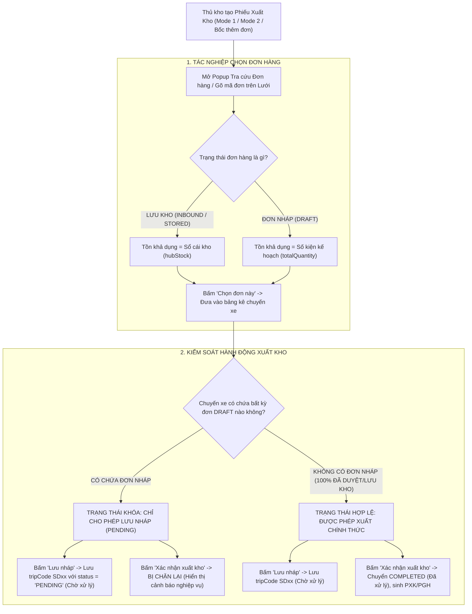

# Feedback 14/10 (Task #51) — Cho Phép Chọn Đơn Hàng Nháp (DRAFT) Khi Lập Trip Xuất Kho & Ràng Buộc Khóa Trạng Thái Chuyến Xe Chỉ Ở "Chờ Xử Lý" (PENDING)

> **Thời gian ghi nhận**: 14/10/2026  
> **Người báo cáo**: @【M】【C】【D】 / @Thai (Quản lý nghiệp vụ / Vận hành TMS)  
> **Phạm vi tác động**:  
> - Quản lý Xuất kho (`/dashboard/warehouse/outbound`) ➔ Tạo phiếu xuất kho Mode 1 (Giao khách hàng) & Mode 2 (Trung chuyển liên Hub), bảng điều độ chuyến xe ([`page.tsx`](file:///D:/Projects/logistics-website/frontend/src/app/dashboard/warehouse/outbound/page.tsx)).  
> - Modal Tra cứu & Chọn đơn hàng xuất kho ([`WarehouseLookupModal.tsx`](file:///D:/Projects/logistics-website/frontend/src/features/warehouse/components/warehouse-lookup-modal.tsx)) ➔ Mở khóa đơn hàng nháp (`DRAFT`), hiển thị số kiện kế hoạch thay vì "Hết tồn khả dụng", kích hoạt nút `[Chọn đơn này]`.  
> - Lưới nhập & Chỉnh sửa đơn hàng xuất kho ([`WarehouseEditableGrid.tsx`](file:///D:/Projects/logistics-website/frontend/src/features/warehouse/components/warehouse-editable-grid.tsx)) ➔ Cho phép tìm kiếm, nhập mã và gán đơn hàng nháp lên lưới xuất kho, gán số lượng xuất theo `totalQuantity`.  
> - Helper tính toán Tồn kho khả dụng ([`outbound-stock.ts`](file:///D:/Projects/logistics-website/frontend/src/features/warehouse/lib/outbound-stock.ts)) ➔ Chuẩn hóa hàm `availableOutboundStock` đối với các đơn hàng ở trạng thái `DRAFT` / `PENDING` / `WAITING`.  
> - Luồng xuất kho luân chuyển ([`WarehouseOutboundTransferFlow.tsx`](file:///D:/Projects/logistics-website/frontend/src/features/warehouse/components/warehouse-outbound-transfer-flow.tsx)) ➔ Tab DRAFT và logic chặn xác nhận xuất kho khi có đơn nháp.  
> - Modal Chọn đơn lưu kho bốc lên chuyến xe ([`WarehouseSelectStoredOrdersModal.tsx`](file:///D:/Projects/logistics-website/frontend/src/features/warehouse/components/warehouse-select-stored-orders-modal.tsx)).  
> - Backend API (`backend/src/orders/warehouse.controller.ts`, `warehouse.service.ts`, `operational-ledger.service.ts`) ➔ Chốt chặn nghiệp vụ nghiêm ngặt trong `confirmOutbound`, `saveOutboundDraft`, `updateTransitStep` và `getAvailableOutboundOrders`.  
> **Tài liệu tham chiếu**:  
> - `/leader` Business Domain Architecture ([`SKILL.md`](file:///D:/Projects/logistics-website/.agents/skills/leader/SKILL.md))  
> - Quy chế phát triển hệ thống [`AGENTS.md`](file:///D:/Projects/logistics-website/AGENTS.md)  
> - Quy chuẩn giao diện hẹp [`.agents/rules/ui-compact-density.md`](file:///D:/Projects/logistics-website/.agents/rules/ui-compact-density.md) & [`ui-spacing-guard`](file:///D:/Projects/logistics-website/.agents/skills/ui-spacing-guard/SKILL.md)  
> - Quy chuẩn kiểm soát kiện vận tải (No-SKU, Consignment Level)  
> - Biên niên sử tiến hóa hệ thống [`docs/SYSTEM_TIMELINE.md`](file:///D:/Projects/logistics-website/docs/SYSTEM_TIMELINE.md)  

---

## 📌 Bối cảnh nghiệp vụ thực tế (Chốt theo phản hồi người dùng)

### 1. Phản hồi gốc từ người dùng (@【M】【C】【D】 / @Thai)
> *"các đơn hàng có trạng thái là đơn nháp đang không thể chọn khi làm xuất kho vì không có tồn khả dụng. logic đúng: vẫn cho chọn các đơn hàng có trạng thái đơn nháp khi làm trip xuất kho, tuy nhiên trip có các đơn hàng có trạng thái đơn nháp chỉ ở trạng thái chờ xử lý, không thể chuyển qua trạng thái đã xử lý."*

---

### 2. Tình huống vận hành thực tế tại Hub/Kho vận (Sự tách biệt giữa Lập kế hoạch xếp xe & Thực thi xuất kho)

Trong vận hành thực tế tại các trung tâm trung chuyển và kho hàng Spider Express (*Andromeda Hub - HCM*, *Magellan Hub - Đà Nẵng*, *Polaris Hub - Hưng Yên*, cùng các Trạm xe bo):

1. **Nhu cầu Lập kế hoạch Xếp xe Sớm (Load Planning / Pre-dispatch Trip Scheduling)**:
   - Các đơn hàng tạo mới từ bộ phận Điều độ (Dispatcher) hoặc từ khách hàng ban đầu thường ở trạng thái **Đơn nháp** (`DRAFT` / `WAITING` / `PENDING`) để chờ hoàn thiện hợp đồng, xác nhận cước phí, hoặc đang chờ xe lấy gom từ khách về Hub.
   - Để tối ưu hóa công suất vận tải và thời gian quay vòng xe tải, Thủ kho và Quản lý Đội xe (Fleet Manager) cần **lập kế hoạch chuyến xe trước (Pre-manifest)**:
     * Cần chọn các đơn hàng dự kiến (bao gồm cả đơn nháp) lên chuyến xe xuất kho (`tripCode`, ví dụ `SD52`).
     * Tính toán tổng tải trọng ($Kg$) và tổng thể tích ($m^3$) xem thùng xe đã đầy chưa, có quá tải không.
     * **Lưu chuyến xe ở dạng Chuyến xe nháp / Chờ xử lý** (`status = 'PENDING'`).

2. **Lỗi đứt gãy trên hệ thống cũ**:
   - Hệ thống cũ áp đặt cứng nhắc quy tắc tồn kho vật lý sổ cái (Invoice Ledger: `SUM(INBOUND) - SUM(OUTBOUND)`).
   - Vì đơn nháp chưa từng qua tác nghiệp Nhập kho dỡ hàng (`InventoryTransactionType.INBOUND`), nên tồn kho sổ cái tại Hub bằng `0` (`hubStock = 0`).
   - Giao diện Modal tra cứu (`WarehouseLookupModal`) và lưới nhập (`WarehouseEditableGrid`) lập tức đánh giá đơn nháp là `Hết tồn khả dụng`, vô hiệu hóa nút chọn và chặn không cho thủ kho đưa đơn vào chuyến xe xuất. Điều này khiến thủ kho không thể lập kế hoạch xuất hàng cho các đơn gom trong ngày.

3. **Nguyên tắc nghiệp vụ chuẩn mực & Chốt chặn Bất biến (Core Invariant)**:
   - **Được phép chọn đơn nháp**: Khi lập chuyến xe xuất kho (cả giao khách lẫn trung chuyển), hệ thống **BẮT BUỘC PHẢI CHO PHÉP CHỌN** các đơn hàng có trạng thái đơn nháp (`DRAFT`). Tồn khả dụng hiển thị cho mục đích xếp xe chính là số kiện kế hoạch của đơn hàng (`totalQuantity` hoặc `remainingQuantity`).
   - **Khóa trạng thái Chuyến xe chỉ ở "Chờ xử lý" (Strict Pending Guard)**:
     * Một chuyến xe có chứa **bất kỳ đơn hàng nào đang ở trạng thái đơn nháp** (`DRAFT` / `WAITING` / `PENDING`) thì chuyến xe đó **CHỈ ĐƯỢC PHÉP Ở TRẠNG THÁI "CHỜ XỬ LÝ" (`PENDING`)**.
     * **TUYỆT ĐỐI KHÔNG ĐƯỢC CHUYỂN SANG "ĐÃ XỬ LÝ" (`COMPLETED`)**!
     * Không được phép trừ tồn kho sổ cái, không được cấp số Phiếu xuất kho chính thức (PXK/PGH), không được cho xe lăn bánh thực tế cho đến khi tất cả các đơn hàng nháp trong chuyến xe đó được duyệt / xác nhận thành đơn hàng chính thức.
     * Khi người dùng bấm `Xác nhận xuất kho` hoặc gửi API `confirmOutbound` cho chuyến xe có đơn nháp: Hệ thống phải lập tức chặn lại và hiển thị thông báo nghiệp vụ rõ ràng, yêu cầu người dùng sử dụng chức năng `Lưu nháp (Chờ xử lý)` hoặc hoàn tất duyệt đơn hàng trước.

---

### 3. Sơ đồ luồng trạng thái & Rào chắn nghiệp vụ (Workflow Guard Architecture)



---

## 🔍 Tổng hợp các điểm chưa đúng trên giao diện cũ (Đối chiếu phân tích trực tiếp)

| STT | Điểm chưa đúng trên hệ thống cũ | Vị trí mã nguồn / Đối chiếu giao diện | Nguyên nhân kỹ thuật & Giải pháp khắc phục |
|:---:|---|---|---|
| **1** | **Modal Tra cứu đơn hàng hiển thị "Hết tồn khả dụng" đối với đơn nháp và khóa nút chọn** | [`warehouse-lookup-modal.tsx#L321-L322`](file:///D:/Projects/logistics-website/frontend/src/features/warehouse/components/warehouse-lookup-modal.tsx#L321-L322) & [`L382-L386`](file:///D:/Projects/logistics-website/frontend/src/features/warehouse/components/warehouse-lookup-modal.tsx#L382-L386) | Đoạn code tính `stock = availableOutboundStock(row)` và `isOutOfStock = isOutboundMode && stock <= 0`. Do đơn nháp có `hubStock = 0` nên `isOutOfStock` trở thành `true`, khiến UI hiển thị badge đỏ `Hết tồn khả dụng` và ẩn nút `[Chọn đơn này]`.<br>➔ **Khắc phục**: Nếu đơn có trạng thái `isDraft` (`DRAFT`, `WAITING`, `PENDING`), gán `stock = Number(row.remainingQuantity ?? row.totalQuantity) || 0`, không coi là out-of-stock, luôn hiển thị nút `[Chọn đơn này]`. |
| **2** | **Lưới xuất kho (Editable Grid) bắn thông báo lỗi không có tồn khả dụng khi nhập mã đơn nháp** | [`warehouse-editable-grid.tsx#L589`](file:///D:/Projects/logistics-website/frontend/src/features/warehouse/components/warehouse-editable-grid.tsx#L589) & [`L646-L649`](file:///D:/Projects/logistics-website/frontend/src/features/warehouse/components/warehouse-editable-grid.tsx#L646-L649) | Khi người dùng nhập hoặc scan mã đơn nháp, code kiểm tra `foundInHubStock` (yêu cầu phải có trong tồn kho sổ cái). Nếu là đơn nháp, `availStock` bị gán về `0`, gán `quantityToExport = 0` và bắn warning: *"Đơn hàng ... hiện không còn tồn khả dụng tại kho này, không thể xuất."*<br>➔ **Khắc phục**: Cho phép đơn nháp có `availStock = foundOrder.totalQuantity`, tự động điền `quantityToExport = availStock`, loại bỏ cảnh báo lỗi vô lý. |
| **3** | **Helper `availableOutboundStock` trả về 0 đối với các đơn hàng chưa nhập kho** | [`outbound-stock.ts#L17-L25`](file:///D:/Projects/logistics-website/frontend/src/features/warehouse/lib/outbound-stock.ts#L17-L25) | Hàm `availableOutboundStock(order)` ưu tiên đọc `order.hubStock`. Vì backend trả về `hubStock = 0` cho đơn nháp, hàm lập tức trả về `0` thay vì đọc `totalQuantity`.<br>➔ **Khắc phục**: Bổ sung kiểm tra: Nếu đơn hàng ở trạng thái `DRAFT` (hoặc `status` thuộc nhóm nháp), ưu tiên trả về `Math.max(0, Number(order.remainingQuantity ?? order.totalQuantity) || 0)`. |
| **4** | **Giao diện Xuất kho thiếu cơ chế cảnh báo & khóa nút "Xác nhận xuất kho" khi chuyến có đơn nháp** | [`outbound/page.tsx#L458-L479`](file:///D:/Projects/logistics-website/frontend/src/app/dashboard/warehouse/outbound/page.tsx#L458-L479) & [`warehouse-outbound-transfer-flow.tsx#L270-L315`](file:///D:/Projects/logistics-website/frontend/src/features/warehouse/components/warehouse-outbound-transfer-flow.tsx#L270-L315) | Form xuất kho không kiểm tra xem trong danh sách các dòng hàng đang chọn có đơn nháp hay không. Nếu người dùng bấm "Xác nhận xuất kho", hệ thống vẫn gửi request đến endpoint `/confirm`.<br>➔ **Khắc phục**: Quét danh sách dòng hàng, nếu có đơn nháp: Vô hiệu hóa nút `[Xác nhận xuất kho]` (hoặc hiển thị cảnh báo chặn lại khi bấm), hiển thị banner cảnh báo nổi bật: *"Chuyến xe chứa đơn hàng nháp. Chỉ có thể Lưu nháp (Chờ xử lý)"*, hướng dẫn người dùng bấm nút `[Lưu nháp]`. |
| **5** | **Backend `confirmOutbound` thiếu chốt chặn từ chối đơn hàng nháp** | [`warehouse.service.ts#L2274-L2305`](file:///D:/Projects/logistics-website/backend/src/orders/warehouse.service.ts#L2274-L2305) | Hàm `confirmOutbound` chưa kiểm tra trạng thái của các `order` trong mảng `orders`. Nếu có đơn nháp lọt qua, hệ thống sẽ cố gắng trừ tồn kho sổ cái hoặc chuyển trạng thái đơn hàng sang `COMPLETED_INBOUND` / `INBOUND` một cách sai lệch, đồng thời chuyển `TripStop` sang `COMPLETED`.<br>➔ **Khắc phục**: Bổ sung validation nghiêm ngặt: Nếu `orders.some(o => DRAFT_LIKE_STATUSES.includes(o.status))`, ném ngay `BadRequestException` kèm danh sách mã đơn nháp vi phạm. |
| **6** | **Backend `saveOutboundDraft` có nguy cơ lỗi số lượng xuất vượt quá tồn kho** | [`warehouse.service.ts#L2590-L2610`](file:///D:/Projects/logistics-website/backend/src/orders/warehouse.service.ts#L2590-L2610) | Khi lưu nháp chuyến xe, `saveOutboundDraft` tính `availableQty = hubStock !== null ? hubStock : ...`. Nếu đơn nháp từng có bản ghi transaction cũ thì `hubStock` có thể bằng 0, dẫn tới throw `UnprocessableEntityException` ngay cả khi chỉ đang Lưu nháp.<br>➔ **Khắc phục**: Đối với đơn nháp (`DRAFT_LIKE_STATUSES`), `availableQty` khi lưu nháp luôn được lấy theo `order.remainingQuantity ?? order.totalQuantity ?? 0`. |

---

## 📋 Danh sách công việc triển khai (Action Checklist)

### 1. Backend (`backend/`)

- [x] **Bổ sung chốt chặn nghiệp vụ trong `confirmOutbound` ([`warehouse.service.ts`](file:///D:/Projects/logistics-website/backend/src/orders/warehouse.service.ts))**:
  - Quét danh sách đơn hàng `orders` trong transaction xuất kho.
  - Kiểm tra xem có đơn hàng nào thuộc nhóm trạng thái đơn nháp (`DRAFT`, `WAITING`, `PENDING`) hay không:
    ```typescript
    const draftOrders = orders.filter((o) =>
      DRAFT_LIKE_STATUSES.includes(o.status),
    );
    if (draftOrders.length > 0) {
      const draftCodes = draftOrders.map((o) => o.orderCode).join(', ');
      throw new BadRequestException(
        `Không thể chuyển chuyến xe sang trạng thái "Đã xử lý" vì chuyến xe có chứa ${draftOrders.length} đơn hàng đang ở trạng thái đơn nháp (${draftCodes}). Chuyến xe có đơn nháp chỉ được phép ở trạng thái "Chờ xử lý". Vui lòng duyệt đơn hàng trước khi xuất kho.`,
      );
    }
    ```
  - Đảm bảo trả về HTTP 400 Bad Request với thông điệp tiếng Việt thân thiện, không bao giờ để lọt chuyến xe chứa đơn nháp sang trạng thái `COMPLETED`.

- [x] **Chuẩn hóa tính toán tồn kho trong `saveOutboundDraft` ([`warehouse.service.ts`](file:///D:/Projects/logistics-website/backend/src/orders/warehouse.service.ts))**:
  - Khi lưu nháp phiếu xuất kho (`POST /api/v1/warehouse/outbound/draft`):
    * Nhận diện đơn hàng có trạng thái đơn nháp: `const isDraft = DRAFT_LIKE_STATUSES.includes(order.status);`
    * Nếu là đơn nháp: `availableQty = order.remainingQuantity ?? order.totalQuantity ?? 0;` (bỏ qua kiểm tra `hubStock` sổ cái).
    * Cho phép lưu nháp thành công, gán `quantityAllocated = qty`.
    * Đảm bảo `TripStopEntity` của trạm xuất phát được tạo/cập nhật với `status: TripStopStatus.PENDING` ("Chờ xử lý").

- [x] **Rà soát `updateTransitStep` ([`warehouse.service.ts`](file:///D:/Projects/logistics-website/backend/src/orders/warehouse.service.ts))**:
  - Khi người dùng thực hiện cập nhật trạm trung chuyển chuyển sang `COMPLETED`:
    * Kiểm tra xem các đơn hàng gắn với chuyến xe tại trạm đó có đơn nào đang là `DRAFT` không.
    * Nếu có, ngăn chặn chuyển trạng thái sang `COMPLETED` và trả về thông báo lỗi yêu cầu xử lý đơn nháp trước.

- [x] **Đảm bảo API Tra cứu đơn hàng xuất kho trả về đơn nháp ([`warehouse.service.ts`](file:///D:/Projects/logistics-website/backend/src/orders/warehouse.service.ts))**:
  - Trong `getOrders` (`GET /api/v1/warehouse/orders`):
    * Khi `status = 'DRAFT'` hoặc `status = 'ALL'`: Đảm bảo đơn nháp tại Hub xuất phát được lấy lên đầy đủ.
    * Đảm bảo trường `hubStock` hoặc `totalQuantity` của đơn nháp được trả về chính xác cho Frontend.
  - Trong `getAvailableOutboundOrders` (`GET /api/v1/warehouse/trips/:tripCode/available-outbound-orders`):
    * Xác nhận điều kiện lọc `(order.status IN ('DRAFT', 'WAITING', 'PENDING') AND order.originHubId = :currentHubId)` hoạt động ổn định và không bị chặn bởi các filter khác.

---

### 2. Frontend (`frontend/`)

#### A. Cải tiến Helper Tồn kho Xuất ([`outbound-stock.ts`](file:///D:/Projects/logistics-website/frontend/src/features/warehouse/lib/outbound-stock.ts))
- [x] **Nâng cấp hàm `availableOutboundStock`**:
  - Bổ sung nhận diện trạng thái `status`:
    ```typescript
    export function availableOutboundStock(order: StockSource & { status?: string; hubStatus?: string | null }): number {
      const st = (order.hubStatus ?? order.status ?? '').toUpperCase();
      const isDraft = ['DRAFT', 'PENDING', 'WAITING'].includes(st);
      
      // Nếu là đơn nháp, tồn khả dụng để xếp xe chính là số kiện kế hoạch của đơn hàng
      if (isDraft) {
        if (order.remainingQuantity !== null && order.remainingQuantity !== undefined) {
          return Math.max(0, Number(order.remainingQuantity) || 0);
        }
        return Math.max(0, Number(order.totalQuantity) || 0);
      }

      if (order.hubStock !== null && order.hubStock !== undefined) {
        return Math.max(0, Number(order.hubStock) || 0);
      }
      if (order.remainingQuantity !== null && order.remainingQuantity !== undefined) {
        return Math.max(0, Number(order.remainingQuantity) || 0);
      }
      return Math.max(0, Number(order.totalQuantity) || 0);
    }
    ```

#### B. Nâng cấp Modal Tra cứu Đơn hàng ([`warehouse-lookup-modal.tsx`](file:///D:/Projects/logistics-website/frontend/src/features/warehouse/components/warehouse-lookup-modal.tsx))
- [x] **Mở khóa hoàn toàn cho Đơn nháp (`DRAFT`)**:
  - Sửa điều kiện `isOutOfStock`:
    ```typescript
    const isDraft = displayStatus === 'DRAFT' || row.status === 'DRAFT';
    const stock = availableOutboundStock(row);
    // Đơn nháp KHÔNG BAO GIỜ bị đánh dấu là Hết tồn khả dụng nếu có totalQuantity > 0
    const isOutOfStock = isOutboundMode && !isDraft && stock <= 0;
    ```
  - Đảm bảo cột SỐ KIỆN hiển thị rõ ràng: `(Number(row.totalQuantity) || 0) kiện` (hoặc `stock / totalQuantity kiện`).
  - Đảm bảo hiển thị nút bấm `[Chọn đơn này]` màu xanh Navy (`#0F3D62`) thay vì badge đỏ `Hết tồn khả dụng`.
  - Giữ nguyên Badge trạng thái `Đơn nháp` màu Slate để thủ kho phân biệt rõ với đơn `Lưu kho`.

#### C. Tối ưu Lưới nhập Xuất kho ([`warehouse-editable-grid.tsx`](file:///D:/Projects/logistics-website/frontend/src/features/warehouse/components/warehouse-editable-grid.tsx))
- [x] **Hỗ trợ gõ mã và tự động điền đơn nháp**:
  - Trong `handleBlurOrderCode`:
    * Kiểm tra xem đơn tìm thấy có phải đơn nháp không: `const isDraft = ['DRAFT', 'PENDING', 'WAITING'].includes(foundOrder.status);`
    * Nếu là đơn nháp: Cho phép chọn bình thường, lấy `availStock = Number(foundOrder.remainingQuantity ?? foundOrder.totalQuantity) || 1`.
    * Điền đầy đủ thông tin: Tên hàng, số kiện xuất (`quantityToExport = availStock`), kg, m³, điểm giao, điểm bốc.
    * Hiển thị thông báo thành công: `toast.success(`Đã chọn đơn nháp ${foundOrder.orderCode} (${availStock} kiện) vào chuyến xe!`);`
    * Tuyệt đối không hiển thị warning *"hiện không còn tồn khả dụng tại kho này, không thể xuất"*.

#### D. Kiểm soát & Khóa Trạng thái Xuất kho ([`outbound/page.tsx`](file:///D:/Projects/logistics-website/frontend/src/app/dashboard/warehouse/outbound/page.tsx))
- [x] **Thêm cơ chế phát hiện Đơn nháp trong Form Xuất kho (Mode 1 & Mode 2)**:
  - Khai báo computed state:
    ```typescript
    const hasDraftOrdersInNote = useMemo(() => {
      return mode1Rows.some((r) => {
        const st = (r.hubStatus ?? r.status ?? '').toUpperCase();
        return ['DRAFT', 'PENDING', 'WAITING'].includes(st);
      });
    }, [mode1Rows]);
    ```
- [x] **Khóa nút "Xác nhận xuất kho" khi có đơn nháp**:
  - Tại thanh Action Footer của Form:
    * Nếu `hasDraftOrdersInNote === true`:
      - Nút **`[Xác nhận xuất kho]`**: Disabled hoặc khi click sẽ hiển thị Modal/Toast cảnh báo:
        `"Chuyến xe đang chứa đơn hàng nháp. Chuyến xe có đơn nháp chỉ được phép ở trạng thái 'Chờ xử lý'. Vui lòng chọn 'Lưu nháp' chuyến xe hoặc duyệt đơn hàng trước khi xuất kho."`
      - Bổ sung Badge / Gợi ý nổi bật cạnh nút: `⚠️ Có đơn nháp - Chỉ được Lưu nháp`.
      - Nút **`[Lưu nháp]`**: Được đánh dấu là hành động chính (Primary / Highlight), cho phép lưu chuyến xe dưới trạng thái `Chờ xử lý` (`PENDING`).
    * Nếu `hasDraftOrdersInNote === false`:
      - Cả 2 nút `[Lưu nháp]` và `[Xác nhận xuất kho]` hoạt động bình thường.
- [x] **Hiển thị Banner cảnh báo nghiệp vụ trong Form khi phát hiện đơn nháp**:
  - Thêm một Callout Alert nhỏ gọn (tuân thủ quy chuẩn `ui-compact-density`):
    ```tsx
    {hasDraftOrdersInNote && (
      <div className="flex items-center gap-1.5 p-1.5 rounded-md bg-amber-50 dark:bg-amber-950/40 border border-amber-200 dark:border-amber-800 text-amber-800 dark:text-amber-200 text-[11px]">
        <IconAlertCircle className="h-4 w-4 shrink-0 text-amber-600" />
        <span>
          <strong>Lưu ý nghiệp vụ:</strong> Phiếu xuất này chứa đơn hàng đang ở trạng thái <strong>Đơn nháp</strong>. Chuyến xe sẽ được lưu ở trạng thái <strong>Chờ xử lý</strong> và không thể chuyển sang <strong>Đã xử lý</strong> cho đến khi các đơn hàng được duyệt chính thức.
        </span>
      </div>
    )}
    ```

#### E. Đồng bộ Luồng Xuất Luân Chuyển ([`warehouse-outbound-transfer-flow.tsx`](file:///D:/Projects/logistics-website/frontend/src/features/warehouse/components/warehouse-outbound-transfer-flow.tsx))
- [x] **Kiểm soát xác nhận xuất kho luân chuyển**:
  - Trong `handleConfirmTransfer`:
    * Kiểm tra `selectedOrders.some(o => ['DRAFT', 'PENDING'].includes(o.status))`.
    * Nếu có đơn nháp được chọn: Chặn thực thi, thông báo toast lỗi rõ ràng: *"Chuyến luân chuyển chứa đơn nháp, chỉ có thể bấm 'Lưu nháp' ở trạng thái Chờ xử lý."*
  - Tại giao diện bảng chọn đơn luân chuyển:
    * Khi người dùng tích chọn các đơn hàng từ Tab `DRAFT`: Làm nổi bật nút `[Lưu nháp luân chuyển]`, làm mờ hoặc cảnh báo tại nút `[Xác nhận xuất kho]`.

---

### 3. Kiểm thử & Đảm bảo chất lượng (Verification & Quality Gate)

- [x] **Kiểm tra Unit / Logic**:
  - Test helper `availableOutboundStock` với các object đơn hàng có `status = 'DRAFT'`, `status = 'INBOUND'`, `hubStock = 0`, `totalQuantity = 10`.
  - Đảm bảo đơn nháp luôn trả về `totalQuantity` (10 kiện), không bao giờ trả về 0.

- [x] **Kiểm thử E2E Tự Động (Playwright E2E Suite)**:
  - Tạo kịch bản kiểm thử tự động `frontend/e2e/51-draft-order-outbound-pending-guard.spec.ts`:
    * **Test case 1**: Tạo một đơn hàng mới ở trạng thái `DRAFT` (ví dụ mã `HCM-TEST-DRAFT-01`, 5 kiện).
    * **Test case 2**: Đăng nhập tài khoản Thủ kho (`WAREHOUSE_MANAGER`), mở trang `/dashboard/warehouse/outbound`, bấm `Tạo phiếu xuất kho`.
    * **Test case 3**: Mở `WarehouseLookupModal` hoặc gõ tìm kiếm đơn nháp vừa tạo:
      - Xác minh đơn hàng hiển thị badge `Đơn nháp`.
      - Xác minh số kiện hiển thị đúng `5 kiện`.
      - Xác minh nút `[Chọn đơn này]` HOẠT ĐỘNG BÌNH THƯỜNG (không bị badge "Hết tồn khả dụng" che khuất).
    * **Test case 4**: Chọn đơn nháp vào bảng xuất kho:
      - Xác minh dòng hàng được đưa vào lưới thành công với số lượng `5 kiện`.
      - Xác minh xuất hiện cảnh báo nghiệp vụ: Chuyến xe chỉ được phép Lưu nháp.
      - Xác minh nút `[Xác nhận xuất kho]` bị chặn hoặc hiển thị lỗi từ chối khi bấm.
    * **Test case 5**: Bấm nút `[Lưu nháp]`:
      - Xác minh lưu nháp thành công, chuyến xe `SDxx` xuất hiện tại bảng danh sách Xuất kho với trạng thái **`Chờ xử lý`** (`PENDING`).
    * **Test case 6 (API Security Gate)**: Thử gửi trực tiếp payload chứa đơn nháp lên `POST /api/v1/warehouse/outbound/confirm`:
      - Xác minh Backend trả về HTTP 400 Bad Request với nội dung từ chối chuẩn mực.

- [x] **Bằng chứng Nghiệm thu (Visual Evidence)**:
  - Chụp ảnh màn hình kiểm thử thực tế:
    * `screenshot_01_lookup_modal_draft_selectable_verified.png`: Modal tra cứu hiển thị đơn nháp với nút "Chọn đơn này" khả dụng.
    * `screenshot_02_outbound_draft_banner_and_pending_guard_verified.png`: Lưới xuất kho chứa đơn nháp, banner cảnh báo nghiệp vụ và trạng thái chặn xuất kho.
    * `screenshot_03_draft_trip_saved_pending_verified.png`: Danh sách chuyến xe xuất kho lưu thành công ở trạng thái `Chờ xử lý`.
  - Cập nhật kết quả nghiệm thu vào `feedbacks/feedback_14_10_task_51/RESOLUTION.md` và `docs/SYSTEM_TIMELINE.md`.

---

## 🎯 Tiêu chuẩn Nghiệm thu (Definition of Done - DoD)

1. 100% các đơn hàng có trạng thái Đơn nháp (`DRAFT`) được phép tra cứu, tìm kiếm và chọn vào chuyến xe xuất kho trên toàn bộ các modal và lưới nhập kho.
2. Tuyệt đối không còn tình trạng đơn nháp bị báo "Hết tồn khả dụng" hay bị khóa nút chọn khi làm trip xuất kho.
3. Chuyến xe có chứa bất kỳ đơn hàng nháp nào BẮT BUỘC chỉ được lưu ở trạng thái **Chờ xử lý (`PENDING`)**, KHÔNG THỂ chuyển sang trạng thái **Đã xử lý (`COMPLETED`)**.
4. Cả 2 tầng Frontend (UI Guard) và Backend (API Validation Guard) đều chặn đứng thao tác xác nhận xuất kho đối với chuyến xe có đơn nháp.
5. Không làm ảnh hưởng đến các chuyến xe thông thường (chỉ chứa đơn đã lưu kho `INBOUND`/`STORED` vẫn xuất kho và chuyển `COMPLETED` bình thường).
6. Toàn bộ kịch bản E2E Playwright PASS 100%, có ảnh chụp bằng chứng nghiệm thu thực tế.
