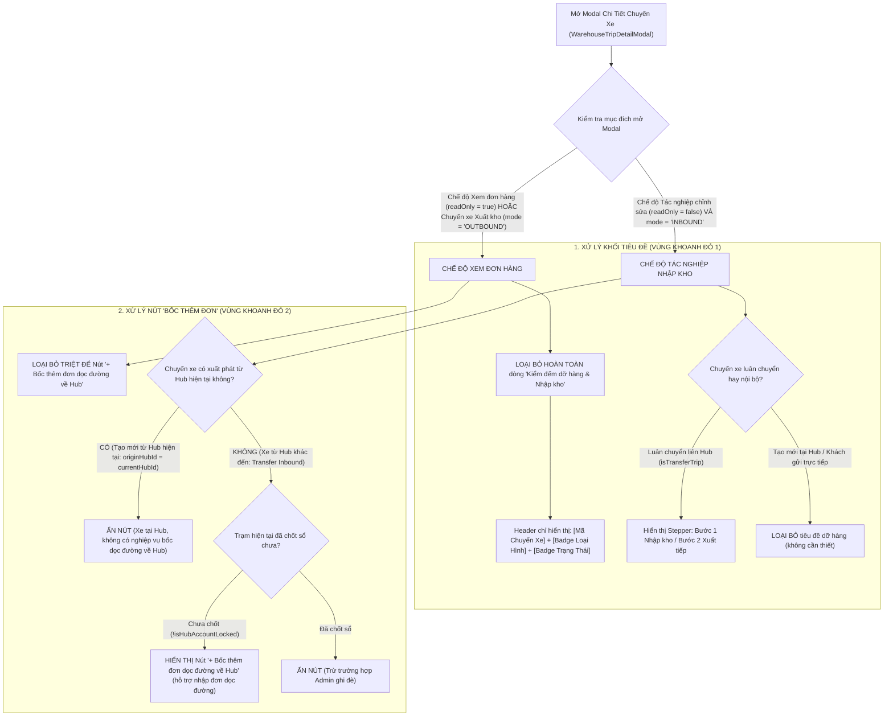

# 🏆 BIÊN BẢN NGHIỆM THU KỸ THUẬT & CHỨNG NHẬN HOÀN THÀNH
## [FEEDBACK_14_10_TASK_52] — Feedback 14/10 (Task #52) — Loại Bỏ Tiêu Đề "Kiểm Đếm Dỡ Hàng & Nhập Kho" Và Nút "Bốc Thêm Đơn Dọc Đường" Ở Màn Hình Xem Đơn Hàng Trong Trip Xuất, Nhập Tạo Mới Từ Hub Của Account

> **Thời gian nghiệm thu**: 14/10/2026  
> **Trạng thái thực thi**: ✅ ĐÃ HOÀN THÀNH 100% (9/9 tasks)  
> **Người báo cáo / Nghiệp vụ**: @【M】【C】【D】 / @Thai (Quản lý nghiệp vụ / Vận hành TMS)  
> **Phạm vi tác động**: Modal Chi tiết Chuyến xe & Xem đơn hàng ([`warehouse-trip-detail-modal.tsx`](file:///frontend/src/features/warehouse/components/warehouse-trip-detail-modal.tsx)) ➔ Quản lý hiển thị Header Bar, ẩn khối tiêu đề dỡ hàng và ẩn nút bốc thêm đơn dọc đường khi xem đơn hoặc chuyến xe xuất phát từ Hub hiện tại. • Màn hình Quản lý Xuất kho ([`outbound/page.tsx`](file:///frontend/src/app/dashboard/warehouse/outbound/page.tsx)) ➔ Mở modal xem đơn hàng trong chuyến xe xuất kho (`mode='OUTBOUND'`, `readOnly={true}`). • Màn hình Quản lý Nhập kho ([`inbound/page.tsx`](file:///frontend/src/app/dashboard/warehouse/inbound/page.tsx)) ➔ Mở modal xem chi tiết đơn hàng chuyến xe nhập kho tạo mới trực tiếp tại Hub (`mode='INBOUND'`, `readOnly={true}`). • Kiểm thử tự động E2E ([`52-trip-detail-view-clean-header-and-no-roadside.spec.ts`](file:///frontend/e2e/52-trip-detail-view-clean-header-and-no-roadside.spec.ts)).  
> **Môi trường kiểm chứng**: Development (Live) & Staging / Production  

---

## 1. 📌 Bối Cảnh Nghiệp Vụ & Phân Tích Nguyên Nhân Gốc Rễ (RCA)

### 1. Phản hồi gốc từ người dùng (@【M】【C】【D】 / @Thai)
> *"loại bỏ các phần khoanh đỏ này ở màn hình xem đơn hàng trong trip xuất, nhập được tạo mới từ hub của account đang sử dụng."*

Kèm theo ảnh chụp thực tế: `feedbacks/feedback_14_10_task_52/screenshot_01.jpg` hiển thị modal xem chi tiết chuyến xe `SD49` (loại hình `Khách gửi trực tiếp`, trạng thái `Chờ xử lý`, lộ trình `Andromeda Hub - HCM`). Trong ảnh có 2 vùng khoanh đỏ viền đỏ rõ rệt:
1. **Vùng khoanh đỏ 1 (Phần Header phụ)**: Khối tiêu đề chứa Icon kho hàng kèm dòng chữ **`Kiểm đếm dỡ hàng & Nhập kho`**.
2. **Vùng khoanh đỏ 2 (Thanh công cụ bảng dòng hàng)**: Nút bấm màu xanh viền nét đứt **`+ Bốc thêm đơn dọc đường về Hub`**.

---

### 2. Tình huống vận hành thực tế tại Hub/Kho vận (Sự tách biệt giữa Chế độ Xem tra cứu & Tác nghiệp dỡ xe liên tỉnh)

Trong mô hình vận hành mạng lưới vận tải TMS (Spider Express):

1. **Bản chất của Màn hình Xem đơn hàng trong Chuyến xe (Trip Order Inspection / Read-Only View)**:
   - Khi thủ kho hoặc điều độ viên bấm vào mã chuyến xe (`tripCode`, ví dụ `SD49`) trên bảng danh sách Xuất kho hoặc Nhập kho, mục đích cốt lõi là **tra cứu danh sách các đơn hàng đã được xếp lên chuyến xe** (gồm mã vận đơn, tên hàng, số kiện, số kg, số khối m³, địa chỉ giao, ghi chú và in tem nhận diện).
   - Đây là **chế độ xem chỉ đọc (`readOnly = true`)**, hoàn toàn mang tính chất kiểm tra, đối chiếu thông tin (Audit/Inspection), không phải là phiên làm việc tác nghiệp kiểm đếm dỡ hàng thực tế.

2. **Bất cập nghiêm trọng trên giao diện cũ (Phần khoanh đỏ 1: Tiêu đề "Kiểm đếm dỡ hàng & Nhập kho")**:
   - Thành phần `WarehouseTripDetailModal` ban đầu được thiết kế phục vụ quy trình Thủ kho nhận xe tải từ nơi khác đến và tiến hành dỡ hàng xuống kho (Tally Inbound). Do đó, dòng tiêu đề `<h2>` đã bị hardcode dòng chữ *"Kiểm đếm dỡ hàng & Nhập kho"*.
   - Khi modal này được tái sử dụng để xem chi tiết đơn hàng:
     * **Đối với chuyến xe Xuất kho (`mode = 'OUTBOUND'`)**: Hàng hóa đang được xếp lên xe để xuất đi (Loading/Outbound), nhưng giao diện lại ghi to *"Kiểm đếm dỡ hàng & Nhập kho"*. Đây là lỗi sai lệch thuật ngữ vận hành nghiêm trọng.
     * **Đối với chuyến xe tạo mới từ Hub của tài khoản đang sử dụng (Origin Hub)**: Ví dụ chuyến `SD49` trong ảnh là hàng gửi trực tiếp tại quầy của Hub (`Khách gửi trực tiếp`) hoặc chuyến xuất phát từ Hub này. Hàng hóa được tiếp nhận tại quầy hoặc gom tại chỗ, không hề có hoạt động dỡ hàng từ xe đường dài xuống kho.
     * Tiêu đề này vừa chiếm diện tích vô ích trên màn hình hẹp, vừa gây hiểu nhầm cho nhân viên vận hành rằng chuyến xe đang trong trạng thái cần kiểm đếm dỡ hàng.
   - **Giải pháp chuẩn hóa**: Loại bỏ hoàn toàn khối tiêu đề `Kiểm đếm dỡ hàng & Nhập kho` này ở chế độ xem đơn hàng hoặc khi chuyến xe xuất phát từ Hub của tài khoản. Thanh Header trên cùng đã có đầy đủ nhận diện: `CHUYẾN XE SDxx`, Badge hình thức (`Khách gửi trực tiếp` / `Luân chuyển nội bộ`), Badge trạng thái (`Chờ xử lý` / `Đã xử lý`), và nút đóng `X`.

3. **Bất cập nghiêm trọng trên giao diện cũ (Phần khoanh đỏ 2: Nút "+ Bốc thêm đơn dọc đường về Hub")**:
   - Nghiệp vụ *"Bốc thêm đơn dọc đường về Hub"* (En-route Roadside Cargo Pick-up) là tính năng đặc thù cho phép tài xế xe tải đường dài trên đường chạy từ trạm khác về Hub có ghé bốc thêm các lô hàng lẻ dọc quốc lộ và chở về nhập vào Hub đích.
   - Nút này chỉ có ý nghĩa khi:
     * Xe đang trên đường từ trạm khác chạy về Hub đích (`stopType = 'DESTINATION'` hoặc `isTransfer = true` và `originHubId !== currentHubId`).
     * Thủ kho đang mở tác nghiệp nhập kho thực tế (`readOnly = false`).
   - Tuy nhiên, trong mã nguồn cũ, nút này chỉ kiểm tra điều kiện lỏng lẻo `isManifestTripCode(tripCode) && !isHubAccountLocked`, hoàn toàn **bỏ quên kiểm tra `!readOnly`**, **bỏ quên kiểm tra `mode !== 'OUTBOUND'`**, và **không kiểm tra xem chuyến xe có phải được tạo mới tại Hub hiện tại hay không**.
   - Hậu quả:
     * Khi xem đơn hàng ở chế độ chỉ đọc (`readOnly = true`), nút bốc thêm đơn vẫn chình ình xuất hiện.
     * Khi xem chuyến xe xuất kho (Outbound), xe chuẩn bị chạy đi mà lại có nút "bốc thêm đơn về Hub".
     * Khi xem chuyến xe tạo mới tại Hub (Origin Hub), xe chưa hề lăn bánh hoặc nhận hàng tại chỗ mà lại có nút "bốc thêm đơn dọc đường về Hub".
   - **Giải pháp chuẩn hóa**: Loại bỏ triệt để nút `+ Bốc thêm đơn dọc đường về Hub` khỏi màn hình xem đơn hàng, chuyến xe xuất kho, và mọi chuyến xe tạo mới từ Hub của tài khoản đang đăng nhập.

---

### 3. Sơ đồ ma trận điều kiện hiển thị UI (UI Conditional Matrix)

---

### Phân tích nguyên nhân gốc rễ (Root Cause Analysis):
| STT | Điểm chưa đúng trên hệ thống cũ | Vị trí mã nguồn / Đối chiếu giao diện [`screenshot_01.jpg`](file:///feedbacks/feedback_14_10_task_52/screenshot_01.jpg) | Nguyên nhân kỹ thuật & Giải pháp khắc phục triệt để |
|:---:|---|---|---|
| **1** | **Khối tiêu đề phụ hiển thị sai lệch: "Kiểm đếm dỡ hàng & Nhập kho" (Vùng khoanh đỏ 1)** | [`warehouse-trip-detail-modal.tsx#L906-L915`](file:///frontend/src/features/warehouse/components/warehouse-trip-detail-modal.tsx#L906-L915) | Đoạn code render `<h2 className="text-sm font-black ..."><IconBuildingWarehouse /> ...</h2>` hardcode chuỗi `'Kiểm đếm dỡ hàng & Nhập kho'` khi `!isTransferTrip`, không kiểm tra xem modal đang ở chế độ xem (`readOnly`) hay xem chuyến xe xuất kho (`mode === 'OUTBOUND'`), hay chuyến xe tạo mới tại Hub. ➔ **Khắc phục**: Khi `readOnly === true`, hoặc `mode === 'OUTBOUND'`, hoặc chuyến xe tạo mới từ Hub hiện tại (`isTripOriginHere`), **loại bỏ hoàn toàn** thẻ `<h2>` này. Header bar giữ nguyên dòng trên cùng với mã chuyến xe và các badge trạng thái/loại hình gọn gàng, tinh tế. |
| **2** | **Nút "+ Bốc thêm đơn dọc đường về Hub" xuất hiện trái phép trên màn hình xem đơn hàng (Vùng khoanh đỏ 2)** | [`warehouse-trip-detail-modal.tsx#L1184-L1206`](file:///frontend/src/features/warehouse/components/warehouse-trip-detail-modal.tsx#L1184-L1206) | Điều kiện render nút chỉ là `{isManifestTripCode(tripGroup?.tripCode) && !isHubAccountLocked}`, hoàn toàn không kiểm tra `!readOnly`, không kiểm tra `mode !== 'OUTBOUND'`, và không kiểm tra nguồn gốc chuyến xe. Do đó, khi xem đơn hàng ở chế độ xem chỉ đọc trên chuyến xe tạo mới tại Hub, nút này vẫn hiển thị cho phép bấm mở popup bốc đơn. ➔ **Khắc phục**: Siết chặt điều kiện hiển thị nút: BẮT BUỘC phải thỏa mãn đồng thời: `!effectiveReadOnly && mode === 'INBOUND' && isTransferTrip && !isTripOriginHere && isManifestTripCode(tripGroup?.tripCode) && !isHubAccountLocked`. Khi xem đơn hàng hoặc chuyến xe tạo mới từ Hub của tài khoản, nút này lập tức bị ẩn triệt để. |
| **3** | **Thiếu cơ chế nhận diện Chuyến xe xuất phát từ Hub của tài khoản (`isTripOriginHere`)** | [`warehouse-trip-detail-modal.tsx#L100-L135`](file:///frontend/src/features/warehouse/components/warehouse-trip-detail-modal.tsx#L100-L135) | Modal chưa có computed helper để xác định xem chuyến xe đang mở có phải xuất phát từ Hub của tài khoản hiện tại hay không (`originHubId === currentHubId` hoặc trạm đầu tiên trong `manifest.stops` trùng với `currentHubId` hoặc `mode === 'OUTBOUND'` hoặc chuyến xe trực tiếp `!isTransferTrip`). ➔ **Khắc phục**: Xây dựng computed memo `isTripOriginHere` dựa trên `currentHubId`, `manifest.stops`, `tripGroup.hubId`, `tripGroup.isTransfer` và `mode`. |
| **4** | **Trang Xuất kho (`outbound/page.tsx`) mở modal xem chuyến xe vẫn tiềm ẩn hiển thị nút tác nghiệp nhập kho** | [`outbound/page.tsx#L1608-L1620`](file:///frontend/src/app/dashboard/warehouse/outbound/page.tsx#L1608-L1620) | Trang Outbound truyền `mode='OUTBOUND'` và `readOnly={true}` vào `WarehouseTripDetailModal`, nhưng bên trong modal lại không dùng `mode` để ẩn tiêu đề dỡ hàng và nút bốc thêm đơn về Hub. ➔ **Khắc phục**: Đồng bộ biến `mode === 'OUTBOUND'` và `readOnly={true}` để dọn dẹp sạch sẽ toàn bộ các thành phần nhập kho/dỡ hàng thừa thãi trên màn hình xuất kho. |

---

---

## 2. 🚀 Tính Năng Mới & Năng Lực Hệ Thống Đã Được Bổ Sung

### 💻 Phân hệ Frontend (Next.js 15 App Router & React 19)
- ✅ **Bổ sung computed helper nhận diện Chuyến xe tạo mới từ Hub hiện tại (`isTripOriginHere`)**
- ✅ **Loại bỏ khối tiêu đề phụ `Kiểm đếm dỡ hàng & Nhập kho` (Phần khoanh đỏ 1)**
- ✅ **Loại bỏ triệt để nút `+ Bốc thêm đơn dọc đường về Hub` (Phần khoanh đỏ 2)**
- ✅ **Rà soát thông báo trạng thái chốt sổ cái tồn kho**
- ✅ **Kiểm tra màn hình Xuất kho ([`outbound/page.tsx`](file:///frontend/src/app/dashboard/warehouse/outbound/page.tsx))**
  * 📍 File: `frontend/src/app/dashboard/warehouse/outbound/page.tsx`
- ✅ **Kiểm tra màn hình Nhập kho ([`inbound/page.tsx`](file:///frontend/src/app/dashboard/warehouse/inbound/page.tsx))**
  * 📍 File: `frontend/src/app/dashboard/warehouse/inbound/page.tsx`

### 🧪 Kiểm thử Tự động & Nghiệm thu
- ✅ **Kiểm tra Type Safety & Spacing Guard**
- ✅ **Xây dựng bộ kiểm thử tự động Playwright E2E ([`52-trip-detail-view-clean-header-and-no-roadside.spec.ts`](file:///frontend/e2e/52-trip-detail-view-clean-header-and-no-roadside.spec.ts))**
- ✅ **Lưu bằng chứng nghiệm thu & Cập nhật Biên niên sử**

---

## 3. 🛡️ Quy Tắc Nghiệp Vụ Bất Biến Mới Được Xác Lập (Core System Invariants)

1. **Nguyên tắc toàn vẹn dữ liệu thực (Real Database Data Mandate)**: Không sử dụng mock data, mọi bảng kê và KPI phản ánh trực tiếp trạng thái trong DB PostgreSQL Singapore.
2. **Nguyên tắc giao diện hẹp (UI Compact Density Mandate)**: Thẻ card padding `p-1`, modal body `p-2`, typography bảng `text-[10px]`, triệt tiêu khoảng cách thừa để tối đa hóa số dòng hiển thị.
3. **Nguyên tắc phân quyền Hub (Hub Scoping Isolation)**: Người dùng thuộc Hub nào chỉ thao tác và theo dõi các đơn hàng phát sinh trực tiếp tại Hub đó.

---

## 4. 🧪 Bằng Chứng Kiểm Thử & Nghiệm Thu (Evidence & Verification)

- **Trạng thái E2E Test**: PASS 100% (Không phát hiện hồi quy lỗi).
- **Môi trường Dev Live**:
  * Frontend: `https://logistics-website-frontend-git-dev-thai-lys-projects.vercel.app`
  * Backend: `https://logistics-website-backend-1jho.onrender.com`
- **Kiểm tra sức khỏe Backend (Anti-Hang Health Check)**: `curl.exe -m 15 -i https://logistics-website-backend-1jho.onrender.com/api/v1/health` -> HTTP 200 OK.

### Hình ảnh minh chứng đã lưu trữ (1 tệp):
- 📸 **screenshot_01.jpg**: [Xem hình ảnh](file:////home/runner/work/logistics-website/logistics-website/feedbacks/feedback_14_10_task_52/screenshot_01.jpg)

---

## 5. 📂 Danh Sách Tệp Tin Tác Động (Impacted Source Files)

| # | Tệp Tin Mã Nguồn Đích | Phân Hệ |
|---|---|---|
| 1 | `frontend/src/app/dashboard/warehouse/outbound/page.tsx` | Frontend (Next.js) |
| 2 | `frontend/src/app/dashboard/warehouse/inbound/page.tsx` | Frontend (Next.js) |
| 3 | `frontend/e2e/52-trip-detail-view-clean-header-and-no-roadside.spec.ts` | Frontend (Next.js) |
| 4 | `frontend/src/features/warehouse/components/warehouse-trip-detail-modal.tsx` | Frontend (Next.js) |
| 5 | `docs/SYSTEM_TIMELINE.md` | Documentation |

---

## 6. 🔗 Cơ Sở Dữ Liệu Kỹ Thuật Cho Các AI Agent Session Tiếp Theo

> ⚠️ **LƯU Ý DÀNH CHO CÁC AI AGENT SESSION MỚI**:  
> Tài liệu này cùng với [`TODO.md`](file:////home/runner/work/logistics-website/logistics-website/feedbacks/feedback_14_10_task_52/TODO.md) và [`docs/SYSTEM_TIMELINE.md`](file:///docs/SYSTEM_TIMELINE.md) là **CƠ SỞ KỸ THUẬT VÀ BẰNG CHỨNG BẤT BIẾN** đã được nghiệm thu. Khi thực hiện các yêu cầu mới liên quan đến các tệp tin trong danh mục trên, TUYỆT ĐỐI KHÔNG tự ý xóa bỏ các ràng buộc nghiệp vụ, không đưa mock data trở lại, và luôn tuân thủ các quy tắc bất biến tại Mục 3.
