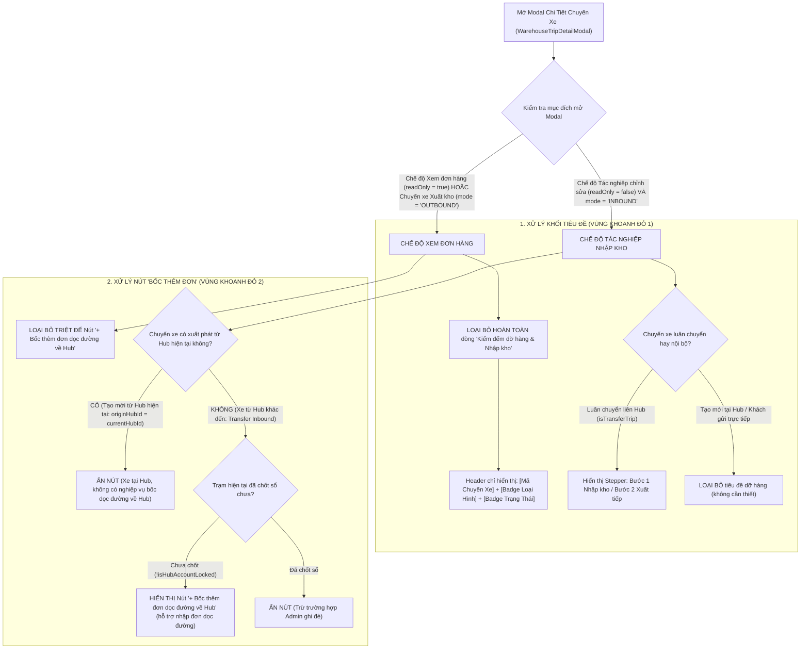

# Feedback 14/10 (Task #52) — Loại Bỏ Tiêu Đề "Kiểm Đếm Dỡ Hàng & Nhập Kho" Và Nút "Bốc Thêm Đơn Dọc Đường" Ở Màn Hình Xem Đơn Hàng Trong Trip Xuất, Nhập Tạo Mới Từ Hub Của Account

> **Thời gian ghi nhận**: 14/10/2026  
> **Người báo cáo**: @【M】【C】【D】 / @Thai (Quản lý nghiệp vụ / Vận hành TMS)  
> **Phạm vi tác động**:  
> - Modal Chi tiết Chuyến xe & Xem đơn hàng ([`warehouse-trip-detail-modal.tsx`](file:///frontend/src/features/warehouse/components/warehouse-trip-detail-modal.tsx)) ➔ Quản lý hiển thị Header Bar, ẩn khối tiêu đề dỡ hàng và ẩn nút bốc thêm đơn dọc đường khi xem đơn hoặc chuyến xe xuất phát từ Hub hiện tại.  
> - Màn hình Quản lý Xuất kho ([`outbound/page.tsx`](file:///frontend/src/app/dashboard/warehouse/outbound/page.tsx)) ➔ Mở modal xem đơn hàng trong chuyến xe xuất kho (`mode='OUTBOUND'`, `readOnly={true}`).  
> - Màn hình Quản lý Nhập kho ([`inbound/page.tsx`](file:///frontend/src/app/dashboard/warehouse/inbound/page.tsx)) ➔ Mở modal xem chi tiết đơn hàng chuyến xe nhập kho tạo mới trực tiếp tại Hub (`mode='INBOUND'`, `readOnly={true}`).  
> - Kiểm thử tự động E2E ([`52-trip-detail-view-clean-header-and-no-roadside.spec.ts`](file:///frontend/e2e/52-trip-detail-view-clean-header-and-no-roadside.spec.ts)).  
> **Tài liệu tham chiếu**:  
> - `/leader` Business Domain Architecture ([`SKILL.md`](file:///.agents/skills/leader/SKILL.md))  
> - Quy chế phát triển hệ thống [`AGENTS.md`](file:///AGENTS.md) (Zero Technical Jargon, Detail vs Create Mode Separation, Real DB Data)  
> - Quy chuẩn giao diện hẹp [`.agents/rules/ui-compact-density.md`](file:///.agents/rules/ui-compact-density.md) & [`ui-spacing-guard`](file:///.agents/skills/ui-spacing-guard/SKILL.md)  
> - Ảnh chụp minh chứng phản hồi: [`feedbacks/feedback_14_10_task_52/screenshot_01.jpg`](file:///feedbacks/feedback_14_10_task_52/screenshot_01.jpg)  
> - Biên niên sử tiến hóa hệ thống [`docs/SYSTEM_TIMELINE.md`](file:///docs/SYSTEM_TIMELINE.md)  

---

## 📌 Bối cảnh nghiệp vụ thực tế (Chốt theo phản hồi người dùng & Ảnh screenshot_01.jpg)

### 1. Phản hồi gốc từ người dùng (@【M】【C】【D】 / @Thai)
> *"loại bỏ các phần khoanh đỏ này ở màn hình xem đơn hàng trong trip xuất, nhập được tạo mới từ hub của account đang sử dụng."*

Kèm theo ảnh chụp thực tế: `feedbacks/feedback_14_10_task_52/screenshot_01.jpg` hiển thị modal xem chi tiết chuyến xe `SD49` (loại hình `Khách gửi trực tiếp`, trạng thái `Chờ xử lý`, lộ trình `Andromeda Hub - HCM`). Trong ảnh có 2 vùng khoanh đỏ viền đỏ rõ rệt:
1. **Vùng khoanh đỏ 1 (Phần Header phụ)**: Khối tiêu đề chứa Icon kho hàng kèm dòng chữ **`Kiểm đếm dỡ hàng & Nhập kho`**.
2. **Vùng khoanh đỏ 2 (Thanh công cụ bảng dòng hàng)**: Nút bấm màu xanh viền nét đứt **`+ Bốc thêm đơn dọc đường về Hub`**.

---

### 2. Tình huống vận hành thực tế tại Hub/Kho vận (Sự tách biệt giữa Chế độ Xem tra cứu & Tác nghiệp dỡ xe liên tỉnh)

Trong mô hình vận hành mạng lưới vận tải TMS (Spider Express):

1. **Bản chất của Màn hình Xem đơn hàng trong Chuyến xe (Trip Order Inspection / Read-Only View)**:
   - Khi thủ kho hoặc điều độ viên bấm vào mã chuyến xe (`tripCode`, ví dụ `SD49`) trên bảng danh sách Xuất kho hoặc Nhập kho, mục đích cốt lõi là **tra cứu danh sách các đơn hàng đã được xếp lên chuyến xe** (gồm mã vận đơn, tên hàng, số kiện, số kg, số khối m³, địa chỉ giao, ghi chú và in tem nhận diện).
   - Đây là **chế độ xem chỉ đọc (`readOnly = true`)**, hoàn toàn mang tính chất kiểm tra, đối chiếu thông tin (Audit/Inspection), không phải là phiên làm việc tác nghiệp kiểm đếm dỡ hàng thực tế.

2. **Bất cập nghiêm trọng trên giao diện cũ (Phần khoanh đỏ 1: Tiêu đề "Kiểm đếm dỡ hàng & Nhập kho")**:
   - Thành phần `WarehouseTripDetailModal` ban đầu được thiết kế phục vụ quy trình Thủ kho nhận xe tải từ nơi khác đến và tiến hành dỡ hàng xuống kho (Tally Inbound). Do đó, dòng tiêu đề `<h2>` đã bị hardcode dòng chữ *"Kiểm đếm dỡ hàng & Nhập kho"*.
   - Khi modal này được tái sử dụng để xem chi tiết đơn hàng:
     * **Đối với chuyến xe Xuất kho (`mode = 'OUTBOUND'`)**: Hàng hóa đang được xếp lên xe để xuất đi (Loading/Outbound), nhưng giao diện lại ghi to *"Kiểm đếm dỡ hàng & Nhập kho"*. Đây là lỗi sai lệch thuật ngữ vận hành nghiêm trọng.
     * **Đối với chuyến xe tạo mới từ Hub của tài khoản đang sử dụng (Origin Hub)**: Ví dụ chuyến `SD49` trong ảnh là hàng gửi trực tiếp tại quầy của Hub (`Khách gửi trực tiếp`) hoặc chuyến xuất phát từ Hub này. Hàng hóa được tiếp nhận tại quầy hoặc gom tại chỗ, không hề có hoạt động dỡ hàng từ xe đường dài xuống kho.
     * Tiêu đề này vừa chiếm diện tích vô ích trên màn hình hẹp, vừa gây hiểu nhầm cho nhân viên vận hành rằng chuyến xe đang trong trạng thái cần kiểm đếm dỡ hàng.
   - **Giải pháp chuẩn hóa**: Loại bỏ hoàn toàn khối tiêu đề `Kiểm đếm dỡ hàng & Nhập kho` này ở chế độ xem đơn hàng hoặc khi chuyến xe xuất phát từ Hub của tài khoản. Thanh Header trên cùng đã có đầy đủ nhận diện: `CHUYẾN XE SDxx`, Badge hình thức (`Khách gửi trực tiếp` / `Luân chuyển nội bộ`), Badge trạng thái (`Chờ xử lý` / `Đã xử lý`), và nút đóng `X`.

3. **Bất cập nghiêm trọng trên giao diện cũ (Phần khoanh đỏ 2: Nút "+ Bốc thêm đơn dọc đường về Hub")**:
   - Nghiệp vụ *"Bốc thêm đơn dọc đường về Hub"* (En-route Roadside Cargo Pick-up) là tính năng đặc thù cho phép tài xế xe tải đường dài trên đường chạy từ trạm khác về Hub có ghé bốc thêm các lô hàng lẻ dọc quốc lộ và chở về nhập vào Hub đích.
   - Nút này chỉ có ý nghĩa khi:
     * Xe đang trên đường từ trạm khác chạy về Hub đích (`stopType = 'DESTINATION'` hoặc `isTransfer = true` và `originHubId !== currentHubId`).
     * Thủ kho đang mở tác nghiệp nhập kho thực tế (`readOnly = false`).
   - Tuy nhiên, trong mã nguồn cũ, nút này chỉ kiểm tra điều kiện lỏng lẻo `isManifestTripCode(tripCode) && !isHubAccountLocked`, hoàn toàn **bỏ quên kiểm tra `!readOnly`**, **bỏ quên kiểm tra `mode !== 'OUTBOUND'`**, và **không kiểm tra xem chuyến xe có phải được tạo mới tại Hub hiện tại hay không**.
   - Hậu quả:
     * Khi xem đơn hàng ở chế độ chỉ đọc (`readOnly = true`), nút bốc thêm đơn vẫn chình ình xuất hiện.
     * Khi xem chuyến xe xuất kho (Outbound), xe chuẩn bị chạy đi mà lại có nút "bốc thêm đơn về Hub".
     * Khi xem chuyến xe tạo mới tại Hub (Origin Hub), xe chưa hề lăn bánh hoặc nhận hàng tại chỗ mà lại có nút "bốc thêm đơn dọc đường về Hub".
   - **Giải pháp chuẩn hóa**: Loại bỏ triệt để nút `+ Bốc thêm đơn dọc đường về Hub` khỏi màn hình xem đơn hàng, chuyến xe xuất kho, và mọi chuyến xe tạo mới từ Hub của tài khoản đang đăng nhập.

---

### 3. Sơ đồ ma trận điều kiện hiển thị UI (UI Conditional Matrix)



---

## 🔍 Tổng hợp các điểm chưa đúng trên giao diện cũ (Đối chiếu phân tích trực tiếp)

| STT | Điểm chưa đúng trên hệ thống cũ | Vị trí mã nguồn / Đối chiếu giao diện [`screenshot_01.jpg`](file:///feedbacks/feedback_14_10_task_52/screenshot_01.jpg) | Nguyên nhân kỹ thuật & Giải pháp khắc phục triệt để |
|:---:|---|---|---|
| **1** | **Khối tiêu đề phụ hiển thị sai lệch: "Kiểm đếm dỡ hàng & Nhập kho" (Vùng khoanh đỏ 1)** | [`warehouse-trip-detail-modal.tsx#L906-L915`](file:///frontend/src/features/warehouse/components/warehouse-trip-detail-modal.tsx#L906-L915) | Đoạn code render `<h2 className="text-sm font-black ..."><IconBuildingWarehouse /> ...</h2>` hardcode chuỗi `'Kiểm đếm dỡ hàng & Nhập kho'` khi `!isTransferTrip`, không kiểm tra xem modal đang ở chế độ xem (`readOnly`) hay xem chuyến xe xuất kho (`mode === 'OUTBOUND'`), hay chuyến xe tạo mới tại Hub.<br>➔ **Khắc phục**: Khi `readOnly === true`, hoặc `mode === 'OUTBOUND'`, hoặc chuyến xe tạo mới từ Hub hiện tại (`isTripOriginHere`), **loại bỏ hoàn toàn** thẻ `<h2>` này. Header bar giữ nguyên dòng trên cùng với mã chuyến xe và các badge trạng thái/loại hình gọn gàng, tinh tế. |
| **2** | **Nút "+ Bốc thêm đơn dọc đường về Hub" xuất hiện trái phép trên màn hình xem đơn hàng (Vùng khoanh đỏ 2)** | [`warehouse-trip-detail-modal.tsx#L1184-L1206`](file:///frontend/src/features/warehouse/components/warehouse-trip-detail-modal.tsx#L1184-L1206) | Điều kiện render nút chỉ là `{isManifestTripCode(tripGroup?.tripCode) && !isHubAccountLocked}`, hoàn toàn không kiểm tra `!readOnly`, không kiểm tra `mode !== 'OUTBOUND'`, và không kiểm tra nguồn gốc chuyến xe. Do đó, khi xem đơn hàng ở chế độ xem chỉ đọc trên chuyến xe tạo mới tại Hub, nút này vẫn hiển thị cho phép bấm mở popup bốc đơn.<br>➔ **Khắc phục**: Siết chặt điều kiện hiển thị nút: BẮT BUỘC phải thỏa mãn đồng thời: `!effectiveReadOnly && mode === 'INBOUND' && isTransferTrip && !isTripOriginHere && isManifestTripCode(tripGroup?.tripCode) && !isHubAccountLocked`. Khi xem đơn hàng hoặc chuyến xe tạo mới từ Hub của tài khoản, nút này lập tức bị ẩn triệt để. |
| **3** | **Thiếu cơ chế nhận diện Chuyến xe xuất phát từ Hub của tài khoản (`isTripOriginHere`)** | [`warehouse-trip-detail-modal.tsx#L100-L135`](file:///frontend/src/features/warehouse/components/warehouse-trip-detail-modal.tsx#L100-L135) | Modal chưa có computed helper để xác định xem chuyến xe đang mở có phải xuất phát từ Hub của tài khoản hiện tại hay không (`originHubId === currentHubId` hoặc trạm đầu tiên trong `manifest.stops` trùng với `currentHubId` hoặc `mode === 'OUTBOUND'` hoặc chuyến xe trực tiếp `!isTransferTrip`).<br>➔ **Khắc phục**: Xây dựng computed memo `isTripOriginHere` dựa trên `currentHubId`, `manifest.stops`, `tripGroup.hubId`, `tripGroup.isTransfer` và `mode`. |
| **4** | **Trang Xuất kho (`outbound/page.tsx`) mở modal xem chuyến xe vẫn tiềm ẩn hiển thị nút tác nghiệp nhập kho** | [`outbound/page.tsx#L1608-L1620`](file:///frontend/src/app/dashboard/warehouse/outbound/page.tsx#L1608-L1620) | Trang Outbound truyền `mode='OUTBOUND'` và `readOnly={true}` vào `WarehouseTripDetailModal`, nhưng bên trong modal lại không dùng `mode` để ẩn tiêu đề dỡ hàng và nút bốc thêm đơn về Hub.<br>➔ **Khắc phục**: Đồng bộ biến `mode === 'OUTBOUND'` và `readOnly={true}` để dọn dẹp sạch sẽ toàn bộ các thành phần nhập kho/dỡ hàng thừa thãi trên màn hình xuất kho. |

---

## 📋 Danh sách công việc triển khai (Action Checklist)

### 1. Frontend (`frontend/src/features/warehouse/components/warehouse-trip-detail-modal.tsx`)

- [x] **Bổ sung computed helper nhận diện Chuyến xe tạo mới từ Hub hiện tại (`isTripOriginHere`)**:
  ```typescript
  const currentHubId = manifest?.currentHubId ?? user?.hubId ?? (user?.hub as any)?.id;

  const isTripOriginHere = useMemo(() => {
    // 1. Mọi chuyến xe trên màn hình Xuất kho đều xuất phát từ Hub hiện tại
    if (mode === 'OUTBOUND') return true;

    // 2. Chuyến xe không phải luân chuyển (Khách gửi trực tiếp tạo tại Hub)
    if (!isTransferTrip) return true;

    // 3. Kiểm tra trạm xuất phát đầu tiên trong danh sách lộ trình stops của Manifest
    if (manifest?.stops && manifest.stops.length > 0) {
      const originStop =
        manifest.stops.find((s) => s.stopType === 'ORIGIN' || s.stopSequence === 1) ??
        manifest.stops[0];
      if (originStop && currentHubId && originStop.hubId === currentHubId) {
        return true;
      }
    }

    // 4. Kiểm tra hubId được gán trên tripGroup
    if (tripGroup?.hubId && currentHubId && tripGroup.hubId === currentHubId) {
      return true;
    }

    // 5. Kiểm tra originHubId trên các đơn hàng thuộc trip
    if (tripGroup?.orders && tripGroup.orders.length > 0) {
      const firstOriginId = tripGroup.orders[0]?.originHubId;
      if (firstOriginId && currentHubId && firstOriginId === currentHubId) {
        return true;
      }
    }

    return false;
  }, [mode, isTransferTrip, manifest, currentHubId, tripGroup]);
  ```

- [x] **Loại bỏ khối tiêu đề phụ `Kiểm đếm dỡ hàng & Nhập kho` (Phần khoanh đỏ 1)**:
  - Vị trí: Dưới thanh Header Bar (`L906-L915`).
  - Điều kiện ẩn: Khi `readOnly === true`, HOẶC `effectiveReadOnly === true`, HOẶC `mode === 'OUTBOUND'`, HOẶC `isTripOriginHere === true`:
    * Không render thẻ `<h2>` chứa icon `<IconBuildingWarehouse />` và chữ *"Kiểm đếm dỡ hàng & Nhập kho"*.
    * Chỉ giữ lại khi người dùng đang thực hiện tác nghiệp dỡ hàng thực tế (`!effectiveReadOnly && mode === 'INBOUND' && isTransferTrip && !isTripOriginHere`).
  - Kết quả: Thanh Header trở nên gọn gàng, tinh tế, loại bỏ hoàn toàn tình trạng sai lệch thuật ngữ khi xem đơn hàng trên chuyến xe.

- [x] **Loại bỏ triệt để nút `+ Bốc thêm đơn dọc đường về Hub` (Phần khoanh đỏ 2)**:
  - Vị trí: Thanh công cụ tiêu đề bảng dòng hàng (`L1184-L1206`).
  - Thay thế điều kiện hiển thị cũ:
    ```tsx
    {/* CŨ: isManifestTripCode(tripGroup?.tripCode) && !isHubAccountLocked */}
    {/* MỚI: Chỉ hiển thị khi đang tác nghiệp nhập kho luân chuyển từ Hub khác đến */}
    {!effectiveReadOnly &&
      mode === 'INBOUND' &&
      isTransferTrip &&
      !isTripOriginHere &&
      isManifestTripCode(tripGroup?.tripCode) &&
      !isHubAccountLocked && (
        <Button
          type='button'
          variant='outline'
          size='sm'
          onClick={() => {
            setAppendModalMode('ROADSIDE_INBOUND');
            setIsAppendModalOpen(true);
          }}
          className='h-6 px-2 text-[10px] text-blue-700 border-blue-300 hover:bg-blue-50 dark:text-blue-300 dark:border-blue-700 dark:hover:bg-blue-950 font-bold'
          title='Tài xế bốc thêm hàng ngoài đường chở về dỡ tại kho hiện tại'
        >
          {isAdmin && isCurrentHubCompleted && (
            <Badge
              variant='outline'
              className='text-[9px] mr-1 bg-amber-100 text-amber-900 border-amber-300 px-1 py-0 h-3.5'
            >
              Admin
            </Badge>
          )}
          <IconPlus className='h-3 w-3 mr-1' /> Bốc thêm đơn dọc đường về Hub
        </Button>
      )}
    ```
  - Kết quả: Nút này biến mất 100% trên màn hình xem đơn hàng (`readOnly = true`), trên màn hình xuất kho (`mode = 'OUTBOUND'`), và trên các chuyến xe tạo mới từ Hub của tài khoản.

- [x] **Rà soát thông báo trạng thái chốt sổ cái tồn kho**:
  - Tại dòng `L1035-L1051`: Câu thông báo *"Chuyến xe đã chốt sổ cái tồn kho nhập tại kho này"* chỉ hiển thị khi thực sự có tác nghiệp nhập kho trước đó; đối với chuyến xuất kho hoặc chuyến tạo mới tại quầy, đảm bảo nội dung thông báo phản ánh đúng bản chất chuyến xe hoặc ẩn đi nếu không áp dụng.

---

### 2. Frontend Outbound & Inbound Pages Integration Verification

- [x] **Kiểm tra màn hình Xuất kho ([`outbound/page.tsx`](file:///frontend/src/app/dashboard/warehouse/outbound/page.tsx))**:
  - Khi click vào mã chuyến xe `tripCode` trên bảng danh sách Xuất kho:
    * Modal `WarehouseTripDetailModal` mở lên ở chế độ `readOnly={true}`, `mode='OUTBOUND'`.
    * Xác nhận **KHÔNG CÒN** dòng chữ *"Kiểm đếm dỡ hàng & Nhập kho"*.
    * Xác nhận **KHÔNG CÒN** nút `[+ Bốc thêm đơn dọc đường về Hub]`.
    * Bảng danh sách hiển thị đầy đủ các đơn hàng trên chuyến xe kèm số kiện, kg, m³ và nút in tem.

- [x] **Kiểm tra màn hình Nhập kho ([`inbound/page.tsx`](file:///frontend/src/app/dashboard/warehouse/inbound/page.tsx))**:
  - Khi click vào mã chuyến xe `tripCode` của một chuyến xe tạo mới tại Hub (như `SD49` - Khách gửi trực tiếp):
    * Modal mở lên ở chế độ xem (`isTripViewModalOpen`, `readOnly={true}`).
    * Xác nhận **KHÔNG CÒN** dòng chữ *"Kiểm đếm dỡ hàng & Nhập kho"*.
    * Xác nhận **KHÔNG CÒN** nút `[+ Bốc thêm đơn dọc đường về Hub]`.
  - Khi click vào nút `[Tiếp tục]` trên một chuyến xe luân chuyển đến từ Hub khác (`isPending = true`):
    * Modal mở lên ở chế độ chỉnh sửa tác nghiệp (`isTripEditModalOpen`, `readOnly={false}`).
    * Xác nhận quy trình kiểm đếm dỡ hàng liên Hub và tính năng bốc thêm đơn dọc đường (nếu hợp lệ) vẫn hoạt động nguyên vẹn, không gây ảnh hưởng hay thoái lui logic (no regression).

---

### 3. Kiểm thử & Đảm bảo chất lượng (Verification & Quality Gate)

- [x] **Kiểm tra Type Safety & Spacing Guard**:
  - Chạy `npx tsc --noEmit` trong thư mục `frontend/` đảm bảo không có bất kỳ lỗi biên dịch TypeScript nào.
  - Tuân thủ nghiêm ngặt quy chuẩn `ui-compact-density`: không sinh các class cấm (`p-4`, `gap-4`, `space-y-3`), giữ khoảng cách hẹp và tối ưu hóa diện tích hiển thị.

- [x] **Xây dựng bộ kiểm thử tự động Playwright E2E ([`52-trip-detail-view-clean-header-and-no-roadside.spec.ts`](file:///frontend/e2e/52-trip-detail-view-clean-header-and-no-roadside.spec.ts))**:
  - **Kịch bản 1 (Inbound View Modal Cleanliness)**:
    1. Đăng nhập tài khoản Thủ kho (`WAREHOUSE_MANAGER`).
    2. Truy cập `/dashboard/warehouse/inbound`.
    3. Nhấp vào mã chuyến xe được tạo tại Hub (ví dụ `SD49` hoặc chuyến xe `Khách gửi trực tiếp`).
    4. Assert: Modal hiển thị mã chuyến xe, badge loại hình, badge trạng thái.
    5. Assert: Phần tử chứa text `"Kiểm đếm dỡ hàng & Nhập kho"` **HOÀN TOÀN KHÔNG TỒN TẠI** (`toBeHidden()` hoặc `not.toBeVisible()`).
    6. Assert: Nút bấm có text `"Bốc thêm đơn dọc đường về Hub"` **HOÀN TOÀN KHÔNG TỒN TẠI** (`not.toBeVisible()`).
    7. Chụp ảnh màn hình bằng chứng nghiệm thu: `screenshot_01_inbound_view_cleaned_verified.png`.
  - **Kịch bản 2 (Outbound View Modal Cleanliness)**:
    1. Truy cập `/dashboard/warehouse/outbound`.
    2. Nhấp vào mã chuyến xe xuất kho bất kỳ.
    3. Assert: Modal hiển thị chi tiết chuyến xe xuất kho.
    4. Assert: Tuyệt đối không xuất hiện dòng chữ `"Kiểm đếm dỡ hàng & Nhập kho"`.
    5. Assert: Tuyệt đối không xuất hiện nút `"Bốc thêm đơn dọc đường về Hub"`.
    6. Chụp ảnh màn hình bằng chứng nghiệm thu: `screenshot_02_outbound_view_cleaned_verified.png`.
  - **Kịch bản 3 (Regression Check - Active Transfer Inbound Tally)**:
    1. Kiểm tra chuyến xe luân chuyển liên Hub đến từ Hub khác ở chế độ tác nghiệp (`handleResumeInboundTrip`).
    2. Xác nhận quy trình dỡ hàng liên Hub không bị lỗi.

- [x] **Lưu bằng chứng nghiệm thu & Cập nhật Biên niên sử**:
  - Lưu ảnh chụp màn hình kiểm thử vào `feedbacks/feedback_14_10_task_52/`.
  - Cập nhật kết quả vào `feedbacks/feedback_14_10_task_52/RESOLUTION.md` và `docs/SYSTEM_TIMELINE.md`.

---

## 🎯 Tiêu chuẩn Nghiệm thu (Definition of Done - DoD)

1. Ở màn hình xem đơn hàng trong chuyến xe (cả Xuất kho lẫn Nhập kho) đối với chuyến xe tạo mới từ Hub của tài khoản đang sử dụng:
   - **100% không còn hiển thị dòng chữ / tiêu đề `"Kiểm đếm dỡ hàng & Nhập kho"`**.
   - **100% không còn hiển thị nút bấm `"+ Bốc thêm đơn dọc đường về Hub"`**.
2. Giao diện modal giữ nguyên sự sắc nét, hiển thị rõ ràng mã chuyến xe, badge loại hình, lộ trình xe, bảng kê chi tiết các dòng hàng với đầy đủ thông tin (kiện, kg, m³, điểm giao, in tem) và nút đóng.
3. Không làm ảnh hưởng hay thoái lui đến luồng tác nghiệp dỡ hàng liên Hub thực tế của thủ kho khi nhận xe từ chi nhánh khác chuyển đến.
4. Toàn bộ kịch bản kiểm thử tự động Playwright E2E PASS 100%, có ảnh chụp bằng chứng nghiệm thu thực tế so khớp với yêu cầu tại `screenshot_01.jpg`.
