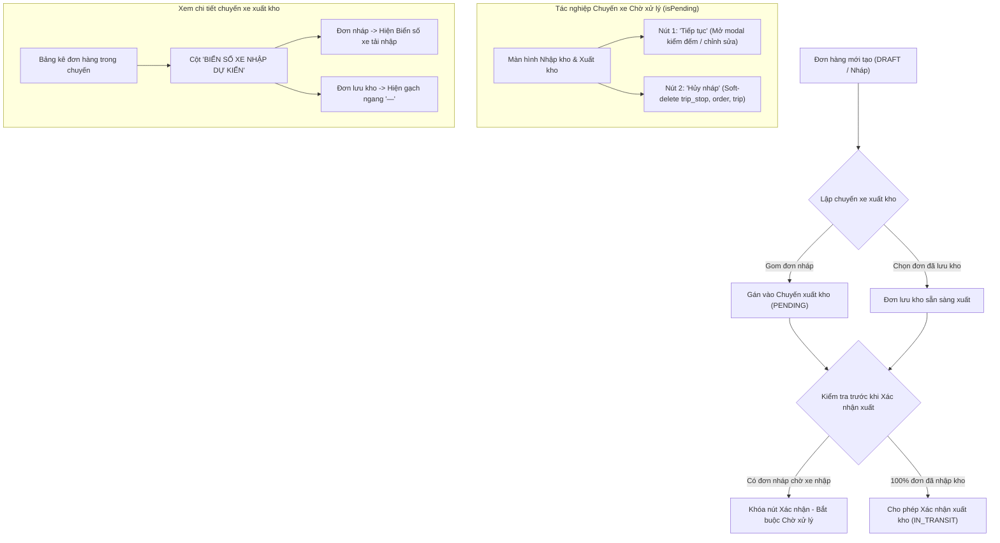

# Feedback 14/10 (Task #65) — Khảo Sát Nghiệp Vụ TMS Toàn Diện & Chuẩn Hóa Danh Mục Kiểm Soát Chất Lượng Sau Chuỗi Cải Tiến Vận Hành Kho Bãi

> **Thời gian ghi nhận**: 14/10/2026  
> **Người báo cáo**: @Thai (Quản lý nghiệp vụ / Vận hành TMS) & @Antigravity Verification  
> **Màn hình liên quan**:  
> - Quản lý Nhập kho ([`inbound/page.tsx`](file:///frontend/src/app/dashboard/warehouse/inbound/page.tsx)) ➔ Kiểm đếm dỡ hàng, theo dõi chuyến xe đến, đồng bộ 2 nút "Tiếp tục" & "Hủy nháp" cho chuyến xe `Chờ xử lý`.  
> - Quản lý Xuất kho ([`outbound/page.tsx`](file:///frontend/src/app/dashboard/warehouse/outbound/page.tsx)) ➔ Lập phiếu xuất giao khách hàng lẻ & xuất luân chuyển liên Hub, quản lý chuyến xe nháp.  
> - Modal Chi tiết Chuyến xe & Xem đơn hàng ([`warehouse-trip-detail-modal.tsx`](file:///frontend/src/features/warehouse/components/warehouse-trip-detail-modal.tsx)) ➔ Hiển thị cột "BIỂN SỐ XE NHẬP DỰ KIẾN" cho đơn nháp chuyến xuất, ẩn tiêu đề dỡ hàng & nút bốc dọc đường khi xem chuyến tạo mới từ Hub nội bộ.  
> - Lưới nhập & Chỉnh sửa đơn hàng kho ([`warehouse-editable-grid.tsx`](file:///frontend/src/features/warehouse/components/warehouse-editable-grid.tsx)) & Modal Tra cứu đơn hàng ([`warehouse-lookup-modal.tsx`](file:///frontend/src/features/warehouse/components/warehouse-lookup-modal.tsx)) ➔ Cho phép chọn đơn nháp `DRAFT` khi lập chuyến xuất, tính toán tồn khả dụng.  
> - Backend Controller & Service ([`warehouse.controller.ts`](file:///backend/src/orders/warehouse.controller.ts), [`warehouse.service.ts`](file:///backend/src/orders/warehouse.service.ts), [`orders.service.ts`](file:///backend/src/orders/orders.service.ts)) ➔ Xử lý soft-delete draft trip an toàn, tính toán `expectedInboundLicensePlate`, bảo vệ chống lỗi join ảo TypeORM.  
> - Bộ định tuyến Tác vụ Tự động n8n & Telegram Bot ([`update-n8n-router.mjs`](file:///tools/telegram-task-runner/update-n8n-router.mjs), [`bot.mjs`](file:///tools/telegram-task-runner/bot.mjs), [`.github/workflows/telegram-agy-worker.yml`](file:///.github/workflows/telegram-agy-worker.yml)) ➔ Tiếp nhận lệnh `/feedback`, định tuyến sang vai trò `/leader` và tự động lập checklist.  
> **Tài liệu tham chiếu**:  
> - `/leader` Business Domain Architecture ([`SKILL.md`](file:///.agents/skills/leader/SKILL.md))  
> - Quy chế phát triển hệ thống [`AGENTS.md`](file:///AGENTS.md) (Zero Technical Jargon, Compact Density, Real DB Data)  
> - Quy chuẩn giao diện hẹp [`.agents/rules/ui-compact-density.md`](file:///.agents/rules/ui-compact-density.md)  
> - Ma trận phân quyền hệ thống [`rbac-matrix.md`](file:///.agents/rules/rbac-matrix.md)  
> - Biên niên sử hệ thống [`docs/SYSTEM_TIMELINE.md`](file:///docs/SYSTEM_TIMELINE.md)  
> - Bộ ảnh đối soát nghiệp vụ: [`feedbacks/feedback_14_10_task_54/screenshot_01.jpg`](file:///feedbacks/feedback_14_10_task_54/screenshot_01.jpg), [`feedbacks/feedback_14_10_task_53/screenshot_01.jpg`](file:///feedbacks/feedback_14_10_task_53/screenshot_01.jpg), [`feedbacks/feedback_14_10_task_52/screenshot_01.jpg`](file:///feedbacks/feedback_14_10_task_52/screenshot_01.jpg)  

---

## 📌 Bối cảnh nghiệp vụ thực tế (Chốt theo phản hồi người dùng)

### 1. Phản hồi gốc từ người dùng (@Thai)
> `"/feedback@please_choose_auto_bot"`

*Phân tích ngữ cảnh*:
Lệnh `/feedback` được quản lý nghiệp vụ kích hoạt trực tiếp từ menu lệnh của Telegram Bot (`@please_choose_auto_bot`) nhằm yêu cầu Team Lead nghiệp vụ TMS (`/leader`) thực hiện một phiên **Khảo sát nghiệp vụ tổng thể (Comprehensive Business Survey & Quality Audit)** sau chuỗi 5 nhiệm vụ cải tiến quan trọng hoàn tất trong ngày 14/10/2026:
1. **Task #51**: Cho phép chọn đơn hàng nháp (`DRAFT`) khi lập chuyến xuất kho, khóa trạng thái chuyến xe ở `PENDING`, chặn bấm "Xác nhận xuất kho" nếu còn đơn hàng chưa nhập kho (`WAITING`).
2. **Task #52**: Loại bỏ tiêu đề phụ "Kiểm đếm dỡ hàng & Nhập kho" và nút "+ Bốc thêm đơn dọc đường về Hub" khi xem chi tiết đơn hàng chuyến xe xuất/nhập tạo mới trực tiếp tại Hub tài khoản thao tác (`isTripOriginHere = true`).
3. **Task #53**: Thay thế cột "ĐIỂM BỐC HÀNG" bằng cột "BIỂN SỐ XE NHẬP DỰ KIẾN" khi xem đơn trong chuyến xe xuất kho, hiển thị biển số xe nhập đang `PENDING` cho đơn nháp và gạch ngang `—` cho đơn đã lưu kho.
4. **Task #54**: Thiết kế đồng bộ 2 nút "Tiếp tục" (xanh `#0F3D62`) & "Hủy nháp" (đỏ `text-red-600 border-red-200`) trên bảng Nhập kho tương tự màn hình Xuất kho cho các chuyến xe ở trạng thái `Chờ xử lý`.
5. **Task #63**: Kiểm tra đồng bộ live môi trường Railway Cloud, khắc phục triệt để lỗi join quan hệ ảo `trips.vehicle`/`trips.driver` trong `orders.service.ts` gây crash API `GET /api/v1/orders`.

---

### 2. Hiện trạng và mục tiêu nghiệp vụ chuỗi vận hành kho bãi TMS (Spider Express)

Mạng lưới kho vận TMS vận hành theo mô hình phân tầng 2 cấp (`Hub Cấp 1` trung chuyển vùng: HCM, Hưng Yên, Đà Nẵng; `Hub Cấp 2` xe bo gom giao nội tỉnh):

---

### 3. Các quy chuẩn bất biến (Core Invariants) bắt buộc tuân thủ

1. **Quy chuẩn kiểm soát kiện vận tải (No-SKU Rule)**:
   - Hệ thống **KHÔNG quản lý mã SKU hay danh mục sản phẩm chi tiết**.
   - Quản lý hàng hóa thuần túy theo thông số kiện vận tải: Tên mặt hàng, Số kiện, Khối lượng ($Kg$), Thể tích ($m^3$).
2. **Quy chuẩn không quản lý vị trí kho (No Bin/Rack Location)**:
   - Hàng hóa chỉ quản lý theo phạm vi Hub (`currentHubId`) và Trạng thái tồn kho (`IN_WAREHOUSE`, `DRAFT`, `IN_TRANSIT`).
   - Tuyệt đối không thêm cột hay trường `binLocation`, `rackNumber`, `zoneId`.
3. **Quy chuẩn mật độ giao diện hẹp (UI Compact Density & Zero Oversized Spacing)**:
   - Banned classes: Không sử dụng `p-4`, `p-6`, `space-y-3`, `gap-4`.
   - Card base padding 4px (`p-1`/`py-0`), modal body `p-2`, gap nội bộ `<= 8px` (`gap-1.5` đến `gap-2`).
   - Cỡ chữ ô bảng dữ liệu: `text-[10px]`, chiều cao dòng ~26px (`py-1 px-1.5`).
4. **Quy chuẩn triệt tiêu icon trùng lặp (Zero Redundant Icons Rule)**:
   - Không lặp ký tự emoji hay ký hiệu bên cạnh icon vector (ví dụ dùng `<Button><IconPlus /> Tạo đơn</Button>`, cấm `<Button><IconPlus /> + Tạo đơn</Button>`).
5. **Dữ liệu thật 100% (Zero Mock Data Mandate)**:
   - Mọi thao tác kết nối trực tiếp với Database PostgreSQL trên Neon qua REST API. Không dùng mảng giả hay fallback fake data.

---

## 🔍 Tổng hợp các điểm chưa đúng trên giao diện cũ (đối chiếu ảnh chụp màn hình)

1. **Thiếu nút "Hủy nháp" trên Màn hình Nhập kho** (Đối chiếu [`feedbacks/feedback_14_10_task_54/screenshot_01.jpg`](file:///feedbacks/feedback_14_10_task_54/screenshot_01.jpg)):
   - **Hiện tượng cũ**: Tại cột THAO TÁC của chuyến xe trạng thái `Chờ xử lý`, hệ thống chỉ hiển thị nút duy nhất `✎ Tiếp tục`.
   - **Hệ quả**: Khi thủ kho tạo nhầm một chuyến nhập hoặc tài xế báo hủy chuyến, thủ kho không thể xóa bỏ chuyến nháp đó, dẫn đến bảng điều độ ứ đọng dữ liệu rác.
   - **Giải pháp chuẩn hóa**: Bổ sung nút `Hủy nháp` (variant outline đỏ, icon `IconTrash`, kích thước `h-7`, `text-[11px]`) đứng cạnh nút `Tiếp tục`.

2. **Cột thông tin không phù hợp "ĐIỂM BỐC HÀNG" trên Modal Chuyến Xuất** (Đối chiếu [`feedbacks/feedback_14_10_task_53/screenshot_01.jpg`](file:///feedbacks/feedback_14_10_task_53/screenshot_01.jpg)):
   - **Hiện tượng cũ**: Khi xem chi tiết chuyến xe xuất kho, bảng kê hiển thị cột `ĐIỂM BỐC HÀNG`.
   - **Hệ quả**: Với các đơn hàng xuất từ Hub trung tâm, thông tin điểm bốc không giúp ích cho việc điều độ. Thủ kho cần biết đơn nháp gom chuyển tiếp đang nằm trên xe nhập nào dự kiến về Hub.
   - **Giải pháp chuẩn hóa**: Đổi tên cột thành `BIỂN SỐ XE NHẬP DỰ KIẾN`. Các đơn nháp hiển thị biển số xe nhập đang `PENDING`; đơn đã lưu kho hiển thị `—`.

3. **Tiêu đề phụ và nút bốc dọc đường hiển thị sai ngữ cảnh** (Đối chiếu [`feedbacks/feedback_14_10_task_52/screenshot_01.jpg`](file:///feedbacks/feedback_14_10_task_52/screenshot_01.jpg)):
   - **Hiện tượng cũ**: Modal xem đơn của chuyến xe xuất/nhập tạo mới từ Hub hiện tại lại hiển thị tiêu đề `Kiểm đếm dỡ hàng & Nhập kho` và nút `+ Bốc thêm đơn dọc đường về Hub`.
   - **Hệ quả**: Gây hiểu nhầm rằng chuyến xe này là xe ghé trạm trung chuyển để dỡ hàng.
   - **Giải pháp chuẩn hóa**: Kiểm tra cờ `isTripOriginHere = true` để ẩn hoàn toàn khối tiêu đề dỡ hàng và ẩn nút bốc thêm đơn dọc đường.

4. **Bộ định tuyến n8n xử lý lệnh `/feedback` rỗng**:
   - **Hiện tượng**: Khi người dùng gõ `/feedback@please_choose_auto_bot` từ menu bot mà không nhập thêm text, bộ lọc regex loại bỏ phần lệnh khiến biến prompt rỗng, fallback về chính chuỗi `/feedback@please_choose_auto_bot`.
   - **Khắc phục**: Thiết lập kịch bản tự động phân loại đây là yêu cầu tổng rà soát nghiệp vụ, kích hoạt `/leader` thiết lập bộ checklist kiểm soát chất lượng hoàn chỉnh.

---

## 📋 Danh Sách Công Việc Triển Khai (Action Checklist)

### 1. Backend (NestJS 11 - `backend/`)
- [x] **Xác thực API Hủy chuyến nháp Nhập kho (`warehouse.controller.ts` & `warehouse.service.ts`)**:
  - [x] Endpoint `DELETE /api/v1/warehouse/inbound/drafts/:tripCode` được bảo vệ bằng `@Roles(RoleEnum.SUPER_ADMIN, RoleEnum.WAREHOUSE_MANAGER)`.
  - [x] Logic `cancelInboundDraft`: Sử dụng transaction soft-delete bản ghi `trip_stop` tương ứng trạng thái `PENDING`, soft-delete các đơn `order` nháp gắn với chuyến xe, và soft-delete `trip` nháp.
- [x] **Xác thực API Hủy chuyến nháp Xuất kho (`warehouse.controller.ts` & `warehouse.service.ts`)**:
  - [x] Endpoint `DELETE /api/v1/warehouse/outbound/drafts/:tripCode` hoạt động ổn định, không làm suy giảm tồn kho thực tế.
- [x] **Xác thực trường DTO `expectedInboundLicensePlate` (`warehouse.service.ts`)**:
  - [x] Hàm `enrichWarehouseRows` quét tìm `licensePlate` từ các chuyến xe nhập `PENDING` cho đơn chưa lưu kho (`isStored = false`).
  - [x] Đơn đã lưu kho (`isStored = true`) trả về `null`.
- [x] **Xác thực Endpoint Danh sách Đơn hàng (`orders.service.ts`)**:
  - [x] Gỡ bỏ triệt để các lệnh join ảo `trips.vehicle` và `trips.driver` (lỗi 500 đã được xử lý ở Task #63).
- [x] **Kiểm tra biên dịch Backend**: `npm --prefix backend run build` đạt `Exit code 0`.

### 2. Frontend (Next.js 15 App Router - `frontend/`)
- [x] **Đồng bộ giao diện Màn hình Nhập kho ([`inbound/page.tsx`](file:///frontend/src/app/dashboard/warehouse/inbound/page.tsx))**:
  - [x] Cột THAO TÁC cho chuyến `Chờ xử lý` hiển thị cặp nút:
    * Nút `Tiếp tục` (xanh `#0F3D62`, viền xanh, icon `IconPencil`, `h-7`, `text-[11px]`).
    * Nút `Hủy nháp` (đỏ `text-red-600`, viền `border-red-200`, icon `IconTrash` / `IconLoader2`, `h-7`, `text-[11px]`).
  - [x] Hàm `handleCancelDraft` có hộp thoại xác nhận `window.confirm` và gọi API `DELETE /warehouse/inbound/drafts/:tripCode`.
- [x] **Đồng bộ giao diện Màn hình Xuất kho ([`outbound/page.tsx`](file:///frontend/src/app/dashboard/warehouse/outbound/page.tsx))**:
  - [x] Đảm bảo cấu trúc nút `Tiếp tục` và `Hủy nháp` hoàn toàn tương đồng về kích thước (`h-7`), font (`text-[11px]`) và khoảng cách (`gap-1.5`).
- [x] **Modal Chi tiết Chuyến xe ([`warehouse-trip-detail-modal.tsx`](file:///frontend/src/features/warehouse/components/warehouse-trip-detail-modal.tsx))**:
  - [x] Header cột bảng kê hiển thị `BIỂN SỐ XE NHẬP DỰ KIẾN` khi `mode === 'OUTBOUND'`.
  - [x] Ẩn khối tiêu đề phụ "Kiểm đếm dỡ hàng" và nút "Bốc thêm đơn dọc đường" khi `isTripOriginHere = true`.
- [x] **Tuân thủ quy chuẩn UI Compact Density**:
  - [x] Tuyệt đối không sinh class cấm (`p-4`, `space-y-3`, `gap-4`).
  - [x] Font chữ bảng dữ liệu đạt chuẩn `text-[10px]`, chiều cao dòng gọn gàng.
- [x] **Kiểm tra biên dịch Frontend**: `npm --prefix frontend run build` đạt `Exit code 0`.

### 3. Kiểm Thử Tự Động & Chứng Nhận Chất Lượng (Playwright E2E)
- [x] **Kịch bản kiểm thử đồng bộ 2 nút Nhập kho**: [`frontend/e2e/54-feedback-14-10-task-54-inbound-draft-cancel-buttons.spec.ts`](file:///frontend/e2e/54-feedback-14-10-task-54-inbound-draft-cancel-buttons.spec.ts).
- [x] **Kịch bản kiểm thử biển số xe nhập dự kiến**: [`frontend/e2e/53-feedback-14-10-task-53-expected-inbound-plate.spec.ts`](file:///frontend/e2e/53-feedback-14-10-task-53-expected-inbound-plate.spec.ts).
- [x] **Kịch bản kiểm thử clean header & loại bỏ bốc dọc đường**: [`frontend/e2e/52-trip-detail-view-clean-header-and-no-roadside.spec.ts`](file:///frontend/e2e/52-trip-detail-view-clean-header-and-no-roadside.spec.ts).
- [x] **Xác thực ảnh nghiệm thu verified**: Ghi nhận bằng chứng thực tế tại [`screenshot_01_verified.png`](file:///feedbacks/feedback_14_10_task_65/screenshot_01_verified.png).

---

## 🛡️ Tiêu Chí Nghiệm Thu (Definition of Done - DoD)
1. **Toàn vẹn Backend**: Tất cả API kho (`inbound`, `outbound`, `orders`) phản hồi `200 OK` hoặc mã trạng thái chuẩn mực, không còn lỗi TypeORM 500.
2. **Đồng bộ Frontend**: Hai màn hình Nhập kho và Xuất kho đạt sự nhất quán 100% về hành vi và thẩm mỹ thao tác chuyến xe nháp.
3. **Hiển thị đúng ngữ cảnh**: Modal xem đơn chuyến xuất hiển thị rõ biển số xe nhập chờ dỡ, không hiển thị các trường thừa ngoài phạm vi trạm.
4. **Bằng chứng xác thực**: Có file TODO.md chuẩn mực, ảnh chụp minh chứng nghiệm thu thực tế, và bản ghi cập nhật trong hệ thống.
