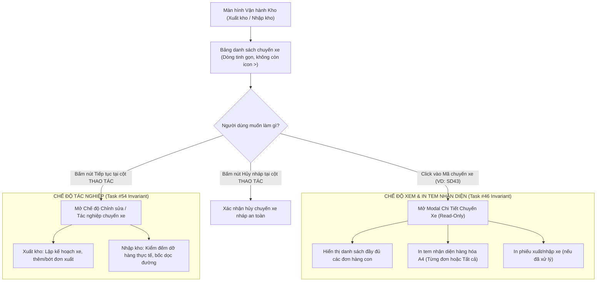

# Feedback 14/10 (Task #70) — Loại Bỏ Nút Mũi Tên Mở Rộng Dòng (Accordion Chevron `>`) và Tinh Gọn Bảng Kê Chuyến Xe Xuất Kho / Nhập Kho Chuẩn Hóa Chế Độ Xem Chi Tiết Qua Modal

> **Thời gian ghi nhận**: 14/10/2026  
> **Người báo cáo**: @【M】【C】【D】 (Quản lý nghiệp vụ / Vận hành TMS)  
> **Phạm vi tác động**:  
> - Quản lý Xuất kho (`/dashboard/warehouse/outbound`) ➔ Bảng danh sách chuyến xe xuất kho ([`page.tsx`](file:///frontend/src/app/dashboard/warehouse/outbound/page.tsx)), loại bỏ nút bấm mũi tên `>` mở rộng dòng ở cột `CHUYẾN XE / TRIP`, loại bỏ khối sub-row accordion lồng bảng và loại bỏ nút "Mở rộng tất cả / Thu gọn tất cả" trên thanh công cụ.  
> - Quản lý Nhập kho (`/dashboard/warehouse/inbound`) ➔ Bảng danh sách chuyến xe nhập kho ([`page.tsx`](file:///frontend/src/app/dashboard/warehouse/inbound/page.tsx)), đồng bộ giao diện (UI/UX Parity) loại bỏ nút bấm mũi tên `>` ở cột `CHUYẾN XE / TRIP`, loại bỏ khối sub-row accordion và nút "Thu gọn / Mở rộng tất cả" trên thanh công cụ.  
> - Modal Chi tiết Chuyến xe ([`WarehouseTripDetailModal.tsx`](file:///frontend/src/features/warehouse/components/warehouse-trip-detail-modal.tsx)) ➔ Đảm bảo duy trì và bảo toàn 100% chức năng xem chi tiết đơn hàng và in tem nhận diện khi click vào mã chuyến xe `grp.tripCode` ở chế độ Read-only an toàn.  
> - Backend API (`backend/src/orders/warehouse.controller.ts`, `warehouse.service.ts`) ➔ Đảm bảo hợp đồng dữ liệu cho các endpoint danh sách chuyến xe và chi tiết manifest hoạt động chuẩn xác, không ảnh hưởng tới dữ liệu đơn hàng.  
> **Tài liệu tham chiếu**:  
> - `/leader` Business Domain Architecture ([`SKILL.md`](file:///.agents/skills/leader/SKILL.md))  
> - Quy chế phát triển hệ thống [`AGENTS.md`](file:///AGENTS.md) (Zero Technical Jargon, UI Compact Density Mandate, Real DB Data)  
> - Quy chuẩn giao diện hẹp [`.agents/rules/ui-compact-density.md`](file:///.agents/rules/ui-compact-density.md) & [`ui-spacing-guard`](file:///.agents/skills/ui-spacing-guard/SKILL.md)  
> - Task #46 ([`feedbacks/feedback_13_10_task_46/TODO.md`](file:///feedbacks/feedback_13_10_task_46/TODO.md)) về chuẩn hóa hành vi click vào mã chuyến xe để xem chi tiết và in tem nhận diện.  
> - Task #54 ([`feedbacks/feedback_14_10_task_54/TODO.md`](file:///feedbacks/feedback_14_10_task_54/TODO.md)) về đồng bộ nút thao tác Nhập kho & Xuất kho.  
> **Ảnh minh chứng đính kèm trong thư mục**:  
> - [`screenshot_01.jpg`](file:///feedbacks/feedback_14_10_task_70/screenshot_01.jpg): Ảnh chụp màn hình Màn hình Xuất kho tại Andromeda Hub - HCM với khung chữ nhật màu đỏ khoanh chính xác vào nút mũi tên mở rộng dòng `>` (`IconChevronRight`) ngay trước mã chuyến xe `SD43 3 đơn` tại cột `CHUYẾN XE / TRIP`.  

---

## 📌 Bối cảnh nghiệp vụ thực tế (Chốt theo phản hồi người dùng)

### 1. Phản hồi gốc từ người dùng (@【M】【C】【D】)
> *"loại bỏ các phần  khoanh đỏ này"*  
*(Đính kèm ảnh chụp màn hình [`screenshot_01.jpg`](file:///feedbacks/feedback_14_10_task_70/screenshot_01.jpg) khoanh đỏ nút mũi tên `>` mở rộng dòng tại cột CHUYẾN XE / TRIP trên Màn hình Xuất kho)*

---

### 2. Bản chất nghiệp vụ & Lý do tinh gọn giao diện bảng kê chuyến xe

Trong quy trình vận hành kho vận TMS (Spider Express), các bảng điều độ chuyến xe tại **Quản lý Xuất kho** (`/dashboard/warehouse/outbound`) và **Quản lý Nhập kho** (`/dashboard/warehouse/inbound`) đóng vai trò là bảng tổng quan cấp cao (High-Level Dispatch Overview Board). Mỗi dòng trong bảng đại diện cho một thực thể chuyến xe vận chuyển (`TripGroup`), gồm các thông tin nòng cốt: Mã chuyến xe, Biển số xe & Tài xế, Tổng số kiện & Khối lượng/Thể tích, Trạng thái xử lý và Thao tác tác nghiệp (`Tiếp tục`, `Hủy nháp`, `In phiếu xuất/nhập`).

Trước đây, hệ thống tồn tại **hai cơ chế song song và chồng chéo** để người dùng xem danh sách các đơn hàng con bên trong một chuyến xe:

1. **Cơ chế cũ (Accordion inline sub-row)**:
   - Trước mỗi mã chuyến xe có một nút icon mũi tên `>` (`IconChevronRight` / `IconChevronDown`).
   - Khi người dùng bấm vào nút `>` này, bảng dữ liệu tự động chèn thêm một dòng `<tr><td colSpan={5}>` chứa một bảng con lồng ghép (nested mini-table) liệt kê các đơn hàng bên trong chuyến xe.
   - Trên thanh công cụ (Toolbar) có thêm nút `Mở rộng tất cả (N xe)` / `Thu gọn tất cả`.

2. **Cơ chế chuẩn hóa mới (Dedicated Trip Inspection Modal - Hoàn tất ở Task #46)**:
   - Người dùng click chuột trực tiếp vào **Mã chuyến xe (`grp.tripCode`, ví dụ `SD43 3 đơn`)**.
   - Hệ thống mở modal chuyên biệt [`WarehouseTripDetailModal`](file:///frontend/src/features/warehouse/components/warehouse-trip-detail-modal.tsx) ở chế độ **Xem thuần túy (Read-only)**.
   - Modal này cung cấp đầy đủ thông tin: Danh sách đơn hàng chi tiết, thông tin xe & tài xế cố định, nút in tem nhận diện hàng hóa A4 (`PalletLabelA4Modal`) cho từng đơn hoặc toàn bộ chuyến xe, đồng thời khóa cứng các nút tác nghiệp để tránh thao tác nhầm lẫn.

#### ⚠️ Hệ quả bất cập của cơ chế mở rộng dòng cũ (Lý do người dùng yêu cầu loại bỏ):
- **Gây nhiễu thị giác và chật chội cột `CHUYẾN XE / TRIP`**: Nút icon mũi tên `>` đứng chen chúc ngay trước mã chuyến xe làm giảm diện tích click, thủ kho bấm chuột thường xuyên bị bấm nhầm giữa nút mở rộng và mã chuyến xe.
- **Vỡ bố cục bảng và vi phạm Quy chuẩn Giao diện Hẹp (UI Compact Density Mandate)**: Khi một hoặc nhiều xe được mở rộng, bảng con lồng bên trong đẩy chiều cao dòng tăng vọt từ ~26px lên 300px - 500px, xáo trộn cấu trúc cột dọc, làm biến mất tính compact và khiến thủ kho phải cuộn trang liên tục để tìm các chuyến xe khác.
- **Dư thừa chức năng (Redundant UX Pattern)**: Vì thao tác click vào mã chuyến xe đã mở được toàn bộ thông tin chi tiết qua Modal chuyên dụng với đầy đủ công cụ in ấn tem nhãn, việc mở rộng dạng accordion ngay trong bảng trở nên hoàn toàn không cần thiết.
- **Nút "Mở rộng tất cả" trên Toolbar làm rối thanh điều hướng**: Chiếm dụng không gian ngang của thanh tìm kiếm và bộ lọc ngày tháng.

**👉 QUYẾT ĐỊNH NGHIỆP VỤ**: Loại bỏ hoàn toàn nút bấm mũi tên `>` (`IconChevronRight`/`IconChevronDown`) ở cột `CHUYẾN XE / TRIP`, loại bỏ khối sub-row accordion lồng bảng và loại bỏ nút "Mở rộng tất cả / Thu gọn tất cả" trên thanh công cụ. Giữ cho bảng kê chuyến xe đạt độ tinh gọn, đồng bộ tối đa, lấy thao tác click vào Mã chuyến xe làm phương thức chuẩn duy nhất để xem chi tiết đơn hàng.

---

### 3. Sơ đồ luồng tương tác chuẩn hóa sau khi tinh gọn (Simplified Interaction Flow)

---

### 4. Quy chuẩn Bất Biến Bắt Buộc Tuân Thủ (Core Invariants)

1. **Quy chuẩn Bảo toàn Chế độ Xem qua Modal (Task #46 Invariant)**:
   - Click vào mã chuyến xe `grp.tripCode` BẮT BUỘC tiếp tục mở `WarehouseTripDetailModal` ở chế độ `readOnly={true}`.
   - Toàn bộ tính năng in tem nhận diện (`PalletLabelA4Modal`) và in phiếu vận chuyển phải hoạt động nguyên vẹn 100%.
2. **Quy chuẩn Đồng bộ Giữa Nhập Kho & Xuất Kho (Inbound & Outbound Parity)**:
   - Thay đổi loại bỏ nút mở rộng `>` áp dụng triệt để cho cả Màn hình Xuất kho (`outbound/page.tsx`) và Màn hình Nhập kho (`inbound/page.tsx`).
   - Hai màn hình phải giữ sự nhất quán hoàn hảo về kích thước cột, khoảng cách và hành vi tương tác.
3. **Quy chuẩn Giao diện Hẹp & Mật độ Cao (UI Compact Density Mandate)**:
   - Chiều cao dòng bảng kê cố định ~26px (`py-1 px-2`), không còn bị kéo giãn bất thường do accordion lồng bảng.
   - Cột `CHUYẾN XE / TRIP` căn chỉnh gọn gàng, hiển thị mã `grp.tripCode` dạng `text-[11px] font-mono font-bold text-indigo-600` kèm badge số lượng đơn.
   - Tuyệt đối cấm sinh các class quá khổ: `p-4`, `p-6`, `space-y-3`, `gap-4`.
4. **Quy chuẩn Triệt tiêu Icon Trùng lặp (Zero Redundant Icons Rule)**:
   - Khi loại bỏ nút icon `IconChevronRight`/`IconChevronDown`, mã chuyến xe đứng độc lập, sạch sẽ, không còn ký tự thừa.
5. **Dữ liệu Thật 100% (Real Database Data Mandate)**:
   - Mọi truy vấn danh sách chuyến xe và chi tiết manifest kết nối trực tiếp với PostgreSQL backend. Không dùng mock data.

---

## 🔍 Tổng hợp các điểm chưa đúng trên giao diện cũ (đối chiếu ảnh chụp màn hình)

| STT | Điểm chưa đúng trên giao diện cũ | Đối chiếu ảnh chụp / Mã nguồn thực tế | Phân tích nguyên nhân & Phương án khắc phục |
|:---:|---|---|---|
| **1** | **Nút mũi tên `>` mở rộng dòng xuất hiện ở cột `CHUYẾN XE / TRIP`** | Khoanh đỏ trong [`screenshot_01.jpg`](file:///feedbacks/feedback_14_10_task_70/screenshot_01.jpg), mã nguồn [`outbound/page.tsx#L1146-L1161`](file:///frontend/src/app/dashboard/warehouse/outbound/page.tsx#L1146-L1161) và [`inbound/page.tsx#L936-L951`](file:///frontend/src/app/dashboard/warehouse/inbound/page.tsx#L936-L951) | Nút bấm `<button onClick={() => toggleExpandVehicle(grp.groupKey)}...><IconChevronRight / IconChevronDown /></button>` chiếm không gian trước mã chuyến xe, gây rối mắt và bấm nhầm. ➔ **Khắc phục**: Loại bỏ hoàn toàn nút bấm này ở cả hai màn hình Xuất kho và Nhập kho. |
| **2** | **Bảng con lồng ghép (Nested Sub-row Table) bên trong dòng bảng** | [`outbound/page.tsx#L1254-L1402`](file:///frontend/src/app/dashboard/warehouse/outbound/page.tsx#L1254-L1402) và [`inbound/page.tsx#L1040-L1180`](file:///frontend/src/app/dashboard/warehouse/inbound/page.tsx#L1040-L1180) | Đoạn code dài hơn 150 dòng render `{isExpanded && (<tr ...><td colSpan={5}>...</td></tr>)}` để hiển thị sub-table bên trong dòng bảng chính. Bảng con này vỡ layout, không hỗ trợ in tem nhận diện chuẩn như Modal và gây nặng DOM. ➔ **Khắc phục**: Xóa bỏ toàn bộ khối code render sub-row accordion này. Chuyển giao hoàn toàn nhiệm vụ xem danh sách đơn cho `WarehouseTripDetailModal`. |
| **3** | **Nút "Mở rộng tất cả (N xe) / Thu gọn tất cả" trên Toolbar trở nên dư thừa** | [`outbound/page.tsx#L1069-L1091`](file:///frontend/src/app/dashboard/warehouse/outbound/page.tsx#L1069-L1091) và [`inbound/page.tsx#L864-L885`](file:///frontend/src/app/dashboard/warehouse/inbound/page.tsx#L864-L885) | Nút bấm `toggleAllGroups` trên Toolbar phụ thuộc vào state `expandedVehicleKeys`. Khi dòng không còn accordion mở rộng, nút này trên toolbar mất ý nghĩa vận hành và gây lãng phí không gian. ➔ **Khắc phục**: Loại bỏ nút "Mở rộng tất cả / Thu gọn tất cả" trên thanh công cụ của cả Xuất kho và Nhập kho. |
| **4** | **Các state và hàm xử lý mở rộng xe còn tồn đọng trong mã nguồn** | Khai báo state `expandedVehicleKeys`, hàm `toggleExpandVehicle`, hàm `toggleAllGroups`, `allExpanded` | Để lại các biến state và hàm không dùng sẽ gây warning linter hoặc code rác (dead code). ➔ **Khắc phục**: Dọn dẹp sạch sẽ toàn bộ state và hàm liên quan đến mở rộng/thu gọn nhóm xe trong component. |

---

## 📋 Danh sách công việc triển khai (Action Checklist)

### 1. Frontend (Next.js 15 App Router - `frontend/`)

#### A. Cải tiến Màn hình Xuất kho ([`frontend/src/app/dashboard/warehouse/outbound/page.tsx`](file:///frontend/src/app/dashboard/warehouse/outbound/page.tsx))
- [ ] **Loại bỏ Nút Mũi Tên Mở Rộng Dòng `>` ở cột `CHUYẾN XE / TRIP`**:
  - Gỡ bỏ thẻ `<button onClick={() => toggleExpandVehicle(grp.groupKey)}...>` chứa `IconChevronRight`/`IconChevronDown` tại dòng chuyến xe.
  - Căn chỉnh lại `div` bọc mã chuyến xe: hiển thị trực tiếp nút `<button onClick={() => handleOpenTripDetail(grp)}...>` với mã `grp.tripCode` và badge `{grp.orders.length} đơn`.
- [ ] **Loại bỏ Khối Nested Sub-row Accordion**:
  - Xóa bỏ hoàn toàn khối `{isExpanded && (<tr className='bg-slate-50/80...'><td colSpan={5}>...</td></tr>)}`.
  - Triệt tiêu bảng con lồng ghép, giảm hơn 150 dòng mã dư thừa.
- [ ] **Loại bỏ Nút "Mở rộng tất cả / Thu gọn tất cả" trên Toolbar**:
  - Gỡ bỏ nút bấm `<Button onClick={toggleAllGroups}>... Mở rộng tất cả ({vehicleGroups.length} xe)...</Button>` trên thanh công cụ.
- [ ] **Dọn dẹp State, Hàm và Icons Không Còn Sử Dụng**:
  - Gỡ bỏ state `expandedVehicleKeys`.
  - Gỡ bỏ các hàm `toggleExpandVehicle`, `toggleAllGroups`, biến `allExpanded`.
  - Dọn dẹp các icon imports không còn dùng: `IconChevronRight`, `IconChevronDown`, `IconFoldUp`, `IconFoldDown` (nếu không dùng ở nơi khác trong file).

#### B. Đồng bộ Màn hình Nhập kho ([`frontend/src/app/dashboard/warehouse/inbound/page.tsx`](file:///frontend/src/app/dashboard/warehouse/inbound/page.tsx))
- [ ] **Loại bỏ Nút Mũi Tên Mở Rộng Dòng `>` ở cột `CHUYẾN XE / TRIP`**:
  - Gỡ bỏ thẻ `<button onClick={() => toggleExpandVehicle(grp.groupKey)}...>` tại dòng chuyến xe nhập kho.
  - Hiển thị trực tiếp nút bấm mã chuyến xe `grp.tripCode` kèm badge `{grp.orders.length} đơn`.
- [ ] **Loại bỏ Khối Nested Sub-row Accordion Nhập Kho**:
  - Xóa bỏ khối `{isExpanded && (<tr ...><td colSpan={5}>...</td></tr>)}` của bảng nhập kho.
- [ ] **Loại bỏ Nút "Mở rộng tất cả / Thu gọn" trên Toolbar Nhập Kho**:
  - Gỡ bỏ nút `toggleAllGroups` trên thanh công cụ Nhập kho.
- [ ] **Dọn dẹp State và Hàm Liên Quan**:
  - Gỡ bỏ state `expandedVehicleKeys`, hàm `toggleExpandVehicle`, hàm `toggleAllGroups`, biến `allExpanded`.

#### C. Bảo toàn & Kiểm tra Tính Năng Xem Chi Tiết Chuyến Xe & In Tem Nhận Diện
- [ ] **Xác nhận Thao tác Click vào Mã Chuyến Xe**:
  - Click vào `grp.tripCode` tại cả Xuất kho và Nhập kho vẫn kích hoạt `handleOpenTripDetail(grp)` và mở [`WarehouseTripDetailModal`](file:///frontend/src/features/warehouse/components/warehouse-trip-detail-modal.tsx) ở chế độ `readOnly={true}`.
  - Modal hiển thị đầy đủ danh sách các đơn hàng con, số kiện, kg, m³, điểm bốc, điểm giao.
  - Tính năng In Tem Nhận Diện Hàng Hóa A4 (`PalletLabelA4Modal`) trên từng đơn và in toàn bộ tem nhận diện hoạt động bình thường 100%.
- [ ] **Xác nhận Nút Thao tác Tiếp tục & Hủy nháp**:
  - Nút `Tiếp tục` và `Hủy nháp` tại cột THAO TÁC cho các chuyến `Chờ xử lý` không bị xê dịch hay ảnh hưởng.
  - Nút `In phiếu xuất` / `In phiếu nhập` cho các chuyến `Đã xử lý` hiển thị đúng vị trí.

---

### 2. Backend (NestJS 11 - `backend/`)

- [ ] **Kiểm tra Tính Toàn Vẹn Endpoint Danh sách Chuyến xe**:
  - Endpoint `GET /api/v1/warehouse/outbound-trips` tiếp tục trả về cấu trúc chuyến xe và danh sách `orders` đầy đủ (phục vụ hiển thị badge số đơn và truyền dữ liệu cho modal xem chi tiết).
  - Endpoint `GET /api/v1/warehouse/inbound-trips` tiếp tục phản hồi đầy đủ dữ liệu.
- [ ] **Kiểm tra API Manifest Chuyến xe**:
  - Endpoint `GET /api/v1/warehouse/trips/:tripCode/manifest` hoạt động ổn định, đảm bảo dữ liệu cho `WarehouseTripDetailModal`.
- [ ] **Kiểm tra Biên dịch Backend**:
  - Chạy lệnh `npm --prefix backend run build` đạt `Exit code 0` (0 lỗi).

---

### 3. Kiểm Thử Tự Động & Chứng Nhận Chất Lượng (Playwright E2E)

- [ ] **Cập nhật các E2E Test Suite Hiện Có (nếu có tham chiếu nút mở rộng)**:
  - Rà soát [`frontend/e2e/26-warehouse-trip-lifecycle-and-hub-isolation.spec.ts`](file:///frontend/e2e/26-warehouse-trip-lifecycle-and-hub-isolation.spec.ts): Nếu kịch bản có bước click nút "Mở rộng tất cả" hoặc nút chevron, cập nhật sang thao tác click vào mã chuyến xe `SDxx` để mở modal kiểm tra các đơn hàng con hoặc kiểm tra trực tiếp qua hàng xe.
- [ ] **Xây dựng Kịch bản Kiểm thử E2E Chuyên biệt cho Task #70**:
  - File kiểm thử: `frontend/e2e/70-feedback-14-10-task-70-remove-accordion-chevron.spec.ts`.
  - **Kịch bản 1: Màn hình Xuất kho (`/dashboard/warehouse/outbound`)**:
    1. Đăng nhập tài khoản thủ kho HCM (`USER_WAREHOUSE_HCM`).
    2. Truy cập trang Xuất kho.
    3. Assert: Cột `CHUYẾN XE / TRIP` KHÔNG chứa bất kỳ nút bấm chevron nào (`IconChevronRight` / `IconChevronDown` / `button[title*="Xem chi tiết các đơn trên xe"]`).
    4. Assert: Toolbar KHÔNG còn nút "Mở rộng tất cả" / "Thu gọn tất cả".
    5. Click vào mã chuyến xe (ví dụ `SD43`): Modal `WarehouseTripDetailModal` mở ra, hiển thị bảng danh sách đơn hàng con bên trong modal.
  - **Kịch bản 2: Màn hình Nhập kho (`/dashboard/warehouse/inbound`)**:
    1. Truy cập trang Nhập kho.
    2. Assert: Cột `CHUYẾN XE / TRIP` KHÔNG chứa nút bấm chevron.
    3. Assert: Toolbar KHÔNG còn nút "Mở rộng tất cả".
    4. Click vào mã chuyến xe: Modal `WarehouseTripDetailModal` mở ra ở chế độ Read-only.
  - **Kịch bản 3: Bằng chứng hình ảnh nghiệm thu thực tế**:
    - Chụp ảnh màn hình verified lưu vào `feedbacks/feedback_14_10_task_70/screenshot_01_verified.png` chứng minh giao diện sạch sẽ, không còn nút `>` khoanh đỏ.
- [ ] **Kiểm tra Type Check & Lint Toàn diện**:
  - Chạy `npm run lint --prefix frontend` và `npm run build --prefix frontend` (0 errors).

---

## 🛡️ Tiêu Chí Nghiệm Thu (Definition of Done - DoD)

1. **Giao diện sạch sẽ đúng yêu cầu phản hồi**: Cột `CHUYẾN XE / TRIP` tại cả Màn hình Xuất kho và Nhập kho không còn nút mũi tên `>` mở rộng dòng.
2. **Không còn nút rác trên Toolbar**: Nút "Mở rộng tất cả / Thu gọn tất cả" được gỡ bỏ khỏi thanh công cụ.
3. **Bảo toàn 100% tính năng tra cứu đơn**: Click vào Mã chuyến xe mở Modal Chi tiết Chuyến xe hiển thị toàn bộ đơn hàng và in tem nhận diện A4 trơn tru.
4. **Không lỗi hồi quy logic**: Các thao tác `Tiếp tục`, `Hủy nháp`, `In phiếu xuất`, `In phiếu nhập` hoạt động bình thường.
5. **Đạt chuẩn kiểm thử tự động**: Kịch bản E2E chuyên biệt chạy PASS 100%, ghi nhận ảnh bằng chứng `screenshot_01_verified.png`.
