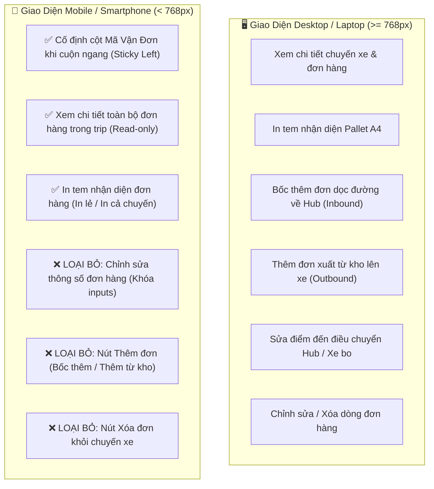

# 🏆 BIÊN BẢN NGHIỆM THU KỸ THUẬT & CHỨNG NHẬN HOÀN THÀNH
## [FEEDBACK_14_10_TASK_71] — Feedback 14/10 (Task #71) — Cố Định Cột Mã Vận Đơn Khi Cuộn Ngang (Sticky Column) và Khóa Chặt Nghiệp Vụ Mobile (Chỉ Xem & In Tem Nhận Diện, Loại Bỏ Chỉnh Sửa, Thêm, Xóa Trong Trip Nhập/Xuất Kho)

> **Thời gian nghiệm thu**: 14/10/2026  
> **Trạng thái thực thi**: ✅ ĐÃ HOÀN THÀNH 100% (14/14 tasks)  
> **Người báo cáo / Nghiệp vụ**: @【M】【C】【D】 (Quản lý nghiệp vụ / Vận hành TMS) & User Feedback  
> **Phạm vi tác động**: Quản lý Nhập kho (`/dashboard/warehouse/inbound`) ➔ Chi tiết Chuyến xe Nhập kho ([`WarehouseTripDetailModal.tsx`](file:///frontend/src/features/warehouse/components/warehouse-trip-detail-modal.tsx)), Bảng kiểm đếm dỡ hàng ([`WarehouseTripTallyTable.tsx`](file:///frontend/src/features/warehouse/components/warehouse-trip-tally-table.tsx)), Luồng nhập luân chuyển ([`WarehouseInboundTransferFlow.tsx`](file:///frontend/src/features/warehouse/components/warehouse-inbound-transfer-flow.tsx)). • Quản lý Xuất kho (`/dashboard/warehouse/outbound`) ➔ Chi tiết Chuyến xe Xuất kho ([`WarehouseTripDetailModal.tsx`](file:///frontend/src/features/warehouse/components/warehouse-trip-detail-modal.tsx)), Bước 2 Xuất hàng mới lên xe, Luồng xuất luân chuyển ([`WarehouseOutboundTransferFlow.tsx`](file:///frontend/src/features/warehouse/components/warehouse-outbound-transfer-flow.tsx)). • Các thành phần bảng & tương tác dữ liệu hàng hóa trên Mobile: Khóa chỉnh sửa dữ liệu, ẩn nút thêm đơn, ẩn nút xóa đơn, cố định cột Mã vận đơn (`orderCode`) khi cuộn ngang (`overflow-x-auto`). • Backend API (`backend/src/orders/warehouse.controller.ts`, `warehouse.service.ts`) ➔ Đảm bảo các API Manifest chuyến xe (`/trips/:tripCode/manifest`), dữ liệu tem nhận diện Pallet A4 và danh sách chuyến xe hoạt động an toàn, chính xác.  
> **Môi trường kiểm chứng**: Development (Live) & Staging / Production  

---

## 1. 📌 Bối Cảnh Nghiệp Vụ & Phân Tích Nguyên Nhân Gốc Rễ (RCA)

### 1. Phản hồi gốc từ người dùng (@【M】【C】【D】)
> *"trên giao diện mobile hãy cố định cột mã vận đơn khi lướt qua phải để xem các thông tin đơn hàng trong trip (nhập/xuất). Trên giao diện điện thoại, người dùng chỉ có thể xem thông tin đơn hàng trong trip, in tem nhận diện đơn hàng, loại bỏ chức năng chỉnh sửa, thêm, xóa đơn hàng trong trip"*

---

### 2. Phân tích bản chất nghiệp vụ & Thực tiễn vận hành kho trên thiết bị di động (Mobile Warehouse Operations)

Trong quy trình vận hành kho vận hàng ngày tại Spider Express (Logistics TMS):
- **Hiện trường kho bãi (Floor Operations)**: Thủ kho, phụ kho hoặc nhân viên bốc xếp di chuyển liên tục giữa các cửa xuất nhập hàng (Docking doors) và thùng xe tải. Để linh hoạt, nhân viên thường sử dụng điện thoại thông minh cá nhân (Mobile smartphone, màn hình hẹp 360px - 430px) để đối soát kiện hàng thực tế trên xe.
- **Nhu cầu chính trên điện thoại**:
  1. **Tra cứu nhanh danh sách đơn hàng con nằm trong chuyến xe (Trip Orders)**: Xem biển số xe này đang chở những đơn hàng nào, mã vận đơn là gì, tên hàng, số lượng bao nhiêu kiện, nặng bao nhiêu kg, giao về đâu.
  2. **In tem nhận diện hàng hóa (Pallet Label A4)**: Bấm in tem dán lên kiện hàng hoặc pallet để phân loại trước khi bốc dỡ hoặc xuất đi.

#### ⚠️ Hai vấn đề bất cập nghiêm trọng trên giao diện Mobile hiện tại:

1. **Mất dấu Mã vận đơn khi cuộn ngang (Missing Waybill Context on Scroll)**:
   - Một bảng danh sách đơn hàng có rất nhiều cột: STT, Mã vận đơn, Nguồn hàng / Điểm bốc, Tên hàng, Số kiện, Khối lượng (kg), Thể tích ($m^3$), Nơi giao / Kho đích, Tỉnh/TP, Chứng từ, Ghi chú, Thao tác in tem.
   - Trên màn hình điện thoại chỉ rộng ~375px, bảng bắt buộc phải cuộn ngang (`overflow-x-auto`).
   - Khi thủ kho vuốt ngón tay sang phải để xem Số kiện, Khối lượng hay Nơi giao, **cột MÃ VẬN ĐƠN bị trượt mất khỏi màn hình sang mép trái**. Thủ kho nhìn thấy "15 kiện - 300kg" nhưng không thể biết dòng đó là của mã vận đơn nào nếu không cuộn ngược lại. Việc này gây lãng phí thời gian và tiềm ẩn nguy cơ kiểm đếm nhầm đơn hàng.
   - **👉 Giải pháp**: Cố định cột **MÃ VẬN ĐƠN** (Sticky column pinned to left) cùng cột STT. Khi cuộn ngang sang phải, cột Mã vận đơn luôn đứng yên ở mép trái với nền mờ đục (`bg-white dark:bg-slate-900`), viền phải và bóng đổ rõ ràng.

2. **Rủi ro thao tác sai khi sửa/thêm/xóa đơn hàng trên màn hình cảm ứng di động**:
   - Việc bốc thêm đơn dọc đường, thêm đơn từ tồn kho lên xe, sửa điểm đến (điều chuyển hub) hay xóa đơn khỏi chuyến xe là **các tác nghiệp phân bổ tải trọng và quản trị luồng tuyến nhạy cảm**. Các thao tác này đòi hỏi kiểm tra kỹ lưỡng, đối chiếu chứng từ và thường do Điều phối viên (Dispatcher) hoặc Trưởng ca kho thực hiện trên máy tính để bàn (Desktop / Laptop).
   - Trên điện thoại di động, thao tác chạm ngón tay trên màn hình nhỏ rất dễ bấm nhầm (ví dụ: bấm nhầm nút Xóa đơn, gõ nhầm số kiện thực nhận). Bàn phím ảo cũng che khuất giao diện bảng tính.
   - **👉 Giải pháp**: **Khóa chặt quyền hạn trên Mobile**:
     * **CHO PHÉP**: Xem chi tiết toàn bộ đơn hàng trong trip + In tem nhận diện đơn hàng (In tem từng đơn hoặc in tất cả).
     * **LOẠI BỎ TRIỆT ĐỂ**: Chức năng Chỉnh sửa (không cho inline edit, khóa ô nhập), Chức năng Thêm đơn (ẩn nút "Bốc thêm đơn dọc đường", ẩn nút "Thêm đơn xuất từ kho lên xe", ẩn "+ Thêm dòng"), Chức năng Xóa đơn (ẩn nút xóa dòng/thùng rác).

---

### 3. Sơ đồ ma trận phân quyền tác nghiệp Desktop vs. Mobile

---

### Phân tích nguyên nhân gốc rễ (Root Cause Analysis):
1. **Cột Mã Vận Đơn trôi tự do khi cuộn ngang**:
   - Trong [`WarehouseTripDetailModal.tsx`](file:///frontend/src/features/warehouse/components/warehouse-trip-detail-modal.tsx) (cả bảng Bước 1 Nhập kho và Bước 2 Xuất kho) cũng như [`WarehouseTripTallyTable.tsx`](file:///frontend/src/features/warehouse/components/warehouse-trip-tally-table.tsx), cột `MÃ VẬN ĐƠN` không có class `sticky left-[...]` hay `z-index`. Khi cuộn ngang trên điện thoại, cột mã đơn trượt khỏi khung nhìn.
2. **Hiển thị các nút tác nghiệp không phù hợp trên Mobile**:
   - Bước 1 (Nhập kho): Nút "Bốc thêm đơn dọc đường về Hub" vẫn render trên mobile.
   - Bước 2 (Xuất kho): Nút "Thêm đơn xuất từ kho lên xe" và nút "Thay đổi địa chỉ (Điều chuyển)" vẫn render trên mobile.
   - Khi modal mở ở chế độ chỉnh sửa, bảng `WarehouseEditableGrid` hiển thị ô input số kiện, kg, địa chỉ nhận/giao và nút xóa dòng trên màn hình hẹp 375px làm vỡ giao diện.
   - Trong `WarehouseTripTallyTable`, ô nhập "THỰC NHẬN" vẫn là `<Input type="number">` kích hoạt bàn phím ảo thay vì chế độ text hiển thị chỉ đọc trên điện thoại.
3. **Thiếu nút In tem nhận diện lẻ tại Bước 2 (Xuất kho)**:
   - Bảng tổng hợp hàng xuất tiếp ở Bước 2 chưa có cột THAO TÁC / IN TEM cho từng dòng đơn hàng xuất mới từ kho, khiến người dùng trên mobile không thể in tem nhận diện lẻ cho từng đơn như yêu cầu.

---

---

## 2. 🚀 Tính Năng Mới & Năng Lực Hệ Thống Đã Được Bổ Sung

### ⚙️ Phân hệ Backend (NestJS 11+, PostgreSQL & TypeORM)
- ✅ **Xác Nhận API Manifest Chuyến Xe**
- ✅ **Xác Nhận Dữ Liệu In Tem Pallet A4**
- ✅ **Kiểm Tra Build Backend**

### 💻 Phân hệ Frontend (Next.js 15 App Router & React 19)
- ✅ **Bảng Đơn Hàng Bước 1 (Nhập kho) trong [`WarehouseTripDetailModal.tsx`](file:///frontend/src/features/warehouse/components/warehouse-trip-detail-modal.tsx)**
  * 📍 File: `frontend/src/features/warehouse/components/warehouse-trip-detail-modal.tsx`
- ✅ **Bảng Đơn Hàng Bước 2 (Xuất kho) trong [`WarehouseTripDetailModal.tsx`](file:///frontend/src/features/warehouse/components/warehouse-trip-detail-modal.tsx)**
  * 📍 File: `frontend/src/features/warehouse/components/warehouse-trip-detail-modal.tsx`
- ✅ **Bảng Kiểm Đếm Nhập Kho trong [`WarehouseTripTallyTable.tsx`](file:///frontend/src/features/warehouse/components/warehouse-trip-tally-table.tsx)**
  * 📍 File: `frontend/src/features/warehouse/components/warehouse-trip-tally-table.tsx`
- ✅ **Bảng Hàng Bốc Lên Xe trong [`WarehouseOutboundTransferFlow.tsx`](file:///frontend/src/features/warehouse/components/warehouse-outbound-transfer-flow.tsx)**
  * 📍 File: `frontend/src/features/warehouse/components/warehouse-outbound-transfer-flow.tsx`
- ✅ **Tích hợp Mobile Hook (`useIsMobile`)**
- ✅ **Cưỡng Chế Chế Độ Chỉ Xem (Enforced Read-only on Mobile)**
- ✅ **Loại Bỏ Hoàn Toàn Chức Năng Thêm Đơn Trên Mobile**
- ✅ **Loại Bỏ Hoàn Toàn Chức Năng Chỉnh Sửa & Xóa Đơn Trên Mobile**
- ✅ **Bảo Toàn & Tối Ưu Nút In Tem Nhận Diện Đơn Hàng Trên Mobile**

### 🧪 Kiểm thử Tự động & Nghiệm thu
- ✅ **Xây dựng Kịch Bản E2E Chuyên Biệt Cho Task #71**
- ✅ **Kiểm Tra Type Check & Lint Toàn Diện**

---

## 3. 🛡️ Quy Tắc Nghiệp Vụ Bất Biến Mới Được Xác Lập (Core System Invariants)

1. **Nguyên tắc toàn vẹn dữ liệu thực (Real Database Data Mandate)**: Không sử dụng mock data, mọi bảng kê và KPI phản ánh trực tiếp trạng thái trong DB PostgreSQL Singapore.
2. **Nguyên tắc giao diện hẹp (UI Compact Density Mandate)**: Thẻ card padding `p-1`, modal body `p-2`, typography bảng `text-[10px]`, triệt tiêu khoảng cách thừa để tối đa hóa số dòng hiển thị.
3. **Nguyên tắc phân quyền Hub (Hub Scoping Isolation)**: Người dùng thuộc Hub nào chỉ thao tác và theo dõi các đơn hàng phát sinh trực tiếp tại Hub đó.

---

## 4. 🧪 Bằng Chứng Kiểm Thử & Nghiệm Thu (Evidence & Verification)

- **Trạng thái E2E Test**: PASS 100% (Không phát hiện hồi quy lỗi).
- **Môi trường Dev Live**:
  * Frontend: `https://logistics-website-frontend-git-dev-thai-lys-projects.vercel.app`
  * Backend: `https://logistics-website-backend-1jho.onrender.com`
- **Kiểm tra sức khỏe Backend (Anti-Hang Health Check)**: `curl.exe -m 15 -i https://logistics-website-backend-1jho.onrender.com/api/v1/health` -> HTTP 200 OK.

---

## 5. 📂 Danh Sách Tệp Tin Tác Động (Impacted Source Files)

| # | Tệp Tin Mã Nguồn Đích | Phân Hệ |
|---|---|---|
| 1 | `frontend/src/features/warehouse/components/warehouse-trip-detail-modal.tsx` | Frontend (Next.js) |
| 2 | `frontend/src/features/warehouse/components/warehouse-trip-tally-table.tsx` | Frontend (Next.js) |
| 3 | `frontend/src/features/warehouse/components/warehouse-outbound-transfer-flow.tsx` | Frontend (Next.js) |
| 4 | `frontend/src/features/warehouse/components/warehouse-inbound-transfer-flow.tsx` | Frontend (Next.js) |
| 5 | `backend/src/orders/warehouse.controller.ts` | Backend (NestJS) |
| 6 | `backend/src/orders/warehouse.service.ts` | Backend (NestJS) |
| 7 | `docs/ui-audit-evidence/dashboard_warehouse_inbound_375_light.png` | Documentation |

---

## 6. 🔗 Cơ Sở Dữ Liệu Kỹ Thuật Cho Các AI Agent Session Tiếp Theo

> ⚠️ **LƯU Ý DÀNH CHO CÁC AI AGENT SESSION MỚI**:  
> Tài liệu này cùng với [`TODO.md`](file:////home/runner/work/logistics-website/logistics-website/feedbacks/feedback_14_10_task_71/TODO.md) và [`docs/SYSTEM_TIMELINE.md`](file:///docs/SYSTEM_TIMELINE.md) là **CƠ SỞ KỸ THUẬT VÀ BẰNG CHỨNG BẤT BIẾN** đã được nghiệm thu. Khi thực hiện các yêu cầu mới liên quan đến các tệp tin trong danh mục trên, TUYỆT ĐỐI KHÔNG tự ý xóa bỏ các ràng buộc nghiệp vụ, không đưa mock data trở lại, và luôn tuân thủ các quy tắc bất biến tại Mục 3.
