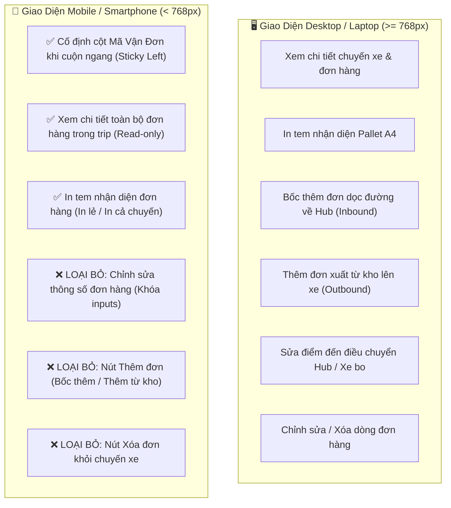

# Feedback 14/10 (Task #71) — Cố Định Cột Mã Vận Đơn Khi Cuộn Ngang (Sticky Column) và Khóa Chặt Nghiệp Vụ Mobile (Chỉ Xem & In Tem Nhận Diện, Loại Bỏ Chỉnh Sửa, Thêm, Xóa Trong Trip Nhập/Xuất Kho)

> **Thời gian ghi nhận**: 14/10/2026  
> **Người báo cáo**: @【M】【C】【D】 (Quản lý nghiệp vụ / Vận hành TMS) & User Feedback  
> **Phạm vi tác động**:  
> - Quản lý Nhập kho (`/dashboard/warehouse/inbound`) ➔ Chi tiết Chuyến xe Nhập kho ([`WarehouseTripDetailModal.tsx`](file:///frontend/src/features/warehouse/components/warehouse-trip-detail-modal.tsx)), Bảng kiểm đếm dỡ hàng ([`WarehouseTripTallyTable.tsx`](file:///frontend/src/features/warehouse/components/warehouse-trip-tally-table.tsx)), Luồng nhập luân chuyển ([`WarehouseInboundTransferFlow.tsx`](file:///frontend/src/features/warehouse/components/warehouse-inbound-transfer-flow.tsx)).  
> - Quản lý Xuất kho (`/dashboard/warehouse/outbound`) ➔ Chi tiết Chuyến xe Xuất kho ([`WarehouseTripDetailModal.tsx`](file:///frontend/src/features/warehouse/components/warehouse-trip-detail-modal.tsx)), Bước 2 Xuất hàng mới lên xe, Luồng xuất luân chuyển ([`WarehouseOutboundTransferFlow.tsx`](file:///frontend/src/features/warehouse/components/warehouse-outbound-transfer-flow.tsx)).  
> - Các thành phần bảng & tương tác dữ liệu hàng hóa trên Mobile: Khóa chỉnh sửa dữ liệu, ẩn nút thêm đơn, ẩn nút xóa đơn, cố định cột Mã vận đơn (`orderCode`) khi cuộn ngang (`overflow-x-auto`).  
> - Backend API (`backend/src/orders/warehouse.controller.ts`, `warehouse.service.ts`) ➔ Đảm bảo các API Manifest chuyến xe (`/trips/:tripCode/manifest`), dữ liệu tem nhận diện Pallet A4 và danh sách chuyến xe hoạt động an toàn, chính xác.  
> **Tài liệu tham chiếu**:  
> - `/leader` Business Domain Architecture ([`SKILL.md`](file:///.agents/skills/leader/SKILL.md))  
> - Quy chế phát triển hệ thống [`AGENTS.md`](file:///AGENTS.md) (Zero Technical Jargon, UI Compact Density Mandate, Real DB Data)  
> - Quy chuẩn giao diện hẹp [`.agents/rules/ui-compact-density.md`](file:///.agents/rules/ui-compact-density.md) & [`ui-spacing-guard`](file:///.agents/skills/ui-spacing-guard/SKILL.md)  
> - Task #46 ([`feedbacks/feedback_13_10_task_46/TODO.md`](file:///feedbacks/feedback_13_10_task_46/TODO.md)) về chuẩn hóa hành vi xem chi tiết chuyến xe và in tem nhận diện hàng hóa.  
> - Task #70 ([`feedbacks/feedback_14_10_task_70/TODO.md`](file:///feedbacks/feedback_14_10_task_70/TODO.md)) về tinh gọn bảng kê chuyến xe, loại bỏ nút chevron mở rộng và lấy Modal làm trung tâm tra cứu.  
> **Ảnh minh chứng đính kèm trong thư mục**:  
> - [`screenshot_01.jpg`](file:///feedbacks/feedback_14_10_task_70/screenshot_01.jpg): Bảng kê chuyến xe xuất kho và chi tiết đơn hàng trong trip.  
> - [`docs/ui-audit-evidence/dashboard_warehouse_inbound_375_light.png`](file:///docs/ui-audit-evidence/dashboard_warehouse_inbound_375_light.png): Giao diện vận hành kho trên thiết bị di động (viewport 375px).  

---

## 📌 Bối cảnh nghiệp vụ thực tế (Chốt theo phản hồi người dùng)

### 1. Phản hồi gốc từ người dùng (@【M】【C】【D】)
> *"trên giao diện mobile hãy cố định cột mã vận đơn khi lướt qua phải để xem các thông tin đơn hàng trong trip (nhập/xuất). Trên giao diện điện thoại, người dùng chỉ có thể xem thông tin đơn hàng trong trip, in tem nhận diện đơn hàng, loại bỏ chức năng chỉnh sửa, thêm, xóa đơn hàng trong trip"*

---

### 2. Phân tích bản chất nghiệp vụ & Thực tiễn vận hành kho trên thiết bị di động (Mobile Warehouse Operations)

Trong quy trình vận hành kho vận hàng ngày tại Spider Express (Logistics TMS):
- **Hiện trường kho bãi (Floor Operations)**: Thủ kho, phụ kho hoặc nhân viên bốc xếp di chuyển liên tục giữa các cửa xuất nhập hàng (Docking doors) và thùng xe tải. Để linh hoạt, nhân viên thường sử dụng điện thoại thông minh cá nhân (Mobile smartphone, màn hình hẹp 360px - 430px) để đối soát kiện hàng thực tế trên xe.
- **Nhu cầu chính trên điện thoại**:
  1. **Tra cứu nhanh danh sách đơn hàng con nằm trong chuyến xe (Trip Orders)**: Xem biển số xe này đang chở những đơn hàng nào, mã vận đơn là gì, tên hàng, số lượng bao nhiêu kiện, nặng bao nhiêu kg, giao về đâu.
  2. **In tem nhận diện hàng hóa (Pallet Label A4)**: Bấm in tem dán lên kiện hàng hoặc pallet để phân loại trước khi bốc dỡ hoặc xuất đi.

#### ⚠️ Hai vấn đề bất cập nghiêm trọng trên giao diện Mobile hiện tại:

1. **Mất dấu Mã vận đơn khi cuộn ngang (Missing Waybill Context on Scroll)**:
   - Một bảng danh sách đơn hàng có rất nhiều cột: STT, Mã vận đơn, Nguồn hàng / Điểm bốc, Tên hàng, Số kiện, Khối lượng (kg), Thể tích ($m^3$), Nơi giao / Kho đích, Tỉnh/TP, Chứng từ, Ghi chú, Thao tác in tem.
   - Trên màn hình điện thoại chỉ rộng ~375px, bảng bắt buộc phải cuộn ngang (`overflow-x-auto`).
   - Khi thủ kho vuốt ngón tay sang phải để xem Số kiện, Khối lượng hay Nơi giao, **cột MÃ VẬN ĐƠN bị trượt mất khỏi màn hình sang mép trái**. Thủ kho nhìn thấy "15 kiện - 300kg" nhưng không thể biết dòng đó là của mã vận đơn nào nếu không cuộn ngược lại. Việc này gây lãng phí thời gian và tiềm ẩn nguy cơ kiểm đếm nhầm đơn hàng.
   - **👉 Giải pháp**: Cố định cột **MÃ VẬN ĐƠN** (Sticky column pinned to left) cùng cột STT. Khi cuộn ngang sang phải, cột Mã vận đơn luôn đứng yên ở mép trái với nền mờ đục (`bg-white dark:bg-slate-900`), viền phải và bóng đổ rõ ràng.

2. **Rủi ro thao tác sai khi sửa/thêm/xóa đơn hàng trên màn hình cảm ứng di động**:
   - Việc bốc thêm đơn dọc đường, thêm đơn từ tồn kho lên xe, sửa điểm đến (điều chuyển hub) hay xóa đơn khỏi chuyến xe là **các tác nghiệp phân bổ tải trọng và quản trị luồng tuyến nhạy cảm**. Các thao tác này đòi hỏi kiểm tra kỹ lưỡng, đối chiếu chứng từ và thường do Điều phối viên (Dispatcher) hoặc Trưởng ca kho thực hiện trên máy tính để bàn (Desktop / Laptop).
   - Trên điện thoại di động, thao tác chạm ngón tay trên màn hình nhỏ rất dễ bấm nhầm (ví dụ: bấm nhầm nút Xóa đơn, gõ nhầm số kiện thực nhận). Bàn phím ảo cũng che khuất giao diện bảng tính.
   - **👉 Giải pháp**: **Khóa chặt quyền hạn trên Mobile**:
     * **CHO PHÉP**: Xem chi tiết toàn bộ đơn hàng trong trip + In tem nhận diện đơn hàng (In tem từng đơn hoặc in tất cả).
     * **LOẠI BỎ TRIỆT ĐỂ**: Chức năng Chỉnh sửa (không cho inline edit, khóa ô nhập), Chức năng Thêm đơn (ẩn nút "Bốc thêm đơn dọc đường", ẩn nút "Thêm đơn xuất từ kho lên xe", ẩn "+ Thêm dòng"), Chức năng Xóa đơn (ẩn nút xóa dòng/thùng rác).

---

### 3. Sơ đồ ma trận phân quyền tác nghiệp Desktop vs. Mobile

---

## 🔍 Tổng hợp các điểm chưa đúng trên giao diện cũ (đối chiếu ảnh chụp màn hình)

1. **Cột Mã Vận Đơn trôi tự do khi cuộn ngang**:
   - Trong [`WarehouseTripDetailModal.tsx`](file:///frontend/src/features/warehouse/components/warehouse-trip-detail-modal.tsx) (cả bảng Bước 1 Nhập kho và Bước 2 Xuất kho) cũng như [`WarehouseTripTallyTable.tsx`](file:///frontend/src/features/warehouse/components/warehouse-trip-tally-table.tsx), cột `MÃ VẬN ĐƠN` không có class `sticky left-[...]` hay `z-index`. Khi cuộn ngang trên điện thoại, cột mã đơn trượt khỏi khung nhìn.
2. **Hiển thị các nút tác nghiệp không phù hợp trên Mobile**:
   - Bước 1 (Nhập kho): Nút "Bốc thêm đơn dọc đường về Hub" vẫn render trên mobile.
   - Bước 2 (Xuất kho): Nút "Thêm đơn xuất từ kho lên xe" và nút "Thay đổi địa chỉ (Điều chuyển)" vẫn render trên mobile.
   - Khi modal mở ở chế độ chỉnh sửa, bảng `WarehouseEditableGrid` hiển thị ô input số kiện, kg, địa chỉ nhận/giao và nút xóa dòng trên màn hình hẹp 375px làm vỡ giao diện.
   - Trong `WarehouseTripTallyTable`, ô nhập "THỰC NHẬN" vẫn là `<Input type="number">` kích hoạt bàn phím ảo thay vì chế độ text hiển thị chỉ đọc trên điện thoại.
3. **Thiếu nút In tem nhận diện lẻ tại Bước 2 (Xuất kho)**:
   - Bảng tổng hợp hàng xuất tiếp ở Bước 2 chưa có cột THAO TÁC / IN TEM cho từng dòng đơn hàng xuất mới từ kho, khiến người dùng trên mobile không thể in tem nhận diện lẻ cho từng đơn như yêu cầu.

---

## 📋 Danh sách công việc triển khai (Action Checklist)

### 1. Frontend (Next.js 15 App Router & Tailwind CSS)

#### A. Cố Định Cột Mã Vận Đơn Khi Cuộn Ngang (Sticky Column Implementation)
- [ ] **Bảng Đơn Hàng Bước 1 (Nhập kho) trong [`WarehouseTripDetailModal.tsx`](file:///frontend/src/features/warehouse/components/warehouse-trip-detail-modal.tsx)**:
  - Thiết lập cột STT: `sticky left-0 z-20 bg-slate-100 dark:bg-slate-800` (ở `th`) và `sticky left-0 z-10 bg-white dark:bg-slate-900` (ở `td`), độ rộng cố định `w-[36px]`.
  - Thiết lập cột MÃ VẬN ĐƠN: `sticky left-[36px] z-20 bg-slate-100 dark:bg-slate-800` (ở `th`) và `sticky left-[36px] z-10 bg-white dark:bg-slate-900` (ở `td`), độ rộng `w-[130px]`.
  - Thêm bóng đổ và viền ngăn cách: `shadow-[2px_0_5px_-2px_rgba(0,0,0,0.15)] border-r border-slate-200 dark:border-slate-700`.
- [ ] **Bảng Đơn Hàng Bước 2 (Xuất kho) trong [`WarehouseTripDetailModal.tsx`](file:///frontend/src/features/warehouse/components/warehouse-trip-detail-modal.tsx)**:
  - Cố định tương tự: STT `sticky left-0` (`w-[36px]`) và MÃ VẬN ĐƠN `sticky left-[36px]` (`w-[130px]`) với nền đặc và viền đổ bóng.
  - Bổ sung cột THAO TÁC chứa nút **"In tem"** (`PalletLabelA4Modal`) cho từng dòng đơn hàng xuất tiếp để hỗ trợ in tem trực tiếp trên mobile.
- [ ] **Bảng Kiểm Đếm Nhập Kho trong [`WarehouseTripTallyTable.tsx`](file:///frontend/src/features/warehouse/components/warehouse-trip-tally-table.tsx)**:
  - Trên mobile, ẩn checkbox chọn dòng dỡ (`hidden sm:table-cell`).
  - Thiết lập cột STT: `sticky left-0 z-20` (`w-[32px]`).
  - Thiết lập cột MÃ VẬN ĐƠN: `sticky left-[32px] z-20` trên mobile (hoặc tính theo độ rộng checkbox trên desktop), thêm `shadow-[2px_0_5px_-2px_rgba(0,0,0,0.15)] border-r`.
- [ ] **Bảng Hàng Bốc Lên Xe trong [`WarehouseOutboundTransferFlow.tsx`](file:///frontend/src/features/warehouse/components/warehouse-outbound-transfer-flow.tsx)**:
  - Cố định cột STT (`sticky left-0`) và MÃ ĐƠN HÀNG (`sticky left-[40px]`) kèm đổ bóng phân cách.

#### B. Khóa Chặt Nghiệp Vụ Trên Giao Diện Mobile (Chỉ Xem & In Tem Nhận Diện)
- [ ] **Tích hợp Mobile Hook (`useIsMobile`)**:
  - Import `useIsMobile` từ `@/hooks/use-mobile`.
  - Kiểm tra trạng thái thiết bị di động: `const isMobile = useIsMobile();`.
- [ ] **Cưỡng Chế Chế Độ Chỉ Xem (Enforced Read-only on Mobile)**:
  - Trong [`WarehouseTripDetailModal.tsx`](file:///frontend/src/features/warehouse/components/warehouse-trip-detail-modal.tsx):
    - Đặt biến cờ: `const isMobileReadOnly = isMobile || readOnly;`.
    - Khi `isMobile === true`, modal luôn render bảng chỉ xem (`readOnly table`), **tuyệt đối không render `WarehouseEditableGrid`**.
    - Khóa các action footer tác nghiệp nặng (chỉ giữ lại nút Đóng, nút chuyển bước Xem và nút In Tem).
- [ ] **Loại Bỏ Hoàn Toàn Chức Năng Thêm Đơn Trên Mobile**:
  - Bước 1 (Nhập kho): Ẩn hoàn toàn nút **"Bốc thêm đơn dọc đường về Hub"** trên mobile (`hidden sm:inline-flex` hoặc `{!isMobile && ...}`).
  - Bước 2 (Xuất kho): Ẩn hoàn toàn nút **"Thêm đơn xuất từ kho lên xe"** trên mobile (`hidden sm:inline-flex` hoặc `{!isMobile && ...}`).
- [ ] **Loại Bỏ Hoàn Toàn Chức Năng Chỉnh Sửa & Xóa Đơn Trên Mobile**:
  - Bước 2: Ẩn nút **"Thay đổi địa chỉ (Điều chuyển)"** (`setSelectedOrderForDestModal`) khi `isMobile === true`, chỉ hiển thị thông tin địa chỉ/kho đích ở dạng văn bản chỉ đọc.
  - Trong [`WarehouseTripTallyTable.tsx`](file:///frontend/src/features/warehouse/components/warehouse-trip-tally-table.tsx):
    - Khi `isMobile === true`, ô "THỰC NHẬN" không hiển thị thẻ `<Input>`, mà hiển thị số kiện dạng văn bản / badge cố định (`${s?.actualQuantity ?? expected} kiện`).
    - Khóa tương tác chỉnh sửa lý do chênh lệch trên điện thoại.
  - Loại bỏ hoàn toàn các nút xóa dòng (`deleteRow`, `IconTrash`, "Xóa đơn") trên điện thoại.
- [ ] **Bảo Toàn & Tối Ưu Nút In Tem Nhận Diện Đơn Hàng Trên Mobile**:
  - Nút **"In tem"** cho từng đơn hàng hiển thị gọn gàng, rõ ràng và có kích thước bấm ngón tay thuận tiện (`h-7 px-2 text-[11px]`).
  - Nút **"In toàn bộ tem chuyến xe"** (Batch print) ở header/footer của modal hoạt động trơn tru trên mobile.

---

### 2. Backend (NestJS 11 - `backend/`)

- [ ] **Xác Nhận API Manifest Chuyến Xe**:
  - Endpoint `GET /api/v1/warehouse/trips/:tripCode/manifest` cung cấp đầy đủ thông tin `lines`: `orderCode`, `goodsDescription`, `totalQuantity`, `totalWeight`, `totalVolume`, `pickupAddress`, `deliveryAddress`, `destinationHub`, phục vụ hiển thị chi tiết chỉ đọc trên mobile.
- [ ] **Xác Nhận Dữ Liệu In Tem Pallet A4**:
  - Đảm bảo dữ liệu đơn hàng trả về có đủ các trường cho `PalletLabelData` (mã vận đơn, số kiện, khối lượng, thể tích, kho đi, kho đến).
- [ ] **Kiểm Tra Build Backend**:
  - Chạy `npm --prefix backend run build` đạt `Exit code 0`.

---

### 3. Kiểm Thử Tự Động & Chứng Nhận Chất Lượng (Playwright E2E)

- [ ] **Xây dựng Kịch Bản E2E Chuyên Biệt Cho Task #71**:
  - File kiểm thử: `frontend/e2e/71-feedback-14-10-task-71-mobile-trip-sticky-and-readonly.spec.ts`.
  - **Cấu hình Viewport Mobile**: `page.setViewportSize({ width: 375, height: 667 })` (iPhone SE / Standard Mobile Screen).
  - **Kịch bản 1: Màn hình Nhập kho trên Mobile (`/dashboard/warehouse/inbound`)**:
    1. Đăng nhập tài khoản thủ kho HCM (`USER_WAREHOUSE_HCM`).
    2. Truy cập Màn hình Nhập kho.
    3. Click vào mã chuyến xe `SDxx` để mở Modal Chi tiết Chuyến xe.
    4. Assert: Cột `MÃ VẬN ĐƠN` có CSS class/style `sticky` và cố định tọa độ `left` khi cuộn ngang container `overflow-x-auto`.
    5. Assert: Nút "Bốc thêm đơn dọc đường về Hub" KHÔNG tồn tại / bị ẩn trên màn hình mobile.
    6. Assert: Không có ô input chỉnh sửa hay nút xóa đơn hàng.
    7. Assert: Nút "In tem" nhận diện đơn hàng hiển thị đầy đủ và có thể click mở modal in tem A4.
  - **Kịch bản 2: Màn hình Xuất kho trên Mobile (`/dashboard/warehouse/outbound`)**:
    1. Truy cập Màn hình Xuất kho tại viewport 375px.
    2. Click vào mã chuyến xe `SDxx` để mở Modal Chi tiết Chuyến xe.
    3. Assert: Cột `MÃ VẬN ĐƠN` có thuộc tính `sticky` cố định khi cuộn ngang.
    4. Chuyển sang Bước 2 (Xuất hàng).
    5. Assert: Nút "Thêm đơn xuất từ kho lên xe" KHÔNG tồn tại / bị ẩn trên mobile.
    6. Assert: Nút "Thay đổi địa chỉ (Điều chuyển)" KHÔNG hiển thị dạng chỉnh sửa trên mobile.
    7. Assert: Cột "In tem" hiển thị nút in tem nhận diện cho từng đơn hàng.
  - **Kịch bản 3: Bằng chứng hình ảnh nghiệm thu thực tế**:
    - Chụp ảnh màn hình verified lưu vào `feedbacks/feedback_14_10_task_71/screenshot_01_verified.png` chứng minh:
      * Cột Mã vận đơn được cố định rõ ràng khi cuộn ngang trên viewport mobile 375px.
      * Giao diện hoàn toàn sạch sẽ, không còn các nút thêm/sửa/xóa, chỉ có chế độ xem và nút in tem nhận diện.
- [ ] **Kiểm Tra Type Check & Lint Toàn Diện**:
  - Chạy `npm run lint --prefix frontend` và `npm run build --prefix frontend` (0 errors).

---

## 🛡️ Tiêu Chí Nghiệm Thu (Definition of Done - DoD)

1. **Cột Mã Vận Đơn cố định 100% khi cuộn ngang**: Trên điện thoại di động, khi cuộn bảng kê đơn hàng sang phải, cột Mã vận đơn luôn ghim cố định ở mép trái, không bị che khuất hay đè chữ.
2. **Khóa chặt quyền chỉ xem trên Mobile**: Không cho phép chỉnh sửa số kiện, kg, m3, ghi chú hay địa chỉ nhận/giao trên thiết bị di động.
3. **Triệt tiêu nút Thêm đơn trên Mobile**: Nút "Bốc thêm đơn dọc đường" và "Thêm đơn xuất từ kho lên xe" bị ẩn hoàn toàn trên mobile.
4. **Triệt tiêu nút Xóa đơn trên Mobile**: Không hiển thị bất kỳ nút xóa dòng/thùng rác nào trên mobile.
5. **In tem nhận diện đơn hàng thông suốt**: Thủ kho bấm nút "In tem" cho từng đơn hoặc in toàn bộ tem chuyến xe mở modal in tem Pallet A4 chuẩn chỉ.
6. **Bảo toàn giao diện Desktop**: Trên máy tính để bàn (>= 768px), mọi quyền thao tác tác nghiệp kho vẫn hoạt động đầy đủ và bình thường 100%.
7. **Đạt chuẩn kiểm thử tự động**: Test suite E2E mobile chạy PASS 100%, ghi nhận ảnh bằng chứng `screenshot_01_verified.png`.
