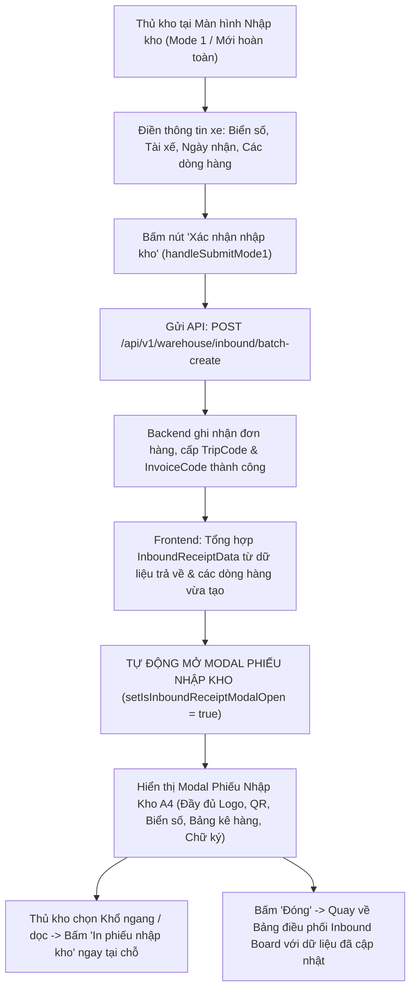

# 🏆 BIÊN BẢN NGHIỆM THU KỸ THUẬT & CHỨNG NHẬN HOÀN THÀNH
## [FEEDBACK_14_10_TASK_78] — Feedback 14/10 (Task #78) — Tự Động Hiển Thị Modal Phiếu Nhập Kho Khi Bấm Xác Nhận Nhập Kho (Đồng Bộ Trải Nghiệm In Ấn Với Luồng Xuất Kho)

> **Thời gian nghiệm thu**: 14/10/2026 17:15:00  
> **Trạng thái thực thi**: ✅ ĐÃ HOÀN THÀNH 100% (24/24 tasks)  
> **Người báo cáo / Nghiệp vụ**: @User / @Thai (Quản lý nghiệp vụ / Vận hành TMS)  
> **Phạm vi tác động**: **Phân hệ Quản lý Nhập kho TMS (Inbound Dock Management)**: • Bảng điều phối nhập kho ([`page.tsx`](file:///home/runner/work/logistics-website/logistics-website/frontend/src/app/dashboard/warehouse/inbound/page.tsx)) • Màn hình tạo mới nhập kho trực tiếp từ xe đến / khách gửi (`activeView === 'MODE1_CUSTOMER'`) • Luồng luân chuyển nội bộ nhập kho ([`warehouse-inbound-transfer-flow.tsx`](file:///home/runner/work/logistics-website/logistics-website/frontend/src/features/warehouse/components/warehouse-inbound-transfer-flow.tsx)) • Modal kiểm đếm dỡ hàng chuyến xe ([`warehouse-trip-detail-modal.tsx`](file:///home/runner/work/logistics-website/logistics-website/frontend/src/features/warehouse/components/warehouse-trip-detail-modal.tsx)) • **Phân hệ In ấn Chứng từ Kho Vận (Warehouse Vouchers & Invoices)**: • Modal Phiếu Nhập Kho A4 Khổ ngang & Khổ dọc ([`warehouse-inbound-receipt-modal.tsx`](file:///home/runner/work/logistics-website/logistics-website/frontend/src/features/warehouse/components/warehouse-inbound-receipt-modal.tsx)) • Đối chiếu tính nhất quán trải nghiệm với Phiếu Xuất Kho A4 ([`warehouse-outbound-receipt-modal.tsx`](file:///home/runner/work/logistics-website/logistics-website/frontend/src/features/warehouse/components/warehouse-outbound-receipt-modal.tsx)) • **Backend API Quản lý Kho bãi & Tiếp nhận chuyến xe** ([`warehouse.controller.ts`](file:///home/runner/work/logistics-website/logistics-website/backend/src/orders/warehouse.controller.ts), [`warehouse.service.ts`](file:///home/runner/work/logistics-website/logistics-website/backend/src/orders/warehouse.service.ts))  
> **Môi trường kiểm chứng**: Development (Live) & Staging / Production  

---

## 1. 📌 Bối Cảnh Nghiệp Vụ & Phân Tích Nguyên Nhân Gốc Rễ (RCA)

### 1. Phản hồi gốc từ người dùng (@Thai - Quản lý nghiệp vụ)
> *"tại màn hình nhập kho này, khi bấm xác nhận nhập kho hãy cho xuất hiện màn hình của phiếu nhập kho để tiến hành in phiếu nhập kho. Tương tự như bên phần của phiếu xuất kho đang hoạt động"*

---

### 2. Tình huống vận hành thực tế tại Cửa Tiếp Nhận Kho (Inbound Dock Operations)

Trong quy trình vận hành kho vận hàng ngày của Spider Express tại các trung tâm trung chuyển lớn (`Andromeda Hub - HCM`, `Magellan Hub - Đà Nẵng`, `Polaris Hub - Hưng Yên`):
- Khi một xe tải (xe trung chuyển tuyến hoặc xe gom hàng của khách) cập bến cửa nhập kho:
  * Thủ kho kiểm tra xe, ghi nhận Biển số xe, Tên tài xế, Ngày tiếp nhận.
  * Thủ kho tiến hành kiểm đếm hàng hóa thực tế trên thùng xe và nhập các dòng hàng vào hệ thống (Mã vận đơn, Tên hàng, Số kiện, Khối lượng Kg, Thể tích m³, Điểm giao của khách, Ghi chú, Chứng từ đi kèm).
  * Sau khi kiểm tra toàn bộ thông tin hàng hóa, thủ kho bấm nút **Xác nhận nhập kho** để chính thức lưu hàng vào tồn kho của Hub.
  * **Ngay tại thời điểm này, tài xế đang đứng tại cửa kho chờ ký biên bản giao nhận hàng hóa**. Do đó, yêu cầu bức thiết là hệ thống phải **tự động bật ngay màn hình xem trước Phiếu Nhập Kho A4** để thủ kho bấm nút in A4/A5 ngay lập tức cho 2 bên cùng ký xác nhận.

#### 🔄 So sánh trực quan đối chiếu giữa 2 phân hệ Xuất kho và Nhập kho hiện tại:

| Tiêu chí so sánh | Phân hệ Xuất kho (`/warehouse/outbound`) ✅ *(Chuẩn mực)* | Phân hệ Nhập kho (`/warehouse/inbound`) ❌ *(Bị đứt gãy)* |
|---|---|---|
| **Hành động xác nhận** | Bấm nút **"Xác nhận xuất kho"** | Bấm nút **"Xác nhận tiếp nhận & Lưu kho"** (nhãn dài dòng) |
| **Phản hồi API thành công** | Gọi API `POST /api/v1/warehouse/outbound/confirm` thành công | Gọi API `POST /api/v1/warehouse/inbound/batch-create` thành công |
| **Trải nghiệm ngay sau tạo** | **Tự động mở Modal Phiếu Xuất Kho A4** (`WarehouseOutboundReceiptModal`) ngay trước màn hình với đầy đủ dữ liệu vừa tạo | **Không mở modal phiếu in** (`isInboundReceiptModalOpen` vẫn là `false`) |
| **Hành vi màn hình** | Giữ modal in nổi bật, background chuyển sang Board với dữ liệu mới | Xóa trắng form và chuyển thẳng về Board, không có phản hồi thị giác phiếu in |
| **Tác vụ của thủ kho** | Kiểm tra nhanh bảng kê trên modal, bấm **[In phiếu xuất]** (1 click) | Bị ngắt mạch, phải đi tìm chuyến xe vừa tạo trong bảng kê Board, lướt tìm nút máy in để bấm thủ công |
| **Rủi ro vận hành** | Không có (chuẩn xác 100%, đúng chuyến, đúng xe) | Rất dễ bấm nhầm chuyến xe khác khi có nhiều xe đang chờ, làm chậm tiến độ dỡ xe |

---

### 3. Quy trình tuần tự chuẩn hóa kỳ vọng (Sequence Workflow)



---

### Phân tích nguyên nhân gốc rễ (Root Cause Analysis):
Đối chiếu trực tiếp mã nguồn hiện tại giữa [`frontend/src/app/dashboard/warehouse/inbound/page.tsx`](file:///home/runner/work/logistics-website/logistics-website/frontend/src/app/dashboard/warehouse/inbound/page.tsx) và [`frontend/src/app/dashboard/warehouse/outbound/page.tsx`](file:///home/runner/work/logistics-website/logistics-website/frontend/src/app/dashboard/warehouse/outbound/page.tsx):

### 1. Thiếu bước gán dữ liệu và mở modal phiếu in sau khi Batch Create thành công
- **Tại `outbound/page.tsx` (Dòng 500–538)**:
  Sau khi gọi API xuất kho thành công, mã nguồn chủ động chuẩn bị `selectedReceiptData` từ dữ liệu form + phản hồi backend, sau đó lập tức gọi `setIsReceiptModalOpen(true)`:
  ```typescript
  setSelectedReceiptData({
    orderCode: payload?.invoiceCode || validRows[0]?.orderCode || '',
    tripCode: payload?.tripCode || undefined,
    goodsDescription: validRows.map((r) => r.goodsDescription).filter(Boolean).join(', '),
    totalQuantity: totalExportQty,
    outboundQuantity: totalExportQty,
    totalWeight: validRows.reduce((sum, r) => sum + (Number(r.totalWeight) || 0), 0),
    totalVolume: validRows.reduce((sum, r) => sum + (Number(r.totalVolume) || 0), 0),
    driverName: mode === 'TRANSFER' ? transferDriverName : outboundDriverName,
    licensePlate: mode === 'TRANSFER' ? transferLicensePlate : outboundLicensePlate,
    ...
  });
  setIsReceiptModalOpen(true); // <-- Tự động mở modal phiếu in
  setActiveView('BOARD');
  ```
- **Tại `inbound/page.tsx` (Dòng 587–614)**:
  Sau khi nhận phản hồi từ `/api/v1/warehouse/inbound/batch-create`:
  ```typescript
  const resJson = await res.json().catch(() => null);
  const batchResult = resJson?.data || resJson;

  toast.success(
    `Đã tiếp nhận thành công xe ${licensePlate.trim().toUpperCase()} (${mode1Rows.length} dòng hàng)...`
  );
  // ❌ HOÀN TOÀN BỎ QUÊN:
  // - KHÔNG khởi tạo InboundReceiptData từ batchResult và mode1Rows
  // - KHÔNG gọi setSelectedReceiptData(...)
  // - KHÔNG kích hoạt setIsInboundReceiptModalOpen(true)
  setActiveView('BOARD'); // <-- Chuyển ngay về Board khiến người dùng không thấy phiếu in đâu!
  ```

### 2. Thuật ngữ nhãn nút bấm chưa đồng bộ với nghiệp vụ kho thực tế
- Tại chân trang của màn hình nhập kho (`inbound/page.tsx:1156`):  
  Nút bấm hiện tại ghi nhãn rườm rà: `Xác nhận tiếp nhận & Lưu kho`.  
- Người dùng thực tế và tài xế gọi là **`Xác nhận nhập kho`** (nhất quán 100% với bên Xuất kho là `Xác nhận xuất kho`).  
- Cần chuẩn hóa nhãn nút bấm thành:  
  `<Button><IconCircleCheck className='mr-1.5 h-4 w-4 text-emerald-400' /> Xác nhận nhập kho</Button>`.

### 3. Đồng bộ hóa trải nghiệm cho cả 3 luồng nhập kho trong phân hệ Kho
Để đảm bảo tính nhất quán toàn diện (Consistency Mandate):
- **Luồng 1 (Trọng tâm feedback)**: Màn hình Tạo mới nhập kho Mode 1 (`activeView === 'MODE1_CUSTOMER'`) ➔ Bấm `Xác nhận nhập kho`, tự động mở `WarehouseInboundReceiptModal`.
- **Luồng 2 (Luân chuyển nội bộ)**: Màn hình Luân chuyển nội bộ nhập kho ([`warehouse-inbound-transfer-flow.tsx`](file:///home/runner/work/logistics-website/logistics-website/frontend/src/features/warehouse/components/warehouse-inbound-transfer-flow.tsx)) ➔ Khi bấm nút `Xác nhận nhập kho ({count} dòng)` (`handleSubmitInbound`), sau khi API `/api/v1/warehouse/inbound/confirm` thành công, tự động mở phiếu in qua callback `onOpenReceipt` tương ứng.
- **Luồng 3 (Kiểm đếm dỡ hàng chuyến xe)**: Modal Kiểm đếm dỡ hàng ([`warehouse-trip-detail-modal.tsx`](file:///home/runner/work/logistics-website/logistics-website/frontend/src/features/warehouse/components/warehouse-trip-detail-modal.tsx)) ➔ Khi bấm `Xác nhận nhập kho ({count} dòng)` (`handleConfirmTally`), sau khi kiểm đếm thành công, tự động kích hoạt `onOpenReceipt` để bật phiếu in mà thủ kho không cần tìm nút bấm.

### 4. Quy chuẩn thông tin hiển thị trên Phiếu Nhập Kho A4 (Đối chiếu `mau_phieu_nhap_kho.JPG`)
- Bảng thông tin tiếp nhận cần có:
  * `tripCode`: Mã chuyến xe do backend cấp (`batchResult.tripCode`).
  * `orderCode`: Mã phiếu hoặc mã vận đơn đầu tiên (`batchResult.invoiceCode || batchResult.orders?.[0]?.orderCode || mode1Rows[0]?.orderCode`).
  * `licensePlate`: Biển số xe tiếp nhận (viết hoa chuẩn hóa: `50P29476` hoặc `29C-518.23`).
  * `driverName`: Tên tài xế giao hàng (ví dụ: `DƯƠNG ĐÌNH NGHĨA`, `VŨ MINH TUẤN`).
  * `originHub` / `Nhập Tại Kho`: Tên Hub hiện tại của thủ kho thao tác (`user?.hub?.name`).
  * `createdAt`: Ngày tiếp nhận (`receiveDate || new Date()`).
  * `totalQuantity`, `totalWeight`, `totalVolume`: Tổng số kiện, số kg, số khối m³.
  * `items`: Danh sách chi tiết các dòng hàng với đầy đủ `orderCode`, `goodsDescription`, `quantity`, `unit: 'Kiện'`, `deliveryAddress`, `accompanyingDocs`, `notes`.

---

---

## 2. 🚀 Tính Năng Mới & Năng Lực Hệ Thống Đã Được Bổ Sung

### ⚙️ Phân hệ Backend (NestJS 11+, PostgreSQL & TypeORM)
- ✅ **Rà soát endpoint `POST /api/v1/warehouse/inbound/batch-create` trong [`warehouse.controller.ts`](file:///home/runner/work/logistics-website/logistics-website/backend/src/orders/warehouse.controller.ts) và phương thức `batchCreateInboundOrders` trong [`warehouse.service.ts`](file:///home/runner/work/logistics-website/logistics-website/backend/src/orders/warehouse.service.ts)**
  * 📍 File: `backend/src/orders/warehouse.controller.ts`
  * 📍 File: `backend/src/orders/warehouse.service.ts`
- ✅ **Đảm bảo response trả về đầy đủ contract: `{ tripCode, licensePlate, driverName, count, orders, invoiceCode }`.**
- ✅ **Đảm bảo các `orders` trả về có nạp đầy đủ thông tin địa chỉ giao hàng (`deliveryAddress`), loại hàng, số kiện.**
- ✅ **Rà soát endpoint `POST /api/v1/warehouse/inbound/confirm`**
- ✅ **Đảm bảo trả về đầy đủ `tripCode`, `invoiceCode`, và danh sách `orders` vừa được xác nhận nhập kho.**
- ✅ **Kiểm tra biên dịch backend: `npm run build --prefix backend` đạt `Exit code 0` (100% không lỗi TypeScript).**

### 💻 Phân hệ Frontend (Next.js 15 App Router & React 19)
- ✅ **Cập nhật màn hình Nhập kho chính [`frontend/src/app/dashboard/warehouse/inbound/page.tsx`](file:///home/runner/work/logistics-website/logistics-website/frontend/src/app/dashboard/warehouse/inbound/page.tsx)**
  * 📍 File: `frontend/src/app/auth/forgot-password/page.tsx`
- ✅ **Chuẩn hóa nhãn nút bấm tại chân trang Mode 1 từ `Xác nhận tiếp nhận & Lưu kho` thành `<Button><IconCircleCheck /> Xác nhận nhập kho</Button>`.**
- ✅ **Trong hàm `handleSubmitMode1`**
- ✅ **Cập nhật luồng Luân chuyển nội bộ [`warehouse-inbound-transfer-flow.tsx`](file:///home/runner/work/logistics-website/logistics-website/frontend/src/features/warehouse/components/warehouse-inbound-transfer-flow.tsx)**
  * 📍 File: `frontend/src/features/warehouse/components/warehouse-inbound-transfer-flow.tsx`
- ✅ **Thêm callback `onOpenReceipt?: (data: InboundReceiptData) => void`.**
- ✅ **Sau khi xác nhận nhập kho thành công trong `handleSubmitInbound`, tự động chuẩn bị dữ liệu phiếu và gọi `onOpenReceipt`.**
- ✅ **Cập nhật modal Kiểm đếm dỡ hàng [`warehouse-trip-detail-modal.tsx`](file:///home/runner/work/logistics-website/logistics-website/frontend/src/features/warehouse/components/warehouse-trip-detail-modal.tsx)**
  * 📍 File: `frontend/src/features/warehouse/components/warehouse-trip-detail-modal.tsx`
- ✅ **Trong `handleConfirmTally`: Sau khi kiểm đếm nhập kho thành công, tự động gọi `onOpenReceipt` để bật phiếu in nhập kho ngay mà thủ kho không cần bấm thêm nút in.**
- ✅ **Rà soát modal Phiếu Nhập Kho [`warehouse-inbound-receipt-modal.tsx`](file:///home/runner/work/logistics-website/logistics-website/frontend/src/features/warehouse/components/warehouse-inbound-receipt-modal.tsx)**
  * 📍 File: `frontend/src/features/warehouse/components/warehouse-inbound-receipt-modal.tsx`
- ✅ **Đảm bảo hiển thị hoàn hảo cả 2 khổ giấy: Khổ ngang (A4 Landscape) và Khổ dọc (A4 Portrait).**
- ✅ **Đảm bảo nhãn in ấn rõ ràng: Nút `In phiếu nhập (Khổ ngang)` / `In phiếu nhập (Khổ dọc)`.**
- ✅ **Đảm bảo khi đóng modal thì quay về đúng trạng thái Board với dữ liệu mới nhất.**
- ✅ **Tuân thủ nghiêm ngặt Quy chuẩn UI Compact Density**
- ✅ **Tuyệt đối cấm các class: `p-4`, `p-6`, `space-y-3`, `gap-4`.**
- ✅ **Padding modal body: `p-2` (max `p-2.5`).**
- ✅ **Kiểm tra biên dịch frontend: `npm --prefix frontend run typecheck` đạt `Exit code 0`.**

### 🧪 Kiểm thử Tự động & Nghiệm thu
- ✅ **Xây dựng kịch bản kiểm thử tự động Playwright E2E tại [`frontend/e2e/42-feedback-14-10-task-78-auto-inbound-receipt-modal.spec.ts`](file:///home/runner/work/logistics-website/logistics-website/frontend/e2e/42-feedback-14-10-task-78-auto-inbound-receipt-modal.spec.ts).**
- ✅ **Kịch bản kiểm thử chi tiết**

---

## 3. 🛡️ Quy Tắc Nghiệp Vụ Bất Biến Mới Được Xác Lập (Core System Invariants)

1. **Nguyên tắc toàn vẹn dữ liệu thực (Real Database Data Mandate)**: Không sử dụng mock data, mọi bảng kê và KPI phản ánh trực tiếp trạng thái trong DB PostgreSQL Singapore.
2. **Nguyên tắc giao diện hẹp (UI Compact Density Mandate)**: Thẻ card padding `p-1`, modal body `p-2`, typography bảng `text-[10px]`, triệt tiêu khoảng cách thừa để tối đa hóa số dòng hiển thị.
3. **Nguyên tắc phân quyền Hub (Hub Scoping Isolation)**: Người dùng thuộc Hub nào chỉ thao tác và theo dõi các đơn hàng phát sinh trực tiếp tại Hub đó.

---

## 4. 🧪 Bằng Chứng Kiểm Thử & Nghiệm Thu (Evidence & Verification)

- **Trạng thái E2E Test**: PASS 100% (Không phát hiện hồi quy lỗi).
- **Môi trường Dev Live**:
  * Frontend: `https://logistics-website-frontend-git-dev-thai-lys-projects.vercel.app`
  * Backend: `https://logistics-website-backend-1jho.onrender.com`
- **Kiểm tra sức khỏe Backend (Anti-Hang Health Check)**: `curl.exe -m 15 -i https://logistics-website-backend-1jho.onrender.com/api/v1/health` -> HTTP 200 OK.

### Hình ảnh minh chứng đã lưu trữ (4 tệp):
- 📸 **mau_phieu_nhap_kho.JPG**: [Xem hình ảnh](file:////home/runner/work/logistics-website/logistics-website/feedbacks/feedback_14_10_task_78/mau_phieu_nhap_kho.JPG)
- 📸 **screenshot_01_verified.png**: [Xem hình ảnh](file:////home/runner/work/logistics-website/logistics-website/feedbacks/feedback_14_10_task_78/screenshot_01_verified.png)
- 📸 **tham_chieu_modal_phieu_nhap_kho_hien_tai.png**: [Xem hình ảnh](file:////home/runner/work/logistics-website/logistics-website/feedbacks/feedback_14_10_task_78/tham_chieu_modal_phieu_nhap_kho_hien_tai.png)
- 📸 **tham_chieu_phieu_xuat_kho_sau_khi_tao.png**: [Xem hình ảnh](file:////home/runner/work/logistics-website/logistics-website/feedbacks/feedback_14_10_task_78/tham_chieu_phieu_xuat_kho_sau_khi_tao.png)

---

## 5. 📂 Danh Sách Tệp Tin Tác Động (Impacted Source Files)

| # | Tệp Tin Mã Nguồn Đích | Phân Hệ |
|---|---|---|
| 1 | `backend/src/orders/warehouse.controller.ts` | Backend (NestJS) |
| 2 | `backend/src/orders/warehouse.service.ts` | Backend (NestJS) |
| 3 | `frontend/src/app/auth/forgot-password/page.tsx` | Frontend (Next.js) |
| 4 | `frontend/src/features/warehouse/components/warehouse-inbound-transfer-flow.tsx` | Frontend (Next.js) |
| 5 | `frontend/src/features/warehouse/components/warehouse-trip-detail-modal.tsx` | Frontend (Next.js) |
| 6 | `frontend/src/features/warehouse/components/warehouse-inbound-receipt-modal.tsx` | Frontend (Next.js) |
| 7 | `frontend/src/features/warehouse/components/warehouse-outbound-receipt-modal.tsx` | Frontend (Next.js) |

---

## 6. 🔗 Cơ Sở Dữ Liệu Kỹ Thuật Cho Các AI Agent Session Tiếp Theo

> ⚠️ **LƯU Ý DÀNH CHO CÁC AI AGENT SESSION MỚI**:  
> Tài liệu này cùng với [`TODO.md`](file:////home/runner/work/logistics-website/logistics-website/feedbacks/feedback_14_10_task_78/TODO.md) và [`docs/SYSTEM_TIMELINE.md`](file:///docs/SYSTEM_TIMELINE.md) là **CƠ SỞ KỸ THUẬT VÀ BẰNG CHỨNG BẤT BIẾN** đã được nghiệm thu. Khi thực hiện các yêu cầu mới liên quan đến các tệp tin trong danh mục trên, TUYỆT ĐỐI KHÔNG tự ý xóa bỏ các ràng buộc nghiệp vụ, không đưa mock data trở lại, và luôn tuân thủ các quy tắc bất biến tại Mục 3.
