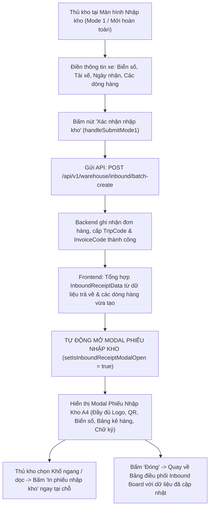

# Feedback 14/10 (Task #78) — Tự Động Hiển Thị Modal Phiếu Nhập Kho Khi Bấm Xác Nhận Nhập Kho (Đồng Bộ Trải Nghiệm In Ấn Với Luồng Xuất Kho)

> **Thời gian ghi nhận**: 14/10/2026 17:15:00  
> **Người báo cáo**: @User / @Thai (Quản lý nghiệp vụ / Vận hành TMS)  
> **Phạm vi tác động**:  
> - **Phân hệ Quản lý Nhập kho TMS (Inbound Dock Management)**: Bảng điều phối nhập kho ([`inbound/page.tsx`](file:///frontend/src/app/dashboard/warehouse/inbound/page.tsx)), Giao diện tạo mới nhập kho trực tiếp từ xe đến / khách gửi (`activeView === 'MODE1_CUSTOMER'`), Luồng luân chuyển nội bộ nhập kho ([`warehouse-inbound-transfer-flow.tsx`](file:///frontend/src/features/warehouse/components/warehouse-inbound-transfer-flow.tsx)), Modal kiểm đếm dỡ hàng chuyến xe ([`warehouse-trip-detail-modal.tsx`](file:///frontend/src/features/warehouse/components/warehouse-trip-detail-modal.tsx))  
> - **Phân hệ In ấn Chứng từ Kho Vận (Warehouse Vouchers & Invoices)**: Modal Phiếu Nhập Kho A4 Khổ ngang & Khổ dọc ([`warehouse-inbound-receipt-modal.tsx`](file:///frontend/src/features/warehouse/components/warehouse-inbound-receipt-modal.tsx)), Đối chiếu tính nhất quán với Phiếu Xuất Kho A4 ([`warehouse-outbound-receipt-modal.tsx`](file:///frontend/src/features/warehouse/components/warehouse-outbound-receipt-modal.tsx))  
> - **Backend API Quản lý Kho bãi & Tiếp nhận chuyến xe** ([`warehouse.controller.ts`](file:///backend/src/orders/warehouse.controller.ts), [`warehouse.service.ts`](file:///backend/src/orders/warehouse.service.ts))  
> **Tài liệu tham chiếu**:  
> - TMS Business Domain Lead Architecture ([`SKILL.md`](file:///.agents/skills/leader/SKILL.md))  
> - Quy chế phát triển hệ thống [`AGENTS.md`](file:///AGENTS.md)  
> - Quy chuẩn giao diện hẹp [`.agents/rules/ui-compact-density.md`](file:///.agents/rules/ui-compact-density.md) & [`ui-spacing-guard`](file:///.agents/skills/ui-spacing-guard/SKILL.md)  
> - Quy chuẩn quản lý kiện vận tải No-SKU, Consignment Level & Không quản lý vị trí giá kệ (No Bin/Rack Location)  
> **Tài liệu & Hình ảnh tham chiếu đính kèm**:  
> - [`mau_phieu_nhap_kho.JPG`](file:///docs_scan/mau_phieu_nhap_kho.JPG): Quy chuẩn biểu mẫu Phiếu nhập kho thực tế tại kho bãi Spider Express.  
> - [`tham_chieu_phieu_xuat_kho_sau_khi_tao.png`](file:///feedbacks/feedback_14_10_task_78/tham_chieu_phieu_xuat_kho_sau_khi_tao.png): Giao diện modal Phiếu Xuất Kho tự động xuất hiện ngay sau khi bấm "Xác nhận xuất kho" (chuẩn trải nghiệm người dùng mong muốn tái hiện bên Nhập kho).  
> - [`tham_chieu_modal_phieu_nhap_kho_hien_tai.png`](file:///feedbacks/feedback_14_10_task_78/tham_chieu_modal_phieu_nhap_kho_hien_tai.png): Modal Phiếu Nhập Kho A4 hiện tại của hệ thống.  

---

## 📌 Bối cảnh nghiệp vụ thực tế (Chốt theo phản hồi người dùng)

### 1. Phản hồi gốc từ người dùng
> *"tại màn hình nhập kho này, khi bấm xác nhận nhập kho hãy cho xuất hiện màn hình của phiếu nhập kho để tiến hành in phiếu nhập kho. Tương tự như bên phần của phiếu xuất kho đang hoạt động"*

---

### 2. Tình huống vận hành thực tế tại Cửa Tiếp Nhận Kho (Inbound Dock Operations)

Trong quy trình vận hành kho vận hàng ngày của Spider Express tại các trung tâm trung chuyển lớn (`Andromeda Hub - HCM`, `Magellan Hub - Đà Nẵng`, `Polaris Hub - Hưng Yên`):
- Khi một xe tải (xe trung chuyển tuyến hoặc xe giao hàng của khách) cập bến cửa nhập kho:
  * Thủ kho kiểm tra xe, ghi nhận Biển số xe, Tên tài xế, Ngày tiếp nhận.
  * Thủ kho tiến hành kiểm đếm hàng hóa thực tế trên thùng xe và nhập các dòng hàng vào hệ thống (Mã vận đơn, Tên hàng, Số kiện, Khối lượng Kg, Thể tích m³, Điểm giao của khách, Ghi chú).
  * Sau khi kiểm tra thông tin, thủ kho bấm nút **Xác nhận nhập kho** để chính thức lưu hàng vào tồn kho của Hub.

#### 🔄 So sánh trực quan giữa 2 phân hệ Xuất kho và Nhập kho hiện tại:

1. **Bên phân hệ Xuất kho (`/dashboard/warehouse/outbound`) — Hoạt động rất mượt mà và chuẩn mực**:
   - Khi thủ kho chọn đơn hàng xuất hoặc tạo chuyến xuất mới, điền biển số và tài xế nhận hàng.
   - Bấm nút **"Xác nhận xuất kho"**: Hệ thống gửi request API tạo chuyến xuất.
   - **Ngay khi API phản hồi thành công**: Hệ thống tự động kích hoạt hiển thị popup Modal **"Phiếu Xuất Kho"** (`WarehouseOutboundReceiptModal`) ngay trước màn hình (đối chiếu [`tham_chieu_phieu_xuat_kho_sau_khi_tao.png`](file:///feedbacks/feedback_14_10_task_78/tham_chieu_phieu_xuat_kho_sau_khi_tao.png)).
   - Thủ kho kiểm tra nhanh thông tin trên phiếu in, bấm nút **[In phiếu xuất (Khổ ngang / Khổ dọc)]** để in ra giấy A4 giao cho tài xế ký nhận, rồi bấm Đóng modal để tiếp tục công việc.
   - **Ưu điểm**: Liền mạch, 0 thao tác thừa, không lo tìm nhầm chuyến xe.

2. **Bên phân hệ Nhập kho (`/dashboard/warehouse/inbound`) — Đang bị đứt gãy luồng thao tác**:
   - Tại màn hình Nhập kho tạo mới (`activeView === 'MODE1_CUSTOMER'`), thủ kho điền biển số xe, tài xế và các dòng hàng.
   - Bấm nút **"Xác nhận tiếp nhận & Lưu kho"** (người dùng gọi là *Xác nhận nhập kho*): Hệ thống gọi API `POST /api/v1/warehouse/inbound/batch-create`.
   - **Khi API phản hồi thành công**:
     * Hệ thống hiển thị toast thành công: `Đã tiếp nhận thành công xe ...`.
     * Tự động xóa form (`setMode1Rows([...])`).
     * Tự động quay về Bảng điều phối nhập kho (`setActiveView('BOARD')`).
     * **NHƯNG HOÀN TOÀN KHÔNG MỞ MODAL PHIẾU NHẬP KHO** (`isInboundReceiptModalOpen` vẫn là `false`, `selectedReceiptData` không được gán)!
   - **Hậu quả**:
     * Thủ kho muốn in phiếu nhập kho để tài xế ký biên bản bàn giao thì phải nhìn vào bảng danh sách chuyến xe ở Board, lướt tìm đúng chuyến xe vừa tạo, rồi bấm vào biểu tượng máy in ở cột tác vụ.
     * Nếu thời điểm đó có nhiều chuyến xe cùng cập bến hoặc danh sách nhiều dòng, thủ kho rất dễ bấm nhầm chuyến xe khác hoặc mất thời gian tìm kiếm.
     * Trải nghiệm bị bất đồng bộ hoàn toàn so với phân hệ Xuất kho.

---

### 3. Quy trình tuần tự chuẩn hóa kỳ vọng (Sequence Workflow)



---

## 🔍 Tổng hợp các điểm chưa đúng trên giao diện cũ (RCA & Đối chiếu mã nguồn)

Đối chiếu trực tiếp mã nguồn hiện tại giữa `frontend/src/app/dashboard/warehouse/inbound/page.tsx` và `frontend/src/app/dashboard/warehouse/outbound/page.tsx`:

### 1. Thiếu bước gán dữ liệu và mở modal phiếu in sau khi Batch Create thành công
- **Tại `outbound/page.tsx` (Dòng 500–538)**:
  ```typescript
  // Sau khi gọi API batch-create hoặc confirm thành công:
  setSelectedReceiptData({
    orderCode: payload?.invoiceCode || validRows[0]?.orderCode || '',
    tripCode: payload?.tripCode || undefined,
    goodsDescription: ...,
    totalQuantity: ...,
    driverName: ...,
    licensePlate: ...,
    items: validRows.map(...)
  });
  setIsReceiptModalOpen(true); // <-- Tự động mở modal in phiếu xuất kho
  setActiveView('BOARD');
  ```
- **Tại `inbound/page.tsx` (Dòng 588–614)**:
  ```typescript
  // Sau khi nhận phản hồi từ /api/v1/warehouse/inbound/batch-create:
  const resJson = await res.json().catch(() => null);
  const batchResult = resJson?.data || resJson;

  toast.success(`Đã tiếp nhận thành công xe ${licensePlate.trim().toUpperCase()}...`);
  // HOÀN TOÀN BỎ QUÊN:
  // - KHÔNG gán setSelectedReceiptData(inboundReceiptData)
  // - KHÔNG gọi setIsInboundReceiptModalOpen(true)
  setActiveView('BOARD'); // <-- Chuyển ngay về Board khiến người dùng không thấy phiếu in đâu!
  ```

### 2. Thuật ngữ nhãn nút bấm chưa đồng bộ với nghiệp vụ kho thực tế
- Tại chân trang của màn hình nhập kho (`inbound/page.tsx:1156`):
  Nút bấm hiện tại ghi nhãn dài dòng: `Xác nhận tiếp nhận & Lưu kho`.
- Người dùng thực tế gọi là **`Xác nhận nhập kho`** (tương tự như bên Xuất kho là `Xác nhận xuất kho`).
- Cần chuẩn hóa nhãn nút bấm thành:
  `<IconCircleCheck className='mr-1.5 h-4 w-4 text-emerald-400' /> Xác nhận nhập kho`

### 3. Đồng bộ hóa cho cả 2 luồng nhập kho còn lại trong phân hệ Kho
Để đảm bảo trải nghiệm người dùng nhất quán 100% trong toàn bộ phân hệ Nhập kho:
- **Luồng 1 (Trọng tâm)**: Màn hình Tạo mới nhập kho (`activeView === 'MODE1_CUSTOMER'`) -> Khi bấm `Xác nhận nhập kho`, tự động mở `WarehouseInboundReceiptModal`.
- **Luồng 2 (Luân chuyển nội bộ)**: Màn hình Luân chuyển nội bộ nhập kho ([`warehouse-inbound-transfer-flow.tsx`](file:///frontend/src/features/warehouse/components/warehouse-inbound-transfer-flow.tsx)) -> Khi bấm nút `Xác nhận nhập kho ({count} dòng)` (`handleSubmitInbound`), sau khi API `/api/v1/warehouse/inbound/confirm` thành công, cũng tự động truyền dữ liệu phiếu nhập kho và mở `WarehouseInboundReceiptModal`.
- **Luồng 3 (Kiểm đếm dỡ hàng chuyến xe)**: Modal Kiểm đếm dỡ hàng ([`warehouse-trip-detail-modal.tsx`](file:///frontend/src/features/warehouse/components/warehouse-trip-detail-modal.tsx)) -> Khi bấm `Xác nhận nhập kho ({count} dòng)` (`handleConfirmTally`), sau khi kiểm đếm thành công, tự động mở phiếu in nhập kho cho các dòng vừa dỡ qua `onOpenReceipt`.

### 4. Quy chuẩn thông tin hiển thị trên Phiếu Nhập Kho A4
- Thông tin trích xuất vào `InboundReceiptData` phải đầy đủ:
  * `tripCode`: Mã chuyến xe do backend cấp (`batchResult.tripCode`).
  * `orderCode`: Mã phiếu hoặc mã vận đơn đầu tiên (`batchResult.invoiceCode || batchResult.orders?.[0]?.orderCode || mode1Rows[0]?.orderCode`).
  * `licensePlate`: Biển số xe tiếp nhận (viết hoa chuẩn hóa).
  * `driverName`: Tên tài xế giao hàng.
  * `originHub` / `Nhập Tại Kho`: Tên Hub hiện tại của thủ kho (`user?.hub?.name`).
  * `createdAt`: Ngày tiếp nhận (`receiveDate || new Date()`).
  * `totalQuantity`, `totalWeight`, `totalVolume`: Tổng số kiện, số kg, số khối m³.
  * `items`: Danh sách chi tiết các dòng hàng với đầy đủ `orderCode`, `goodsDescription`, `quantity`, `unit: 'Kiện'`, `deliveryAddress`, `accompanyingDocs`, `notes`.

---

## 📋 Danh sách công việc triển khai (Action Checklist)

### 1. Backend NestJS 11+ (`backend/`)
- [ ] Rà soát endpoint `POST /api/v1/warehouse/inbound/batch-create` trong [`warehouse.controller.ts`](file:///backend/src/orders/warehouse.controller.ts) và phương thức `batchCreateInboundOrders` trong [`warehouse.service.ts`](file:///backend/src/orders/warehouse.service.ts):
  - [ ] Đảm bảo response trả về đầy đủ: `{ tripCode, licensePlate, driverName, count, orders, invoiceCode }`.
  - [ ] Đảm bảo các `orders` trả về có nạp đầy đủ thông tin địa chỉ giao hàng (`deliveryAddress`), loại hàng, số kiện.
- [ ] Rà soát endpoint `POST /api/v1/warehouse/inbound/confirm`:
  - [ ] Đảm bảo trả về đầy đủ `tripCode`, `invoiceCode`, và danh sách `orders` vừa được xác nhận nhập kho.
- [ ] Kiểm tra biên dịch backend: `npm run build --prefix backend` đạt `Exit code 0` (100% không lỗi TypeScript).

### 2. Frontend Next.js 15 App Router (`frontend/`)
- [ ] Cập nhật màn hình Nhập kho chính [`frontend/src/app/dashboard/warehouse/inbound/page.tsx`](file:///frontend/src/app/dashboard/warehouse/inbound/page.tsx):
  - [ ] Chuẩn hóa nhãn nút bấm tại chân trang Mode 1 từ `Xác nhận tiếp nhận & Lưu kho` thành `<Button><IconCircleCheck /> Xác nhận nhập kho</Button>`.
  - [ ] Trong hàm `handleSubmitMode1`:
    * Sau khi gọi API `/api/v1/warehouse/inbound/batch-create` thành công, khởi tạo đối tượng `receiptData: InboundReceiptData` với đầy đủ:
      - `tripCode`: `batchResult?.tripCode`
      - `orderCode`: `batchResult?.invoiceCode || batchResult?.orders?.[0]?.orderCode || mode1Rows[0]?.orderCode || 'INBOUND'`
      - `goodsDescription`: `mode1Rows.map((r) => r.goodsDescription).filter(Boolean).join(', ')`
      - `totalQuantity`: Tổng số kiện các dòng hàng
      - `inboundQuantity`: Tổng số kiện
      - `totalWeight`: Tổng khối lượng kg
      - `totalVolume`: Tổng thể tích m³
      - `licensePlate`: `licensePlate.trim().toUpperCase()`
      - `driverName`: `driverName.trim()`
      - `originHub`: `user?.hub?.name || ''`
      - `createdAt`: `receiveDate || new Date()`
      - `items`: Danh sách dòng hàng ánh xạ từ `mode1Rows` (kèm `deliveryAddress`, `accompanyingDocs`, `notes`)
    * Gọi `setSelectedReceiptData(receiptData)`.
    * Kích hoạt `setIsInboundReceiptModalOpen(true)` để hiển thị ngay modal Phiếu Nhập Kho.
    * Đặt `setActiveView('BOARD')` và làm mới danh sách chuyến xe ngầm bên dưới (`fetchInboundTrips()`, `fetchKpi()`).
    * Reset sạch sẽ state form Mode 1 (`setMode1Rows`, `setLicensePlate`, `setDriverName`).
- [ ] Cập nhật luồng Luân chuyển nội bộ [`warehouse-inbound-transfer-flow.tsx`](file:///frontend/src/features/warehouse/components/warehouse-inbound-transfer-flow.tsx):
  - [ ] Thêm callback `onOpenReceipt?: (data: InboundReceiptData) => void` hoặc `onSuccessWithReceipt?: (data: InboundReceiptData) => void`.
  - [ ] Sau khi xác nhận nhập kho thành công trong `handleSubmitInbound`, tự động chuẩn bị dữ liệu phiếu và mở `WarehouseInboundReceiptModal`.
- [ ] Cập nhật modal Kiểm đếm dỡ hàng [`warehouse-trip-detail-modal.tsx`](file:///frontend/src/features/warehouse/components/warehouse-trip-detail-modal.tsx):
  - [ ] Trong `handleConfirmTally`: Sau khi kiểm đếm nhập kho thành công, tự động gọi `onOpenReceipt` để bật phiếu in nhập kho ngay mà thủ kho không cần bấm thêm nút in.
- [ ] Rà soát modal Phiếu Nhập Kho [`warehouse-inbound-receipt-modal.tsx`](file:///frontend/src/features/warehouse/components/warehouse-inbound-receipt-modal.tsx):
  - [ ] Đảm bảo hiển thị hoàn hảo cả 2 khổ giấy: Khổ ngang (A4 Landscape) và Khổ dọc (A4 Portrait).
  - [ ] Đảm bảo nhãn in ấn rõ ràng: Nút `In phiếu nhập (Khổ ngang)` / `In phiếu nhập (Khổ dọc)`.
  - [ ] Đảm bảo khi đóng modal thì quay về đúng trạng thái Board với dữ liệu mới nhất.
- [ ] Tuân thủ nghiêm ngặt Quy chuẩn UI Compact Density:
  - [ ] Tuyệt đối cấm các class: `p-4`, `p-6`, `space-y-3`, `gap-4`.
  - [ ] Padding modal body: `p-2` (max `p-2.5`).
- [ ] Kiểm tra biên dịch frontend: `npm --prefix frontend run typecheck` đạt `Exit code 0`.

### 3. Kiểm Thử Tự Động Playwright E2E & Nghiệm Thu Thị Giác
- [ ] Xây dựng kịch bản kiểm thử tự động Playwright E2E tại [`frontend/e2e/42-feedback-14-10-task-78-auto-inbound-receipt-modal.spec.ts`](file:///frontend/e2e/42-feedback-14-10-task-78-auto-inbound-receipt-modal.spec.ts).
- [ ] Kịch bản kiểm thử chi tiết:
  1. Đăng nhập hệ thống với tài khoản Thủ kho HCM (`warehouse_hcm` / `USER_WAREHOUSE_HCM`).
  2. Điều hướng vào phân hệ Nhập kho `/dashboard/warehouse/inbound`.
  3. Bấm nút **"Tạo đơn nhập mới"** để chuyển sang giao diện tạo mới nhập kho (`MODE1_CUSTOMER`).
  4. Nhập Biển số xe (ví dụ: `51D-998.88`), Tên tài xế (ví dụ: `NGUYỄN VĂN A`), Ngày tiếp nhận.
  5. Nhập các thông tin dòng hàng: Mã vận đơn (ví dụ: `TEST-INB-78`), Tên hàng `Bao bì carton đóng gói`, Số kiện `50`, Kg `250`, $m^3$ `1.2`, Địa chỉ giao hàng `123 Lê Duẩn, Quận 1, TP. HCM`.
  6. Bấm nút **"Xác nhận nhập kho"**.
  7. **Assert nghiệm thu mấu chốt**:
     - Modal Phiếu Nhập Kho (`WarehouseInboundReceiptModal`) BẮT BUỘC xuất hiện ngay lập tức trên màn hình.
     - Tiêu đề modal hiển thị: `Phiếu Nhập Kho · Mã ...` (hoặc `Mã TEST-INB-78`).
     - Bảng thông tin header hiển thị đúng Biển số xe `51D-998.88`, Tài xế `NGUYỄN VĂN A`, Kho nhập `ANDROMEDA HUB - HCM`.
     - Bảng kê chi tiết có đúng 1 dòng với Tên hàng `Bao bì carton đóng gói`, Số lượng `50`, Địa chỉ giao hàng `123 Lê Duẩn, Quận 1, TP. HCM`.
     - Xuất hiện nút bấm **"In phiếu nhập (Khổ ngang)"** và toggle chuyển khổ giấy.
  8. Chụp ảnh màn hình bằng chứng nghiệm thu thực tế: `feedbacks/feedback_14_10_task_78/screenshot_01_verified.png`.

---

## 🧪 Kịch Bản Kiểm Thử E2E & Ma Trận Edge Cases (E2E Test Spec)

### Cấu phần 1: Luồng Thao Tác Tuần Tự Từng Bước (Step-by-Step E2E Sequence)
- **Tài khoản**: Thủ kho HCM (`warehouse_hcm` / `secret`) hoặc Super Admin (`admin`).
- **Môi trường**: Dev Cloud (`https://frontend-tms-core-dev.up.railway.app`) hoặc Localhost (`http://localhost:4000`).
- **Các bước thực thi**:
  1. *Bước 1*: Mở trình duyệt điều hướng đến trang Đăng nhập `/auth/sign-in`.
  2. *Bước 2*: Đăng nhập tài khoản thủ kho hợp lệ (`warehouse_hcm`).
  3. *Bước 3*: Truy cập phân hệ Nhập kho `/dashboard/warehouse/inbound`.
  4. *Bước 4*: Bấm "Tạo đơn nhập mới", nhập thông tin xe và dòng hàng.
  5. *Bước 5*: Bấm "Xác nhận nhập kho".
  6. *Bước 6*: Chờ và assert modal Phiếu Nhập Kho A4 hiển thị tự động.
  7. *Bước 7*: Bấm chuyển đổi Khổ dọc / Khổ ngang, kiểm tra render không bị vỡ khung.
  8. *Bước 8*: Bấm nút Đóng modal, kiểm tra view tự động chuyển về Bảng điều phối danh sách chuyến xe nhập kho và dữ liệu đã được làm mới.
  9. *Bước 9*: Chụp ảnh màn hình nghiệm thu thực tế và lưu trữ tại thư mục task.

### Cấu phần 2: Ma Trận Edge Cases Đối Soát Nghiệp Vụ

| Mã Case | Tình huống kiểm tra | Điều kiện kích hoạt | Hành vi chuẩn hóa kỳ vọng | Tiêu chí nghiệm thu |
|:---:|---|---|---|:---:|
| `CASE-01` | **Tạo đơn nhập kho xe đến (Mode 1)** | Nhập đầy đủ xe, tài xế và $\ge 1$ dòng hàng, bấm Xác nhận nhập kho | Modal Phiếu Nhập Kho A4 tự động bật lên, hiển thị đúng biển số, tài xế và bảng kê hàng | **PASS** |
| `CASE-02` | **Nhiều dòng hàng chung 1 chuyến** | Nhập 3 dòng hàng khác nhau cho cùng 1 xe | Phiếu Nhập Kho hiển thị đầy đủ cả 3 dòng, tính đúng Tổng cộng số kiện và khối lượng | **PASS** |
| `CASE-03` | **Hiển thị Địa chỉ giao hàng trên Phiếu** | Dòng hàng có địa chỉ giao khách lẻ | Cột "Địa chỉ giao hàng" trên Phiếu Nhập Kho hiển thị chính xác địa chỉ khách, không bị `—` | **PASS** |
| `CASE-04` | **Chuyển đổi Khổ ngang / Khổ dọc** | Bấm toggle [Khổ ngang (A4)] / [Khổ dọc (A4)] | Modal thay đổi tỷ lệ khung in mượt mà, QR Code và Logo Spider Express co giãn đúng chuẩn | **PASS** |
| `CASE-05` | **Đóng modal phiếu in** | Bấm nút [Đóng] hoặc nút X góc trên | Modal đóng, giao diện nền ở Bảng điều phối Inbound Board hiển thị chuyến xe vừa tạo trong tab Tất cả / Chờ xử lý | **PASS** |
| `CASE-06` | **Zero Redundant Icons** | Rà soát nút Xác nhận nhập kho và In phiếu | Dùng icon kèm text sạch, không có emoji hoặc ký hiệu `+` trùng lặp | **PASS** |
| `CASE-07` | **UI Compact Density** | Rà soát cấu trúc CSS modal | Modal body padding `p-2`, không có class cấm `p-4`, `space-y-3`, bảng font `text-[10pt]` | **PASS** |

---

## 📷 Bằng Chứng Nghiệm Thu Thị Giác (Visual Evidence)

File ảnh minh chứng nghiệm thu thực tế sau khi triển khai và chạy test:  
- [`screenshot_01_verified.png`](file:///feedbacks/feedback_14_10_task_78/screenshot_01_verified.png) — Bằng chứng thực tế modal Phiếu Nhập Kho A4 tự động xuất hiện ngay sau khi bấm Xác nhận nhập kho.  
