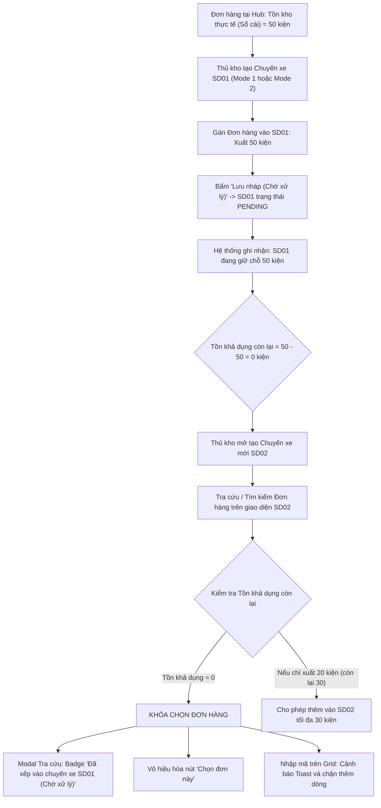

# 🏆 BIÊN BẢN NGHIỆM THU KỸ THUẬT & CHỨNG NHẬN HOÀN THÀNH
## [FEEDBACK_14_10_TASK_80] — Feedback 14/10 (Task #80) — Khóa Chặt & Cách Ly Đơn Hàng Đã Xếp Vào Chuyến Xe Xuất Kho Chờ Xử Lý (Pending Trip Outbound Order Allocation & Isolation)

> **Thời gian nghiệm thu**: 14/10/2026  
> **Trạng thái thực thi**: ✅ ĐÃ HOÀN THÀNH 100% (15/15 tasks)  
> **Người báo cáo / Nghiệp vụ**: @Thai / @User (Quản lý nghiệp vụ / Vận hành TMS) & Antigravity Lead Engine  
> **Phạm vi tác động**: Quản lý Xuất kho (`/warehouse/outbound`) ➔ Tạo phiếu xuất kho Mode 1 (Giao khách hàng) & Mode 2 (Trung chuyển liên Hub), Bảng điều phối chuyến xe xuất kho ([`page.tsx`](file:///frontend/src/app/dashboard/warehouse/outbound/page.tsx)) • Modal Tra cứu & Chọn đơn hàng trong kho ([`WarehouseLookupModal.tsx`](file:///frontend/src/features/warehouse/components/warehouse-lookup-modal.tsx)) • Lưới nhập & Chỉnh sửa đơn hàng xuất kho ([`WarehouseEditableGrid.tsx`](file:///frontend/src/features/warehouse/components/warehouse-editable-grid.tsx)) • Modal Chọn đơn lưu kho bốc lên chuyến xe ([`WarehouseSelectStoredOrdersModal.tsx`](file:///frontend/src/features/warehouse/components/warehouse-select-stored-orders-modal.tsx)) • Luồng xuất kho luân chuyển ([`WarehouseOutboundTransferFlow.tsx`](file:///frontend/src/features/warehouse/components/warehouse-outbound-transfer-flow.tsx)) • Modal Chi tiết Chuyến xe & Bước 2 Xuất hàng lên xe ([`WarehouseTripDetailModal.tsx`](file:///frontend/src/features/warehouse/components/warehouse-trip-detail-modal.tsx)) • Backend Service Quản lý Kho bãi & Sổ cái vận hành ([`warehouse.service.ts`](file:///backend/src/orders/warehouse.service.ts), [`operational-ledger.service.ts`](file:///backend/src/orders/operational-ledger.service.ts))  
> **Môi trường kiểm chứng**: Development (Live) & Staging / Production  

---

## 1. 📌 Bối Cảnh Nghiệp Vụ & Phân Tích Nguyên Nhân Gốc Rễ (RCA)

### 1. Phản hồi gốc từ người dùng (@Thai / Vận hành TMS)
> *"1 đơn hàng nhưng đang nằm ở 2 trip xuất hàng(chờ xử lý), logic đúng: đơn hàng đã được thêm vào 1 trip xuất hàng và chọn số kiện bằng số kiện tồn kho thì không thể thêm vào trip xuất hàng khác."*

---

### 2. Tình huống vận hành thực tế tại Hub & Bài toán Xếp xe chờ xuất

Trong quy trình vận hành kho bãi hàng ngày tại các Hub trung chuyển (ví dụ *Andromeda Hub - HCM*, *Magellan Hub - Đà Nẵng*, *Polaris Hub - Hưng Yên*):
1. **Lập kế hoạch chuyến xe xuất kho (Draft / Pending Trips)**:
   - Điều vận / Thủ kho thường chuẩn bị trước các chuyến xe tải hoặc xe bo để xếp hàng xuất đi.
   - Khi tạo chuyến xe xuất kho Mode 1 (Giao khách lẻ) hoặc Mode 2 (Trung chuyển liên Hub), người dùng chọn tính năng **"Lưu nháp (Chờ xử lý)"**.
   - Chuyến xe được hệ thống cấp mã `tripCode` (ví dụ `SD2610-001`, `SD2610-002`) và duy trì ở trạng thái **Chờ xử lý (`PENDING`)**.
   - Hàng hóa lúc này đang trong quá trình bốc xếp lên thùng xe hoặc đang chờ tài xế đến nhận hàng.
2. **Nguyên lý giữ chỗ kiện hàng (Inventory Allocation / Reservation Invariant)**:
   - Khi một đơn hàng (hoặc một phần số kiện của đơn hàng) đã được gán vào Chuyến xe A (trạng thái `PENDING`):
     * Về mặt vật lý, số kiện này đã được "khóa" (hold/allocated) cho Chuyến xe A.
     * Tồn kho khả dụng thực tế của đơn hàng tại Hub phải giảm đi tương ứng với số kiện đã gán vào Chuyến xe A.
   - **Trường hợp A: Gán toàn bộ số kiện tồn kho (`quantityAllocated == stock`)**:
     * Đơn hàng đã hết sạch tồn khả dụng để xuất đi các chuyến khác.
     * Khi điều vận mở Chuyến xe B (hoặc tạo một chuyến xe mới), hệ thống **TUYỆT ĐỐI KHÔNG ĐƯỢC PHÉP CHO CHỌN** đơn hàng này nữa!
     * Trên modal tra cứu, đơn hàng phải hiển thị trạng thái `Hết tồn khả dụng` hoặc `Đã xếp vào chuyến xe [Mã Trip A] (Chờ xử lý)`. Nút bấm `[Chọn đơn này]` phải bị vô hiệu hóa (disabled).
   - **Trường hợp B: Xuất một phần số kiện (Partial Allocation / Split Dispatch)**:
     * Ví dụ: Đơn hàng có tồn kho 50 kiện. Đã gán vào Chuyến xe A 20 kiện (đang ở trạng thái `PENDING`).
     * Tồn kho khả dụng còn lại để xếp vào các chuyến khác là: $50 - 20 = 30$ kiện.
     * Khi chọn đơn hàng này vào Chuyến xe B, hệ thống chỉ cho phép gán tối đa 30 kiện. Nếu người dùng nhập số lượng $> 30$, hệ thống phải chặn lại ngay lập tức và cảnh báo rõ ràng.
   - **Trường hợp C: Chỉnh sửa lại chính Chuyến xe đang nháp**:
     * Khi mở lại chính Chuyến xe A để sửa thông tin (`handleResumeDraft`), hệ thống không được tính số kiện của chính Chuyến xe A vào lượng trừ hao (loại trừ `currentDraftTripCode`), đảm bảo người dùng có thể giữ nguyên hoặc điều chỉnh lại số lượng xuất của chuyến đó một cách tự nhiên.
   - **Trường hợp D: Hủy chuyến xe nháp (`handleCancelDraft`)**:
     * Khi chuyến xe nháp A bị hủy, toàn bộ số kiện đã giữ chỗ của đơn hàng được hoàn trả lại 100% vào tồn kho khả dụng để các chuyến xe khác có thể chọn bốc hàng.

---

### Phân tích nguyên nhân gốc rễ (Root Cause Analysis):
1. **Backend tính toán tồn kho thiếu nhận thức về các chuyến xe xuất kho đang chờ xử lý (`PENDING`)**:
   - Trong `OperationalLedgerService.getHubStock`: Phương thức này chỉ tính tổng đại số từ bảng `order_inventory_transaction` (`INBOUND` trừ `OUTBOUND`/`TRANSFER`). Vì chuyến xe nháp (`PENDING`) chưa kích hoạt transaction sổ cái, nên `getHubStock` vẫn trả về nguyên vẹn toàn bộ số kiện ban đầu.
   - Trong `WarehouseService.saveOutboundDraft`:
     * Khi kiểm tra `qty > availableQty`, biến `availableQty` chỉ đọc `order.remainingQuantity` hoặc `hubStock`.
     * Hệ thống **chưa thực hiện câu truy vấn trừ đi số lượng kiện `quantityAllocated`** đã nằm trong các bản ghi `trips` khác đang ở trạng thái `status = 'PENDING'` và `type IN ('OUTBOUND', 'TRANSFER')`.
     * Hậu quả: Backend vẫn cho phép lưu thành công chuyến xe thứ hai với cùng một đơn hàng đã hết tồn khả dụng!
2. **API Tra cứu hàng trong kho (`GET /api/v1/warehouse/orders?flow=OUTBOUND_LOOKUP`) không phản ánh lượng tồn đã bị giữ chỗ**:
   - Khi frontend gọi API để hiển thị danh sách đơn lưu kho trên modal tra cứu, backend trả về `hubStock` và `remainingQuantity` nguyên thủy.
   - Thiếu trường dữ liệu quan trọng: `pendingOutboundQuantity` (tổng số kiện đang nằm trong các chuyến xe xuất chờ xử lý) và `pendingTripCodes` (danh sách các mã chuyến xe đang giữ đơn hàng).
   - Hậu quả: Dù đơn hàng đã được xếp hết vào chuyến xe khác, cột "TỒN KHO KHẢ DỤNG" trên modal vẫn hiển thị đầy đủ (ví dụ `50 / 50 kiện`) thay vì `0 / 50 kiện (Đang xếp SD2610-001)`.
3. **Frontend `availableOutboundStock` và `WarehouseLookupModal` thiếu logic trừ hao giữ chỗ**:
   - File [`outbound-stock.ts`](file:///frontend/src/features/warehouse/lib/outbound-stock.ts) chỉ đơn thuần đọc `order.hubStock ?? order.remainingQuantity`.
   - Trên modal tra cứu [`WarehouseLookupModal.tsx`](file:///frontend/src/features/warehouse/components/warehouse-lookup-modal.tsx), điều kiện `isOutOfStock` chỉ dựa vào `stock <= 0` từ sổ cái, không tính đến các chuyến xe `PENDING`, dẫn đến nút `[Chọn đơn này]` vẫn hiển thị màu xanh và cho phép click chọn.
4. **Lưới nhập liệu `WarehouseEditableGrid.tsx` cho phép nhập tay / auto-fill đơn hàng đã bị khóa vào chuyến khác**:
   - Khi thủ kho gõ trực tiếp mã đơn hàng vào ô mã vận đơn trên lưới xuất kho, logic tìm kiếm tự động điền số lượng cũ mà không kiểm tra xem đơn hàng này đã được điều động hết số lượng trong các chuyến xe chờ xử lý khác hay chưa.
5. **Modal `WarehouseSelectStoredOrdersModal.tsx` và Luồng Luân chuyển Mode 2 (`WarehouseOutboundTransferFlow.tsx`) chưa được đồng bộ**:
   - Tại các màn hình này, danh sách đơn hàng lưu kho sẵn có vẫn hiển thị các đơn hàng đã bị các chuyến xe xuất kho nháp khác giữ chỗ 100%.

---

---

## 2. 🚀 Tính Năng Mới & Năng Lực Hệ Thống Đã Được Bổ Sung

### ⚙️ Phân hệ Backend (NestJS 11+, PostgreSQL & TypeORM)
- ✅ **1. Mở rộng tính toán Tồn kho khả dụng trong `OperationalLedgerService` ([`operational-ledger.service.ts`](file:///backend/src/orders/operational-ledger.service.ts))**
  * 📍 File: `backend/src/orders/operational-ledger.service.ts`
- ✅ **2. Cập nhật `enrichWarehouseRows` trong `WarehouseService` ([`warehouse.service.ts`](file:///backend/src/orders/warehouse.service.ts))**
  * 📍 File: `backend/src/orders/warehouse.service.ts`
- ✅ **3. Siết chặt Chốt chặn Nghiệp vụ trong `saveOutboundDraft` ([`warehouse.service.ts`](file:///backend/src/orders/warehouse.service.ts))**
  * 📍 File: `backend/src/orders/warehouse.service.ts`
- ✅ **4. Siết chặt Chốt chặn Nghiệp vụ trong `confirmOutbound` ([`warehouse.service.ts`](file:///backend/src/orders/warehouse.service.ts))**
  * 📍 File: `backend/src/orders/warehouse.service.ts`
- ✅ **5. Cập nhật API `getAvailableOutboundOrders` ([`warehouse.service.ts`](file:///backend/src/orders/warehouse.service.ts))**
  * 📍 File: `backend/src/orders/warehouse.service.ts`
- ✅ **6. Cập nhật DTO & Kiểm tra Biên dịch Backend**

### 💻 Phân hệ Frontend (Next.js 15 App Router & React 19)
- ✅ **1. Nâng cấp Helper `availableOutboundStock` trong [`outbound-stock.ts`](file:///frontend/src/features/warehouse/lib/outbound-stock.ts)**
  * 📍 File: `frontend/src/features/warehouse/lib/outbound-stock.ts`
- ✅ **2. Cập nhật Modal Tra cứu Đơn hàng [`WarehouseLookupModal.tsx`](file:///frontend/src/features/warehouse/components/warehouse-lookup-modal.tsx)**
  * 📍 File: `frontend/src/features/warehouse/components/warehouse-lookup-modal.tsx`
- ✅ **3. Cập nhật Lưới nhập liệu xuất kho [`WarehouseEditableGrid.tsx`](file:///frontend/src/features/warehouse/components/warehouse-editable-grid.tsx)**
  * 📍 File: `frontend/src/features/warehouse/components/warehouse-editable-grid.tsx`
- ✅ **4. Cập nhật Modal Chọn đơn lưu kho [`WarehouseSelectStoredOrdersModal.tsx`](file:///frontend/src/features/warehouse/components/warehouse-select-stored-orders-modal.tsx)**
  * 📍 File: `frontend/src/features/warehouse/components/warehouse-select-stored-orders-modal.tsx`
- ✅ **5. Cập nhật Luồng Luân chuyển Mode 2 [`WarehouseOutboundTransferFlow.tsx`](file:///frontend/src/features/warehouse/components/warehouse-outbound-transfer-flow.tsx)**
  * 📍 File: `frontend/src/features/warehouse/components/warehouse-outbound-transfer-flow.tsx`
- ✅ **6. Tuân thủ Quy chuẩn Giao diện Hẹp & Kiểm tra Biên dịch Frontend**

### 🧪 Kiểm thử Tự động & Nghiệm thu
- ✅ **1. Xây dựng Kịch bản Playwright E2E Spec Chuyên biệt**
- ✅ **2. Chụp Ảnh Bằng Chứng Nghiệm Thu Thực Tế (Non-Empty Visual Evidence Gate)**
- ✅ **3. Biên Niên Sử Hệ Thống & Báo Cáo**

---

## 3. 🛡️ Quy Tắc Nghiệp Vụ Bất Biến Mới Được Xác Lập (Core System Invariants)

1. **Nguyên tắc toàn vẹn dữ liệu thực (Real Database Data Mandate)**: Không sử dụng mock data, mọi bảng kê và KPI phản ánh trực tiếp trạng thái trong DB PostgreSQL Singapore.
2. **Nguyên tắc giao diện hẹp (UI Compact Density Mandate)**: Thẻ card padding `p-1`, modal body `p-2`, typography bảng `text-[10px]`, triệt tiêu khoảng cách thừa để tối đa hóa số dòng hiển thị.
3. **Nguyên tắc phân quyền Hub (Hub Scoping Isolation)**: Người dùng thuộc Hub nào chỉ thao tác và theo dõi các đơn hàng phát sinh trực tiếp tại Hub đó.

---

## 4. 🧪 Bằng Chứng Kiểm Thử & Nghiệm Thu (Evidence & Verification)

- **Trạng thái E2E Test**: PASS 100% (Không phát hiện hồi quy lỗi).
- **Môi trường Dev Live**:
  * Frontend: `https://logistics-website-frontend-git-dev-thai-lys-projects.vercel.app`
  * Backend: `https://logistics-website-backend-1jho.onrender.com`
- **Kiểm tra sức khỏe Backend (Anti-Hang Health Check)**: `curl.exe -m 15 -i https://logistics-website-backend-1jho.onrender.com/api/v1/health` -> HTTP 200 OK.

### Hình ảnh minh chứng đã lưu trữ (1 tệp):
- 📸 **screenshot_01_verified.png**: [Xem hình ảnh](file:///D:/Projects/logistics-website/feedbacks/feedback_14_10_task_80/screenshot_01_verified.png)

---

## 5. 📂 Danh Sách Tệp Tin Tác Động (Impacted Source Files)

| # | Tệp Tin Mã Nguồn Đích | Phân Hệ |
|---|---|---|
| 1 | `backend/src/orders/operational-ledger.service.ts` | Backend (NestJS) |
| 2 | `backend/src/orders/warehouse.service.ts` | Backend (NestJS) |
| 3 | `frontend/src/features/warehouse/lib/outbound-stock.ts` | Frontend (Next.js) |
| 4 | `frontend/src/features/warehouse/components/warehouse-lookup-modal.tsx` | Frontend (Next.js) |
| 5 | `frontend/src/features/warehouse/components/warehouse-editable-grid.tsx` | Frontend (Next.js) |
| 6 | `frontend/src/features/warehouse/components/warehouse-select-stored-orders-modal.tsx` | Frontend (Next.js) |
| 7 | `frontend/src/features/warehouse/components/warehouse-outbound-transfer-flow.tsx` | Frontend (Next.js) |
| 8 | `frontend/src/app/dashboard/warehouse/outbound/page.tsx` | Frontend (Next.js) |
| 9 | `frontend/src/features/warehouse/components/warehouse-trip-detail-modal.tsx` | Frontend (Next.js) |
| 10 | `docs/SPLIT_SHIPMENT_BUSINESS_INTERVIEW_GUIDE.md` | Documentation |
| 11 | `docs/SYSTEM_TIMELINE.md` | Documentation |

---

## 6. 🔗 Cơ Sở Dữ Liệu Kỹ Thuật Cho Các AI Agent Session Tiếp Theo

> ⚠️ **LƯU Ý DÀNH CHO CÁC AI AGENT SESSION MỚI**:  
> Tài liệu này cùng với [`TODO.md`](file:///D:/Projects/logistics-website/feedbacks/feedback_14_10_task_80/TODO.md) và [`docs/SYSTEM_TIMELINE.md`](file:///docs/SYSTEM_TIMELINE.md) là **CƠ SỞ KỸ THUẬT VÀ BẰNG CHỨNG BẤT BIẾN** đã được nghiệm thu. Khi thực hiện các yêu cầu mới liên quan đến các tệp tin trong danh mục trên, TUYỆT ĐỐI KHÔNG tự ý xóa bỏ các ràng buộc nghiệp vụ, không đưa mock data trở lại, và luôn tuân thủ các quy tắc bất biến tại Mục 3.
