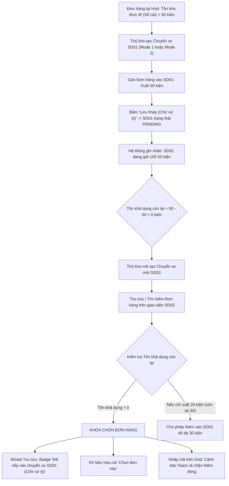

# Feedback 14/10 (Task #80) — Khóa Chặt & Cách Ly Đơn Hàng Đã Xếp Vào Chuyến Xe Xuất Kho Chờ Xử Lý (Pending Trip Outbound Order Allocation & Isolation)

> **Thời gian ghi nhận**: 14/10/2026  
> **Người báo cáo**: @Thai / @User (Quản lý nghiệp vụ / Vận hành TMS) & Antigravity Lead Engine  
> **Màn hình liên quan**:  
> - Quản lý Xuất kho (`/warehouse/outbound`) ➔ Tạo phiếu xuất kho Mode 1 (Giao khách hàng) & Mode 2 (Trung chuyển liên Hub), Bảng điều phối chuyến xe xuất kho ([`page.tsx`](file:///frontend/src/app/dashboard/warehouse/outbound/page.tsx))  
> - Modal Tra cứu & Chọn đơn hàng trong kho ([`WarehouseLookupModal.tsx`](file:///frontend/src/features/warehouse/components/warehouse-lookup-modal.tsx))  
> - Lưới nhập & Chỉnh sửa đơn hàng xuất kho ([`WarehouseEditableGrid.tsx`](file:///frontend/src/features/warehouse/components/warehouse-editable-grid.tsx))  
> - Modal Chọn đơn lưu kho bốc lên chuyến xe ([`WarehouseSelectStoredOrdersModal.tsx`](file:///frontend/src/features/warehouse/components/warehouse-select-stored-orders-modal.tsx))  
> - Luồng xuất kho luân chuyển ([`WarehouseOutboundTransferFlow.tsx`](file:///frontend/src/features/warehouse/components/warehouse-outbound-transfer-flow.tsx))  
> - Modal Chi tiết Chuyến xe & Bước 2 Xuất hàng lên xe ([`WarehouseTripDetailModal.tsx`](file:///frontend/src/features/warehouse/components/warehouse-trip-detail-modal.tsx))  
> - Backend Service Quản lý Kho bãi & Sổ cái vận hành ([`warehouse.service.ts`](file:///backend/src/orders/warehouse.service.ts), [`operational-ledger.service.ts`](file:///backend/src/orders/operational-ledger.service.ts))  
> **Tài liệu tham chiếu**:  
> - `/leader` Business Domain Architecture ([`SKILL.md`](file:///home/runner/work/logistics-website/logistics-website/.agents/skills/leader/SKILL.md))  
> - Quy chế phát triển hệ thống [`AGENTS.md`](file:///home/runner/work/logistics-website/logistics-website/AGENTS.md)  
> - Phân hệ Điều độ & Tách chuyến đa xe ([`docs/SPLIT_SHIPMENT_BUSINESS_INTERVIEW_GUIDE.md`](file:///home/runner/work/logistics-website/logistics-website/docs/SPLIT_SHIPMENT_BUSINESS_INTERVIEW_GUIDE.md))  
> - Quy chuẩn giao diện hẹp [`.agents/rules/ui-compact-density.md`](file:///home/runner/work/logistics-website/logistics-website/.agents/rules/ui-compact-density.md) & [`ui-spacing-guard`](file:///home/runner/work/logistics-website/logistics-website/.agents/skills/ui-spacing-guard/SKILL.md)  
> - Biên niên sử hệ thống [`docs/SYSTEM_TIMELINE.md`](file:///home/runner/work/logistics-website/logistics-website/docs/SYSTEM_TIMELINE.md) (Đối chiếu mốc Task #51)  
> **Ảnh minh chứng đính kèm & Ngữ cảnh báo cáo**:  
> - Ảnh chụp màn hình từ Telegram Task #80: Bảng điều độ chuyến xe xuất kho thể hiện cùng 1 mã đơn hàng đang cùng xuất hiện đồng thời trong 2 chuyến xe xuất khác nhau ở trạng thái Chờ xử lý (`PENDING`), dẫn tới nguy cơ xuất khống hàng hóa và sai lệch tồn kho vật lý.  

---

## 📌 Bối cảnh nghiệp vụ thực tế (Chốt theo phản hồi người dùng)

### 1. Phản hồi gốc từ người dùng (@Thai / Vận hành TMS)
> *"1 đơn hàng nhưng đang nằm ở 2 trip xuất hàng(chờ xử lý), logic đúng: đơn hàng đã được thêm vào 1 trip xuất hàng và chọn số kiện bằng số kiện tồn kho thì không thể thêm vào trip xuất hàng khác."*

---

### 2. Tình huống vận hành thực tế tại Hub & Bài toán Xếp xe chờ xuất

Trong quy trình vận hành kho bãi hàng ngày tại các Hub trung chuyển (ví dụ *Andromeda Hub - HCM*, *Magellan Hub - Đà Nẵng*, *Polaris Hub - Hưng Yên*):
1. **Lập kế hoạch chuyến xe xuất kho (Draft / Pending Trips)**:
   - Điều vận / Thủ kho thường chuẩn bị trước các chuyến xe tải hoặc xe bo để xếp hàng xuất đi.
   - Khi tạo chuyến xe xuất kho Mode 1 (Giao khách lẻ) hoặc Mode 2 (Trung chuyển liên Hub), người dùng chọn tính năng **"Lưu nháp (Chờ xử lý)"**.
   - Chuyến xe được hệ thống cấp mã `tripCode` (ví dụ `SD2610-001`, `SD2610-002`) và duy trì ở trạng thái **Chờ xử lý (`PENDING`)**.
   - Hàng hóa lúc này đang trong quá trình bốc xếp lên thùng xe hoặc đang chờ tài xế đến nhận hàng.
2. **Nguyên lý giữ chỗ kiện hàng (Inventory Allocation / Reservation Invariant)**:
   - Khi một đơn hàng (hoặc một phần số kiện của đơn hàng) đã được gán vào Chuyến xe A (trạng thái `PENDING`):
     * Về mặt vật lý, số kiện này đã được "khóa" (hold/allocated) cho Chuyến xe A.
     * Tồn kho khả dụng thực tế của đơn hàng tại Hub phải giảm đi tương ứng với số kiện đã gán vào Chuyến xe A.
   - **Trường hợp A: Gán toàn bộ số kiện tồn kho (`quantityAllocated == stock`)**:
     * Đơn hàng đã hết sạch tồn khả dụng để xuất đi các chuyến khác.
     * Khi điều vận mở Chuyến xe B (hoặc tạo một chuyến xe mới), hệ thống **TUYỆT ĐỐI KHÔNG ĐƯỢC PHÉP CHO CHỌN** đơn hàng này nữa!
     * Trên modal tra cứu, đơn hàng phải hiển thị trạng thái `Hết tồn khả dụng` hoặc `Đã xếp vào chuyến xe [Mã Trip A] (Chờ xử lý)`. Nút bấm `[Chọn đơn này]` phải bị vô hiệu hóa (disabled).
   - **Trường hợp B: Xuất một phần số kiện (Partial Allocation / Split Dispatch)**:
     * Ví dụ: Đơn hàng có tồn kho 50 kiện. Đã gán vào Chuyến xe A 20 kiện (đang ở trạng thái `PENDING`).
     * Tồn kho khả dụng còn lại để xếp vào các chuyến khác là: $50 - 20 = 30$ kiện.
     * Khi chọn đơn hàng này vào Chuyến xe B, hệ thống chỉ cho phép gán tối đa 30 kiện. Nếu người dùng nhập số lượng $> 30$, hệ thống phải chặn lại ngay lập tức và cảnh báo rõ ràng.
   - **Trường hợp C: Chỉnh sửa lại chính Chuyến xe đang nháp**:
     * Khi mở lại chính Chuyến xe A để sửa thông tin (`handleResumeDraft`), hệ thống không được tính số kiện của chính Chuyến xe A vào lượng trừ hao (loại trừ `currentDraftTripCode`), đảm bảo người dùng có thể giữ nguyên hoặc điều chỉnh lại số lượng xuất của chuyến đó một cách tự nhiên.
   - **Trường hợp D: Hủy chuyến xe nháp (`handleCancelDraft`)**:
     * Khi chuyến xe nháp A bị hủy, toàn bộ số kiện đã giữ chỗ của đơn hàng được hoàn trả lại 100% vào tồn kho khả dụng để các chuyến xe khác có thể chọn bốc hàng.

---

## 🔍 Tổng hợp các điểm chưa đúng trên hệ thống cũ cần khắc phục

1. **Backend tính toán tồn kho thiếu nhận thức về các chuyến xe xuất kho đang chờ xử lý (`PENDING`)**:
   - Trong `OperationalLedgerService.getHubStock`: Phương thức này chỉ tính tổng đại số từ bảng `order_inventory_transaction` (`INBOUND` trừ `OUTBOUND`/`TRANSFER`). Vì chuyến xe nháp (`PENDING`) chưa kích hoạt transaction sổ cái, nên `getHubStock` vẫn trả về nguyên vẹn toàn bộ số kiện ban đầu.
   - Trong `WarehouseService.saveOutboundDraft`:
     * Khi kiểm tra `qty > availableQty`, biến `availableQty` chỉ đọc `order.remainingQuantity` hoặc `hubStock`.
     * Hệ thống **chưa thực hiện câu truy vấn trừ đi số lượng kiện `quantityAllocated`** đã nằm trong các bản ghi `trips` khác đang ở trạng thái `status = 'PENDING'` và `type IN ('OUTBOUND', 'TRANSFER')`.
     * Hậu quả: Backend vẫn cho phép lưu thành công chuyến xe thứ hai với cùng một đơn hàng đã hết tồn khả dụng!
2. **API Tra cứu hàng trong kho (`GET /api/v1/warehouse/orders?flow=OUTBOUND_LOOKUP`) không phản ánh lượng tồn đã bị giữ chỗ**:
   - Khi frontend gọi API để hiển thị danh sách đơn lưu kho trên modal tra cứu, backend trả về `hubStock` và `remainingQuantity` nguyên thủy.
   - Thiếu trường dữ liệu quan trọng: `pendingOutboundQuantity` (tổng số kiện đang nằm trong các chuyến xe xuất chờ xử lý) và `pendingTripCodes` (danh sách các mã chuyến xe đang giữ đơn hàng).
   - Hậu quả: Dù đơn hàng đã được xếp hết vào chuyến xe khác, cột "TỒN KHO KHẢ DỤNG" trên modal vẫn hiển thị đầy đủ (ví dụ `50 / 50 kiện`) thay vì `0 / 50 kiện (Đang xếp SD2610-001)`.
3. **Frontend `availableOutboundStock` và `WarehouseLookupModal` thiếu logic trừ hao giữ chỗ**:
   - File [`outbound-stock.ts`](file:///frontend/src/features/warehouse/lib/outbound-stock.ts) chỉ đơn thuần đọc `order.hubStock ?? order.remainingQuantity`.
   - Trên modal tra cứu [`WarehouseLookupModal.tsx`](file:///frontend/src/features/warehouse/components/warehouse-lookup-modal.tsx), điều kiện `isOutOfStock` chỉ dựa vào `stock <= 0` từ sổ cái, không tính đến các chuyến xe `PENDING`, dẫn đến nút `[Chọn đơn này]` vẫn hiển thị màu xanh và cho phép click chọn.
4. **Lưới nhập liệu `WarehouseEditableGrid.tsx` cho phép nhập tay / auto-fill đơn hàng đã bị khóa vào chuyến khác**:
   - Khi thủ kho gõ trực tiếp mã đơn hàng vào ô mã vận đơn trên lưới xuất kho, logic tìm kiếm tự động điền số lượng cũ mà không kiểm tra xem đơn hàng này đã được điều động hết số lượng trong các chuyến xe chờ xử lý khác hay chưa.
5. **Modal `WarehouseSelectStoredOrdersModal.tsx` và Luồng Luân chuyển Mode 2 (`WarehouseOutboundTransferFlow.tsx`) chưa được đồng bộ**:
   - Tại các màn hình này, danh sách đơn hàng lưu kho sẵn có vẫn hiển thị các đơn hàng đã bị các chuyến xe xuất kho nháp khác giữ chỗ 100%.

---

## 📋 Danh sách công việc triển khai (Action Checklist)

### 🎯 PHẦN I: BACKEND (backend/)

- [x] **1. Mở rộng tính toán Tồn kho khả dụng trong `OperationalLedgerService` ([`operational-ledger.service.ts`](file:///backend/src/orders/operational-ledger.service.ts))**:
  - Bổ sung phương thức `getPendingOutboundAllocation(orderId: number, hubId: number, excludeTripCode?: string, manager?: EntityManager)`:
    * Query bảng `trips`: `SELECT COALESCE(SUM("quantityAllocated"), 0)::int AS "pendingQty", array_agg(DISTINCT "tripCode") FILTER (WHERE "tripCode" IS NOT NULL) AS "tripCodes" FROM "trips" WHERE "orderId" = $1 AND "originHubId" = $2 AND "status" = 'PENDING' AND "type" IN ('OUTBOUND', 'TRANSFER') AND "deletedAt" IS NULL AND ("tripCode" != $3 OR $3 IS NULL)`.
  - Cập nhật hàm tính toán tồn khả dụng thực xuất: `effectiveAvailableStock = Math.max(0, hubStock - pendingQty)`.
- [x] **2. Cập nhật `enrichWarehouseRows` trong `WarehouseService` ([`warehouse.service.ts`](file:///backend/src/orders/warehouse.service.ts))**:
  - Khi enrich dữ liệu đơn hàng cho flow kho (đặc biệt `flow = 'OUTBOUND_LOOKUP'` hoặc màn hình xuất kho):
    * Gom nhóm và tính toán tổng số kiện đang chờ xuất `pendingOutboundQuantity` và mảng mã chuyến xe `pendingOutboundTripCodes`.
    * Tính toán lại `effectiveHubStock = Math.max(0, hubStock - pendingOutboundQuantity)`.
    * Trả về thêm các trường: `pendingOutboundQuantity`, `pendingOutboundTripCodes`, `effectiveHubStock` trong payload của từng đơn hàng.
- [x] **3. Siết chặt Chốt chặn Nghiệp vụ trong `saveOutboundDraft` ([`warehouse.service.ts`](file:///backend/src/orders/warehouse.service.ts))**:
  - Khi người dùng bấm lưu nháp chuyến xe xuất kho:
    * Kiểm tra từng đơn hàng: tính `pendingQty` từ các chuyến xe `PENDING` khác (`tripCode != draftCode`).
    * Tính `effectiveAvailable = Math.max(0, availableQty - pendingQty)`.
    * Nếu `qtyToExport > effectiveAvailable`:
      Throw `UnprocessableEntityException`:  
      `"Mã đơn ${order.orderCode}: Không thể thêm vào chuyến xe này. Đơn hàng đã được xếp ${pendingQty}/${availableQty} kiện vào các chuyến xe chờ xuất (${pendingTripCodes.join(', ')}). Số kiện khả dụng còn lại: ${effectiveAvailable} kiện."`
- [x] **4. Siết chặt Chốt chặn Nghiệp vụ trong `confirmOutbound` ([`warehouse.service.ts`](file:///backend/src/orders/warehouse.service.ts))**:
  - Tương tự `saveOutboundDraft`, đảm bảo khi xác nhận xuất kho chính thức (`COMPLETED`), nếu đơn hàng đã bị các chuyến xe nháp khác chiếm dụng vượt mức cho phép, hệ thống phải phát hiện và chặn lại an toàn.
- [x] **5. Cập nhật API `getAvailableOutboundOrders` ([`warehouse.service.ts`](file:///backend/src/orders/warehouse.service.ts))**:
  - Bổ sung điều kiện loại trừ hoặc đánh dấu các đơn hàng đã có tổng số kiện trong các chuyến xe `PENDING` $\ge$ số kiện tồn kho của đơn hàng.
- [x] **6. Cập nhật DTO & Kiểm tra Biên dịch Backend**:
  - Kiểm tra `npm run build --prefix backend` đảm bảo 100% không phát sinh lỗi TypeScript.

---

### 🎨 PHẦN II: FRONTEND (frontend/)

- [x] **1. Nâng cấp Helper `availableOutboundStock` trong [`outbound-stock.ts`](file:///frontend/src/features/warehouse/lib/outbound-stock.ts)**:
  - Mở rộng interface `StockSource` bổ sung các trường: `pendingOutboundQuantity?: number | null`, `effectiveHubStock?: number | null`.
  - Logic tính toán: Nếu có `effectiveHubStock` trả về từ backend thì ưu tiên sử dụng; hoặc tự động trừ `pendingOutboundQuantity`:
    `const liveStock = order.effectiveHubStock ?? Math.max(0, (order.hubStock ?? order.remainingQuantity ?? order.totalQuantity ?? 0) - (order.pendingOutboundQuantity ?? 0));`
- [x] **2. Cập nhật Modal Tra cứu Đơn hàng [`WarehouseLookupModal.tsx`](file:///frontend/src/features/warehouse/components/warehouse-lookup-modal.tsx)**:
  - Hiển thị thông tin minh bạch tại cột TỒN KHẢ DỤNG:
    * Nếu `stock <= 0` do đã được xếp hết vào trip chờ xuất:
      Render badge cảnh báo màu cam/đỏ: `Đã xếp chuyến ${row.pendingOutboundTripCodes?.join(', ') || 'khác'} (Chờ xuất)`.
      Hiển thị số kiện: `0 / ${row.totalQuantity} kiện (Đang giữ ${row.pendingOutboundQuantity})`.
    * Vô hiệu hóa nút `[Chọn đơn này]` với tooltip / label giải thích: `Hết tồn khả dụng (Đang chờ xuất)`.
- [x] **3. Cập nhật Lưới nhập liệu xuất kho [`WarehouseEditableGrid.tsx`](file:///frontend/src/features/warehouse/components/warehouse-editable-grid.tsx)**:
  - Khi người dùng nhập mã vận đơn hoặc tra cứu đơn hàng:
    * Nếu đơn hàng có `effectiveStock <= 0` do đã bị giữ ở chuyến xe khác: Hiển thị toast lỗi rõ ràng: `Đơn hàng ${foundOrder.orderCode} đã được xếp hết số kiện vào chuyến xe chờ xuất (${foundOrder.pendingOutboundTripCodes?.join(', ')}). Không thể thêm vào chuyến xe này!` và không gán đơn vào lưới.
    * Nếu đơn hàng chỉ còn lại một phần tồn khả dụng: Tự động gán `totalQuantity`, `quantityToExport`, `remainingQuantity` theo đúng số lượng khả dụng còn lại (`effectiveStock`).
- [x] **4. Cập nhật Modal Chọn đơn lưu kho [`WarehouseSelectStoredOrdersModal.tsx`](file:///frontend/src/features/warehouse/components/warehouse-select-stored-orders-modal.tsx)**:
  - Lọc bỏ hoặc vô hiệu hóa checkbox đối với các đơn hàng đã bị các chuyến xe xuất kho nháp khác giữ trọn 100% số kiện.
- [x] **5. Cập nhật Luồng Luân chuyển Mode 2 [`WarehouseOutboundTransferFlow.tsx`](file:///frontend/src/features/warehouse/components/warehouse-outbound-transfer-flow.tsx)**:
  - Đồng bộ logic trừ hao tồn kho giữ chỗ trong bước chọn đơn điều chuyển liên Hub.
- [x] **6. Tuân thủ Quy chuẩn Giao diện Hẹp & Kiểm tra Biên dịch Frontend**:
  - Đảm bảo tuân thủ nghiêm ngặt [`.agents/rules/ui-compact-density.md`](file:///home/runner/work/logistics-website/logistics-website/.agents/rules/ui-compact-density.md) (Card padding `p-1`, Modal `p-2`, Typography `text-[10px]`, Zero Redundant Icons).
  - Chạy kiểm tra biên dịch: `npx --prefix frontend tsc --noEmit` & `npm run build --prefix frontend` PASS 100%.

---

### 🧪 PHẦN III: KIỂM THỬ TỰ ĐỘNG & NGHIỆM THU (E2E PLAYWRIGHT SPEC & QUALITY GATE)

- [x] **1. Xây dựng Kịch bản Playwright E2E Spec Chuyên biệt**:
  - Đường dẫn file test: [`frontend/e2e/80-feedback-14-10-task-80-pending-trip-order-isolation.spec.ts`](file:///frontend/e2e/80-feedback-14-10-task-80-pending-trip-order-isolation.spec.ts).
  - **Tài khoản kiểm thử**: Bắt buộc đăng nhập đúng tài khoản Hub quản lý kho (ví dụ `USER_WAREHOUSE_HCM` hoặc `USER_WAREHOUSE_DAD`).
  - **Kịch bản kiểm thử chi tiết**:
    1. **Bước 1 (Lập chuyến xuất nháp thứ nhất SD-A)**:
       - Vào màn hình Xuất kho `/dashboard/warehouse/outbound`.
       - Mở phiếu xuất kho Mode 1, chọn 1 đơn hàng lưu kho đang có sẵn tồn kho (ví dụ Đơn `HCM-...` có 10 kiện).
       - Chọn xuất đủ 10 kiện ➔ Bấm `Lưu nháp (Chờ xử lý)`.
       - Xác nhận chuyến xe `SD-A` xuất hiện trên Bảng điều độ với trạng thái `Chờ xử lý`.
    2. **Bước 2 (Lập chuyến xuất nháp thứ hai SD-B & Xác thực chặn trùng lặp)**:
       - Tiếp tục bấm `+ Tạo phiếu xuất kho`.
       - Mở modal `Tra cứu & chọn hàng trong kho`.
       - Tìm kiếm chính mã đơn hàng vừa gán ở Bước 1.
       - **Khẳng định (Assertion 1)**: Đơn hàng hiển thị trạng thái `Hết tồn khả dụng` / `Đã xếp chuyến SD-A`, nút `Chọn đơn này` bị vô hiệu hóa (disabled).
       - Nhập tay mã đơn vào ô lưới xuất kho ➔ **Khẳng định (Assertion 2)**: Hệ thống chặn và hiển thị toast cảnh báo không cho thêm vào chuyến.
    3. **Bước 3 (Xác thực giải phóng tồn kho khi Hủy nháp chuyến SD-A)**:
       - Quay lại Bảng điều độ, bấm nút `Hủy nháp` chuyến `SD-A`.
       - Quay lại tạo phiếu xuất kho ➔ Mở modal Tra cứu ➔ **Khẳng định (Assertion 3)**: Đơn hàng được giải phóng, hiển thị lại tồn khả dụng đầy đủ (10 kiện) và nút `Chọn đơn này` sáng trở lại bình thường.
- [x] **2. Chụp Ảnh Bằng Chứng Nghiệm Thu Thực Tế (Non-Empty Visual Evidence Gate)**:
  - Lưu ảnh chụp màn hình bằng chứng vào thư mục feedback:
    * `feedbacks/feedback_14_10_task_80/screenshot_01_verified.png`: Minh chứng modal tra cứu hiển thị badge chặn chọn đơn hàng đã nằm trong chuyến xe chờ xử lý.
- [x] **3. Biên Niên Sử Hệ Thống & Báo Cáo**:
  - Chạy `npm run todo:record feedback_14_10_task_80` để tự động cập nhật [`docs/SYSTEM_TIMELINE.md`](file:///docs/SYSTEM_TIMELINE.md) và sinh [`RESOLUTION.md`](file:///feedbacks/feedback_14_10_task_80/RESOLUTION.md).
