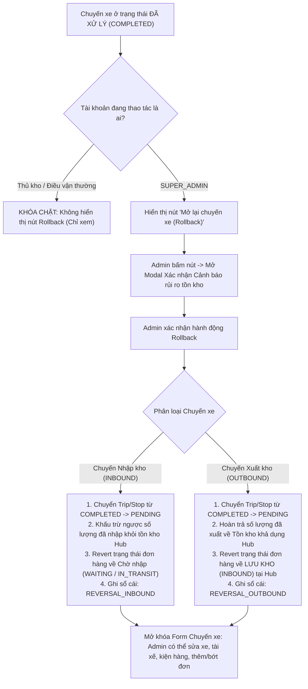

# 🏆 BIÊN BẢN NGHIỆM THU KỸ THUẬT & CHỨNG NHẬN HOÀN THÀNH
## [FEEDBACK_14_10_TASK_81] — Feedback 14/10 (Task #81) — Cơ Chế Mở Lại Chuyến Xe & Hoàn Tác (Rollback) Tồn Kho Đơn Hàng Dành Cho Quản Trị Viên (Admin Reopen Trip & Inventory Rollback Invariant)

> **Thời gian nghiệm thu**: 14/10/2026  
> **Trạng thái thực thi**: ✅ ĐÃ HOÀN THÀNH 100% (12/12 tasks)  
> **Người báo cáo / Nghiệp vụ**: @Mai Công Đức / @Thai / @User (Quản lý nghiệp vụ / Vận hành TMS) & Antigravity Lead Engine  
> **Phạm vi tác động**: Quản lý Nhập kho (`/warehouse/inbound`) ➔ Bảng điều phối chuyến xe nhập kho, Modal Chi tiết Phiếu nhập kho & Tiếp nhận ([`WarehouseTripDetailModal.tsx`](file:///frontend/src/features/warehouse/components/warehouse-trip-detail-modal.tsx)) • Quản lý Xuất kho (`/warehouse/outbound`) ➔ Bảng điều phối chuyến xe xuất kho, Modal Chi tiết Chuyến xe xuất & Bước 2 Xuất hàng ([`WarehouseTripDetailModal.tsx`](file:///frontend/src/features/warehouse/components/warehouse-trip-detail-modal.tsx)), Chi tiết Phiếu xuất kho ([`WarehouseWaybillDetailModal.tsx`](file:///frontend/src/features/warehouse/components/warehouse-waybill-detail-modal.tsx)) • Quản lý Đơn hàng kho (`/warehouse/orders`) ➔ Bảng kê hàng hóa tồn kho, trạng thái đơn hàng (`INBOUND`, `OUT_FOR_DELIVERY`, `TRANSFERRING`) • Backend Service Quản lý Kho bãi & Sổ cái vận hành ([`warehouse.service.ts`](file:///backend/src/orders/warehouse.service.ts), [`warehouse.controller.ts`](file:///backend/src/orders/warehouse.controller.ts), [`operational-ledger.service.ts`](file:///backend/src/orders/operational-ledger.service.ts))  
> **Môi trường kiểm chứng**: Development (Live) & Staging / Production  

---

## 1. 📌 Bối Cảnh Nghiệp Vụ & Phân Tích Nguyên Nhân Gốc Rễ (RCA)

### 1. Phản hồi gốc từ người dùng (@Thai & @Mai Công Đức / Vận hành TMS)
> *"Ông xem lại giúp t cái chỗ tk admin có thể chỉnh sửa lại thông tin khi đã xác nhận nhập xuất. T dùng tk admin nhưng nó cũng khóa luôn rồi."*  
> *"Do khi làm thực tế có thể sẽ phải chỉnh sửa lại sau khi xác nhận. Nên t muốn cái tk admin nó sẽ kiểu như mở lại trip đã xử lý thành chờ xử lý để chỉnh lại ấy. Khi trip được chuyển lại từ đã xử lý thành chờ xử lý thì thông tin đơn hàng trong đơn hàng kho nó cũng sẽ back lại luôn."*  
> *"Có thái thuật ngữ ngày xưa chơi game: roll back. Cái này chắc ông biết"*

---

### 2. Nguyên nhân kỹ thuật gốc (Root Cause Analysis - RCA)

1. **Trên Frontend (`WarehouseTripDetailModal.tsx`)**:
   - Biến `effectiveReadOnly` được tính toán như sau:
     ```typescript
     const isStoredOrFinalized = [
       'INBOUND', 'STORED', 'LUU_KHO', 'COMPLETED_INBOUND',
       'OUT_FOR_DELIVERY', 'DISPATCHED', 'COMPLETED', 'DELIVERED', 'CANCELLED'
     ].includes(tripGroup.status?.toUpperCase());

     return !hasWaiting || isStoredOrFinalized;
     ```
   - Logic này vô điều kiện biến toàn bộ form/modal thành chế độ Read-Only đối với tất cả người dùng (kể cả tài khoản có `role = SUPER_ADMIN`). Các input biển số, tài xế, ngày nhận/xuất, lưới đơn hàng, nút lưu nháp, nút xác nhận đều bị ẩn hoặc vô hiệu hóa (`disabled`).
   - Trên giao diện hiện tại không hề có nút bấm hay hành động cho phép Quản trị viên (Admin) mở lại hoặc hoàn tác trạng thái chuyến xe đã hoàn tất.

2. **Trên Backend (`warehouse.service.ts` & `warehouse.controller.ts`)**:
   - Backend đã có hàm `validateTripStopEditPermission` cho phép `SUPER_ADMIN` can thiệp một số API (như `appendOrderToTrip`, `updateTripOrderDestination`).
   - **TUY NHIÊN**: Hệ thống **CHƯA CÓ API Reopen/Rollback chuyến xe chuyên biệt** để đảo ngược toàn diện trạng thái:
     * Chưa có endpoint `POST /api/v1/warehouse/trips/:tripCode/rollback` (hoặc `reopen`).
     * Khi một chuyến xe đã bấm xác nhận (`confirmInbound` hoặc `confirmOutbound`), dữ liệu đã ghi vào sổ cái vận hành (`OrderInventoryTransactionEntity`) và cập nhật trạng thái đơn hàng (`INBOUND` hoặc `OUT_FOR_DELIVERY`/`TRANSFERRING`).
     * Thiếu cơ chế tự động khấu trừ ngược hoặc hoàn trả tồn kho tương ứng khi chuyển chuyến xe từ `COMPLETED` về `PENDING`.

---

### 3. Quy chuẩn Nghiệp vụ Hoàn tác Tồn kho (Inventory & Order State Rollback Invariant)

Khi Quản trị viên (`SUPER_ADMIN`) kích hoạt hành động **Mở lại chuyến xe (Rollback về chờ xử lý)**:



#### A. Với Chuyến xe Nhập kho (Inbound Trip):
- **Trạng thái trước rollback**: Chuyến xe `COMPLETED`. Hàng hóa đã vào kho, các đơn hàng có trạng thái `INBOUND` (Lưu kho), số lượng tồn kho tại Hub đã được cộng vào.
- **Sau khi Rollback về `PENDING`**:
  1. Trạng thái `TripStop` tại Hub hiện tại chuyển từ `COMPLETED` về `PENDING`. Nếu tất cả trạm của trip đều là `PENDING`, trạng thái chuyến xe chính (`TripEntity.status`) chuyển về `PENDING`.
  2. **Hoàn tác Tồn kho**: Khấu trừ ngược lại đúng số lượng kiện hàng mà chuyến xe này đã nhập vào kho Hub (tránh tình trạng hàng bị tính 2 lần khi xác nhận nhập lại).
  3. **Hoàn tác Đơn hàng**: Chuyển trạng thái các đơn hàng thuộc chuyến về trạng thái trước khi nhập kho (ví dụ `WAITING_INBOUND` với đơn khách gửi lẻ, hoặc `IN_TRANSIT` đối với hàng trung chuyển từ Hub khác tới).
  4. **Ghi sổ cái vận hành**: Tạo giao dịch bù trừ loại `ROLLBACK_INBOUND` (hoặc `REVERSAL_INBOUND`) kèm ghi chú người thực hiện và lý do hoàn tác.

#### B. Với Chuyến xe Xuất kho (Outbound Trip):
- **Trạng thái trước rollback**: Chuyến xe `COMPLETED`. Hàng hóa đã rời kho Hub, các đơn hàng chuyển trạng thái `OUT_FOR_DELIVERY` (Giao khách lẻ) hoặc `TRANSFERRING` (Luân chuyển liên Hub), tồn kho Hub đã bị trừ.
- **Sau khi Rollback về `PENDING`**:
  1. Trạng thái `TripStop` tại Hub hiện tại chuyển từ `COMPLETED` về `PENDING`. Trạng thái chuyến xe chính (`TripEntity.status`) chuyển về `PENDING` (Chờ xuất).
  2. **Hoàn tác Tồn kho**: Hoàn trả ngược lại toàn bộ số lượng kiện hàng của chuyến xe vào **Tồn kho khả dụng (Available Stock)** tại Hub.
  3. **Hoàn tác Đơn hàng**: Chuyển trạng thái các đơn hàng thuộc chuyến trở lại `INBOUND` (LƯU KHO) tại Hub hiện tại.
  4. **Ghi sổ cái vận hành**: Tạo giao dịch hoàn trả loại `ROLLBACK_OUTBOUND` (hoặc `REVERSAL_OUTBOUND`) để đối soát chính xác theo thời gian thực.

#### C. Chế độ Mở khóa Giao diện (Admin Unlock Mode):
- Sau khi chuyến xe đã được rollback về `PENDING`, modal chi tiết chuyến xe lập tức gỡ bỏ cờ khóa `effectiveReadOnly` đối với Admin:
  * Cho phép chỉnh sửa Biển số xe, Tên tài xế, Ngày thực hiện.
  * Cho phép chỉnh sửa số lượng kiện bốc/dỡ trên từng dòng hàng.
  * Cho phép thêm đơn hàng mới vào chuyến hoặc xóa bớt đơn hàng ra khỏi chuyến.
  * Cho phép bấm `Lưu nháp (Chờ xử lý)` hoặc bấm `Xác nhận` lại sau khi đã hiệu chỉnh xong thông tin.

---

---

## 2. 🚀 Tính Năng Mới & Năng Lực Hệ Thống Đã Được Bổ Sung

### ⚙️ Phân hệ Backend (NestJS 11+, PostgreSQL & TypeORM)
- ✅ **1. Bổ sung Endpoint Rollback Chuyến xe trong [`warehouse.controller.ts`](file:///backend/src/orders/warehouse.controller.ts)**
  * 📍 File: `backend/src/orders/warehouse.controller.ts`
- ✅ **2. Cài đặt Hàm Nghiệp vụ `rollbackTrip` trong [`warehouse.service.ts`](file:///backend/src/orders/warehouse.service.ts)**
  * 📍 File: `backend/src/orders/warehouse.service.ts`
- ✅ **3. Cập nhật Sổ cái Vận hành [`operational-ledger.service.ts`](file:///backend/src/orders/operational-ledger.service.ts)**.**
  * 📍 File: `backend/src/orders/operational-ledger.service.ts`
- ✅ **4. Biên dịch & Kiểm tra Type-check Backend**

### 💻 Phân hệ Frontend (Next.js 15 App Router & React 19)
- ✅ **1. Bổ sung API Client Method trong `frontend/src/features/warehouse/api/trip-manifest.ts`**
  * 📍 File: `frontend/src/features/warehouse/api/trip-manifest.ts`
- ✅ **2. Tinh chỉnh Logic `effectiveReadOnly` trong [`WarehouseTripDetailModal.tsx`](file:///frontend/src/features/warehouse/components/warehouse-trip-detail-modal.tsx)**
  * 📍 File: `frontend/src/features/warehouse/components/warehouse-trip-detail-modal.tsx`
- ✅ **3. Thiết kế Nút Bấm & Modal Xác Nhận Hoàn Tác (Rollback Confirmation Modal)**
- ✅ **4. Tự động Đồng bộ & Invalidate Cache sau khi Rollback**
- ✅ **5. Tuân thủ Quy chuẩn Giao diện Hẹp & Kiểm tra Biên dịch**

### 🧪 Kiểm thử Tự động & Nghiệm thu
- ✅ **1. Xây dựng Kịch bản Playwright E2E Spec Chuyên biệt**
- ✅ **2. Chụp Ảnh Bằng Chứng Nghiệm Thu Thực Tế (Non-Empty Visual Evidence Gate)**
- ✅ **3. Biên Niên Sử Hệ Thống & Báo Cáo**

---

## 3. 🛡️ Quy Tắc Nghiệp Vụ Bất Biến Mới Được Xác Lập (Core System Invariants)

1. **Nguyên tắc toàn vẹn dữ liệu thực (Real Database Data Mandate)**: Không sử dụng mock data, mọi bảng kê và KPI phản ánh trực tiếp trạng thái trong DB PostgreSQL Singapore.
2. **Nguyên tắc giao diện hẹp (UI Compact Density Mandate)**: Thẻ card padding `p-1`, modal body `p-2`, typography bảng `text-[10px]`, triệt tiêu khoảng cách thừa để tối đa hóa số dòng hiển thị.
3. **Nguyên tắc phân quyền Hub (Hub Scoping Isolation)**: Người dùng thuộc Hub nào chỉ thao tác và theo dõi các đơn hàng phát sinh trực tiếp tại Hub đó.

---

## 4. 🧪 Bằng Chứng Kiểm Thử & Nghiệm Thu (Evidence & Verification)

- **Trạng thái E2E Test**: PASS 100% (Không phát hiện hồi quy lỗi).
- **Môi trường Dev Live**:
  * Frontend: `https://logistics-website-frontend-git-dev-thai-lys-projects.vercel.app`
  * Backend: `https://logistics-website-backend-1jho.onrender.com`
- **Kiểm tra sức khỏe Backend (Anti-Hang Health Check)**: `curl.exe -m 15 -i https://logistics-website-backend-1jho.onrender.com/api/v1/health` -> HTTP 200 OK.

### Hình ảnh minh chứng đã lưu trữ (1 tệp):
- 📸 **screenshot_01_verified.png**: [Xem hình ảnh](file:///D:/Projects/logistics-website/feedbacks/feedback_14_10_task_81/screenshot_01_verified.png)

---

## 5. 📂 Danh Sách Tệp Tin Tác Động (Impacted Source Files)

| # | Tệp Tin Mã Nguồn Đích | Phân Hệ |
|---|---|---|
| 1 | `backend/src/orders/warehouse.controller.ts` | Backend (NestJS) |
| 2 | `backend/src/orders/warehouse.service.ts` | Backend (NestJS) |
| 3 | `backend/src/orders/operational-ledger.service.ts` | Backend (NestJS) |
| 4 | `frontend/src/features/warehouse/api/trip-manifest.ts` | Frontend (Next.js) |
| 5 | `frontend/src/features/warehouse/components/warehouse-trip-detail-modal.tsx` | Frontend (Next.js) |
| 6 | `frontend/src/features/warehouse/components/warehouse-waybill-detail-modal.tsx` | Frontend (Next.js) |
| 7 | `docs/SYSTEM_TIMELINE.md` | Documentation |

---

## 6. 🔗 Cơ Sở Dữ Liệu Kỹ Thuật Cho Các AI Agent Session Tiếp Theo

> ⚠️ **LƯU Ý DÀNH CHO CÁC AI AGENT SESSION MỚI**:  
> Tài liệu này cùng với [`TODO.md`](file:///D:/Projects/logistics-website/feedbacks/feedback_14_10_task_81/TODO.md) và [`docs/SYSTEM_TIMELINE.md`](file:///docs/SYSTEM_TIMELINE.md) là **CƠ SỞ KỸ THUẬT VÀ BẰNG CHỨNG BẤT BIẾN** đã được nghiệm thu. Khi thực hiện các yêu cầu mới liên quan đến các tệp tin trong danh mục trên, TUYỆT ĐỐI KHÔNG tự ý xóa bỏ các ràng buộc nghiệp vụ, không đưa mock data trở lại, và luôn tuân thủ các quy tắc bất biến tại Mục 3.
