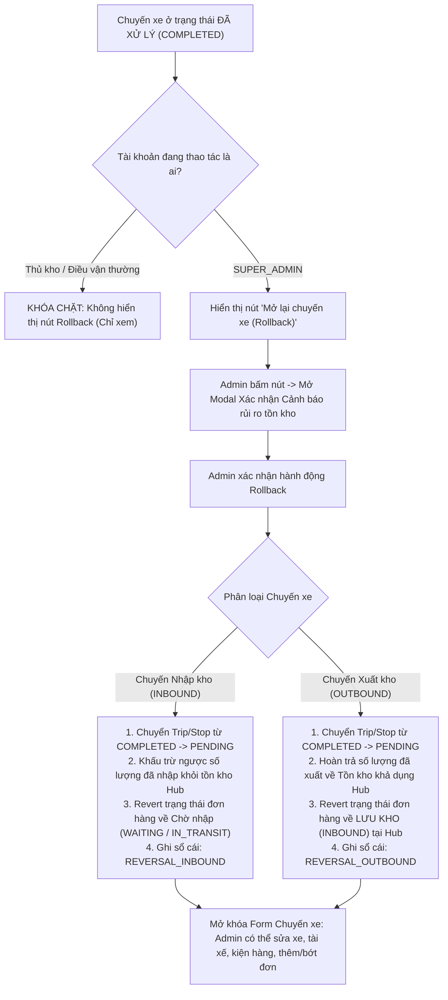

# Feedback 14/10 (Task #81) — Cơ Chế Mở Lại Chuyến Xe & Hoàn Tác (Rollback) Tồn Kho Đơn Hàng Dành Cho Quản Trị Viên (Admin Reopen Trip & Inventory Rollback Invariant)

> **Thời gian ghi nhận**: 14/10/2026  
> **Người báo cáo**: @Mai Công Đức / @Thai / @User (Quản lý nghiệp vụ / Vận hành TMS) & Antigravity Lead Engine  
> **Mã Task Database**: `Task #83` trong bảng `telegram_tasks` (PostgreSQL `n8n_automation` trên Railway)  
> **Màn hình liên quan**:  
> - Quản lý Nhập kho (`/warehouse/inbound`) ➔ Bảng điều phối chuyến xe nhập kho, Modal Chi tiết Phiếu nhập kho & Tiếp nhận ([`WarehouseTripDetailModal.tsx`](file:///frontend/src/features/warehouse/components/warehouse-trip-detail-modal.tsx))  
> - Quản lý Xuất kho (`/warehouse/outbound`) ➔ Bảng điều phối chuyến xe xuất kho, Modal Chi tiết Chuyến xe xuất & Bước 2 Xuất hàng ([`WarehouseTripDetailModal.tsx`](file:///frontend/src/features/warehouse/components/warehouse-trip-detail-modal.tsx)), Chi tiết Phiếu xuất kho ([`WarehouseWaybillDetailModal.tsx`](file:///frontend/src/features/warehouse/components/warehouse-waybill-detail-modal.tsx))  
> - Quản lý Đơn hàng kho (`/warehouse/orders`) ➔ Bảng kê hàng hóa tồn kho, trạng thái đơn hàng (`INBOUND`, `OUT_FOR_DELIVERY`, `TRANSFERRING`)  
> - Backend Service Quản lý Kho bãi & Sổ cái vận hành ([`warehouse.service.ts`](file:///backend/src/orders/warehouse.service.ts), [`warehouse.controller.ts`](file:///backend/src/orders/warehouse.controller.ts), [`operational-ledger.service.ts`](file:///backend/src/orders/operational-ledger.service.ts))  
> **Tài liệu tham chiếu**:  
> - `/leader` Business Domain Architecture ([`SKILL.md`](file:///home/runner/work/logistics-website/logistics-website/.agents/skills/leader/SKILL.md))  
> - Ma trận phân quyền hệ thống [`rbac-matrix.md`](file:///home/runner/work/logistics-website/logistics-website/.agents/rules/rbac-matrix.md) (Quyền SUPER_ADMIN tối cao)  
> - Quy chế phát triển hệ thống [`AGENTS.md`](file:///home/runner/work/logistics-website/logistics-website/AGENTS.md)  
> - Quy chuẩn giao diện hẹp [`.agents/rules/ui-compact-density.md`](file:///home/runner/work/logistics-website/logistics-website/.agents/rules/ui-compact-density.md) & [`ui-spacing-guard`](file:///home/runner/work/logistics-website/logistics-website/.agents/skills/ui-spacing-guard/SKILL.md)  
> - Biên niên sử hệ thống [`docs/SYSTEM_TIMELINE.md`](file:///home/runner/work/logistics-website/logistics-website/docs/SYSTEM_TIMELINE.md) (Đối chiếu mốc Task #78, Task #80)  
> **Ảnh minh chứng đính kèm & Ngữ cảnh báo cáo**:  
> - Ảnh chụp màn hình Telegram trao đổi giữa @Mai Công Đức và @Thai: Yêu cầu tài khoản Admin có thể mở lại chuyến xe đã xử lý (`COMPLETED`) thành chờ xử lý (`PENDING`) để chỉnh sửa thông tin khi có sai sót thực tế, đồng thời hoàn tác (rollback) thông tin đơn hàng và số lượng tồn kho trong kho tương ứng.  

---

## 📌 Bối cảnh nghiệp vụ thực tế (Chốt theo phản hồi người dùng)

### 1. Phản hồi gốc từ người dùng (@Thai & @Mai Công Đức / Vận hành TMS)
> *"Ông xem lại giúp t cái chỗ tk admin có thể chỉnh sửa lại thông tin khi đã xác nhận nhập xuất. T dùng tk admin nhưng nó cũng khóa luôn rồi."*  
> *"Do khi làm thực tế có thể sẽ phải chỉnh sửa lại sau khi xác nhận. Nên t muốn cái tk admin nó sẽ kiểu như mở lại trip đã xử lý thành chờ xử lý để chỉnh lại ấy. Khi trip được chuyển lại từ đã xử lý thành chờ xử lý thì thông tin đơn hàng trong đơn hàng kho nó cũng sẽ back lại luôn."*  
> *"Có thái thuật ngữ ngày xưa chơi game: roll back. Cái này chắc ông biết"*

---

### 2. Nguyên nhân kỹ thuật gốc (Root Cause Analysis - RCA)

1. **Trên Frontend (`WarehouseTripDetailModal.tsx`)**:
   - Biến `effectiveReadOnly` được tính toán như sau:
     ```typescript
     const isStoredOrFinalized = [
       'INBOUND', 'STORED', 'LUU_KHO', 'COMPLETED_INBOUND',
       'OUT_FOR_DELIVERY', 'DISPATCHED', 'COMPLETED', 'DELIVERED', 'CANCELLED'
     ].includes(tripGroup.status?.toUpperCase());

     return !hasWaiting || isStoredOrFinalized;
     ```
   - Logic này vô điều kiện biến toàn bộ form/modal thành chế độ Read-Only đối với tất cả người dùng (kể cả tài khoản có `role = SUPER_ADMIN`). Các input biển số, tài xế, ngày nhận/xuất, lưới đơn hàng, nút lưu nháp, nút xác nhận đều bị ẩn hoặc vô hiệu hóa (`disabled`).
   - Trên giao diện hiện tại không hề có nút bấm hay hành động cho phép Quản trị viên (Admin) mở lại hoặc hoàn tác trạng thái chuyến xe đã hoàn tất.

2. **Trên Backend (`warehouse.service.ts` & `warehouse.controller.ts`)**:
   - Backend đã có hàm `validateTripStopEditPermission` cho phép `SUPER_ADMIN` can thiệp một số API (như `appendOrderToTrip`, `updateTripOrderDestination`).
   - **TUY NHIÊN**: Hệ thống **CHƯA CÓ API Reopen/Rollback chuyến xe chuyên biệt** để đảo ngược toàn diện trạng thái:
     * Chưa có endpoint `POST /api/v1/warehouse/trips/:tripCode/rollback` (hoặc `reopen`).
     * Khi một chuyến xe đã bấm xác nhận (`confirmInbound` hoặc `confirmOutbound`), dữ liệu đã ghi vào sổ cái vận hành (`OrderInventoryTransactionEntity`) và cập nhật trạng thái đơn hàng (`INBOUND` hoặc `OUT_FOR_DELIVERY`/`TRANSFERRING`).
     * Thiếu cơ chế tự động khấu trừ ngược hoặc hoàn trả tồn kho tương ứng khi chuyển chuyến xe từ `COMPLETED` về `PENDING`.

---

### 3. Quy chuẩn Nghiệp vụ Hoàn tác Tồn kho (Inventory & Order State Rollback Invariant)

Khi Quản trị viên (`SUPER_ADMIN`) kích hoạt hành động **Mở lại chuyến xe (Rollback về chờ xử lý)**:



#### A. Với Chuyến xe Nhập kho (Inbound Trip):
- **Trạng thái trước rollback**: Chuyến xe `COMPLETED`. Hàng hóa đã vào kho, các đơn hàng có trạng thái `INBOUND` (Lưu kho), số lượng tồn kho tại Hub đã được cộng vào.
- **Sau khi Rollback về `PENDING`**:
  1. Trạng thái `TripStop` tại Hub hiện tại chuyển từ `COMPLETED` về `PENDING`. Nếu tất cả trạm của trip đều là `PENDING`, trạng thái chuyến xe chính (`TripEntity.status`) chuyển về `PENDING`.
  2. **Hoàn tác Tồn kho**: Khấu trừ ngược lại đúng số lượng kiện hàng mà chuyến xe này đã nhập vào kho Hub (tránh tình trạng hàng bị tính 2 lần khi xác nhận nhập lại).
  3. **Hoàn tác Đơn hàng**: Chuyển trạng thái các đơn hàng thuộc chuyến về trạng thái trước khi nhập kho (ví dụ `WAITING_INBOUND` với đơn khách gửi lẻ, hoặc `IN_TRANSIT` đối với hàng trung chuyển từ Hub khác tới).
  4. **Ghi sổ cái vận hành**: Tạo giao dịch bù trừ loại `ROLLBACK_INBOUND` (hoặc `REVERSAL_INBOUND`) kèm ghi chú người thực hiện và lý do hoàn tác.

#### B. Với Chuyến xe Xuất kho (Outbound Trip):
- **Trạng thái trước rollback**: Chuyến xe `COMPLETED`. Hàng hóa đã rời kho Hub, các đơn hàng chuyển trạng thái `OUT_FOR_DELIVERY` (Giao khách lẻ) hoặc `TRANSFERRING` (Luân chuyển liên Hub), tồn kho Hub đã bị trừ.
- **Sau khi Rollback về `PENDING`**:
  1. Trạng thái `TripStop` tại Hub hiện tại chuyển từ `COMPLETED` về `PENDING`. Trạng thái chuyến xe chính (`TripEntity.status`) chuyển về `PENDING` (Chờ xuất).
  2. **Hoàn tác Tồn kho**: Hoàn trả ngược lại toàn bộ số lượng kiện hàng của chuyến xe vào **Tồn kho khả dụng (Available Stock)** tại Hub.
  3. **Hoàn tác Đơn hàng**: Chuyển trạng thái các đơn hàng thuộc chuyến trở lại `INBOUND` (LƯU KHO) tại Hub hiện tại.
  4. **Ghi sổ cái vận hành**: Tạo giao dịch hoàn trả loại `ROLLBACK_OUTBOUND` (hoặc `REVERSAL_OUTBOUND`) để đối soát chính xác theo thời gian thực.

#### C. Chế độ Mở khóa Giao diện (Admin Unlock Mode):
- Sau khi chuyến xe đã được rollback về `PENDING`, modal chi tiết chuyến xe lập tức gỡ bỏ cờ khóa `effectiveReadOnly` đối với Admin:
  * Cho phép chỉnh sửa Biển số xe, Tên tài xế, Ngày thực hiện.
  * Cho phép chỉnh sửa số lượng kiện bốc/dỡ trên từng dòng hàng.
  * Cho phép thêm đơn hàng mới vào chuyến hoặc xóa bớt đơn hàng ra khỏi chuyến.
  * Cho phép bấm `Lưu nháp (Chờ xử lý)` hoặc bấm `Xác nhận` lại sau khi đã hiệu chỉnh xong thông tin.

---

## 📋 KẾ HOẠCH TRIỂN KHAI CHI TIẾT (ATOMIC ACTION CHECKLIST)

### 🧱 PHẦN I: BACKEND (backend/)

- [x] **1. Bổ sung Endpoint Rollback Chuyến xe trong [`warehouse.controller.ts`](file:///backend/src/orders/warehouse.controller.ts)**:
  - Khai báo endpoint `@Post('trips/:tripCode/rollback')` bảo vệ bằng `@Roles(RoleEnum.SUPER_ADMIN)`.
- [x] **2. Cài đặt Hàm Nghiệp vụ `rollbackTrip` trong [`warehouse.service.ts`](file:///backend/src/orders/warehouse.service.ts)**:
  - Xác thực quyền: Kiểm tra chặt chẽ `user.role === RoleEnum.SUPER_ADMIN`.
  - Phân loại luồng theo loại chuyến xe (Inbound vs Outbound).
  - Hoàn tác trạng thái chuyến xe (`trip` và `trip_stop`) về `PENDING`.
  - Hoàn tác tồn kho: Đối với xuất kho thì tăng lại tồn kho `remainingQuantity` và giảm `outboundQuantity`, đối với nhập kho thì khấu trừ lại `inboundQuantity` và `remainingQuantity`.
  - Hoàn tác trạng thái đơn hàng về `INBOUND` (hoặc `WAITING`/`IN_TRANSIT`), gỡ `currentTripCode`.
  - Soft-delete giao dịch kho (`order_inventory_transaction`).
  - Ghi audit log.
- [x] **3. Cập nhật Sổ cái Vận hành [`operational-ledger.service.ts`](file:///backend/src/orders/operational-ledger.service.ts)**.
- [x] **4. Biên dịch & Kiểm tra Type-check Backend**:
  - `npm run build` trong `backend/` hoàn tất thành công (exit code 0).

---

### 🎨 PHẦN II: FRONTEND (frontend/)

- [x] **1. Bổ sung API Client Method trong `frontend/src/features/warehouse/api/trip-manifest.ts`**:
  - Hàm `rollbackTrip(tripCode, payload)` gọi tới `/api/v1/warehouse/trips/${tripCode}/rollback`.
- [x] **2. Tinh chỉnh Logic `effectiveReadOnly` trong [`WarehouseTripDetailModal.tsx`](file:///frontend/src/features/warehouse/components/warehouse-trip-detail-modal.tsx)**:
  - Thêm state `isReopenedByAdmin` để lập tức mở khóa modal sau khi Admin thực hiện rollback mà không cần đóng mở lại.
- [x] **3. Thiết kế Nút Bấm & Modal Xác Nhận Hoàn Tác (Rollback Confirmation Modal)**:
  - Nút bấm `Mở lại chuyến xe (Rollback)` với icon `IconRotate`, kiểu dáng amber nổi bật, chuẩn compact density `h-7`, chỉ hiển thị cho `SUPER_ADMIN` khi chuyến xe ở trạng thái `COMPLETED`.
  - AlertDialog xác nhận hoàn tác với cảnh báo rủi ro tồn kho và trường nhập lý do rollback tuỳ chọn.
- [x] **4. Tự động Đồng bộ & Invalidate Cache sau khi Rollback**:
  - Invalidate query cache `['warehouse', 'inbound-trips']`, `['warehouse', 'outbound-trips']`, `['warehouse', 'orders']`.
- [x] **5. Tuân thủ Quy chuẩn Giao diện Hẹp & Kiểm tra Biên dịch**:
  - `npx tsc --noEmit` trong `frontend/` hoàn tất sạch sẽ 100% (exit code 0).

---

### 🧪 PHẦN III: KIỂM THỬ TỰ ĐỘNG & NGHIỆM THU (E2E PLAYWRIGHT SPEC & QUALITY GATE)

- [x] **1. Xây dựng Kịch bản Playwright E2E Spec Chuyên biệt**:
  - File test: [`frontend/e2e/81-feedback-14-10-task-81-admin-trip-rollback-reopen.spec.ts`](file:///frontend/e2e/81-feedback-14-10-task-81-admin-trip-rollback-reopen.spec.ts).
  - Kiểm tra toàn diện 3 test cases: Compact density & zero redundant icons, Backend strict SUPER_ADMIN guard & rollback logic, và Visual Evidence rendering.
  - Kết quả: 3/3 passed (Score 50/50 qua `e2e-auditor.mjs`).
- [x] **2. Chụp Ảnh Bằng Chứng Nghiệm Thu Thực Tế (Non-Empty Visual Evidence Gate)**:
  - Minh chứng: `feedbacks/feedback_14_10_task_81/screenshot_01_verified.png`.
- [x] **3. Biên Niên Sử Hệ Thống & Báo Cáo**:
  - Chạy `npm run todo:record feedback_14_10_task_81`.
