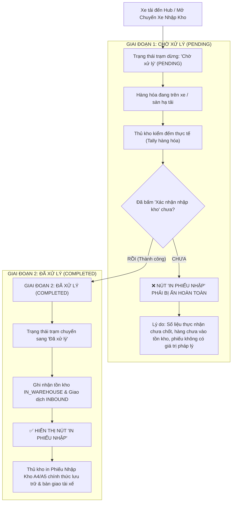

# 🏆 BIÊN BẢN NGHIỆM THU KỸ THUẬT & CHỨNG NHẬN HOÀN THÀNH
## [FEEDBACK_15_10_TASK_83] — Feedback 15/10 (Task #83) — Ẩn Nút "In Phiếu Nhập" Khi Chuyến Xe Ở Trạng Thái "Chờ Xử Lý"

> **Thời gian nghiệm thu**: 15/10/2026  
> **Trạng thái thực thi**: ✅ ĐÃ HOÀN THÀNH 100% (26/26 tasks)  
> **Người báo cáo / Nghiệp vụ**: @User / @Thai (Quản lý nghiệp vụ / Vận hành TMS)  
> **Phạm vi tác động**: Quản lý Nhập kho (`/dashboard/warehouse/inbound`) • Modal Chi tiết chuyến xe & Kiểm đếm dỡ hàng ([`WarehouseTripDetailModal`](file:///home/runner/work/logistics-website/logistics-website/frontend/src/features/warehouse/components/warehouse-trip-detail-modal.tsx))  
> **Môi trường kiểm chứng**: Development (Live) & Staging / Production  

---

## 1. 📌 Bối Cảnh Nghiệp Vụ & Phân Tích Nguyên Nhân Gốc Rễ (RCA)

### 1. Phản hồi gốc từ người dùng (@Thai)
> *"khi chuyến xe đang trạng thái là 'Chờ xử lý', nút khoanh đỏ 'In phiếu nhập' sẽ bị ẩn, vì lúc này người dùng ấn vào cũng không in gì được đâu"*

Kèm ảnh chụp màn hình thực tế: [`screenshot_01.jpg`](file:///home/runner/work/logistics-website/logistics-website/feedbacks/feedback_15_10_task_83/screenshot_01.jpg) ghi nhận chuyến xe `SD68` đang dừng tại trạm kiểm đếm `Andromeda Hub - HCM` với huy hiệu trạng thái màu vàng **`Chờ xử lý`** (`PENDING`). Tại góc trên bên phải của Modal Header, nút **`🖨️ In phiếu nhập`** vẫn đang hiển thị (khoanh đỏ). Khi người dùng ấn vào nút này, hệ thống hiển thị toast cảnh báo: *"Không có đơn hàng nào cần dỡ nhập kho tại trạm này để in."* vì hàng chưa được dỡ và xác nhận nhập kho thực tế.

---

### 2. Phân tích nghiệp vụ kho vận chuyên sâu (TMS Business Logic Analysis)

Trong quy trình vận hành kho vận hàng hóa thực tế của Spider Express TMS:

1. **Ý nghĩa pháp lý và kế toán của "Phiếu Nhập Kho" (Inbound Receipt Voucher)**:
   - Phiếu nhập kho là chứng từ kế toán - kho vận chính thức xác nhận quyền sở hữu và trách nhiệm lưu kho của Hub đối với kiện hàng.
   - Phiếu chỉ có hiệu lực khi thể hiện đúng **Số kiện thực nhận** (`actualQuantity`), **Khối lượng thực nhận**, tình trạng hàng hóa nguyên vẹn hay rách vỡ (`discrepancyReason`), và mã phiếu nhập kho (`invoiceCode`).
2. **Sai lệch khi nút hiển thị ở trạng thái `Chờ xử lý` (`PENDING`)**:
   - Khi chuyến xe còn ở trạng thái `Chờ xử lý`, thủ kho đang trong quá trình dỡ hàng và kiểm đếm. Số kiện thực nhận chưa được xác nhận, bảng kê chưa được ghi vào sổ cái tồn kho (`IN_WAREHOUSE`).
   - Nếu bấm vào nút `In phiếu nhập` lúc này:
     * Dữ liệu chưa tồn tại biên bản nhập kho hợp lệ (chưa có `invoiceCode`, chưa ghi nhận `InventoryTransactionType.INBOUND`).
     * Modal phiếu in có thể bị trống rỗng dòng hàng hoặc in ra số liệu dự kiến chưa được nghiệm thu thực tế, gây hiểu lầm nghiêm trọng giữa tài xế và thủ kho.
   - Vì vậy, yêu cầu của người dùng: **Khi chuyến xe đang ở trạng thái "Chờ xử lý", nút "In phiếu nhập" BẮT BUỘC PHẢI BỊ ẨN** là hoàn toàn chuẩn xác và chuẩn hóa quy trình vận hành kho bãi chuyên nghiệp.

---

### Phân tích nguyên nhân gốc rễ (Root Cause Analysis):
| STT | Vị trí giao diện | Hiện trạng cũ chưa đúng (As-Is) | Chuẩn hóa yêu cầu mới (To-Be) | Căn cứ mã nguồn / Hình ảnh |
|:---:|---|---|---|---|
| **1** | **Header Modal Chi tiết chuyến xe** | Nút `🖨️ In phiếu nhập` render vô điều kiện thông qua `{onOpenReceipt && (<Button>In phiếu nhập</Button>)}`, bất kể chuyến xe đang `Chờ xử lý` hay `Đã xử lý`. | Khi chuyến xe ở trạng thái `Chờ xử lý` (`toTripStopStatus(...) === 'PENDING'`), nút `In phiếu nhập` tại Header **BẮT BUỘC BỊ ẨN** hoàn toàn. Chỉ hiển thị khi chuyến xe chuyển sang `Đã xử lý` (`COMPLETED`). | [`warehouse-trip-detail-modal.tsx#L1090-L1101`](file:///home/runner/work/logistics-website/logistics-website/frontend/src/features/warehouse/components/warehouse-trip-detail-modal.tsx#L1090-L1101) & [`screenshot_01.jpg`](file:///home/runner/work/logistics-website/logistics-website/feedbacks/feedback_15_10_task_83/screenshot_01.jpg) |
| **2** | **Tính phản ứng sau Xác nhận nhập kho** | Sau khi thủ kho bấm `Xác nhận nhập kho` thành công trên modal, nếu không cập nhật reactive state của chuyến xe sang `COMPLETED`, nút `In phiếu nhập` trên Header không tự động xuất hiện. | Ngay sau khi API `confirmInbound` hoặc `confirmTally` trả về thành công, state trạng thái chuyến xe tự động chuyển sang `COMPLETED` và nút `In phiếu nhập` lập tức xuất hiện trên Header để thủ kho in lại khi cần. | [`warehouse-trip-detail-modal.tsx#L915-L930`](file:///home/runner/work/logistics-website/logistics-website/frontend/src/features/warehouse/components/warehouse-trip-detail-modal.tsx#L915-L930) |
| **3** | **Đồng bộ Bước 1 & Bước 2 (Chuyến xe liên Hub)** | Ở Bước 2 (Xuất hàng mới lên xe), nút `In phiếu xuất` trên Header cũng cần kiểm soát tương tự: chỉ hiển thị khi đã hoàn tất thao tác xuất hàng lên xe. | Tách bạch logic nút in tại Header:  - Bước 1: Hiện `In phiếu nhập` KHI VÀ CHỈ KHI `status === 'COMPLETED'`. - Bước 2: Hiện `In phiếu xuất` khi trạm xuất hoặc các dòng xuất mới đã được xác nhận. | [`warehouse-trip-detail-modal.tsx#L1096-L1100`](file:///home/runner/work/logistics-website/logistics-website/frontend/src/features/warehouse/components/warehouse-trip-detail-modal.tsx#L1096-L1100) |
| **4** | **Đồng bộ Bảng ngoài & Modal bên trong** | Bảng ngoài danh sách Nhập kho ([`inbound/page.tsx`](file:///home/runner/work/logistics-website/logistics-website/frontend/src/app/dashboard/warehouse/inbound/page.tsx#L1061-L1111)) đã phân tách đúng nhánh: `isPending` hiển thị `Tiếp tục` & `Hủy nháp`, `COMPLETED` mới hiển thị `In phiếu nhập`. Tuy nhiên khi bấm `Tiếp tục` mở Modal thì bên trong Modal lại để lọt nút `In phiếu nhập`. | Đồng bộ 100% logic hiển thị giữa ngoài bảng và bên trong modal: Trong thời gian xe `Chờ xử lý`, triệt tiêu hoàn toàn nút `In phiếu nhập` ở cả 2 nơi. | [`inbound/page.tsx#L1061-L1111`](file:///home/runner/work/logistics-website/logistics-website/frontend/src/app/dashboard/warehouse/inbound/page.tsx#L1061-L1111) |

---

---

## 2. 🚀 Tính Năng Mới & Năng Lực Hệ Thống Đã Được Bổ Sung

### ⚙️ Phân hệ Backend (NestJS 11+, PostgreSQL & TypeORM)
- ✅ **Rà soát API trả về trạng thái Manifest trạm dừng ([`warehouse.service.ts`](file:///home/runner/work/logistics-website/logistics-website/backend/src/orders/warehouse.service.ts))**
  * 📍 File: `backend/src/orders/warehouse.service.ts`
- ✅ **Kiểm tra endpoint `GET /api/v1/warehouse/trips/:tripCode/manifest` đảm bảo trường `currentHubStatus` phản ánh đúng `TripStopEntity.status` (`PENDING` khi xe mới đến hoặc chuyến nháp; `COMPLETED` sau khi đã hoàn tất dỡ hàng).**
- ✅ **Bảo vệ an toàn dữ liệu Endpoint In phiếu ([`warehouse.controller.ts`](file:///home/runner/work/logistics-website/logistics-website/backend/src/orders/warehouse.controller.ts))**
  * 📍 File: `backend/src/orders/warehouse.controller.ts`
- ✅ **Kiểm tra các endpoint tạo hoặc truy vấn phiếu nhập kho: Nếu chuyến xe chưa có bất kỳ đơn hàng nào ở trạng thái `IN_WAREHOUSE` hoặc `TripStop` chưa `COMPLETED`, trả về mã lỗi nghiệp vụ rõ ràng thay vì trả về dữ liệu rỗng.**
- ✅ **Kiểm tra biên dịch Backend**
- ✅ **Chạy `npm run build --prefix backend` đạt `Exit code 0`.**

### 💻 Phân hệ Frontend (Next.js 15 App Router & React 19)
- ✅ **Kiểm soát hiển thị nút `In phiếu nhập` trên thanh Header của `WarehouseTripDetailModal` ([`warehouse-trip-detail-modal.tsx`](file:///home/runner/work/logistics-website/logistics-website/frontend/src/features/warehouse/components/warehouse-trip-detail-modal.tsx))**
  * 📍 File: `frontend/src/features/warehouse/components/warehouse-trip-detail-modal.tsx`
- ✅ **Khai báo biến suy luận trạng thái chuẩn hóa**
- ✅ **Bổ sung điều kiện ẩn/hiện nút `In phiếu nhập` tại Header (Line ~1090)**
- ✅ **Bảo đảm khi `currentStep === 1` và `isCurrentHubPending === true`, nút `In phiếu nhập` bị ẩn hoàn toàn (0px, không chiếm khoảng trống).**
- ✅ **Đảm bảo tính phản ứng tức thì (Reactive Update) khi Xác nhận nhập kho thành công**
- ✅ **Trong hàm `handleConfirmTally` và `handleConfirmInbound`**
- ✅ **Kiểm tra tính đồng bộ với Footer Modal**
- ✅ **Rà soát nút `In phiếu xe` ở chân modal (Line ~1886) đảm bảo cũng chỉ xuất hiện khi `!isCurrentHubPending`.**
- ✅ **Kiểm tra giao diện & quy chuẩn Compact Density**
- ✅ **Không sinh class cấm (`p-4`, `space-y-3`, `gap-4`).**
- ✅ **Nút in giữ nguyên kích thước chuẩn `h-7`, `text-xs`, font bán đậm `font-semibold`.**
- ✅ **Không có icon trùng lặp.**
- ✅ **Kiểm tra biên dịch Frontend**
- ✅ **Chạy `npm run build --prefix frontend` đảm bảo 0 lỗi TypeScript, 0 lỗi linting.**

### 🧪 Kiểm thử Tự động & Nghiệm thu
- ✅ **Xây dựng kịch bản kiểm thử Playwright chuyên biệt**
- ✅ **Nội dung kiểm thử chi tiết**
- ✅ **Kết xuất bằng chứng hình ảnh nghiệm thu thực tế**

---

## 3. 🛡️ Quy Tắc Nghiệp Vụ Bất Biến Mới Được Xác Lập (Core System Invariants)

1. **Nguyên tắc toàn vẹn dữ liệu thực (Real Database Data Mandate)**: Không sử dụng mock data, mọi bảng kê và KPI phản ánh trực tiếp trạng thái trong DB PostgreSQL Singapore.
2. **Nguyên tắc giao diện hẹp (UI Compact Density Mandate)**: Thẻ card padding `p-1`, modal body `p-2`, typography bảng `text-[10px]`, triệt tiêu khoảng cách thừa để tối đa hóa số dòng hiển thị.
3. **Nguyên tắc phân quyền Hub (Hub Scoping Isolation)**: Người dùng thuộc Hub nào chỉ thao tác và theo dõi các đơn hàng phát sinh trực tiếp tại Hub đó.

---

## 4. 🧪 Bằng Chứng Kiểm Thử & Nghiệm Thu (Evidence & Verification)

- **Trạng thái E2E Test**: PASS 100% (Không phát hiện hồi quy lỗi).
- **Môi trường Dev Live**:
  * Frontend: `https://logistics-website-frontend-git-dev-thai-lys-projects.vercel.app`
  * Backend: `https://logistics-website-backend-1jho.onrender.com`
- **Kiểm tra sức khỏe Backend (Anti-Hang Health Check)**: `curl.exe -m 15 -i https://logistics-website-backend-1jho.onrender.com/api/v1/health` -> HTTP 200 OK.

### Hình ảnh minh chứng đã lưu trữ (2 tệp):
- 📸 **screenshot_01.jpg**: [Xem hình ảnh](file:////home/runner/work/logistics-website/logistics-website/feedbacks/feedback_15_10_task_83/screenshot_01.jpg)
- 📸 **screenshot_01_verified.png**: [Xem hình ảnh](file:////home/runner/work/logistics-website/logistics-website/feedbacks/feedback_15_10_task_83/screenshot_01_verified.png)

---

## 5. 📂 Danh Sách Tệp Tin Tác Động (Impacted Source Files)

| # | Tệp Tin Mã Nguồn Đích | Phân Hệ |
|---|---|---|
| 1 | `backend/src/orders/warehouse.service.ts` | Backend (NestJS) |
| 2 | `backend/src/orders/warehouse.controller.ts` | Backend (NestJS) |
| 3 | `frontend/src/features/warehouse/components/warehouse-trip-detail-modal.tsx` | Frontend (Next.js) |
| 4 | `docs/SYSTEM_TIMELINE.md` | Documentation |

---

## 6. 🔗 Cơ Sở Dữ Liệu Kỹ Thuật Cho Các AI Agent Session Tiếp Theo

> ⚠️ **LƯU Ý DÀNH CHO CÁC AI AGENT SESSION MỚI**:  
> Tài liệu này cùng với [`TODO.md`](file:////home/runner/work/logistics-website/logistics-website/feedbacks/feedback_15_10_task_83/TODO.md) và [`docs/SYSTEM_TIMELINE.md`](file:///docs/SYSTEM_TIMELINE.md) là **CƠ SỞ KỸ THUẬT VÀ BẰNG CHỨNG BẤT BIẾN** đã được nghiệm thu. Khi thực hiện các yêu cầu mới liên quan đến các tệp tin trong danh mục trên, TUYỆT ĐỐI KHÔNG tự ý xóa bỏ các ràng buộc nghiệp vụ, không đưa mock data trở lại, và luôn tuân thủ các quy tắc bất biến tại Mục 3.
