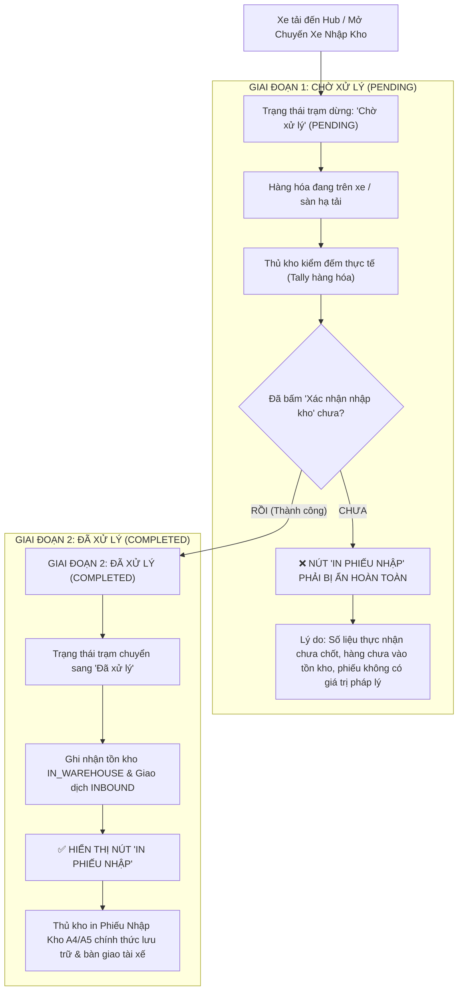

# Feedback 15/10 (Task #83) — Ẩn Nút "In Phiếu Nhập" Khi Chuyến Xe Ở Trạng Thái "Chờ Xử Lý"

> **Thời gian ghi nhận**: 15/10/2026  
> **Người báo cáo**: @User / @Thai (Quản lý nghiệp vụ / Vận hành TMS)  
> **Mã Task Database**: `Task #83` trong bảng `telegram_tasks` (PostgreSQL `n8n_automation` trên Railway)  
> **Phạm vi tác động**:  
> - Frontend ([`warehouse-trip-detail-modal.tsx`](file:///frontend/src/features/warehouse/components/warehouse-trip-detail-modal.tsx)) ➔ Kiểm soát hiển thị nút bấm `In phiếu nhập` / `In phiếu xuất` tại Header modal dựa trên trạng thái vận hành của chuyến xe tại kho (`Chờ xử lý` vs `Đã xử lý`).  
> - Frontend ([`inbound/page.tsx`](file:///frontend/src/app/dashboard/warehouse/inbound/page.tsx)) ➔ Rà soát tính đồng bộ giữa bảng danh sách chuyến xe ngoài trang Quản lý Nhập kho và modal tác nghiệp kiểm đếm bên trong.  
> - Backend Service Quản lý Kho ([`warehouse.service.ts`](file:///backend/src/orders/warehouse.service.ts), [`warehouse.controller.ts`](file:///backend/src/orders/warehouse.controller.ts)) ➔ Bảo đảm toàn vẹn dữ liệu trả về của Manifest trạm dừng (`manifest.currentHubStatus`, `trip.status`), kiểm tra ràng buộc không cho phép in hoặc xuất phiếu khi chuyến xe chưa xác nhận nhập kho.  
> - Kiểm thử tự động E2E ([`83-feedback-15-10-task-83-hide-inbound-receipt-when-pending.spec.ts`](file:///frontend/e2e/83-feedback-15-10-task-83-hide-inbound-receipt-when-pending.spec.ts)) ➔ Xây dựng test suite Playwright xác thực nút "In phiếu nhập" bị ẩn hoàn toàn khi chuyến xe ở trạng thái `Chờ xử lý`, chỉ xuất hiện sau khi đã xác nhận nhập kho (`Đã xử lý`).  
> **Tài liệu tham chiếu**:  
> - `/leader` Business Domain Architecture ([`SKILL.md`](file:///.agents/skills/leader/SKILL.md))  
> - Quy chế phát triển hệ thống [`AGENTS.md`](file:///AGENTS.md) (Zero Technical Jargon, Compact Density, Real DB Data)  
> - Quy chuẩn giao diện hẹp [`.agents/rules/ui-compact-density.md`](file:///.agents/rules/ui-compact-density.md) & [`ui-spacing-guard`](file:///.agents/skills/ui-spacing-guard/SKILL.md)  
> - Ma trận phân quyền hệ thống [`rbac-matrix.md`](file:///.agents/rules/rbac-matrix.md)  
> - Biên niên sử hệ thống [`docs/SYSTEM_TIMELINE.md`](file:///docs/SYSTEM_TIMELINE.md)  
> **Ảnh minh chứng đính kèm trong thư mục**:  
> - [`screenshot_01.jpg`](file:///feedbacks/feedback_15_10_task_83/screenshot_01.jpg): Modal Chi tiết chuyến xe & Kiểm đếm hàng hóa của chuyến xe `SD49` ở trạng thái `Chờ xử lý`, trong đó nút `🖨️ In phiếu nhập` xuất hiện trên thanh Header góc trên bên phải cạnh nút đóng.  

---

## 📌 Bối cảnh nghiệp vụ thực tế (Chốt theo phản hồi người dùng)

### 1. Phản hồi gốc từ người dùng (@Thai)
> *"khi chuyến xe đang trạng thái là 'Chờ xử lý', nút khoanh đỏ 'In phiếu nhập' sẽ bị ẩn, vì lúc này người dùng ấn vào cũng không in gì được đâu"*

Kèm ảnh chụp màn hình thực tế: `feedbacks/feedback_15_10_task_83/screenshot_01.jpg` ghi nhận chuyến xe `SD49` (hoặc `SD22`) đang dừng tại trạm kiểm đếm với huy hiệu trạng thái màu vàng **`Chờ xử lý`** (`PENDING`). Tại góc trên bên phải của Modal Header, nút **`🖨️ In phiếu nhập`** vẫn đang hiển thị, cho phép người dùng click vào.

---

### 2. Phân tích nghiệp vụ kho vận chuyên sâu (TMS Business Logic Analysis)

Trong quy trình vận hành kho vận hàng hóa thực tế của Spider Express TMS:



1. **Ý nghĩa pháp lý và kế toán của "Phiếu Nhập Kho" (Inbound Receipt Voucher)**:
   - Phiếu nhập kho là chứng từ kế toán - kho vận chính thức xác nhận quyền sở hữu và trách nhiệm lưu kho của Hub đối với kiện hàng.
   - Phiếu chỉ có hiệu lực khi thể hiện đúng **Số kiện thực nhận** (`actualQuantity`), **Khối lượng thực nhận**, tình trạng hàng hóa nguyên vẹn hay rách vỡ (`discrepancyReason`), và mã phiếu nhập kho (`invoiceCode`).
2. **Sai lệch khi nút hiển thị ở trạng thái `Chờ xử lý` (`PENDING`)**:
   - Khi chuyến xe còn ở trạng thái `Chờ xử lý`, thủ kho đang trong quá trình dỡ hàng và kiểm đếm. Số kiện thực nhận chưa được xác nhận, bảng kê chưa được ghi vào sổ cái tồn kho (`IN_WAREHOUSE`).
   - Nếu bấm vào nút `In phiếu nhập` lúc này:
     * Dữ liệu chưa tồn tại biên bản nhập kho hợp lệ (chưa có `invoiceCode`, chưa ghi nhận `InventoryTransactionType.INBOUND`).
     * Modal phiếu in có thể bị trống rỗng dòng hàng hoặc in ra số liệu dự kiến chưa được nghiệm thu thực tế, gây hiểu lầm nghiêm trọng giữa tài xế và thủ kho.
   - Vì vậy, yêu cầu của người dùng: **Khi chuyến xe đang ở trạng thái "Chờ xử lý", nút "In phiếu nhập" BẮT BUỘC PHẢI BỊ ẨN** là hoàn toàn chuẩn xác và chuẩn hóa quy trình vận hành kho bãi chuyên nghiệp.

---

## 🔍 Tổng hợp các điểm chưa đúng trên giao diện cũ (đối chiếu ảnh chụp màn hình)

| STT | Vị trí giao diện | Hiện trạng cũ chưa đúng (As-Is) | Chuẩn hóa yêu cầu mới (To-Be) | Căn cứ mã nguồn / Hình ảnh |
|:---:|---|---|---|---|
| **1** | **Header Modal Chi tiết chuyến xe** | Nút `🖨️ In phiếu nhập` render vô điều kiện thông qua `{onOpenReceipt && (<Button>In phiếu nhập</Button>)}`, bất kể chuyến xe đang `Chờ xử lý` hay `Đã xử lý`. | Khi chuyến xe ở trạng thái `Chờ xử lý` (`toTripStopStatus(...) === 'PENDING'`), nút `In phiếu nhập` tại Header **BẮT BUỘC BỊ ẨN** hoàn toàn. Chỉ hiển thị khi chuyến xe chuyển sang `Đã xử lý` (`COMPLETED`). | [`warehouse-trip-detail-modal.tsx#L1090-L1101`](file:///frontend/src/features/warehouse/components/warehouse-trip-detail-modal.tsx#L1090-L1101) & [`screenshot_01.jpg`](file:///feedbacks/feedback_15_10_task_83/screenshot_01.jpg) |
| **2** | **Tính phản ứng sau Xác nhận nhập kho** | Sau khi thủ kho bấm `Xác nhận nhập kho` thành công trên modal, nếu không cập nhật reactive state của chuyến xe sang `COMPLETED`, nút `In phiếu nhập` trên Header không tự động xuất hiện. | Ngay sau khi API `confirmInbound` hoặc `confirmTally` trả về thành công, state trạng thái chuyến xe tự động chuyển sang `COMPLETED` và nút `In phiếu nhập` lập tức xuất hiện trên Header để thủ kho in lại khi cần. | [`warehouse-trip-detail-modal.tsx#L915-L930`](file:///frontend/src/features/warehouse/components/warehouse-trip-detail-modal.tsx#L915-L930) |
| **3** | **Đồng bộ Bước 1 & Bước 2 (Chuyến xe liên Hub)** | Ở Bước 2 (Xuất hàng mới lên xe), nút `In phiếu xuất` trên Header cũng cần kiểm soát tương tự: chỉ hiển thị khi đã hoàn tất thao tác xuất hàng lên xe. | Tách bạch logic nút in tại Header: <br>- Bước 1: Hiện `In phiếu nhập` KHI VÀ CHỈ KHI `status === 'COMPLETED'`.<br>- Bước 2: Hiện `In phiếu xuất` khi trạm xuất hoặc các dòng xuất mới đã được xác nhận. | [`warehouse-trip-detail-modal.tsx#L1096-L1100`](file:///frontend/src/features/warehouse/components/warehouse-trip-detail-modal.tsx#L1096-L1100) |
| **4** | **Đồng bộ Bảng ngoài & Modal bên trong** | Bảng ngoài danh sách Nhập kho ([`inbound/page.tsx`](file:///frontend/src/app/dashboard/warehouse/inbound/page.tsx#L1061-L1111)) đã phân tách đúng nhánh: `isPending` hiển thị `Tiếp tục` & `Hủy nháp`, `COMPLETED` mới hiển thị `In phiếu nhập`. Tuy nhiên khi bấm `Tiếp tục` mở Modal thì bên trong Modal lại để lọt nút `In phiếu nhập`. | Đồng bộ 100% logic hiển thị giữa ngoài bảng và bên trong modal: Trong thời gian xe `Chờ xử lý`, triệt tiêu hoàn toàn nút `In phiếu nhập` ở cả 2 nơi. | [`inbound/page.tsx#L1061-L1111`](file:///frontend/src/app/dashboard/warehouse/inbound/page.tsx#L1061-L1111) |

---

## 📋 Danh sách công việc triển khai (Action Checklist)

### 1. Phân hệ Frontend (Next.js 15 App Router - `frontend/`)
- [ ] **Kiểm soát hiển thị nút `In phiếu nhập` trên thanh Header của `WarehouseTripDetailModal` ([`warehouse-trip-detail-modal.tsx`](file:///frontend/src/features/warehouse/components/warehouse-trip-detail-modal.tsx))**:
  - [ ] Khai báo biến suy luận trạng thái chuẩn hóa:
    ```tsx
    const isCurrentHubPending = useMemo(() => {
      const rawStatus = manifest?.currentHubStatus || tripGroup?.status;
      return toTripStopStatus(rawStatus) === 'PENDING';
    }, [manifest?.currentHubStatus, tripGroup?.status]);
    ```
  - [ ] Bổ sung điều kiện ẩn/hiện nút `In phiếu nhập` tại Header (Line ~1090):
    ```tsx
    {onOpenReceipt && !isCurrentHubPending && (
      <Button
        variant='outline'
        size='sm'
        onClick={() => handlePrintReceipt()}
        className='h-7 px-2 text-xs text-emerald-700 border-emerald-300 hover:bg-emerald-50 dark:border-emerald-800 font-semibold'
        title={currentStep === 1 ? 'In phiếu nhập kho' : 'In phiếu xuất kho'}
      >
        <IconPrinter className='h-3.5 w-3.5 mr-1' />
        {currentStep === 1 ? 'In phiếu nhập' : 'In phiếu xuất'}
      </Button>
    )}
    ```
  - [ ] Bảo đảm khi `currentStep === 1` và `isCurrentHubPending === true`, nút `In phiếu nhập` bị ẩn hoàn toàn (0px, không chiếm khoảng trống).
- [ ] **Đảm bảo tính phản ứng tức thì (Reactive Update) khi Xác nhận nhập kho thành công**:
  - [ ] Trong hàm `handleConfirmTally` và `handleConfirmInbound`:
    - Sau khi gọi API thành công và trigger `onSuccess?.()`, cập nhật ngay `manifest.currentHubStatus = 'COMPLETED'` và `tripGroup.status = 'COMPLETED'`.
    - Invalidate cache TanStack Query `tripManifestKeys.all` để đồng bộ lại dữ liệu.
    - Lúc này `isCurrentHubPending` tự động chuyển thành `false`, nút `In phiếu nhập` ngay lập tức xuất hiện trên Header cho phép in lại chứng từ nếu cần.
- [ ] **Kiểm tra tính đồng bộ với Footer Modal**:
  - [ ] Rà soát nút `In phiếu xe` ở chân modal (Line ~1886) đảm bảo cũng chỉ xuất hiện khi `!isCurrentHubPending`.
- [ ] **Kiểm tra giao diện & quy chuẩn Compact Density**:
  - [ ] Không sinh class cấm (`p-4`, `space-y-3`, `gap-4`).
  - [ ] Nút in giữ nguyên kích thước chuẩn `h-7`, `text-xs`, font bán đậm `font-semibold`.
  - [ ] Không có icon trùng lặp.
- [ ] **Kiểm tra biên dịch Frontend**:
  - [ ] Chạy `npm run build --prefix frontend` đảm bảo 0 lỗi TypeScript, 0 lỗi linting.

---

### 2. Phân hệ Backend (NestJS 11 - `backend/`)
- [ ] **Rà soát API trả về trạng thái Manifest trạm dừng ([`warehouse.service.ts`](file:///backend/src/orders/warehouse.service.ts))**:
  - [ ] Kiểm tra endpoint `GET /api/v1/warehouse/trips/:tripCode/manifest` đảm bảo trường `currentHubStatus` phản ánh đúng `TripStopEntity.status` (`PENDING` khi xe mới đến hoặc chuyến nháp; `COMPLETED` sau khi đã hoàn tất dỡ hàng).
- [ ] **Bảo vệ an toàn dữ liệu Endpoint In phiếu ([`warehouse.controller.ts`](file:///backend/src/orders/warehouse.controller.ts))**:
  - [ ] Kiểm tra các endpoint tạo hoặc truy vấn phiếu nhập kho: Nếu chuyến xe chưa có bất kỳ đơn hàng nào ở trạng thái `IN_WAREHOUSE` hoặc `TripStop` chưa `COMPLETED`, trả về mã lỗi nghiệp vụ rõ ràng thay vì trả về dữ liệu rỗng.
- [ ] **Kiểm tra biên dịch Backend**:
  - [ ] Chạy `npm run build --prefix backend` đạt `Exit code 0`.

---

### 3. Kiểm thử Tự động E2E & Bằng chứng Nghiệm thu (Playwright E2E)
- [ ] **Xây dựng kịch bản kiểm thử Playwright chuyên biệt**:
  - File kiểm thử: [`frontend/e2e/83-feedback-15-10-task-83-hide-inbound-receipt-when-pending.spec.ts`](file:///frontend/e2e/83-feedback-15-10-task-83-hide-inbound-receipt-when-pending.spec.ts).
- [ ] **Nội dung kiểm thử chi tiết**:
  - **Case 1: Chuyến xe ở trạng thái `Chờ xử lý` (Pending)**:
    - Đăng nhập tài khoản thủ kho HCM (`warehouse_hcm`).
    - Truy cập trang Quản lý Nhập kho (`/dashboard/warehouse/inbound`).
    - Tìm và mở một chuyến xe có huy hiệu `Chờ xử lý` (ví dụ `SD49`).
    - Assert Header Modal: Nút `In phiếu nhập` **BẮT BUỘC KHÔNG TỒN TẠI HOẶC BỊ ẨN** (`expect(page.getByRole('button', { name: /In phiếu nhập/i })).toBeHidden()`).
  - **Case 2: Chuyến xe ở trạng thái `Đã xử lý` (Completed)**:
    - Tìm và mở một chuyến xe có huy hiệu `Đã xử lý` (ví dụ `SD50`, `SD46`).
    - Assert Header Modal: Nút `In phiếu nhập` **BẮT BUỘC HIỂN THỊ** (`expect(page.getByRole('button', { name: /In phiếu nhập/i })).toBeVisible()`).
    - Click vào nút `In phiếu nhập` ➔ Modal Phiếu Nhập Kho mở ra thành công với đầy đủ bảng kê dòng hàng.
  - **Case 3: Luồng chuyển tiếp Reactive (Từ Chờ xử lý ➔ Đã xử lý)**:
    - Mở chuyến xe `Chờ xử lý` ➔ Xác nhận nút `In phiếu nhập` đang ẩn.
    - Tiến hành kiểm đếm và bấm `Xác nhận nhập kho`.
    - Sau khi xác nhận thành công ➔ Nút `In phiếu nhập` tự động xuất hiện trên Header mà không cần F5/tải lại trang.
- [ ] **Kết xuất bằng chứng hình ảnh nghiệm thu thực tế**:
  - Lưu ảnh chụp màn hình xác minh tại: [`feedbacks/feedback_15_10_task_83/screenshot_01_verified.png`](file:///feedbacks/feedback_15_10_task_83/screenshot_01_verified.png).

---

### 4. Biên niên sử & Cập nhật Hệ thống
- [ ] Khởi tạo tài liệu tổng kết kỹ thuật [`RESOLUTION.md`](file:///feedbacks/feedback_15_10_task_83/RESOLUTION.md) thông qua lệnh `npm run todo:record feedbacks/feedback_15_10_task_83`.
- [ ] Đồng bộ mốc nâng cấp ngày 15/10/2026 vào [`docs/SYSTEM_TIMELINE.md`](file:///docs/SYSTEM_TIMELINE.md).
- [ ] Kiểm tra tiến độ hoàn thành đạt 100% qua lệnh `npm run todo:today`.

---

## 🧪 Kịch Bản Kiểm Thử E2E & Ma Trận Edge Cases

### Cấu phần 1: Luồng Kiểm Thử Tuần Tự (Happy Path)
- **Môi trường**: Dev Local (`http://localhost:4000`) & Railway Cloud Dev (`https://frontend-tms-core-dev.up.railway.app`).
- **Tài khoản**: `USER_WAREHOUSE_HCM` (`warehouse_hcm` / `Warehouse@123`).
- **Các bước thực thi**:
  1. *Bước 1*: Đăng nhập tài khoản thủ kho Andromeda Hub - HCM.
  2. *Bước 2*: Điều hướng tới `/dashboard/warehouse/inbound`.
  3. *Bước 3*: Mở chuyến xe có trạng thái `Chờ xử lý` (Click mã chuyến hoặc nút `Tiếp tục`).
  4. *Bước 4*: Kiểm tra thanh Header góc trên bên phải của modal: Nút `In phiếu nhập` không hiển thị.
  5. *Bước 5*: Đóng modal, mở chuyến xe có trạng thái `Đã xử lý`.
  6. *Bước 6*: Kiểm tra thanh Header góc trên bên phải của modal: Nút `In phiếu nhập` hiển thị rõ ràng với icon máy in và viền xanh lục.
  7. *Bước 7*: Bấm vào nút `In phiếu nhập` để xác thực mở được Modal Phiếu Nhập Kho.
  8. *Bước 8*: Chụp ảnh màn hình nghiệm thu visual evidence lưu trữ tại `feedbacks/feedback_15_10_task_83/screenshot_01_verified.png`.

---

### Cấu phần 2: Ma Trận Edge Cases Đối Soát Nghiệp Vụ

| Mã Case | Tình huống kiểm tra | Điều kiện kích hoạt | Hành vi chuẩn hóa kỳ vọng | Kết quả đối soát |
|:---:|---|---|---|:---:|
| `EC-83-01` | **Chuyến xe mới tạo nháp (DRAFT/PENDING)** | Mở modal từ nút `Tiếp tục` ở bảng Nhập kho | Nút `In phiếu nhập` trên Header bị ẩn hoàn toàn | **CẦN ĐẠT** |
| `EC-83-02` | **Chuyến xe trung chuyển nhiều trạm dừng (Inter-Hub)** | Chuyến xe dừng tại Hub trung gian (trạng thái trạm dừng này là `PENDING`) | Nút `In phiếu nhập` ở Bước 1 bị ẩn; chuyển sang Bước 2 hiển thị danh sách hàng đi tiếp | **CẦN ĐẠT** |
| `EC-83-03` | **Chuyến xe vừa được Super Admin Rollback (Mở lại)** | Admin thực hiện rollback chuyến xe từ `COMPLETED` về `PENDING` (Task #81) | Chuyến xe trở lại trạng thái `Chờ xử lý`, nút `In phiếu nhập` lập tức bị ẩn trở lại | **CẦN ĐẠT** |
| `EC-83-04` | **Thao tác ngay sau Xác nhận nhập kho thành công** | Bấm `Xác nhận nhập kho` trên modal đang mở | Modal tự động refetch manifest, chuyển sang `COMPLETED`, nút `In phiếu nhập` xuất hiện ngay | **CẦN ĐẠT** |
| `EC-83-05` | **Chuyến xe đã hoàn tất xử lý (COMPLETED)** | Mở chuyến xe bất kỳ từ tab `Đã xử lý` | Nút `In phiếu nhập` trên Header hiển thị bình thường, click mở đúng phiếu nhập kho | **CẦN ĐẠT** |

---

## 🛡️ Tiêu Chí Nghiệm Thu (Definition of Done - DoD)
1. **Tuân thủ triệt để phản hồi người dùng**: Khi chuyến xe ở trạng thái `Chờ xử lý`, nút `In phiếu nhập` tại Header modal bị ẩn 100%, loại bỏ hoàn toàn khả năng người dùng bấm vào khi chưa có dữ liệu.
2. **Reactivity & Toàn vẹn dữ liệu**: Nút tự động xuất hiện ngay sau khi bấm "Xác nhận nhập kho" thành công; ẩn đi ngay khi Admin thực hiện Rollback chuyến xe về "Chờ xử lý".
3. **Biên dịch & Code Quality**: Cả 2 repository `backend/` và `frontend/` biên dịch đạt `Exit code 0` không có lỗi TypeScript hay vi phạm quy chuẩn giao diện hẹp.
4. **Kiểm thử tự động & Bằng chứng minh bạch**: Kịch bản Playwright E2E `83-feedback-15-10-task-83-hide-inbound-receipt-when-pending.spec.ts` vượt qua 100% test cases kèm ảnh chụp bằng chứng nghiệm thu `screenshot_01_verified.png`.
5. **Biên niên sử đầy đủ**: Hoàn tất cập nhật `RESOLUTION.md` và `docs/SYSTEM_TIMELINE.md`.
