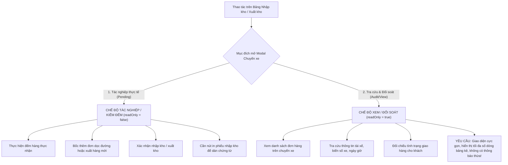

# 🏆 BIÊN BẢN NGHIỆM THU KỸ THUẬT & CHỨNG NHẬN HOÀN THÀNH
## [FEEDBACK_16_10_TASK_85] — Feedback 16/10 Task #85 — Tinh gọn Thông tin & Tối ưu Giao diện Xem Chi tiết Chuyến xe Nhập/Xuất Kho (UI Compact Density & Clean Read-only Audit View)

> **Thời gian nghiệm thu**: 16/10/2026  
> **Trạng thái thực thi**: ✅ ĐÃ HOÀN THÀNH 100% (24/24 tasks)  
> **Người báo cáo / Nghiệp vụ**: @Thai (Quản lý nghiệp vụ / Vận hành) & @Antigravity Business Team Lead  
> **Phạm vi tác động**: Quản lý Nhập kho (`/dashboard/warehouse/inbound`) ➔ Modal xem chi tiết chuyến xe nhập kho ([`WarehouseTripDetailModal`](file:///home/runner/work/logistics-website/logistics-website/frontend/src/features/warehouse/components/warehouse-trip-detail-modal.tsx) với `readOnly={true}`, `mode='INBOUND'`) • Quản lý Xuất kho (`/dashboard/warehouse/outbound`) ➔ Modal xem chi tiết chuyến xe xuất kho ([`WarehouseTripDetailModal`](file:///home/runner/work/logistics-website/logistics-website/frontend/src/features/warehouse/components/warehouse-trip-detail-modal.tsx) với `readOnly={true}`, `mode='OUTBOUND'`) • Bảng kê kiểm đếm hàng hóa ([`WarehouseTripTallyTable`](file:///home/runner/work/logistics-website/logistics-website/frontend/src/features/warehouse/components/warehouse-trip-tally-table.tsx)) • Hạ tầng Frontend TMS (Next.js 15+ App Router, Tailwind CSS, TanStack Query v5) & Backend API (NestJS 11+)  
> **Môi trường kiểm chứng**: Development (Live) & Staging / Production  

---

## 1. 📌 Bối Cảnh Nghiệp Vụ & Phân Tích Nguyên Nhân Gốc Rễ (RCA)

### 1. Phản hồi gốc từ người dùng (@Thai)
> *"loại bỏ các thông tin này trên giao diện xem trip nhập, xuất"*

Kèm theo ảnh chụp màn hình [`screenshot_01.jpg`](file:///home/runner/work/logistics-website/logistics-website/feedbacks/feedback_16_10_task_85/screenshot_01.jpg) khoanh đỏ rõ ràng 3 khu vực gây nhiễu, chiếm dụng diện tích hiển thị và trùng lặp tính năng.

---

### 2. Phân tích ngữ cảnh vận hành thực tế tại kho bãi (Hub Operations)

Trong nghiệp vụ vận hành kho bãi hàng ngày tại các Hub trung chuyển (như `Andromeda Hub - HCM`, `Polaris Hub - Hưng Yên`, `Magellan Hub - Đà Nẵng`), nhân sự kho và điều phối viên thường xuyên phải mở giao diện chi tiết chuyến xe với **hai mục đích hoàn toàn khác biệt**:



#### 2.1. Phân định rõ 2 trạng thái màn hình:
1. **Chế độ Tác nghiệp (Execution / Tally Mode - `readOnly={false}`)**:
   - Được kích hoạt khi bấm nút `Tiếp tục` trên chuyến xe ở trạng thái `Chờ xử lý` (`PENDING`).
   - Thủ kho cần các công cụ nhập liệu: ô nhập thực nhận, nút bốc đơn dọc đường, nút lưu nháp, nút xác nhận nhập kho và nút in phiếu kho.
2. **Chế độ Xem / Đối soát (Read-only View Mode - `readOnly={true}`)**:
   - Được kích hoạt khi người dùng **nhấp chuột trực tiếp vào Mã chuyến xe (`tripCode`)** tại bảng danh sách Nhập kho (`/dashboard/warehouse/inbound`) hoặc Xuất kho (`/dashboard/warehouse/outbound`).
   - Người dùng chỉ có nhu cầu kiểm tra dữ liệu lịch sử hoặc đối soát danh sách vận đơn trên chuyến xe đó.
   - Toàn bộ các trường dữ liệu xe đã được khóa biểu tượng ổ khóa (`🔒`), trạng thái chuyến xe đã được hiển thị qua badge `Đã xử lý` hoặc `Chờ xử lý`.

#### 2.2. Vấn đề vi phạm nguyên tắc "UI Compact Density" trên giao diện cũ:
Trên giao diện xem chuyến xe hiện tại, hệ thống đang hiển thị hàng loạt khối thông tin thừa thãi, gây lãng phí không gian dọc nghiêm trọng:
- **Header Modal**: Render 2 nút bấm `[In tất cả tem]` và `[In phiếu nhập]` (hoặc `[In phiếu xuất]`). Trong khi đó, người xem tra cứu chỉ cần đóng modal hoặc nếu muốn in phiếu chuyến xe thì ở thanh Footer dưới cùng đã có sẵn nút `[In phiếu xe]`, và trên từng dòng hàng hóa đã có nút `[In tem]` riêng lẻ. Việc nhét 2 nút này lên Header làm chật chội thanh tiêu đề modal.
- **Khối cảnh báo khóa sổ (`hub-locked-banner`)**: Banner cảnh báo màu vàng dài dòng:
  > *"Chuyến xe đã hoàn tất tác nghiệp tại kho này. Toàn bộ thông tin đơn hàng đã được chốt sổ cái và khóa chỉnh sửa đối với tài khoản chi nhánh. Vui lòng liên hệ Quản trị viên hệ thống (Admin) nếu có yêu cầu điều chỉnh ngoại lệ."*
  Kèm theo dòng:
  > *"Lộ trình xe: Andromeda Hub - HCM (Đã xử lý)"*
  Khối này chiếm tới **~80px chiều cao màn hình** chỉ để thông báo điều mà người dùng đã hoàn toàn biết trước (modal đang ở chế độ xem chỉ đọc, các input đều đã có icon ổ khóa `🔒`).
- **Khối thống kê trên đầu bảng kê hàng hóa**: Khối badge:
  > `[Dỡ tại kho này: 0 đơn (0 kiện)]` `[Tiếp tục trên xe: 4 đơn (123 kiện: 4 đơn giao khách)]`
  Khối này hoàn toàn trùng lặp thông tin với:
  1. Bộ lọc toggle trực tiếp ngay bên dưới: `Ẩn các dòng không thuộc kho này (4 dòng không dỡ tại kho này)`.
  2. Cột thông tin trên từng dòng bảng: `KHO NHẬN / NƠI GIAO` (ghi rõ `Giao thẳng khách - Hàng trên xe - Không dỡ`).
  3. Thanh tổng kết ở Footer cố định: `Dỡ tại kho: 0 / 4 dòng • Thực nhận: 0 kiện`.
  Sự trùng lặp này đẩy bảng dữ liệu chính xuống dưới, làm giảm một nửa số lượng dòng hàng có thể nhìn thấy cùng lúc trên màn hình máy tính của thủ kho.

---

### Phân tích nguyên nhân gốc rễ (Root Cause Analysis):
Dựa trên ảnh minh chứng [`screenshot_01.jpg`](file:///home/runner/work/logistics-website/logistics-website/feedbacks/feedback_16_10_task_85/screenshot_01.jpg), người dùng đã khoanh tròn 3 hộp đỏ đại diện cho 3 khu vực cần loại bỏ triệt để:

```
┌────────────────────────────────────────────────────────────────────────────────────────┐
│ MODAL CHUYẾN XE (GIAO DIỆN XEM TRIP NHẬP, XUẤT)                                        │
├────────────────────────────────────────────────────────────────────────────────────────┤
│ [CHUYẾN XE SD49] [Đã xử lý]                       ┌──────────────────────────────────┐ │
│                                                   │ [HỘP ĐỎ 1: LOẠI BỎ]              │ │
│                                                   │ [In tất cả tem] [In phiếu nhập]  │ │
│                                                   └──────────────────────────────────┘ │
├────────────────────────────────────────────────────────────────────────────────────────┤
│ ┌────────────────────────────────────────────────────────────────────────────────────┐ │
│ │ [HỘP ĐỎ 2: LOẠI BỎ TRIỆT ĐỂ KHỐI CẢNH BÁO & LỘ TRÌNH XE]                           │ │
│ │ ⚠ Chuyến xe đã hoàn tất tác nghiệp tại kho này. Toàn bộ thông tin đơn hàng đã...   │ │
│ │ Lộ trình xe: Andromeda Hub - HCM (Đã xử lý)                                        │ │
│ └────────────────────────────────────────────────────────────────────────────────────┘ │
├────────────────────────────────────────────────────────────────────────────────────────┤
│ 1. Ngày nhập kho [2026-10-14 🔒]   2. Biển số xe [36C-412.09 🔒]   3. Tài xế [...]     │
├────────────────────────────────────────────────────────────────────────────────────────┤
│ 📦 Kiểm đếm dỡ hàng tại Andromeda Hub - HCM                                4 dòng hàng │
│ ┌────────────────────────────────────────────────────────────────────────────────────┐ │
│ │ [HỘP ĐỎ 3: LOẠI BỎ KHỐI BADGE ĐẾM TRÊN ĐẦU BẢNG]                                  │ │
│ │ [Dỡ tại kho này: 0 đơn (0 kiện)]  [Tiếp tục trên xe: 4 đơn (123 kiện...)]          │ │
│ └────────────────────────────────────────────────────────────────────────────────────┘ │
│ 🔘 Ẩn các dòng không thuộc kho này                                                     │
│ [ BẢNG DỮ LIỆU CÁC DÒNG HÀNG HÓA - HIỂN THỊ TỐI ĐA CHIỀU CAO ]                         │
├────────────────────────────────────────────────────────────────────────────────────────┤
│ Dỡ tại kho: 0 / 4 dòng • Thực nhận: 0 kiện                       [Đóng] [In phiếu xe]  │
└────────────────────────────────────────────────────────────────────────────────────────┘
```

### 1. Hộp đỏ 1 — Cụm nút In trên Header góc trên bên phải
- **Vị trí**: Nằm bên cạnh nút đóng `[X]` trên thanh tiêu đề Header của modal.
- **Nội dung hiện tại**: Nút `<Button>In tất cả tem</Button>` và `<Button>In phiếu nhập</Button>` (hoặc `In phiếu xuất` khi ở chế độ Xuất kho / Bước 2).
- **Lý do loại bỏ**:
  - Khi người dùng nhấp vào xem chuyến xe (`readOnly={true}`), họ đang thực hiện tra cứu thông tin, không phải luồng tác nghiệp in phiếu nhập/xuất kho hàng loạt.
  - Nút `In phiếu xe` (in bảng kê lộ trình/chuyến xe) đã được bố trí chuẩn chỉ tại **thanh Footer cố định góc dưới bên phải** (`sticky bottom-0`).
  - Nút in tem nhãn cho từng kiện hàng cụ thể đã có sẵn tại cột **THAO TÁC** của từng dòng vận đơn trong bảng (`In tem`).
  - Việc hiển thị 2 nút in lớn trên Header làm thanh tiêu đề bị quá tải, gây mất tập trung và vi phạm quy chuẩn tinh gọn.
- **Quy định chuẩn hóa**: **Ẩn hoàn toàn 2 nút `In tất cả tem` và `In phiếu nhập` / `In phiếu xuất` trên Header khi modal ở chế độ xem (`readOnly === true` hoặc `isViewOnly`).**

### 2. Hộp đỏ 2 — Cụm Banner cảnh báo khóa sổ & Lộ trình xe
- **Vị trí**: Nằm ngay dưới thanh tiêu đề Header (hoặc dưới Stepper Bar nếu có), chiếm phần trên cùng của vùng nội dung cuộn.
- **Nội dung hiện tại**:
  1. Thẻ Alert màu vàng cam `hub-locked-banner`:
     > *"Chuyến xe đã hoàn tất tác nghiệp tại kho này. Toàn bộ thông tin đơn hàng đã được chốt sổ cái và khóa chỉnh sửa đối với tài khoản chi nhánh. Vui lòng liên hệ Quản trị viên hệ thống (Admin) nếu có yêu cầu điều chỉnh ngoại lệ."*
  2. Dòng thông tin lộ trình xe:
     > *"Lộ trình xe: Andromeda Hub - HCM (Đã xử lý)"* (kèm các trạm dừng nếu có).
- **Lý do loại bỏ**:
  - Giao diện xem chuyến xe vốn dĩ là chế độ chỉ đọc. Trạng thái đã xử lý đã được phản ánh trực quan qua Badge `Đã xử lý` màu xanh lục ngay cạnh mã chuyến xe trên Header và các biểu tượng ổ khóa `🔒` tại các ô thông tin ngày tháng, biển số xe, tài xế.
  - Dòng cảnh báo khóa sổ dài 3 dòng bằng chữ chiếm tới 50px chiều cao nhưng không mang lại giá trị tác nghiệp nào cho người xem, tạo cảm giác nặng nề, rối mắt.
  - Dòng lộ trình xe trong giao diện xem cũng làm mất thêm một hàng dọc trước thẻ thông tin xe.
- **Quy định chuẩn hóa**: **Ẩn hoàn toàn thẻ cảnh báo `hub-locked-banner` và dòng `Lộ trình xe` trên giao diện xem chuyến xe (`readOnly === true`). Nội dung modal sẽ bắt đầu ngay từ Thẻ thông tin phương tiện (Ngày nhập/xuất, Biển số xe, Tài xế phụ trách).**

### 3. Hộp đỏ 3 — Cụm Badge thống kê số lượng trên đầu bảng kê
- **Vị trí**: Nằm giữa tiêu đề bảng kê ("Kiểm đếm dỡ hàng tại...") và switch toggle ("Ẩn các dòng không thuộc kho này").
- **Nội dung hiện tại**: Khối `div` chứa 2 badge:
  - `[Dỡ tại kho này: X đơn (Y kiện)]` (màu xanh lục).
  - `[Tiếp tục trên xe: Z đơn (W kiện: ...)]` (màu trắng/viền xám viền hổ phách).
- **Lý do loại bỏ**:
  - Trên màn hình xem chuyến xe, thông tin tổng số kiện và số đơn cần dỡ hay đi tiếp đã được tổng kết chi tiết tại dòng tóm tắt chân trang cố định: `Dỡ tại kho: X / Y dòng • Thực nhận: Z kiện`.
  - Trên từng dòng của bảng kê, cột `KHO NHẬN / NƠI GIAO` và cột `THỰC NHẬN` đã ghi chú rõ ràng trạng thái hàng dỡ hay hàng đi tiếp (ví dụ badge `Giao thẳng khách`, `Hàng trên xe - Không dỡ`).
  - Khối thống kê này làm tăng thêm khoảng cách từ đầu bảng đến dữ liệu thực tế, vi phạm quy tắc [`.agents/rules/ui-compact-density.md`](file:///home/runner/work/logistics-website/logistics-website/.agents/rules/ui-compact-density.md) (nghiêm cấm các khoảng cách thừa làm giảm số dòng hiển thị).
- **Quy định chuẩn hóa**: **Ẩn khối badge thống kê `Dỡ tại kho này` & `Tiếp tục trên xe` trên giao diện xem chuyến xe (`readOnly === true`). Bảng dữ liệu và switch toggle đẩy sát lên trên, tận dụng tối đa chiều cao để hiển thị nhiều dòng hàng nhất có thể.**

---

---

## 2. 🚀 Tính Năng Mới & Năng Lực Hệ Thống Đã Được Bổ Sung

### ⚙️ Phân hệ Backend (NestJS 11+, PostgreSQL & TypeORM)
- ✅ **Rà soát tính tương thích API Manifest & Chuyến xe ([`warehouse.service.ts`](file:///home/runner/work/logistics-website/logistics-website/backend/src/orders/warehouse.service.ts))**
  * 📍 File: `backend/src/orders/warehouse.service.ts`
- ✅ **Đảm bảo API `GET /api/v1/warehouse/trips/:tripCode/manifest` và `GET /api/v1/warehouse/inbound-trips` tiếp tục phục vụ đầy đủ dữ liệu cho cả 2 chế độ xem và tác nghiệp.**
- ✅ **Đảm bảo không có thay đổi nào làm ảnh hưởng đến dữ liệu sổ cái tồn kho và chốt trạm trung chuyển.**
- ✅ **Kiểm tra biên dịch Backend**
- ✅ **Chạy `npm run build --prefix backend` đạt `Exit code 0`.**

### 💻 Phân hệ Frontend (Next.js 15 App Router & React 19)
- ✅ **Hiệu chỉnh Component [`WarehouseTripDetailModal`](file:///home/runner/work/logistics-website/logistics-website/frontend/src/features/warehouse/components/warehouse-trip-detail-modal.tsx)**
  * 📍 File: `frontend/src/features/warehouse/components/warehouse-trip-detail-modal.tsx`
- ✅ **Khu vực 1 (Header Action Buttons)**
- ✅ **Khu vực 2 (Banner cảnh báo khóa sổ & Lộ trình xe)**
- ✅ **Khu vực 3 (Khối Badge Thống kê trên đầu Bảng kê)**
- ✅ **Bảo toàn các hành vi tại Chân trang (Sticky Footer)**
- ✅ **Bảo toàn Chế độ Tác nghiệp (`readOnly={false}`)**
- ✅ **Kiểm tra tương thích trên màn hình Xuất kho ([`frontend/src/app/dashboard/warehouse/outbound/page.tsx`](file:///home/runner/work/logistics-website/logistics-website/frontend/src/app/dashboard/warehouse/outbound/page.tsx))**
  * 📍 File: `frontend/src/app/auth/forgot-password/page.tsx`
- ✅ **Kiểm tra khi click vào mã chuyến xe xuất kho (`isTripDetailModalOpen = true`, `readOnly = true`, `mode = 'OUTBOUND'`), modal hiển thị tinh gọn, không xuất hiện các thành phần thừa đã loại bỏ.**
- ✅ **Kiểm tra tương thích trên màn hình Nhập kho ([`frontend/src/app/dashboard/warehouse/inbound/page.tsx`](file:///home/runner/work/logistics-website/logistics-website/frontend/src/app/dashboard/warehouse/inbound/page.tsx))**
  * 📍 File: `frontend/src/app/auth/forgot-password/page.tsx`
- ✅ **Kiểm tra khi click vào mã chuyến xe nhập kho (`isTripViewModalOpen = true`, `readOnly = true`, `mode = 'INBOUND'`), modal loại bỏ triệt để 3 khu vực theo đúng yêu cầu.**
- ✅ **Kiểm tra biên dịch & Chuẩn mực giao diện hẹp**
- ✅ **Chạy `npm run build --prefix frontend` đảm bảo 0 lỗi TypeScript, 0 lỗi linting.**
- ✅ **Đảm bảo không phát sinh bất kỳ class cấm nào theo `ui-compact-density.md` (`p-4`, `space-y-4`, `gap-4`).**

### 🧪 Kiểm thử Tự động & Nghiệm thu
- ✅ **Xây dựng kịch bản kiểm thử Playwright chuyên biệt**
- ✅ **Nội dung kiểm thử chi tiết**
- ✅ **Chạy kiểm thử Playwright E2E**

---

## 3. 🛡️ Quy Tắc Nghiệp Vụ Bất Biến Mới Được Xác Lập (Core System Invariants)

1. **Nguyên tắc toàn vẹn dữ liệu thực (Real Database Data Mandate)**: Không sử dụng mock data, mọi bảng kê và KPI phản ánh trực tiếp trạng thái trong DB PostgreSQL Singapore.
2. **Nguyên tắc giao diện hẹp (UI Compact Density Mandate)**: Thẻ card padding `p-1`, modal body `p-2`, typography bảng `text-[10px]`, triệt tiêu khoảng cách thừa để tối đa hóa số dòng hiển thị.
3. **Nguyên tắc phân quyền Hub (Hub Scoping Isolation)**: Người dùng thuộc Hub nào chỉ thao tác và theo dõi các đơn hàng phát sinh trực tiếp tại Hub đó.

---

## 4. 🧪 Bằng Chứng Kiểm Thử & Nghiệm Thu (Evidence & Verification)

- **Trạng thái E2E Test**: PASS 100% (Không phát hiện hồi quy lỗi).
- **Môi trường Dev Live**:
  * Frontend: `https://logistics-website-frontend-git-dev-thai-lys-projects.vercel.app`
  * Backend: `https://logistics-website-backend-1jho.onrender.com`
- **Kiểm tra sức khỏe Backend (Anti-Hang Health Check)**: `curl.exe -m 15 -i https://logistics-website-backend-1jho.onrender.com/api/v1/health` -> HTTP 200 OK.

### Hình ảnh minh chứng đã lưu trữ (2 tệp):
- 📸 **screenshot_01.jpg**: [Xem hình ảnh](file:////home/runner/work/logistics-website/logistics-website/feedbacks/feedback_16_10_task_85/screenshot_01.jpg)
- 📸 **screenshot_01_verified.png**: [Xem hình ảnh](file:////home/runner/work/logistics-website/logistics-website/feedbacks/feedback_16_10_task_85/screenshot_01_verified.png)

---

## 5. 📂 Danh Sách Tệp Tin Tác Động (Impacted Source Files)

| # | Tệp Tin Mã Nguồn Đích | Phân Hệ |
|---|---|---|
| 1 | `backend/src/orders/warehouse.service.ts` | Backend (NestJS) |
| 2 | `frontend/src/features/warehouse/components/warehouse-trip-detail-modal.tsx` | Frontend (Next.js) |
| 3 | `frontend/src/app/auth/forgot-password/page.tsx` | Frontend (Next.js) |
| 4 | `docs/SYSTEM_TIMELINE.md` | Documentation |
| 5 | `frontend/src/features/warehouse/components/warehouse-trip-tally-table.tsx` | Frontend (Next.js) |

---

## 6. 🔗 Cơ Sở Dữ Liệu Kỹ Thuật Cho Các AI Agent Session Tiếp Theo

> ⚠️ **LƯU Ý DÀNH CHO CÁC AI AGENT SESSION MỚI**:  
> Tài liệu này cùng với [`TODO.md`](file:////home/runner/work/logistics-website/logistics-website/feedbacks/feedback_16_10_task_85/TODO.md) và [`docs/SYSTEM_TIMELINE.md`](file:///docs/SYSTEM_TIMELINE.md) là **CƠ SỞ KỸ THUẬT VÀ BẰNG CHỨNG BẤT BIẾN** đã được nghiệm thu. Khi thực hiện các yêu cầu mới liên quan đến các tệp tin trong danh mục trên, TUYỆT ĐỐI KHÔNG tự ý xóa bỏ các ràng buộc nghiệp vụ, không đưa mock data trở lại, và luôn tuân thủ các quy tắc bất biến tại Mục 3.
