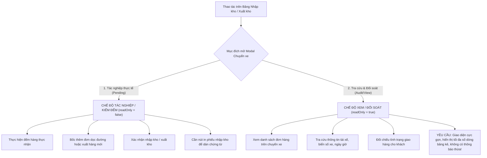

# Feedback 16/10 Task #85 — Tinh gọn Thông tin & Tối ưu Giao diện Xem Chi tiết Chuyến xe Nhập/Xuất Kho (UI Compact Density & Clean Read-only Audit View)

> **Thời gian ghi nhận**: 16/10/2026  
> **Người báo cáo**: @Thai (Quản lý nghiệp vụ / Vận hành) & @Antigravity Business Team Lead  
> **Phạm vi tác động**:  
> - Quản lý Nhập kho (`/dashboard/warehouse/inbound`) ➔ Modal xem chi tiết chuyến xe nhập kho ([`WarehouseTripDetailModal`](file:///home/runner/work/logistics-website/logistics-website/frontend/src/features/warehouse/components/warehouse-trip-detail-modal.tsx) với `readOnly={true}`, `mode='INBOUND'`)  
> - Quản lý Xuất kho (`/dashboard/warehouse/outbound`) ➔ Modal xem chi tiết chuyến xe xuất kho ([`WarehouseTripDetailModal`](file:///home/runner/work/logistics-website/logistics-website/frontend/src/features/warehouse/components/warehouse-trip-detail-modal.tsx) với `readOnly={true}`, `mode='OUTBOUND'`)  
> - Bảng kê kiểm đếm hàng hóa ([`WarehouseTripTallyTable`](file:///home/runner/work/logistics-website/logistics-website/frontend/src/features/warehouse/components/warehouse-trip-tally-table.tsx))  
> - Hạ tầng Frontend TMS (Next.js 15+ App Router, Tailwind CSS, TanStack Query v5) & Backend API (NestJS 11+)  
> **Tài liệu tham chiếu**:  
> - `/leader` Business Domain Architecture ([`SKILL.md`](file:///home/runner/work/logistics-website/logistics-website/.agents/skills/leader/SKILL.md))  
> - Quy chế phát triển hệ thống [`AGENTS.md`](file:///home/runner/work/logistics-website/logistics-website/AGENTS.md)  
> - Quy chuẩn giao diện hẹp [`.agents/rules/ui-compact-density.md`](file:///home/runner/work/logistics-website/logistics-website/.agents/rules/ui-compact-density.md) & [`ui-spacing-guard`](file:///home/runner/work/logistics-website/logistics-website/.agents/skills/ui-spacing-guard/SKILL.md)  
> - Quy chuẩn kiểm soát kiện vận tải (No-SKU, Consignment Level)  
> **Ảnh minh chứng đính kèm trong thư mục**:  
> - [`screenshot_01.jpg`](file:///home/runner/work/logistics-website/logistics-website/feedbacks/feedback_16_10_task_85/screenshot_01.jpg): Ảnh chụp màn hình giao diện xem chi tiết chuyến xe `SD49` tại `Andromeda Hub - HCM` (trạng thái `Đã xử lý`), người dùng khoanh 3 hộp đỏ chỉ định các thành phần cần loại bỏ triệt để.  

---

## 📌 Bối cảnh nghiệp vụ thực tế (Chốt theo phản hồi người dùng)

### 1. Phản hồi gốc từ người dùng (@Thai)
> *"loại bỏ các thông tin này trên giao diện xem trip nhập, xuất"*

Kèm theo ảnh chụp màn hình [`screenshot_01.jpg`](file:///home/runner/work/logistics-website/logistics-website/feedbacks/feedback_16_10_task_85/screenshot_01.jpg) khoanh đỏ rõ ràng 3 khu vực gây nhiễu, chiếm dụng diện tích hiển thị và trùng lặp tính năng.

---

### 2. Phân tích ngữ cảnh vận hành thực tế tại kho bãi (Hub Operations)

Trong nghiệp vụ vận hành kho bãi hàng ngày tại các Hub trung chuyển (như `Andromeda Hub - HCM`, `Polaris Hub - Hưng Yên`, `Magellan Hub - Đà Nẵng`), nhân sự kho và điều phối viên thường xuyên phải mở giao diện chi tiết chuyến xe với **hai mục đích hoàn toàn khác biệt**:



#### 2.1. Phân định rõ 2 trạng thái màn hình:
1. **Chế độ Tác nghiệp (Execution / Tally Mode - `readOnly={false}`)**:
   - Được kích hoạt khi bấm nút `Tiếp tục` trên chuyến xe ở trạng thái `Chờ xử lý` (`PENDING`).
   - Thủ kho cần các công cụ nhập liệu: ô nhập thực nhận, nút bốc đơn dọc đường, nút lưu nháp, nút xác nhận nhập kho và nút in phiếu kho.
2. **Chế độ Xem / Đối soát (Read-only View Mode - `readOnly={true}`)**:
   - Được kích hoạt khi người dùng **nhấp chuột trực tiếp vào Mã chuyến xe (`tripCode`)** tại bảng danh sách Nhập kho (`/dashboard/warehouse/inbound`) hoặc Xuất kho (`/dashboard/warehouse/outbound`).
   - Người dùng chỉ có nhu cầu kiểm tra dữ liệu lịch sử hoặc đối soát danh sách vận đơn trên chuyến xe đó.
   - Toàn bộ các trường dữ liệu xe đã được khóa biểu tượng ổ khóa (`🔒`), trạng thái chuyến xe đã được hiển thị qua badge `Đã xử lý` hoặc `Chờ xử lý`.

#### 2.2. Vấn đề vi phạm nguyên tắc "UI Compact Density" trên giao diện cũ:
Trên giao diện xem chuyến xe hiện tại, hệ thống đang hiển thị hàng loạt khối thông tin thừa thãi, gây lãng phí không gian dọc nghiêm trọng:
- **Header Modal**: Render 2 nút bấm `[In tất cả tem]` và `[In phiếu nhập]` (hoặc `[In phiếu xuất]`). Trong khi đó, người xem tra cứu chỉ cần đóng modal hoặc nếu muốn in phiếu chuyến xe thì ở thanh Footer dưới cùng đã có sẵn nút `[In phiếu xe]`, và trên từng dòng hàng hóa đã có nút `[In tem]` riêng lẻ. Việc nhét 2 nút này lên Header làm chật chội thanh tiêu đề modal.
- **Khối cảnh báo khóa sổ (`hub-locked-banner`)**: Banner cảnh báo màu vàng dài dòng:
  > *"Chuyến xe đã hoàn tất tác nghiệp tại kho này. Toàn bộ thông tin đơn hàng đã được chốt sổ cái và khóa chỉnh sửa đối với tài khoản chi nhánh. Vui lòng liên hệ Quản trị viên hệ thống (Admin) nếu có yêu cầu điều chỉnh ngoại lệ."*
  Kèm theo dòng:
  > *"Lộ trình xe: Andromeda Hub - HCM (Đã xử lý)"*
  Khối này chiếm tới **~80px chiều cao màn hình** chỉ để thông báo điều mà người dùng đã hoàn toàn biết trước (modal đang ở chế độ xem chỉ đọc, các input đều đã có icon ổ khóa `🔒`).
- **Khối thống kê trên đầu bảng kê hàng hóa**: Khối badge:
  > `[Dỡ tại kho này: 0 đơn (0 kiện)]` `[Tiếp tục trên xe: 4 đơn (123 kiện: 4 đơn giao khách)]`
  Khối này hoàn toàn trùng lặp thông tin với:
  1. Bộ lọc toggle trực tiếp ngay bên dưới: `Ẩn các dòng không thuộc kho này (4 dòng không dỡ tại kho này)`.
  2. Cột thông tin trên từng dòng bảng: `KHO NHẬN / NƠI GIAO` (ghi rõ `Giao thẳng khách - Hàng trên xe - Không dỡ`).
  3. Thanh tổng kết ở Footer cố định: `Dỡ tại kho: 0 / 4 dòng • Thực nhận: 0 kiện`.
  Sự trùng lặp này đẩy bảng dữ liệu chính xuống dưới, làm giảm một nửa số lượng dòng hàng có thể nhìn thấy cùng lúc trên màn hình máy tính của thủ kho.

---

## 🔍 Tổng hợp các điểm chưa đúng trên giao diện cũ (đối chiếu ảnh chụp màn hình)

Dựa trên ảnh minh chứng [`screenshot_01.jpg`](file:///home/runner/work/logistics-website/logistics-website/feedbacks/feedback_16_10_task_85/screenshot_01.jpg), người dùng đã khoanh tròn 3 hộp đỏ đại diện cho 3 khu vực cần loại bỏ triệt để:

```
┌────────────────────────────────────────────────────────────────────────────────────────┐
│ MODAL CHUYẾN XE (GIAO DIỆN XEM TRIP NHẬP, XUẤT)                                        │
├────────────────────────────────────────────────────────────────────────────────────────┤
│ [CHUYẾN XE SD49] [Đã xử lý]                       ┌──────────────────────────────────┐ │
│                                                   │ [HỘP ĐỎ 1: LOẠI BỎ]              │ │
│                                                   │ [In tất cả tem] [In phiếu nhập]  │ │
│                                                   └──────────────────────────────────┘ │
├────────────────────────────────────────────────────────────────────────────────────────┤
│ ┌────────────────────────────────────────────────────────────────────────────────────┐ │
│ │ [HỘP ĐỎ 2: LOẠI BỎ TRIỆT ĐỂ KHỐI CẢNH BÁO & LỘ TRÌNH XE]                           │ │
│ │ ⚠ Chuyến xe đã hoàn tất tác nghiệp tại kho này. Toàn bộ thông tin đơn hàng đã...   │ │
│ │ Lộ trình xe: Andromeda Hub - HCM (Đã xử lý)                                        │ │
│ └────────────────────────────────────────────────────────────────────────────────────┘ │
├────────────────────────────────────────────────────────────────────────────────────────┤
│ 1. Ngày nhập kho [2026-10-14 🔒]   2. Biển số xe [36C-412.09 🔒]   3. Tài xế [...]     │
├────────────────────────────────────────────────────────────────────────────────────────┤
│ 📦 Kiểm đếm dỡ hàng tại Andromeda Hub - HCM                                4 dòng hàng │
│ ┌────────────────────────────────────────────────────────────────────────────────────┐ │
│ │ [HỘP ĐỎ 3: LOẠI BỎ KHỐI BADGE ĐẾM TRÊN ĐẦU BẢNG]                                  │ │
│ │ [Dỡ tại kho này: 0 đơn (0 kiện)]  [Tiếp tục trên xe: 4 đơn (123 kiện...)]          │ │
│ └────────────────────────────────────────────────────────────────────────────────────┘ │
│ 🔘 Ẩn các dòng không thuộc kho này                                                     │
│ [ BẢNG DỮ LIỆU CÁC DÒNG HÀNG HÓA - HIỂN THỊ TỐI ĐA CHIỀU CAO ]                         │
├────────────────────────────────────────────────────────────────────────────────────────┤
│ Dỡ tại kho: 0 / 4 dòng • Thực nhận: 0 kiện                       [Đóng] [In phiếu xe]  │
└────────────────────────────────────────────────────────────────────────────────────────┘
```

### 1. Hộp đỏ 1 — Cụm nút In trên Header góc trên bên phải
- **Vị trí**: Nằm bên cạnh nút đóng `[X]` trên thanh tiêu đề Header của modal.
- **Nội dung hiện tại**: Nút `<Button>In tất cả tem</Button>` và `<Button>In phiếu nhập</Button>` (hoặc `In phiếu xuất` khi ở chế độ Xuất kho / Bước 2).
- **Lý do loại bỏ**:
  - Khi người dùng nhấp vào xem chuyến xe (`readOnly={true}`), họ đang thực hiện tra cứu thông tin, không phải luồng tác nghiệp in phiếu nhập/xuất kho hàng loạt.
  - Nút `In phiếu xe` (in bảng kê lộ trình/chuyến xe) đã được bố trí chuẩn chỉ tại **thanh Footer cố định góc dưới bên phải** (`sticky bottom-0`).
  - Nút in tem nhãn cho từng kiện hàng cụ thể đã có sẵn tại cột **THAO TÁC** của từng dòng vận đơn trong bảng (`In tem`).
  - Việc hiển thị 2 nút in lớn trên Header làm thanh tiêu đề bị quá tải, gây mất tập trung và vi phạm quy chuẩn tinh gọn.
- **Quy định chuẩn hóa**: **Ẩn hoàn toàn 2 nút `In tất cả tem` và `In phiếu nhập` / `In phiếu xuất` trên Header khi modal ở chế độ xem (`readOnly === true` hoặc `isViewOnly`).**

### 2. Hộp đỏ 2 — Cụm Banner cảnh báo khóa sổ & Lộ trình xe
- **Vị trí**: Nằm ngay dưới thanh tiêu đề Header (hoặc dưới Stepper Bar nếu có), chiếm phần trên cùng của vùng nội dung cuộn.
- **Nội dung hiện tại**:
  1. Thẻ Alert màu vàng cam `hub-locked-banner`:
     > *"Chuyến xe đã hoàn tất tác nghiệp tại kho này. Toàn bộ thông tin đơn hàng đã được chốt sổ cái và khóa chỉnh sửa đối với tài khoản chi nhánh. Vui lòng liên hệ Quản trị viên hệ thống (Admin) nếu có yêu cầu điều chỉnh ngoại lệ."*
  2. Dòng thông tin lộ trình xe:
     > *"Lộ trình xe: Andromeda Hub - HCM (Đã xử lý)"* (kèm các trạm dừng nếu có).
- **Lý do loại bỏ**:
  - Giao diện xem chuyến xe vốn dĩ là chế độ chỉ đọc. Trạng thái đã xử lý đã được phản ánh trực quan qua Badge `Đã xử lý` màu xanh lục ngay cạnh mã chuyến xe trên Header và các biểu tượng ổ khóa `🔒` tại các ô thông tin ngày tháng, biển số xe, tài xế.
  - Dòng cảnh báo khóa sổ dài 3 dòng bằng chữ chiếm tới 50px chiều cao nhưng không mang lại giá trị tác nghiệp nào cho người xem, tạo cảm giác nặng nề, rối mắt.
  - Dòng lộ trình xe trong giao diện xem cũng làm mất thêm một hàng dọc trước thẻ thông tin xe.
- **Quy định chuẩn hóa**: **Ẩn hoàn toàn thẻ cảnh báo `hub-locked-banner` và dòng `Lộ trình xe` trên giao diện xem chuyến xe (`readOnly === true`). Nội dung modal sẽ bắt đầu ngay từ Thẻ thông tin phương tiện (Ngày nhập/xuất, Biển số xe, Tài xế phụ trách).**

### 3. Hộp đỏ 3 — Cụm Badge thống kê số lượng trên đầu bảng kê
- **Vị trí**: Nằm giữa tiêu đề bảng kê ("Kiểm đếm dỡ hàng tại...") và switch toggle ("Ẩn các dòng không thuộc kho này").
- **Nội dung hiện tại**: Khối `div` chứa 2 badge:
  - `[Dỡ tại kho này: X đơn (Y kiện)]` (màu xanh lục).
  - `[Tiếp tục trên xe: Z đơn (W kiện: ...)]` (màu trắng/viền xám viền hổ phách).
- **Lý do loại bỏ**:
  - Trên màn hình xem chuyến xe, thông tin tổng số kiện và số đơn cần dỡ hay đi tiếp đã được tổng kết chi tiết tại dòng tóm tắt chân trang cố định: `Dỡ tại kho: X / Y dòng • Thực nhận: Z kiện`.
  - Trên từng dòng của bảng kê, cột `KHO NHẬN / NƠI GIAO` và cột `THỰC NHẬN` đã ghi chú rõ ràng trạng thái hàng dỡ hay hàng đi tiếp (ví dụ badge `Giao thẳng khách`, `Hàng trên xe - Không dỡ`).
  - Khối thống kê này làm tăng thêm khoảng cách từ đầu bảng đến dữ liệu thực tế, vi phạm quy tắc [`.agents/rules/ui-compact-density.md`](file:///home/runner/work/logistics-website/logistics-website/.agents/rules/ui-compact-density.md) (nghiêm cấm các khoảng cách thừa làm giảm số dòng hiển thị).
- **Quy định chuẩn hóa**: **Ẩn khối badge thống kê `Dỡ tại kho này` & `Tiếp tục trên xe` trên giao diện xem chuyến xe (`readOnly === true`). Bảng dữ liệu và switch toggle đẩy sát lên trên, tận dụng tối đa chiều cao để hiển thị nhiều dòng hàng nhất có thể.**

---

## 📋 Danh sách công việc triển khai (Action Checklist)

### 1. Phân hệ Frontend (Next.js 15 App Router - `frontend/`)
- [ ] **Hiệu chỉnh Component [`WarehouseTripDetailModal`](file:///home/runner/work/logistics-website/logistics-website/frontend/src/features/warehouse/components/warehouse-trip-detail-modal.tsx)**:
  - [ ] **Khu vực 1 (Header Action Buttons)**:
    - Bổ sung điều kiện kiểm tra `!readOnly`:
      ```tsx
      {/* Ẩn các nút in trên Header khi ở chế độ xem trip */}
      {!readOnly && (
        <Button variant='outline' size='sm' onClick={handlePrintAllLabels} ...>
          <IconPrinter className='h-3.5 w-3.5 mr-1' /> In tất cả tem
        </Button>
      )}
      {!readOnly && onOpenReceipt && !isCurrentHubPending && (
        <Button variant='outline' size='sm' onClick={() => handlePrintReceipt()} ...>
          <IconPrinter className='h-3.5 w-3.5 mr-1' />
          {currentStep === 1 ? 'In phiếu nhập' : 'In phiếu xuất'}
        </Button>
      )}
      ```
    - Đảm bảo nút đóng `[X]` vẫn luôn hiển thị góc phải trên cùng.
  - [ ] **Khu vực 2 (Banner cảnh báo khóa sổ & Lộ trình xe)**:
    - Bọc điều kiện `!readOnly` cho khối `hub-locked-banner`:
      ```tsx
      {!readOnly && isHubAccountLocked && (
        <div data-testid='hub-locked-banner' className='bg-amber-50 ...'>
          ...
        </div>
      )}
      ```
    - Bọc điều kiện `!readOnly` cho khối `Lộ trình xe:` (route stops):
      ```tsx
      {!readOnly && manifest && manifest.stops.length > 0 && (
        <div className='flex flex-wrap items-center gap-1 text-[10px]'>
          <span className='font-semibold text-slate-600 dark:text-slate-300'>Lộ trình xe:</span>
          ...
        </div>
      )}
      ```
    - Đảm bảo trong chế độ xem (`readOnly={true}`), phần thân cuộn modal mở ra hiển thị ngay thẻ thông tin xe: Ngày nhập/xuất, Biển số xe, Tài xế phụ trách.
  - [ ] **Khu vực 3 (Khối Badge Thống kê trên đầu Bảng kê)**:
    - Bọc điều kiện `!readOnly` cho khối badge thống kê dỡ kho / đi tiếp:
      ```tsx
      {!readOnly && (
        <div className='flex flex-wrap items-center gap-1.5 px-2 py-1 bg-slate-50 dark:bg-slate-800/60 rounded-md border border-slate-200 dark:border-slate-700 text-[10px]'>
          ...
        </div>
      )}
      ```
    - Khi `readOnly={true}`, bảng kê `WarehouseTripTallyTable` hoặc bảng chi tiết sẽ áp sát thanh tiêu đề bảng, tối đa hóa số dòng hiển thị.
  - [ ] **Bảo toàn các hành vi tại Chân trang (Sticky Footer)**:
    - Nút `[Đóng]` và nút `[In phiếu xe]` tại Footer vẫn duy trì hoạt động bình thường để người dùng có thể in biên bản chuyến xe khi có nhu cầu.
    - Dòng tổng kết số liệu `Dỡ tại kho: X / Y dòng • Thực nhận: Z kiện` được giữ nguyên để đối soát số lượng.
  - [ ] **Bảo toàn Chế độ Tác nghiệp (`readOnly={false}`)**:
    - Khi thủ kho bấm `Tiếp tục` để thực hiện kiểm đếm dỡ hàng hoặc xuất kho mới, các nút `In phiếu nhập`, các badge thống kê và luồng thao tác nghiệp vụ vẫn hoạt động chuẩn xác 100% như thiết kế đã duyệt tại Task #83.
- [ ] **Kiểm tra tương thích trên màn hình Xuất kho ([`frontend/src/app/dashboard/warehouse/outbound/page.tsx`](file:///home/runner/work/logistics-website/logistics-website/frontend/src/app/dashboard/warehouse/outbound/page.tsx))**:
  - [ ] Kiểm tra khi click vào mã chuyến xe xuất kho (`isTripDetailModalOpen = true`, `readOnly = true`, `mode = 'OUTBOUND'`), modal hiển thị tinh gọn, không xuất hiện các thành phần thừa đã loại bỏ.
- [ ] **Kiểm tra tương thích trên màn hình Nhập kho ([`frontend/src/app/dashboard/warehouse/inbound/page.tsx`](file:///home/runner/work/logistics-website/logistics-website/frontend/src/app/dashboard/warehouse/inbound/page.tsx))**:
  - [ ] Kiểm tra khi click vào mã chuyến xe nhập kho (`isTripViewModalOpen = true`, `readOnly = true`, `mode = 'INBOUND'`), modal loại bỏ triệt để 3 khu vực theo đúng yêu cầu.
- [ ] **Kiểm tra biên dịch & Chuẩn mực giao diện hẹp**:
  - [ ] Chạy `npm run build --prefix frontend` đảm bảo 0 lỗi TypeScript, 0 lỗi linting.
  - [ ] Đảm bảo không phát sinh bất kỳ class cấm nào theo `ui-compact-density.md` (`p-4`, `space-y-4`, `gap-4`).

---

### 2. Phân hệ Backend (NestJS 11 - `backend/`)
- [ ] **Rà soát tính tương thích API Manifest & Chuyến xe ([`warehouse.service.ts`](file:///home/runner/work/logistics-website/logistics-website/backend/src/orders/warehouse.service.ts))**:
  - [ ] Đảm bảo API `GET /api/v1/warehouse/trips/:tripCode/manifest` và `GET /api/v1/warehouse/inbound-trips` tiếp tục phục vụ đầy đủ dữ liệu cho cả 2 chế độ xem và tác nghiệp.
  - [ ] Đảm bảo không có thay đổi nào làm ảnh hưởng đến dữ liệu sổ cái tồn kho và chốt trạm trung chuyển.
- [ ] **Kiểm tra biên dịch Backend**:
  - [ ] Chạy `npm run build --prefix backend` đạt `Exit code 0`.

---

### 3. Kiểm thử Tự động E2E & Bằng chứng Nghiệm thu (Playwright E2E)
- [ ] **Xây dựng kịch bản kiểm thử Playwright chuyên biệt**:
  - File kiểm thử: [`frontend/e2e/85-feedback-16-10-task-85-clean-trip-view-modal.spec.ts`](file:///home/runner/work/logistics-website/logistics-website/frontend/e2e/85-feedback-16-10-task-85-clean-trip-view-modal.spec.ts).
- [ ] **Nội dung kiểm thử chi tiết**:
  - **Case 1: Kiểm thử Màn hình Xem Chuyến xe Nhập kho (`/dashboard/warehouse/inbound`)**:
    - Đăng nhập tài khoản thủ kho HCM (`warehouse_hcm`).
    - Mở trang Nhập kho, click vào mã chuyến xe đã xử lý `SD49` (hoặc chuyến bất kỳ) để mở Modal ở chế độ Xem (`readOnly={true}`).
    - **Assert Khu vực 1 (Header)**: Nút `In tất cả tem` và `In phiếu nhập` **KHÔNG TỒN TẠI** (`expect(page.getByRole('button', { name: /In tất cả tem/i })).toBeHidden()`, `expect(page.getByRole('button', { name: /In phiếu nhập/i })).toBeHidden()`).
    - **Assert Khu vực 2 (Body)**: Banner `hub-locked-banner` và chữ `Lộ trình xe:` **KHÔNG TỒN TẠI** (`expect(modal.locator('[data-testid="hub-locked-banner"]')).toBeHidden()`, `expect(modal.locator('text=Lộ trình xe:')).toBeHidden()`).
    - **Assert Khu vực 3 (Table Header)**: Khối badge `Dỡ tại kho này` và `Tiếp tục trên xe` **KHÔNG TỒN TẠI** (`expect(modal.locator('text=Dỡ tại kho này:')).toBeHidden()`).
    - **Assert Footer & Bảng dữ liệu**: Bảng kê hàng hóa hiển thị rõ ràng, nút `[In phiếu xe]` và `[Đóng]` tại chân trang hiển thị sẵn sàng.
    - Chụp ảnh màn hình nghiệm thu thực tế: `feedbacks/feedback_16_10_task_85/screenshot_01_verified.png`.
  - **Case 2: Kiểm thử Màn hình Xem Chuyến xe Xuất kho (`/dashboard/warehouse/outbound`)**:
    - Điều hướng sang trang Xuất kho (`/dashboard/warehouse/outbound`).
    - Click vào mã chuyến xe xuất kho bất kỳ để mở Modal Xem Xuất kho (`mode='OUTBOUND'`).
    - Assert tương tự: Header không có nút `In tất cả tem` / `In phiếu xuất`; không có banner khóa sổ; không có lộ trình xe thừa.
  - **Case 3: Kiểm thử Tính Độc lập với Chế độ Tác nghiệp (Regression Prevention)**:
    - Tại bảng Nhập kho, mở chuyến xe ở trạng thái `Chờ xử lý` bằng nút `Tiếp tục` (`readOnly={false}`).
    - Xác nhận chế độ Tác nghiệp vẫn hiển thị đầy đủ các thành phần phục vụ kiểm đếm theo đúng quy trình nghiệp vụ.
- [ ] **Chạy kiểm thử Playwright E2E**:
  - Thực thi kiểm thử cục bộ: `npx playwright test frontend/e2e/85-feedback-16-10-task-85-clean-trip-view-modal.spec.ts`.
  - Đảm bảo 100% test cases PASS và lưu ảnh bằng chứng visual evidence vào thư mục feedback.

---

### 4. Biên niên sử & Cập nhật Hệ thống
- [ ] Khởi tạo tài liệu tổng kết kỹ thuật [`RESOLUTION.md`](file:///home/runner/work/logistics-website/logistics-website/feedbacks/feedback_16_10_task_85/RESOLUTION.md) thông qua lệnh `npm run todo:record feedbacks/feedback_16_10_task_85`.
- [ ] Đồng bộ mốc nâng cấp ngày 16/10/2026 vào [`docs/SYSTEM_TIMELINE.md`](file:///home/runner/work/logistics-website/logistics-website/docs/SYSTEM_TIMELINE.md).
- [ ] Kiểm tra tiến độ hoàn thành đạt 100% qua lệnh `npm run todo:today`.

---

## 🧪 Kịch Bản Kiểm Thử E2E & Ma Trận Edge Cases

### Cấu phần 1: Luồng Kiểm Thử Tuần Tự (Happy Path)
- **Môi trường**: Dev Local (`http://localhost:4000`) & Railway Cloud Dev (`https://frontend-tms-core-dev.up.railway.app`).
- **Tài khoản**: `USER_WAREHOUSE_HCM` (`warehouse_hcm` / `Warehouse@123`).
- **Các bước thực thi**:
  1. *Bước 1*: Đăng nhập tài khoản thủ kho Andromeda Hub - HCM.
  2. *Bước 2*: Điều hướng tới trang Quản lý Nhập kho `/dashboard/warehouse/inbound`.
  3. *Bước 3*: Nhấp chuột vào mã chuyến xe `SD49` (hoặc chuyến xe có trạng thái `Đã xử lý`).
  4. *Bước 4*: Kiểm tra Header modal: Xác nhận không có nút `In tất cả tem` và không có nút `In phiếu nhập`.
  5. *Bước 5*: Kiểm tra vùng đầu nội dung modal: Xác nhận không có banner màu vàng cảnh báo khóa sổ `hub-locked-banner` và không có dòng text `Lộ trình xe:`.
  6. *Bước 6*: Kiểm tra khu vực bảng kê hàng hóa: Xác nhận không có khối badge `Dỡ tại kho này: ...` và `Tiếp tục trên xe: ...`.
  7. *Bước 7*: Kiểm tra Footer modal: Nút `In phiếu xe` và nút `Đóng` hiển thị đúng vị trí.
  8. *Bước 8*: Chụp ảnh màn hình nghiệm thu visual evidence lưu trữ tại `feedbacks/feedback_16_10_task_85/screenshot_01_verified.png`.

---

### Cấu phần 2: Ma Trận Edge Cases Đối Soát Nghiệp Vụ

| Mã Case | Tình huống kiểm tra | Điều kiện kích hoạt | Hành vi chuẩn hóa kỳ vọng | Kết quả đối soát |
|:---:|---|---|---|:---:|
| `EC-85-01` | **Xem chuyến xe Nhập kho đã xử lý (`COMPLETED`)** | Nhấp vào `tripCode` của chuyến xe đã chốt sổ tại `/warehouse/inbound` | Ẩn hoàn toàn 3 khu vực thừa (Nút in Header, Banner khóa sổ, Badge đếm trên bảng) | **CẦN ĐẠT** |
| `EC-85-02` | **Xem chuyến xe Nhập kho đang chờ xử lý (`PENDING`)** | Nhấp vào `tripCode` của chuyến xe chờ xử lý tại `/warehouse/inbound` | Modal mở ở chế độ xem (`readOnly=true`), không có nút in Header, không có banner thừa | **CẦN ĐẠT** |
| `EC-85-03` | **Xem chuyến xe Xuất kho (`OUTBOUND`)** | Nhấp vào `tripCode` tại trang `/warehouse/outbound` | Modal mở ở chế độ xem xuất kho, không có nút `In tất cả tem` hay `In phiếu xuất` trên Header | **CẦN ĐẠT** |
| `EC-85-04` | **Tác nghiệp kiểm đếm dỡ hàng (`readOnly=false`)** | Nhấp nút `Tiếp tục` tại bảng Nhập kho trên chuyến xe `PENDING` | Modal mở ở chế độ tác nghiệp, giữ nguyên các tính năng kiểm đếm, xác nhận và in phiếu theo chuẩn Task #83 | **CẦN ĐẠT** |
| `EC-85-05` | **Tài khoản Quản trị viên (Super Admin) mở xem** | Đăng nhập tài khoản `admin`, nhấp xem chi tiết chuyến xe | Hiển thị giao diện xem tinh gọn sạch sẽ, nếu admin muốn can thiệp nút Rollback vẫn sẵn sàng tại Footer | **CẦN ĐẠT** |

---

## 🛡️ Tiêu Chí Nghiệm Thu (Definition of Done - DoD)
1. **Khớp 100% yêu cầu người dùng và ảnh khoanh đỏ**: Cả 3 khu vực khoanh đỏ trong [`screenshot_01.jpg`](file:///home/runner/work/logistics-website/logistics-website/feedbacks/feedback_16_10_task_85/screenshot_01.jpg) đều được loại bỏ triệt để trên giao diện xem chi tiết chuyến xe nhập kho và xuất kho.
2. **Không phá vỡ chế độ Tác nghiệp (Regression-Free)**: Khi mở modal ở chế độ kiểm đếm (`readOnly={false}`), toàn bộ nghiệp vụ dỡ hàng, bốc thêm đơn dọc đường và xác nhận nhập kho vẫn hoạt động bình thường.
3. **Tuân thủ quy chuẩn giao diện hẹp (UI Compact Density)**: Giao diện xem chuyến xe giải phóng ~150px chiều cao thừa, giúp bảng dữ liệu vận đơn hiển thị nhiều dòng nhất có thể mà không bị che khuất hay cuộn trang không đáng có.
4. **Biên dịch & Code Quality**: Cả 2 repository `backend/` và `frontend/` biên dịch đạt `Exit code 0` không có lỗi TypeScript hay vi phạm quy chuẩn.
5. **Kiểm thử tự động & Bằng chứng minh bạch**: Kịch bản Playwright E2E `85-feedback-16-10-task-85-clean-trip-view-modal.spec.ts` vượt qua 100% test cases kèm ảnh chụp bằng chứng nghiệm thu `screenshot_01_verified.png`.
6. **Biên niên sử đầy đủ**: Hoàn tất cập nhật `RESOLUTION.md` và `docs/SYSTEM_TIMELINE.md`.
