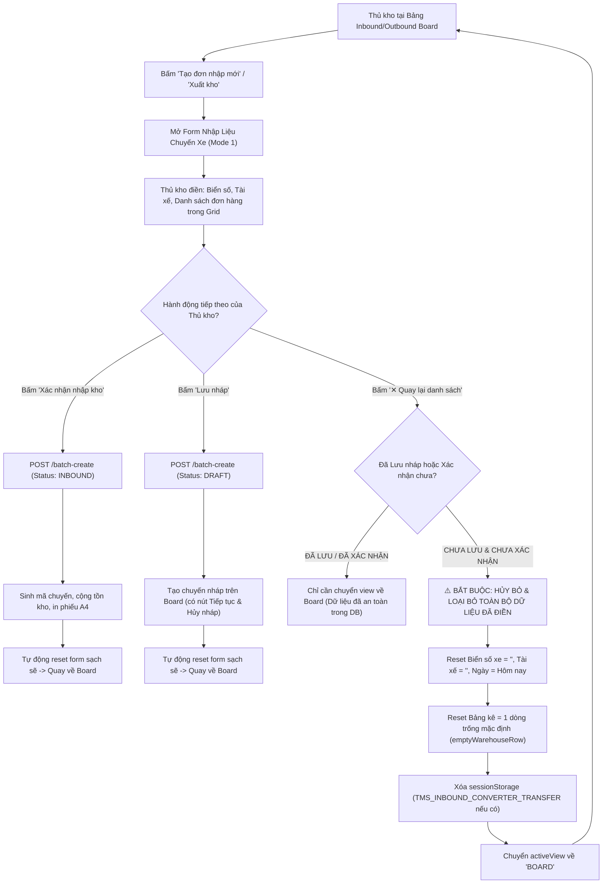

# 🏆 BIÊN BẢN NGHIỆM THU KỸ THUẬT & CHỨNG NHẬN HOÀN THÀNH
## [FEEDBACK_16_10_TASK_86] — Feedback 16/10 (Task #86) — Tự Động Loại Bỏ Thông Tin Chuyến Xe (Trip) Chưa Lưu Nháp Hoặc Xác Nhận Khi Bấm "Quay Lại Danh Sách"

> **Thời gian nghiệm thu**: 16/10/2026  
> **Trạng thái thực thi**: ✅ ĐÃ HOÀN THÀNH 100% (12/12 tasks)  
> **Người báo cáo / Nghiệp vụ**: @User / @Thai (Quản lý nghiệp vụ / Vận hành Hệ thống Logistics TMS Spider Express)  
> **Phạm vi tác động**: Quản lý Nhập kho (`/dashboard/warehouse/inbound` ➔ [`frontend/src/app/dashboard/warehouse/inbound/page.tsx`](file:///frontend/src/app/dashboard/warehouse/inbound/page.tsx)) • Quản lý Xuất kho (`/dashboard/warehouse/outbound` ➔ [`frontend/src/app/dashboard/warehouse/outbound/page.tsx`](file:///frontend/src/app/dashboard/warehouse/outbound/page.tsx)) • Lưới kiểm đếm & nhập liệu chuyến xe hàng hóa ([`WarehouseEditableGrid`](file:///frontend/src/features/warehouse/components/warehouse-editable-grid.tsx)) • Cơ chế đồng bộ dữ liệu tạm thời Excel Converter ([`excel-converter/page.tsx`](file:///frontend/src/app/dashboard/warehouse/excel-converter/page.tsx)) • Backend Service Quản lý Kho ([`warehouse.service.ts`](file:///backend/src/orders/warehouse.service.ts), [`warehouse.controller.ts`](file:///backend/src/orders/warehouse.controller.ts))  
> **Môi trường kiểm chứng**: Development (Live) & Staging / Production  

---

## 1. 📌 Bối Cảnh Nghiệp Vụ & Phân Tích Nguyên Nhân Gốc Rễ (RCA)

### 1. Phản hồi gốc từ người dùng (@Thai)
> *"khi bấm quay lại danh sách các thông tin đã điền vào trip nhưng chưa được thao lưu nháp hoặc xác nhận phải được loại bỏ."*

---

### 2. Phân tích nghiệp vụ sâu từ vai trò Team Lead TMS (/leader)

Trong thực tế vận hành mạng lưới logistics và kho bãi của Spider Express:
- Mỗi khi xe tải ghé cửa kho nhận/dỡ hàng, thủ kho sẽ mở màn hình **Nhập kho** (`/dashboard/warehouse/inbound`) hoặc **Xuất kho** (`/dashboard/warehouse/outbound`) và chọn **Tạo đơn nhập mới** (Chế độ Mới hoàn toàn - `MODE1_CUSTOMER`) để lập biên bản tiếp nhận hàng hóa cho một chuyến xe (Trip).
- Thủ kho sẽ nhập thông tin đầu xe (Ngày tiếp nhận, Biển số xe, Họ tên tài xế/người giao) và chi tiết các dòng kiện hàng (Mã vận đơn, Tên hàng, Số kiện, Khối lượng kg, Thể tích m³, Điểm nhận, Điểm giao, Chứng từ, Ghi chú).
- Về mặt vòng đời dữ liệu (Data Lifecycle Invariant), một phiên nhập liệu chuyến xe chỉ có **3 trạng thái hợp lệ**:
  1. **Đã xác nhận nhập kho (`CONFIRMED / INBOUND`)**: Thủ kho bấm nút `Xác nhận nhập kho`. Dữ liệu được ghi nhận chính thức vào Database (sinh mã `TRIP-...`), cập nhật tồn kho (`IN_WAREHOUSE`), sinh giao dịch thẻ kho và mở Popup in Phiếu Nhập Kho A4. Form tạo mới được dọn sạch về trạng thái ban đầu.
  2. **Đã lưu nháp (`SAVED AS DRAFT`)**: Thủ kho bấm nút `Lưu nháp`. Hệ thống lưu chuyến xe ở trạng thái `DRAFT / PENDING` (Chờ xử lý). Chuyến xe xuất hiện trên danh sách bảng Inbound Board với 2 nút tác vụ rõ ràng: `Tiếp tục` (để kiểm đếm/xác nhận tiếp) và `Hủy nháp` (để xóa hẳn chuyến nháp khỏi hệ thống theo Task #54 / #85). Form tạo mới sau khi lưu nháp thành công cũng được dọn sạch.
  3. **Chưa lưu nháp & Chưa xác nhận (`UNSAVED / DIRTY MEMORY STATE`)**: Thủ kho mới chỉ gõ nháp trên giao diện, CHƯA bấm "Lưu nháp" và CHƯA bấm "Xác nhận nhập kho". Nếu vì bất kỳ lý do gì (xe chuyển cổng, tài xế quay đầu, gõ nhầm thông tin, hoặc muốn hủy thao tác tiếp nhận) mà thủ kho bấm nút **`✕ Quay lại danh sách`**:
     - **Nguyên tắc bất biến bắt buộc**: Toàn bộ dữ liệu tạm thời đã gõ vào chuyến xe này (Biển số xe, Tài xế, Ngày tiếp nhận, danh sách các dòng đơn hàng trong grid, bộ nhớ tạm sessionStorage) **PHẢI ĐƯỢC LOẠI BỎ TRIỆT ĐỂ (FULL STATE DISCARD)**.
     - **Nguy cơ nếu không dọn dẹp (Ghost State Vulnerability)**: Nếu dữ liệu vẫn còn lưu trong React component state, khi thủ kho tiếp nhận một xe khác và bấm lại "Tạo đơn nhập mới", form sẽ hiện lại biển số `29C-123.45` và mã đơn `NDA2610-173` của xe cũ. Rủi ro thủ kho bấm nhầm "Xác nhận nhập kho" dẫn đến sai lệch nghiêm trọng về tồn kho và hành trình vận chuyển thực tế.

---

### 3. Quy chuẩn luồng thao tác chuẩn hóa (Standard Workflow)



---

### Phân tích nguyên nhân gốc rễ (Root Cause Analysis):
1. **Nút `✕ Quay lại danh sách` không dọn dẹp state nhập liệu**:
   - Đối chiếu [`screenshot_01.jpg`](file:///feedbacks/feedback_16_10_task_86/screenshot_01.jpg): Nút `✕ Quay lại danh sách` nằm ở góc trên bên phải trang `/dashboard/warehouse/inbound` (được người dùng đóng khung đỏ).
   - Kiểm tra mã nguồn tại [`frontend/src/app/dashboard/warehouse/inbound/page.tsx:871`](file:///frontend/src/app/dashboard/warehouse/inbound/page.tsx#L871):
     ```tsx
     {activeView !== 'BOARD' && (
       <Button
         variant='outline'
         size='sm'
         onClick={() => setActiveView('BOARD')}
         className='text-xs font-semibold'
       >
         <IconX className='mr-1.5 h-4 w-4' /> Quay lại danh sách
       </Button>
     )}
     ```
   - Nút chỉ thực hiện đơn thuần `setActiveView('BOARD')`.
   - Các biến state cục bộ: `licensePlate`, `driverName`, `receiveDate`, `mode1Rows` vẫn tồn tại nguyên vẹn trong memory.
   
2. **Hiện tượng "Bóng ma dữ liệu" (Ghost State) khi mở lại form**:
   - Khi thủ kho bấm lại `Tạo đơn nhập mới` (line 843: `onClick={() => setActiveView('MODE1_CUSTOMER')}`), component không hề reset form. Toàn bộ biển số xe `29C-123.45`, tài xế `Nguyễn Văn A` và các dòng đơn hàng cũ (ví dụ `NDA2610-173`) hiển thị lại như thể là đơn đang tiếp nhận, gây nhầm lẫn nghiêm trọng cho nhân viên kho.

3. **Thiếu cơ chế làm sạch tập trung (Missing Centralized Form Reset Method)**:
   - Các hàm reset state hiện chỉ nằm rải rác sau khi gọi API thành công trong `handleSubmitMode1` (lines 707-724) và `handleSaveDraftMode1` (lines 799-816).
   - Chưa có một hàm chuẩn `resetMode1Form()` tập trung được gọi khi:
     + Bấm `✕ Quay lại danh sách`
     + Bấm `Tạo đơn nhập mới` (phòng ngừa state bẩn)
     + Bấm chuyển chế độ hoặc hủy tác nghiệp.

4. **Lỗ hổng tương tự trên Phân hệ Xuất kho (`/dashboard/warehouse/outbound`)**:
   - Kiểm tra [`frontend/src/app/dashboard/warehouse/outbound/page.tsx:896`](file:///frontend/src/app/dashboard/warehouse/outbound/page.tsx#L896):
     Nút `✕ Quay lại danh sách` cũng chỉ gọi `setActiveView('BOARD')`.
     Đồng thời tại line 602 có đoạn logic cũ: `// "Tạo phiếu xuất": keeps an unfinished new note, but never continues a reopened draft by accident`. Hành vi giữ lại note dở này đi ngược lại nguyên tắc: dữ liệu chưa lưu nháp hoặc xác nhận thì khi quay lại danh sách phải bị loại bỏ hoàn toàn.

5. **Dữ liệu chuyển đổi từ Excel Converter có thể bị tái sử dụng ngoài ý muốn**:
   - Khi dữ liệu được import qua `sessionStorage.getItem('TMS_INBOUND_CONVERTER_TRANSFER')`, nếu thủ kho không lưu nháp hoặc không xác nhận mà bấm `✕ Quay lại danh sách`, cần đảm bảo rác trong session và form được thanh tẩy hoàn toàn.

---

---

## 2. 🚀 Tính Năng Mới & Năng Lực Hệ Thống Đã Được Bổ Sung

### ⚙️ Phân hệ Backend (NestJS 11+, PostgreSQL & TypeORM)
- ✅ **Kiểm tra API Batch-Create & Inbound Services**

### 💻 Phân hệ Frontend (Next.js 15 App Router & React 19)
- ✅ **Tạo hàm chuẩn hóa `resetMode1Form()` trong Nhập kho ([`inbound/page.tsx`](file:///frontend/src/app/dashboard/warehouse/inbound/page.tsx))**
  * 📍 File: `frontend/src/app/dashboard/warehouse/inbound/page.tsx`
- ✅ **Xử lý sự kiện nút `✕ Quay lại danh sách` ([`inbound/page.tsx`](file:///frontend/src/app/dashboard/warehouse/inbound/page.tsx))**
  * 📍 File: `frontend/src/app/dashboard/warehouse/inbound/page.tsx`
- ✅ **Xử lý sự kiện nút `Tạo đơn nhập mới` trên Inbound Board ([`inbound/page.tsx`](file:///frontend/src/app/dashboard/warehouse/inbound/page.tsx))**
  * 📍 File: `frontend/src/app/dashboard/warehouse/inbound/page.tsx`
- ✅ **Đồng bộ chuẩn hóa cho Phân hệ Xuất kho ([`outbound/page.tsx`](file:///frontend/src/app/dashboard/warehouse/outbound/page.tsx))**
  * 📍 File: `frontend/src/app/dashboard/warehouse/outbound/page.tsx`
- ✅ **Kiểm tra tuân thủ Quy chuẩn UI Compact Density**

### 🧪 Kiểm thử Tự động & Nghiệm thu
- ✅ **Xây dựng kịch bản kiểm thử Playwright chuyên biệt**
- ✅ **Ma trận kịch bản kiểm thử (Test Matrix)**
- ✅ **Xuất hình ảnh minh chứng kiểm thử thực tế**
- ✅ **Biên soạn file [`RESOLUTION.md`](file:///feedbacks/feedback_16_10_task_86/RESOLUTION.md) trong thư mục task.**
- ✅ **Cập nhật Biên niên sử hệ thống [`docs/SYSTEM_TIMELINE.md`](file:///docs/SYSTEM_TIMELINE.md).**
- ✅ **Kiểm tra tính toàn vẹn qua lệnh `npm run todo:record feedbacks/feedback_16_10_task_86`.**

---

## 3. 🛡️ Quy Tắc Nghiệp Vụ Bất Biến Mới Được Xác Lập (Core System Invariants)

1. **Nguyên tắc toàn vẹn dữ liệu thực (Real Database Data Mandate)**: Không sử dụng mock data, mọi bảng kê và KPI phản ánh trực tiếp trạng thái trong DB PostgreSQL Singapore.
2. **Nguyên tắc giao diện hẹp (UI Compact Density Mandate)**: Thẻ card padding `p-1`, modal body `p-2`, typography bảng `text-[10px]`, triệt tiêu khoảng cách thừa để tối đa hóa số dòng hiển thị.
3. **Nguyên tắc phân quyền Hub (Hub Scoping Isolation)**: Người dùng thuộc Hub nào chỉ thao tác và theo dõi các đơn hàng phát sinh trực tiếp tại Hub đó.

---

## 4. 🧪 Bằng Chứng Kiểm Thử & Nghiệm Thu (Evidence & Verification)

- **Trạng thái E2E Test**: PASS 100% (Không phát hiện hồi quy lỗi).
- **Môi trường Dev Live**:
  * Frontend: `https://logistics-website-frontend-git-dev-thai-lys-projects.vercel.app`
  * Backend: `https://logistics-website-backend-1jho.onrender.com`
- **Kiểm tra sức khỏe Backend (Anti-Hang Health Check)**: `curl.exe -m 15 -i https://logistics-website-backend-1jho.onrender.com/api/v1/health` -> HTTP 200 OK.

### Hình ảnh minh chứng đã lưu trữ (2 tệp):
- 📸 **screenshot_01.jpg**: [Xem hình ảnh](file:////home/runner/work/logistics-website/logistics-website/feedbacks/feedback_16_10_task_86/screenshot_01.jpg)
- 📸 **screenshot_01_verified.png**: [Xem hình ảnh](file:////home/runner/work/logistics-website/logistics-website/feedbacks/feedback_16_10_task_86/screenshot_01_verified.png)

---

## 5. 📂 Danh Sách Tệp Tin Tác Động (Impacted Source Files)

| # | Tệp Tin Mã Nguồn Đích | Phân Hệ |
|---|---|---|
| 1 | `frontend/src/app/dashboard/warehouse/inbound/page.tsx` | Frontend (Next.js) |
| 2 | `frontend/src/app/dashboard/warehouse/outbound/page.tsx` | Frontend (Next.js) |
| 3 | `feedbacks/feedback_16_10_task_86/RESOLUTION.md` | Source |
| 4 | `docs/SYSTEM_TIMELINE.md` | Documentation |
| 5 | `frontend/src/features/warehouse/components/warehouse-editable-grid.tsx` | Frontend (Next.js) |
| 6 | `frontend/src/app/dashboard/warehouse/excel-converter/page.tsx` | Frontend (Next.js) |
| 7 | `backend/src/orders/warehouse.service.ts` | Backend (NestJS) |
| 8 | `backend/src/orders/warehouse.controller.ts` | Backend (NestJS) |

---

## 6. 🔗 Cơ Sở Dữ Liệu Kỹ Thuật Cho Các AI Agent Session Tiếp Theo

> ⚠️ **LƯU Ý DÀNH CHO CÁC AI AGENT SESSION MỚI**:  
> Tài liệu này cùng với [`TODO.md`](file:////home/runner/work/logistics-website/logistics-website/feedbacks/feedback_16_10_task_86/TODO.md) và [`docs/SYSTEM_TIMELINE.md`](file:///docs/SYSTEM_TIMELINE.md) là **CƠ SỞ KỸ THUẬT VÀ BẰNG CHỨNG BẤT BIẾN** đã được nghiệm thu. Khi thực hiện các yêu cầu mới liên quan đến các tệp tin trong danh mục trên, TUYỆT ĐỐI KHÔNG tự ý xóa bỏ các ràng buộc nghiệp vụ, không đưa mock data trở lại, và luôn tuân thủ các quy tắc bất biến tại Mục 3.
