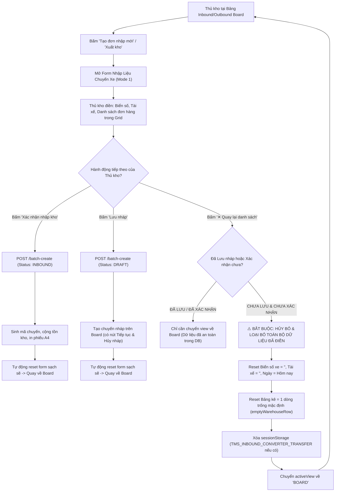

# Feedback 16/10 (Task #86) — Tự Động Loại Bỏ Thông Tin Chuyến Xe (Trip) Chưa Lưu Nháp Hoặc Xác Nhận Khi Bấm "Quay Lại Danh Sách"

> **Thời gian ghi nhận**: 16/10/2026  
> **Người báo cáo**: @User / @Thai (Quản lý nghiệp vụ / Vận hành Hệ thống Logistics TMS Spider Express)  
> **Mã Task Database**: `Task #86` trong bảng `telegram_tasks` (PostgreSQL `n8n_automation` trên Railway)  
> **Phạm vi tác động**:  
> - Quản lý Nhập kho (`/dashboard/warehouse/inbound` ➔ [`frontend/src/app/dashboard/warehouse/inbound/page.tsx`](file:///frontend/src/app/dashboard/warehouse/inbound/page.tsx))  
> - Quản lý Xuất kho (`/dashboard/warehouse/outbound` ➔ [`frontend/src/app/dashboard/warehouse/outbound/page.tsx`](file:///frontend/src/app/dashboard/warehouse/outbound/page.tsx))  
> - Lưới kiểm đếm & nhập liệu chuyến xe hàng hóa ([`WarehouseEditableGrid`](file:///frontend/src/features/warehouse/components/warehouse-editable-grid.tsx))  
> - Cơ chế đồng bộ dữ liệu tạm thời Excel Converter ([`excel-converter/page.tsx`](file:///frontend/src/app/dashboard/warehouse/excel-converter/page.tsx))  
> - Backend Service Quản lý Kho ([`warehouse.service.ts`](file:///backend/src/orders/warehouse.service.ts), [`warehouse.controller.ts`](file:///backend/src/orders/warehouse.controller.ts))  
> **Tài liệu tham chiếu**:  
> - `/leader` Business Domain Architecture ([`SKILL.md`](file:///.agents/skills/leader/SKILL.md))  
> - Quy chế phát triển hệ thống [`AGENTS.md`](file:///AGENTS.md) (Zero Technical Jargon, Compact Density, Real DB Data, Hub-scoping Mandate)  
> - Quy chuẩn giao diện hẹp [`.agents/rules/ui-compact-density.md`](file:///.agents/rules/ui-compact-density.md) & [`ui-spacing-guard`](file:///.agents/skills/ui-spacing-guard/SKILL.md)  
> - Ma trận phân quyền hệ thống [`rbac-matrix.md`](file:///.agents/rules/rbac-matrix.md)  
> - Biên niên sử hệ thống [`docs/SYSTEM_TIMELINE.md`](file:///docs/SYSTEM_TIMELINE.md)  
> **Ảnh minh chứng đính kèm trong thư mục**:  
> - [`screenshot_01.jpg`](file:///feedbacks/feedback_16_10_task_86/screenshot_01.jpg): Giao diện Nhập kho tại Andromeda Hub - HCM (Chế độ tạo đơn Mới hoàn toàn) với dữ liệu đã điền gồm Biển số xe `29C-123.45`, Tài xế `Nguyễn Văn A`, dòng vận đơn `NDA2610-173`, và nút bấm `✕ Quay lại danh sách` được khoanh viền đỏ yêu cầu dọn sạch dữ liệu nếu chưa bấm "Lưu nháp" hoặc "Xác nhận nhập kho".  

---

## 📌 Bối cảnh nghiệp vụ thực tế (Chốt theo phản hồi người dùng)

### 1. Phản hồi gốc từ người dùng (@Thai)
> *"khi bấm quay lại danh sách các thông tin đã điền vào trip nhưng chưa được thao lưu nháp hoặc xác nhận phải được loại bỏ."*

---

### 2. Phân tích nghiệp vụ sâu từ vai trò Team Lead TMS (/leader)

Trong thực tế vận hành mạng lưới logistics và kho bãi của Spider Express:
- Mỗi khi xe tải ghé cửa kho nhận/dỡ hàng, thủ kho sẽ mở màn hình **Nhập kho** (`/dashboard/warehouse/inbound`) hoặc **Xuất kho** (`/dashboard/warehouse/outbound`) và chọn **Tạo đơn nhập mới** (Chế độ Mới hoàn toàn - `MODE1_CUSTOMER`) để lập biên bản tiếp nhận hàng hóa cho một chuyến xe (Trip).
- Thủ kho sẽ nhập thông tin đầu xe (Ngày tiếp nhận, Biển số xe, Họ tên tài xế/người giao) và chi tiết các dòng kiện hàng (Mã vận đơn, Tên hàng, Số kiện, Khối lượng kg, Thể tích m³, Điểm nhận, Điểm giao, Chứng từ, Ghi chú).
- Về mặt vòng đời dữ liệu (Data Lifecycle Invariant), một phiên nhập liệu chuyến xe chỉ có **3 trạng thái hợp lệ**:
  1. **Đã xác nhận nhập kho (`CONFIRMED / INBOUND`)**: Thủ kho bấm nút `Xác nhận nhập kho`. Dữ liệu được ghi nhận chính thức vào Database (sinh mã `TRIP-...`), cập nhật tồn kho (`IN_WAREHOUSE`), sinh giao dịch thẻ kho và mở Popup in Phiếu Nhập Kho A4. Form tạo mới được dọn sạch về trạng thái ban đầu.
  2. **Đã lưu nháp (`SAVED AS DRAFT`)**: Thủ kho bấm nút `Lưu nháp`. Hệ thống lưu chuyến xe ở trạng thái `DRAFT / PENDING` (Chờ xử lý). Chuyến xe xuất hiện trên danh sách bảng Inbound Board với 2 nút tác vụ rõ ràng: `Tiếp tục` (để kiểm đếm/xác nhận tiếp) và `Hủy nháp` (để xóa hẳn chuyến nháp khỏi hệ thống theo Task #54 / #85). Form tạo mới sau khi lưu nháp thành công cũng được dọn sạch.
  3. **Chưa lưu nháp & Chưa xác nhận (`UNSAVED / DIRTY MEMORY STATE`)**: Thủ kho mới chỉ gõ nháp trên giao diện, CHƯA bấm "Lưu nháp" và CHƯA bấm "Xác nhận nhập kho". Nếu vì bất kỳ lý do gì (xe chuyển cổng, tài xế quay đầu, gõ nhầm thông tin, hoặc muốn hủy thao tác tiếp nhận) mà thủ kho bấm nút **`✕ Quay lại danh sách`**:
     - **Nguyên tắc bất biến bắt buộc**: Toàn bộ dữ liệu tạm thời đã gõ vào chuyến xe này (Biển số xe, Tài xế, Ngày tiếp nhận, danh sách các dòng đơn hàng trong grid, bộ nhớ tạm sessionStorage) **PHẢI ĐƯỢC LOẠI BỎ TRIỆT ĐỂ (FULL STATE DISCARD)**.
     - **Nguy cơ nếu không dọn dẹp (Ghost State Vulnerability)**: Nếu dữ liệu vẫn còn lưu trong React component state, khi thủ kho tiếp nhận một xe khác và bấm lại "Tạo đơn nhập mới", form sẽ hiện lại biển số `29C-123.45` và mã đơn `NDA2610-173` của xe cũ. Rủi ro thủ kho bấm nhầm "Xác nhận nhập kho" dẫn đến sai lệch nghiêm trọng về tồn kho và hành trình vận chuyển thực tế.

---

### 3. Quy chuẩn luồng thao tác chuẩn hóa (Standard Workflow)



---

## 🔍 Tổng hợp các điểm chưa đúng trên giao diện cũ (đối chiếu ảnh chụp màn hình)

1. **Nút `✕ Quay lại danh sách` không dọn dẹp state nhập liệu**:
   - Đối chiếu [`screenshot_01.jpg`](file:///feedbacks/feedback_16_10_task_86/screenshot_01.jpg): Nút `✕ Quay lại danh sách` nằm ở góc trên bên phải trang `/dashboard/warehouse/inbound` (được người dùng đóng khung đỏ).
   - Kiểm tra mã nguồn tại [`frontend/src/app/dashboard/warehouse/inbound/page.tsx:871`](file:///frontend/src/app/dashboard/warehouse/inbound/page.tsx#L871):
     ```tsx
     {activeView !== 'BOARD' && (
       <Button
         variant='outline'
         size='sm'
         onClick={() => setActiveView('BOARD')}
         className='text-xs font-semibold'
       >
         <IconX className='mr-1.5 h-4 w-4' /> Quay lại danh sách
       </Button>
     )}
     ```
   - Nút chỉ thực hiện đơn thuần `setActiveView('BOARD')`.
   - Các biến state cục bộ: `licensePlate`, `driverName`, `receiveDate`, `mode1Rows` vẫn tồn tại nguyên vẹn trong memory.
   
2. **Hiện tượng "Bóng ma dữ liệu" (Ghost State) khi mở lại form**:
   - Khi thủ kho bấm lại `Tạo đơn nhập mới` (line 843: `onClick={() => setActiveView('MODE1_CUSTOMER')}`), component không hề reset form. Toàn bộ biển số xe `29C-123.45`, tài xế `Nguyễn Văn A` và các dòng đơn hàng cũ (ví dụ `NDA2610-173`) hiển thị lại như thể là đơn đang tiếp nhận, gây nhầm lẫn nghiêm trọng cho nhân viên kho.

3. **Thiếu cơ chế làm sạch tập trung (Missing Centralized Form Reset Method)**:
   - Các hàm reset state hiện chỉ nằm rải rác sau khi gọi API thành công trong `handleSubmitMode1` (lines 707-724) và `handleSaveDraftMode1` (lines 799-816).
   - Chưa có một hàm chuẩn `resetMode1Form()` tập trung được gọi khi:
     + Bấm `✕ Quay lại danh sách`
     + Bấm `Tạo đơn nhập mới` (phòng ngừa state bẩn)
     + Bấm chuyển chế độ hoặc hủy tác nghiệp.

4. **Lỗ hổng tương tự trên Phân hệ Xuất kho (`/dashboard/warehouse/outbound`)**:
   - Kiểm tra [`frontend/src/app/dashboard/warehouse/outbound/page.tsx:896`](file:///frontend/src/app/dashboard/warehouse/outbound/page.tsx#L896):
     Nút `✕ Quay lại danh sách` cũng chỉ gọi `setActiveView('BOARD')`.
     Đồng thời tại line 602 có đoạn logic cũ: `// "Tạo phiếu xuất": keeps an unfinished new note, but never continues a reopened draft by accident`. Hành vi giữ lại note dở này đi ngược lại nguyên tắc: dữ liệu chưa lưu nháp hoặc xác nhận thì khi quay lại danh sách phải bị loại bỏ hoàn toàn.

5. **Dữ liệu chuyển đổi từ Excel Converter có thể bị tái sử dụng ngoài ý muốn**:
   - Khi dữ liệu được import qua `sessionStorage.getItem('TMS_INBOUND_CONVERTER_TRANSFER')`, nếu thủ kho không lưu nháp hoặc không xác nhận mà bấm `✕ Quay lại danh sách`, cần đảm bảo rác trong session và form được thanh tẩy hoàn toàn.

---

## 📋 Danh sách công việc triển khai (Action Checklist)

### 🎯 1. Phân hệ Backend (NestJS 11 - `backend/`)
- [x] **Kiểm tra API Batch-Create & Inbound Services**:
  - Đối soát [`backend/src/orders/warehouse.controller.ts`](file:///backend/src/orders/warehouse.controller.ts) và [`warehouse.service.ts`](file:///backend/src/orders/warehouse.service.ts): Đảm bảo tuyệt đối không có cơ chế tự động ghi dữ liệu ngầm (no silent auto-save) khi người dùng đang nhập dở ở frontend.
  - Xác thực phân định rõ ràng giữa 2 trạng thái: `DRAFT` (khi người dùng bấm Lưu nháp) và `INBOUND` (khi người dùng bấm Xác nhận nhập kho).
  - Đảm bảo endpoint `POST /api/v1/warehouse/inbound/batch-create` thực thi an toàn trong TypeORM transaction, không sinh rác DB khi request bị hủy hoặc gián đoạn.

### 🎨 2. Phân hệ Frontend (Next.js 15 App Router - `frontend/`)
- [x] **Tạo hàm chuẩn hóa `resetMode1Form()` trong Nhập kho ([`inbound/page.tsx`](file:///frontend/src/app/dashboard/warehouse/inbound/page.tsx))**:
  - Reset `licensePlate` về `''` (chuỗi rỗng).
  - Reset `driverName` về `''` (chuỗi rỗng).
  - Reset `receiveDate` về ngày hiện tại (`new Date().toISOString().split('T')[0]`).
  - Reset `mode1Rows` về đúng 1 dòng rỗng chuẩn ban đầu (`[emptyWarehouseRow()]` gồm `orderCode: ''`, `pickupAddress: ''`, `goodsDescription: ''`, `totalQuantity: 1`, `totalWeight: 0`, `totalVolume: 0`, `deliveryAddress: ''`, `notes: ''`).
  - Xóa bỏ cờ bộ nhớ tạm `sessionStorage.removeItem('TMS_INBOUND_CONVERTER_TRANSFER')` để tránh tình trạng nạp lại dữ liệu cũ ngoài ý muốn.
- [x] **Xử lý sự kiện nút `✕ Quay lại danh sách` ([`inbound/page.tsx`](file:///frontend/src/app/dashboard/warehouse/inbound/page.tsx))**:
  - Cập nhật handler của nút `✕ Quay lại danh sách`: Khi người dùng bấm nút, tự động gọi `resetMode1Form()` trước khi chuyển `setActiveView('BOARD')`.
  - Triệt tiêu hoàn toàn tình trạng giữ lại thông tin xe và danh sách đơn khi chưa lưu nháp hoặc xác nhận.
- [x] **Xử lý sự kiện nút `Tạo đơn nhập mới` trên Inbound Board ([`inbound/page.tsx`](file:///frontend/src/app/dashboard/warehouse/inbound/page.tsx))**:
  - Tại sự kiện bấm nút `Tạo đơn nhập mới`: Chủ động gọi `resetMode1Form()` trước khi `setActiveView('MODE1_CUSTOMER')`, bảo đảm mở form là form mới tinh 100%.
- [x] **Đồng bộ chuẩn hóa cho Phân hệ Xuất kho ([`outbound/page.tsx`](file:///frontend/src/app/dashboard/warehouse/outbound/page.tsx))**:
  - Cập nhật nút `✕ Quay lại danh sách` của trang Xuất kho: Bắt buộc gọi `resetMode1Form()` trước khi chuyển `setActiveView('BOARD')`.
  - Cập nhật hàm `handleOpenNewMode1`: Loại bỏ logic giữ lại note dở dang (`keeps an unfinished new note`), luôn gọi `resetMode1Form()` để đảm bảo form xuất kho mới luôn sạch sẽ.
- [x] **Kiểm tra tuân thủ Quy chuẩn UI Compact Density**:
  - Giữ vững quy cách padding gọn gàng (`p-1`, `p-2`), font chữ nhỏ gọn, không thêm class phình to (`p-4`, `space-y-3`, `gap-4`).
  - Giữ vững nguyên tắc Zero Redundant Icons.

### 🧪 3. Kiểm thử Tự động E2E & Minh chứng Hình ảnh (Playwright E2E)
- [x] **Xây dựng kịch bản kiểm thử Playwright chuyên biệt**:
  - Tạo file kiểm thử mới: [`frontend/e2e/89-feedback-16-10-task-86-discard-unsaved-trip-info.spec.ts`](file:///frontend/e2e/89-feedback-16-10-task-86-discard-unsaved-trip-info.spec.ts).
  - Tích hợp tài khoản thủ kho chuẩn theo quy định Hub-scoping (`USER_WAREHOUSE_HCM` - `Andromeda Hub - HCM`).
- [x] **Ma trận kịch bản kiểm thử (Test Matrix)**:
  1. **Case 1: Điền thông tin chuyến nhập kho -> Bấm 'Quay lại danh sách' -> Dữ liệu phải bị xóa bỏ**:
     - Đăng nhập vào `/dashboard/warehouse/inbound`.
     - Bấm "Tạo đơn nhập mới".
     - Điền Biển số xe: `29C-123.45`, Tài xế: `Nguyễn Văn A`.
     - Điền dòng đơn hàng STT 1: Mã đơn `NDA2610-173`, Tên hàng `Bao bì carton & màng`, Địa chỉ giao `88 Lê Lợi, Q.1`.
     - KHÔNG bấm "Lưu nháp", KHÔNG bấm "Xác nhận nhập kho".
     - Bấm nút `✕ Quay lại danh sách`.
     - Assert màn hình quay về Bảng danh sách Inbound Board (`activeView === 'BOARD'`).
     - Bấm lại nút "Tạo đơn nhập mới".
     - Assert: Biển số xe rỗng (`value === ''`), Tài xế rỗng (`value === ''`), Mã vận đơn rỗng (`value === ''`), Tên hàng rỗng (`value === ''`).
  2. **Case 2: Điền thông tin chuyến xuất kho -> Bấm 'Quay lại danh sách' -> Dữ liệu phải bị xóa bỏ**:
     - Vào `/dashboard/warehouse/outbound`.
     - Bấm "Xuất kho".
     - Điền Biển số xe `51D-888.88`, Tài xế `Trần Văn B`.
     - Bấm nút `✕ Quay lại danh sách`.
     - Bấm lại "Xuất kho".
     - Assert: Form xuất kho hoàn toàn trắng sạch.
  3. **Case 3: Thao tác Lưu nháp thành công thì vẫn giữ nguyên chuyến xe trên Board**:
     - Điền thông tin -> Bấm "Lưu nháp".
     - Chuyến xe xuất hiện trên Board với trạng thái `Chờ xử lý`.
     - Bấm nút "Tiếp tục" -> Chuyến xe mở ra đầy đủ thông tin để hoàn tất tác nghiệp.
- [x] **Xuất hình ảnh minh chứng kiểm thử thực tế**:
  - Lưu ảnh chụp màn hình nghiệm thu tại: [`feedbacks/feedback_16_10_task_86/screenshot_01_verified.png`](file:///feedbacks/feedback_16_10_task_86/screenshot_01_verified.png).

### 📝 4. Ghi nhận Biên niên sử & Biên bản Nghiệm thu
- [x] Biên soạn file [`RESOLUTION.md`](file:///feedbacks/feedback_16_10_task_86/RESOLUTION.md) trong thư mục task.
- [x] Cập nhật Biên niên sử hệ thống [`docs/SYSTEM_TIMELINE.md`](file:///docs/SYSTEM_TIMELINE.md).
- [x] Kiểm tra tính toàn vẹn qua lệnh `npm run todo:record feedbacks/feedback_16_10_task_86`.

---

## 🛡️ Tiêu Chí Nghiệm Thu (Definition of Done - DoD)

1. **Xóa sạch dữ liệu tức thì**: Khi bấm `✕ Quay lại danh sách` trên form Nhập kho hoặc Xuất kho mà chưa bấm Lưu nháp/Xác nhận, 100% dữ liệu đã điền (xe, tài xế, ngày, bảng kê đơn hàng) bị loại bỏ hoàn toàn.
2. **Không còn bóng ma dữ liệu**: Khi mở lại form tạo mới, giao diện luôn khởi tạo từ trạng thái trắng tinh (Clean Initial State).
3. **Bảo toàn dữ liệu đã lưu nháp**: Các chuyến xe đã bấm nút "Lưu nháp" vẫn được lưu an toàn trong CSDL và quản lý bình thường qua Inbound/Outbound Board.
4. **Kiểm thử tự động 100% PASS**: Suite Playwright E2E chạy thành công trên môi trường thực tế, không có flaky timeout.
5. **Đầy đủ bằng chứng nghiệm thu**: File `TODO.md`, `RESOLUTION.md`, ảnh chụp `screenshot_01_verified.png` được kết xuất và lưu trữ đúng vị trí.
