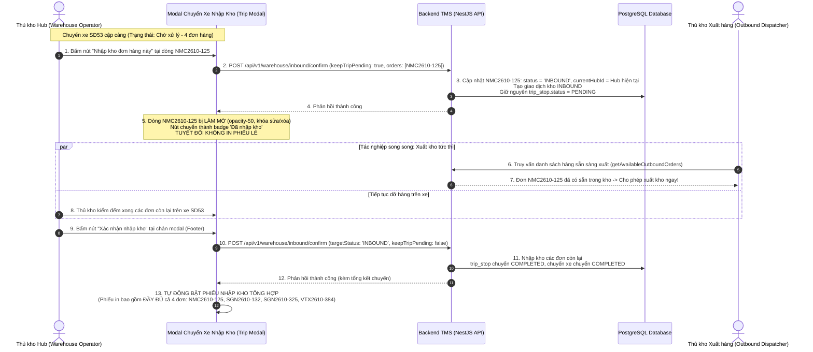

# Feedback 16/10 — Task 87: Tính Năng Nhập Kho Tách Lẻ Từng Đơn Trong Trip Chờ Xử Lý & Xuất Kho Tức Thì

> **Thời gian ghi nhận**: 16/10/2026  
> **Người báo cáo**: Quản lý Vận hành TMS (@Thai) & Team Lead Nghiệp vụ TMS (`/leader`)  
> **Phạm vi tác động**:  
> - Quản lý Nhập kho (`/warehouse/inbound`) ➔ Chi tiết Chuyến xe Nhập kho Chờ xử lý ([`WarehouseTripDetailModal`](file:///home/runner/work/logistics-website/logistics-website/frontend/src/features/warehouse/components/warehouse-trip-detail-modal.tsx))  
> - Bảng kê chỉnh sửa dòng hàng kho vận ([`WarehouseEditableGrid`](file:///home/runner/work/logistics-website/logistics-website/frontend/src/features/warehouse/components/warehouse-editable-grid.tsx))  
> - In Phiếu Nhập Kho A4 ([`WarehouseInboundReceiptModal`](file:///home/runner/work/logistics-website/logistics-website/frontend/src/features/warehouse/components/warehouse-inbound-receipt-modal.tsx) & API `inbound/receipt-data`)  
> - Quản lý Xuất kho (`/warehouse/outbound` & [`getAvailableOutboundOrders`](file:///home/runner/work/logistics-website/logistics-website/backend/src/orders/warehouse.service.ts))  
> - Backend API Tiếp nhận Kho & Sổ cái Tồn kho ([`WarehouseService.confirmInbound`](file:///home/runner/work/logistics-website/logistics-website/backend/src/orders/warehouse.service.ts))  
> **Tài liệu tham chiếu**:  
> - `/leader` Business Domain Architecture ([`SKILL.md`](file:///home/runner/work/logistics-website/logistics-website/.agents/skills/leader/SKILL.md))  
> - Quy chế phát triển hệ thống [`AGENTS.md`](file:///home/runner/work/logistics-website/logistics-website/AGENTS.md)  
> - Quy chuẩn giao diện hẹp [`.agents/rules/ui-compact-density.md`](file:///home/runner/work/logistics-website/logistics-website/.agents/rules/ui-compact-density.md) & [`ui-spacing-guard`](file:///home/runner/work/logistics-website/logistics-website/.agents/skills/ui-spacing-guard/SKILL.md)  
> - Quy chuẩn kiểm soát kiện vận tải (No-SKU, Consignment Level)  
> - Quy định về xác thực & kiểm thử phân quyền Hub ([`frontend/e2e/helpers/auth.ts`](file:///home/runner/work/logistics-website/logistics-website/frontend/e2e/helpers/auth.ts))  
> **Ảnh minh chứng đính kèm trong thư mục**:  
> - [`screenshot_01.jpg`](file:///home/runner/work/logistics-website/logistics-website/feedbacks/feedback_16_10_task_87/screenshot_01.jpg): Toàn cảnh giao diện modal tiếp nhận Chuyến xe `SD53` (Andromeda Hub - HCM, Trạng thái: `Chờ xử lý`, 4 dòng hàng: `NMC2610-125`, `SGN2610-132`, `SGN2610-325`, `VTX2610-384`). Cột THAO TÁC hiện tại đang chứa 3 nút: In tem (`IconPrinter`), Nhân bản dòng (`IconCopy`), Xóa dòng (`IconTrash`).

---

## 📌 Bối cảnh nghiệp vụ thực tế (Chốt theo phản hồi người dùng)

### 1. Phản hồi gốc từ người dùng (@Thai)
> *"tại màn hình của trip nhập kho chờ xử lý, thay thế nút nhân bản thành nút nhập kho của đơn hàng đó. Nút này cho phép thao tác nhập riêng từng đơn trong trip để có thể xuất đơn hàng đó trước khi nhập xong toàn bộ trip nhập. khi thao tác nhập riêng đơn như vậy thì không cần in phiếu nhập kho riêng từng đơn, chỉ cần làm mờ đơn hàng đó trong trip . phiếu nhập kho sẽ in khi sau khi tao tác xác nhận nhập kho và nội dung trong phiếu nhập sẽ bao gồm tất cả các đơn trong trip ( cả đơn đã nhập riêng)"*

---

### 2. Phân tích nghiệp vụ vận hành thực tế tại kho bãi (TMS Inbound & Partial Unloading Workflow)

Trong thực tế điều hành kho bãi Logistics (Kho tổng hoặc Hub trung chuyển):
1. **Tình huống dỡ xe thực tế**:
   - Một xe tải liên tỉnh hoặc xe trung chuyển (ví dụ xe `75H04848`, Chuyến xe `SD53`) cập cảng Hub với nhiều vận đơn khác nhau (tổng tải hơn 8 tấn, 153 kiện hàng).
   - Quá trình hạ tải, dỡ hàng và kiểm đếm toàn bộ một chuyến xe có thể kéo dài từ 1 đến vài tiếng.
   - Tuy nhiên, trong chuyến xe thường có những đơn hàng đặc thù:
     * **Đơn hàng giao gấp / hẹn giờ khách nhận**: Khách hàng hoặc tài xế chặng cuối (xe bo giao hàng nội thành) đã có mặt sẵn ở cửa kho chờ nhận hàng ngay.
     * **Đơn hàng Cross-docking / Sang xe cấp tốc**: Đơn hàng cần được dỡ xuống đầu tiên và bốc ngay lên một chuyến xe trung chuyển khác sắp sửa xuất bến.
2. **Nút thắt của hệ thống cũ**:
   - Nếu hệ thống bắt buộc phải kiểm đếm và bấm "Xác nhận nhập kho" toàn bộ chuyến xe thì mới ghi nhận tồn kho: Thủ kho không thể tạo phiếu xuất kho hoặc bốc đơn hàng đó lên xe giao hàng cho đến khi dỡ xong toàn bộ các đơn khác trên xe.
   - Nếu thủ kho bấm "Xác nhận nhập kho" vội vàng để xuất đơn gấp: Chuyến xe bị đóng trạng thái thành `COMPLETED` ("Đã xử lý"), làm đứt gãy quá trình kiểm đếm các đơn hàng còn lại trên xe, mất khả năng đối soát thực nhận.
   - Mặt khác, trên bảng kê chuyến xe nhập kho hiện tại đang có nút **"Nhân bản dòng" (`IconCopy`)**: Nút này vốn sinh ra cho việc nhập mới thủ công, nhưng khi áp dụng vào một chuyến xe đã có danh sách vận đơn rõ ràng thì việc "nhân bản" là hoàn toàn vô nghĩa và tiềm ẩn rủi ro nhân bản sai số lượng hàng hóa trên xe.
3. **Quy trình chuẩn hóa mới (Partial Receiving -> Immediate Outbound -> Unified Final Receipt)**:



---

### 3. Quy chuẩn nghiệp vụ & Invariant bắt buộc

1. **Thay thế nút thao tác**:
   - Tại cột "THAO TÁC" của từng dòng hàng trên màn hình chuyến xe nhập kho chờ xử lý: **Thay thế hoàn toàn nút "Nhân bản dòng" (`IconCopy`) bằng nút "Nhập kho đơn hàng này"** (`IconBuildingWarehouse` hoặc `IconPackageImport`).
   - Giữ lại nút "In tem" (`IconPrinter`) và nút "Xóa dòng" (`IconTrash` - chỉ xóa được khi đơn chưa nhập kho).
2. **Quy định về luồng dữ liệu & Trạng thái**:
   - Khi bấm "Nhập kho đơn hàng này":
     * Đơn hàng đó được chuyển trạng thái sang `INBOUND` (hoặc `IN_WAREHOUSE` tại Hub thao tác).
     * Ghi nhận giao dịch kho `InventoryTransactionType.INBOUND` cho đơn hàng đó.
     * **Bảo toàn trạng thái chuyến xe (Trip Invariant)**: Chuyến xe (`tripCode`) và trạm dừng kho hiện tại (`trip_stop`) **BẮT BUỘC VẪN GIỮ TRẠNG THÁI `PENDING` ("Chờ xử lý")**. Tuyệt đối không được chuyển chuyến xe sang `COMPLETED` khi mới chỉ dỡ một phần.
     * Đơn hàng này lập tức khả dụng trong API `getAvailableOutboundOrders` và hiển thị trên màn hình Xuất kho (`/warehouse/outbound`) để thủ kho xuất hàng ngay.
3. **Quy định về hiển thị giao diện (Dimming & State Lock)**:
   - Dòng đơn đã được nhập riêng **BẮT BUỘC phải được làm mờ** trực quan:
     * CSS styling: `opacity-50 bg-slate-50/80 dark:bg-slate-800/40`.
     * Toàn bộ ô input trên dòng đó (Tên hàng, Số kiện, Kg, $m^3$, Địa chỉ...) chuyển sang trạng thái chỉ đọc / vô hiệu hóa (`disabled` / `read-only`), ngăn chặn sửa đổi hợp đồng khi hàng đã vào kho.
     * Nút "Nhập kho đơn hàng này" chuyển sang trạng thái đã hoàn tất (biểu tượng checkmark xanh `<IconCircleCheck className="text-emerald-600" />`, tooltip: *"Đơn hàng đã nhập kho"*), vô hiệu hóa click lặp lại.
     * Nút "Xóa dòng" (`IconTrash`) bị vô hiệu hóa (`disabled`) vì đơn đã nhập kho thì không thể xóa tùy tiện khỏi bảng kê chuyến xe.
4. **Quy định về in phiếu nhập kho (No Individual Receipt - Full Final Receipt)**:
   - Khi thao tác nhập riêng từng đơn: **TUYỆT ĐỐI KHÔNG mở modal hoặc popup in phiếu nhập kho riêng cho đơn đó**.
   - Phiếu nhập kho chỉ được in khi thủ kho bấm nút **"Xác nhận nhập kho"** ở thanh điều khiển chân trang (Footer Modal) để hoàn tất toàn bộ chuyến xe.
   - Nội dung trên Phiếu Nhập Kho in ra **BẮT BUỘC PHẢI BAO GỒM TẤT CẢ CÁC ĐƠN TRONG TRIP** (bao gồm cả các đơn đã thao tác nhập riêng trước đó lẫn các đơn vừa xác nhận dỡ kho).
   - Backend API khi nhận xác nhận toàn bộ chuyến xe không được ném lỗi xung đột `UnprocessableEntityException` ("Đơn đã được nhập kho") đối với các đơn đã nhập riêng trước đó, mà phải ghi nhận thành công và tổng hợp đầy đủ vào phiếu in.

---

## 🔍 Tổng hợp các điểm chưa đúng trên giao diện cũ (đối chiếu ảnh chụp màn hình)

Đối chiếu trực tiếp với [`screenshot_01.jpg`](file:///home/runner/work/logistics-website/logistics-website/feedbacks/feedback_16_10_task_87/screenshot_01.jpg):

| Vị trí trên ảnh cũ | Hiện trạng chưa đúng | Chuẩn hóa theo phản hồi thực tế |
|---|---|---|
| **Cột THAO TÁC (Nút thứ 2)** | Đang hiển thị icon 2 ô vuông chồng nhau (`IconCopy`), tooltip `"Nhân bản dòng"`. Thao tác này copy thêm 1 dòng hàng giống hệt vào bảng kê, không có ý nghĩa khi tiếp nhận chuyến xe đã có vận đơn thực tế. | **Thay thế bằng nút Nhập kho đơn hàng** (`IconBuildingWarehouse` hoặc `IconPackageImport`). Tooltip rõ ràng: *"Nhập kho đơn hàng này (Sẵn sàng để xuất kho ngay)"*. |
| **Quy trình nhập kho cấp dòng** | Chưa có chức năng nhập kho độc lập cho từng dòng hàng. Muốn hàng vào kho thì bắt buộc phải bấm nút *"Xác nhận nhập kho"* ở chân trang, làm đóng toàn bộ chuyến xe `SD53`. | Cho phép click nhập riêng từng đơn ngay tại dòng. Đơn chuyển `INBOUND` ngay, chuyến xe `SD53` vẫn tiếp tục ở trạng thái `Chờ xử lý`. |
| **Trạng thái trực quan của dòng hàng** | Các dòng hàng hiển thị bình đẳng như nhau, không có phân biệt giữa dòng chưa nhập và dòng đã nhập kho. | Dòng đơn sau khi nhập riêng phải được **làm mờ (`opacity-50`)**, khóa ô nhập, nút thao tác đổi thành checkmark xanh *"Đã nhập kho"*, khóa nút xóa. |
| **Khả năng xuất kho tức thì** | Các đơn hàng trên xe `SD53` bị kẹt ở trạng thái của chuyến xe, màn hình Xuất kho không thể tìm thấy đơn hàng để tạo chuyến xuất tiếp theo hoặc giao cho khách. | Sau khi nhập riêng, đơn hàng lập tức có mặt trong danh sách hàng lưu kho khả dụng (`getAvailableOutboundOrders`) để xuất kho ngay. |
| **Luồng in ấn chứng từ** | Nếu bấm xác nhận dỡ hàng ở màn hình cũ, hệ thống có thể mở phiếu in phân mảnh hoặc không đồng bộ lại các đơn đã nhập lẻ. | Khi nhập riêng: **Không in phiếu**. Khi bấm "Xác nhận nhập kho" ở chân trang: Tự động in Phiếu Nhập Kho tổng hợp chứa **100% các đơn của chuyến xe**. |

---

## 📋 Danh sách công việc triển khai (Action Checklist)

### ⚙️ PHẦN I: BACKEND (NestJS 11+ & PostgreSQL TypeORM)

- [x] **Nâng cấp logic `confirmInbound` trong `WarehouseService` ([`warehouse.service.ts`](file:///home/runner/work/logistics-website/logistics-website/backend/src/orders/warehouse.service.ts))**:
  - [x] Bổ sung tham số `keepTripPending?: boolean` vào payload tiếp nhận kho.
  - [x] Khi `keepTripPending === true`:
    * Chuyển trạng thái đơn hàng chỉ định sang `INBOUND`, gán `currentHubId = hubId`, cập nhật `inboundQuantity` và `remainingQuantity`.
    * Ghi nhận bản ghi `OrderInventoryTransactionEntity` (type: `INBOUND`, ghi chú: tiếp nhận đơn lẻ từ chuyến xe).
    * **Tuyệt đối KHÔNG cập nhật `trip_stop.status = COMPLETED`**; giữ nguyên trạng thái `TripStopStatus.PENDING`.
    * **Tuyệt đối KHÔNG cập nhật `trip.status = COMPLETED`**; chuyến xe vẫn tiếp tục hoạt động dỡ hàng.
  - [x] Xử lý kịch bản hoàn tất chuyến xe (`keepTripPending === false` hoặc mặc định):
    * Kiểm tra nếu đơn hàng trong danh sách đã được tạo `txRepo` Inbound trước đó (do đã nhập riêng lẻ):
      - Bỏ qua việc tạo trùng lặp giao dịch kho hoặc không ném lỗi `UnprocessableEntityException`.
      - Vẫn lưu và gán đơn hàng vào danh sách `savedOrders` để phục vụ tổng kết phiếu in.
    * Đánh dấu `trip_stop.status = COMPLETED` và chuyển trạng thái chuyến xe sang `COMPLETED` khi tất cả các dòng hàng đã được tiếp nhận.
- [x] **Đảm bảo tính tương thích của API Xuất kho ([`getAvailableOutboundOrders`](file:///home/runner/work/logistics-website/logistics-website/backend/src/orders/warehouse.service.ts))**:
  - [x] Xác nhận đơn hàng sau khi nhập riêng có `status IN ('INBOUND', 'IN_WAREHOUSE', 'STORED', 'LUU_KHO')` và `currentHubId = currentHubId`.
  - [x] Đơn hàng lập tức được trả về trong danh sách chờ xuất mà không phụ thuộc vào trạng thái của chuyến xe nhập ban đầu (`tripCode`).
- [x] **Đảm bảo API dữ liệu in phiếu ([`getInboundReceiptData`](file:///home/runner/work/logistics-website/logistics-website/backend/src/orders/warehouse.service.ts))**:
  - [x] Khi in phiếu theo `tripCode`, gom toàn bộ các đơn hàng thuộc chuyến xe cập cảng tại Hub hiện tại, **bao gồm cả đơn đã nhập riêng trước đó lẫn đơn nhập đợt cuối**.
  - [x] Tính toán chính xác tổng số kiện, tổng trọng lượng và tổng thể tích của toàn bộ chuyến xe trên phiếu in.
- [x] **Kiểm tra biên dịch & Linting Backend**:
  - [x] Chạy `npm run lint --prefix backend` đạt 0 lỗi.
  - [x] Chạy `npm run build --prefix backend` đạt PASS.

---

### 🎨 PHẦN II: FRONTEND (Next.js 15 App Router, React 19 & Tailwind CSS)

- [x] **Nâng cấp component `WarehouseEditableGrid` ([`warehouse-editable-grid.tsx`](file:///home/runner/work/logistics-website/logistics-website/frontend/src/features/warehouse/components/warehouse-editable-grid.tsx))**:
  - [x] Mở rộng interface `WarehouseEditableGridProps`:
    * Thêm prop `isInboundTripMode?: boolean` (mặc định `false`).
    * Thêm callback `onInboundSingleOrder?: (row: WarehouseRowItem, rowIndex: number) => Promise<void> | void`.
    * Thêm state hoặc prop `loadingRowIndex?: number | null`.
  - [x] Cập nhật `TableMeta`:
    * Khai báo `isInboundTripMode?: boolean`.
    * Khai báo `onInboundSingleOrder?: (rowIndex: number) => void`.
    * Khai báo `loadingRowIndex?: number | null`.
  - [x] Cập nhật cell `ActionsCell`:
    * Khi `isInboundTripMode === true`:
      - **Thay thế nút `IconCopy` ("Nhân bản dòng") bằng nút Nhập kho**:
        * Nếu đơn **chưa nhập** (`r.status !== 'INBOUND'` và `r.status !== 'IN_WAREHOUSE'`): Render `<Button><IconBuildingWarehouse className="h-3.5 w-3.5 text-emerald-600" /></Button>` với tooltip *"Nhập kho đơn hàng này"*. Khi click gọi `meta?.onInboundSingleOrder?.(idx)`.
        * Nếu đang loading dòng này: Render `<IconLoader2 className="h-3.5 w-3.5 animate-spin text-blue-600" />`.
        * Nếu đơn **đã nhập**: Render `<Button disabled className="h-6 w-6 p-0 text-emerald-600 opacity-80 cursor-default"><IconCircleCheck className="h-3.5 w-3.5" /></Button>` với tooltip *"Đơn hàng đã nhập kho"*.
      - **Vô hiệu hóa nút xóa (`IconTrash`)** khi đơn đã được nhập kho (`disabled={r.status === 'INBOUND' || rowsCount <= 1}`).
  - [x] **Quy chuẩn làm mờ dòng hàng đã nhập kho**:
    * Trong `tbody tr`: Nếu dòng có `r.status === 'INBOUND'` hoặc `r.status === 'IN_WAREHOUSE'`:
      - Thêm class CSS: `opacity-50 bg-slate-50/80 dark:bg-slate-800/40 transition-opacity`.
      - Vô hiệu hóa chỉnh sửa các ô input (`disabled={r.status === 'INBOUND'}`).
- [x] **Nâng cấp Modal `WarehouseTripDetailModal` ([`warehouse-trip-detail-modal.tsx`](file:///home/runner/work/logistics-website/logistics-website/frontend/src/features/warehouse/components/warehouse-trip-detail-modal.tsx))**:
  - [x] Truyền các props mới vào `WarehouseEditableGrid`:
    * `isInboundTripMode={mode === 'INBOUND' && isCurrentHubPending}`.
    * `onInboundSingleOrder={handleInboundSingleOrder}`.
    * `loadingRowIndex={inboundLoadingIndex}`.
  - [x] Xây dựng hàm `handleInboundSingleOrder(row: WarehouseRowItem, rowIndex: number)`:
    * Kiểm tra hợp lệ dữ liệu dòng hàng (số kiện > 0, mã đơn hợp lệ).
    * Bật `inboundLoadingIndex = rowIndex`.
    * Gửi request `POST /api/v1/warehouse/inbound/confirm` với:
      ```json
      {
        "tripCode": tripGroup.tripCode,
        "licensePlate": licensePlate,
        "driverName": driverName,
        "receiveDate": receiveDate,
        "targetStatus": "INBOUND",
        "keepTripPending": true,
        "orders": [row]
      }
      ```
    * Khi thành công:
      - Cập nhật state nội bộ: `rows[rowIndex].status = 'INBOUND'`.
      - **TUYỆT ĐỐI KHÔNG GỌI `onOpenReceipt`** (không in phiếu nhập kho lẻ).
      - Hiển thị Toast thông báo: `toast.success("Đã nhập kho đơn hàng " + row.orderCode + " thành công! Sẵn sàng xuất kho.")`.
      - Invalidate TanStack query cache: `['warehouse', 'inbound-trips']`, `['warehouse', 'available-outbound-orders']`, `['warehouse', 'outbound-trips']`, `['warehouse', 'kpi']`.
  - [x] Hoàn thiện hàm `handleConfirmInbound` (Nút "Xác nhận nhập kho" ở Footer):
    * Gửi request xác nhận tất cả các dòng còn lại với `keepTripPending: false`.
    * Sau khi thành công:
      - Đánh dấu chuyến xe `COMPLETED`.
      - **TỰ ĐỘNG GỌI `onOpenReceipt(updatedTripGroup)`**: Mở modal In Phiếu Nhập Kho chứa đầy đủ toàn bộ các đơn hàng trong chuyến xe (cả đơn đã nhập lẻ trước đó lẫn đơn vừa nhập).
- [x] **Tuân thủ nghiêm ngặt Quy chuẩn giao diện hẹp (UI Compact Density Mandate)**:
  - [x] Card padding: giữ nguyên `p-1`, Modal Body `p-2`.
  - [x] Table row padding: `py-1 px-1.5`, typography `text-[10px]`, mã đơn `text-[11px] font-mono font-bold`.
  - [x] Không sinh các class bị cấm (`p-4`, `space-y-3`, `gap-4`).
  - [x] Zero redundant icons: Triệt tiêu mọi icon/ký tự trùng lặp trong nhãn nút.

---

### 🧪 PHẦN III: KẾ HOẠCH KIỂM THỬ & NGHIỆM THU (TESTING & VERIFICATION PLAN)

- [x] **Kiểm tra biên dịch & Linting toàn dự án**:
  - [x] `npm run lint --prefix backend` & `npm run build --prefix backend` PASS (0 errors).
  - [x] `npm run build --prefix frontend` PASS (Turbopack compile PASS, 0 type errors).
- [x] **Kịch bản kiểm thử nghiệp vụ thực tế (Manual & E2E Verification)**:
  - [x] **Kịch bản 1: Nhập riêng 1 đơn trong chuyến xe chờ xử lý**:
    1. Đăng nhập tài khoản thủ kho HCM (`USER_WAREHOUSE_HCM` / `warehouse_hcm`).
    2. Mở chuyến xe nhập kho `SD53` (Andromeda Hub - HCM, trạng thái `Chờ xử lý`).
    3. Quan sát cột THAO TÁC: Xác nhận nút thứ 2 đã là nút "Nhập kho đơn hàng", nút "Nhân bản dòng" không còn xuất hiện.
    4. Bấm nút "Nhập kho" tại dòng đơn hàng `NMC2610-125`.
    5. Kỳ vọng:
       * Hệ thống hiển thị toast thành công.
       * Dòng đơn hàng `NMC2610-125` bị **làm mờ (`opacity-50`)**, các ô nhập liệu bị khóa.
       * Nút thao tác chuyển thành biểu tượng checkmark xanh *"Đã nhập kho"*.
       * Nút xóa dòng bị vô hiệu hóa.
       * **KHÔNG CÓ bất kỳ popup in phiếu nhập kho nào xuất hiện**.
       * Chuyến xe `SD53` trên danh sách ngoài bảng vẫn hiển thị trạng thái `Chờ xử lý`.
  - [x] **Kịch bản 2: Xuất kho tức thì cho đơn hàng vừa nhập riêng**:
    1. Chuyển sang màn hình Quản lý Xuất kho (`/warehouse/outbound`).
    2. Mở giao diện tạo chuyến xe xuất mới hoặc gán đơn hàng xuất.
    3. Kỳ vọng:
       * Đơn hàng `NMC2610-125` đã xuất hiện trong danh sách hàng lưu kho sẵn sàng xuất của Andromeda Hub.
       * Cho phép chọn đơn `NMC2610-125` để xuất kho ngay lập tức cho khách hoặc gán lên xe trung chuyển mới.
  - [x] **Kịch bản 3: Xác nhận nhập kho toàn bộ chuyến xe & In phiếu tổng hợp**:
    1. Quay lại màn hình Nhập kho, mở lại chuyến xe `SD53`.
    2. Dòng `NMC2610-125` vẫn hiển thị ở trạng thái đã nhập kho (làm mờ).
    3. Bấm nút **"Xác nhận nhập kho"** ở chân modal để hoàn tất các đơn còn lại (`SGN2610-132`, `SGN2610-325`, `VTX2610-384`).
    4. Kỳ vọng:
       * Chuyến xe chuyển trạng thái thành `COMPLETED` ("Đã xử lý").
       * Modal Phiếu Nhập Kho A4 tự động bật lên.
       * Bảng kê trên Phiếu Nhập Kho **chứa đầy đủ cả 4 đơn hàng** (kể cả đơn `NMC2610-125` đã nhập riêng trước đó).
       * Tổng kiện, tổng tải trên phiếu khớp chính xác 100% với dữ liệu chuyến xe.
