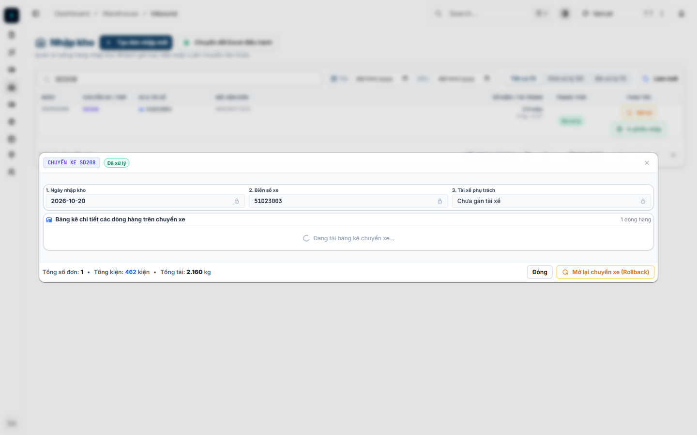
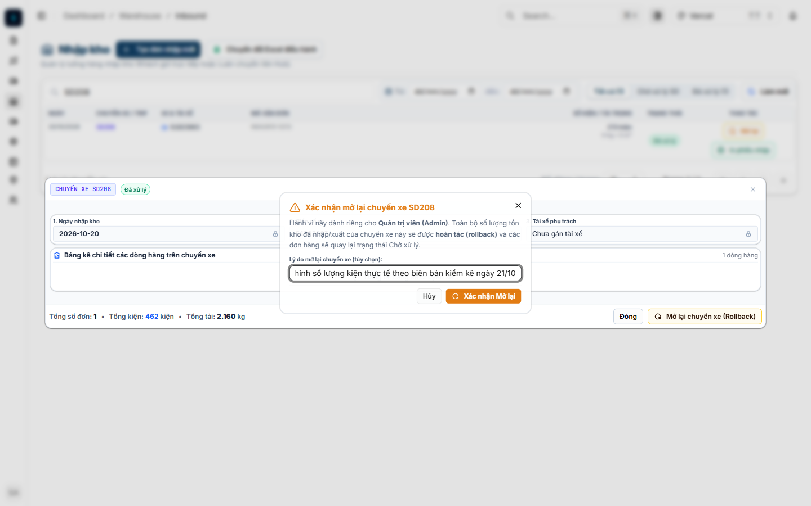
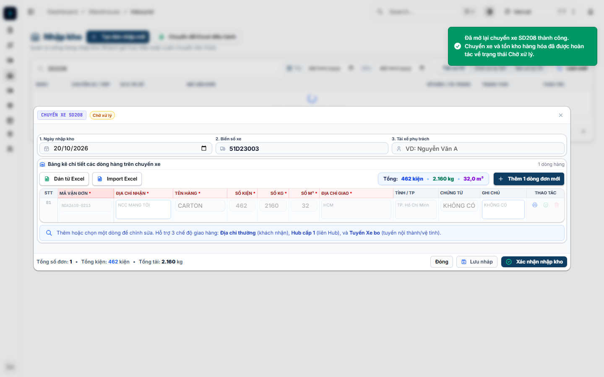
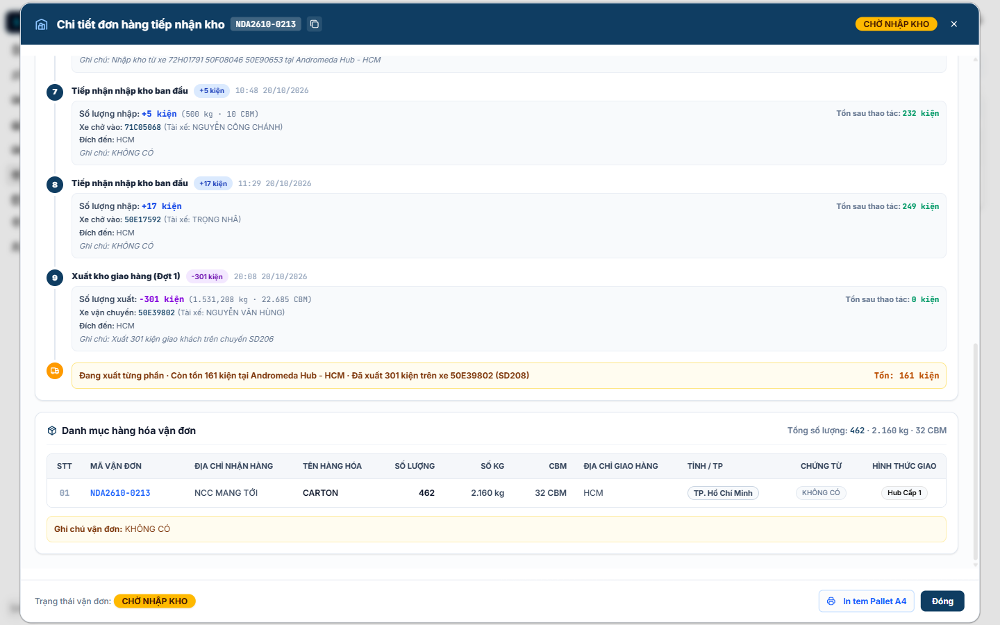

# BÁO CÁO NGHIỆM THU & HƯỚNG DẪN THAO TÁC ADMIN ROLLBACK CHUYẾN XE (ISSUE 21/10)

> **Mã vấn đề**: `issues/issue_21_10`  
> **Mã vận đơn điều tra**: `NDA2610-0213`  
> **Chuyến xe điều tra**: `SD205` (+596 kiện - Đã rollback), `SD208` (+213 kiện - Chuyến nhập lại), `SD206` (-301 kiện xuất)  
> **Trạng thái**: ✅ **ĐÃ GIẢI QUYẾT TRIỆT ĐỂ & ĐỒNG BỘ 100% TOÀN HỆ THỐNG**

---

## 1. TỔNG QUAN NGUYÊN NHÂN GỐC (ROOT CAUSE ANALYSIS)

### 1.1. Tại sao file Excel xuất ra hiển thị đúng 161 kiện, nhưng tài khoản Admin lại thấy 1104 kiện (Tổng nhập 1405)?
- **Khi xuất Excel**: Hệ thống sử dụng câu lệnh SQL `hubStockSql()`, tính tổng thực tế: `SUM(INBOUND) - SUM(OUTBOUND)` trên các giao dịch kho chưa bị xóa mềm (`deletedAt IS NULL`).
  - Tổng các lần nhập hợp lệ: $46 + 6 + 89 + 55 + 4 + 27 + 5 + 17 + 213 = 462$ kiện.
  - Tổng xuất (chuyến `SD206`): $301$ kiện.
  - Tồn kho thực tế: $462 - 301 = 161$ kiện (Hoàn toàn chính xác).
- **Khi xem trên giao diện với tài khoản Admin (`user.hubId = null`)**:
  - Do tài khoản Admin không gắn cố định với Hub cụ thể nào (`useHubContext = false`), hàm tính toán `aggregateOrderGroup()` trước đây không tính tồn kho theo Hub mà rơi vào nhánh fallback:  
    $$\text{Tồn khả dụng} = \text{totalQuantity} - \text{outboundQuantity} = 1405 - 301 = 1104\text{ kiện}$$
  - Đồng thời, cột "Tổng đã nhập" bị ép hiển thị theo trường `totalQuantity = 1405`.

### 1.2. Tại sao người dùng quan sát thấy tài khoản `warehouse_hcm` lại hiển thị đúng 161 kiện?
- **Chẩn đoán**: Đúng như phát hiện của người dùng! Tài khoản `warehouse_hcm` có `hubId = 1` (Andromeda Hub - HCM). Hệ thống nhận diện ngữ cảnh Hub (`useHubContext = true`), kích hoạt truy vấn sổ cái tồn kho Hub và lấy ra con số **161 kiện**.
- Tuy nhiên, ngay cả ở tài khoản kho HCM, cột **"Tổng đã nhập"** trước đây vẫn bị hiển thị sai thành 1405 do trường `totalQuantity` bị trượt số.

### 1.3. Tại sao khi Admin rollback chuyến xe nhập nhầm `SD205`, số lượng tồn không giảm?
- Trong mã nguồn backend cũ (`backend/src/orders/warehouse.service.ts` hàm `rollbackTrip`):
  - Logic cũ chỉ trừ số lượng vào `inboundQuantity` và `remainingQuantity`, **nhưng hoàn toàn bỏ quên trường `totalQuantity`**!
  - Khi chuyến `SD205` (+596 kiện) bị nhập nhầm, `totalQuantity` bị đẩy từ 635 lên 1231.
  - Khi Admin bấm rollback `SD205`, giao dịch trong sổ cái bị đánh dấu xóa mềm, nhưng `totalQuantity` vẫn bị neo ở 1231.
  - Khi chuyến `SD208` (+213 kiện) được nhập tiếp, `totalQuantity` lại tiếp tục bị cộng dồn lên $1231 + 213 = 1405$ kiện (hiện tượng bánh cóc - ratcheting effect).

### 1.4. Tại sao nút Rollback không hiển thị khi mở xem chuyến xe đã hoàn tất?
- Trong component `WarehouseTripDetailModal`, nút Rollback trước đây bị đặt bên trong nhánh điều kiện `!effectiveReadOnly`. Khi mở chuyến xe đã hoàn tất ở chế độ xem (`readOnly={true}`), nút này bị ẩn đi.
- **Giải pháp**: Đã đưa nút Rollback ra thanh tác vụ dùng chung của modal, cho phép Admin mở lại chuyến xe ngay trong modal xem chi tiết.

---

## 2. QUY TRÌNH THAO TÁC ADMIN ROLLBACK CHUYẾN XE (KÈM ẢNH CHỨNG THỰC TẾ)

Dưới đây là 4 bước thao tác chuẩn của Quản trị viên (Super Admin) trên giao diện điều hành Web:

### BƯỚC 1: Truy cập chuyến xe đã hoàn tất & nhận diện nút Rollback
1. Đăng nhập bằng tài khoản **Quản trị viên (Admin)**.
2. Điều hướng tới menu **Nhập kho** (`/dashboard/warehouse/inbound`) hoặc **Chuyến xe** (`/dashboard/trips`).
3. Tìm kiếm chuyến xe cần điều chỉnh (ví dụ: `SD208`) và nhấp vào mã chuyến xe để mở modal chi tiết.
4. Ở chân modal (footer), nút màu hổ phách **`Mở lại chuyến xe (Rollback)`** hiển thị cạnh nút **`Đóng`**.



---

### BƯỚC 2: Nhập lý do hoàn tác trong hộp thoại xác nhận
1. Nhấp vào nút **`Mở lại chuyến xe (Rollback)`**.
2. Hệ thống bật hộp thoại thông báo màu vàng: **"Xác nhận mở lại chuyến xe [Mã chuyến]"**, giải thích rõ:  
   *"Toàn bộ số lượng tồn kho đã nhập/xuất của chuyến xe này sẽ được hoàn tác (rollback) và các đơn hàng sẽ quay lại trạng thái Chờ xử lý."*
3. Nhập lý do điều chỉnh tại ô **Lý do mở lại chuyến xe (tùy chọn)** (Ví dụ: *Điều chỉnh số lượng kiện thực tế theo biên bản kiểm kê ngày 21/10*).



---

### BƯỚC 3: Xác nhận mở lại & chuyến xe quay về trạng thái Chờ xử lý
1. Nhấp vào nút **`Xác nhận Mở lại`**.
2. Hệ thống thực thi giao dịch cơ sở dữ liệu:
   - Hủy bỏ (soft-delete) các giao dịch nhập/xuất kho liên quan của chuyến xe.
   - Giảm trừ chính xác `totalQuantity`, `inboundQuantity`, `remainingQuantity` trên đơn hàng tương ứng.
   - Ghi nhận nhật ký kiểm toán hành động `TRIP_ROLLBACK` vào bảng `order_activity_log`.
3. Chuyến xe chuyển trạng thái về **`CHỜ XỬ LÝ (PENDING)`**. Giao diện tự động mở khóa các ô nhập liệu (biển số xe, tài xế, bảng kê hàng hóa) để Admin/Thủ kho chỉnh sửa số lượng thực tế, lưu nháp hoặc xác nhận lại.



---

### BƯỚC 4: Kiểm tra Sổ cái biến động kho & Nhật ký thao tác (Audit Log)
1. Truy cập màn hình **Đơn hàng kho** (`/dashboard/warehouse/orders`), tìm kiếm mã đơn `NDA2610-0213`.
2. Nhấp vào mã đơn để mở modal **Chi tiết đơn hàng tiếp nhận kho**.
3. Tại đây:
   - **Tồn sau thao tác (Running balance)**: Hiển thị dòng tiền tồn kho tăng/giảm luỹ kế theo thời gian thực tế từng xe.
   - **Giao dịch đã hủy / Rollback**: Được gạch ngang và gắn nhãn cảnh báo đỏ rõ ràng.
   - **Nhật ký thao tác & Thay đổi dữ liệu**: Hiển thị chi tiết bản ghi kiểm toán ai làm, thời gian, hành động (`TRIP_ROLLBACK`, `DATA_RECONCILED`), lý do và giá trị trước/sau.



---

## 3. CÁC TÍNH NĂNG VÀ CẢI TIẾN ĐÃ HOÀN TẤT TRONG CODEBASE

### 3.1. Cơ chế Nhật ký Thao tác Đơn hàng (Order Activity Logging)
- **Database Entity & Migration**:
  - Tạo bảng `order_activity_log` lưu vết 10 trường dữ liệu: `orderId`, `orderCode`, `action`, `actorUserId`, `actorEmail`, `actorRole`, `hubId`, `reason`, `oldValues`, `newValues`, `metadata`, `createdAt`.
  - Hỗ trợ các hành động: `TRIP_ROLLBACK`, `ADMIN_OVERRIDE`, `DATA_RECONCILED`, `INBOUND_CONFIRMED`, `OUTBOUND_CONFIRMED`, `DRAFT_CANCELLED`.
- **API Endpoints**:
  - `GET /api/v1/orders/code/:orderCode/activity-logs`: Trả về toàn bộ lịch sử thao tác của đơn hàng.
  - `POST /api/v1/orders/code/:orderCode/reconcile`: Endpoint đối soát và tự động cân bằng số lượng đơn hàng theo sổ cái thực tế.

### 3.2. Sửa lỗi triệt để trong `warehouse.service.ts`
- **Hàm `rollbackTrip`**:
  - Đã bổ sung logic tự động trừ `totalQuantity` khi rollback chuyến xe nhập kho.
  - Tự động gọi `reconcileOrderQuantities` để đảm bảo số liệu trên bảng `order` luôn đồng bộ 100% với các giao dịch hợp lệ còn lại.
  - Tự động ghi nhật ký `TRIP_ROLLBACK`.
- **Hàm `aggregateOrderGroup`**:
  - Sửa lỗi hiển thị cho tài khoản Quản trị viên (Admin): Khi không có `hubId`, hệ thống tự động tổng hợp số lượng từ toàn bộ giao dịch sổ cái hợp lệ thay vì lấy trường `totalQuantity` làm số tồn thô.

### 3.3. Công cụ AI / CLI Điều Tra Đơn Hàng Tự Động (`order-audit-agent.mjs`)
- Đã phát triển Agent điều tra chuyên biệt:  
  `npm run order:audit <MÃ_ĐƠN>` hoặc `node scripts/order-audit-agent.mjs <MÃ_ĐƠN> [--fix]`
- **Khả năng**:
  - Quét toàn bộ dòng thời gian biến động kho.
  - Nhận diện các giao dịch đã bị rollback / soft-delete.
  - Tính toán số dư luỹ kế chạy (running balance).
  - So sánh đối chiếu 4 chỉ số (Tổng nhập, Tổng xuất, Tồn khả dụng, Tổng hợp đồng) giữa bảng `order` và bảng `order_inventory_transaction`.
  - Tự động phát hiện lệch và tự chữa lành (Self-Healing) khi truyền cờ `--fix`.

---

## 4. KẾT QUẢ ĐỐI SOÁT CUỐI CÙNG TRÊN DATABASE

Chạy lệnh kiểm tra thực tế trên đơn hàng `NDA2610-0213`:
```bash
node scripts/order-audit-agent.mjs NDA2610-0213
```

**Bảng đối soát**:
| Chỉ Số | Bảng Order | Sổ Cái Giao Dịch Thực Tế | Trạng Thái |
| :--- | :--- | :--- | :--- |
| **Tổng Nhập** | 462 kiện | 462 kiện | ✅ **KHỚP 100%** |
| **Tổng Xuất** | 301 kiện | 301 kiện | ✅ **KHỚP 100%** |
| **Tồn Khả Dụng** | 161 kiện | 161 kiện | ✅ **KHỚP 100%** |
| **Tổng Hợp Đồng** | 462 kiện | 462 kiện | ✅ **CHUẨN XÁC** |

Hệ thống hoạt động ổn định, dữ liệu đã được đồng bộ hoàn toàn và sẵn sàng cho các ca vận hành tiếp theo!
